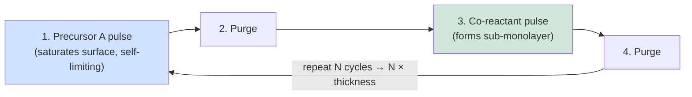
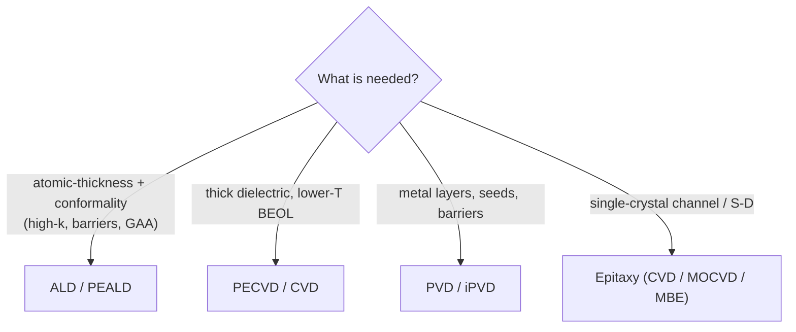

# Thin Film Deposition — CVD, ALD, PVD, Epitaxy

Deposition is the family of processes that *add* material to the wafer — building up the dielectrics, conductors, barriers, and channels from which transistors and interconnects are constructed. Together with etch and lithography, deposition is one of the three pillars of wafer processing, and it represents roughly a fifth to a quarter of total wafer-fab-equipment spending. A modern logic chip contains scores of distinct deposited films, ranging from sub-nanometer ALD high-k gate dielectrics to micron-thick metallization, each requiring precise control of thickness, composition, conformality, stress, and purity. This file surveys the major deposition families — CVD, ALD, PVD, and epitaxy — together with the emerging materials, the vendor landscape, the patent picture, and the node-by-node deposition challenges driving the transition from FinFET to GAA to CFET.

---

## 📊 Visual Overview

*Original schematics; Mermaid diagrams render natively on GitHub.*

**The ALD cycle — self-limiting, one sub-monolayer per cycle**



**Choosing a deposition method**



**Why ALD is unique — conformality in a high-aspect-ratio feature (cross-section)**

```
   ▓▓▓▓▓▓▓▓▓▓▓▓▓▓   ← ALD film: equal thickness on top,
   ▓░░░░░░░░░░░░▓      sidewall, and bottom (AR > 50:1 OK)
   ▓░          ░▓
   ▓░  trench  ░▓     PVD/CVD would thin or pinch off here;
   ▓░          ░▓     ALD's surface-saturating reaction does not.
   ▓░░░░░░░░░░░░▓
   ▓▓▓▓▓▓▓▓▓▓▓▓▓▓
```

---

## 1. Chemical Vapor Deposition (CVD)

In chemical vapor deposition, gaseous precursors react at or near the wafer surface to deposit a solid film, with volatile byproducts pumped away. CVD is the most versatile and widely used deposition method, and it exists in numerous variants distinguished by pressure, energy source, and temperature, each trading off film quality, conformality, throughput, and thermal budget.

**LPCVD (Low-Pressure CVD)** operates at reduced pressure (typically 0.1–1 Torr) and elevated temperature (600–800°C), often in large batch furnaces processing 50–150 wafers at once. The low pressure improves uniformity and conformality by increasing the mean free path of reactants. LPCVD produces high-quality polysilicon (for gates and 3D NAND channels), silicon nitride (Si₃N₄, for hard masks and spacers), and TEOS-based silicon dioxide. Its high temperature limits it to early FEOL steps before metal is present.

**APCVD (Atmospheric Pressure CVD)** runs at atmospheric pressure for high throughput on relatively non-critical films (e.g., doped oxides, passivation). Conformality and uniformity are poorer, so its modern role is limited.

**PECVD (Plasma-Enhanced CVD)** uses an RF plasma to supply reaction energy, enabling deposition at much lower temperatures (200–400°C). This makes PECVD indispensable for **BEOL** processing, where the underlying copper interconnects impose a strict thermal budget (typically ≤400°C). PECVD deposits the bulk of interlayer dielectrics (SiO₂, SiN, SiCN, SiOCH low-k), passivation layers, and hardmasks. The plasma allows tuning of film stress, density, and composition.

**HDP-CVD (High-Density Plasma CVD)** combines deposition and simultaneous sputter-etch (via biased high-density plasma) to achieve **void-free gap-fill** in high-aspect-ratio trenches — historically the workhorse for STI and pre-metal dielectric fill. As aspect ratios climbed, HDP-CVD increasingly ceded ground to flowable CVD and ALD.

**Flowable CVD (FCVD)** deposits a flowable, liquid-like film that wicks into the narrowest gaps before being cured into solid oxide — solving the void-free gap-fill problem for the extreme aspect ratios of advanced STI and the gaps between fins and nanosheets.

The central trade-off across all CVD variants is **thermal budget versus film quality**: hotter processes generally yield denser, purer films but cannot be used after temperature-sensitive structures (metal, strained junctions) are in place. This constraint becomes more acute at every node and is a primary driver of the shift toward lower-temperature ALD and plasma-assisted methods.

---

## 2. Atomic Layer Deposition (ALD)

Atomic layer deposition is arguably the most important deposition advance of the last two decades and the enabling technology for high-k/metal gate, FinFET, GAA, 3D NAND, and DRAM capacitors. ALD builds films **one atomic layer at a time** through a sequence of **self-limiting surface reactions**.

A single ALD cycle consists of: (1) a pulse of precursor A, which chemisorbs on the surface until all reactive sites are saturated and then stops (self-limiting); (2) a purge to remove excess A; (3) a pulse of co-reactant B, which reacts with the chemisorbed A to form a sub-monolayer of the desired film and regenerate surface sites; (4) another purge. Each cycle adds a precisely fixed, sub-monolayer increment, so total thickness is controlled simply by counting cycles. Because the reactions are surface-saturating rather than flux-limited, ALD achieves **near-perfect conformality** even in structures with aspect ratios exceeding 50:1 — exactly what is needed to coat the sidewalls of deep DRAM capacitors, 3D NAND channels, and the wrapped channels of GAA nanosheets.

**Thermal ALD** relies purely on temperature to drive the surface chemistry, giving the best conformality and lowest damage. **Plasma-Enhanced ALD (PEALD)** uses a plasma co-reactant (e.g., oxygen or nitrogen radicals) to enable lower-temperature deposition and access films difficult to form thermally, at some cost to conformality in the deepest features.

Key ALD films and their roles:
- **HfO₂ and ZrO₂** — high-k gate dielectrics (logic) and capacitor dielectrics (DRAM, typically a ZrO₂/Al₂O₃/ZrO₂ "ZAZ" stack).
- **Al₂O₃** — interfacial layers, passivation, and etch-stop/encapsulation.
- **TiN** — metal-gate work-function and electrode layers, and diffusion barriers.
- **Ru and Co** — emerging BEOL metals and liners (see below).
- **MoS₂ and other 2D materials** — channel materials in research (File 23).

Two frontier ALD modes are reshaping integration:
- **Spatial ALD** physically separates the precursor zones rather than separating them in time, moving the wafer between zones to dramatically increase throughput — important for high-volume applications.
- **Area-Selective Deposition (ASD / selective ALD)** exploits surface chemistry so that film grows only on certain materials (e.g., on metal but not dielectric), using inhibitor molecules (self-assembled monolayers) to block growth where it is not wanted. ASD promises **self-aligned** structures that relax overlay requirements — for example, growing a via cap only on exposed metal — and is one of the most actively researched deposition techniques for sub-3nm nodes.

---

## 3. Physical Vapor Deposition (PVD)

In physical vapor deposition, material is physically ejected from a solid target and condenses on the wafer, with no chemical reaction required (or only reactive-gas-assisted). PVD is the method of choice for metals.

**DC magnetron sputtering** bombards a metal target with argon ions; magnets confine the plasma near the target to increase sputter rate. It deposits aluminum, titanium, tantalum, and copper seed layers. **RF sputtering** extends PVD to insulating targets.

**Ionized PVD (iPVD)** ionizes the sputtered metal flux so that wafer bias can direct it into the bottoms of high-aspect-ratio features — essential for depositing thin, continuous **barrier (TaN/Ta)** and **copper seed** layers at the bottom and sidewalls of damascene vias and trenches before electroplating. PVD also forms **NiPt** layers for silicide and various work-function and capping metals.

PVD's limitation is conformality: as features shrink and aspect ratios rise, even iPVD struggles to coat sidewalls and bottoms uniformly, which is one reason ALD has displaced PVD for the thinnest barrier and liner layers at the leading edge. Nonetheless PVD remains indispensable for seed metals, electrodes, and the thick metallization of upper interconnect and packaging.

---

## 4. Epitaxy

Epitaxy grows a **single-crystal** film in registry with the underlying crystal lattice — the most demanding form of deposition, requiring atomically clean surfaces and precise temperature control.

**Silicon and SiGe/Ge CVD epitaxy** is central to modern transistors. **Selective epitaxial growth (SEG)** deposits SiGe (boron-doped, for pMOS) or Si:P (phosphorus-doped, for nMOS) only in the recessed source/drain regions, applying strain that boosts carrier mobility and providing low-resistance, in-situ-doped junctions. Facet control during SEG governs the final S/D shape and stress. For **GAA**, epitaxy grows the alternating **SiGe/Si superlattice** (typically 25–35% Ge in the sacrificial SiGe, with sheets a few nanometers thick) from which the nanosheet channels are later released — making epitaxy one of the defining GAA enabling steps.

**MBE (Molecular Beam Epitaxy)** uses ultra-high-vacuum thermal evaporation for the highest-purity, atomically abrupt films; it is a research and III-V/specialty tool, not a mainstream HVM logic method, because of low throughput.

**MOCVD (Metal-Organic CVD)** grows compound-semiconductor epitaxy (GaN, SiC, InP, GaAs and their alloys) for power, RF, and photonic devices, and is the leading method for wafer-scale 2D-material (MoS₂) deposition research. (Files 12 and 23 cover compound and 2D epitaxy in depth.)

---

## 5. Emerging Deposition Frontiers

Several deposition challenges define the leading edge:

- **Ru and Mo BEOL metals:** as copper's effective resistivity rises at sub-10nm pitches and its barrier consumes too much wire cross-section, the lower interconnect layers are transitioning to **ruthenium** (ALD from precursors such as Ru(DMBD)(CO)₃) and **molybdenum** (CVD/ALD from MoCl₅ or MoF₆ chemistries), which can be used with little or no barrier. This is one of the most consequential materials transitions in BEOL since copper itself. Molybdenum crossed into volume production first in 3D NAND word lines (via ALD replacing tungsten) during 2025, and is now being adopted for logic contacts and vias at the 2nm–1.4nm-class generations; ruthenium for the tightest BEOL pitches remains in development and qualification (see the 2025–2026 update below).
- **High-aspect-ratio (HAR) tungsten fill** for 3D NAND word lines and DRAM buried word lines, where CVD tungsten must fill features tens of layers deep without voids or seams.
- **2D-material deposition** (MoS₂, WS₂) by MOCVD and ALD for future channel materials, where grain size, defect density, and 300mm uniformity remain unsolved (File 23).
- **Selective and self-aligned deposition** (ASD), enabling via caps, barrier-selective fills, and self-aligned structures that relax lithographic overlay.

---

## 6. Vendor Landscape

| Vendor | Deposition strengths |
|---|---|
| **Lam Research** | Strong in PECVD/ALD dielectrics (VECTOR, Striker), tungsten and metal fill (ALTUS), and gap-fill; launched ALTUS Halo molybdenum ALD in February 2025, now in production at 3D NAND makers; tightly coupled to its etch dominance for integrated module flows. |
| **Applied Materials (AMAT)** | The broadest deposition portfolio: PVD (Endura, the PVD leader), CVD (Producer), ALD, epitaxy (Centura/Epi, including the Centura Xtera GAA epi system launched in October 2025), and selective deposition; market-share leader in deposition overall. Agreed in May 2026 to acquire ASMPT's NEXX advanced-packaging deposition/ECD business (reported). |
| **ASM International** | The **ALD leader**, especially for high-k and gate-stack ALD and epitaxy (Intrepid/Epsilon); ALD is core to its identity and its strong margins. |
| **Tokyo Electron (TEL)** | Strong in CVD, ALD, and coat/develop; broad presence across deposition and clean. |
| **Kokusai Electric** | Leader in **batch (furnace) ALD/CVD**, important for memory (3D NAND ONON stacks, DRAM); spun out of Hitachi and owned by KKR after Applied's planned acquisition collapsed in 2021; listed in Tokyo since October 2023, with KKR (and reportedly Applied, a minority holder) since selling down their stakes. |
| **Jusung Engineering, Wonik IPS (Korea)** | Domestic ALD/CVD suppliers serving Samsung and SK Hynix. |
| **NAURA, Piotech (China)** | NAURA is the fast-growing Chinese deposition, thermal (and etch) supplier, and Piotech the leading domestic PECVD/ALD specialist — both central to China's localization drive, under which domestic tools reportedly made up ~35% of equipment used in Chinese fabs in 2025. |

---

## 7. Patent Landscape

The foundational ALD patents trace to **Tuomo Suntola** (Finland), who invented "atomic layer epitaxy" in the 1970s; ASM International built much of its ALD leadership on a strong patent position. Applied Materials and Lam hold extensive deposition IP across PVD, CVD, gap-fill, and ALD reactor design and chemistries. A particularly active modern area is **selective/area-selective deposition**, where ASM, Applied, Lam, and TEL are all building patent portfolios around inhibitor chemistries and self-aligned schemes, recognizing that ASD is likely to be a key differentiator at sub-3nm nodes. Precursor chemistry (the metal-organic compounds enabling new ALD films) is a parallel IP battleground involving chemical suppliers such as Merck/EMD, Entegris, and Air Liquide.

---

## 8. Node-by-Node Deposition Challenges

**FinFET era (22nm–5nm):** deposition challenges centered on conformal high-k/metal-gate ALD wrapping three sides of the fin, void-free gap-fill between increasingly tall, narrow fins (driving the move to flowable CVD and ALD), conformal SiGe S/D epitaxy with facet control, and the introduction of cobalt for lower-metal fill at N7 to combat copper's gap-fill and electromigration limits.

**GAA nanosheet era (3nm–2nm):** the defining deposition challenges are the **SiGe/Si superlattice epitaxy** (precise Ge concentration and layer-thickness control over multiple stacked pairs), **inner-spacer ALD** (filling a few-nanometer lateral cavity with a low-k dielectric after selectively recessing the SiGe — the signature GAA process), and **gate-stack ALD inside the released nanosheet gaps** (depositing high-k and work-function metals into channels separated by only a few nanometers, demanding flawless gap-fill conformality). In parallel, **Mo metallization** has entered production (first in 3D NAND word lines, then logic contacts/vias), while **Ru BEOL metallization** for the lowest interconnect layers is still being qualified. This is the era now in high-volume manufacturing: TSMC N2 (since Q4 2025), Intel 18A and Samsung SF2.

**CFET era (research; imec's 2026 roadmap reportedly places CFET around the A7, 0.7nm-class generation, i.e. well beyond 2027):** deposition complexity roughly doubles. The dual-tier nanosheet stack requires independent gate-metal deposition for the bottom and top tiers, self-aligned dielectric isolation between them, ALD gap-fill at openings below 3nm, and — for sequential CFET — low-temperature (<400°C) high-quality dielectric deposition compatible with an already-bonded bottom tier. Selective and area-selective deposition becomes increasingly central to enabling self-aligned structures that lithography alone cannot resolve.

Across all these transitions, the unifying theme is the relentless demand for **atomic-scale thickness control, perfect conformality in ever-deeper features, lower thermal budgets, and selective (self-aligned) deposition** — requirements that have made ALD and its selective variants the fastest-growing and most strategically important corner of the deposition world.

---

## Extended Analysis: ALD's Ascendancy, Selective Deposition, and the Materials Frontier

### A. Why ALD Became the Defining Deposition Technology

Of all the deposition methods, **ALD has risen fastest in importance**, and the reasons illuminate the broader direction of the industry. ALD's defining property — **self-limiting, surface-saturating reactions that deposit a precise sub-monolayer per cycle** — gives it two capabilities no other method matches: **angstrom-level thickness control** (set simply by counting cycles) and **near-perfect conformality** (the reactions saturate every surface equally, regardless of geometry). These are exactly the capabilities the leading edge demands. High-k/metal-gate dielectrics must be a few atomic layers thick and uniform — ALD. FinFET gate stacks must conformally wrap three-dimensional fins — ALD. DRAM capacitors and 3D NAND structures must be coated conformally at aspect ratios above 50:1 — ALD. GAA inner spacers and gate fill must deposit into few-nanometer cavities and gaps — ALD. As devices became thinner, more three-dimensional, and more conformality-demanding, ALD moved from a niche to a central, fast-growing technology, and it is why **ASM International** (the ALD leader) has been one of the strongest-growing, highest-margin equipment makers. The number of ALD steps per advanced chip has risen steadily, and ALD's share of deposition spending continues to grow — a structural tailwind rooted in the same three-dimensional, atomic-scale trends that run throughout this database.

### B. Selective and Area-Selective Deposition — The Self-Aligned Future

The most important deposition frontier is **area-selective deposition (ASD)** — growing material **only where it is wanted** (e.g., on metal but not on dielectric), using surface chemistry (inhibitor molecules, self-assembled monolayers) to block growth elsewhere. The significance of ASD is profound: it enables **self-aligned structures** that relax the lithographic overlay requirement, which is one of the hardest and most expensive challenges at advanced nodes. If a via cap, a barrier, or a metal can be grown selectively on an exposed feature without needing a separate, perfectly-aligned lithography step, the process is simpler, cheaper, and more robust to overlay error. As pitches shrink below what lithography can reliably align, self-alignment via selective deposition becomes increasingly essential — which is why ASD is one of the most actively researched and patented deposition technologies (ASM, Applied, Lam, TEL all investing heavily), and why it is expected to be a key enabler at sub-3nm nodes and for CFET (File 23). Selective deposition, together with selective etch (File 05), points toward a future of **self-aligned processing** in which the structure increasingly directs its own formation, reducing reliance on the lithography that can no longer align everything.

### C. The Interconnect-Metal Transition

One of the most consequential deposition challenges is the **transition of BEOL interconnect from copper to ruthenium and molybdenum** (Files 04, 15). This is fundamentally a deposition problem: Ru and Mo must be deposited (by ALD/CVD) as thin, low-resistance, well-adhered films, ideally barrier-less (one of their key advantages over copper, which needs a non-scaling TaN barrier). Developing the precursors (Ru precursors such as Ru(DMBD)(CO)₃; Mo precursors such as MoCl₅ and MoF₆), the deposition processes (conformal fill at tiny dimensions), and the integration (with the new patterning and CMP these metals require) is a major, ongoing effort. Molybdenum has moved first — into 3D NAND word-line production in 2025 and into leading-edge logic contacts from 2026 — while ruthenium remains the longer-term candidate for the tightest-pitch lines. The payoff is lower effective resistance at the tightest pitches, where copper's resistivity penalty and barrier overhead become prohibitive. This metal transition — the most significant since copper replaced aluminum 25 years ago — places deposition at the center of one of the leading edge's defining challenges, and it exemplifies how each new material brings a corresponding deposition-development effort.

### D. The 2D-Material Deposition Challenge

Looking further ahead, the deposition of **2D channel materials** (MoS₂, WSe₂, File 23) is one of the hardest and most important frontiers. The challenge is not the device physics (favorable) but growing **wafer-scale, low-defect, uniform** 2D films — IMEC's 300mm MOCVD MoS₂ demonstration was a milestone, but grain size, defect density (sulfur vacancies), and uniformity remain far from logic-quality. Solving this is a deposition problem: developing MOCVD and ALD processes (and the reactors, from Aixtron, Veeco, ASM, Applied) that can grow these atomically-thin crystals uniformly across 300mm with low defect density. The 2D-material deposition challenge exemplifies the broader pattern: as the industry reaches for new materials to extend scaling, the **deposition of those materials** — uniformly, conformally, at scale, with the required quality — is often the gating challenge, placing the deposition-equipment makers and the precursor suppliers at the center of enabling each new frontier.

### E. The Node-by-Node Deposition Summary

The deposition challenge intensifies with each architecture transition: FinFET demanded conformal gate-stack ALD over fins and void-free gap-fill between them; GAA demands superlattice epitaxy, inner-spacer ALD in few-nanometer cavities, and gate-fill ALD in released nanosheet gaps; CFET roughly doubles the gap-fill and gate-metal complexity and demands sub-3nm-opening fill and dual-tier integration. Across all of these, the unifying demands are **atomic-scale thickness control, perfect conformality in ever-deeper and narrower features, lower thermal budgets, selective (self-aligned) deposition, and an expanding palette of new materials** — requirements that have made ALD and its selective variants the fastest-growing and most strategically important corner of deposition, and that ensure deposition remains, alongside lithography and etch, one of the three central pillars on which the leading edge depends.

---

## 🆕 2025–2026 Update: Latest Developments (as of November 2026)

### Market backdrop

Deposition has ridden the strongest equipment upcycle in the industry's history. Per SEMI's July 2026 mid-year forecast, total equipment sales are expected to reach **$165.9B in 2026 (+23.2%)**, with wafer fab equipment at **$143.9B**, and a record $229.5B projected for 2028. In the October 2026 earnings season, Lam Research put calendar-2026 WFE in the mid-$150B range and, preliminarily, above $200B in 2027, with growth led by **DRAM**, then foundry/logic, then NAND. That mix is favorable for deposition: DRAM (especially HBM-related DRAM) and GAA logic are both ALD- and epitaxy-intensive, and NAND upgrades are driving the switch from tungsten to molybdenum. Lam also flagged cleanroom space and component supply as possible constraints on how fast the industry can add capacity.

### Molybdenum moves from roadmap to production

The BEOL/word-line metal transition described in Sections 5 and C has started in earnest, led by molybdenum rather than ruthenium:

- **Lam Research** launched **ALTUS Halo**, an ALD molybdenum tool, in February 2025. Lam said it was ramping at leading 3D NAND makers, with Micron citing it as enabling Mo in mass production; Lam has since reported broader adoption across its NAND customers, with logic adoption reported and DRAM still in development. Lam's claim of >50% resistance improvement versus tungsten is a vendor figure.
- **Applied Materials** introduced **Spectral ALD** around SEMICON Korea in early 2026, positioned to bring molybdenum into transistor contacts in place of tungsten (per trade-press coverage of the launch).
- **ASM International** highlighted wins for its **Mo ALD** offerings at the **1.4nm node** on its Q2 2026 call, with that node expected to make its first meaningful revenue contribution in 2H 2026.

Ruthenium remains the long-term candidate for the very tightest interconnect pitches, but no broad production adoption has been confirmed publicly.

### GAA in volume: more ALD and epi layers per wafer

With TSMC N2 in volume production since Q4 2025, Intel 18A in HVM (Panther Lake, early 2026) and Samsung SF2 shipping, the GAA deposition steps in Section 8 — SiGe/Si superlattice epitaxy, inner-spacer ALD and gate-stack ALD in released sheet gaps — are now high-volume processes. ASM's management stated in July 2026 that GAA architectures will require **increasingly more ALD and epi layers** at the next nodes. Applied launched the **Centura Xtera** epitaxy system in October 2025 for 2nm-and-below GAA source/drain epi; Applied claims a 40% improvement in cell-to-cell uniformity and roughly half the gas consumption of earlier epi approaches. Backside power (Intel's PowerVia on 18A; TSMC's A16 Super Power Rail, ramping 2H 2026–2027 depending on source) adds new deposition steps for backside dielectrics, contacts and wafer-bonding layers.

### Memory and advanced packaging

HBM-driven DRAM spending has become a major deposition driver: ASM reported new DRAM/HBM wins for epi and ALD (including dipole and work-function layers) in 2025, and said in Q2 2026 that another DRAM customer selected its epi solution. In packaging, Applied agreed in May 2026 to acquire the **NEXX** business from ASMPT (reported), adding electrochemical deposition and other packaging deposition capability as AI packaging demand rises; hybrid bonding (Applied–Besi) also needs tightly controlled dielectric bonding films.

### Key deposition data points, 2025–2026

| Date | Company | Development | Why it matters |
|---|---|---|---|
| Feb 2025 | Lam Research | ALTUS Halo Mo ALD launched | W → Mo switch in 3D NAND word lines |
| Oct 2025 | Applied Materials | Centura Xtera epi for GAA | S/D epi uniformity at 2nm and below |
| Early 2026 | Applied Materials | Spectral ALD (Mo contacts) | Mo enters logic MOL |
| May 2026 | Applied Materials | Agreement to acquire NEXX from ASMPT (reported) | Packaging deposition/ECD |
| Jul 2026 | ASM International | Q2 2026 revenue €1,003M, adj. op. margin 33.0%; Q3 guide €1,100M ±5% | ALD/epi leader at record levels |

ASM also guided that 2H 2026 revenue would be more than 20% above 1H at constant currency; one secondary report says it raised its 2027 revenue target to above €4.6B, which we have not confirmed in company materials.

### Ownership and China

At **Kokusai Electric**, KKR has continued to sell down its holding since the 2023 Tokyo listing, and Applied Materials reportedly sold part of its minority stake in early 2026. In China, domestic tools reportedly accounted for ~35% of equipment used in 2025; NAURA and Piotech are the main domestic deposition suppliers, and new capacity is reportedly required to source more than half of its tools domestically. China fell to 28% of Applied Materials' revenue in its fiscal Q3 2026, from 35% a year earlier.

**What to watch (late 2026–2027)**
- Whether Mo spreads from NAND word lines and logic contacts into DRAM and into BEOL vias, and whether any chipmaker confirms Ru for the tightest lines.
- ALD/epi intensity at TSMC A16/A14, Intel 14A and Samsung's second-generation 2nm, and how much backside power adds.
- DRAM-led 2027 WFE (>$200B per Lam's preliminary view) and whether cleanroom and component shortages cap deposition shipments.
- Closing and integration of Applied's NEXX acquisition, and deposition steps in hybrid bonding for HBM4E/HBM5.
- Domestic Chinese deposition share gains (NAURA, Piotech) under continued export controls.
