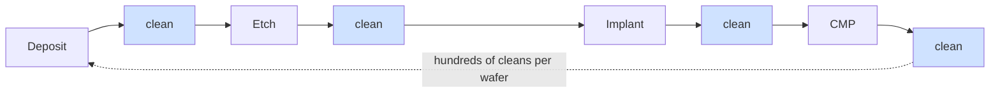
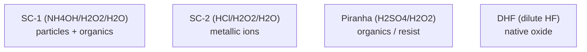

# Wet Processing, Cleaning, and Surface Preparation

Cleaning is the most frequently repeated operation in the entire fab. A leading-edge logic wafer is cleaned **hundreds of times** during its journey — after virtually every deposition, etch, implant, CMP, and lithography step — because a single particle, a trace of metallic contamination, or a residual film at the wrong moment can destroy the device. Wet processing and cleaning are therefore quietly among the highest-throughput and most yield-critical activities in manufacturing, even though they receive far less attention than lithography or etch. This file covers wet-bench chemistry, single-wafer and megasonic cleaning, supercritical and dry cleaning, photoresist strip, the vendor landscape, and the roadmap toward damage-free cleaning at the sub-2nm node.

The defining tension of modern cleaning is **removing contamination and residue without damaging the increasingly fragile structures on the wafer** — a tension that grows more acute as features shrink, aspect ratios climb, and materials become more delicate.

---

## 📊 Visual Overview

*Original schematics; Mermaid diagrams render natively on GitHub.*

**Cleaning is the most-repeated operation — done after almost every step**



**RCA-derived clean chemistries — each targets a different contaminant**



**The pattern-collapse problem and its fix (high-aspect-ratio features)**

```
 Liquid drying:                  Supercritical CO2 drying:
   ║  ║  ║  ║                       ║  ║  ║  ║
   ║  ║  ║  ║  capillary force →    ║  ║  ║  ║   zero surface tension
   ╲  ╲  ╱  ╱  pulls features        ║  ║  ║  ║   → no collapse
    ╲▼▼▼▼▼╱   together (COLLAPSE)    ║  ║  ║  ║
```

---

## 1. Wet-Bench Chemistry

The foundational cleaning chemistries date to the **RCA clean**, developed at RCA Laboratories in the 1960s and still the conceptual basis of wafer cleaning today:

- **SC-1 (Standard Clean 1):** a mixture of ammonium hydroxide, hydrogen peroxide, and water (NH₄OH/H₂O₂/H₂O). It removes particles and organic contamination by slightly etching the surface (lifting off particles) while the peroxide re-grows a thin protective oxide. SC-1 also removes some metals.
- **SC-2 (Standard Clean 2):** a mixture of hydrochloric acid, hydrogen peroxide, and water (HCl/H₂O₂/H₂O). It removes metallic contamination (alkali ions, and metals like iron, copper, and gold) by forming soluble complexes.
- **Piranha (SPM):** a mixture of sulfuric acid and hydrogen peroxide (H₂SO₄/H₂O₂), a powerful oxidizer used to strip organic residues and photoresist.
- **DHF (Dilute Hydrofluoric acid):** removes native and chemical oxide and is fundamental to surface preparation before critical depositions and contacts.
- **TMAH (Tetramethylammonium hydroxide):** an organic base used for both developing photoresist and anisotropically etching silicon.
- **Hot phosphoric acid (H₃PO₄):** selectively etches silicon nitride relative to oxide, important in spacer and 3D NAND word-line processing.

These chemistries are deployed in precisely controlled, temperature-regulated baths or single-wafer tools, using **semiconductor-grade chemicals** purified to parts-per-billion (ppb) levels of metallic and particulate contamination (File 16).

---

## 2. Single-Wafer Cleaning and Megasonics

Historically, cleaning was done by immersing batches of wafers in chemical baths (**wet benches**). The modern trend, driven by the need for tighter control and reduced cross-contamination, is toward **single-wafer cleaning**, in which each wafer is processed individually with precisely dispensed chemistries, spin-drying, and immediate inspection. Single-wafer tools give better uniformity and process control at the cost of throughput, and they dominate at the leading edge.

Physical assistance enhances particle removal:
- **Megasonic / ultrasonic cleaning** applies high-frequency acoustic energy to the cleaning fluid, creating microscopic agitation (and controlled cavitation) that dislodges particles from the surface — but the energy must be carefully controlled to avoid damaging fragile fine patterns.
- **Post-CMP cleaning** is a specialized, critical step: after CMP, the wafer is covered in slurry residue and particles that must be removed without scratching the freshly planarized surface, using brushes (PVA brushes), chemistry, and megasonics in combination.
- **EUV-specific surface preparation** addresses the unique residues and defect concerns of EUV patterning, including post-develop cleaning that must remove stochastic-defect-related residues without damaging the thin resist.

---

## 3. The Pattern-Collapse Problem and Supercritical CO₂

As feature aspect ratios climb and features grow taller and thinner, a new failure mode appears during the drying step of wet cleaning: **pattern collapse**. As the rinse liquid evaporates from between tall, narrow structures, **capillary forces** from the receding liquid surface pull adjacent structures together, causing them to stick and collapse — destroying the pattern. This is a major yield concern for high-aspect-ratio features such as fins, nanosheet stacks, DRAM capacitors, and 3D NAND structures.

**Supercritical CO₂ (scCO₂) drying** solves this elegantly. Carbon dioxide brought to its supercritical state has liquid-like density but **zero surface tension**, so it can be used to displace and then evaporate without any capillary force — eliminating pattern collapse. scCO₂ drying has become an important enabling technology for high-aspect-ratio cleaning at advanced nodes.

---

## 4. Dry Cleaning

Some cleaning tasks are better done without liquid at all, using gas-phase or plasma chemistries that are gentler or more selective:

- **Remote plasma cleaning** generates reactive radicals (e.g., from NF₃ or H₂) in a remote chamber and flows them to the wafer, removing residues and native oxide with low ion-bombardment damage.
- **UV-ozone cleaning** uses ultraviolet light and ozone to remove organic contamination.
- **HF vapor (anhydrous HF)** etches oxide in the gas phase, useful for native-oxide removal and certain release etches without the capillary forces of liquid HF.
- **Vapor chemistries (e.g., BCl₃ vapor)** address specific residue and surface-preparation needs.

Dry cleaning is increasingly important where liquid processes would cause damage, contamination, or pattern collapse, and it blurs the line between cleaning and etch (the gentlest selective etches and the most aggressive cleans are closely related).

---

## 5. Photoresist Strip

After each lithography-and-etch cycle, the photoresist mask must be removed completely. Resist strip uses several methods, often in combination:

- **Plasma ashing** uses an oxygen (O₂), nitrogen/hydrogen (N₂/H₂), or other plasma to oxidize and volatilize the organic resist. O₂ ashing is fast and thorough but can oxidize and damage underlying low-k dielectrics and metals, so **reducing (H₂-based)** chemistries are often used at the leading edge to protect sensitive materials.
- **Wet strip and solvent strip** dissolve resist and post-etch residues using organic solvents or chemistries like Piranha, especially where plasma would cause damage.

Resist strip must be complete (any residue causes defects) yet gentle (it must not damage the underlying device), a balance that becomes harder as dielectrics grow more fragile and metals more reactive. **Low-temperature resist strip** is increasingly required to protect temperature-sensitive structures.

---

## 6. Vendor Landscape

| Vendor | Position |
|---|---|
| **SCREEN Semiconductor Solutions (Japan)** | The **dominant single-wafer wet-clean supplier**, with a particularly strong position in Japan and globally; wet processing is core to SCREEN's identity. |
| **Tokyo Electron (TEL)** | A major clean and surface-preparation supplier, with strong single-wafer and batch clean platforms integrated with its broad process portfolio. |
| **Lam Research** | Strong in clean and surface preparation (including the former SEZ single-wafer clean business and Da Vinci platforms), tightly coupled to its etch and deposition franchises. |
| **Akrion, Modutek** | Specialist wet-process and wet-bench suppliers (Akrion's wet-processing business was acquired by China's Naura in 2018). |
| **ACM Research (US/China)** | Fast-growing single-wafer and batch clean supplier (SAPS/TEBO megasonic cleaning, SPM tools) with most operations and customers in mainland China; by 2026 its growth was being driven more by electroplating (ECP) and advanced-packaging tools than by cleaning. |
| **Naura (China)** | Broad-line Chinese equipment maker whose portfolio includes batch and single-wafer cleaning, benefiting from China's domestic-tool localization push. |
| **MKS Instruments** | Supplies cleaning and surface-prep subsystems and chemistries (including through its acquisitions), and remote-plasma sources. |
| **Semes (Korea)** | Samsung-affiliated wet-clean and process-equipment supplier serving the Korean memory industry. |

The wet-clean market is notable for the strength of Japanese (SCREEN, TEL) and Korean (Semes) suppliers, reflecting the deep process know-how and customer relationships that cleaning — an unglamorous but yield-critical discipline — rewards. Cleaning is also one of the tool categories where Chinese suppliers (ACM Research, Naura and others) have made the most progress in their home market, as Chinese fabs localize equipment purchasing (see the 2025–2026 update below).

---

## 7. Roadmap

The cleaning roadmap is defined by the imperative of **doing more cleaning, more gently, on more fragile structures**:

- **Damage-free cleaning for sub-2nm nodes:** as nanosheet stacks, inner spacers, and new channel materials become more delicate, cleaning must remove contamination and residue without etching, eroding, or collapsing these structures — driving gentler chemistries, single-wafer precision, and dry/supercritical methods.
- **EUV post-develop inspection and cleaning:** EUV's stochastic defects and thin resists demand specialized post-develop cleaning and inspection to remove defect-related residues without damaging the pattern.
- **Low-temperature resist strip and clean:** the spread of 3D integration and temperature-sensitive materials demands resist strip and cleaning at the lowest possible temperatures to protect already-formed structures.
- **New-material compatibility:** ruthenium, molybdenum, cobalt, high-k, and 2D channel materials each require cleaning chemistries that remove residue without corroding or damaging the new material — a continual co-development challenge as the materials set expands.
- **Hybrid-bonding surface preparation:** die-to-wafer and wafer-to-wafer hybrid bonding (File 11) requires bonding surfaces that are essentially particle-free and atomically smooth, because a single particle creates a bonding void; post-CMP cleaning, plasma activation and surface preparation are increasingly sold integrated with the bonder itself.
- **Pattern-collapse mitigation:** as aspect ratios climb further (3D NAND toward 1000 layers, taller capacitors and nanosheet stacks), supercritical and surface-tension-free drying methods become ever more essential.

Cleaning thus exemplifies a recurring theme of this database: a process that appears mundane and mature is, at the leading edge, a continually innovating, yield-critical enabler — performed hundreds of times per wafer, and increasingly the difference between a working chip and a scrapped one.

---

## Extended Analysis: Mechanisms, Single-Wafer Transition, and New-Material Cleaning

### A. The Physics and Chemistry of Particle Removal

Removing a sub-100nm particle from a wafer is harder than it sounds, because the **adhesion forces** (van der Waals, electrostatic, and capillary) that bind a tiny particle to the surface scale down more slowly than the **removal forces** available, so as particles shrink they become proportionally *harder* to remove. The classic SC-1 chemistry removes particles partly by **etching a thin layer of the underlying surface** (undercutting the particle so it lifts off) while the hydrogen peroxide re-grows a protective chemical oxide — an elegant mechanism, but one that consumes a little material each time, which becomes problematic when the structures are only atoms thick. Megasonic agitation adds a **physical** removal force (acoustic streaming and controlled cavitation), but the same energy that dislodges particles can **damage fragile fine patterns** — so the megasonic power must be carefully tuned, and at the leading edge the process window between "removes the particle" and "breaks the pattern" narrows to the point where new approaches (gentler chemistries, controlled cavitation, alternative energy sources) are required.

### B. Why Single-Wafer Cleaning Won

The historical immersion **wet bench** — dunking batches of 25–50 wafers in a sequence of chemical and rinse tanks — offered high throughput but suffered cross-contamination (every wafer shares the bath, so a contaminant from one spreads to all) and limited process control (the whole batch gets the same treatment). The modern **single-wafer cleaner** processes each wafer individually: chemicals are precisely dispensed onto the spinning wafer, reacted for a controlled time, rinsed, and the wafer is spin-dried, all with per-wafer recipe control and no shared bath. This gives better uniformity, tighter control, reduced chemical consumption per wafer (chemicals are dispensed, not maintained in large baths), and elimination of batch cross-contamination — at the cost of lower throughput, which is mitigated by multi-chamber tools running many wafers in parallel. The transition to single-wafer cleaning, led by SCREEN and TEL, parallels the broader industry shift from batch to single-wafer processing for control-critical steps, and it is essential at the leading edge where contamination and uniformity tolerances are unforgiving.

### C. Drying — The Underappreciated Critical Step

Drying is deceptively difficult and a frequent source of defects. As a rinse liquid evaporates, it can leave behind **watermarks** (residue from dissolved species), can **collapse fragile high-aspect-ratio patterns** via capillary force (Section 3), and can re-deposit particles. Advanced drying methods — **Marangoni drying** (using a surface-tension gradient created by an IPA/alcohol vapor to pull liquid cleanly off the surface) and **supercritical-CO₂ drying** (eliminating surface tension entirely) — address these problems, and the choice of drying method becomes more critical as features grow taller and thinner. The fact that an entire wafer's worth of perfect processing can be ruined in the final drying step underscores how unforgiving cleaning is.

### D. Cleaning for New Materials

Each new material introduced at the leading edge brings new cleaning challenges, because a chemistry that safely cleans one material may corrode or damage another:
- **Cobalt, ruthenium, and molybdenum interconnects** (Files 04, 15) are more chemically reactive or differently reactive than copper, requiring cleaning chemistries that remove residue and post-etch byproducts without galvanic corrosion or excessive metal loss — a significant reformulation challenge.
- **High-k and ferroelectric materials** require cleans that do not degrade the dielectric.
- **2D channel materials** (File 23) are damaged by aggressive plasma and many wet chemistries, demanding extremely gentle cleaning.
- **Low-k and ultra-low-k dielectrics** are porous and fragile, easily damaged by the plasma ashing used for resist strip — driving the shift to **reducing (H₂-based) chemistries** and gentler strip methods that protect the dielectric.

This material-specific cleaning co-development — matching the clean to each new material — is a continual, often-overlooked enabling activity, performed hand-in-hand with the deposition and etch process owners.

### E. The Cleaning Roadmap in Context

The throughline is that cleaning, performed hundreds of times per wafer, must continually become **gentler, more selective, and more material-aware** even as it remains thorough — a tension that intensifies at every node. Damage-free cleaning for fragile sub-2nm structures, EUV-specific post-develop cleaning, low-temperature resist strip for 3D-integration thermal budgets, pattern-collapse-free drying for ever-higher aspect ratios, and new-material-compatible chemistries together define a roadmap in which a process once regarded as mundane is, in fact, a continually innovating, yield-critical frontier — and one where the deep process know-how of the Japanese and Korean wet-clean leaders (SCREEN, TEL, Semes) constitutes a durable competitive moat.

---

## Further Analysis: Cleaning as the Invisible Yield Determinant

### A. The Sheer Scale of Cleaning

It bears emphasizing just how pervasive cleaning is: performed **hundreds of times per wafer**, after virtually every deposition, etch, implant, CMP, and lithography step, cleaning is by far the most frequently repeated operation in the entire fab. This sheer scale makes cleaning a quietly enormous activity — in tool count, in throughput, in chemical and water consumption, and in its cumulative impact on yield. Because cleaning happens so often, even a small per-step defect rate compounds across hundreds of steps into a significant yield impact, which is why cleaning, despite its low profile relative to lithography or etch, is one of the most yield-critical activities in manufacturing. A fab's cleaning performance — its ability to remove contamination and residue thoroughly without damaging the wafer, hundreds of times in succession — is an invisible but decisive determinant of its overall yield, and it is a major reason the wet-clean leaders (SCREEN, TEL, Semes) hold durable positions built on deep, hard-won process know-how.

### B. The Co-Development Burden

Cleaning illustrates, perhaps better than any other step, the **co-development burden** that runs throughout advanced manufacturing. Every new material (cobalt, ruthenium, molybdenum, high-k, ferroelectrics, 2D channels), every new structure (fins, nanosheets, high-aspect-ratio capacitors, hybrid-bonding surfaces), and every new patterning approach (EUV, with its thin resists and stochastic defects) requires a corresponding cleaning development — a chemistry and process that removes the relevant contamination and residue without damaging or corroding the new material or collapsing the new structure. This co-development is continuous and often invisible, performed hand-in-hand with the deposition, etch, and lithography process owners, and it is essential: a new process module cannot be qualified until its cleaning is solved. The cleaning co-development burden grows with every node, as the materials set expands and the structures grow more fragile, and it is a quiet but significant part of the total effort required to bring each new technology to manufacturing — a reminder that the headline process steps (the new transistor, the new interconnect) depend on a host of enabling steps, cleaning prominent among them, that must be developed in concert.

### C. The Cleaning Roadmap Reprised

The cleaning roadmap, reprised, is defined by the imperative of doing **more cleaning, more gently, on more fragile and more diverse structures and materials** — a set of demands that intensifies at every node. Damage-free cleaning for fragile sub-2nm structures and delicate nanosheet stacks; EUV-specific post-develop cleaning that removes stochastic-defect-related residues without damaging thin resists; low-temperature resist strip and cleaning to protect the temperature-sensitive structures of three-dimensional integration; pattern-collapse-free drying (Marangoni and supercritical-CO₂) for ever-higher aspect ratios; and new-material-compatible chemistries for cobalt, ruthenium, molybdenum, high-k, ferroelectrics, and 2D channels — together these define a roadmap in which cleaning, far from being a solved and mundane step, is a continually innovating, yield-critical enabler. The deep process know-how this rewards — the accumulated learning about how to clean each material and structure thoroughly yet gently, hundreds of times per wafer, without damaging the increasingly delicate device — constitutes a durable competitive moat for the wet-clean leaders, and it ensures that cleaning, the humblest and most frequently repeated of process steps, remains an essential and continually advancing pillar of the semiconductor manufacturing enterprise, every bit as critical to yield as the more glamorous steps that build the device up.

---

## 🆕 2025–2026 Update: Latest Developments (as of November 2026)

### Market backdrop: cleaning rides a DRAM-led, AI-driven upcycle

Cleaning demand scales with the number of process steps and the number of wafers started, so it tracks overall wafer fab equipment (WFE) spending closely. Per SEMI's July 2026 mid-year forecast, total equipment sales are expected to reach about **$165.9B in 2026 (+23.2%)**, with WFE at about **$143.9B**; company views published in the October 2026 earnings season were higher still (Lam Research sees CY2026 WFE in the mid-$150B range and, preliminarily, more than $200B in 2027). Lam described the growth as led by **DRAM**, then foundry/logic, then NAND. That mix favors cleaning: DRAM capacitor and HBM-related flows are clean-intensive, and the ramp of 2nm-class gate-all-around (GAA) nodes (TSMC N2 in volume since Q4 2025, Intel 18A, Samsung SF2) adds many delicate nanosheet-release, inner-spacer and selective-etch/clean steps.

### Vendor results: a mixed picture beneath the headline growth

- **SCREEN** (fiscal year ended March 2026): per summaries of its May 2026 results, sales in the semiconductor production equipment segment were roughly **¥486B**, down from about ¥520B a year earlier. DRAM-related equipment and post-sales service grew while foundry-related equipment declined; by region, sales to Taiwan rose while sales to China and the US fell. SCREEN remains widely described as the world's largest single-wafer cleaning supplier.
- **ACM Research** raised its full-year 2026 revenue guidance in August 2026 to **$1.125–1.175B** (25–30% growth) and on 28 Oct 2026 pre-announced Q3 2026 revenue of **$360–365M** (+34–36% YoY), with full results due 5 Nov 2026. Notably, management said growth in the first half of 2026 came from electroplating (ECP) and advanced-packaging tools while **single-wafer cleaning sales declined**; newer SPM (sulfuric-peroxide) cleaning products had shipped but contributed little revenue pending customer acceptance.
- **TEL and Lam Research** continue to bundle clean and surface-preparation steps with their etch and deposition franchises; Lam's 2025 introduction of molybdenum ALD (ALTUS Halo) for metallization adds another metal that post-etch and post-CMP cleans must handle without corrosion or excessive loss.

### China: cleaning is a leading localization category

Domestic tools accounted for roughly **35%** of equipment used in Chinese fabs in 2025 (an industry-body figure, up from ~25% in 2024), and new capacity is reportedly required to source more than half of its tools domestically. Cleaning is commonly cited as one of the categories where Chinese suppliers (ACM Research's Shanghai operation, Naura and others) are furthest along, in contrast to lithography (<5% localized). This shift is one reason the sales of Japanese cleaning leaders into China softened in FY2026, even as overall China equipment demand remained substantial.

### Hybrid bonding pulls cleaning into the packaging line

The most visible new application is **surface preparation for hybrid bonding**, where any particle or residue on the copper/dielectric bonding surface creates a void:

- Applied Materials and Besi's **Kinex** die-to-wafer hybrid-bonding system (launched October 2025) integrates surface preparation, bonding and metrology in one tool — a sign that chipmakers want cleaning and activation tightly coupled to the bonder.
- **SUSS MicroTec** introduced the **XBC300 Gen2 SP** surface-preparation cluster for hybrid bonding in 2026, and ULVAC presented downstream-plasma cleaning/activation for hybrid bonding at a 2026 industry symposium (reported).
- For HBM, JEDEC's decision to raise the HBM4 package-height limit to 775 µm eased the immediate need for hybrid bonding; SK hynix said at Hot Chips 2026 that hybrid bonding is not ready for HBM4E and would come with HBM5 at the earliest, while Samsung is reportedly more aggressive. The timing of hybrid bonding in HBM is therefore a key swing factor for packaging-line cleaning demand.

### Sustainability and chemical supply

- **PFAS:** On 26 Mar 2026 ECHA's RAC published its final opinion and SEAC its draft opinion supporting an EU-wide PFAS restriction with time-limited derogations; earliest bans are not expected before late 2028. Wet-process tools rely heavily on fluoropolymer wetted parts (PFA/PTFE tubing, tanks, valves) and some fluorinated chemistries, so derogation scope matters directly to wet-clean OEMs and fabs. Semiconductors were the largest named commenting sector.
- **Water and chemicals:** Cleaning is the fab's largest consumer of ultrapure water and high-purity chemicals; single-wafer dispense efficiency, chemical recycling and water reclaim remain differentiators as new fabs in Arizona, Japan, Korea and Europe face local water constraints.

### Key datapoints

| Item | Datapoint | Source / status |
|---|---|---|
| 2026 WFE | ~$143.9B | SEMI mid-year forecast, Jul 2026 |
| 2026 WFE (company view) | mid-$150B range; >$200B in 2027 (prelim.) | Lam Research, 21 Oct 2026 |
| SCREEN SPE segment sales, FY to Mar 2026 | ~¥486B (vs ~¥520B) | Results summaries, May 2026 |
| ACM Research 2026 revenue guide | $1.125–1.175B | Raised Aug 2026 |
| ACM Research Q3 2026 revenue (prelim.) | $360–365M | Pre-announced 28 Oct 2026 |
| China domestic-tool share | ~35% (2025) | Industry-body figure |
| EU PFAS restriction | RAC final / SEAC draft opinions | Published 26 Mar 2026 |

**What to watch (late 2026–2027)**
- Whether DRAM- and HBM-led WFE growth in 2027 translates into a cleaning upcycle for SCREEN, TEL and Semes, and whether foundry-related cleaning recovers with the 2nm/A16 ramps.
- Customer acceptance and revenue recognition of ACM Research's new SPM tools, and further localization of cleaning in China.
- Hybrid-bonding adoption timing in HBM (HBM4E vs HBM5) and logic SoIC, which determines demand for integrated surface-preparation tools.
- Cleaning chemistries for molybdenum and ruthenium metallization and for backside-power (A16, 18A) process flows.
- The final EU PFAS restriction text and the scope of semiconductor derogations.
