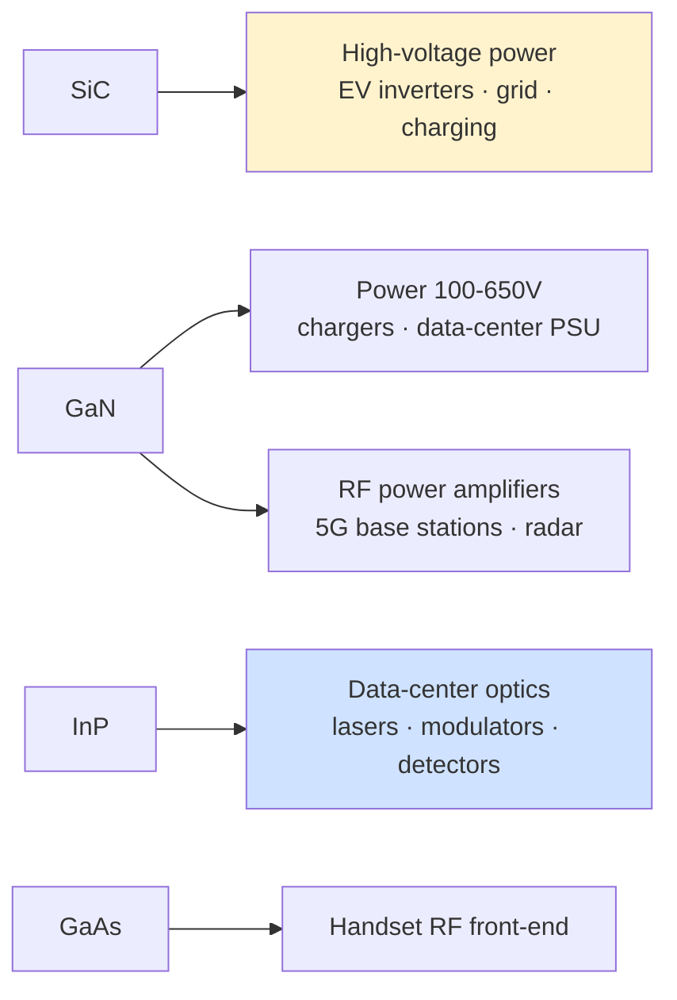
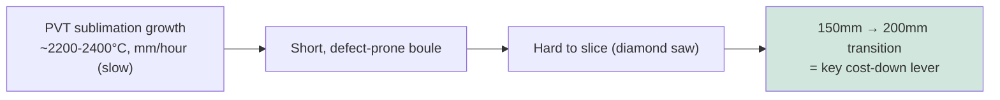

# Compound Semiconductor Manufacturing Equipment — GaN, SiC, III-V

Not all semiconductors are silicon. A family of **compound semiconductors** — made by combining elements from different groups of the periodic table — offers electrical and optical properties that silicon cannot match, and they have become indispensable in power electronics, radio frequency (RF), optoelectronics, and photonics. Silicon carbide (SiC) and gallium nitride (GaN) are revolutionizing power conversion for electric vehicles, fast chargers, and the grid; III-V materials such as gallium arsenide (GaAs) and indium phosphide (InP) dominate RF front-ends and data-center optics. These materials require a distinct manufacturing ecosystem — different crystal-growth methods, different epitaxy, different thermal processing, and often smaller wafers — supplied by a largely separate set of equipment vendors. This file covers SiC, GaN, and III-V manufacturing and their equipment, the markets driving them, and the vendor landscape.

The fundamental reason these materials matter is the **bandgap** and related properties. A wide bandgap (SiC ~3.3eV, GaN ~3.4eV versus silicon's 1.1eV) allows devices to withstand much higher voltages and temperatures and to switch faster with lower losses — ideal for power. High electron mobility and direct bandgaps make III-V materials superior for high-frequency amplification and for emitting and detecting light.

---

## 📊 Visual Overview

*Original schematics; Mermaid diagrams render natively on GitHub.*

**Wide bandgap → higher voltage, temperature, and frequency (relative scale)**

```
 Bandgap (eV):  Si 1.1 ██████    GaAs 1.4 ███████    SiC 3.3 ████████████████    GaN 3.4 █████████████████
 Breakdown field ~10× silicon → thinner, lower-loss power devices
```

**Material → application map**



**Why SiC is expensive — the crystal-growth bottleneck**



---

## 1. Silicon Carbide (SiC)

Silicon carbide is the leading wide-bandgap material for **high-voltage power electronics** (typically 650V–1700V and above), where its low conduction and switching losses dramatically improve the efficiency of EV traction inverters, on-board chargers, solar inverters, and industrial drives. SiC's manufacturing challenges begin at the very first step: the crystal.

**Boule growth.** Unlike silicon, SiC cannot be pulled from a melt by the Czochralski method (it sublimes rather than melts at practical pressures). Instead, SiC boules are grown by **PVT (Physical Vapor Transport / seeded sublimation)**, in which SiC source powder is sublimed at ~2,200–2,400°C and re-condenses on a seed crystal — an extremely slow process (millimeters per hour) that produces short boules and is prone to defects (micropipes, dislocations). **HTCVD (High-Temperature CVD)** is an alternative growth method. The slow, defect-prone growth is the primary reason SiC wafers are expensive and supply-constrained.

**Wafer-size transition.** The SiC industry is undergoing a pivotal transition from **150mm to 200mm** wafers, which roughly doubles the die per wafer and lowers cost — a key competitive battleground, with Wolfspeed, Coherent (formerly II-VI), and others racing to ramp 200mm. By 2026 the transition was well under way: Wolfspeed closed its Durham 150mm device fab and consolidated device production at its 200mm Mohawk Valley fab, while Chinese substrate makers (SICC, TankeBlue and others) were scaling 200mm capacity and showing 300mm (12-inch) SiC substrate samples, which have not yet reached mass production.

**Epitaxy.** A SiC CVD epitaxial layer is grown on the substrate to form the device's active region, with **n-type doping (nitrogen)** and **p-type doping (aluminum)** introduced in situ. SiC epitaxy occurs at high temperature in specialized CVD reactors.

**Device processing.** SiC device fabrication requires extraordinarily high-temperature **dopant-activation anneals (1,600–1,800°C)**, often with a carbon cap, far beyond anything in silicon processing. Devices include **trench and planar MOSFETs** and **Schottky barrier diodes (SBDs)**. The gate-oxide interface quality (SiC/SiO₂) is a persistent reliability challenge requiring specialized oxidation and passivation.

**Wafer vendors:** Wolfspeed (the long-time leader, which restructured through Chapter 11 in 2025 and emerged on 29 Sep 2025), Coherent/II-VI, SiCrystal (ROHM), SICC and TankeBlue (China, which have gained substantial share amid a substrate price war), Resonac, STMicroelectronics (which acquired Norstel). **Equipment:** Aixtron and others for SiC CVD epitaxy; specialized high-temperature furnaces and implanters; PVT growth furnaces from a small set of suppliers.

---

## 2. Gallium Nitride (GaN)

Gallium nitride serves two distinct markets with two distinct substrate strategies:

- **GaN-on-Si (power):** GaN grown on inexpensive silicon substrates enables cost-effective **power devices** for the lower-voltage range (typically 100V–650V) — fast chargers, data-center power supplies, consumer electronics, and increasingly automotive. The lattice and thermal mismatch between GaN and silicon requires sophisticated buffer/transition layers grown by MOCVD.
- **GaN-on-SiC (RF):** GaN grown on SiC substrates (which provide excellent thermal conductivity) delivers high-power **RF amplifiers** for 5G base stations, radar, and defense, where GaN HEMTs (High-Electron-Mobility Transistors) far outperform older GaAs and LDMOS technologies.

**Epitaxy.** GaN device layers are grown by **MOCVD (Metal-Organic CVD)**, using precursors such as trimethylgallium and ammonia. The leading MOCVD tool suppliers are **Aixtron (G5+ C platform)** and **Veeco (Propel platform)**, which dominate compound-semiconductor and LED epitaxy. Precise control of the AlGaN/GaN heterostructure that forms the conductive **two-dimensional electron gas (2DEG)** channel is the heart of GaN HEMT performance.

**Device processing.** GaN HEMT/HBT fabrication involves **mesa etch** (isolating devices), **SiN passivation** (critical for surface-trap control and reliability), **ohmic and Schottky contact** formation, and gate processing. **Vertical GaN** — using true GaN-on-GaN substrates for higher-voltage vertical devices — is an emerging frontier promising better performance than lateral GaN-on-Si, but bulk GaN substrates remain expensive and small.

---

## 3. III-V Materials (InP, GaAs, InGaAs)

The III-V family — compounds of group-III (Ga, In, Al) and group-V (As, P, N) elements — dominates high-frequency and optoelectronic applications:

- **GaAs** is used for RF power amplifiers and switches in mobile handsets (pHEMT, HBT), and for some photonics and solar.
- **InP** is the workhorse of **data-center optics** and long-haul telecom, providing the lasers, modulators, and photodetectors for high-speed optical transceivers; it also serves the highest-frequency RF (mmWave, terahertz) applications.
- **InGaAs** (and related alloys) provides very high electron mobility for RF HEMTs and for photodetectors.

**Epitaxy.** III-V devices are built on epitaxial layers grown by **MOCVD** (for high-volume production) and **MBE (Molecular Beam Epitaxy)** (for the most precise, abrupt structures and research). The ability to grow lattice-matched and strained heterostructures with atomic precision underpins III-V device performance.

**Device processing.** III-V fabrication uses specialized **wet-etch chemistries** (the materials are sensitive to many of the chemistries used in silicon), along with dry etch, contact metallization, and passivation tailored to each material. Wafers are typically smaller (100–150mm) than silicon, and the fabs are correspondingly specialized.

**Applications** include **data-center optics** (the explosive growth in AI-driven optical interconnect is a major InP driver), **5G mmWave** front-ends, **satellite and defense** electronics, and **photonics** generally.

---

## 4. Markets

The compound-semiconductor markets are driven by powerful secular trends:

- **Power electronics (SiC and GaN):** the electrification of transportation (EVs), the buildout of fast-charging infrastructure, renewable-energy inverters, and grid modernization are driving rapid growth in SiC and GaN power devices. SiC dominates the high-voltage EV traction market; GaN is expanding in chargers, data-center power, and increasingly automotive.
- **RF (GaN and III-V):** 5G infrastructure (GaN-on-SiC base-station amplifiers), defense radar and electronic warfare, and satellite communications drive RF compound-semiconductor demand.
- **Optics and photonics (InP, GaAs):** the AI-driven explosion in data-center bandwidth is a massive tailwind for InP-based optical transceivers, and silicon photonics (File 23) increasingly integrates III-V lasers.

---

## 5. Key Vendors and Fab Landscape

| Category | Key players |
|---|---|
| **SiC substrates** | Wolfspeed, Coherent/II-VI, SiCrystal (ROHM), STMicroelectronics, SICC, TankeBlue, Resonac |
| **SiC/GaN power devices** | Infineon, STMicroelectronics, onsemi, ROHM, Wolfspeed, Mitsubishi, Toshiba, Navitas, Power Integrations, GaN Systems (Infineon), EPC |
| **RF GaN/III-V** | Qorvo, Broadcom, MACOM, Wolfspeed (former RF business to MACOM), NXP, Sumitomo |
| **MOCVD epitaxy equipment** | Aixtron, Veeco (merging with Axcelis; closing expected by end of Q1 2027), AMEC (China) |
| **MBE equipment** | Riber, Veeco |
| **Compound-semi foundries** | Tower Semiconductor, WIN Semiconductors (GaAs/GaN foundry), GlobalFoundries (specialty, incl. GaN), Powerchip/PSMC (GaN-on-Si), VPEC, IQE and others (epi-wafer supply); TSMC is exiting GaN foundry by July 2027 |

The compound-semiconductor equipment market is notably distinct from mainstream silicon WFE: it is led by epitaxy specialists (Aixtron, Veeco) and a constellation of materials and device companies, rather than by the silicon-CMOS giants (though Applied Materials and others supply some implant, etch, and deposition tools adapted for these materials). Crystal growth — PVT furnaces for SiC, bulk GaN and InP growth — is served by a small, specialized supplier base, and substrate supply remains the key bottleneck and value driver across the compound-semiconductor world.

As electrification and optical interconnect accelerate, compound semiconductors represent one of the most attractive growth areas adjacent to mainstream silicon — with their own equipment ecosystem, their own roadmaps (SiC's 150-to-200mm transition, vertical GaN, InP photonics integration), and their own strategic significance in the energy transition and the AI-driven bandwidth explosion.

---

## Extended Analysis: Device Physics, Markets, and Equipment Detail

### A. Why Wide-Bandgap Physics Wins in Power and RF

The advantages of SiC and GaN over silicon trace directly to material properties. The **critical breakdown field** of SiC (~3 MV/cm) and GaN (~3.3 MV/cm) is roughly ten times that of silicon (~0.3 MV/cm), which means a wide-bandgap device of a given voltage rating can be **ten times thinner** in its drift region and far more highly doped — drastically reducing the on-resistance that wastes energy as heat. This is captured by figures of merit such as the **Baliga Figure of Merit (BFOM)** for power and the **Johnson Figure of Merit (JFOM)** for RF, on which SiC and GaN score hundreds of times higher than silicon. The practical consequences are transformative: a SiC traction inverter in an electric vehicle can be smaller, lighter, and a few percent more efficient than its silicon-IGBT predecessor — and in an EV, a few points of inverter efficiency translate directly into extended range or a smaller, cheaper battery, which is why automakers (led by Tesla's pioneering adoption) drove SiC into the mainstream.

SiC's high thermal conductivity (~3–4× silicon) also lets devices run hotter and dissipate heat more easily, important for high-power and harsh-environment use. GaN's very high electron velocity and the two-dimensional electron gas (2DEG) at the AlGaN/GaN interface give it exceptional high-frequency performance, which is why GaN-on-SiC HEMTs have displaced older LDMOS and GaAs technologies in 5G base-station and radar power amplifiers.

### B. SiC Manufacturing Challenges in Depth

The SiC value chain is bottlenecked at the substrate. PVT crystal growth is slow (sub-millimeter per hour versus the centimeters-per-hour pull rate of silicon CZ) and prone to defects — **micropipes** (hollow core defects, now largely controlled), **basal-plane dislocations** (which cause bipolar degradation), and **threading dislocations**. Boules are short (a few centimeters), limiting wafers per boule, and SiC's extreme hardness makes slicing and polishing slow and costly (diamond wire sawing, with significant kerf loss, though laser-based "cold split" techniques such as Halo/Infineon's and the use of laser-assisted slicing are improving yield). The **150mm-to-200mm transition** roughly doubles usable die area and is the central cost-reduction lever, with Wolfspeed, Coherent, Bosch, STMicro, and Chinese suppliers (SICC, TankeBlue) racing to qualify 200mm. Substrate cost remains the single largest component of SiC device cost, which is why vertical integration (device makers securing or owning substrate supply) is a defining strategic theme.

### C. GaN Manufacturing and Reliability

GaN-on-Si power devices are typically **lateral HEMTs** (the current flows laterally in the 2DEG), normally-on by nature and engineered to be **normally-off (enhancement-mode)** for safe power switching via p-GaN gate, cascode, or recessed-gate structures. The buffer-layer engineering to bridge the large GaN/Si lattice and thermal mismatch (using AlN nucleation and graded AlGaN transition layers) is the heart of GaN epitaxy and a key MOCVD challenge. **Reliability** — dynamic on-resistance (current collapse from trapped charge), gate reliability, and the absence of an intrinsic body diode — drove years of qualification before GaN won broad adoption; **SiN passivation** and field-plate engineering are central to controlling surface traps. Vertical GaN (on bulk GaN substrates) promises higher voltages and better reliability but awaits affordable, large bulk-GaN substrates.

### D. Market Sizing and Outlook

| Segment | Primary material | Key applications | Growth driver |
|---|---|---|---|
| High-voltage power (650–1700V+) | SiC | EV traction inverters, charging, grid, rail | EV electrification |
| Mid-voltage power (100–650V) | GaN | Chargers, data-center PSUs, consumer, automotive | Efficiency, power density |
| RF power | GaN-on-SiC | 5G base stations, radar, defense, satcom | 5G/defense |
| RF front-end (handset) | GaAs | Power amplifiers, switches | Mobile |
| Data-center optics | InP | Lasers, modulators, detectors | AI bandwidth |

The SiC power-device market has grown rapidly on the back of EV adoption (with Infineon, STMicroelectronics, onsemi, ROHM, and Wolfspeed the leading device makers), while GaN power is expanding from chargers into data-center and automotive applications. The AI-driven boom in optical interconnect is a powerful tailwind for InP photonics. A recurring theme across all three is that the **equipment and substrate ecosystem is the value-determining bottleneck** — epitaxy reactors (Aixtron, Veeco), crystal-growth furnaces, and substrate supply gate the industry's growth more than device design does.

### E. Equipment Detail

Compound-semiconductor fabs use smaller wafers (100–200mm) and a distinct toolset: **MOCVD and MBE** for epitaxy (the highest-value tools); **high-temperature implant and anneal** (1,600–1,800°C for SiC activation, far beyond silicon); **specialized dry and wet etch** chemistries (BCl₃/Cl₂ for GaN/III-V, fluorine-based for SiC, with III-V materials sensitive to many silicon-fab chemistries); **dielectric deposition** (SiN passivation critical for GaN); and **ohmic-contact and metallization** processes tailored to each material. Because volumes are lower and wafers smaller than mainstream silicon, the equipment is often adapted from older silicon-tool generations or purpose-built by specialists, and the fabs (Wolfspeed, Infineon, STMicro, plus pure-play foundries like WIN Semiconductors and Tower) form a distinct ecosystem from the leading-edge silicon-logic world — even as the strategic importance of compound semiconductors, driven by electrification and AI-driven optics, continues to rise.

---

## Further Analysis: Cost-Down Roadmaps and Competitive Dynamics

### A. The SiC Cost-Down Imperative

The central commercial dynamic in silicon carbide is the relentless drive to **reduce cost**, because SiC's adoption in price-sensitive applications (especially mass-market EVs) depends on closing the cost gap with silicon. The cost-down roadmap has several levers, each an equipment and process challenge. The **150mm-to-200mm wafer transition** roughly doubles die per wafer and is the single largest lever — but it requires scaling the difficult PVT crystal growth to larger diameters while controlling defects, a formidable materials challenge. **Improved crystal growth** (faster growth, higher yield, fewer defects, longer boules) directly lowers substrate cost, the dominant cost component. **Thinner wafers and better device designs** (trench MOSFETs, which pack more performance per area than planar) improve cost-per-performance. **Higher-throughput epitaxy and device processing** lower the per-wafer processing cost. And **laser-based slicing** (cold-split techniques) reduces the kerf loss and processing time of the difficult diamond-saw slicing of this extremely hard material. The competition to drive down SiC cost — among Wolfspeed, Infineon, STMicro, onsemi, ROHM, Bosch, and the Chinese entrants — is reshaping the industry, with vertical integration (controlling substrate supply) and 200mm leadership as the key competitive battlegrounds. For the equipment makers (Aixtron and others in epitaxy, the crystal-growth-furnace and slicing-tool suppliers), the SiC cost-down roadmap is a growth opportunity driven by the EV electrification megatrend.

### B. GaN's Two-Market Competitive Structure

Gallium nitride's competitive structure is shaped by its two distinct markets — **power (GaN-on-Si)** and **RF (GaN-on-SiC)** — which have different dynamics. In **power**, GaN competes with silicon (which it displaces in the 100–650V range on efficiency and power density) and increasingly addresses higher-power applications (data-center PSUs, automotive). The competition is among GaN specialists (Navitas, EPC, GaN Systems now part of Infineon, Power Integrations) and the large power-semiconductor makers (Infineon, STMicro, onsemi, TI) adding GaN to their portfolios, with the key challenges being cost (GaN-on-Si leverages cheap silicon substrates but requires sophisticated buffer-layer MOCVD), reliability (the years-long qualification that GaN required), and scaling to higher power. In **RF**, GaN-on-SiC has displaced LDMOS and GaAs in 5G base-station and defense power amplifiers, a market led by Qorvo, MACOM, Wolfspeed (RF business sold to MACOM), NXP, and Sumitomo, with the key driver being 5G infrastructure and defense demand. The **vertical GaN** frontier (GaN-on-GaN for higher voltages) awaits affordable bulk-GaN substrates. Across both markets, MOCVD epitaxy (Aixtron, Veeco) is the value-determining equipment, and the GaN growth story — like SiC's — is tied to the electrification and connectivity megatrends.

### C. The InP Photonics Tailwind

Indium phosphide is riding one of the strongest tailwinds in the compound-semiconductor world: the **AI-driven explosion in data-center optical interconnect**. As AI clusters demand ever more bandwidth between chips, racks, and systems, the optical transceivers that carry that bandwidth — built on InP lasers, modulators, and detectors — are in surging demand, and the move toward co-packaged optics (Files 11, 23) and higher data rates (800G and 1.6T in volume by 2026, with 3.2T next) further accelerates it. This makes InP epitaxy (MOCVD and MBE) and InP device fabrication a growth area, served by a specialized ecosystem (Coherent, Lumentum, and the photonics foundries) and increasingly intertwined with silicon photonics (which uses InP lasers bonded to silicon). The InP photonics tailwind exemplifies how the compound-semiconductor world, though distinct from mainstream silicon logic, is being pulled by the same AI megatrend — not through logic but through the optical interconnect that AI's bandwidth demands require. For the equipment makers, it is another growth vector adjacent to the silicon mainstream, with its own specialized epitaxy and processing requirements.

### D. The Distinct Equipment Ecosystem

The deepest structural point about compound semiconductors is that they constitute a **distinct equipment ecosystem** from mainstream silicon logic — different crystal growth (PVT furnaces for SiC, bulk growth for GaN and InP), different epitaxy (MOCVD and MBE rather than the silicon-CVD epitaxy of logic), different thermal processing (the extreme high-temperature anneals SiC requires), smaller wafers, and a specialized, often-adapted toolset. This ecosystem is led not by the silicon-WFE giants but by epitaxy specialists (Aixtron, Veeco), crystal-growth-furnace makers, and a constellation of materials and device companies, though the WFE giants supply some adapted implant, etch, and deposition tools. The substrate — its growth, its cost, its quality, its diameter — is the value-determining bottleneck across the compound-semiconductor world, more than any other factor. As electrification (SiC/GaN power) and AI-driven optics (InP) accelerate, this distinct ecosystem represents one of the most attractive growth areas adjacent to mainstream silicon, with its own roadmaps, its own competitive dynamics, and its own strategic significance in the energy transition and the connectivity and AI revolutions — a reminder that the semiconductor industry is not only about shrinking silicon transistors but also about the diverse materials that serve the applications silicon cannot.

---

## 🆕 2025–2026 Update: Latest Developments (as of November 2026)

### The demand mix has flipped: AI optics up, EV-driven SiC under pressure

The compound-semiconductor equipment cycle of 2025–2026 was shaped less by electric vehicles and more by AI data centers. Slower-than-expected EV growth in the West and aggressive Chinese capacity additions created a **SiC substrate glut and price war**, while AI clusters drove surging demand for **InP-based optical components** and, increasingly, for high-efficiency **GaN and SiC power** in data-center power delivery.

The clearest equipment datapoint is Aixtron. Per its preliminary Q3 2026 release (15 Oct 2026), order intake was about **€275M** — roughly double the €124M of Q3 2025 — with **optoelectronics ~68%** and power electronics ~24% of equipment orders. Aixtron said demand for InP-based optical components continued to grow rapidly and now represents the majority of its order backlog, while momentum in GaN and SiC power improved. Q3 revenue was about €184M with an EBIT margin of about 31%, and full-year 2026 guidance was unchanged.

### SiC: restructuring, 200mm consolidation and Chinese scale

- **Wolfspeed** filed a prepackaged Chapter 11 in mid-2025 and emerged on **29 Sep 2025**. It then shut its Durham 150mm device fab ahead of schedule and moved device production to its 200mm Mohawk Valley fab; per its fiscal-2026 releases, quarterly revenue was roughly $150–170M with gross margins still deeply negative because of underutilization.
- **China**: SICC, TankeBlue and others have scaled 150mm and 200mm substrate capacity rapidly. Press reports describe a 6-inch price war and overcapacity that squeezed even Chinese suppliers' margins (SICC reported a sharp revenue drop and net loss in Q1 2026, per press summaries), with strategy shifting to 8-inch (200mm) capacity. SICC unveiled the first 300mm SiC substrate in November 2024, and at least ten Chinese firms reportedly have 12-inch samples, but 300mm SiC has not reached mass production.
- **Implication for equipment**: crystal-growth furnace and SiC epitaxy demand is now concentrated in China and in 200mm conversions elsewhere; Western greenfield SiC projects have generally been slowed or rescoped.

### GaN: foundry reshuffle and the move to 300mm

- **TSMC** announced in 2025 that it will **exit the GaN foundry business by July 2027**, citing price pressure from Chinese competitors, and will reportedly repurpose the fab for advanced packaging. Its customers are moving elsewhere: **Navitas** shifted GaN-on-Si production to **Powerchip (PSMC)** on 200mm (100V products from 1H 2026, 650V over 12–24 months) and signed a separate foundry collaboration with **GlobalFoundries**.
- **Infineon** is scaling GaN-on-Si on **300mm** wafers in its existing Austrian silicon fabs (first customer samples planned by end-2025), a step that brings GaN into mainstream silicon-fab tooling and could disadvantage 150/200mm-only competitors.
- **Data-center power**: Nvidia's 2025 announcement of an 800V DC power architecture for future AI racks, with power-semiconductor makers among its partners, reinforced GaN and SiC demand in server power supplies (timing of adoption remains to be seen).

### Materials and geopolitics: gallium and germanium

China supplies roughly 80% of primary gallium and ~60% of germanium. Its December 2024 ban on gallium, germanium and antimony exports to the US was **paused until 27 Nov 2026** under the late-2025 US–China truce, and gallium prices rose sharply from early 2025. This matters directly for GaAs, GaN and InP supply chains (trimethylgallium precursors, GaAs substrates) and for defense RF programs. The broader rare-earth controls China announced in October 2025 are likewise suspended until November 2026; whether the truce — which US officials said in September 2026 was extended to 10 Jan 2027 — produces a further extension of the mineral pauses is a key near-term risk.

### Equipment-vendor consolidation

The **Axcelis–Veeco** all-stock merger (announced October 2025, ~$4.4B) combines a leading SiC/power ion-implant supplier with a leading MOCVD/MBE supplier. Shareholders of both companies approved it on 6 Feb 2026; closing is now expected by **end of Q1 2027**, pending China SAMR approval and a new HSR filing.

| Item | Datapoint | Source / status |
|---|---|---|
| Aixtron Q3 2026 orders | ~€275M (vs €124M Q3 2025); optoelectronics ~68% | Preliminary release, 15 Oct 2026 |
| Wolfspeed | Emerged from Chapter 11 on 29 Sep 2025; 150mm Durham device fab closed | Company releases |
| TSMC GaN | Exit from GaN foundry by July 2027 | Announced 2025 |
| Infineon GaN | 300mm GaN-on-Si production ramp | Company plan |
| China Ga/Ge export ban to US | Paused until 27 Nov 2026 | US–China truce |
| Axcelis–Veeco | Closing expected by end Q1 2027 | Pending SAMR/HSR |

**What to watch (late 2026–2027)**
- Whether China's gallium/germanium and rare-earth export pauses are extended past late November 2026 and into 2027.
- SiC substrate pricing and the pace of 200mm adoption; any 300mm SiC pilot production.
- GaN foundry capacity transfers after TSMC's exit, and 300mm GaN qualification at Infineon and others.
- Continued InP epitaxy and optical-component capacity expansion for 1.6T/3.2T transceivers and co-packaged optics.
- Closing of the Axcelis–Veeco merger and any resulting product-line changes in implant and MOCVD.
