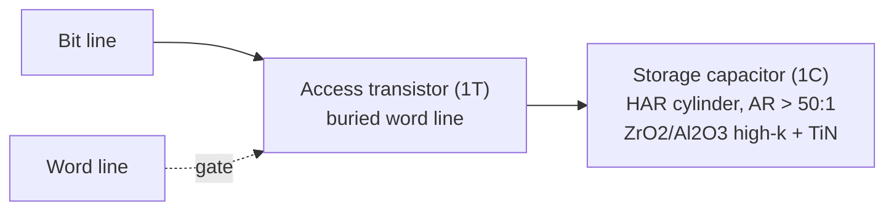
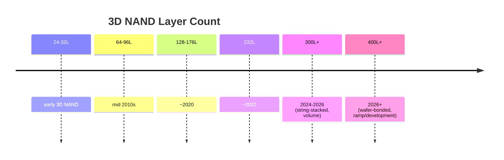
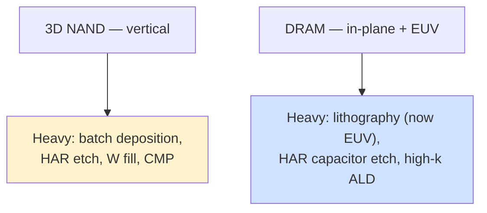

# Memory-Specific Manufacturing Equipment — 3D NAND and DRAM

Memory manufacturing follows a different logic from logic manufacturing. Where leading-edge logic is defined by ever-tighter lithography and ever-more-complex transistors, memory is defined by **massive, repetitive, three-dimensional arrays** built with extreme economy of cost-per-bit. This drives a distinctive equipment mix: memory fabs are voracious consumers of **deposition and etch** — especially high-aspect-ratio (HAR) etch and batch ALD/CVD — and historically lighter (until recently) on the most advanced lithography. The two great memory families, 3D NAND and DRAM, each pose unique manufacturing challenges, and a set of emerging memories (MRAM, PCM, ReRAM) is creeping into the picture. This file covers the architectures, the defining process steps and their equipment, the emerging-memory landscape, the key customers, and the equipment-spend patterns.

---

## 📊 Visual Overview

*Original schematics; Mermaid diagrams render natively on GitHub.*

**3D NAND — scaling by stacking layers, not shrinking features (cross-section)**

```
   ══ word line (W) ══ │ ░ │ ══ word line ══     ◄ each pair = one memory cell
   ══ word line (W) ══ │ ░ │ ══ word line ══       ░ = vertical channel
   ══ word line (W) ══ │ ░ │ ══ word line ══           (poly-Si + ONO charge trap)
   ══ word line (W) ══ │ ░ │ ══ word line ══
        ...  100s of stacked layers (96 → 300+ → 400+)  ...
   One HAR channel-hole etch (AR > 60:1) defines the whole tower.
```

**DRAM — the 1T1C cell with a tall capacitor**



**NAND layer-count scaling (string-stacking joins towers)**



**The two memory scaling paradigms drive different equipment**



---

## 1. 3D NAND Flash

### Architecture Evolution

NAND flash stores data as charge trapped in memory cells. When planar (2D) NAND scaling hit its limits around 2013 (cells became too small to hold enough electrons reliably), the industry pivoted to building **vertically** — stacking memory cells in towers and addressing the third dimension. This **3D NAND** architecture has scaled not by shrinking features in the plane, but by **adding layers**: from 24 and 32 in the first generations, through 64, 96, 128, 176, 232, and now **300+ layers** in volume production (SK hynix's 321-layer NAND had become its largest NAND node by mid-2026, per its July 2026 results), with **400+ layer** generations in ramp or development; the highest counts are achieved by **string stacking** (fabricating two or more separate stacks and connecting them vertically) and, increasingly, by **wafer bonding** a separately built CMOS periphery wafer to the cell-array wafer. Adding layers increases bit density without requiring finer lithography — a fundamentally different scaling paradigm from logic.

### Defining Process Steps and Equipment

- **ONON / ONOP stack deposition:** the tower begins as a stack of alternating dielectric layers — typically oxide and nitride (ONON) or oxide and polysilicon — deposited in **batch LPCVD/ALD furnaces** (Kokusai, TEL) over hundreds of layers. Uniformity and stress control across this enormous stack are critical; stress can bow the wafer and distort subsequent patterning.
- **High-aspect-ratio (HAR) channel-hole etch:** the signature 3D NAND process. Millions of channel holes, only tens of nanometers wide, are etched straight down through the entire stack at **aspect ratios exceeding 60:1** and climbing toward 100:1 (File 05). This single step is among the most demanding in all of manufacturing, requiring powerful cryogenic/high-energy fluorocarbon CCP etch with exquisite profile control to avoid bowing, twisting, and tapering. It is a primary battleground for Lam, TEL, and Applied Materials.
- **Channel-hole fill:** the holes are lined with the memory film stack — the **ONO (oxide-nitride-oxide) charge-trap layers** deposited by ALD — and filled with a **polysilicon** channel, all conformally coating a structure microns deep and tens of nanometers wide.
- **Word-line replacement (gate-last):** the sacrificial nitride layers are removed by **hot phosphoric acid wet etch** (or dry ALE) through the slit openings, creating horizontal cavities that are then filled with **tungsten (CVD W)** to form the word lines, followed by CMP. This "replacement gate" scheme is central to charge-trap 3D NAND.
- **Staircase etch:** to make electrical contact to each of the hundreds of word-line layers, a **stepped "staircase"** structure is formed at the array edge by repeatedly etching down one layer and trimming back a resist mask — a specialized, multi-cycle etch process.

3D NAND's equipment intensity is concentrated in **deposition (batch ALD/CVD), HAR etch, tungsten fill, and CMP** — making memory makers among the largest customers for these tool classes. The relentless layer-count race continually pushes etch and deposition to new extremes.

---

## 2. DRAM

### Architecture

DRAM stores each bit as charge on a tiny capacitor, accessed by a single transistor — the **1T1C (one-transistor, one-capacitor)** cell. Unlike NAND, DRAM has *not* gone fully three-dimensional in its array (though that transition is now beginning); it has scaled primarily by shrinking the cell in the plane while building the capacitor vertically. This makes DRAM the most lithography-intensive memory and the first memory to adopt EUV.

### Defining Process Steps and Equipment

- **Buried word line (bWL):** to save area and reduce coupling, the word-line transistor's gate is buried in a trench in the silicon. This requires precise trench **etch** and conformal **fill** (often tungsten with a barrier), plus the formation of the access transistor.
- **High-aspect-ratio capacitor etch:** to store enough charge in a shrinking footprint, the **storage capacitor** is built as a very tall, narrow cylinder or pillar, with **aspect ratios exceeding 50:1**. Etching these capacitor structures is DRAM's HAR-etch challenge, analogous to NAND's channel holes.
- **Capacitor dielectric ALD:** the capacitor is lined with a high-k dielectric stack — historically **ZrO₂/Al₂O₃/ZrO₂ (ZAZ)** and increasingly more advanced high-k materials — deposited by ALD with perfect conformality over the enormous aspect ratio, with a **TiN electrode**. Maximizing capacitance while minimizing leakage in an ever-smaller cell is the core DRAM materials challenge.
- **Advanced cell transistors:** to control leakage and short-channel effects, DRAM access transistors have evolved through **RCAT (Recessed-Channel Array Transistor)** and **saddle-fin** structures, and the industry is moving toward **vertical-channel and 3D DRAM** in coming generations.
- **Metal interconnect:** DRAM increasingly adopts **Ru, Co, and Mo** for tight-pitch metal layers, mirroring logic's interconnect transition.
- **EUV adoption:** DRAM was the first memory to insert EUV. **SK Hynix** led with EUV in its 1a/1b nm-class DRAM, and Samsung and Micron have followed (Micron's first EUV node is 1γ), using EUV to pattern the most critical layers and simplify multi-patterning. At the 1c (sixth-generation 10nm-class) node now ramping in 2025–2026, SK hynix and Samsung reportedly use five or more EUV layers, while Micron has kept EUV use minimal and relied more on ArF-immersion multi-patterning. This has made advanced DRAM a meaningful EUV customer alongside leading-edge logic.

DRAM's equipment intensity spans **lithography (now including EUV), HAR capacitor etch, high-k ALD, and precise deposition/CMP** — a more litho-heavy mix than NAND.

---

## 3. Emerging Memories

Beyond NAND and DRAM, a family of emerging non-volatile memories is finding niches — especially as **embedded memory** (replacing on-chip flash) and for novel computing (File 23):

- **MRAM (Magnetoresistive RAM):** stores data in the magnetization of a **magnetic tunnel junction (MTJ)**. Manufacturing requires **PVD deposition of the complex multi-layer MTJ stack** (~30 layers, in an ultra-high-vacuum cluster tool), **magnetic annealing** (in a strong field to set the magnetic orientation), and **ion-beam etch (IBE)** to pattern the MTJ pillars (conventional plasma etch causes magnetic redeposition and shorts). MRAM (STT-MRAM, and emerging SOT-MRAM) is in production as embedded memory at Samsung, TSMC, and others.
- **PCM (Phase Change Memory):** stores data in the amorphous/crystalline state of a **chalcogenide (GST — Ge₂Sb₂Te₅)**, requiring GST deposition and careful etch selectivity. Used in Intel/Micron's former 3D XPoint and in embedded applications.
- **ReRAM (Resistive RAM):** stores data in a conductive filament formed in a metal-oxide (typically **HfOx deposited by ALD**); attractive for low-cost embedded NVM (e.g., TSMC/Weebit Nano 28nm embedded ReRAM).

These emerging memories add new equipment requirements — PVD MTJ stacks, IBE, chalcogenide deposition, specialized ALD — to the memory toolset, though their volumes remain small relative to NAND and DRAM.

---

## 4. Key Customers

The memory industry is highly consolidated:

| Memory | Major manufacturers |
|---|---|
| **DRAM** | Samsung, SK Hynix, Micron (the "big three," ~95% of the market); CXMT (China, emerging) |
| **3D NAND** | Samsung, SK Hynix (which acquired Intel's NAND business, now Solidigm), Kioxia/Sandisk (JV; Sandisk was spun off from Western Digital in Feb 2025), Micron; YMTC (China, emerging) |
| **Emerging/embedded** | Samsung, TSMC, GlobalFoundries, Infineon, plus specialists (Everspin, Weebit Nano) |

This concentration means that the capital-spending decisions of a handful of companies drive the entire memory-equipment market — and because memory is a commodity prone to violent price cycles, that spending swings dramatically, making memory the most cyclical driver of WFE demand.

---

## 5. Equipment Suppliers and Spend Patterns by Memory Type

Memory's equipment-spend profile differs markedly from logic:

- **3D NAND** is dominated by **deposition (batch ALD/CVD for the ONON stack) and HAR etch and tungsten fill** — making Lam Research (etch and metal fill), Applied Materials, TEL, and Kokusai especially memory-exposed. Lithography is comparatively light (the regular array patterns are forgiving), which is why **nanoimprint lithography (Canon)** is being explored for NAND. CMP and clean are also intensive.
- **DRAM** is more **lithography-intensive** (now including EUV from ASML), alongside HAR capacitor etch and high-k ALD; it thus spreads spending across ASML, Lam, TEL, Applied, and the ALD specialists.
- **Spend cyclicality:** memory capex is the most volatile component of WFE. When DRAM and NAND prices spike (as in 2017–2018, the AI-driven HBM boom, and the DRAM-led 2025–2026 upcycle), memory makers surge investment; when prices crash, they slash capex almost overnight, driving the boom-bust pattern that ripples through the entire equipment industry.

The **HBM boom** deserves special mention: the AI-driven demand for high-bandwidth memory has made advanced DRAM and its **TSV/stacking/bonding** processes a major growth driver, pulling memory makers (especially SK Hynix and Samsung) into heavy investment in both advanced DRAM and the advanced-packaging equipment (File 11) needed to stack it. HBM has, for the first time in years, made memory a leading-edge-technology story rather than purely a commodity-cost story — and has correspondingly reshaped memory-maker equipment spending toward the most advanced deposition, etch, lithography, and bonding tools.

Memory thus remains the great cyclical engine of the equipment industry — a market where a few giant customers, building unimaginably repetitive three-dimensional arrays, drive enormous and volatile demand for the deposition, etch, and increasingly the lithography and packaging tools that make ever-cheaper bits possible.

---

## Extended Analysis: Scaling Mechanics, HBM, and the Memory Equipment Mix

### A. The Two Scaling Paradigms

The deepest way to understand memory equipment is to recognize that NAND and DRAM scale by **fundamentally different paradigms**, which dictate their different equipment mixes. **3D NAND scales vertically** — adding layers rather than shrinking features — so its scaling is driven by **deposition** (depositing ever-taller stacks), **high-aspect-ratio etch** (etching through them), and **fill** (filling the resulting structures), with lithography comparatively relaxed (the in-plane features are not aggressively small, and the patterns are regular). **DRAM scales primarily in-plane** (shrinking the cell) while building the capacitor vertically, so it is far more **lithography-intensive** (now including EUV) and depends on **HAR capacitor etch and high-k ALD**. This difference explains why NAND makers are the largest customers for batch deposition and HAR etch, while DRAM makers are meaningful EUV customers — and why a shift in the NAND/DRAM investment balance shifts demand among the equipment categories.

### B. 3D NAND — The Layer-Count Arms Race

The relentless climb in 3D NAND layer count (24 → 300+) is the defining dynamic of NAND manufacturing, and it stresses equipment in compounding ways. Each added layer makes the **stack deposition** more demanding (more total thickness, tighter stress control to prevent wafer bow), the **channel-hole etch** harder (higher aspect ratio, tighter profile control to avoid bowing and tapering over a deeper hole), and the **fill and word-line replacement** more challenging (conformally coating and filling deeper structures). Beyond a certain height, a single etch and a single deposition can no longer span the whole stack, so makers use **string stacking** — building two (or more) stacks separately and connecting them — which adds alignment and connection challenges. The economics are compelling enough (more bits per wafer, lower cost per bit) to justify the escalating difficulty, but the engineering is brutal, and **cryogenic etch** (File 05), new high-energy plasma sources, novel hardmasks, and ever-better profile control are the levers that keep the arms race going. The layer-count race is the single largest driver of HAR-etch and batch-deposition equipment demand.

### C. DRAM — The Capacitor and the EUV Transition

DRAM's central challenge is storing enough charge in an ever-smaller cell to reliably hold a bit, which forces the **storage capacitor** into ever-taller, narrower cylinders (aspect ratios exceeding 50:1) lined with ever-better high-k dielectric (the ZrO₂/Al₂O₃ "ZAZ"-type stacks, evolving toward higher-k materials) by ALD. The access transistor likewise evolves (buried word line, then toward vertical-channel and 3D structures) to control leakage. The most consequential recent shift is the **EUV transition**: DRAM became the first memory to adopt EUV (SK Hynix leading in its 1a/1b-nm-class nodes, followed by Samsung and Micron), using it to pattern the most critical layers and simplify the multi-patterning that DRAM's tight pitches otherwise require. This has made advanced DRAM a meaningful EUV customer and has begun to pull DRAM toward the leading-edge equipment intensity once reserved for logic — a trend that the looming **3D DRAM** transition (File 23) will accelerate, as DRAM finally follows NAND into the third dimension with all the deposition/etch/fill intensity that implies.

### D. HBM — Memory Meets Advanced Packaging

The AI boom has made **High-Bandwidth Memory (HBM)** the most important growth story in memory, and HBM is as much an **advanced-packaging** story as a memory story. An HBM stack comprises 8–16 DRAM dies connected vertically by **through-silicon vias (TSVs)** and **micro-bumps** (HBM4, in mass production in 2026, still uses MR-MUF/TC bonding after JEDEC relaxed the package height limit to 775 µm; **hybrid bonding** is now expected from HBM4E or HBM5), mounted beside logic on a silicon interposer (CoWoS, File 11). Manufacturing HBM therefore requires not only advanced DRAM but the **TSV formation, wafer thinning, stacking, and bonding** equipment of advanced packaging — drawing the memory makers (especially SK Hynix, the HBM leader, and Samsung and Micron) into heavy investment in both advanced DRAM and packaging equipment. HBM has, for the first time in years, made memory a leading-edge-technology and capacity-constrained story rather than purely a commodity-cost story, and it has reshaped memory-maker equipment spending toward the most advanced deposition, etch, lithography, TSV, thinning, and bonding tools. The competition to lead in HBM (where yield and stacking capability are decisive) is one of the defining battles in the current memory industry.

### E. Emerging Memory and the Equipment Implication

The emerging memories (MRAM, PCM, ReRAM, FeRAM, File 23) add specialized equipment requirements — UHV multi-chamber PVD and ion-beam etch for MRAM's magnetic stacks, chalcogenide deposition and selective etch for PCM, HfOx ALD for ReRAM, HZO ALD for FeRAM — to the memory toolset. Their volumes remain small relative to NAND and DRAM, but they are growing as **embedded** memory (replacing on-chip flash in microcontrollers and SoCs) and as candidates for storage-class memory and in-memory compute. For the equipment industry, emerging memory represents a set of smaller but higher-value, specialized niches that leverage and extend existing deposition and etch platforms toward new materials — a microcosm of the broader pattern in which the expanding materials set continually creates new equipment opportunities.

---

## Further Analysis: The Memory Cycle and the HBM Transformation

### A. The Commodity Memory Cycle

The defining economic feature of mainstream memory (DRAM and NAND) is its **commodity nature** and the violent price cycle that results. Because DRAM and NAND are largely interchangeable commodities sold on price, and because capacity additions come in large, lumpy increments with long lead times, the market swings between shortage (high prices, high profits, capacity-addition rush) and glut (crashing prices, losses, capex collapse). These cycles are amplified by the concentrated supplier structure (a handful of makers, whose collective capacity decisions determine supply) and by the long lead time between a capacity decision and its output (so additions often arrive after demand has shifted). For the equipment industry, the memory cycle is the single largest source of WFE volatility: when memory prices spike, Samsung, SK Hynix, and Micron pour capital into capacity, and memory-tilted equipment demand (batch deposition, HAR etch, tungsten fill for NAND; lithography including EUV, capacitor etch, and high-k ALD for DRAM) surges; when prices crash, that spending is slashed almost overnight. This makes the memory makers' capex decisions — driven by the commodity price cycle — a primary swing factor in the overall equipment market, and it makes the memory-exposed equipment makers (Lam, with its etch and NAND strength; Kokusai and TEL in batch deposition; Applied) the most cyclically leveraged.

### B. How HBM Broke the Commodity Pattern

The rise of **High-Bandwidth Memory (HBM)** for AI has, for the first time in years, partly broken memory's pure-commodity pattern and transformed the memory landscape. Unlike commodity DRAM, HBM is a **differentiated, high-value, capacity-constrained, technology-intensive product**: it requires advanced DRAM plus sophisticated 3D stacking (TSVs, micro-bumps, with hybrid bonding expected in later HBM generations), the yield and stacking capability are decisive competitive differentiators, and demand (driven by AI accelerators) has outstripped supply, supporting premium pricing. This has several profound effects. It has made **SK Hynix** (the HBM leader) a standout beneficiary of the AI boom and intensified competition with Samsung and Micron to lead in HBM. It has pulled memory makers into heavy investment in both advanced DRAM and the **advanced-packaging equipment** (TSV, thinning, stacking, bonding — File 11) that HBM requires, expanding their equipment spending beyond the traditional memory toolset. And it has, for the first time in years, made memory a **leading-edge-technology and capacity story** rather than purely a commodity-cost story, partly decoupling a meaningful slice of memory demand from the commodity cycle. HBM's transformation of memory — from interchangeable commodity to differentiated, AI-driven, packaging-intensive product — is one of the most important developments in the recent memory industry, and it has reshaped both the competitive dynamics among the memory makers and the equipment demand they generate.

### C. The Coming 3D DRAM Transition

Looking ahead, the most consequential development on the memory horizon is the **transition of DRAM to three dimensions** (3D DRAM, File 23). DRAM has scaled primarily in-plane while building its capacitor vertically, but it is approaching the same wall that drove NAND vertical: the cell can no longer shrink in-plane while storing and switching adequate charge. 3D DRAM — stacking DRAM cells vertically — is in development at all three major makers, and while it is profoundly difficult (DRAM's low-leakage requirements are far less forgiving than NAND's charge-trap cell), it is increasingly seen as the necessary path beyond conventional DRAM scaling. The equipment implications are significant: 3D DRAM will require the **high-aspect-ratio etch, conformal ALD, and HAR fill** capabilities that NAND pioneered, applied to DRAM's more demanding specifications, plus potentially new materials (IGZO oxide-semiconductor access transistors for their ultra-low leakage). This transition would pull DRAM toward the deposition-and-etch intensity that has long characterized NAND, reshaping memory equipment demand and creating new opportunities for the deposition and etch leaders. The 3D DRAM transition, expected toward the end of the decade, represents the next great inflection in memory manufacturing — DRAM finally following NAND into the third dimension, with all the equipment intensity that implies, and completing the industry-wide turn toward three-dimensional integration that runs throughout this database.

---

## 🆕 2025–2026 Update: Latest Developments (as of November 2026)

### A. Memory Leads the 2026–2027 Equipment Upcycle

The memory cycle described above has swung decisively upward. DRAM and NAND prices rose sharply from late 2025, and the industry narrative has shifted to a "memory supercycle" driven by AI data-center demand for HBM, high-capacity server DRAM and enterprise SSDs. This has made memory the leading growth segment of wafer fab equipment:

- **SEMI's July 2026 mid-year forecast** raised 2026 WFE to **$143.9B** (total equipment $165.9B, +23.2%), with a record $229.5B total projected for 2028.
- **Lam Research** (21 Oct 2026) sees CY2026 WFE in the ~mid-$150B range and, preliminarily, **more than $200B in 2027**, with growth led by **DRAM**, followed by foundry/logic and then NAND. Lam also warned that **cleanroom space and component supply** could constrain how fast the industry can add output. Per earnings-call summaries, Lam reported record DRAM revenue tied to 1α/1β/1γ technology additions, and said its NAND **upgrade** business would remain strong into 2026.
- TrendForce (Nov 2025) forecast 2026 DRAM capex of ~$61.3B (+14%), a figure later exceeded as memory spending rose.

| Indicator | Latest view | Source |
|---|---|---|
| 2026 WFE | $143.9B | SEMI, Jul 2026 |
| 2026 WFE | ~mid-$150B range | Lam Research, Oct 2026 |
| 2027 WFE | >$200B (preliminary), DRAM-led | Lam Research, Oct 2026 |
| 2026 DRAM capex | ~$61.3B (+14%), later exceeded | TrendForce, Nov 2025 |
| HBM share, Q2 2026 | SK hynix ~50%, Samsung ~33%, Micron ~18% | Counterpoint |

### B. DRAM: 1c, More EUV, and the Road to 4F²/3D

- **EUV layer counts are rising.** At the 1c node, SK hynix and Samsung reportedly use **five or more EUV layers**; SK hynix reportedly raised its 1c EUV investment well above its original plan and aims to convert a large share of its DRAM capacity to 1c. Micron, by contrast, introduced EUV only at 1γ and has kept EUV usage minimal, relying on ArF-immersion multi-patterning. These diverging strategies matter for ASML (EUV units) versus deposition/etch suppliers (multi-patterning spacer and etch steps).
- **Next architectures.** Vertical-channel transistor (VCT) and **4F² cell** designs are reportedly targeted for sub-10nm-class DRAM, with **3D DRAM** further out; none has a confirmed mass-production date. Each step raises deposition and etch intensity, a point Lam has stressed publicly.

### C. HBM4: Bonding Choices Shift

- **HBM4 entered mass production in 2026**, primarily for Nvidia's Rubin platform.
- **JEDEC raised the HBM4 package height limit to 775 µm** (from 720 µm). This eased the pressure to adopt hybrid bonding. SK hynix continues with **MR-MUF / thermo-compression (TC) bonding**, and at Hot Chips 2026 said hybrid bonding is not ready for HBM4E and would come at **HBM5 at the earliest**.
- **Samsung** is reportedly more aggressive on hybrid bonding (Cheonan line). SK hynix reportedly placed a first hybrid-bonding production order for an integrated **Applied Materials + Besi** inline system. Hybrid bonding remains a key future equipment opportunity, but timing has slipped relative to earlier expectations.
- **HBM share** has become more contested. Per Counterpoint, Samsung's share rose from ~21% in Q1 2026 to ~33% in Q2 2026.

### D. 3D NAND: 300+ Layers in Volume, 400+ Next

- SK hynix's **321-layer** NAND became its largest NAND node by mid-2026. Samsung's 10th-generation V-NAND (400+ layers, with wafer bonding of periphery and cell wafers) and Kioxia's 332-layer BiCS10 are in ramp or preparation, though reported timelines vary. Samsung has reportedly shown very-high-layer prototypes built by bonding stacked wafers.
- **Cryogenic dielectric etch** has become mainstream for advanced channel-hole etch; Lam has described its Cryo 3.0 as the industry standard for advanced NAND. **Molybdenum** word lines (replacing tungsten) are reportedly being adopted in next-generation NAND, which benefits Mo ALD/CVD platforms such as Lam's ALTUS Halo.
- NAND spending is still weighted to **node upgrades** of existing capacity rather than greenfield fabs, although AI inference storage has improved the NAND demand outlook. YMTC has reportedly accelerated a third Wuhan fab phase despite export controls.

### E. Capacity Investments and Geopolitics

- **SK hynix:** first fab at the Yongin cluster targeted for Q1 2027; Indiana advanced-packaging plant (~US$3.87B, ~2028); a reported US listing raising up to ~US$36B for fabs and EUV tools (Jul 2026).
- **Micron:** ~US$7B HBM packaging facility in Singapore; US fabs in Idaho and New York.
- **Samsung/SK hynix:** new HBM back-end capacity (Cheonan/Onyang).
- **China fabs of Korean makers:** Samsung (Xi'an) and SK hynix (Wuxi, Dalian) lost Validated End-User status effective 31 Dec 2025. BIS then granted **annual licenses for 2026** that allow them to maintain, but not expand or upgrade, operations. This effectively freezes technology migration at those NAND/DRAM sites.
- **CXMT and YMTC** continue expanding with an increasing share of domestic tools. China's broader domestic-equipment share reached roughly 35% in 2025 (industry-body figure).

**What to watch (late 2026–2027)**
- Whether 2027 WFE exceeds $200B as Lam projects, and whether cleanroom and component shortages cap memory capacity additions.
- HBM4E qualification, and whether any maker commits hybrid bonding to volume HBM before HBM5.
- Samsung's 1c DRAM yields and its HBM share trajectory versus SK hynix.
- 400+ layer NAND ramps, Mo word-line adoption and the spread of cryogenic etch.
- Renewal terms of the US licenses for Korean makers' China memory fabs after 2026.
