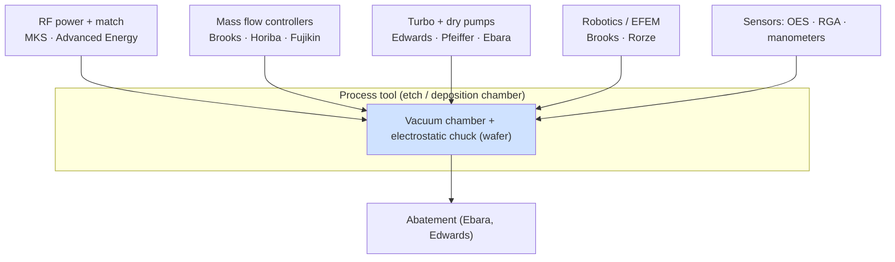

# Critical Subsystems, Components, and the Equipment Supply Chain

Behind every multi-million-dollar process tool stands a deep supply chain of specialized **subsystems and components** — the RF power supplies, vacuum pumps, mass flow controllers, electrostatic chucks, ceramics, robotics, sensors, and fluid-handling parts that make the tool function. These subsystems are often invisible in discussions of SemiCap, yet they are essential, technically demanding, and strategically important: a shortage of a single subsystem can throttle the output of an entire tool, and the subsystem suppliers are themselves a bellwether for the health of the whole equipment industry. This file surveys the critical subsystem categories, their suppliers, and the structure of the equipment supply chain.

The economic logic is significant: the major OEMs (Applied Materials, Lam, TEL, ASML) design and integrate their tools but **outsource a large fraction of the bill of materials** to specialized subsystem makers. This makes the subsystem suppliers a leveraged play on WFE demand and a critical dependency for the OEMs, who must qualify and secure these components years in advance.

---

## 📊 Visual Overview

*Original schematics; Mermaid diagrams render natively on GitHub.*

**Anatomy of a process tool — the subsystems that make it work**



**Subsystem innovation enables process innovation — and gates tool output**

```
 Better RF pulsing      → enables advanced etch / ALE
 Faster mass-flow ctrl  → enables ALD dose precision
 Better ESC uniformity  → enables tight CD across the wafer
 (A subsystem shortage can halt tool shipments — as the 2021-22 crunch showed,
  and as stretched 2026 component lead times are showing again)
```

---

## 1. RF Power Supplies and Matching Networks

Plasma-based processes — etch, PECVD, PEALD, sputtering — require **radio-frequency (RF) power** to generate and sustain the plasma, delivered through a **matching network** that couples the generator to the constantly-changing plasma load. RF power is among the most critical subsystems: the precision, stability, and pulsing capability of the RF supply directly determine etch and deposition performance. **ICP (inductively coupled)** and **CCP (capacitively coupled)** plasmas use different excitation schemes, and modern processes increasingly rely on **pulsed RF** (rapidly modulating the power) to control radical-to-ion ratios and reduce charging damage. The leading suppliers are **MKS Instruments (operating as MKS Inc. since 2025), Advanced Energy, and Comdel/XP Power**, with RF power a high-value, performance-critical category.

---

## 2. Mass Flow Controllers (MFCs)

Every deposition, etch, and cleaning process depends on precisely metered gas flows, delivered by **mass flow controllers** — devices that measure and regulate gas flow to high accuracy. ALD imposes especially stringent requirements: the rapid, precise **pulse-width control** needed to dose precursors in self-limiting cycles demands fast, accurate, repeatable MFCs. Leading suppliers include **Brooks Instrument, Horiba (Horiba STEC), Fujikin, and Parker (Hannifin)**. MFC accuracy and response time are quietly decisive for process control, particularly as ALD and atomic-layer processes proliferate.

---

## 3. Vacuum Systems

Most advanced processes occur under **vacuum**, requiring a hierarchy of pumps and gauges. **Turbomolecular pumps** (high vacuum) and **dry roughing pumps** (rough/backing vacuum) evacuate the chambers, while **capacitance manometers and ionization gauges** measure pressure. Vacuum integrity is fundamental — leaks or particles introduced by pumps degrade yield. The leading vacuum suppliers are **Pfeiffer Vacuum, Edwards (part of Atlas Copco), Leybold, and Ebara** (dry pumps). EUV adds extreme vacuum requirements for the scanner's optical path. Vacuum is a large, essential, and relatively concentrated subsystem market.

---

## 4. Gas Abatement

Process exhaust contains toxic, corrosive, flammable, and greenhouse gases that must be treated before release. **Point-of-use (POU) abatement** systems — using **burn (thermal), wet-scrub, plasma, or catalytic** methods, often in combination ("burn-wet-scrub") — destroy or capture these gases, including the potent **perfluorocarbon (PFC)** greenhouse gases (File 21). Suppliers include **Ebara, CS Clean Solutions (Busch), Edwards (Atlas Copco), and Ecosys/DAS**. Abatement is both an environmental necessity and a safety system, and its importance grows with tightening emissions regulations.

---

## 5. Electrostatic Chucks (ESCs)

The wafer must be held flat, stationary, and at precisely controlled temperature during processing, increasingly by **electrostatic chucks** that clamp the wafer with electrostatic force and regulate its temperature across multiple zones. Two physical mechanisms exist: **Johnsen-Rahbek** (using slightly conductive ceramics) and **Coulomb** (using insulating ceramics). ESCs are built from advanced ceramics (**Al₂O₃, AlN**) and provide **multi-zone temperature uniformity** critical for etch and deposition CD control. Suppliers include the OEMs' captive operations plus specialists such as **Shinko, NGK, Kyocera, and TOTO**. The ESC is one of the most technically demanding components, directly affecting process uniformity.

---

## 6. Ceramics and Process-Kit Parts

The interior of a process chamber is lined with **consumable ceramic and specialty parts** that must withstand aggressive plasma and chemistry: **Al₂O₃ chamber liners, SiC focus rings, Y₂O₃ (yttria)-coated components**, and various quartz and ceramic parts. These **process-kit** parts erode over time and must be replaced on a regular cycle, generating substantial **recurring revenue** and representing a meaningful share of a fab's operating cost. The economics of process-kit replacement (lifetime, cost, particle performance) are a real consideration in tool cost-of-ownership. Suppliers include **Kyocera, CoorsTek, NGK, Ferrotec, and Entegris**, plus coating specialists. Yttria and other plasma-resistant coatings are an area of active development as plasma processes grow more aggressive.

---

## 7. Wafer Handling and Robotics

Wafers must be moved through the fab and within each tool with extraordinary precision and cleanliness, by **vacuum and atmospheric robots**, **EFEMs (Equipment Front-End Modules)** that interface tools to the fab automation, and **FOUPs (Front-Opening Unified Pods)** that transport wafers in a mini-environment (standardized under SEMI E47.1). Suppliers include **Brooks Automation** (the semiconductor-automation business that the former Brooks — now the life-sciences company Azenta — sold to Thomas H. Lee Partners in 2022), **Rorze, Genmark (Persimmon), and Yaskawa**. Reliable, particle-free wafer handling is fundamental — a single mishandling event can scrap wafers — and robotics throughput affects tool productivity.

---

## 8. Sensors and Metrology Subsystems

Process tools embed numerous **sensors** for monitoring and control: **capacitance manometers** (pressure), **optical emission spectroscopy (OES)** (plasma/etch endpoint), **residual gas analyzers (RGA)** and **mass spectrometers** (gas composition), temperature sensors, and optical monitors. These in-situ sensors feed the advanced process control loops (File 08) that hold processes on target. Suppliers include **MKS, Inficon, and Hiden Analytical**, plus the OEMs' captive sensor development.

---

## 9. High-Purity Fluid Handling

The chemicals and gases that touch the wafer must be delivered through **ultra-clean fluid-handling components** — **PTFE/PFA valves, fittings, tubing, filters, and pumps** that introduce no contamination. Suppliers include **Entegris (a leader in fluid handling and filtration), Swagelok, Parker, and Saint-Gobain**. The purity requirement (parts-per-billion and beyond, File 16) makes fluid-handling components a specialized, high-value category.

---

## 10. Contamination Control

The fab environment itself is a controlled system requiring **ULPA/HEPA filters** (removing virtually all particles from the air), **mini-environments** (FOUPs and tool enclosures that maintain ISO Class 1–5 cleanliness around the wafer even within a less-clean fab), and ionizers (ESD control). Contamination control spans the tool, the mini-environment, and the cleanroom (File 24), and is fundamental to yield. Suppliers include filter makers (**AAF, Camfil, Daikin**) and the broader cleanroom-infrastructure ecosystem.

---

## 11. The Subsystem Supplier Landscape

| Subsystem | Leading suppliers |
|---|---|
| RF power & matching | MKS Instruments, Advanced Energy, Comdel |
| Mass flow controllers | Brooks Instrument, Horiba, Fujikin, Parker |
| Vacuum pumps & gauges | Pfeiffer, Edwards (Atlas Copco), Leybold, Ebara |
| Gas abatement | Ebara, CS Clean Solutions, Edwards, Ecosys |
| Electrostatic chucks | Shinko, NGK, Kyocera, TOTO (+ OEM captive) |
| Ceramics / process kits | Kyocera, CoorsTek, NGK, Ferrotec, Entegris |
| Robotics & automation | Brooks Automation, Rorze, Genmark, Yaskawa |
| Sensors | MKS, Inficon, Hiden |
| Fluid handling & filtration | Entegris, Swagelok, Parker, Saint-Gobain |
| Outsourced assembly | Ultra Clean Holdings (UCTT), Ichor, Celestica |

Several **integrators** — notably **Ultra Clean Holdings (UCTT)** and **Ichor** — assemble complete gas-delivery and fluid subsystems for the OEMs, occupying an important tier between component makers and tool builders.

---

## 12. Financial and Strategic Significance

The subsystem suppliers occupy a strategically important and financially distinctive position. Companies like **MKS Instruments, Advanced Energy, Ultra Clean Holdings, and Ichor** are **leveraged plays on WFE demand** — their fortunes rise and fall with the equipment cycle, often with more volatility than the OEMs themselves. **MKS Instruments**, in particular, with its broad portfolio (RF power, vacuum, flow, photonics, and — via the Atotech acquisition — plating chemistry) spanning many tools, is a closely watched bellwether for the entire equipment industry.

For the OEMs, the subsystem supply chain is a critical dependency: a shortage of RF generators, vacuum pumps, or specialty ceramics can constrain tool output regardless of demand, as the 2021–2022 supply crunch vividly demonstrated, when component shortages limited the OEMs' ability to ship tools even with record backlogs. The AI-driven upturn of 2026 has revived the same concern: Lam Research flagged component supply constraints (alongside cleanroom shortages) as a possible limit on industry output in October 2026, and Korean press reports cited lengthening lead times for RF power supplies, ceramic parts, valves and gas boxes (see the 2025–2026 update below). This has driven the OEMs to deepen relationships with, and in some cases invest in or dual-source, their critical subsystem suppliers.

The subsystem and component layer is thus the foundation beneath the foundation — the specialized, technically demanding, often-overlooked supply chain that makes the world's most advanced manufacturing tools possible, and whose health is inseparable from that of the equipment industry it serves.

---

## Extended Analysis: The Strategic Role of the Subsystem Layer

### A. The Outsourcing Logic

The major OEMs (Applied Materials, Lam, TEL, ASML) are fundamentally **integrators and process-knowledge owners**: their value lies in understanding how to turn a process recipe into a yielding production tool, and in the system-level integration, control software, and customer relationships that surround the tool. They therefore **outsource a large fraction of the physical bill of materials** — often 50% or more — to specialized subsystem makers who can develop and manufacture RF generators, vacuum pumps, mass flow controllers, and the rest more efficiently than the OEMs could in-house. This outsourcing logic creates a deep, multi-tier supply chain and makes the subsystem suppliers a **leveraged play on WFE demand** — their revenue rises and falls with the equipment cycle, often more sharply than the OEMs' because they sit further up the supply chain and feel the bullwhip effect of inventory swings.

### B. The 2021–2022 Supply Crunch as a Lesson

The supply crunch of 2021–2022 vividly demonstrated the criticality of the subsystem layer. As demand surged, the OEMs found themselves unable to ship tools not for lack of orders but for lack of **components** — RF generators, vacuum pumps, specialty ceramics, and especially semiconductors *for* the tools' own control electronics (a recursive irony: chip-making tools were constrained by chip shortages). Lead times for some subsystems stretched to a year or more, and the OEMs' backlogs ballooned with orders they could not fulfill. The lesson reshaped the industry's supply-chain strategy: OEMs deepened relationships with critical subsystem suppliers, dual-sourced where possible, invested in or acquired key suppliers, and carried more inventory — and the episode underscored that the equipment industry's output is gated by its weakest subsystem link, not just by its own assembly capacity.

### C. Subsystem Performance as Process Performance

A subtle but crucial point is that subsystem performance often **directly determines process performance**. The stability and pulsing precision of the RF generator shape etch and deposition results; the accuracy and response of the mass flow controllers determine ALD dose control; the temperature uniformity of the electrostatic chuck governs etch CD uniformity across the wafer; the particle performance of the process-kit ceramics affects defectivity and yield. The OEMs therefore **co-engineer** these subsystems closely with their process requirements, and the best subsystem suppliers are deep technical partners, not mere component vendors. This co-engineering creates sticky relationships and means that subsystem innovation (faster-pulsing RF, more precise flow control, more plasma-resistant ceramics) is often the enabler of process innovation — a new etch capability may depend on a new RF or chuck capability beneath it.

### D. The Process-Kit Consumable Economy

The **process kit** — the consumable ceramic and metal parts inside the chamber (liners, focus rings, electrodes, shields) that erode under plasma and chemistry — represents a large, recurring revenue stream and a significant share of a fab's operating cost. These parts must be replaced on a regular cycle (the **wet-clean / part-replacement cycle** is a key driver of tool downtime and cost-of-ownership), and their performance (lifetime, particle generation, plasma resistance) materially affects yield and productivity. The economics — part cost, lifetime, refurbishment, and the downtime to replace them — are a real consideration in tool cost-of-ownership, and **plasma-resistant coatings** (yttria, and advanced rare-earth coatings) are an area of active development as plasma processes grow more aggressive. The process-kit business, served by ceramics specialists (Kyocera, CoorsTek, NGK) and the OEMs' own parts operations, is a recurring, high-margin complement to the tool sales themselves.

### E. The Subsystem Vendors as Bellwethers

Because subsystem suppliers sit across many tools and many OEMs, their results are watched as **bellwethers** for the whole equipment industry. **MKS Instruments**, with its broad portfolio (RF power, vacuum, flow, photonics, and plating chemistry via Atotech), is the canonical example — its book-to-bill and commentary signal the direction of WFE demand. **Advanced Energy** (RF and power), **Ultra Clean Holdings** and **Ichor** (gas/fluid subsystem integrators), and **Brooks Automation** (automation; privately held since 2022, while the former parent Azenta became a life-sciences company) similarly track and signal the cycle. For investors and industry watchers, the subsystem layer offers both a leveraged way to play WFE demand and an early read on its direction — and for the OEMs, it is the indispensable foundation on which their tools, and ultimately the entire chip industry, are built.

---

## Further Analysis: Subsystem Innovation as the Foundation of Process Innovation

### A. How Subsystem Advances Enable Process Advances

A subtle but crucial dynamic is that **process innovation often depends on subsystem innovation beneath it**. A new etch or deposition capability frequently requires a new or improved subsystem to enable it: faster, more precise **RF pulsing** enables better control of radical-to-ion ratios for advanced etch and ALE; faster, more accurate **mass flow control** enables the precise dosing that ALD and atomic-layer processes require; better **electrostatic chuck** temperature uniformity enables the CD uniformity that advanced etch demands; more **plasma-resistant ceramics and coatings** enable the aggressive plasmas that high-aspect-ratio and selective processes require; better **vacuum and gas-purity** control enables the cleanliness that advanced films require. In each case, the process capability is gated by the subsystem capability, and the OEMs and subsystem suppliers co-engineer them together. This means that subsystem innovation is not a passive supply activity but an active enabler of process advance — a new generation of RF generator, flow controller, or chuck can unlock a new process capability, and the subsystem suppliers (MKS, Advanced Energy, Brooks, Horiba, the ceramics makers) are genuine technical partners in the advance of the leading edge, not mere component vendors. Recognizing this elevates the strategic importance of the subsystem layer: it is part of the innovation engine, not just the supply chain.

### B. The Vulnerability and the Response

The 2021–2022 supply crunch (Section B above) exposed the **vulnerability** that the OEMs' dependence on the subsystem layer creates: the equipment industry's output is gated by its weakest subsystem link, and a shortage of any critical component — RF generators, vacuum pumps, specialty ceramics, or even the chips for the tools' own control electronics — can throttle tool production regardless of demand. The industry's response has reshaped its supply-chain strategy in lasting ways. OEMs have **deepened relationships** with critical subsystem suppliers (longer-term agreements, closer co-planning), pursued **dual-sourcing** where feasible (qualifying second sources to reduce single-point risk), in some cases **invested in or acquired** key suppliers (vertical integration of critical capabilities), and carried **more inventory** of long-lead components. Subsystem suppliers, in turn, have expanded capacity and regionalized supply (partly in response to the geopolitical pressures of File 18). This rebalancing — toward resilience and redundancy, away from pure efficiency — reflects the hard lesson that in a concentrated, interdependent supply chain, the cost of a disruption far exceeds the cost of the buffers and redundancy that prevent it. The subsystem supply chain's resilience has become a strategic priority for the OEMs, on par with the resilience of the materials supply chain (File 16).

### C. The Subsystem Layer as Industry Bellwether and Investment

The subsystem suppliers occupy a distinctive position as **bellwethers and leveraged investments** in the equipment industry. Because they sit across many tools and many OEMs, their order trends and commentary provide an early, broad read on WFE demand — **MKS Instruments**, with its portfolio spanning RF power, vacuum, flow, photonics, and (via Atotech) plating chemistry, is the canonical industry bellwether, and **Advanced Energy, Ultra Clean Holdings, and Ichor** similarly track and signal the cycle. For investors, the subsystem layer offers both a leveraged way to play WFE demand (subsystem suppliers often swing more than the OEMs, sitting further up the supply chain) and an early indicator of its direction. For the industry, the health of the subsystem layer is inseparable from its own: the OEMs cannot ship tools without their subsystems, the subsystems cannot advance without co-engineering with the OEMs, and the entire edifice of the world's most advanced manufacturing rests on this deep, specialized, often-invisible supply chain. The subsystem layer is, in the end, the foundation beneath the foundation — the precision components and subsystems that make the multi-million-dollar process tools possible, whose innovation enables process innovation, whose resilience determines the industry's output, and whose health signals the direction of the entire wafer-fab-equipment market.

---

## 🆕 2025–2026 Update: Latest Developments (as of November 2026)

### A. The subsystem layer rides the AI-driven WFE upcycle

The leveraged-play logic described above has played out clearly in 2026. With SEMI's July 2026 mid-year forecast putting 2026 WFE at **$143.9B** (total equipment $165.9B, +23.2%) and OEMs now talking about 2027 WFE well above that (Lam Research said on 21 Oct 2026 that 2027 could preliminarily exceed **$200B**, led by DRAM), subsystem suppliers have reported growth rates in their semiconductor segments that outpace the OEMs' own:

| Supplier | Latest reported period | Semiconductor-related figures (per company releases / call summaries) |
|---|---|---|
| **MKS (MKS Inc.)** | Q2 2026 (reported Aug 2026) | Total revenue ~$1.25B (+28% YoY); semiconductor revenue $554M (+28% YoY, +19% QoQ); Q3 guide $1.35B ± $40M with semiconductor ~$630M, i.e. >50% YoY growth expected |
| **Advanced Energy** | Q3 2026 (reported early Nov 2026) | Revenue $696M (+50% YoY); semiconductor equipment revenue ~$322M (+64% YoY), a record; Q4 guide $735M ± $25M |
| **Ultra Clean Holdings (UCT)** | Q3 2026 | Revenue $759.0M (products $681.9M, services $77.1M); Q4 guide $800–860M |
| **Ichor** | Q1 2026 | Revenue ~$256M (+15% QoQ, per call summaries); Q2 guide ~$290–310M; gross margin still only ~13% |

Two patterns stand out. First, the **RF-power and gas/fluid-delivery specialists** are growing fastest, consistent with the etch- and deposition-heavy mix of DRAM, HBM and gate-all-around spending. Second, **integrator margins remain thin** (Ichor's low-teens gross margin) even in a boom, underlining that value capture in the subsystem layer sits with the owners of differentiated technology (RF, vacuum, flow, ceramics) rather than with assembly.

### B. A renewed supply crunch — lead times stretch again

The lesson of 2021–2022 is being re-tested. In October 2026 **Lam Research flagged component supply constraints and cleanroom space shortages** as possible limits on industry output in 2027. Press reports summarized by TrendForce (citing Korea's ETNews and Chinese sources, Aug–Sep 2026) describe:

- Lead times for key tools from the top five equipment makers reportedly stretching **1.5–2×**, with conventional etch and thin-film deposition tools at roughly **12 months** and high-end packaging and test equipment at more than 18 months.
- Lead times for essential equipment components reportedly **more than doubling**; one laser-processing toolmaker was said to face up to **40 months** for certain Japanese parts (a single case, not an industry average).
- A China Securities note pointing to longer lead times at overseas suppliers of **valves and piping, ceramic components, RF power supplies and gas boxes**, and estimating that expanding component production lines takes **12–18 months**.
- Component makers reportedly hesitant to add capacity aggressively because of uncertainty over how long the AI-driven upcycle will last.

Responses are visible across the chain: Advanced Energy brought a new **Thailand** factory toward first production revenue in late 2026; Lam announced (Oct 2026, reported) a roughly **US$1.2B investment in India** for semiconductor component manufacturing; and OEMs continue the dual-sourcing and inventory-buffering strategies described in the Further Analysis section above.

### C. Geopolitics reaches down into the subsystem tier

- **Export-control enforcement** in 2025–2026 has increasingly targeted SME **components and spare parts** flowing to China, not just complete tools; the proposed MATCH Act in the US Congress (pending) would go further by restricting servicing of installed tools.
- **China's localization gap is widest in subsystems.** While domestic tools reportedly accounted for about 35% of equipment used in China in 2025, reports in August 2026 indicated that **vacuum valves and RF power remain ~80% foreign-sourced** — making subsystems, alongside lithography, the hardest layer to substitute. Longer Western lead times have, per press reports, helped Chinese toolmakers that can offer faster delivery.
- Corporate structure has also shifted: the former Brooks Automation, renamed **Azenta**, is now a life-sciences company, while the semiconductor robotics business continues as a privately held **Brooks Automation**; MKS Instruments now operates under the **MKS Inc.** name.

### D. Technology pull on subsystems

The process transitions of 2025–2026 keep raising subsystem requirements: **DRAM and HBM** ramps drive high-aspect-ratio etch (high-power, pulsed RF and advanced ESCs); GAA and backside power increase selective etch, ALD and epitaxy steps (fast, precise MFCs and gas delivery); and the rapid growth of **advanced packaging and hybrid bonding** expands demand for precision robotics, cleanliness and fluid-handling subsystems in back-end tools. More aggressive plasma chemistries continue to push development of plasma-resistant process-kit coatings.

**What to watch (late 2026–2027)**

- Whether component lead times ease or worsen as 2027 WFE heads toward the >$200B level some OEMs now expect.
- Capacity additions by RF, vacuum, ceramics and gas-delivery suppliers — and whether OEMs take equity stakes in or acquire constrained suppliers.
- Subsystem-supplier commentary (MKS, Advanced Energy, UCT, Ichor) as an early read on the depth and duration of the memory-led upcycle.
- Progress of Chinese suppliers in RF power, vacuum valves and pumps, and any further US controls on components and servicing.
