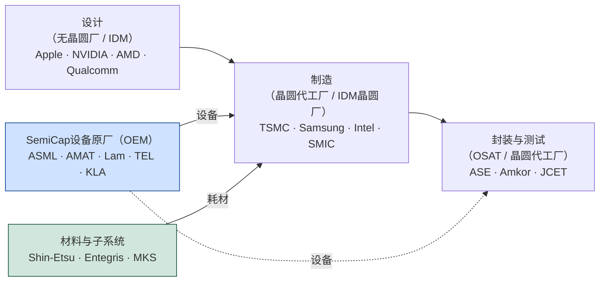
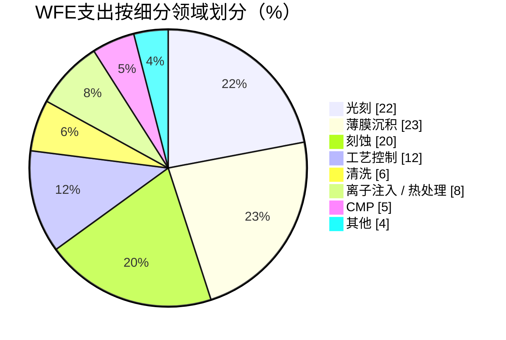
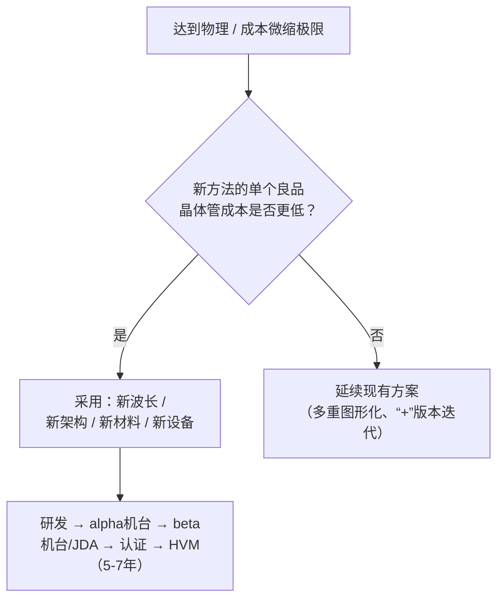

# 半导体资本设备——概览与战略背景

> 📘 **说明：** 本文为英文原版《Semiconductor Capital Equipment — Overview and Strategic Context》的简体中文参考译本，仅供参考；如有出入，以英文原版为准。

## 📊 图示概览

*原创示意图；Mermaid图表可在GitHub上原生渲染。*

**半导体价值链——以及半导体资本设备（SemiCap）在其下方所处的位置**

**全球晶圆厂设备（WFE）支出按细分领域划分（近似占比）**

**推动设备代际转换的因素**

---

## 1. 什么是半导体资本设备（SemiCap）？

半导体资本设备——普遍简称为“SemiCap”，在仅指前道设备时有时也称为**晶圆厂设备（WFE）**——包括用于将原始硅晶圆制造成集成电路（IC）的机器、仪器和子系统。这些设备单价动辄数百万美元，在半导体制造工厂（“晶圆厂”）内执行光刻、薄膜沉积、刻蚀、离子注入、平坦化、清洗、量测和测试等工序。一座领先的逻辑晶圆厂部署500–1,200台工艺设备，一座现代3nm/2nm级晶圆厂的设备总投入通常超过**200亿美元**——往往占新建（绿地）晶圆厂总建设成本的75–80%。

SemiCap处于全球经济中集中度最高、研发强度最大、战略敏感性最强的供应链之一的顶端。芯片本身由数百家公司设计、由数十家晶圆代工厂制造，而使这些芯片得以生产的设备却仅由极少数企业供应。五家公司——**阿斯麦（ASML）、应用材料（Applied Materials）、泛林集团（Lam Research）、东京电子（Tokyo Electron，TEL）和科磊（KLA）**——合计占据晶圆厂设备市场收入的绝大部分。在若干关键品类中，单一供应商几乎处于垄断地位：ASML是地球上*唯一*的极紫外（EUV）光刻扫描机供应商，而KLA在对良率至关重要的检测与量测领域占据主导地位。

SemiCap的决定性特征在于，它是**一切数字技术之下的赋能层**。每一部智能手机、每一颗数据中心GPU、每一个汽车控制器和每一枚导弹制导芯片，其物理存在都可以追溯到少数几家公司制造的少数几种设备。这使得SemiCap同时是一个工业部门、一种金融资产类别和一个地缘政治“卡脖子”环节。

### 为何SemiCap至关重要

三项结构性特征使SemiCap具有独特的重要性：

- **不可替代性。** 工艺设备凝聚了数十年积累的物理学、材料科学、精密工程以及隐性制造诀窍。一台EUV扫描式光刻机集成了来自约5,000家供应商的约100,000个零部件，其光学元件的面形误差被抛光至亚纳米级。没有任何国家或公司能够迅速复制这一切；进入壁垒以数十年时间和数百亿美元来衡量。
- **杠杆效应。** 由于供应高度集中，对单一设备品类的控制即可转化为对整个下游芯片产业的控制。拒绝一家晶圆厂获得EUV，就会使其逻辑路线图冻结在约7nm工艺节点（借助多重图形化），而在此之下将面临严重的成本和良率损失。
- **周期性与资本密集度。** SemiCap是一个周期性极强的行业，与晶圆厂建设“浪潮”紧密相连。当存储器价格高企或新晶圆厂破土动工时，设备订单激增；而在库存调整期间则急剧萎缩。这种繁荣—萧条模式塑造了整个行业的财务表现。

## 2. 设计、制造与设备供应之间的关系

现代半导体产业由三个相互交织但又彼此独立的层级构成，而SemiCap是支撑它们全部的基础。

| 层级 | 参与者 | 职能 | 示例 |
|---|---|---|---|
| **设计（无晶圆厂 / IDM设计）** | 无晶圆厂（Fabless）公司、IDM设计团队 | 构建电路架构并完成版图设计；生成GDSII/OASIS流片文件 | Apple、英伟达（NVIDIA）、AMD、Qualcomm、MediaTek；英特尔和三星的设计部门 |
| **制造（晶圆代工厂 / IDM晶圆厂）** | 晶圆代工厂和垂直整合制造商（IDM） | 使用工艺设备将晶圆加工成带图形的裸片 | 台积电（TSMC）、三星代工（Samsung Foundry）、英特尔代工（Intel Foundry）、GlobalFoundries、中芯国际（SMIC） |
| **设备与材料（SemiCap）** | 设备原厂（OEM）、子系统供应商、材料/化学品企业 | 制造并供应驱动晶圆厂运转的机器和耗材 | ASML、AMAT、Lam、KLA、TEL、ASM、信越化学（Shin-Etsu）、Entegris |

由1987年台积电成立所开创的**无晶圆厂—晶圆代工模式**，使芯片设计与制造相互分离。这对SemiCap产生了深远影响：随着晶圆代工厂为整个行业承担建厂的资本负担，设备需求集中到少数几家超大型客户（台积电、三星、英特尔、SK海力士、美光）。如今，**仅台积电一家在典型年份就占全球WFE总支出的两位数百分比**，使其对设备路线图拥有非凡的影响力。

价值流动是双向的。设计公司向上提出工艺需求（他们需要更高密度、更快速度、更低功耗的工艺节点）；晶圆代工厂将这些需求转化为工艺整合目标；设备原厂则必须提供能够实现这些目标的设备——通常需要通过联合开发协议（JDA）提前数年完成。反过来，设备*能够*做到什么，也约束着设计公司所能尝试的范围：现有光刻设备的分辨率决定了最小特征间距，进而决定晶体管密度，并最终限定可实现的性能和功耗。

## 3. SemiCap作为经济与地缘政治的杠杆点

任何关于SemiCap的讨论都离不开其地缘政治维度——大约自2018年起，这一维度已从小众议题转变为行业的核心特征。

### 出口管制与战略“卡脖子”环节

由于少数几种设备把控着整个先进芯片供应链，各国政府发现**管控设备远比管控芯片更为有效**。主要手段包括：

- 由美国工业与安全局（BIS）执行的**美国《出口管理条例》（EAR）**。具有里程碑意义的**2022年10月7日**规则限制向中国出口能够生产≤16/14nm（FinFET）逻辑芯片、半间距≤18nm的DRAM以及≥128层NAND的设备。这些规则直接削减了应用材料、泛林集团和科磊对华销售。
- **外国直接产品规则（FDPR）**，将美国管辖权延伸至含有美国技术的外国制造产品——鉴于几乎所有设备（包括ASML的EUV扫描机）都含有美国原产零部件或软件，这是一项强有力的杠杆。
- **荷兰和日本**——分别是ASML以及TEL/尼康（Nikon）/佳能（Canon）/迪恩士（SCREEN）的母国——已使本国管制与美国政策保持一致。自2018年以来，ASML一直未获准向中国发运EUV（许可证从未获批），而DUV浸没式设备的限制在2023–2024年间进一步收紧。日本**2023年3月**的管制涵盖了23类设备。
- **美国规则的持续加码**自2022年以来不断扩大管控范围：2023年10月的更新；**2024年12月**的一揽子措施（HBM管制、约140个新增实体清单条目、扩大的FDPR）；**2025年9月的“关联方”（50%）规则**，将实体清单限制扩展至其持股过半的子公司（根据美中贸易休战安排，自2025年11月10日起暂停执行一年）；以及自2025年12月31日起撤销三星和SK海力士在华晶圆厂的经验证最终用户（VEU）资格（以2026年度许可证取代，允许维持运营但不得扩产或升级）。
- **《国际武器贸易条例》（ITAR）** 管辖的范围较窄——主要是国防级和抗辐射加固元器件——但强化了该行业的军民两用敏感性。

### 产业政策：补贴时代

在实施限制的同时，主要经济体推出了规模庞大的补贴计划以实现产能本地化：

- **美国《芯片与科学法案》（CHIPS法案，2022年）**——约520亿美元，其中约390亿美元用于制造激励，约110亿美元用于研发（包括国家半导体技术中心NSTC）。该法案支撑了台积电亚利桑那州工厂、英特尔俄亥俄州/亚利桑那州工厂、三星得克萨斯州工厂和美光纽约州工厂。“护栏”条款禁止受资助方在十年内扩大在华先进产能。2025年8月，美国政府将英特尔的CHIPS补助转换为约10%的股权（约89亿美元），标志着一种更直接的、以持股为基础的产业政策形式。
- **《欧洲芯片法案》（2023年）**——撬动约430亿欧元，支持ASML、IMEC、Infineon、STMicroelectronics以及新建晶圆厂（如台积电/ESMC德累斯顿合资工厂和英特尔规划中的马格德堡工厂）。
- **中国“大基金”（国家集成电路产业投资基金）**——一期（约1,390亿元人民币/约220亿美元，2014年）、二期（约2,040亿元人民币/约300亿美元，2019年）和三期（约3,440亿元人民币/约470亿美元，2024年）——同时资助晶圆厂（中芯国际、长鑫存储CXMT、长江存储YMTC）和本土设备厂商（北方华创NAURA、中微公司AMEC、拓荆科技Piotech、SiCarrier）。
- **日本、韩国、印度等国**也推出了类似计划（例如日本对Rapidus和台积电熊本工厂的支持；韩国的超大型产业集群计划；印度的激励计划）。

最终结果是，SemiCap已成为治国方略的工具。设备原厂如今同时承受双重压力：一方面要抓住西方由补贴驱动的需求，另一方面要应对中国收入的流失——对主要WFE企业而言，中国收入历来占销售额的20–45%，2024年其中数家公司的这一比例一度超过40%。到2026年，这一比例已有所回落（例如在应用材料2026年7月当季收入中约占28%，在ASML 2026年第二至第三季度的系统销售额中占14–23%），原因是中国的提前采购趋于正常化且管制进一步收紧。

## 4. SemiCap价值链：从设备原厂到大批量制造

一台新的工艺设备从概念到在晶圆厂投入生产，要走过漫长的道路。理解这一流程有助于说明为何设备路线图要领先芯片生产数年。

1. **设备原厂研发与alpha机台。** 设备制造商通常与研究联盟（IMEC、Leti）或首发客户合作，开发出展示新能力的第一台原型机（“alpha机台”）。
2. **beta机台与JDA。** 在联合开发协议框架下，“beta”机台被安装在首发客户或研究晶圆厂。客户在真实工艺模块上运行设备原厂的机台，并反馈数据。
3. **工艺整合。** 晶圆厂的工艺整合工程师将新机台的工序融入包含1,000多道工序的完整流程中，确保其与上下游所有工序兼容——在这一过程中，一种新的刻蚀化学品可能会对量测、清洗和良率产生连锁影响。
4. **机台认证（“qual”）。** 机台必须在严格的统计范围内证明其稳定性、重复性和良率。认证指标包括设备稼动率、平均故障间隔时间（MTBF）、颗粒增量以及工艺能力指数（Cpk）。
5. **大批量制造（HVM）爬坡。** 只有通过认证后，机台才会投入生产，通常以数十个相同腔室组成的机群来提供产能。（由英特尔首创的）“精确复制”（copy-exactly）方法要求机群中的每台设备表现完全一致。

正是这一流程决定了像2nm这样的工艺节点需要提前5–7年做出设备决策，也解释了为何高数值孔径极紫外（High-NA EUV）——2024年首次向客户发货，并于2026年以EXE:5200B量产版本在英特尔俄勒冈开发晶圆厂完成验收——在此之前已在ASML和蔡司（ZEISS）研发了十多年。即便如此，根据ASML 2026年10月的表述，首发客户预计High-NA进入大批量制造的时间约为2028年（三星）至2030年（台积电）。

## 5. 市场规模：全球SemiCap总可寻址市场（TAM），2015–2030年

晶圆厂设备市场规模庞大，长期增长迅速，但逐年波动性很强。以下数据为具有代表性的行业估计（SEMI、VLSI Research、Gartner及公司披露）；具体数字因来源和定义（WFE与包括测试和组装在内的设备总额）不同而有所差异。

| 年份 | 半导体设备总额（十亿美元，近似值） | 备注 |
|---|---|---|
| 2015 | ~37 | PC衰退后的低谷；移动设备驱动 |
| 2016 | ~41 | 3D NAND和DRAM投资爬坡 |
| 2017 | ~57 | 存储器超级周期开始 |
| 2018 | ~64 | 存储器繁荣顶峰 |
| 2019 | ~60 | 存储器调整；逻辑/代工保持韧性 |
| 2020 | ~71 | 新冠疫情推动数字化需求；EUV爬坡 |
| 2021 | ~103 | 疫情期间供应紧缺；大规模资本开支 |
| 2022 | ~107 | 创纪录；逻辑/代工先进制程支出领跑 |
| 2023 | ~106 | 中国DUV提前采购抵消存储器下行 |
| 2024 | ~113 | AI驱动的先进制程+先进封装 |
| 2025 | ~133 | 创纪录；据SEMI（2025年12月）同比增长13.7%：AI资本开支、2nm爬坡、HBM |
| 2026（预测） | ~166 | SEMI年中预测（2026年7月），增长23.2%；WFE约1,440亿美元；DRAM领涨 |
| 2028（预计） | ~230 | SEMI预计创下约2,295亿美元的纪录 |
| 2030（预计） | ~160–200+（早期观点） | 2025年之前的预测，现已过时——SEMI对2028年的预测已超过该值 |

### 按工艺步骤细分（典型领先逻辑晶圆厂的WFE分配）

| 细分领域 | 约占WFE比例 | 主导厂商 |
|---|---|---|
| 光刻 | 20–25% | ASML（EUV/DUV）、尼康、佳能 |
| 刻蚀 | 18–22% | Lam、TEL、AMAT |
| 薄膜沉积（CVD/ALD/PVD/外延） | 20–25% | AMAT、Lam、TEL、ASM、国际电气（Kokusai） |
| 工艺控制（量测+检测） | 11–13% | KLA、AMAT、ASML、Onto、Nova |
| 化学机械平坦化（CMP） | 4–6% | AMAT、荏原（Ebara） |
| 离子注入 / 热处理 | 3–5% | AMAT、亚舍立（Axcelis）；AMAT、Kokusai、TEL |
| 清洗 / 湿法 | 5–7% | SCREEN、TEL、Lam |

最重要的长期趋势是<strong>光刻（受EUV/High-NA平均售价推动）和工艺控制（受EUV和全环绕栅极（GAA）良率难度推动）</strong>占比的持续上升，以及**先进封装设备**作为一个由芯粒（Chiplet）和面向AI的高带宽内存（HBM）所推动的全新支出类别的爆发式增长。

## 6. 主要行业组织与路线图

SemiCap行业通过若干机构进行协调：

- **国际半导体产业协会（SEMI）**——电子制造供应链的全球性行业协会。SEMI发布市场数据（备受关注的订单出货比和WFE预测），制定数百项接口与安全标准（例如用于自动物料搬运系统交接的SEMI E84、用于设备安全的SEMI S2/S8，以及FOUP/300mm/450mm晶圆标准），并举办各类展会（SEMICON West、Europa、Taiwan、Korea）。
- **IEEE电子器件学会（EDS）**——顶级器件研究会议IEDM和VLSI研讨会背后的专业机构，也是IRDS路线图的主办方。
- **ITRS / IRDS**——<strong>国际半导体技术路线图（ITRS，1992–2016年）</strong>及其由IEEE主办的继任者**国际器件与系统路线图（IRDS，2016年至今）**。这些共识性路线图协调全行业技术转换的时间节点，详见[文件15](15_technology_roadmaps.md)。
- **比利时微电子研究中心imec（IMEC）、CEA-Leti和Fraunhofer**——竞争前研究中心（见下文及[文件23](23_research_and_emerging_technologies.md)），在新工艺模块进入商业晶圆厂之前为其降低风险。
- <strong>世界半导体理事会（WSC）</strong>及各地区协会（美国的SIA、日本的JEITA、SEMI Europe）——在贸易、环境目标（PFC排放）和政策方面进行协调。

## 7. 设备代际如何界定以及推动转换的因素

设备“代际”与其说是由日历时间界定，不如说是由**工艺能力拐点**界定。当物理微缩极限迫使业界采取根本性的新方法时，新一代设备便应运而生。历史上的主要驱动因素包括：

- **光刻波长的转换：** g线（436nm）→ i线（365nm）→ KrF（248nm）→ ArF干式（193nm）→ ArF浸没式（193i）→ EUV（13.5nm）→ High-NA EUV。每一次转换都需要一个本质上全新的扫描机平台，以及由光刻胶、掩模和量测组成的全新生态系统。
- **晶体管架构的转换：** 平面晶体管 → 鳍式场效应晶体管（FinFET，约2011年，22nm）→ 全环绕栅极纳米片（三星2022年；台积电N2和英特尔18A自2025年末起大批量生产）→ 互补场效应晶体管（CFET，研究阶段；imec将其定位在A7代左右）。每一次转换都要求新的薄膜沉积（ALD内侧墙）、刻蚀（选择性沟道释放）和量测（单元内3D量测）能力。
- **材料的转换：** SiO₂ → SiON → 高k/金属栅；铝 → 铜 → 钴/钌/钼互连；新型低k介质。每种新材料往往需要新的设备或腔室。
- **晶圆尺寸的转换：** 150mm → 200mm → 300mm（约2001年）。期待已久的450mm转换在2017年前后被放弃，因为在密度微缩放缓的背景下其成本无法得到合理回报。

推动转换的是一套严酷的经济账：只有当现有方法的单个良品晶体管成本超过新方法时，新方法才会被采用。经典例子是**EUV导入**：只有当某一层所需的多重图形化次数（每次都需要一次浸没式曝光外加薄膜沉积和刻蚀）多到使单次EUV曝光反而更便宜时——尽管扫描机售价约1.5–2亿美元——EUV才变得经济可行。

## 8. 自有研发与设备原厂驱动的创新

SemiCap的创新来自两个互补的来源，而二者之间的平衡在行业历史中不断变化。

**自有研发与联盟研发。** 在早期的几十年里，大型IDM和政府支持的联盟承担了大部分研发重任：

- **SEMATECH**（1987–2015年），一个为对抗日本主导地位而成立的美国政府—产业联盟，负责协调设备认证和早期EUV开发。
- **IBM研究院**历来是远超生产进度的器件创新的超额贡献者——绝缘体上硅（SOI）、铜互连（1997年宣布）、应变硅、高k/金属栅，以及近年的首颗2nm纳米片测试芯片（2021年）和CFET研究。
- <strong>IMEC（比利时鲁汶）</strong>如今是占主导地位的中立、竞争前研究中心。IMEC拥有5,000多名研究人员和约9亿欧元的年度预算，运营一条300mm试验线，ASML、台积电、三星、英特尔、应用材料、泛林集团和东京电子在此共同开发下一代工艺模块。IMEC的路线图（N2、A14、A10、CFET）深刻影响着行业方向。
- <strong>CEA-Leti（法国格勒诺布尔）</strong>专注于FD-SOI、3D顺序集成以及成像/量子技术，与STMicroelectronics和Soitec紧密合作。

**设备原厂驱动的创新。** 随着研发成本上升以及IDM转向无晶圆厂或轻晶圆厂模式，越来越多的工艺创新转移到设备原厂内部。应用材料、泛林集团和东京电子如今运营着各自的先进开发晶圆厂，并雇用数以千计的工艺工程师。ASML的EUV项目是行业历史上规模最大的私营协调研发项目，在二十年间耗资远超100亿欧元，参与者包括蔡司（光学）、TRUMPF（CO₂驱动激光器）和Cymer（光源，2013年被ASML收购）。

因此，现代模式是**协作式的**：新工艺节点由IMEC试验线、设备原厂的开发晶圆厂和领先晶圆代工厂的工艺整合团队共同开发，并通过一张分担成本与风险的JDA网络加以维系。

## 9. 与晶圆厂建设浪潮相关的主要设备支出周期

SemiCap需求从根本上由**晶圆厂建设浪潮**驱动，而后者又由终端市场周期驱动。这一模式在数十年间清晰可辨：

- **存储器超级周期。** DRAM和NAND是价格剧烈波动的大宗商品市场。当价格飙升时（例如2017–2018年），三星、SK海力士和美光向新产能大举投资，偏重存储器的设备需求（薄膜沉积、刻蚀，尤其是高深宽比设备）随之激增。当价格崩跌时，资本开支几乎在一夜之间被削减。
- **先进逻辑/代工浪潮。** 台积电的资本开支在2025年之前每年处于300–400多亿美元区间，2026年的指引上调至600–640亿美元，它是先进制程设备需求的支柱。每一个新工艺节点（N5、N3、N2）都会引发一波EUV、刻蚀、薄膜沉积和量测设备订单。
- **成熟制程/特色工艺浪潮。** 2020–2022年的芯片短缺引发了一波面向汽车、工业和功率应用的成熟制程（28nm–180nm）产能投资——受益者包括DUV浸没式设备（通常是翻新设备）、较老的薄膜沉积/刻蚀设备以及中国本土设备原厂。
- **AI/先进封装浪潮（2023年至今）。** 生成式AI热潮催生了对先进逻辑芯片（基于台积电N4/N3的英伟达/AMD GPU）、HBM（通过硅通孔（TSV）和键合堆叠的DRAM）以及**先进封装**（CoWoS、SoIC）前所未有的需求。这使得先进封装设备——晶圆键合机、减薄/研磨设备、TSV刻蚀与填充设备——成为增长最快的SemiCap细分领域之一，并推动台积电的CoWoS产能进入多年扩张期。自2025年末起，这一浪潮扩展为由DRAM引领的**存储器上行周期**——常被称为“存储器超级周期”——HBM和常规DRAM价格大幅上涨，据泛林集团称，DRAM因此成为2026–2027年增长最快的WFE细分领域。

这些浪潮很少同步，这既平滑了总量，也使其更加复杂。存储器下行可能与先进逻辑繁荣同时发生，从而在一定程度上缓冲产品组合横跨两者的WFE设备原厂。这种多元化是最大的几家WFE企业（AMAT、Lam、TEL）维持横跨逻辑、存储器以及日益扩大的封装领域的广泛产品线的关键原因。

## 10. 战略综述

半导体资本设备是**信息经济的物理基础**——在这一领域，少数几家企业对使一切现代计算成为可能的设备拥有垄断或寡头控制权。其决定性特征是极端的供应集中度、非凡的研发强度（通常为收入的12–18%）、剧烈的周期性，以及自2018年以来在国家安全和大国竞争中的核心地位。

后续章节将从这一战略概览深入到芯片如何制造以及由哪些设备制造的具体细节。[文件02](02_chip_manufacturing_process_end_to_end.md)完整梳理端到端的制造流程；文件03–13逐一考察各设备品类以及存储器/化合物半导体的专门领域；[文件14](14_vendor_competitive_landscape.md)剖析厂商格局；[文件15](15_technology_roadmaps.md)和[文件23](23_research_and_emerging_technologies.md)——本数据库中最深入的部分——逐个工艺节点追溯技术路线图，并综述将定义下一个十年的前沿研究。它们共同构成了一幅关于地球上最具战略影响力的机器设备的全面地图。

---

## 延伸分析：SemiCap的战略独特性

### A. 地球上集中度最高的关键产业

值得深入思考SemiCap行业的集中度究竟有多么非同寻常，因为它在全球经济中没有真正的可比对象。试想，现代数字文明的整座大厦——每一部智能手机、每一个数据中心、每一个AI模型、每一套武器系统、每一辆汽车、每一台医疗设备——最终都依赖芯片，而最先进的芯片只能用在若干关键品类中来自**单一公司**的设备来制造。EUV光刻扫描机的制造商**只有一家**（ASML）。这些扫描机所需的EUV光学元件的制造商基本上**也只有一家**（蔡司）。最先进的工艺控制设备绝大部分来自**一家**公司（KLA）。与每台扫描机配套的涂胶/显影设备绝大部分来自**一家**公司（TEL）。没有任何其他具有同等重要性的产业呈现出如此程度的单点集中。最接近的类比——某些航空航天、制药或特种材料行业——其集中度要低得多，普遍关键性也低得多。这种独一无二的集中度是关于SemiCap最深层的事实，它既是该行业非凡盈利能力的来源，也是其在地缘政治中处于核心地位的原因：当使一切计算成为可能的设备来自少数几家不可替代的企业时，这些企业——以及能够影响它们的政府——便掌握了对整个技术未来的杠杆。

### B. 集中格局为何如此持久

这种集中并非偶然的暂时现象，而是一种稳定的均衡，由所有行业中最深的护城河所维系（[文件14](14_vendor_competitive_landscape.md)、[文件17](17_patents_and_ip_landscape.md)）。进入壁垒以**数十年时间和数百亿美元**来衡量：一台EUV扫描机集成了来自约5,000家供应商的约100,000个零部件，其光学元件面形误差被抛光至亚纳米级，光源通过激光脉冲轰击锡等离子体产生光，而系统集成诀窍则是在四分之一个世纪中积累起来的。没有任何国家或公司——无论资金多么充裕——能够迅速复制这一切：中国规模庞大、意志坚定、由国家支持的努力，在耗费多年时间和数百亿美元之后，仍未形成具备量产能力的本土EUV能力（2025年12月路透社报道称，深圳有一台EUV原型机能够产生EUV光，但尚未生产出可用芯片）。同样的持久性在较小程度上也保护着每个品类的领导者：积累的工艺诀窍、与客户的联合开发关系、装机量锁定、研发规模以及专利/商业秘密保护相结合，构筑起直接竞争难以迅速突破的护城河。这种持久性解释了为何SemiCap的竞争格局变化如此缓慢、为何领导者能保持如此高的盈利能力，以及为何对这些“卡脖子”环节的控制能转化为如此持久的战略杠杆。

### C. 微缩放缓的悖论

贯穿整个数据库的一个核心悖论值得在开篇就直言不讳：**摩尔定律的放缓对设备行业并非坏事——在重要意义上，它反而是好事。** 认为尺寸微缩放缓会缩小设备市场机会的直觉是错误的。随着每个工艺节点变得更难、更复杂、更昂贵——需要更多工艺步骤、更多EUV/High-NA曝光、更多工艺控制、新材料和三维集成——**对设备的需求、设备的价值以及技术难度（从而护城河）都在增加。** 即便每个节点的密度增益在缩小，领先晶圆厂的成本仍在上升；工艺步骤数量在增加；光刻和工艺控制在WFE中的占比在上升；全新的品类（先进封装、键合、减薄、背面工艺）不断涌现。设备行业的价值正在因经典微缩的放缓而被**重新分配和扩大**，而非被侵蚀。这一悖论——轻松微缩的终结恰恰是一个更复杂、更依赖设备、设备价值更高的时代的开端——是SemiCap投资与战略论点的乐观内核，并在后续各章中反复出现。

### D. 地缘政治的长期性

最后，SemiCap被推向地缘政治中心（[文件18](18_geopolitics_and_export_controls.md)）并非一个过渡阶段，而是一种永久性的变化。一旦各国政府发现控制少数几种设备就能把控整个先进芯片供应链——进而把控依赖于此的AI、军事和经济能力——半导体资本设备便成为治国方略的永久工具。近年来的出口管制、补贴竞赛和供应链安全举措并非暂时的扰动，而是新常态，它们将在可预见的未来塑造该行业的结构、地理分布和经济格局。对于任何希望理解现代世界——其技术、经济和力量平衡——的人来说，SemiCap行业已不再是小众议题而是核心议题，因为它是数字与AI时代赖以建立的物理基础，也是争夺这个时代制高点的竞争日益集中的“卡脖子”关口。后续章节将从这一战略概览深入到这一最具影响力的产业如何运作的技术与商业细节——但在通读全文时应始终牢记此处确立的战略利害，因为正是它们使本数据库所描述的机器设备具有如此深远的意义。

---

## 🆕 2025–2026年更新：最新进展（截至2026年11月）

自2025年初以来，上文描绘的战略图景得到了强化而非颠覆。这一时期有三大主题：规模远超预测者预期的AI驱动设备繁荣；叠加在2nm爬坡之上、由DRAM引领的存储器上行周期；以及在升级与休战之间摇摆、但并未放松对设备核心管控的地缘政治格局。

### 市场规模：预测屡次上调

| 来源（日期） | 年份 | 数据 | 说明 |
|---|---|---|---|
| SEMI年终预测（2025年12月） | 2025 | 设备总额约1,330亿美元（+13.7%） | 创新纪录 |
| SEMI年终预测（2025年12月） | 2026 / 2027 | 1,450亿美元 / 1,560亿美元 | 首次预测超过1,500亿美元 |
| SEMI年中预测（2026年7月14日） | 2026 | 总额1,659亿美元（+23.2%）；WFE约1,439亿美元；测试设备约153亿美元 | 大幅上调 |
| SEMI年中预测（2026年7月14日） | 2028 | 约2,295亿美元 | 预计创纪录 |
| 泛林集团（2026年10月21日） | 2026 / 2027年WFE | 约1,500亿美元中段 / 超过2,000亿美元（初步） | DRAM领涨，其次为代工/逻辑，再次为NAND |
| 科磊（2026年10月） | 2026年WFE | 约1,500亿美元低段 | 预计2027年“显著增长” |

各方定义不同（WFE与包括测试和组装在内的设备总额），因此这些数字并不严格可比，但方向是明确无误的：该行业的增长将远超早期预测（包括第5节表格）所设想的约1,600–2,000亿美元“2030年”区间。在需求侧，Gartner预计2026年半导体资本开支总额约为2,370亿美元；世界半导体贸易统计组织（WSTS）预计2026年半导体收入接近约9,750亿美元，而Omdia认为可能突破1万亿美元大关。

### 龙头企业：业绩创纪录，产能成为硬约束

- **ASML**公布2026年第三季度净销售额创纪录的117亿欧元（2026年10月14日），将2026财年指引定为440–450亿欧元，并警告称，尽管计划在2027年将低数值孔径EUV和DUV浸没式产能提高约30%，规划中的供应**仍无法完全满足2027年和2028年的客户需求**。据报道，客户已在要求下2029–2030年的订单。
- **应用材料**公布2026财年第三季度创纪录收入约91亿美元（同比增长25%），中国占收入比例降至约28%；出口管制估计将使其2026财年收入减少约6亿美元。
- **泛林集团**（2026年10月21日）公布代工业务销售额创纪录，并指出**洁净室空间短缺和零部件供应受限**可能制约全行业产出——与2023年的产能过剩担忧形成鲜明反差。
- **整合**：亚舍立（Axcelis）与维易科（Veeco）的全股票合并（2025年10月宣布，约44亿美元）已于2026年2月获得双方股东批准，目前预计在2027年第一季度末前完成，尚待中国国家市场监督管理总局（SAMR）批准以及重新提交的HSR申报。应用材料于2026年5月同意收购ASMPT旗下的NEXX先进封装沉积业务（据报道），并于2025年取得Besi约9%的股权。

### 客户与工艺节点

台积电的N2——其首个GAA纳米片工艺节点——自2025年第四季度起已进入大批量生产，公司并将2026年资本开支指引上调至600–640亿美元。英特尔18A——首个采用背面供电（PowerVia）的工艺节点——随Panther Lake进入大批量制造，而美国政府（约10%）、英伟达（50亿美元）和软银（20亿美元）于2025年成为其股东。三星的SF2已投入生产；日本Rapidus自2025年7月起已实现2nm GAA原型晶体管工作，目标是在2027财年下半年进入大批量制造。

### 地缘政治：休战但未松绑

- 美国2025年9月的“关联方”（50%）规则作为美中休战安排的一部分，自2025年11月10日起暂停执行一年；据报道，2026年9月休战期延长至2027年1月10日。
- 三星和SK海力士在华晶圆厂的VEU资格于2025年12月31日终止，取而代之的是仅限维持运营的2026年度许可证。
- 针对一小部分先进芯片的25%《232条款》关税于2026年1月15日生效，对支持美国本土制造的进口给予豁免。
- 据行业机构数据，2025年中国本土设备厂商供应了中国晶圆厂所用设备的约35%，但光刻设备的国产化率仍低于约5%。路透社报道了深圳的一台EUV原型机（2025年12月），该机尚未生产出可用芯片。
- 荷兰政府与中国母公司闻泰科技（Wingtech）之间的安世半导体（Nexperia）纠纷自2025年10月起扰乱了汽车芯片供应，表明即使是成熟制程供应链如今也会受到国家干预。

### 晶圆厂内部的AI

AI如今既是设备需求的主要驱动力，也是晶圆厂和设备原厂所使用的工具——从AI辅助检测、数字孪生，到GPU加速的计算光刻（例如台积电采用英伟达cuLitho）。

### 值得关注的事项（2026年末–2027年）

- 2027年WFE能否达到泛林集团等公司初步提出的超过2,000亿美元，以及洁净室空间、零部件或ASML产能是否会限制此轮上行。
- ASML资本市场日（2027年6月10日）及其可能更新的长期产能和High-NA采用目标。
- 英特尔14A（首个计划采用High-NA EUV的工艺节点）的客户承诺。
- 2027年1月10日之后美中休战的走向，包括“关联方”规则暂停执行的安排，以及中国对稀土和镓/锗的出口管制。
- 亚舍立—维易科合并的完成情况，以及先进封装设备领域的进一步整合。
