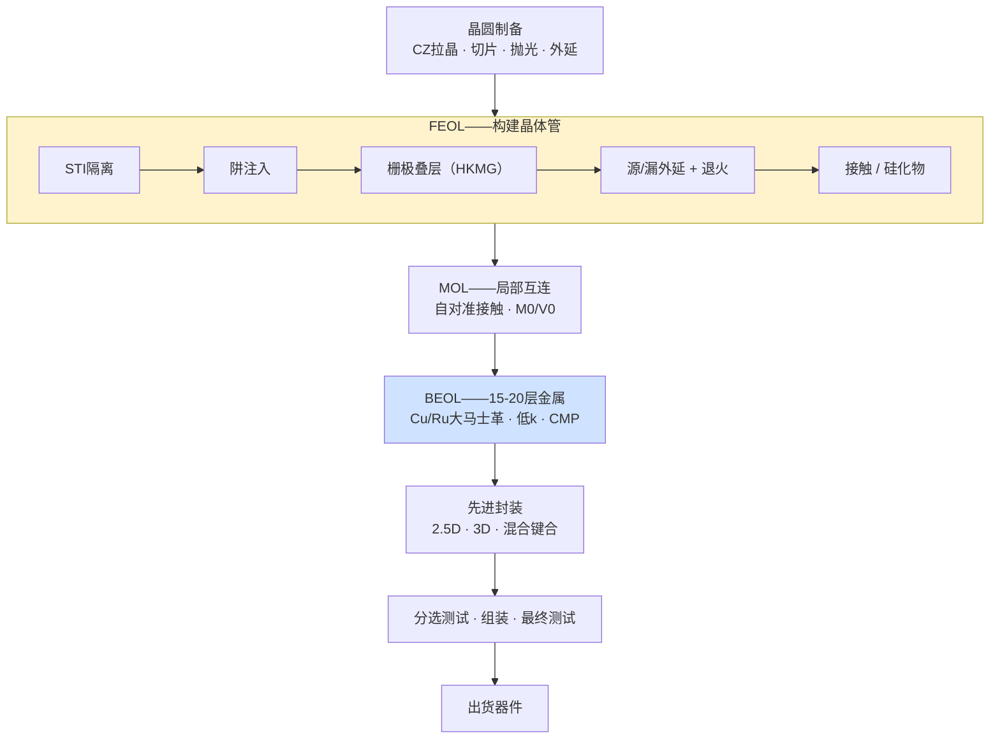
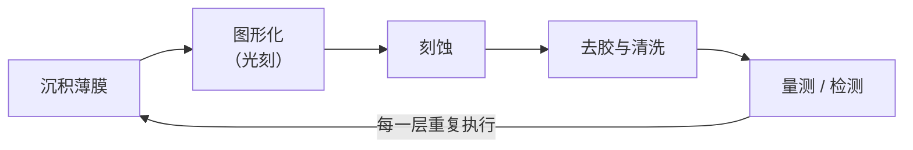

# 端到端芯片制造流程

> 📘 **说明：** 本文为英文原版《End-to-End Chip Manufacturing Process》的简体中文参考译本，仅供参考；如有出入，以英文原版为准。

本文追溯从原始硅材料到封装完成、测试合格的集成电路的完整历程。一颗领先的逻辑芯片要在3–4个月的生产周期内经历**1,000–1,500道独立工艺步骤**，反复循环执行相同的基本操作——沉积、图形化、刻蚀、清洗、量测——以逐层构建数十个堆叠层。以下各节遵循标准顺序：晶圆制备、前道（FEOL）、中道（MOL）、后道（BEOL）、先进封装，以及贯穿全程的量测/测试工序。

对于每个模块，讨论涵盖其背后的物理/化学原理、该步骤存在的原因、由哪类设备执行，以及先进制程面临的挑战。

---

## 📊 图示概览

*原创示意图；Mermaid图表可在GitHub上原生渲染。*

**端到端制造流程（原始硅 → 封装器件）**



**制造的重复单元——沉积-图形化-刻蚀-清洗循环（每片晶圆执行30-70次）**



**决定整个流程顺序的热预算逻辑**

下图说明：流程从高温步骤（晶体、阱、栅极、源/漏——硅能承受高温）逐步过渡到接触/硅化物，再到BEOL（≤400°C，受铜和低k材料限制），最后到封装（已组装部件）。

```
HIGH temperature ───────────────────────────────► LOW temperature
Crystal/well/gate/S&D   →   contacts/silicide   →   BEOL (≤400°C)   →   packaging
(silicon tolerates heat)                          (Cu & low-k limit)   (assembled parts)
```

---

## 1. 晶圆制备

一切都始于极其纯净、无缺陷的单晶硅。

### 晶体生长——直拉法（CZ法）

电子级多晶硅（纯度9N–11N，即99.9999999%以上）在约1,420°C的石英坩埚中熔化。将具有精确晶向（CMOS通常为<100>）的籽晶浸入熔体，并在旋转的同时缓慢提拉。原子按照籽晶的晶格排列依附于籽晶之上，生长出直径达300mm、长度2米以上的圆柱形单晶**硅锭（晶棒）**。向熔体中添加掺杂剂（p型用硼，n型用磷）以设定基础电阻率。

- <strong>区熔法（FZ）</strong>生长是另一种方法，可获得更高的纯度和电阻率（无坩埚接触），用于功率器件和探测器，但不用于主流逻辑芯片。
- 主要挑战：控制来自石英坩埚的氧掺入、尽量减少晶体原生颗粒（COP）和空位，以及保持径向电阻率均匀性。磁场直拉法（MCZ）通过施加磁场来抑制对流并控制氧含量。

### 切片、研磨、抛光

硅锭被研磨至精确直径，经X射线定向后，使用**金刚石线锯**切割成约775μm厚（300mm晶圆）的晶圆。随后晶圆依次经过：

- **研磨**，去除切割损伤并改善平整度；
- **化学腐蚀**，去除亚表面损伤；
- 通过化学机械平坦化（CMP）进行**抛光**，获得镜面光洁度、亚纳米级粗糙度和极高的平整度（局部平整度/SFQR在纳米范围内，这对光刻焦深至关重要）；
- **清洗**并检测颗粒和缺陷。

### 外延沉积

许多先进晶圆会生长一层**外延（epi）层**——通过CVD（在高温下使用二氯硅烷/DCS或硅烷）在抛光表面上生长的一层薄而超纯的单晶硅薄膜。外延层提供无缺陷、掺杂精确的器件层，并能抑制闩锁效应。<strong>绝缘体上硅（SOI）</strong>晶圆——用于FD-SOI和射频——采用Soitec的Smart Cut工艺（氢注入+键合+层转移）或SIMOX工艺制造。

**主要厂商：** 信越化学（Shin-Etsu）、胜高（SUMCO）、GlobalWafers、Siltronic（抛光片/外延片）；Soitec（SOI）。外延设备：应用材料（AMAT，Epi Centura/Centura RP）、ASM（Intrepid/Epsilon）。

---

## 2. 前道（FEOL）

FEOL构建晶体管本身——即有源器件。这是整个流程中物理强度最高、热预算灵活性最低的部分。在2nm级工艺——台积电（TSMC）N2（自2025年第四季度起大批量生产）、英特尔（Intel）18A和三星（Samsung）SF2——中，鳍式场效应晶体管（FinFET）已让位于**全环绕栅极（GAA）纳米片**，这在下文所述的FEOL模块中增加了Si/SiGe超晶格外延、内侧墙形成和选择性沟道释放等工序。

### 2.1 浅沟槽隔离（STI）

相邻晶体管之间必须电隔离。STI在器件区域之间的硅中刻蚀出浅沟槽，用介质（高密度等离子体CVD或可流动CVD SiO₂）填充，然后通过CMP平坦化。沟槽衬层和填充必须无空洞；在先进节点，鳍/纳米片之间隔离结构的高深宽比使无空洞间隙填充成为一项关键挑战（通过可流动氧化物和ALD解决）。

### 2.2 阱注入

离子注入形成分别承载pMOS和nMOS晶体管的**n阱和p阱**。倒掺杂阱分布（表面以下掺杂浓度更高）可控制闩锁效应和短沟道效应。这需要使用中能和高能离子注入机，并精心设置倾角以避免沟道效应。

### 2.3 栅极叠层形成——从热氧化层到HKMG

栅介质是MOSFET的核心。历史上它是**热生长SiO₂**（遵循Deal-Grove动力学），随工艺节点逐代减薄，直到约90/65nm时达到约1.2nm——仅几个原子层——此时量子力学栅极漏电变得无法容忍。

解决方案于<strong>45nm（英特尔，2007年）</strong>引入，即**高k/金属栅（HKMG）**：

- **高k介质：** 通过ALD沉积的HfO₂（k≈20–25），配以SiO₂/SiON界面层。物理上更厚的高k薄膜可提供与薄得多的SiO₂相同的电容（低等效氧化层厚度，EOT），但漏电流低几个数量级。
- **金属栅：** 取代多晶硅栅，以消除多晶硅耗尽并设定合适的功函数。nMOS和pMOS需要*不同*的金属功函数（nMOS为TiAl基，pMOS为TiN基），通过功函数金属层进行调节。

存在两种集成方案：<strong>先栅（gate-first）</strong>和**后栅（替代金属栅，RMG）**。英特尔开创了后栅工艺，并因其能保护高k材料免受高温源/漏退火影响而成为主流。在RMG中，先形成牺牲性（“伪”）多晶硅栅，完成源/漏工艺后，再去除伪栅并以高k和金属叠层取而代之。

### 2.4 源/漏工程

源极和漏极区域经过专门设计，以实现低电阻并施加有益的应变：

- **应变SiGe源/漏（pMOS）：** 在凹陷的源/漏区域中选择性外延生长原位硼掺杂SiGe，对沟道施加压应变，提升空穴迁移率。Ge浓度逐代攀升（从约20%到50%以上）。
- **Si:P源/漏（nMOS）：** 磷掺杂硅（有时为SiC）施加张应变，提升电子迁移率。
- **扩展区注入和晕环注入**形成超浅结（USJ）和口袋注入，以控制短沟道效应。
- **退火**激活掺杂剂并修复注入损伤，同时尽量减少扩散——采用尖峰快速热处理（spike RTP）、闪光灯退火（FLA），以及在先进制程中日益增多地用于最浅结的**激光尖峰退火（LSA）**。

### 2.5 接触形成

接触将硅源/漏连接到第一层金属。**硅化**在硅表面形成低电阻的金属硅化物（较老节点为NiSi、NiPtSi或CoSi₂；先进制程为Ti基），以降低接触电阻。随后填充接触孔——历史上采用通过CVD沉积的**钨（W）**（使用WF₆/H₂，以TiN为阻挡层），如今随着接触尺寸缩小，越来越多地采用**钴或钌**以降低电阻。

**接触电阻（Rc）是2nm及以下最具约束性的单一微缩挑战**：随着接触面积缩小，Rc上升，目前已占器件总电阻的很大一部分。

---

## 3. 中道（MOL）

MOL连接晶体管（FEOL）与全局互连（BEOL），包括最初的、间距最紧密的连接：

- **局部互连**和**自对准接触（SAC）**，在栅极上使用氮化物帽层，使接触孔能够以自对准方式刻蚀而不会与栅极短路。
- **COAG（有源栅上接触）：** 由英特尔在10nm引入，将栅极接触直接置于有源栅区域上方（而非隔离区上方）以节省面积——这是一个重要的密度杠杆，但也是一个良率风险，因为它压缩了防止栅极与接触短路的余量。
- **M0/V0金属化：** 最底层的金属（M0）和通孔（V0）层，通常采用钴（台积电在N7的下层金属中采用了Co），以在极小尺寸下获得更好的间隙填充和抗电迁移性能。

MOL以ALD/CVD阻挡层与填充、选择性刻蚀和精密CMP为主，套刻要求极为严格。

---

## 4. 后道（BEOL）

BEOL构建多层“布线”——在先进制程中多达**15–20层金属**——将数十亿个晶体管连接成可运行的电路。

### 4.1 双大马士革铜互连

自IBM于1997年引入以来，铜凭借更低的电阻率和更好的抗电迁移性能取代了铝。由于铜难以刻蚀，BEOL采用**双大马士革**工艺：

1. 沉积层间介质（ILD）。
2. 在介质中刻蚀沟槽（用于导线）和通孔（用于垂直连接）。
3. 沉积**阻挡层/衬层**（TaN/Ta，阻止Cu扩散）和**铜籽晶层**（PVD），然后通过<strong>电镀（ECD）</strong>填充铜。
4. 通过**CMP**去除多余部分，留下嵌入的铜线和通孔。

### 4.2 低k与超低k介质

为降低互连电容（从而降低RC延迟和功耗），ILD从SiO₂（k≈4.0）演进到碳掺杂氧化物<strong>SiOCH低k（k≈2.7–3.0）</strong>和**多孔超低k（k≈2.0–2.5）**。降低k值需要引入孔隙，这使薄膜机械强度变弱，在刻蚀、灰化和CMP过程中易受损伤——这是BEOL的核心权衡。**气隙**结构（k≈1.0）被用于部分上层（例如台积电N5），以最大限度地降低电容。

### 4.3 BEOL中的CMP

每一层金属都要通过CMP进行平坦化。挑战包括**碟形凹陷**（宽铜线条的过度抛光）和**侵蚀**（密集阵列中介质的损失），二者都会降低下一层的光刻焦深。

### 4.4 10nm以下间距向Ru/Mo的转换

在最紧密的间距下，由于晶界和表面处的电子散射，铜的电阻率急剧上升，而固定厚度的TaN阻挡层占用了过多的导线截面。业界正在将较低的BEOL层转向<strong>钌（Ru）</strong>和**钼（Mo）**，它们可以使用更薄的阻挡层甚至无需阻挡层，并在微缩尺寸下提供更低的有效电阻率。面向量产的钼ALD设备已于2025年上市（例如泛林集团（Lam Research）的ALTUS Halo），面向NAND、DRAM和逻辑芯片的金属化应用。这部分内容在[文件04](04_deposition.md)和[文件15](15_technology_roadmaps.md)中有深入讨论。

---

## 5. 先进封装

封装在历史上曾是低价值的“后段”附属环节，如今已成为主要的性能杠杆——是**芯粒（Chiplet）架构**和**异构集成**的基础。（[文件11](11_advanced_packaging_equipment.md)详细介绍相关设备。）

- **2.5D——CoWoS（晶圆上芯片再上基板）：** 多个裸片（逻辑+HBM堆栈）并排放置在含有细间距布线和硅通孔（TSV）的硅**中介层**上。这是现代AI加速器（英伟达（NVIDIA）、AMD）的支柱。
- **3D——SoIC / Foveros / X-Cube：** 裸片垂直堆叠，通过微凸点或日益普遍的**混合键合**连接。台积电的SoIC、英特尔的Foveros和三星的X-Cube是领先平台。
- **混合键合（Cu-Cu直接键合）：** 3D集成的前沿。两个表面——各自是嵌入介质中的平坦化铜焊盘阵列，抛光至亚纳米级粗糙度——相互接触；介质在室温下键合，再通过热退火使铜焊盘熔合。这使键合间距可低于10μm（迈向1μm及以下），比微凸点细一个数量级；据报道，台积电SoIC量产采用约6μm间距。这需要极致的CMP、表面活化和100nm以下的对准精度。集成式芯片-晶圆（die-to-wafer）混合键合设备（例如应用材料与Besi于2025年推出的Kinex系统）旨在将其推向大批量应用。
- **扇出型晶圆级封装（FOWLP）：** 裸片被嵌入重构的塑封晶圆中，并通过直接构建于其上的重布线层（RDL）相连。台积电的**InFO**（用于Apple A系列应用处理器）和**HDFO**，以及最早的**eWLB**，是主要变体。
- **HBM堆栈键合：** 高带宽内存（HBM）将8–16个DRAM裸片通过TSV和微凸点堆叠在一起，然后与逻辑芯片并排放置在中介层上。业界曾长期预期混合键合将随HBM4到来，但JEDEC将HBM4封装高度上限放宽至775μm（此前为720μm），使HBM4——2026年已为英伟达Rubin平台量产——得以继续采用批量回流模塑底部填充（MR-MUF）和热压键合；SK海力士（SK hynix）在Hot Chips 2026上表示，混合键合最早要到HBM5才会采用，而据报道三星正更积极地推进这一技术。
- **共封装光学（CPO）：** 光学引擎与交换机或加速器裸片集成在同一封装内。CPO交换机于2025–2026年开始出货（例如英伟达的Spectrum-X/Quantum-X Photonics），台积电的COUPE平台于2026年下半年进入量产。

---

## 6. 量测与检测（贯穿全程）

工艺控制并非单一步骤，而是贯穿整个流程的普遍性活动。（[文件08](08_metrology_and_inspection.md)专门讨论这一主题。）它有三种时间模式：

- **在线（工序后离线取样）：** 在关键步骤之后抽取晶圆，在专用量测设备（CD-SEM、散射测量、椭偏仪）上测量关键尺寸（CD）、膜厚和套刻。
- **原位 / 设备内在线：** 工艺腔内的传感器实时监控工艺——用光学发射光谱（OES）判断刻蚀终点，用反射测量判断CMP终点，用光谱监测薄膜沉积。
- **离线：** 在实验室进行详细的物理/失效分析（TEM、FIB），用于工艺开发和异常的根因分析。

检测（发现缺陷）与量测（测量尺寸）是不同的。二者均由<strong>科磊（KLA）</strong>主导，应用材料（电子束）和阿斯麦（ASML，YieldStar套刻、HMI电子束）是另外的主要参与者。在先进节点，捕捉微小的、由EUV随机效应引起的缺陷十分困难，这使工艺控制成为增长最快、对良率最关键的支出领域之一。

---

## 7. 晶圆分选、探针与测试

晶圆完全制造完成后，每个裸片在切割前都要进行**晶圆级电性测试（“晶圆分选测试”或“探针测试”）**：

- **探针卡**（采用垂直或悬臂探针，或MEMS探针）接触裸片的I/O焊盘。
- <strong>自动测试设备（ATE）</strong>施加测试向量，测量功能、速度和漏电流（IDDQ）。
- **参数测试**在划片道中的测试结构上测量晶体管阈值电压（Vt）、驱动电流和漏电流。
- 裸片按性能（速度等级）**分档**，并标记为合格/不合格。良率图驱动工艺控制反馈。

对于3D和芯粒产品，堆叠前的<strong>已知合格裸片（KGD）</strong>测试至关重要，因为单个不良裸片就可能毁掉一个昂贵的多裸片组件。

---

## 8. 最终组装与封装测试

合格裸片经切割和封装（[文件11](11_advanced_packaging_equipment.md)）后，再次进行测试：

- 封装后的**最终测试**验证器件在其封装中、在不同电压和温度下能正常工作。
- <strong>老化测试（Burn-in）</strong>在升高的电压/温度下对器件施加应力，以筛除早期失效（依据JEDEC标准）。
- <strong>系统级测试（SLT）</strong>在接近真实应用的环境中运行芯片——对于仅靠ATE无法捕捉全部故障的复杂SoC越来越重要，并可部分替代老化测试。

**主要测试厂商：** 爱德万测试（Advantest）和泰瑞达（Teradyne）（ATE）；Cohu、FormFactor、Technoprobe（分选机和探针卡）。（[文件25](25_test_and_characterization.md)深入讨论测试。）

---

## 9. 串联整个流程：从工艺节点的视角看

为了理解这些模块如何相互衔接，不妨考察先进节点上的单个金属层：先**沉积**介质（CVD/旋涂），通过光刻进行**图形化**（对光刻胶进行EUV曝光），**刻蚀**（等离子体刻蚀转移图形），**去除光刻胶并清洗晶圆**，**沉积**阻挡层和金属（ALD/PVD/ECD），对表面进行**平坦化**（CMP），最后对结果进行**量测和检测**（CD、套刻、缺陷）。这一沉积-图形化-刻蚀-清洗-填充-平坦化-量测的循环在数十层中的每一层重复执行，每层都有各自的材料、尺寸和公差——任何一个步骤失控都可能毁掉整片晶圆的良率。

这就是为什么半导体制造常被称为人类日常执行的最复杂的工艺：要协调上千个依次进行、各自都容不得差错的步骤，每一步都依靠一类专门的资本设备来实现，从而可靠地生产出数十亿个完全相同的纳米级结构。后续章节将逐一考察这些设备类别。

---

## 延伸分析：流程的内在逻辑及其现代演进

### A. 流程为何按此顺序排列

半导体制造的顺序并非随意安排——它遵循一套不可违背的**热预算逻辑**，由此决定了整个流程的顺序。需要最高温度的步骤（晶体生长、阱与隔离形成、栅极叠层形成、源/漏激活）必须**最先**进行，因为此时硅仍能承受高温。一旦晶体管形成，尤其是引入金属互连之后，热预算便急剧收紧（铜和低k介质在约400°C以上会退化），因此此后的一切——整个BEOL以及封装——都必须在逐步降低的温度下完成。这种热预算排序解释了FEOL → MOL → BEOL → 封装的顺序：这是一个从温度最高、最依赖硅的步骤，逐步下降到温度最低、最依赖金属与集成的步骤的过程。理解这一逻辑有助于说明某些创新为何困难——例如，为何在已完成的金属层之上构建第二层晶体管（单片3D，[文件23](23_research_and_emerging_technologies.md)）如此具有挑战性（必须在下层金属所能承受的低热预算内完成），以及为何激光退火（仅加热表面）对流程后段的激活如此有价值。

### B. 沉积-图形化-刻蚀-清洗循环：制造的“原子单元”

在模块层级结构（FEOL、MOL、BEOL）之下，半导体制造真正的重复单元是**沉积-图形化-刻蚀-清洗循环**，它被执行数十次以构建层状结构。每个循环中：**沉积**一层薄膜，通过**光刻**在光刻胶中定义图形，通过**刻蚀**将图形转移到薄膜中，**去除光刻胶并清洗晶圆**，然后对结果进行**量测和检测**。1,000多道工艺步骤中的每一步都属于这些循环之一，而每个循环都各自容不得差错——任何一个循环中的缺陷、错位或超规格尺寸都可能毁掉晶圆。半导体制造的精妙与难度在于：要按顺序将这一循环执行上千次，每次执行都保持原子级公差，覆盖每颗芯片上数十亿个特征结构，并使良率高到足以盈利。这就是为什么该循环每一步所对应的设备——薄膜沉积、光刻、刻蚀、清洗、量测——构成了SemiCap行业的核心，也是为什么其中任何一项的改进都会波及整个流程。

### C. 流程如何变得更长、更复杂

流程中的步骤数随每个工艺节点急剧增加，理解其原因有助于揭示制造成本和复杂度的上升。成熟节点可能只需要几百道步骤；而领先的GAA节点需要1,000–1,500道。增长来自多个方面：**更多金属层**（随着逻辑密度提高，从约10层增至15–20层以上）、**多重图形化**（每个多重图形化层都会倍增为若干沉积/光刻/刻蚀/清洗子步骤）、**新模块**（HKMG、FinFET鳍形成、GAA超晶格/内侧墙/沟道释放、背面供电）、**更多工艺控制**（随着公差收紧，量测和检测步骤增多）以及**新材料**（每种都需要各自的沉积、刻蚀和清洗）。步骤数的增长是晶圆成本上升（[文件15](15_technology_roadmaps.md)）和设备需求上升（更多步骤意味着每片晶圆需要更多次设备加工）的主要驱动因素，这也是为什么即使尺寸微缩步伐放缓，设备市场仍在增长——每个工艺节点虽然微缩幅度变小，但制造所需的步骤和设备却更多。

### D. 对经典流程的现代颠覆

若干现代发展正在颠覆本文所述的经典“由正面到背面”的流程。**背面供电**（[文件15](15_technology_roadmaps.md)）——目前已随英特尔18A的PowerVia进入大批量生产，台积电A16的Super Power Rail紧随其后——在正面完成*之后*增加了一整套新的加工序列：翻转晶圆、将其减薄并加工背面，从而将流程扩展到第三维度。**顺序3D集成和CFET**（[文件23](23_research_and_emerging_technologies.md)）将晶圆键合在一起并加工额外的层级，打破了经典流程的单晶圆线性特征。**先进封装**（[文件11](11_advanced_packaging_equipment.md)）已从简单的后段步骤发展为复杂的、达到前道级别的加工序列（TSV、RDL、混合键合），其复杂程度可与晶圆流程的部分环节相媲美。这些颠覆反映了向三维集成的更广泛转向：经典流程在单一晶圆表面上逐层构建芯片，而现代流程越来越多地在第三维度上构建——在背面、在堆叠层级中、跨越键合裸片——从而扩展并复杂化了数十年来定义制造的那套优雅的由正到背的顺序，并催生了新的设备类别（键合、减薄、背面加工），这些类别是行业中增长最快的领域之一。

### E. 流程即设备产业的地图

端到端流程实际上就是整个SemiCap产业的地图：每个模块对应一个或多个设备类别，本数据库的章节也沿着流程展开。晶体生长和晶圆加工（材料供应商，[文件16](16_key_materials_and_chemicals.md)）；FEOL（光刻、薄膜沉积、刻蚀、离子注入、热处理、清洗——文件03–10）；MOL和BEOL（薄膜沉积、刻蚀、CMP、光刻——文件03–06）；先进封装（[文件11](11_advanced_packaging_equipment.md)）；贯穿全程的量测与检测（[文件08](08_metrology_and_inspection.md)）；以及最后的测试（[文件25](25_test_and_characterization.md)）。因此，理解流程是理解设备产业的基础，因为每台设备的存在都是为了执行这一序列中的一个或多个步骤，而每个设备类别的价值都源于其所执行步骤的关键性、难度和频次。流程是半导体制造——以及赋能它的设备产业——整部大戏上演的舞台。

---

## 🆕 2025–2026年更新：最新进展（截至2026年11月）

2025年至2026年末，本文所述的端到端流程在三个环节同时发生了变化：晶体管（GAA纳米片在先进制程中取代了FinFET）、供电网络（转向晶圆背面）以及后段（先进封装和HBM本身成为产能瓶颈）。每一项变化都增加了工艺步骤和新的设备类型，这在很大程度上解释了为何国际半导体产业协会（SEMI）2026年7月的年中预测将2026年晶圆厂设备（WFE）定在约1,439亿美元。

### FEOL：GAA时代进入量产

| 工艺节点 | 公司 | 状态（2026年11月） | 对流程的影响 |
|---|---|---|---|
| N2 | 台积电 | 自2025年第四季度起量产；据报道产能已售罄；N2P随后推出 | Si/SiGe超晶格外延、内侧墙、沟道释放 |
| 18A | 英特尔 | 大批量制造（Panther Lake，2026年初）；18A-P自2026年6月起风险试产 | GAA（RibbonFET）+ PowerVia背面供电 |
| SF2 | 三星 | 已投产（Exynos 2600）；第二代于2026年下半年爬坡 | GAA（MBCFET）；据报道良率低于台积电 |
| 2nm GAA | Rapidus | 自2025年7月起原型晶体管工作；计划2026年末提供客户测试芯片 | 大批量制造目标为2027财年下半年 |

GAA为FEOL增加了外延、选择性刻蚀和ALD步骤，并使单元内3D量测成为必需。据报道，比利时微电子研究中心imec的2026年路线图在CFET于A7代前后变得可行之前，继续保留纳米片和叉片方案；其2026年7月的研究表明，在A2节点，决定微缩下限的将是接触电阻和寄生电阻，而非沟道材料——这进一步印证了第2.5节的观点，即接触电阻是最具约束性的挑战。

### 背面供电与流程的“第三维度”

- 英特尔18A是首个采用背面供电（PowerVia）的大批量工艺节点，这意味着晶圆键合、极限减薄以及背面光刻/刻蚀/金属化如今已成为量产流程的一部分，而不仅仅停留在研发阶段。
- 台积电采用Super Power Rail的A16计划于2026年下半年至2027年进入量产（各方信息对时间说法不一），首批产品预计于2027年前后推出，首先面向HPC/AI。
- 英特尔14A——首个计划采用High-NA EUV的工艺节点——正等待外部客户的决定，预计在2026年下半年至2027年上半年作出。

### BEOL与MOL材料

钼ALD（例如泛林集团2025年推出的ALTUS Halo）和泛林集团的Akara导体刻蚀系统（2025年）旨在应对最紧密间距导线和接触的金属化与图形化挑战。随着铜电阻率上升，钌和钼继续从研究阶段进入最底层的金属层级。

### 封装：后段成为前道级别的瓶颈

- **CoWoS**仍是占主导地位的AI封装平台，2026年产能估计约为每月10.6–13万片晶圆（各方估计不一），并计划在2027年大幅增加。
- **混合键合**已用于逻辑芯片堆叠的量产（据报道台积电SoIC间距约6μm）。在HBM方面，JEDEC将HBM4高度上限放宽至775μm，推迟了混合键合的采用；HBM4于2026年采用MR-MUF和热压键合出货，SK海力士预计混合键合将从HBM4E/HBM5开始采用，而据报道三星更积极地推进这一技术。
- **共封装光学**已进入量产（英伟达Spectrum-X/Quantum-X Photonics交换机；台积电COUPE于2026年下半年量产），而**面板级封装**（台积电采用矩形玻璃芯基板的CoPoS）已列入路线图。日月光（ASE）警告称，CPO仍缺乏测试标准。
- 设备厂商随之调整布局：应用材料同意收购ASMPT的NEXX沉积/电镀（ECD）业务（2026年5月，据报道），科磊预计其先进封装工艺控制收入在2026年将达到约11亿美元，增长约70%（据报道）。

### 测试与工艺控制

AI加速器具有大裸片、HBM堆栈和长测试时间等特点，推动了测试设备的繁荣：SEMI 2026年7月的预测将2026年测试设备定在约153亿美元，而AI相关需求在2026年第一季度占泰瑞达收入的约70%。东京电子（Tokyo Electron）与泰瑞达宣布合作开发面向AI/数据中心器件的集成测试单元（2026年6月），这是融合晶圆厂数据与测试数据这一趋势的例证。鉴于多芯粒、多HBM组件的高昂成本，已知合格裸片测试（第7节）如今至关重要。

### 贯穿整个流程的产能约束

2026年的上行周期暴露出设备本身之外的物理限制：泛林集团（2026年10月21日）指出洁净室空间短缺和零部件供应受限，ASML则表示其规划中的供应将无法完全满足2027–2028年的需求。因此，晶圆厂建设和认证时间（见[文件01](01_overview_and_introduction.md)第4节）与设备交付周期同样重要。

### 值得关注的事项（2026年末–2027年）

- 台积电N2/N2P和三星SF2的良率学习进展，以及A16背面供电的爬坡。
- 英特尔14A的客户承诺，以及首批采用High-NA EUV的量产流程。
- HBM4E是否转向混合键合，以及芯片-晶圆混合键合设备进入大批量应用的速度。
- CoWoS、CoPoS和CPO的产能扩充，以及CPO测试标准的出现。
- IEDM 2026（12月）关于CFET、二维沟道器件和背面接触的论文。
