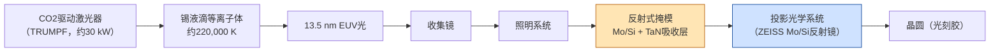
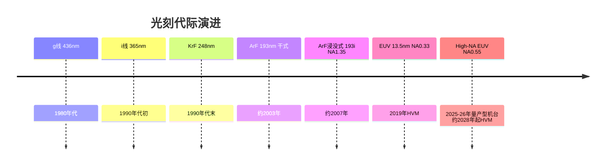
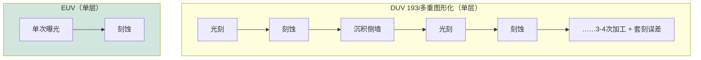

# 光刻——技术、设备、厂商与路线图

> 📘 **说明：** 本文为英文原版《Lithography — Technologies, Equipment, Vendors, and Roadmap》的简体中文参考译本，仅供参考；如有出入，以英文原版为准。

光刻是半导体制造的图形化核心——它定义芯片上最小的特征尺寸，因而决定了晶体管密度的上限。它是最昂贵的单一设备品类，也是集中度最高的品类（全球只有一家极紫外（EUV）供应商），同时也是战略争夺最激烈的品类。本文涵盖其物理原理、主要技术家族（193i、EUV、高数值孔径极紫外（High-NA EUV）、纳米压印光刻（NIL）、定向自组装（DSA）、电子束）、计算光刻、厂商格局、专利与诉讼历史，以及通往1nm级的路线图。

---

## 📊 图示概览

*原创示意图；Mermaid图表可在GitHub上原生渲染。*

**EUV扫描式光刻机如何产生光并印制图形（整个光路处于真空中）**

**分辨率 = k₁ · λ / NA——波长/数值孔径的演进**

**EUV为何胜过多重图形化：每个关键层所需的加工次数**

---

## 1. 光学光刻基础

光刻将掩模（掩模版）的图像投射到涂有光刻胶的晶圆上，然后通过化学显影形成曝光图形。可实现的分辨率由**瑞利判据**决定：

> **分辨率（半间距）= k₁ · λ / NA**

其中：
- **λ** 为曝光波长；
- **NA** 为投影光学系统的数值孔径（NA = n·sinθ，n为介质折射率）；
- **k₁** 为与工艺相关的系数，反映分辨率增强技术（RET）的效果，单次曝光的物理硬下限为**0.25**（若不采用激进的RET，实际约为0.5）。

焦深（DoF）按**DoF = k₂ · λ / NA²**变化，这意味着提高NA以改善分辨率会缩小可用的焦深窗口——这是一个核心的工程矛盾。

历史上，分辨率的提升依靠**缩短λ**：g线（436nm）→ i线（365nm）→ KrF（248nm）→ ArF（193nm）→ EUV（13.5nm）。当波长微缩在193nm停滞十余年时，业界转而**提高NA**（浸没式）并**降低k₁**（多重图形化、光学邻近校正、离轴照明）来继续缩小特征尺寸。

---

## 2. ArF浸没式（193i）——主力设备

当计划中的157nm（F₂激光）一代失败后，业界通过**浸没式**技术延续了193nm ArF光刻：在最后一片透镜与晶圆之间加入超纯水（n≈1.44），使有效NA从约0.93（干式）提高到**1.35**。ArF浸没式（193i）于2007年前后（45nm）引入，并成为——至今仍是——即使在最先进工艺节点也承担大多数层的主力设备。

为了突破193i约38nm半间距的单次曝光极限，业界采用了**多重图形化**：

- **LELE（光刻-刻蚀-光刻-刻蚀）：** 两次独立的曝光和刻蚀将两组图形交错，使密度加倍。可扩展到LELELE（三重）及以上，但每次加工都会增加成本和套刻误差。
- **SADP（自对准双重图形化）：** 先图形化一个牺牲性“芯轴”，在其侧壁上沉积共形侧墙，去除芯轴后以侧墙作为刻蚀掩模——从而以极佳的均匀性获得双倍线密度。<strong>SAQP（自对准四重图形化）</strong>重复侧墙工艺以实现四倍密度；用于10/7nm的鳍和紧密金属层。
- **NTD（负性显影）：** 一种光刻胶/工艺方案，可改善接触孔和沟槽层的对比度和工艺窗口。

多重图形化可行但代价高昂：单个关键层可能需要3–4次浸没式曝光，外加相应的薄膜沉积和刻蚀，成本和周期时间成倍增加，套刻误差不断累积。正是这种成本最终证明了EUV的合理性。

---

## 3. EUV光刻（13.5nm）——定义一个时代的设备

极紫外光刻使用**13.5nm**的光——这一波长短到几乎能被所有材料吸收，包括空气、玻璃和常规光刻胶。这迫使机器采用截然不同的架构，这是ASML投入超过100亿欧元、历时数十年的研发项目的成果。

### 3.1 光源

EUV光通过<strong>激光等离子体（LPP）</strong>产生：熔融的**锡液滴**（每秒约25,000–50,000个）被高功率**CO₂驱动激光器**（TRUMPF，约30kW级）击中。每个液滴先被预脉冲击中而压扁，再被主脉冲电离成约220,000 K的等离子体，辐射出13.5nm的光。光由掠入射**收集镜**收集并导入扫描机。该光源——最初为Cymer的技术（ASML于2013年收购Cymer）——历史上一直是限制产能的因素；达到约250W的可用EUV功率是使大批量制造（HVM）可行的关键里程碑。

### 3.2 光学系统

由于没有任何材料能透过13.5nm的光，EUV采用**全反射式光学系统**：精密反射镜镀有**40–50对交替的Mo/Si多层膜**，通过相长干涉在13.5nm处实现约70%的反射率。蔡司（ZEISS）以亚纳米级面形精度制造这些反射镜——这是迄今为止规模化生产的最精密的光学表面。整个光路在**高真空**中运行。

### 3.3 掩模版（掩模）

EUV掩模同样是反射式的：在低热膨胀基板上制作Mo/Si多层膜反射镜，再以图形化的**TaN/TaBN吸收层**定义电路。主要挑战：
- **3D掩模效应：** 吸收层的有限厚度和斜入射照明（6°主光线角）导致阴影效应和成像不对称。针对**高n值/低厚度吸收层**（例如Ni基、Co基、Ru基）的研究可缓解这一问题。
- **保护膜难题：** 保护膜是保护掩模免受颗粒污染的薄膜。在EUV功率水平下，保护膜必须在13.5nm处两次（入射和出射）透过约90%的光，同时承受巨大的热负荷。多晶硅保护膜（约10–12nm）可达到88–90%的透过率；目标透过率>95%且耐热性更高的**碳纳米管（CNT）保护膜**正在开发中。

### 3.4 光刻胶与随机效应

- **CAR（化学放大光刻胶）：** 现有主流方案；光致产酸剂催化脱保护反应。受限于酸扩散造成的模糊以及EUV的低光子数。
- **金属氧化物光刻胶（MOR）：** 锡氧化物基光刻胶（Inpria，已被JSR收购）通过金属直接吸收EUV，以牺牲灵敏度为代价，提供更高的分辨率和更低的线边缘粗糙度。
- **随机效应：** 由于EUV光子能量高，而有效剂量在每个像素上提供的光子相对较少，**散粒噪声**会引起随机的关键尺寸（CD）波动、<strong>线边缘/线宽粗糙度（LER/LWR）</strong>以及随机的“随机缺陷”（桥连和断线）。管理剂量–LER–产能之间的权衡是EUV工艺的核心挑战（详见[文件23](23_research_and_emerging_technologies.md)）。

### 3.5 扫描机的演进与HVM现实

ASML的NXE平台从早期的低功率设备发展到**NXE:3400C**（约170 wph）和**NXE:3600D**（经改进后约160–220 wph）。产能、光源功率和**可用性（设备稼动率）**——历史上EUV的阿喀琉斯之踵——在2018–2023年的爬坡期间稳步提升。台积电（TSMC）的N7+（2019年）是首个使用EUV的HVM工艺节点；N5（2020年）以10层以上的EUV使其成为主流；N3使用约20层以上。当前的主力机型是**NXE:3800E**（自2024年起出货，额定产能最高约220 wph），ASML预计到2027年其EUV出货组合将进一步向3800E倾斜。

---

## 4. High-NA EUV（0.55 NA）——下一代扫描机

为了在不借助EUV多重图形化的情况下扩展EUV分辨率，ASML开发了**High-NA EUV**，在全新的<strong>EXE平台（EXE:5000、EXE:5200）</strong>上将NA从0.33提高到**0.55**。

- **变形（anamorphic）光学系统：** 为了在更高NA下将掩模阴影效应控制在可控范围内，光学系统在**扫描方向采用8倍缩小、在狭缝方向采用4倍缩小**。其结果是可印制的曝光场缩小到**26mm × 16.5mm**（为常规26×33mm曝光场的一半）。大芯片必须由多次曝光**拼接**而成——这对大型GPU而言是一项重大的设计约束。
- **分辨率：** 可实现约8nm半间距的单次曝光，足以在不使用EUV双重图形化的情况下推进数个工艺节点。
- **现状：** 首台EXE:5000发运给**英特尔（Intel）**（2024年在俄勒冈完成组装），ASML与**IMEC**于2024年在费尔德霍芬开设了联合High-NA实验室；EXE:5000研发机型共制造了五台。量产版本**EXE:5200B**（约175 wph）于2025年首次发运，据报道英特尔已于2026年初在其俄勒冈D1X晶圆厂完成了一台EXE:5200B的验收。英特尔计划在**Intel 14A**上首次将High-NA导入HVM（18A使用0.33 NA EUV）。设备单价约**3.8亿美元以上**，使早期采用仅限于最先进晶圆厂的少数几层。根据ASML 2026年10月财报电话会议的摘要，三星（Samsung）计划在2028年前后、台积电在2030年前后将High-NA用于大批量生产——台积电已表示A16和A14无需High-NA即可制造。
- **挑战：** 需要更薄的光刻胶（<20nm）以控制掩模3D效应和吸收、拼接精度需<1nm、需要新型金属氧化物光刻胶，以及一台3.8亿美元的设备每次曝光产出更少裸片所带来的经济性问题。

---

## 5. 替代性与互补性图形化技术

### 5.1 纳米压印光刻（NIL）

NIL利用直接接触的模具（“模板”）将图形物理压印到光刻胶中，然后进行固化——完全不需要光学系统。**佳能（Canon）的FPA-1200NZ2C**是领先的商用系统。优点：每层成本极低，无需昂贵光学系统，已演示10nm以下分辨率。缺点：缺陷率（接触式工艺）、模板磨损、产能和套刻。其首个真正的量产立足点是**3D NAND闪存**（Kioxia/SK海力士（SK hynix）有意采用），其规则、周期性的图形适合NIL；由于缺陷和套刻要求，在逻辑芯片中的应用仍是一个研究课题。2024年10月，佳能向<strong>德克萨斯电子研究所（TIE）</strong>交付了一台FPA-1200NZ2C，用于研发和原型制造，并表示希望在五年内实现每年销售约10–20台NIL设备。

### 5.2 定向自组装（DSA）

DSA利用**嵌段共聚物**发生微相分离形成规则的纳米级畴区，并由光刻预图形加以引导（图形外延=形貌引导；化学外延=化学引导）。它可以倍增密度（例如接触孔缩小、线条倍增），并**修正**EUV预图形的粗糙度。三星已将DSA用于DRAM接触孔/通孔缩小。缺陷密度（约10–100个/cm²）仍是其进入先进逻辑芯片的障碍。（详见[文件23](23_research_and_emerging_technologies.md)。）

### 5.3 电子束光刻

电子束直写可在极高分辨率下实现无掩模、任意图形化，但单束产能对HVM而言太低。其作用包括：
- **掩模写入：** 所有光掩模（DUV和EUV）都由电子束设备写入（来自英特尔控股的**IMS Nanofabrication**以及NuFlare/东芝的多束掩模写入机）。
- **多束直写：** 用于研究和细分领域（ASML以前的MAPPER项目现已终止；多束方法用于特种/无掩模应用）。

---

## 6. 计算光刻

随着k₁逼近极限，每次曝光背后的**计算**变得与光学系统同等重要。计算光刻对掩模进行预畸变处理并调整照明，使印制图像在衍射存在的情况下仍与设计相符：

- **OPC（光学邻近校正）：** 修改掩模形状（添加衬线、偏置边缘），以补偿衍射和工艺效应。
- **SMO（光源-掩模协同优化）：** 联合优化照明光瞳和掩模图形。
- **ILT（反演光刻技术）：** 通过求解成像逆问题计算理想（通常为曲线形）的掩模形状——计算量极大，但应用日益广泛，特别是配合曲线形EUV掩模。
- **AI / GPU加速：** **英伟达（NVIDIA）cuLitho**（2023年与台积电、ASML和Synopsys共同宣布）在GPU上将计算光刻工作负载——包括ILT和基于RCWA的仿真——加速几个数量级，以应对先进节点掩模合成急剧膨胀的计算成本。此后台积电已在其计算光刻流程中采用cuLitho，GPU加速、AI辅助的掩模合成正逐渐成为标准做法。

EDA龙头**Synopsys、Siemens EDA（Mentor Calibre）以及ASML旗下的Brion**主导计算光刻软件市场。

---

## 7. 厂商格局

| 厂商 | 地位 |
|---|---|
| **阿斯麦（ASML，荷兰）** | 全球唯一的EUV和High-NA供应商；同时也是领先的DUV浸没式供应商；旗下拥有Cymer（光源）、Brion（计算光刻）、HMI（电子束检测）。SemiCap领域战略重要性最高的单一公司。 |
| **尼康（Nikon，日本）** | 历史上是领先的DUV/浸没式扫描机制造商；如今在浸没式领域远远落后，专注于特定客户和特种应用；无EUV。 |
| **佳能（Canon，日本）** | 面向成熟制程的DUV i线/KrF扫描机；<strong>纳米压印（NIL）</strong>领域的领导者；无EUV。 |
| **Cymer（现属ASML）** | LPP EUV光源的先驱；2013年被ASML收购。 |
| **Gigaphoton（日本）** | 独立的DUV（历史上也包括EUV光源）光源供应商，主要服务于尼康/佳能的扫描机。 |
| **蔡司SMT（ZEISS SMT，德国）** | ASML的EUV和High-NA投影光学系统的独家供应商；是地位对等的技术合作伙伴（ASML持有蔡司SMT的股份）。 |
| **TRUMPF（德国）** | EUV光源所用高功率CO₂驱动激光器的供应商。 |
| **上海微电子（SMEE，中国）** | 中国本土扫描机制造商；最擅长面向成熟制程和封装的i线/KrF/ArF干式设备；据报道一款28nm级ArF浸没式扫描机正处于验证阶段，但尚无独立证据证实其已用于量产。据报道，中国光刻设备的整体国产化率仍低于约5%。 |

ASML的垄断源于这一紧密掌控的生态系统：即使竞争对手获得了专利，要复制蔡司的光学系统、TRUMPF的激光器、Cymer的光源以及系统集成诀窍，也需要数十年的努力。

---

## 8. 专利格局与诉讼历史

- **EUV核心知识产权：** ASML、蔡司和Cymer持有EUV的基础专利（光源、光学系统、掩模版传输、双工件台）。许多早期EUV知识产权可追溯到美国**EUV LLC**联盟（1990年代末，成员包括英特尔、摩托罗拉、AMD和国家实验室），其授权许可帮助ASML取得领先。
- **ASML诉尼康（1990年代–2004年）：** 围绕浸没式和扫描机技术的长期交叉专利纠纷，于2004年以交叉许可和支付款项的方式和解——为浸没式时代扫清了道路。
- **ASML诉XTAL / 东方晶源（2018–2019年）：** ASML子公司Brion在针对XTAL的重大商业秘密案件中胜诉（约8.45亿美元，后来影响了XTAL的破产），XTAL是一家被指控盗用计算光刻源代码的初创公司——该案涉及中国相关因素，预示了后来的知识产权安全担忧。
- **专利到期：** 若干EUV时代的基础专利将在**2025–2030年**期间陆续到期，但实际的进入壁垒仍是系统集成诀窍和供应生态系统，而不仅仅是专利。

---

## 9. 路线图：迈向1nm级

- **EUV层数扩展：** N3使用约20层以上EUV；N2和英特尔18A进一步增加，在High-NA单次曝光接手之前，最紧密的间距将出现**EUV双重图形化（LELE-EUV / SAOP）**。
- **High-NA采用曲线：** 英特尔14A率先采用（少数层；14A的客户决定预计在2026年下半年至2027年上半年作出）；三星在2028年前后；台积电在2030年前后（A16和A14计划采用0.33 NA EUV）；到约2028–2030年，High-NA将广泛用于关键层。
- <strong>背面供电网络（BSPDN）</strong>通过**释放正面金属层**（电源移到背面）重塑光刻，但也带来新的图形化挑战：需透过减薄晶圆与正面晶体管对准的背面通孔光刻（红外对准），以及极为严格的套刻要求。
- **掩模基础设施：** EUV掩模基板的供应（AGC、信越化学（Shin-Etsu）、Hoya——仅三家供应商）和**光化掩模检测**（蔡司AIMS EUV）是关键瓶颈；2nm间距下的随机缺陷检测需要更快的光化检测。
- **套刻**要求收紧至<2nm，对量测端（ASML YieldStar、科磊（KLA）Archer）的推动力度与对扫描机本身一样大。
- **k₁壁垒与3D：** 随着平面光刻微缩逼近其经济和物理极限，密度提升越来越多地来自<strong>3D集成（互补场效应晶体管（CFET）、堆叠、先进封装）</strong>而非进一步的二维缩小——这意味着光刻的角色将从“缩小一切”演变为“图形化关键层，其余交给架构和封装”。

因此，光刻仍然是整个行业的节奏性技术：谁掌握最先进的扫描机，谁就掌握了先进制程，这正是为什么一家荷兰公司处于全球技术地缘政治的中心。

---

## 延伸分析：图形化的经济学与High-NA转换

### A. 主导光刻选择的成本交叉逻辑

现代晶圆厂中的每一项图形化决策都受**成本交叉计算**支配，它逐层决定哪种技术最便宜。对于给定间距下的某一层，可选方案有：单次EUV曝光（设备约1.5亿美元，但只需一次加工）、EUV多重图形化（两次或更多EUV加工）、DUV多重图形化（多次约8,000万美元浸没式设备的加工，外加每个侧墙或切割所需的薄膜沉积和刻蚀），或High-NA EUV（设备约3.8亿美元，一次加工，但曝光场减半）。每种方法的成本取决于加工次数、设备成本与产能、新增的沉积/刻蚀步骤、累积的套刻误差以及对良率的影响。一个需要三到四次DUV浸没式加工（每次都有各自的沉积、刻蚀和套刻误差）的层，一旦EUV的产能和稼动率足够，改用单次EUV曝光就会更便宜——这正是推动EUV采用的成本交叉点。同样的逻辑如今支配着**High-NA转换**：High-NA首先在需要最多次EUV多重图形化加工的层上变得经济，在这些层上，一次（昂贵的）High-NA曝光胜过两次或更多次标准EUV曝光。这种逐层应用的成本交叉逻辑，解释了每种新光刻技术为何是逐步、有选择地导入的——晶圆厂不会整体切换，而是先在经济性最具说服力的地方采用新方法，再随其成熟而逐步扩大应用。

### B. 多重图形化的负担以及EUV为何重要

要理解为什么EUV值得其巨大的成本和十多年的研发，不妨看看它所解除的**多重图形化负担**。在EUV之前的10nm/7nm节点，最紧密的层需要<strong>自对准四重图形化（SAQP）</strong>或多次**LELE**加工——这意味着单个层可能需要四次或更多次浸没式曝光，每次都伴随侧墙沉积、刻蚀和切割步骤，每一次加工都在累积套刻误差和成本。一个EUV一次曝光即可完成图形化的层，通过DUV多重图形化可能需要十几道甚至更多的独立工艺步骤。EUV大幅降低了这种复杂性：以一次曝光取代多次，累积的套刻误差更小、步骤更少——尽管存在扫描机成本以及随机效应和产能方面的挑战。工艺步骤、周期时间和套刻误差的节省——而不仅仅是分辨率本身——才是EUV的合理性所在，这也是为什么一旦该技术变得足够可靠，EUV的采用便加速推进。这同样解释了为什么EUV的价值随其单次曝光可图形化的层数增加而上升，以及为什么业界不断推动将更多层从多重图形化转向单次曝光EUV（并最终转向High-NA）。

### C. High-NA的曝光场尺寸权衡

High-NA EUV最具影响的特征——也是其最显著的缺点——是由变形光学系统导致的**曝光场尺寸减半**（26mm × 16.5mm，而非26mm × 33mm）。这是物理规律的直接结果：要在实现0.55 NA的同时将掩模阴影效应控制在可控范围内，需要采用变形（8×/4×）缩小倍率，从而使可印制的曝光场在一个维度上减半。其影响重大而具体。大芯片——尤其是已经逼近掩模版尺寸极限的大型GPU和AI加速器计算裸片——会超出High-NA的曝光场，必须由多次曝光**拼接**而成，并要将曝光场边界处的拼接误差控制在约1nm以下。这是一项实实在在的设计约束：芯片的有源计算阵列可能不得不在曝光场边界处被分割，这需要精心设计并增加工艺复杂度。曝光场尺寸的权衡，加上3.8亿美元以上的设备成本，正是High-NA最初只会被有选择地采用（在最先进晶圆厂的少数关键层，由英特尔领先）而非全面采用的原因，也是各制造商仔细权衡High-NA成本交叉点及其设计影响的原因。这生动地说明，一项光刻技术进步带来的不仅是新能力，还有会波及芯片设计的新约束。

### D. 掩模与光刻胶生态系统：隐藏的瓶颈

贯穿光刻路线图的一个反复出现的主题是：**扫描机只是系统的一部分**——掩模、光刻胶、保护膜和检测生态系统同样关键，而且往往是隐藏的瓶颈。EUV掩模基板仅来自三家供应商（AGC、信越化学、Hoya），且必须满足极其严苛的缺陷规格；保护膜必须在高功率下透过约90%的光而不退化（推动了CNT保护膜的开发）；光刻胶必须在可接受的随机效应下分辨目标间距（推动了金属氧化物光刻胶的开发，尤其是针对High-NA的16nm以下间距和20nm以下薄胶）；光化掩模检测（蔡司AIMS EUV）必须以目前仍然有限的产能捕捉与EUV相关的掩模缺陷和随机缺陷。其中任何一项——掩模基板短缺、保护膜不合格、光刻胶无法分辨目标间距、检测无法发现缺陷——都可能像扫描机本身一样，卡住新一代光刻技术的部署。这就是为什么光刻最好被理解为一个横跨扫描机、掩模、光刻胶、保护膜和检测的**协同工程系统**，也是为什么推进先进制程需要所有这些环节协同推进——这是EUV生态系统（ASML、蔡司、掩模与光刻胶供应商以及晶圆厂）已经解决、并且在每一新代际中都必须继续解决的协调难题。

---

## 进一步分析：DUV的持久作用与图形化工具箱

### A. DUV浸没式为何仍是主力设备

在对EUV和High-NA的关注之中，人们很容易忘记**DUV（ArF浸没式，193i）仍然是整个行业的主力设备**——即使在最先进的工艺节点，它也承担着大多数层的图形化，同时也是庞大的成熟制程市场的主导设备。原因既有经济方面的，也有物理方面的。芯片上的大多数层并不需要最精细的分辨率，对这些层而言，单次（或多重图形化的）DUV曝光远比EUV便宜——因此即使是先进晶圆厂，其大多数层也使用DUV，只将EUV留给少数关键层。整个**成熟制程市场**（28nm及更老节点，[文件15](15_technology_roadmaps.md)）——服务于汽车、工业、物联网、模拟、功率器件以及按数量计的绝大多数芯片——几乎完全依赖DUV运行，而且常常使用翻新的浸没式扫描机。这使DUV成为一个庞大而持久的市场，也是<strong>中国本土光刻（上海微电子SMEE）</strong>所聚焦的细分领域（成熟制程DUV无需中国所缺乏的EUV能力即可实现）。ASML自身也计划在2027年将DUV浸没式产能（连同低数值孔径EUV）提高约30%，这凸显了DUV需求依然旺盛。DUV的持久作用提醒我们：先进制程虽然吸引眼球，却只是行业的一部分——服务于大部分产量的主力设备，与服务于最前沿的尖端EUV扫描机在商业上同等重要。

### B. 图形化工具箱

理解现代光刻的一个有用方式，是将其视为一个由互补图形化技术组成的**工具箱**，根据每一层所需的分辨率和成本逐层部署。在最粗糙的层，单次曝光DUV（i线、KrF或ArF）即可满足。在更紧密的间距下，DUV多重图形化（LELE、SADP、SAQP）以不断增加的成本扩展DUV的能力。在先进节点的关键层，单次曝光EUV取代多重图形化；在最紧密的层，则需要EUV多重图形化或（正在兴起的）High-NA EUV。与这些光学技术并存的还有特种工具：纳米压印（用于3D NAND的规则图形）、定向自组装（用于接触孔/通孔缩小和间距倍增，由光学预图形引导）以及电子束（用于掩模写入和特种直写）。先进图形化的艺术在于为每一层选择最优技术——在分辨率、成本、套刻和良率之间取得平衡——而趋势是走向日益**多元化的工具箱**，即单个晶圆厂部署多种图形化方法，每种方法针对不同的层和应用进行优化。这种多元化而非单一主导技术，很可能将定义光刻的最终格局（[文件23](23_research_and_emerging_technologies.md)），因为没有任何单一方法能满足现代芯片多样化的全部图形化需求。

### C. 光刻作为节奏性技术

关于光刻最深刻的一点在于，它仍然是**整个行业的节奏性技术**——这种能力比其他任何能力都更能决定可制造的极限，并把控着先进制程。谁掌握最先进的光刻，谁就掌握先进制程：这就是为什么ASML的EUV垄断是整个半导体领域战略重要性最高的单一地位，为什么EUV的获取是出口管制的核心杠杆（[文件18](18_geopolitics_and_export_controls.md)），以及为什么High-NA转换如此重要。光刻的节奏性作用源自其在制造流程中的位置：它定义最小特征尺寸，最小特征尺寸决定晶体管密度，晶体管密度又限定性能和功耗——因此现有扫描机的分辨率为下游的一切设定了上限。随着微缩放缓并转向三维，光刻的角色在演变（从“缩小一切”转向“图形化关键层，其余交给架构、材料和封装”），但其重要性并未减弱：关键层仍需要最先进的图形化，套刻要求不断收紧，新架构（背面供电、CFET）也带来新的图形化挑战。因此，光刻始终处于行业进步及其地缘政治的核心——它是节奏性技术，是战略“卡脖子”环节，也是整个设备产业和全球技术霸权竞争所围绕的核心能力。

---

## 🆕 2025–2026年更新：最新进展（截至2026年11月）

2025–2026年间，光刻领域的问题已从“业界能否消化EUV？”转变为“ASML能否造出足够多的EUV？”。AI驱动的逻辑芯片需求和由DRAM引领的存储器上行周期，使EUV和DUV浸没式设备的需求都超过了ASML的计划产量；与此同时，High-NA EUV已从研发阶段跨入经过认证的量产型设备阶段——但对大多数客户而言，导入大批量生产仍需数年。

### ASML：业绩创纪录，供应触及上限

ASML于2026年10月14日公布第三季度净销售额创纪录的**117亿欧元**（毛利率57.5%，净利润50亿欧元），其中包括**41亿欧元的EUV系统销售额（含一台High-NA系统）**。公司将2026财年净销售额指引定为**440–450亿欧元**（2025年约为327亿欧元），第四季度指引为142–152亿欧元。最重要的信息与产能有关：

- 规划中的供应将**无法完全满足2027年和2028年的客户需求**。
- 计划在2027年将低数值孔径EUV和DUV浸没式产能提高约30%，并正在研究2028年进一步扩产。
- 据报道，客户已在要求下2029–2030年交付的订单。
- ASML将于2027年6月10日举办资本市场日。

| 指标 | 2025年第四季度 | 2026年第一季度 | 2026年第二季度 | 2026年第三季度 |
|---|---|---|---|---|
| 中国占ASML系统销售额比例 | 36% | 19% | 14% | 约23% |

ASML预计中国将占2026财年总净销售额的约20%，低于2024–2025年由提前采购推高的水平。（此外，ASML于2025年9月以约13亿欧元领投了Mistral AI的C轮融资，显示其有意在产品中广泛应用AI。）

### High-NA EUV：从实验室走向量产型设备

| 里程碑 | 时间 | 备注 |
|---|---|---|
| EXE:5000研发机型 | 2023–2025年 | 共制造五台；英特尔（俄勒冈）以及ASML–imec High-NA联合实验室为首批用户 |
| EXE:5200B量产型设备首次发运 | 2025年 | 约175 wph；据ASML称，生产率较EXE:5000提升约60% |
| 英特尔在D1X完成EXE:5200B验收 | 2026年初（据报道） | 英特尔14A是首个计划采用High-NA的工艺节点 |
| 三星在HVM中采用High-NA | 约2028年 | 据ASML 2026年第三季度电话会议摘要 |
| 台积电在HVM中采用High-NA | 约2030年 | 台积电A16/A14计划采用0.33 NA EUV |

第4节及延伸分析C中讨论的曝光场减半和3.8亿美元以上的价格，仍是采用High-NA的核心障碍；英特尔能否赢得14A的外部客户（预计在2026年下半年至2027年上半年作出决定），是对High-NA经济性的近期检验。

### 中国：国产化与EUV问题

- 光刻仍是中国最薄弱的设备品类：据报道国产化率低于约5%，而2025年本土设备整体占比约为35%（行业机构数据）。
- 据报道，上海微电子的28nm级ArF浸没式扫描机正处于验证阶段；尚无独立证据证实其已用于量产及其产能水平。
- 路透社于2025年12月报道，一支包括前ASML工程师在内的团队在深圳组装了一台**EUV原型机**，部分使用了来自较老ASML系统的零部件。该机可产生EUV光，但尚未生产出可用芯片；报道称目标为2028年，而知情人士认为约2030年更为现实。
- 据报道，中芯国际（SMIC）/华为（Huawei）采用DUV多重图形化、以低良率和高成本生产出了5nm级（N+3）芯片（麒麟9030，2025年末）——这印证了第2节的观点：多重图形化可以延展DUV的能力，但代价高昂。
- 中国正在推动本土KrF/ArF光刻胶；2025年末关于日本限制向中国出口光刻胶的传闻未经证实。

### 影响光刻的出口管制

向中国出口EUV仍被禁止，先进DUV浸没式设备的出口和维修服务仍受到美国、荷兰和日本的严格管控。美国国会提出的<strong>《MATCH法案》</strong>将禁止向中国销售DUV设备以及为当地已安装设备提供维修服务；截至2026年11月，该法案仍在审议中。根据美中休战安排而暂停执行的“关联方”（50%）规则如被恢复，可能会扩大受限中国客户的范围。

### 替代技术与新进入者

- **纳米压印：** 佳能的FPA-1200NZ2C仍是领先的NIL系统（2024年10月交付TIE）；存储器仍是其最现实的量产市场。
- **新型光源与新方法（早期阶段）：** 正在开发自由电子激光EUV光源的美国初创公司xLight，据报道于2026年6月敲定了1.5亿美元的CHIPS激励协议；Substrate正在研发基于加速器的X射线光刻，但其宣称的性能尚未在规模化条件下得到验证。预计二者在2030年代之前都不会对HVM产生影响。
- **计算光刻：** 随着曲线形掩模和High-NA推高计算需求，GPU加速（英伟达cuLitho，已被台积电采用）和AI辅助的OPC/ILT正在普及。

### 值得关注的事项（2026年末–2027年）

- ASML 2026年第四季度业绩和2027年指引；计划中约30%的产能增长能否缓解设备配额紧张。
- ASML 2027年6月10日的资本市场日：长期产能、High-NA路线图以及任何关于Hyper-NA的信号。
- 英特尔14A赢得客户的情况，以及首批High-NA量产层。
- 《MATCH法案》的命运，以及休战期于2027年1月10日到期后“关联方”规则暂停执行安排的走向。
- 关于中国EUV原型机能否产出可用芯片、上海微电子浸没式扫描机能否用于量产的可信证据（或缺乏证据）。
