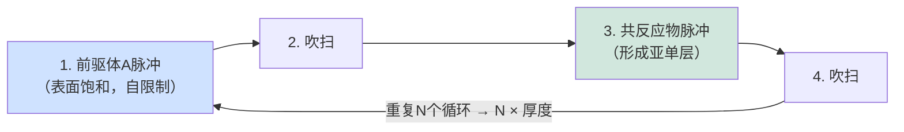
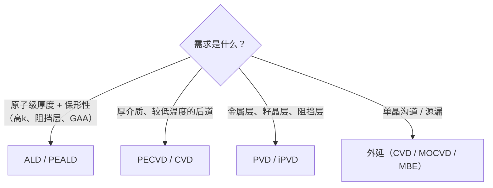

# 薄膜沉积——CVD、ALD、PVD与外延

> 📘 **说明：** 本文为英文原版《Thin Film Deposition — CVD, ALD, PVD, Epitaxy》的简体中文参考译本，仅供参考；如有出入，以英文原版为准。

薄膜沉积是一类向晶圆*添加*材料的工艺——构建出晶体管与互连所需的介质、导体、阻挡层和沟道。沉积与刻蚀、光刻并列为晶圆加工的三大支柱，约占晶圆厂设备（WFE）总支出的五分之一到四分之一。一颗现代逻辑芯片包含数十种不同的沉积薄膜，从亚纳米级的原子层沉积（ALD）高k栅介质到微米级厚度的金属化层，每一种都需要对厚度、成分、保形性、应力和纯度进行精确控制。本文概述主要的沉积技术家族——化学气相沉积（CVD）、ALD、物理气相沉积（PVD）和外延——以及新兴材料、供应商格局、专利态势，以及推动从鳍式场效应晶体管（FinFET）向全环绕栅极（GAA）再向互补场效应晶体管（CFET）过渡的逐节点沉积挑战。

---

## 📊 可视化概览

*原创示意图；Mermaid图表可在GitHub上原生渲染。*

**ALD循环——自限制，每个循环沉积一个亚单层**



**沉积方法的选择**



**ALD为何独特——高深宽比结构中的保形性（截面图）**

下图为截面示意：ALD薄膜在沟槽顶部、侧壁和底部厚度相同（深宽比大于50:1亦可）；PVD/CVD在此处会变薄或封口，而ALD的表面饱和反应不会。

```
   ▓▓▓▓▓▓▓▓▓▓▓▓▓▓   ← ALD film: equal thickness on top,
   ▓░░░░░░░░░░░░▓      sidewall, and bottom (AR > 50:1 OK)
   ▓░          ░▓
   ▓░  trench  ░▓     PVD/CVD would thin or pinch off here;
   ▓░          ░▓     ALD's surface-saturating reaction does not.
   ▓░░░░░░░░░░░░▓
   ▓▓▓▓▓▓▓▓▓▓▓▓▓▓
```

---

## 1. 化学气相沉积（CVD）

在化学气相沉积中，气态前驱体在晶圆表面或其附近发生反应，沉积出固态薄膜，挥发性副产物则被抽走。CVD是用途最广、应用最普遍的沉积方法，存在众多变体，按压力、能量来源和温度加以区分，各自在薄膜质量、保形性、产能和热预算之间进行权衡。

<strong>LPCVD（低压CVD）</strong>在较低压力（通常0.1–1 Torr）和较高温度（600–800°C）下工作，常在一次处理50–150片晶圆的大型批式炉管中进行。低压通过增大反应物的平均自由程来改善均匀性和保形性。LPCVD可沉积高质量多晶硅（用于栅极和3D NAND闪存沟道）、氮化硅（Si₃N₄，用于硬掩模和侧墙）以及基于TEOS的二氧化硅。由于温度较高，它仅限于金属引入之前的早期前道（FEOL）步骤。

<strong>APCVD（常压CVD）</strong>在大气压下运行，用于对相对非关键的薄膜（如掺杂氧化物、钝化层）进行高产能沉积。其保形性和均匀性较差，因此在现代工艺中作用有限。

<strong>PECVD（等离子体增强CVD）</strong>利用射频等离子体提供反应能量，可在低得多的温度（200–400°C）下沉积。这使PECVD成为<strong>后道（BEOL）</strong>工艺中不可或缺的技术，因为下方的铜互连施加了严格的热预算（通常≤400°C）。PECVD沉积了大部分层间介质（SiO₂、SiN、SiCN、SiOCH低k）、钝化层和硬掩模。等离子体可用于调节薄膜的应力、致密度和成分。

<strong>HDP-CVD（高密度等离子体CVD）</strong>将沉积与同步溅射刻蚀（通过施加偏压的高密度等离子体）相结合，在高深宽比（HAR）沟槽中实现**无空洞填隙**——历史上一直是浅沟槽隔离（STI）和金属前介质填充的主力。随着深宽比不断攀升，HDP-CVD逐渐让位于可流动CVD和ALD。

<strong>可流动CVD（FCVD）</strong>沉积一种可流动、类液态的薄膜，它能渗入最窄的间隙，随后固化为固态氧化物——解决了先进STI以及鳍片之间、纳米片之间极端深宽比下的无空洞填隙难题。

所有CVD变体的核心权衡是**热预算与薄膜质量**：温度越高的工艺通常得到更致密、更纯净的薄膜，但在温度敏感结构（金属、应变结）形成之后便无法使用。这一约束在每个节点都愈发严峻，也是推动行业转向更低温ALD和等离子体辅助方法的主要动因。

---

## 2. 原子层沉积（ALD）

原子层沉积可以说是过去二十年中最重要的沉积技术进步，是高k/金属栅、FinFET、GAA、3D NAND和DRAM电容的使能技术。ALD通过一系列**自限制表面反应**，**一次一个原子层**地构建薄膜。

一个ALD循环包括：（1）前驱体A脉冲，A化学吸附于表面，直至所有反应位点饱和后停止（自限制）；（2）吹扫以去除多余的A；（3）共反应物B脉冲，B与化学吸附的A反应，形成所需薄膜的亚单层并再生表面位点；（4）再次吹扫。每个循环增加一个精确固定的亚单层增量，因此总厚度只需通过计数循环次数即可控制。由于反应受表面饱和而非通量限制，ALD即使在深宽比超过50:1的结构中也能实现**近乎完美的保形性**——这恰恰是在深DRAM电容、3D NAND沟道以及GAA纳米片环绕沟道侧壁上进行覆盖所需要的。

**热ALD**完全依靠温度驱动表面化学反应，保形性最佳、损伤最低。<strong>等离子体增强ALD（PEALD）</strong>使用等离子体共反应物（如氧或氮自由基），可在更低温度下沉积，并能获得难以通过热方式形成的薄膜，代价是在最深结构中保形性有所下降。

主要ALD薄膜及其作用：
- **HfO₂和ZrO₂**——高k栅介质（逻辑）和电容介质（DRAM，通常为ZrO₂/Al₂O₃/ZrO₂“ZAZ”叠层）。
- **Al₂O₃**——界面层、钝化层以及刻蚀停止/封装层。
- **TiN**——金属栅功函数层和电极层，以及扩散阻挡层。
- **Ru和Co**——新兴的后道金属和衬垫层（见下文）。
- **MoS₂及其他二维材料**——处于研究阶段的沟道材料（文件23）。

两种前沿ALD模式正在重塑工艺集成：
- **空间ALD**在空间上而非时间上分隔前驱体区域，通过在各区域之间移动晶圆来大幅提升产能——这对大批量应用十分重要。
- <strong>区域选择性沉积（ASD/选择性ALD）</strong>利用表面化学，使薄膜仅在特定材料上生长（例如在金属上而不在介质上），借助抑制剂分子（自组装单层）阻止不需要处的生长。ASD有望实现放宽套刻要求的**自对准**结构——例如只在暴露的金属上生长通孔帽层——是3nm以下节点研究最活跃的沉积技术之一。

---

## 3. 物理气相沉积（PVD）

在物理气相沉积中，材料从固态靶材中被物理地溅射出来并凝结在晶圆上，无需化学反应（或仅需反应气体辅助）。PVD是沉积金属的首选方法。

**直流磁控溅射**用氩离子轰击金属靶材，磁体将等离子体约束在靶材附近以提高溅射速率。它用于沉积铝、钛、钽和铜籽晶层。**射频溅射**将PVD扩展到绝缘靶材。

<strong>离化PVD（iPVD）</strong>将溅射出的金属流离子化，使晶圆偏压能够将其引导至高深宽比结构的底部——这对于在电镀之前于大马士革通孔和沟槽的底部与侧壁沉积薄而连续的<strong>阻挡层（TaN/Ta）</strong>和**铜籽晶层**至关重要。PVD还用于形成硅化物所需的**NiPt**层以及各种功函数和盖帽金属。

PVD的局限在于保形性：随着特征尺寸缩小、深宽比上升，即使是iPVD也难以均匀覆盖侧壁和底部，这也是ALD在前沿工艺中取代PVD用于最薄阻挡层和衬垫层的原因之一。尽管如此，PVD在籽晶金属、电极以及上层互连和封装的厚金属化方面仍不可或缺。

---

## 4. 外延

外延生长与下方晶格对齐的**单晶**薄膜——这是要求最苛刻的沉积形式，需要原子级洁净的表面和精确的温度控制。

**硅及SiGe/Ge CVD外延**是现代晶体管的核心。<strong>选择性外延生长（SEG）</strong>仅在凹陷的源/漏区沉积SiGe（掺硼，用于pMOS）或Si:P（掺磷，用于nMOS），施加应变以提升载流子迁移率，并提供低电阻的原位掺杂结。SEG过程中的晶面控制决定最终的源漏形状和应力。对于**GAA**，外延生长交替的**SiGe/Si超晶格**（牺牲层SiGe中Ge含量通常为25–35%，每层厚度仅几纳米），纳米片沟道随后由此释放——这使外延成为GAA的决定性使能步骤之一。

<strong>MBE（分子束外延）</strong>采用超高真空热蒸发，获得最高纯度、原子级陡峭的薄膜；由于产能低，它是研究和III-V族/特种器件工具，而非主流大批量逻辑制造方法。

<strong>MOCVD（金属有机CVD）</strong>用于生长化合物半导体外延层（GaN、SiC、InP、GaAs及其合金），服务于功率、射频和光电器件，也是晶圆级二维材料（MoS₂）沉积研究的主要方法。（文件12和文件23深入介绍化合物外延和二维材料外延。）

---

## 5. 新兴沉积前沿

若干沉积挑战定义了技术前沿：

- <strong>Ru和Mo后道金属：</strong>随着铜在10nm以下间距的有效电阻率上升，且其阻挡层占用过多导线截面，较低层互连正在向**钌**（以Ru(DMBD)(CO)₃等前驱体进行ALD）和**钼**（以MoCl₅或MoF₆化学体系进行CVD/ALD）过渡，二者可在几乎无需或完全无需阻挡层的情况下使用。这是自铜本身以来后道最重要的材料转变之一。钼于2025年率先在3D NAND闪存字线中进入量产（以ALD取代钨），目前正在2nm–1.4nm级世代的逻辑接触孔和通孔中得到采用；用于最紧密后道间距的钌仍处于开发和认证阶段（见下文2025–2026年更新）。
- **高深宽比（HAR）钨填充**，用于3D NAND字线和DRAM埋入式字线，CVD钨必须在数十层深的结构中实现无空洞、无接缝填充。
- **二维材料沉积**（MoS₂、WS₂），通过MOCVD和ALD制备未来的沟道材料，其晶粒尺寸、缺陷密度和300mm均匀性仍未解决（文件23）。
- **选择性与自对准沉积**（ASD），可实现通孔帽层、阻挡层选择性填充，以及放宽光刻套刻要求的自对准结构。

---

## 6. 供应商格局

| 供应商 | 沉积优势 |
|---|---|
| **泛林集团（Lam Research）** | 在PECVD/ALD介质（VECTOR、Striker）、钨及金属填充（ALTUS）和填隙方面实力雄厚；2025年2月推出ALTUS Halo钼ALD设备，目前已在3D NAND厂商中投入生产；与其刻蚀主导地位紧密结合，提供集成模块化流程。 |
| **应用材料（Applied Materials，AMAT）** | 沉积产品组合最广泛：PVD（Endura，PVD领导者）、CVD（Producer）、ALD、外延（Centura/Epi，包括2025年10月推出的Centura Xtera GAA外延系统）以及选择性沉积；整体沉积市场份额领先。据报道，2026年5月同意收购ASMPT旗下的NEXX先进封装沉积/电化学沉积（ECD）业务。 |
| **ASM国际（ASM International）** | **ALD领导者**，尤其擅长高k和栅叠层ALD以及外延（Intrepid/Epsilon）；ALD是其身份认同和高利润率的核心。 |
| **东京电子（Tokyo Electron，TEL）** | 在CVD、ALD和涂胶/显影方面实力强劲；在沉积和清洗领域布局广泛。 |
| **国际电气（Kokusai Electric）** | **批式（炉管）ALD/CVD**领导者，对存储器（3D NAND ONON叠层、DRAM）十分重要；脱胎于日立，在应用材料的收购计划于2021年告吹后由KKR持有；自2023年10月起在东京上市，此后KKR（据报道还有少数股东应用材料）一直在减持股份。 |
| **Jusung Engineering、Wonik IPS（韩国）** | 服务于三星（Samsung）和SK海力士（SK hynix）的本土ALD/CVD供应商。 |
| **北方华创（NAURA）、拓荆科技（Piotech）（中国）** | 北方华创是快速成长的中国沉积、热处理（及刻蚀）设备供应商，拓荆科技则是领先的本土PECVD/ALD专业厂商——二者都是中国国产化进程的核心；据报道，2025年国产设备约占中国晶圆厂所用设备的35%。 |

---

## 7. 专利格局

ALD的基础专利可追溯至**Tuomo Suntola**（芬兰），他在20世纪70年代发明了“原子层外延”；ASM国际的ALD领导地位在很大程度上建立在其强大的专利布局之上。应用材料和泛林集团在PVD、CVD、填隙以及ALD反应腔设计和化学工艺方面拥有大量沉积知识产权。当前一个尤为活跃的领域是**选择性/区域选择性沉积**，ASM、应用材料、泛林集团和东京电子都在围绕抑制剂化学和自对准方案构建专利组合，因为它们认识到ASD很可能成为3nm以下节点的关键差异化因素。前驱体化学（使新型ALD薄膜成为可能的金属有机化合物）是另一个并行的知识产权战场，涉及Merck/EMD、Entegris和Air Liquide等化学品供应商。

---

## 8. 逐节点沉积挑战

<strong>FinFET时代（22nm–5nm）：</strong>沉积挑战集中在包裹鳍片三面的保形高k/金属栅ALD、日益高而窄的鳍片之间的无空洞填隙（推动了向可流动CVD和ALD的转变）、具有晶面控制的保形SiGe源漏外延，以及在N7节点引入钴用于底层金属填充，以应对铜的填隙和电迁移限制。

<strong>GAA纳米片时代（3nm–2nm）：</strong>决定性的沉积挑战包括**SiGe/Si超晶格外延**（在多个堆叠对上精确控制Ge浓度和层厚）、**内侧墙ALD**（在选择性回刻SiGe后，用低k介质填充几纳米宽的横向空腔——GAA的标志性工艺），以及**在释放后的纳米片间隙内进行栅叠层ALD**（将高k和功函数金属沉积到仅相隔几纳米的沟道之间，要求完美的填隙保形性）。与此同时，**Mo金属化**已进入生产（先是3D NAND字线，然后是逻辑接触孔/通孔），而用于最底层互连的**Ru后道金属化**仍在认证中。这一时代现已进入大批量制造：台积电（TSMC）N2（自2025年第四季度起）、英特尔（Intel）18A和三星SF2。

<strong>CFET时代（研究阶段；据报道，比利时微电子研究中心imec的2026年路线图将CFET定位于A7即0.7nm级世代前后，远晚于2027年）：</strong>沉积复杂度大致翻倍。双层纳米片叠层要求对底层和顶层分别进行栅金属沉积，在两层之间形成自对准介质隔离，在3nm以下开口中进行ALD填隙，并且——对于顺序式CFET——需要与已键合的底层兼容的低温（<400°C）高质量介质沉积。选择性和区域选择性沉积对于实现仅靠光刻无法分辨的自对准结构变得愈发关键。

在所有这些转变中，贯穿始终的主题是对**原子级厚度控制、在越来越深的结构中实现完美保形性、更低热预算以及选择性（自对准）沉积**的不懈需求——这些要求使ALD及其选择性变体成为沉积领域增长最快、战略意义最重要的分支。

---

## 扩展分析：ALD的崛起、选择性沉积与材料前沿

### A. ALD为何成为决定性的沉积技术

在所有沉积方法中，**ALD的重要性上升最快**，其原因揭示了整个行业的发展方向。ALD的决定性特性——**自限制、表面饱和的反应，每个循环沉积精确的亚单层**——赋予它两种其他方法无法比拟的能力：**埃级厚度控制**（只需计数循环）和**近乎完美的保形性**（反应在所有表面上均等饱和，与几何形状无关）。这恰恰是前沿工艺所需的能力。高k/金属栅介质必须只有几个原子层厚且均匀——ALD。FinFET栅叠层必须保形包裹三维鳍片——ALD。DRAM电容和3D NAND结构必须在深宽比超过50:1时实现保形覆盖——ALD。GAA内侧墙和栅填充必须沉积到几纳米的空腔和间隙中——ALD。随着器件变得更薄、更三维化、对保形性要求更高，ALD从小众技术变为核心的快速增长技术，这也是**ASM国际**（ALD领导者）成为增长最强劲、利润率最高的设备制造商之一的原因。每颗先进芯片的ALD步骤数量稳步增加，ALD在沉积支出中的份额持续增长——这一结构性顺风源于贯穿本数据库的三维化、原子尺度趋势。

### B. 选择性与区域选择性沉积——自对准的未来

最重要的沉积前沿是**区域选择性沉积（ASD）**——利用表面化学（抑制剂分子、自组装单层）阻止其他区域的生长，使材料**只在需要的地方生长**（例如在金属上而不在介质上）。ASD的意义深远：它能够实现放宽光刻套刻要求的**自对准结构**，而套刻是先进节点上最困难、最昂贵的挑战之一。如果通孔帽层、阻挡层或金属能够在暴露的特征上选择性生长，而无需单独的、完美对准的光刻步骤，那么工艺就更简单、更便宜，对套刻误差也更稳健。随着间距缩小到光刻无法可靠对准的程度，通过选择性沉积实现自对准变得愈发必要——这就是为什么ASD是研究和专利申请最活跃的沉积技术之一（ASM、应用材料、泛林集团、东京电子均投入巨资），也是为什么它被预期成为3nm以下节点和CFET的关键使能技术（文件23）。选择性沉积与选择性刻蚀（文件05）共同指向一个**自对准工艺**的未来：结构越来越多地引导自身的形成，降低对已无法对准一切的光刻的依赖。

### C. 互连金属转变

最重要的沉积挑战之一是**后道互连从铜向钌和钼的转变**（文件04、15）。这从根本上说是一个沉积问题：Ru和Mo必须（通过ALD/CVD）沉积为薄、低电阻、附着良好的薄膜，最好无需阻挡层（这是它们相对于铜的关键优势之一，铜需要一层无法微缩的TaN阻挡层）。开发前驱体（Ru前驱体如Ru(DMBD)(CO)₃；Mo前驱体如MoCl₅和MoF₆）、沉积工艺（在极小尺寸下实现保形填充）以及集成（与这些金属所需的新图形化和化学机械平坦化（CMP）相配合）是一项重大的持续性工作。钼率先取得进展——2025年进入3D NAND字线生产，2026年起进入前沿逻辑接触孔——而钌仍是最紧密间距线路的长期候选材料。其回报是在最紧密间距下获得更低的有效电阻，因为在这些间距下铜的电阻率劣势和阻挡层开销变得难以承受。这一金属转变——自25年前铜取代铝以来最重大的一次——将沉积置于前沿工艺决定性挑战之一的中心，也说明了每种新材料都会带来相应的沉积开发工作。

### D. 二维材料沉积挑战

展望更远的未来，**二维沟道材料**（MoS₂、WSe₂，文件23）的沉积是最困难也最重要的前沿之一。挑战不在于器件物理（前景良好），而在于生长**晶圆级、低缺陷、均匀**的二维薄膜——imec在300mm晶圆上的MOCVD MoS₂演示是一个里程碑，但晶粒尺寸、缺陷密度（硫空位）和均匀性仍远未达到逻辑级质量。解决这一问题是一个沉积问题：开发能够在300mm晶圆上以低缺陷密度均匀生长这些原子级薄晶体的MOCVD和ALD工艺（以及来自Aixtron、维易科（Veeco）、ASM、应用材料的反应腔）。二维材料沉积挑战体现了一个更普遍的模式：当行业寻求新材料以延续微缩时，**这些材料的沉积**——均匀、保形、规模化、达到所需质量——往往是决定性的瓶颈，这使沉积设备制造商和前驱体供应商处于开启每一个新前沿的中心。

### E. 逐节点沉积总结

沉积挑战随每次架构转变而加剧：FinFET要求在鳍片上进行保形栅叠层ALD并在鳍片间实现无空洞填隙；GAA要求超晶格外延、在几纳米空腔中进行内侧墙ALD，以及在释放后的纳米片间隙中进行栅填充ALD；CFET使填隙和栅金属复杂度大致翻倍，并要求3nm以下开口填充和双层集成。在所有这些转变中，统一的需求是**原子级厚度控制、在越来越深越来越窄的结构中实现完美保形性、更低热预算、选择性（自对准）沉积，以及不断扩展的新材料组合**——这些要求使ALD及其选择性变体成为沉积领域增长最快、战略意义最重要的分支，并确保沉积与光刻和刻蚀一起，始终是前沿工艺所依赖的三大核心支柱之一。

---

## 🆕 2025–2026年更新：最新进展（截至2026年11月）

### 市场背景

沉积设备乘上了行业史上最强劲的设备上行周期。根据国际半导体产业协会SEMI 2026年7月发布的年中预测，2026年设备总销售额预计达到**1,659亿美元（+23.2%）**，其中晶圆厂设备为**1,439亿美元**，2028年预计将创下2,295亿美元的纪录。在2026年10月的财报季中，泛林集团预计2026日历年WFE在1,550亿美元左右（“mid-$150B”区间），并初步预计2027年将超过2,000亿美元，增长依次由**DRAM**、晶圆代工/逻辑和NAND引领。这一结构对沉积有利：DRAM（尤其是与高带宽内存（HBM）相关的DRAM）和GAA逻辑都高度依赖ALD和外延，而NAND升级正推动从钨向钼的转换。泛林集团还指出，洁净室空间和零部件供应可能限制行业扩产的速度。

### 钼从路线图走向量产

第5节和扩展分析C部分所述的后道/字线金属转变已正式启动，引领者是钼而非钌：

- **泛林集团**于2025年2月推出钼ALD设备**ALTUS Halo**。泛林集团表示该设备正在领先的3D NAND厂商中量产爬坡，美光（Micron）称其使钼得以进入大规模量产；此后泛林集团报告其在NAND客户中得到更广泛采用，据报道逻辑领域亦已采用，DRAM领域仍在开发中。泛林集团所称相对钨电阻改善超过50%为厂商自报数据。
- **应用材料**于2026年初在SEMICON Korea前后推出**Spectral ALD**，定位于以钼取代钨用于晶体管接触孔（据行业媒体对发布会的报道）。
- **ASM国际**在2026年第二季度业绩电话会上强调了其**Mo ALD**产品在**1.4nm节点**获得的订单，该节点预计将在2026年下半年首次带来实质性营收贡献。

钌仍是最紧密互连间距的长期候选材料，但尚无公开确认的大范围量产采用。

### GAA进入量产：每片晶圆需要更多ALD和外延层

随着台积电N2自2025年第四季度起量产、英特尔18A进入大批量制造（Panther Lake，2026年初）以及三星SF2出货，第8节所述的GAA沉积步骤——SiGe/Si超晶格外延、内侧墙ALD以及释放后纳米片间隙中的栅叠层ALD——现已成为大批量工艺。ASM管理层在2026年7月表示，GAA架构在后续节点将需要**越来越多的ALD和外延层**。应用材料于2025年10月推出**Centura Xtera**外延系统，用于2nm及以下GAA源漏外延；应用材料称其单元间均匀性提高40%，气体消耗约为早期外延方法的一半。背面供电（英特尔18A上的PowerVia；台积电A16的Super Power Rail，依不同来源于2026年下半年至2027年量产爬坡）为背面介质、接触孔和晶圆键合层带来了新的沉积步骤。

### 存储器与先进封装

HBM驱动的DRAM支出已成为沉积的主要驱动力：ASM在2025年报告了外延和ALD（包括偶极层和功函数层）方面新的DRAM/HBM订单，并在2026年第二季度表示又一家DRAM客户选择了其外延方案。在封装方面，据报道，应用材料于2026年5月同意收购ASMPT旗下的**NEXX**业务，随着AI封装需求上升，增加电化学沉积及其他封装沉积能力；混合键合（应用材料与Besi合作）同样需要严格控制的介质键合薄膜。

### 2025–2026年关键沉积数据点

| 日期 | 公司 | 进展 | 意义 |
|---|---|---|---|
| 2025年2月 | 泛林集团 | 推出ALTUS Halo钼ALD | 3D NAND字线由W转向Mo |
| 2025年10月 | 应用材料 | 推出用于GAA的Centura Xtera外延 | 2nm及以下源漏外延均匀性 |
| 2026年初 | 应用材料 | Spectral ALD（Mo接触孔） | Mo进入逻辑中道（MOL） |
| 2026年5月 | 应用材料 | 同意收购ASMPT旗下NEXX（据报道） | 封装沉积/ECD |
| 2026年7月 | ASM国际 | 2026年第二季度营收10.03亿欧元，调整后营业利润率33.0%；第三季度指引11亿欧元±5% | ALD/外延领导者业绩创纪录 |

ASM还预计，按固定汇率计算，2026年下半年营收将比上半年高出20%以上；一份二手报道称其已将2027年营收目标上调至46亿欧元以上，但我们尚未在公司资料中证实这一点。

### 股权变动与中国

在**国际电气**，KKR自2023年东京上市以来持续减持，据报道应用材料也于2026年初出售了其部分少数股权。在中国，据报道2025年国产设备约占所用设备的35%；北方华创和拓荆科技是主要的本土沉积设备供应商，据报道新建产能被要求一半以上的设备采用国产。中国在应用材料2026财年第三季度营收中的占比降至28%，而一年前为35%。

**值得关注（2026年末–2027年）**
- 钼能否从NAND字线和逻辑接触孔扩展到DRAM和后道通孔，以及是否有芯片制造商确认在最紧密线路中采用Ru。
- 台积电A16/A14、英特尔14A以及三星第二代2nm的ALD/外延强度，以及背面供电带来的增量。
- 由DRAM引领的2027年WFE（据泛林集团初步观点超过2,000亿美元），以及洁净室和零部件短缺是否会限制沉积设备出货。
- 应用材料NEXX收购的完成与整合，以及HBM4E/HBM5混合键合中的沉积步骤。
- 在持续出口管制下，中国本土沉积设备（北方华创、拓荆科技）的份额提升。
