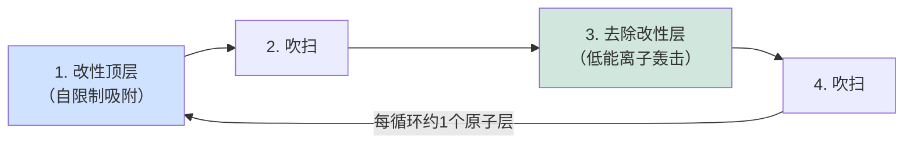

# 刻蚀技术——干法刻蚀、湿法刻蚀、ALE与选择性刻蚀

> 📘 **说明：** 本文为英文原版《Etch Technologies — Dry Etch, Wet Etch, ALE, and Selective Etch》的简体中文参考译本，仅供参考；如有出入，以英文原版为准。

刻蚀是与沉积和光刻相对应的减材工艺：它去除材料，将光刻胶中定义的图形转移到下方薄膜，最终转移到硅本身。刻蚀是晶圆厂设备（WFE）三大类别之一，通常占WFE支出的18–22%，也是泛林集团（Lam Research）与东京电子（Tokyo Electron）以及应用材料（Applied Materials）竞争最激烈的领域。在技术前沿，刻蚀的难度急剧上升：3D NAND闪存的极端深宽比、全环绕栅极（GAA）沟道释放所需的埃级精度，以及现代材料叠层的选择比要求，已将刻蚀从一项相对成熟的技术推向半导体制造中创新最密集的领域之一。本文涵盖干法刻蚀物理、向高密度等离子体的演进、3D NAND高深宽比（HAR）刻蚀、原子层刻蚀（ALE）、湿法与选择性刻蚀、低温刻蚀，以及供应商与路线图格局。

---

## 📊 可视化概览

*原创示意图；Mermaid图表可在GitHub上原生渲染。*

**各向异性等离子体刻蚀——定向离子 + 侧壁钝化（截面图）**

下图为截面示意：定向离子决定各向异性；钝化膜阻挡横向刻蚀；离子激活的化学反应向下刻蚀；整体是化学作用（选择性、各向同性）与物理作用（定向）的平衡。

```
        ↓ ↓ ↓   directional ions (set anisotropy)
   ═══ mask ═══
   ║          ║   ← passivation film blocks LATERAL etch
   ║   etch   ║
   ║    ↓     ║   ← ion-activated chemistry etches DOWNWARD
   ‾‾‾‾‾‾‾‾‾‾‾‾
   Balance of chemical (selective, isotropic) + physical (directional) action
```

**ALE循环——原子尺度、自限制的去除**



**3D NAND高深宽比（HAR）沟道孔刻蚀——深宽比大于60:1，贯穿数百层**

下图为截面示意：在氧化物/氮化物交替叠层中进行一次连续的深刻蚀，孔径约数十纳米、深度达数微米，底部必须完全刻穿；需避免的缺陷包括弯曲（bowing）、扭曲（twisting）和锥化（tapering）。

```
   ── oxide ── nitride ── oxide ── nitride ──     ◄ top of stack
   ─────────────────────────────────────────
        │  one continuous deep etch  │
        │   diameter ~tens of nm     │   defects to avoid:
        │   depth ~microns           │   bowing · twisting · tapering
   ─────────────────────────────────────────
   ── oxide ── nitride ── oxide ── nitride ──     ◄ bottom (must fully clear)
```

---

## 1. 干法刻蚀基础

干法（等离子体）刻蚀利用辉光放电等离子体产生化学活性物种和高能离子，二者共同从晶圆表面去除材料。等离子体刻蚀的威力在于能够结合两种机制：

- **化学刻蚀**：中性自由基（如氟原子或氯原子）与表面反应，生成挥发性产物并被抽走。化学刻蚀通常是**各向同性**的（各方向刻蚀速率相同）且具有**选择性**（不同材料在特定化学条件下刻蚀速率差异很大）。
- **物理刻蚀（溅射）**：被电场加速射向晶圆的高能离子以物理方式将原子撞离表面。物理刻蚀是**各向异性**的（定向，向下刻蚀远快于侧向），但选择性**相对较差**。

等离子体刻蚀的艺术在于平衡这两种机制——通常借助**离子辅助化学刻蚀**，即定向离子轰击优先在结构底部激活化学反应，形成忠实转移图形所需的垂直、各向异性形貌，而不产生侧向钻蚀。一个关键的使能现象是**侧壁钝化**：反应副产物或有意加入的聚合物形成气体在结构侧壁上沉积保护膜，阻止横向刻蚀，同时受离子轰击的底部继续向下刻蚀。

业界使用多种等离子体源架构，区别在于如何产生和控制等离子体：

- <strong>CCP（电容耦合等离子体）：</strong>射频功率施加在两块平行板电极之间。CCP擅长**介质刻蚀**（氧化物、氮化物、低k），因为它能维持刻蚀这些坚固材料所需的高离子能量，双频CCP则可部分解耦离子能量和离子通量。
- <strong>ICP（电感耦合等离子体）：</strong>射频功率通过线圈耦合，在低压下产生高密度等离子体，并由独立偏压控制离子能量。ICP对离子**通量**和**能量**的控制更为独立，适用于**导体刻蚀**（硅、金属栅、多晶硅）及许多先进应用。
- <strong>ECR（电子回旋共振）：</strong>利用微波功率和磁场产生极高密度等离子体；历史上很重要，如今不如ICP常见。

两个主要调节旋钮——**离子能量**（控制各向异性、溅射成分和损伤）和**离子通量**（控制刻蚀速率）——必须与化学成分、压力、温度和脉冲一起调校，才能实现所需的形貌、选择比、均匀性和最小损伤。

---

## 2. 从RIE到高密度等离子体

早期等离子体刻蚀采用**反应离子刻蚀（RIE）**——一种中等密度的CCP工艺，足以应对旧节点相对宽松的几何尺寸。随着特征尺寸缩小、深宽比攀升，行业转向**高密度等离子体**源（ICP、ECR），在实现良好各向异性和均匀性所需的低压下提供高刻蚀速率。关键应用按材料类别分化：

- **导体刻蚀**——对栅极（多晶硅、金属栅叠层）以及钨、氮化钛、氮化钽等金属进行图形化——通常在ICP设备中使用氯基和溴基化学品（Cl₂、HBr、BCl₃），对下方栅介质的选择比和精确的关键尺寸（CD）控制至关重要。
- **介质刻蚀**——在SiO₂、Si₃N₄和低k材料中刻蚀接触孔、通孔和沟槽——在CCP设备中使用碳氟化合物化学品（CF₄、CHF₃、C₄F₈、C₄F₆），碳氟聚合物在刻蚀介质的同时钝化侧壁。挑战在于对下方停止层实现高选择比，并避免损伤脆弱的低k薄膜。

现代刻蚀腔体增加了复杂的控制层：可在晶圆各区域独立控温以调节刻蚀均匀性的**多区静电吸盘**；通过脉冲化源功率和/或偏压功率来控制自由基与离子比例、减少充电损伤和深宽比相关刻蚀的**脉冲射频**；以及基于光学发射光谱的先进终点检测。

---

## 3. 3D NAND高深宽比（HAR）刻蚀

如果说有哪一个应用最能体现现代刻蚀挑战，那就是**3D NAND中的沟道孔和狭缝刻蚀**。3D NAND通过堆叠交替的介质层（氧化物与氮化物组成的“ONON”叠层，或氧化物与多晶硅组成的“OPOP”叠层）垂直构建存储器——层数已从早期的24层激增至96、128、176、232层，如今已超过300层（SK海力士（SK hynix）于2024年底开始量产321层NAND，其他厂商随后也发布了300层以上的世代），并通过串堆叠（分别刻蚀两个叠层再将其连接）达到最高层数。

在这样的叠层中刻蚀沟道孔是整个制造业中最极端的工艺之一：

- **深宽比超过60:1**并正向100:1迈进——孔径仅数十纳米、深达数微米，在单次连续工艺中刻穿数百个交替层。
- **形貌控制**极为严苛：刻蚀必须从上到下保持笔直、直径均匀的孔。常见缺陷包括**弯曲**（孔中部鼓起）、**扭曲**、**锥化**（孔随深度变窄）以及底部刻蚀不完全。在数十亿个孔中，即便微小的CD变化也会放大为器件失效。
- <strong>CD负载效应和深宽比相关刻蚀（ARDE）</strong>使孔的刻蚀速率随局部密度和深度而不同，要求极其精细的化学和等离子体控制。
- 刻蚀依赖强大的**低温或高能碳氟化合物CCP工艺**，配合精心设计的钝化和离子能量（有时超过10 keV），并越来越多地采用**低温刻蚀**（见下文）以提高刻蚀速率和改善形貌，同时减少掩模消耗。

3D NAND HAR刻蚀是泛林集团、东京电子和应用材料之间的主要战场，并占用了存储器刻蚀产能中不成比例的份额。与之配套的**台阶刻蚀**——通过反复刻蚀和修整光刻胶掩模来形成阶梯状接触着陆结构——是另一项NAND特有的刻蚀专长。

---

## 4. 原子层刻蚀（ALE）

正如原子层沉积（ALD）实现了原子尺度的材料*添加*，<strong>原子层刻蚀（ALE）</strong>实现了原子尺度的*去除*——通过一系列自限制步骤一次刻蚀一个单层。凡是刻蚀必须以近原子级精度停止且损伤最小的场合，ALE都必不可少，而在GAA及更先进节点，这类场合越来越多。

典型的**等离子体ALE**循环交替进行：（1）**改性**步骤，反应物（如氯）以自限制方式化学吸附于表面最顶层原子并使其改性；（2）吹扫；（3）**去除**步骤，低能离子轰击（能量刚好足以去除改性层而不足以去除下方未改性材料）精确溅射掉这一改性层；（4）再次吹扫。由于每一步都是自限制的，ALE可提供卓越的**均匀性、原子级深度控制、低损伤和高选择比**——代价是产能，因为需要很多循环。

**热ALE**使用顺序气相反应（如先氟化，再进行配体交换反应），完全不使用等离子体，可实现各向同性、极其温和、保形的刻蚀，对释放纳米片沟道和修整三维结构很有价值。

ALE的主要应用：
- **鳍片和纳米片修整**，以埃级精度调整关键尺寸。
- GAA流程中的**侧墙回缩**和**内侧墙**处理。
- **GAA纳米片沟道释放**，必须以极高选择比去除硅沟道之间的牺牲SiGe，且不损伤脆弱的悬空纳米片。
- **EUV光刻胶及随机缺陷缓解**，使用类似ALE的温和修整与平滑处理。

ALE的采用迅速增长，因为它解决了常规连续刻蚀无法解决的问题：当器件尺寸接近刻蚀速率波动本身的量级时，只有自限制、原子级受控的去除才能保住良率。

---

## 5. 湿法刻蚀及与清洗相邻的刻蚀

尽管等离子体刻蚀占主导地位，**湿法（化学）刻蚀**在特定任务中仍不可或缺，其价值在于高选择比、低损伤和高产能：

- <strong>稀氢氟酸（DHF）</strong>刻蚀二氧化硅并去除自然氧化层，是表面预处理的基础。
- <strong>热磷酸（H₃PO₄，约160°C）</strong>相对于氧化物选择性刻蚀氮化硅——在侧墙和3D NAND工艺中至关重要（例如去除氮化物以形成字线凹槽）。
- **KOH和TMAH**沿晶面各向异性地刻蚀硅，用于MEMS、晶圆减薄及一些先进应用。
- <strong>SC-1和SC-2（RCA化学品）</strong>介于清洗和轻度刻蚀之间，用于去除颗粒和金属污染。

湿法刻蚀越来越多地在**单片式**设备（而非浸泡槽）中进行，以获得更好的控制并减少交叉污染，并与清洗紧密集成（文件10）。

---

## 6. 选择性刻蚀——GAA的使能技术

选择性刻蚀——去除一种材料而使相邻的、化学性质相近的材料不受影响——已成为前沿工艺的决定性能力，其中最重要的是**GAA沟道释放**。在GAA流程中，硅纳米片之间由牺牲**SiGe**层隔开，必须将其完全刻蚀掉，使硅片悬空且不受损伤。这要求**Si对SiGe的选择比达到30:1至100:1以上**，通过精心调校的气相或湿法化学（如基于HF/H₂O₂的化学品，或干法氯/氟基各向同性刻蚀）来利用硅与锗硅之间的化学差异实现。

与之密切相关的**内侧墙工艺**要求相对于硅*横向*回刻SiGe一个精确受控的量，然后用低k介质填充所形成的空腔——这一流程将高选择性横向刻蚀与保形ALD填充结合在一起。选择性刻蚀也是**高选择比介质刻蚀**（精确停止于薄刻蚀停止层上）以及日益用于放宽套刻要求的自对准方案的核心。

---

## 7. 低温刻蚀

**低温刻蚀**在等离子体刻蚀期间将晶圆冷却至极低温度（通常为−60°C至−100°C以下）。低温增强了侧壁钝化并改变了反应动力学，显著改善刻蚀速率、形貌控制和掩模选择比。低温刻蚀最初为MEMS中的**深硅刻蚀**和<strong>硅通孔（TSV）</strong>开发，现已成为**3D NAND HAR沟道刻蚀**的重要技术，可实现更快、更直、深宽比更高的孔，同时减少掩模消耗——这是NAND层数突破300层时的关键手段。低温刻蚀能力如今已成为领先刻蚀供应商之间的竞争差异化因素：泛林集团的第三代Lam Cryo 3.0（2024年8月推出）已投入量产，泛林集团表示其7,500多个NAND HAR介质刻蚀腔体中有近1,000个采用低温技术；而据报道，东京电子的低温沟道孔刻蚀（东京电子称其可刻穿400层以上，速度约为常规工艺的2.5倍）将从2026年起推出，挑战泛林集团在这一步骤中近乎垄断的地位。

---

## 8. 与EUV兼容的刻蚀

极紫外（EUV）光刻的出现带来了新的刻蚀要求。EUV光刻胶**很薄**（通常<30nm），且容易产生**随机缺陷**（随机桥接和断线）。因此，刻蚀必须将EUV图形从薄、粗糙、易出缺陷的光刻胶忠实地转移到下方薄膜中，通常借助**硬掩模**（如旋涂碳加含金属硬掩模）来提供抗刻蚀能力。温和的**光刻胶修整**和**平滑**刻蚀可降低从光刻胶继承的线边缘粗糙度，而精心的刻蚀工艺设计可以不放大光刻胶的微小缺陷，从而**缓解随机缺陷**。EUV图形化与刻蚀之间的紧密耦合，使光刻-刻蚀模块的协同优化成为前沿工艺的核心工作。

---

## 9. 供应商格局

| 供应商 | 刻蚀地位 |
|---|---|
| **泛林集团（Lam Research）** | **刻蚀市场领导者**，拥有占主导地位的CCP（Flex/Exelan）和ICP（Kiyo）平台；2025年2月推出Kiyo导体刻蚀的继任产品**Akara**，采用固态DirectDrive等离子体源，并为NAND推出Lam Cryo 3.0；在介质HAR刻蚀（3D NAND）和导体刻蚀方面尤为强势；刻蚀是泛林集团业务的核心和深厚的技术护城河。 |
| **东京电子（Tokyo Electron，TEL）** | 第二大刻蚀供应商，泛林集团的主要竞争对手，拥有强大的介质和导体刻蚀平台（Tactras、Telius）；在涂胶/显影领域也占主导地位，可提供一体化的光刻-刻蚀方案。 |
| **应用材料（Applied Materials，AMAT）** | 主要刻蚀厂商（Centura、Sym3、用于选择性刻蚀的Producer Selectra），在用于GAA沟道释放的选择性刻蚀和ALE方面尤具优势，依托其集成材料解决方案战略；2026年2月推出Sym3 Z Magnum导体刻蚀系统（第二代脉冲电压技术）。 |
| **日立高新（Hitachi High-Tech）** | 在导体和特种刻蚀方面实力雄厚，具备先进控制能力，并且是刻蚀相关量测（CD-SEM）的领导者。 |
| **SPTS（科磊（KLA）旗下公司）** | 特种及先进封装刻蚀（DRIE/Bosch工艺、MEMS、TSV）。 |
| **Mattson Technology（现属北京亦庄/APS）** | 去胶、干法刻蚀和快速热处理（RTP）；现属于一家与中国相关的集团，与国产化相关。 |
| **北方华创（NAURA）、中微公司（AMEC）（中国）** | 快速崛起的中国刻蚀供应商；尤其是中微公司拥有可信的CCP/ICP刻蚀设备，被国内及部分国际晶圆厂采用（据报道2025年刻蚀收入约98亿元人民币，同比增长35%），是中国设备国产化工作的焦点；北方华创的28nm级刻蚀已实现量产。 |

---

## 10. 专利格局

刻蚀知识产权集中在**等离子体源设计**（CCP和ICP反应腔架构、双频和脉冲射频方案）、**静电吸盘与温度控制**以及**工艺化学**方面。泛林集团在CCP/ICP反应腔和介质刻蚀技术方面拥有深厚的专利组合；应用材料拥有大量**ALE和选择性刻蚀**知识产权；东京电子拥有强大的刻蚀和一体化光刻-刻蚀专利。较新的前沿——原子层刻蚀、低温刻蚀以及用于沟道释放的选择性各向同性刻蚀——是专利申请活跃的领域，各供应商竞相锁定将定义GAA和互补场效应晶体管（CFET）制造的工艺知识产权。

---

## 11. 路线图

刻蚀路线图由架构转变驱动：

- <strong>GAA纳米片刻蚀：</strong>沟道释放所需的Si/SiGe选择比不断提高、精确的内侧墙横向回刻，以及对悬空纳米片的无损伤各向同性刻蚀——使选择性刻蚀和原子层刻蚀成为核心。
- <strong>CFET图形化：</strong>双层叠层使内侧墙和沟道释放的复杂度大致翻倍，并需要在n层与p层之间进行新的自对准隔离刻蚀，以及高深宽比的层间通孔刻蚀。
- <strong>背面供电网络（BSPDN）的背面刻蚀：</strong>从晶圆背面穿过超薄（<5μm）硅刻蚀纳米级硅通孔，深宽比超过40:1，并与正面晶体管对准——这是由背面供电催生的全新刻蚀挑战，现已随英特尔（Intel）18A（PowerVia）进入量产，台积电（TSMC）A16（Super Power Rail）将于2026年下半年至2027年跟进。
- <strong>超过1000层的3D NAND：</strong>随着串堆叠将总层数推向并突破1000层，沟道孔刻蚀面临越来越极端的深宽比，需要低温刻蚀、新型高能等离子体源、新型硬掩模以及更严格的形貌控制，以保证数十亿个孔从上到下保持一致。
- <strong>全面原子尺度化：</strong>在逻辑和存储器领域，共同主线是从连续刻蚀迁移到**自限制、原子级受控的去除**，因为在这些尺寸下，常规刻蚀的自然波动相对于所制造的结构已不再微小。

因此，刻蚀已从一个成熟、近乎商品化的步骤，演变为半导体设备中要求最苛刻、创新最迅速的领域之一——是将芯片“搭建”起来的沉积和光刻不可或缺的减材补充。

---

## 扩展分析：刻蚀复兴与原子尺度前沿

### A. 从成熟步骤到创新前沿

在行业历史的大部分时间里，刻蚀被视为一个相对成熟、近乎商品化的步骤——光鲜的光刻之外一个必要的减材补充。这种看法如今已彻底过时。刻蚀已成为半导体设备中创新最丰富、进展最迅速的领域之一，原因有三。第一，**3D NAND的极端深宽比**（沟道孔超过60:1并向100:1攀升，贯穿数百层）将等离子体刻蚀推入了无人预料的难度区间，需要在等离子体源、化学和低温技术方面持续创新。第二，**GAA所需的埃级精度**（选择性沟道释放、内侧墙回刻、纳米片修整）要求开发原子层刻蚀和高选择比各向同性刻蚀——这都是全新的能力。第三，**新材料的激增**（钴、钌、钼、高k、二维沟道，每种都需要各自的刻蚀化学和选择比）成倍增加了刻蚀开发负担。这些因素共同使刻蚀从成熟步骤变为前沿，也正因如此，泛林集团（刻蚀领导者）成为增长最强劲的设备制造商之一，刻蚀占WFE支出约18–22%——可与光刻和沉积相匹敌。

### B. 原子层刻蚀革命

近年来最重要的刻蚀进展是**原子层刻蚀（ALE）**——ALD的减材对应技术，通过自限制循环一次去除一个原子层。ALE的意义与ALD相当：当器件尺寸接近连续刻蚀自然波动的量级时，只有**自限制、原子级受控的去除**才能保住良率。ALE提供卓越的均匀性、原子级深度控制、低损伤和高选择比——这正是GAA沟道释放、内侧墙形成、鳍片/纳米片修整以及EUV缺陷缓解所需要的。其代价是产能（需要很多循环），但对于最关键、对精度要求最高的步骤，ALE的控制能力值得付出产能代价。热ALE（无等离子体、各向同性、极其温和）对于无损伤地释放脆弱的纳米片沟道尤为有价值。ALE的快速普及——从研究中的新奇技术到量产关键能力——体现了前沿工艺向原子尺度、自限制加工的更广泛迁移，也是实现GAA和CFET时代的关键能力之一。

### C. 3D NAND刻蚀的极限

3D NAND中的高深宽比沟道孔刻蚀堪称整个制造业中最极端的工程成就之一。刻蚀数以百万计的孔，每个孔宽数十纳米，以超过60:1的深宽比垂直刻穿数百个交替介质层——在每片晶圆数十亿个孔上保持均匀直径、垂直形貌和从上到下的完全刻穿，并具备避免弯曲、扭曲和锥化的形貌控制能力——这将等离子体刻蚀推向了物理极限。随着NAND层数向300层及以上攀升（串堆叠将总层数推向1000层），这一刻蚀的要求越来越高，需要**低温刻蚀**（冷却晶圆以增强钝化和刻蚀速率）、新型高能等离子体源（离子能量超过10 keV）、新型硬掩模（以承受长时间刻蚀）以及更好的形貌控制。3D NAND刻蚀是刻蚀设备需求的主要驱动力和持续的创新前沿，它说明了存储器的垂直微缩范式（文件13）所带来的刻蚀挑战与逻辑的尺寸微缩挑战同样严峻。

### D. 选择性刻蚀作为GAA和CFET的使能技术

选择性刻蚀——去除一种材料而使相邻的、化学性质相近的材料不受影响——已成为GAA和CFET时代的决定性能力。其标志性应用是**沟道释放**：以超过30:1的选择比（对于CFET的双材料叠层则趋近100:1）刻蚀掉硅纳米片之间的牺牲SiGe，使硅片悬空且不受损伤。与之密切相关的**内侧墙**工艺要求SiGe相对于硅进行精确受控的横向回刻。这些都需要精细调校的化学（气相或湿法）来利用硅与锗硅之间细微的化学差异，是量产中最困难的刻蚀工艺之一。选择性刻蚀与选择性沉积（文件04）共同指向一个**自对准工艺**的未来：结构越来越多地引导自身的形成——在这样的未来里，刻蚀不仅仅是减材，而是一种能够在原子尺度上区分并作用于不同材料的精密雕刻工具。这一能力是GAA的核心、CFET的必需，也是刻蚀如何从粗放的减材步骤演变为精密、材料选择性、原子尺度技术的最清晰例证之一。

### E. 背面与三维刻蚀前沿

向三维集成的转变正在创造全新的刻蚀挑战。用于背面供电的**背面通孔刻蚀**（文件15）要求从晶圆背面穿过超薄（<5μm）硅刻蚀纳米级通孔，深宽比超过40:1，并与正面晶体管对准——这是背面供电催生的全新刻蚀应用。用于顺序式CFET的**层间通孔刻蚀**（文件23）要求在键合的器件层之间以低于20nm的CD进行高深宽比刻蚀。用于先进封装的**硅通孔刻蚀**（文件11）在不同尺度上使用Bosch工艺深反应离子刻蚀（DRIE）。而CFET层间的**自对准隔离刻蚀**则需要新的选择性能力。这些三维刻蚀挑战——背面、层间、TSV和自对准——代表了行业转向第三维度所创造的新前沿，它们确保刻蚀远非成熟步骤，而是始终是半导体设备中要求最苛刻、进展最迅速的领域之一，是实现定义前沿工艺的三维、原子尺度、多材料器件的核心。

---

## 🆕 2025–2026年更新：最新进展（截至2026年11月）

### 市场背景

刻蚀是2025–2026年设备上行周期的主要受益者之一。根据国际半导体产业协会SEMI 2025年12月的年终预测，2025年设备总销售额约为**1,330亿美元（+13.7%）**；SEMI在2026年7月的年中预测中又将2026年大幅上调至**1,659亿美元（+23.2%）**，其中WFE为**1,439亿美元**。刻蚀领导者泛林集团在2026年10月21日的业绩中报告了创纪录的晶圆代工销售额，并表示预计2026日历年WFE在1,550亿美元左右（“mid-$150B”区间），并初步预计2027年将超过2,000亿美元，增长依次由**DRAM**、晶圆代工/逻辑和NAND引领。泛林集团还提醒，洁净室空间短缺和零部件供应限制可能制约行业扩产速度。对刻蚀而言，驱动因素包括2nm GAA量产爬坡、高带宽内存（HBM）驱动的DRAM支出、NAND层数升级以及背面供电。

### 新刻蚀平台

- <strong>泛林集团Akara（2025年2月）：</strong>泛林集团Kiyo导体刻蚀产品线的继任者（Kiyo装机量超过30,000个腔体）。Akara采用固态**DirectDrive**等离子体源，泛林集团称其响应速度约为早期等离子体源的100倍，并配备TEMPO等离子体脉冲和SNAP离子能量控制。泛林集团将其定位于GAA、6F² DRAM和3D NAND，并可扩展至4F² DRAM、CFET和3D DRAM，且称其已被选为平面DRAM和代工GAA应用的量产基准设备（tool of record）。
- <strong>应用材料Sym3 Z Magnum（2026年2月）：</strong>基于Sym3 Z平台（据应用材料称已部署超过250个腔体），采用第二代脉冲电压技术（PVT2），用于2nm级导体刻蚀。与之同时推出的还有**Viva**自由基处理系统，用于无损伤地平滑GAA纳米片表面；应用材料称一家逻辑芯片制造商已在2nm以下工程开发中采用Viva。
- <strong>低温刻蚀竞争：</strong>Lam Cryo 3.0（2024年8月）已在NAND量产中使用，泛林集团7,500多个NAND HAR介质腔体中近1,000个运行低温工艺。据报道，东京电子的低温沟道孔刻蚀将从2026年起进入市场。沟道孔刻蚀一直近乎由泛林集团垄断，因此东京电子在此取得的任何订单都将是刻蚀领域最重要的份额变化之一。来自二手来源的份额估计相互矛盾，应审慎对待。

### GAA与背面供电进入量产

随着台积电N2自2025年第四季度起量产、英特尔18A进入大批量制造（Panther Lake，2026年初）以及三星（Samsung）SF2出货，第4节和第6节所述的选择性SiGe沟道释放、内侧墙回刻和ALE步骤首次成为大批量工艺。英特尔18A上的PowerVia使**背面通孔刻蚀**成为量产工艺，台积电A16（Super Power Rail）将于2026年下半年至2027年跟进（依来源而异）。展望更远的未来，据报道，比利时微电子研究中心imec的2026年路线图将CFET定位于A7（0.7nm级）世代前后。imec于2026年7月发表的研究发现，在A2节点决定栅极间距下限的是接触和寄生效应，而非沟道材料。这使选择性刻蚀以及接触孔/通孔刻蚀继续处于未来微缩的中心。

### 存储器：DRAM引领的刻蚀需求与NAND层数

受AI加速器对HBM需求的推动，DRAM正引领2026–2027年的设备增长。HBM4于2026年进入量产；据Counterpoint数据，2026年第二季度SK海力士HBM份额约为50%，三星约33%，美光（Micron）约18%。DRAM电容刻蚀和埋入式字线刻蚀，以及HBM堆叠所需的TSV刻蚀，都直接受益。在NAND领域，层数已超过300层，向400层以上和多层堆叠的迈进持续提高每片晶圆的HAR刻蚀强度。

### 中国

| 指标 | 数据点（2025–2026年） | 来源/状态 |
|---|---|---|
| 中微公司2025年总营收 | 约124亿元人民币（同比增长约37%） | 据媒体报道的公司初步数据 |
| 中微公司2025年刻蚀营收 | 约98亿元人民币（+35%） | 据媒体报道 |
| 中微公司2026年第一季度营收 | 约29亿元人民币（同比增长34%） | 据媒体报道 |
| 中微公司CCP刻蚀在长鑫存储（CXMT）DRAM产线 | 已在多个关键步骤实现量产 | 据报道，2026年8月 |
| 北方华创刻蚀 | 28nm级刻蚀已实现量产 | 行业报道 |
| 中国国产设备占比 | 2025年约占所用设备的35%（2024年约25%） | 行业协会数据（据报道） |

据报道，中微公司的目标是在五年内覆盖约60%的高端刻蚀市场。美国对半导体制造设备（SME）和零部件的管制仍然有效。“关联方（50%）规则”在中美休战框架下暂停实施，美国财政部长贝森特于2026年9月表示休战将延长至2027年1月10日，因此西方刻蚀设备厂商面临的中国前景仍不明朗。中国在应用材料2026财年第三季度营收中的占比为28%，低于一年前的35%。

**值得关注（2026年末–2027年）**
- 东京电子的低温沟道孔刻蚀能否在主要NAND厂商处从泛林集团手中赢得量产份额。
- 台积电A16/A14和英特尔14A的刻蚀强度（背面通孔、选择性释放），以及与CFET相关的早期刻蚀开发。
- 由DRAM引领的2027年WFE（据泛林集团初步观点超过2,000亿美元），以及洁净室和零部件短缺是否会限制刻蚀设备产出。
- 中微公司和北方华创在先进介质刻蚀和HAR刻蚀方面的进展，以及休战期结束后美国出口规则的任何变化。
- 随着混合键合的临近，HBM4E/HBM5对TSV和堆叠刻蚀的要求。
