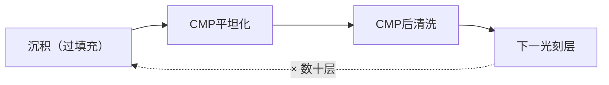

# 化学机械平坦化（CMP）

> 📘 **说明：** 本文为英文原版《Chemical Mechanical Planarization (CMP)》的简体中文参考译本，仅供参考；如有出入，以英文原版为准。

化学机械平坦化——通常简称CMP——是使现代多层集成电路成为可能的工艺。每当在前一层之上构建新的布线层或器件层时，都必须使表面重新达到原子级平整；否则累积的表面起伏将破坏下一道光刻步骤的焦深，并使无空洞沉积无法实现。CMP通过同时对表面进行**化学软化**和**机械研磨**来实现平坦化，将晶圆抛光至近乎完美的平面。尽管CMP在晶圆厂设备（WFE）支出中所占份额小于光刻、刻蚀或沉积（通常为4–6%），但它是影响良率的关键使能工艺，其重要性随着每一层新增金属层和每一种新互连材料而不断提升。本文涵盖CMP基础、主要应用、CMP在先进封装和混合键合中的作用、新兴材料挑战、原位量测、供应商格局，以及迈向原子级平整度的路线图。

---

## 📊 可视化概览

*原创示意图；Mermaid图表可在GitHub上原生渲染。*

**CMP设备——化学软化 + 机械研磨（截面图）**

下图为截面示意：旋转的抛光头施加下压力，晶圆正面朝下压在旋转的、经金刚石修整的抛光垫上，中间是含磨料（二氧化硅/二氧化铈）和化学成分的抛光液；去除速率 = Kp × 压力 × 速度（Preston方程），凸起处承受更大压力，因此实现平坦化而非简单减薄。

```
        │ down-force ↓   (rotating carrier head)
   ▒▒▒▒▒ wafer — face down ▒▒▒▒▒
   ~~~ slurry: abrasive (silica/ceria) + chemistry ~~~
   ███████ polishing pad (rotating, diamond-conditioned) ███████

   Removal rate = Kp × Pressure × Velocity   (Preston's equation)
   High points see more pressure → planarize, not just thin
```

**混合键合——CMP作为三维集成的使能技术（截面图）**

下图为截面示意：晶圆A与晶圆B的铜焊盘嵌于介质中并在键合面对接；要求亚纳米级CMP粗糙度、轻微的铜凹陷以及<100 nm的对准精度；介质在室温下键合，铜在退火时融合，键合间距<10 µm。

```
   ░░ Cu pad ░░  dielectric  ░░ Cu pad ░░     ◄ wafer A
   ─────────────  bond plane  ─────────────
   ░░ Cu pad ░░  dielectric  ░░ Cu pad ░░     ◄ wafer B

   Needs: sub-nm CMP roughness + slight Cu dishing + <100 nm alignment
   Dielectric bonds at room temp; Cu fuses on anneal → bond pitch < 10 µm
```

**CMP的位置——每一层之后都要重复**



---

## 1. CMP基础

在CMP中，晶圆正面朝下固定在旋转的抛光头上，压向一块旋转的抛光**垫**，抛光垫上布满含有磨料纳米颗粒的化学活性**抛光液**。两种机制共同作用：

- <strong>化学作用：</strong>抛光液中的化学成分与表面材料反应，形成软化、更易去除的表层（例如氧化金属表面，或使氧化物表面水合）。化学成分经过调校，具有高度的材料特异性，从而提供选择比。
- <strong>机械作用：</strong>悬浮在抛光液中的磨料颗粒（二氧化硅、二氧化铈或氧化铝）在抛光垫凸点的压力下，以机械方式去除化学软化层。关键在于，表面形貌的凸起处承受更大压力，研磨得比低处更快，因此表面被**平坦化**而不仅仅是减薄。

去除速率的一阶描述为**Preston方程**：

> **去除速率 = Kₚ · P · v**

其中Kₚ为Preston系数（反映抛光液/抛光垫的化学特性），P为下压力，v为晶圆与抛光垫之间的相对速度。实际CMP因**图形密度效应**而偏离这一理想模型：特征密度不同的区域抛光速率不同，导致典型的CMP缺陷——**碟形凹陷（dishing）**（宽而软的特征被过度抛光而下凹）和**侵蚀（erosion）**（密集特征阵列中介质过度损失）。通过抛光液选择比、抛光垫设计以及考虑特征密度的版图设计（冗余填充）来管理这些效应，是CMP工程的核心。

耗材——**抛光液**和**抛光垫**——与抛光设备本身同样重要。抛光液是精确配制的悬浮液（磨料类型与粒径、氧化剂、pH缓冲剂、缓蚀剂、表面活性剂）；抛光垫是经过工程设计的聚氨酯结构（如经典的IC1000），其表面必须定期**修整**（用金刚石盘粗化）以保持稳定的去除速率。CMP之后紧接着进行**CMP后清洗**，以去除抛光液残留和颗粒，否则缺陷将会扩散。

---

## 2. 主要CMP应用

**氧化物CMP**用于平坦化介质层。两种典型用途是**浅沟槽隔离（STI）**——在前道（FEOL）中抛除过填充的氧化物以平坦化隔离区——以及后道（BEOL）中的<strong>层间介质（ILD）</strong>平坦化，在下一层金属化之前将每一层介质抛平。氧化物CMP通常使用二氧化硅基或二氧化铈基抛光液，其中二氧化铈具有较高的氧化物对氮化物选择比，有利于STI工艺停止在氮化物层上。

**金属CMP**用于平坦化大马士革工艺中嵌入的导体。在金属（及其阻挡层）沉积并过填充已刻蚀的沟槽和通孔之后，CMP去除多余部分，使金属与介质齐平嵌入。主要的金属CMP应用包括：
- **钨（W）CMP**，用于接触孔和通孔插塞，以及3D NAND闪存/DRAM字线金属化。
- **铜（Cu）CMP**，用于后道互连——一个多步骤工艺（铜体去除、阻挡层去除、软着陆精抛），使用含氧化剂的抛光液，控制碟形凹陷和侵蚀至关重要。
- **钴（Co）CMP**，用于先进节点的底层金属和接触孔。

每种金属都需要各自的抛光液化学成分以及对周围介质和阻挡层的选择比。随着互连向钌和钼过渡，全新的CMP化学体系正在开发中。钼已在2025–2026年开始在部分3D NAND字线和前沿逻辑接触孔中取代钨，因此钼CMP已从研究进入量产。

---

## 3. 先进封装中的CMP

CMP在**先进封装**中承担起决定性的新角色，已成为**混合键合**的关键使能技术。两个封装特有的应用尤为突出：

- <strong>用于三维堆叠和背面工艺的晶圆减薄：</strong>晶圆键合到载片后，先进行机械背面研磨，再通过CMP抛光至极薄——常规三维堆叠为数十微米，背面供电则低于5μm——同时保持均匀性并控制应力。
- <strong>混合键合表面预处理：</strong>在铜-铜混合键合中，两个表面（各由嵌入介质中的铜焊盘组成）直接接触并键合。为使键合成功，表面必须平坦化至**亚纳米级粗糙度**，并精确控制轻微的铜**凹陷**（几纳米，使铜焊盘恰好回缩到位，在键合后退火时膨胀并相互接触）。这使CMP处于量产中最先进的三维集成技术的核心，其公差远比常规后道CMP严格。

芯粒（Chiplet）和高带宽内存（HBM）的兴起因此使CMP成为封装关键技术，其市场远远超出了传统的前道角色。

---

## 4. 新兴CMP挑战

技术前沿给CMP带来了一系列新的难题：

- <strong>Ru和Mo后道CMP：</strong>在最紧密间距上从铜向钌和钼的转变，需要新的抛光液化学体系，既能平坦化这些更硬、化学惰性更强的金属，又能保持选择比并避免电偶腐蚀。
- <strong>GAA刻蚀后薄叠层CMP：</strong>全环绕栅极（GAA）器件脆弱的薄材料叠层必须在不损伤或凹陷脆弱纳米片结构的前提下进行平坦化，需要温和、高选择比、低下压力的工艺。
- <strong>低k碟形凹陷与侵蚀：</strong>先进后道中使用的多孔、机械强度低的超低k介质在CMP过程中容易受损和凹陷，需要精心控制压力和设计抛光液以避免介质性能退化。
- <strong>背面晶圆减薄至<5μm：</strong>对于背面供电，晶圆必须以极高的均匀性和应力控制减薄至5微米以下——任何不均匀性都会转化为整个器件范围内的良率损失，而超薄晶圆在机械上极其脆弱。

这些挑战使CMP持续成为一个活跃的创新领域，而非已解决的成熟步骤。

---

## 5. 原位量测集成

由于过度抛光会毁坏器件，抛光不足则会留下短路或表面起伏，**终点检测**对CMP至关重要。现代CMP设备将原位量测直接集成到抛光台中：

- **光学终点**系统透过抛光垫上的窗口照射光线，监测反射率变化，以检测某层何时被清除或何时达到目标厚度。
- **光谱反射测量**在抛光过程中实时测量薄膜厚度。
- **电机电流/摩擦终点**检测被抛光材料从一层过渡到另一层（例如从金属到阻挡层再到介质）时摩擦力（进而电机扭矩）的变化。

这种原位控制为<strong>先进过程控制（APC）</strong>回路（文件08）提供输入，实现抛光时间和压力的批次间调整，以保持严格的厚度目标——随着先进节点和混合键合表面对波动的容忍度不断缩小，这一点愈发重要。

---

## 6. 供应商格局

CMP的特殊之处在于，**设备**市场与**耗材**（抛光液和抛光垫）市场都规模可观，且由基本不同的厂商服务。

| 类别 | 领先厂商 |
|---|---|
| **CMP抛光设备** | **应用材料（Applied Materials）**（Reflexion平台；CMP设备整体领导者）和**荏原（Ebara）**（日本；实力强劲的第二名，在金属和封装CMP方面尤具优势）。KCTECH（韩国）服务于韩国本土市场；**华海清科（Hwatsing）**（中国）已成为中国领先的本土CMP设备供应商（据报道其第1,000台CMP设备于2026年4月出货）。 |
| **抛光液** | **Cabot Microelectronics / CMC Materials**（2022年被收购后现属**Entegris**）、**Fujimi**、**富士胶片（Fujifilm）**、**Versum/Merck**、**杜邦（DuPont）**（其电子业务于2025年11月分拆为**Qnity Electronics**）以及Resonac（原日立化成）。 |
| **抛光垫** | **杜邦/Qnity**（占主导地位的抛光垫供应商，包括IC1000和IKONIC系列；该业务随杜邦2025年11月的电子业务分拆转入Qnity Electronics）和**3M**，Cabot/CMC（Entegris）也较活跃。 |

耗材业务具有高度经常性和战略重要性：抛光液和抛光垫的配方与特定工艺和材料深度协同开发，形成黏性强、利润率高的合作关系。Entegris收购CMC Materials，体现了在其他关键材料之外掌控抛光液供应链的战略价值。

---

## 7. 路线图

CMP路线图由不断收紧的平整度要求所定义：

- <strong>2nm及以后的原子级平整度：</strong>随着特征尺寸和焦深预算缩小，允许的CMP后表面起伏逼近原子尺度，要求越来越好的碟形凹陷/侵蚀控制和均匀性。
- <strong>新材料CMP：</strong>钌、钼和钴互连，以及新的高k和沟道材料，都需要定制的抛光液和抛光垫开发。
- <strong>混合键合精度：</strong>随着键合间距缩小至1微米乃至以下，表面预处理要求（亚纳米级粗糙度、精确控制的铜凹陷）更加严格，使CMP成为三维集成的节奏性技术（pacing technology）。
- <strong>背面工艺：</strong>背面供电的普及——英特尔（Intel）18A（PowerVia）自2025–2026年起已大批量生产，台积电（TSMC）A16将于2026年下半年至2027年跟进——使超薄晶圆减薄成为主流大批量需求，并带来相应的均匀性和应力挑战。
- <strong>原位、AI驱动的控制：</strong>更严格的公差推动实时量测与基于机器学习的终点和过程控制更深度地集成，以将工艺保持在越来越窄的窗口内。

CMP曾被视为相对平凡的成熟步骤，如今已重新成为两个前沿的关键使能技术——前沿逻辑的原子级平整度与混合键合的亚纳米级表面完美度——从而确保其在半导体资本设备（SemiCap）格局中的持续重要性。

---

## 扩展分析：耗材、混合键合与CMP复兴

### A. 以耗材为中心的CMP经济学

在各工艺步骤中，CMP的特殊之处在于其持续成本主要由**耗材**——抛光液和抛光垫——而非设备决定。一座大批量晶圆厂消耗大量抛光液（每种配方都与被抛光材料精确匹配），并频繁更换抛光垫（抛光垫寿命有限，必须定期用金刚石盘**修整**以保持稳定的去除速率）。这使**抛光液和抛光垫供应商**（Entegris/CMC、Fujimi、杜邦/Qnity、3M、Resonac）成为CMP经济性和性能的核心，也使抛光液/抛光垫配方成为一门深度协同开发的学科：化学成分必须针对特定材料、所需选择比、缺陷要求和抛光垫力学特性进行调校，其成果通常作为商业秘密加以保护。Entegris收购CMC Materials体现了掌控这一耗材供应的战略价值，而抛光液和抛光垫销售的经常性、高利润特征，使CMP耗材成为一项独立于设备之外的有吸引力的业务。

### B. 混合键合的迫切需求

提升CMP战略重要性的最重要单一发展是**混合键合**（文件11、23）。在铜-铜混合键合中，两个表面——各为嵌入介质中的铜焊盘阵列——直接键合，键合的成败几乎完全取决于**经CMP处理的表面**：介质必须平坦化至**亚纳米级粗糙度**（使介质表面一经接触即可键合），铜焊盘必须形成精确受控的轻微**凹陷**（几纳米的回缩，使铜不突出，而是在键合后退火时膨胀以形成接触）。这一CMP规格远比常规后道CMP严格苛刻，粗糙度和凹陷需在整片晶圆上以原子尺度进行控制。随着混合键合的推广——在三维逻辑（AMD 3D V-Cache、台积电SoIC）中、在CMOS图像传感器中、未来可能在HBM中（在JEDEC将HBM4封装高度上限放宽至775 µm之后，HBM的采用已推迟至最早HBM4E/HBM5），并向亚微米键合间距迈进——它使CMP成为**三维集成的节奏性技术**，并推动了专门用于键合表面预处理的新型抛光液、抛光垫和过程控制的密集开发。实际上，CMP已成为一项封装关键技术，其市场和战略重要性远远超出了传统的前道角色。

### C. 新材料CMP挑战

前沿工艺向新互连和器件材料的转变带来了一系列CMP新难题。**钌和钼**（新的后道金属，文件04、15）比铜更硬、化学惰性更强，需要新的抛光液化学体系，在保持对周围介质的选择比并避免电偶腐蚀的同时实现平坦化——这是一项重大的配方重构挑战，因为历经25年发展的铜CMP化学体系无法直接沿用。**钴**（用于底层金属层）有其自身的化学体系。**GAA薄叠层**必须在不损伤或凹陷脆弱纳米片结构的前提下进行平坦化，需要温和、低下压力、高选择比的工艺。**多孔超低k介质**机械强度低，容易凹陷或受损，需要精心控制压力。因此，器件叠层中的每一种新材料都带来相应的CMP开发工作，使CMP成为持续创新的领域，而非已解决的成熟步骤。

### D. 背面减薄与超薄前沿

背面供电（文件15）和三维集成已使**CMP晶圆减薄**成为主流的大批量需求。将晶圆减薄至**5μm以下**（有时低于2μm），并具备避免整个芯片范围良率损失所需的均匀性和应力控制，是一项极端的CMP和研磨挑战，而超薄晶圆的脆弱性（全程必须与载片键合）更增加了难度。这一前沿——曾是封装领域的小众需求——随着背面供电的普及正在成为前沿逻辑的需求，提升了CMP和研磨（迪思科（Disco）、Okamoto、应用材料、荏原）的地位并创造了新的高价值需求。结合混合键合表面预处理和新材料抛光，背面减薄使CMP成为在前沿工艺中战略重要性**不断上升**的技术之一——这是一个曾被视为成熟的步骤的复兴，其驱动力正是贯穿本数据库的向三维集成的转变。

---

## 进一步分析：过程控制与缺陷挑战

### A. CMP缺陷问题

CMP的矛盾之处在于，它既是*消除*缺陷的步骤（通过平坦化使后续工艺成为可能），又是*产生*缺陷的步骤（机械研磨和抛光液可能引入划痕、颗粒和残留物）。因此，管理**CMP缺陷率**是一项核心挑战，并且随着特征尺寸缩小（致命缺陷尺寸更小）、材料愈发脆弱（多孔低k、GAA薄叠层）以及平整度要求收紧而愈发困难。缺陷模式有多种：**划痕**（来自团聚的抛光液颗粒或抛光垫碎屑）、**残留抛光液颗粒**（CMP后清洗必须将其去除，同时不能划伤新平坦化的表面）、**腐蚀和电偶效应**（尤其是新金属）、**碟形凹陷和侵蚀**（降低平整度并影响下一道光刻）以及脆弱薄膜的**分层**。控制这些缺陷需要对抛光液（粒径分布、化学成分）、抛光垫（力学特性、修整）、工艺（压力、速度、终点）和CMP后清洗进行精心的协同设计——而先进节点、尤其是混合键合表面的更严格公差，使CMP缺陷控制成为持续创新的领域。原位量测（光学和光谱终点）以及日益AI驱动的过程控制的集成，有助于将工艺保持在不断收窄的窗口内，但CMP缺陷率仍是较具挑战性的良率杠杆之一，这也是CMP远非曾经被认为的那种已解决的成熟步骤的原因。

### B. 终点检测作为一门精密艺术

由于过度抛光会毁坏器件，抛光不足则会留下短路或表面起伏，**终点检测**——精确知道何时停止——是CMP核心的一门精密艺术。挑战之所以尖锐，是因为尽管图形密度差异导致不同区域在不同时间被清除，抛光仍必须在整片晶圆上恰好在正确的点停止。现代CMP集成了多种终点技术：**光学终点**（在某层被清除或达到目标厚度时，透过抛光垫窗口监测反射率）、**光谱反射测量**（抛光过程中实时测量薄膜厚度）以及**电机电流/摩擦终点**（检测被抛光材料从一层过渡到另一层时的摩擦变化）。对于要求最高的应用——混合键合表面预处理（铜凹陷必须控制在几纳米以内）和超薄背面减薄（最终厚度必须精确保持）——终点检测必须极其精确，并越来越多地接入闭环、批次间和AI增强的控制（文件08、22），逐片调整工艺以保持目标。终点检测说明，CMP在其概念上简单的“抛平”描述之下，实际上是一个精确受控、量测密集的工艺，其难度随着平整度和凹陷要求的每一次收紧而上升。

### C. 复兴总结

CMP在技术前沿最深层的主题是其**复兴**——从一个成熟、近乎商品化的步骤转变为同时在两个前沿发挥关键作用的使能技术。在**逻辑前沿**，原子级平整度要求、新材料抛光（Ru、Mo、Co）以及脆弱GAA叠层的平坦化，使CMP保持为活跃的创新领域。在**三维集成前沿**，混合键合表面预处理（亚纳米级粗糙度、精确受控的铜凹陷）和超薄背面减薄（背面供电要求低于5μm），使CMP成为三维未来的节奏性技术。这两个前沿——原子级平整度和亚纳米级键合表面完美度——将CMP从一个曾被视为理所当然的步骤提升为战略重要性不断上升的步骤，并推动了新型抛光液、抛光垫、工艺和控制的密集开发。CMP复兴是贯穿本数据库的一种模式的缩影：随着行业迈向原子尺度和三维集成，即使看似最成熟的步骤也会重新成为关键的、不断创新的、决定良率的使能技术——而执行这些步骤的设备和耗材（设备方面的应用材料、荏原；耗材方面的Entegris、杜邦/Qnity、Fujimi）也重新获得战略意义。

---

## 🆕 2025–2026年更新：最新进展（截至2026年11月）

### 市场背景

CMP受益于2025–2026年广泛的设备上行周期及其在先进封装中日益重要的作用。根据国际半导体产业协会SEMI 2026年7月的年中预测，2026年设备总销售额预计达到**1,659亿美元（+23.2%）**，其中WFE为**1,439亿美元**。泛林集团（Lam Research）于2026年10月表示，初步预计2027年WFE将超过2,000亿美元，由DRAM引领。2nm节点更多的金属层、HBM驱动的DRAM、AI封装中的硅通孔（TSV）和键合步骤，以及背面减薄，都增加了每片晶圆的CMP次数。在耗材方面，TECHCET估计2024年CMP抛光液和抛光垫市场约为**34亿美元**（抛光液约20亿美元，抛光垫约13.9亿美元，整体增长1.6%），并预计2025年约为36亿美元。据市场研究机构估计，用于新金属和键合表面的特种抛光液增速快于标准产品。

### 混合键合：取得进展，但HBM时间表推迟

- <strong>逻辑与SoIC：</strong>混合键合已在三维逻辑堆叠中实现量产，据报道台积电SoIC的键合间距约为6 µm。CMP表面预处理（亚纳米级粗糙度、受控的铜凹陷）仍是决定性步骤。
- <strong>设备联盟：</strong>应用材料于2025年取得BE Semiconductor（Besi）约9%的股份。双方共同开发混合键合系统，包括应用材料的**Kinex**一体化芯片-晶圆（die-to-wafer）混合键合机（2025年推出）。据报道，SK海力士（SK hynix）已为应用材料-Besi在线混合键合系统下了首份量产订单。
- <strong>HBM时间表：</strong>JEDEC将HBM4封装高度上限提高至**775 µm**（此前为720 µm），缓解了采用混合键合的压力。SK海力士在HBM4上继续使用MR-MUF/热压键合，并在Hot Chips 2026上表示混合键合尚未为HBM4E做好准备，最早要到HBM5。据报道，三星（Samsung）的态度更为积极。因此对CMP而言，HBM混合键合看起来是2027年及以后的需求驱动因素，而非2026年的。
- <strong>键合用耗材：</strong>富士胶片于2025年9月推出用于铜/氧化物混合键合表面的抛光液，并称已被一家主要芯片制造商采用。据报道，Qnity已在与SK海力士的供应协议下推出面向HBM的CMP抛光垫平台。

### 新金属与背面减薄

钼进入3D NAND字线（泛林集团ALTUS Halo，2025年）和前沿逻辑接触孔（2026年），使钼CMP成为量产需求。其去除行为、氧化控制和缺陷敏感性均不同于钨工艺，因此需要新的抛光液配方。背面供电——英特尔18A PowerVia已进入大批量制造，台积电A16 Super Power Rail将于2026年下半年至2027年跟进——使通过研磨加CMP将晶圆减薄至5 µm以下成为前沿逻辑工艺步骤。

### 企业与供应链变化

| 日期 | 公司 | 进展 |
|---|---|---|
| 2025年1月 | 荏原 | 展出面向先进封装的面板级封装CMP设备和电镀设备 |
| 2025年 | 应用材料 / Besi | 应用材料持有Besi约9%股份；推出Kinex混合键合机 |
| 2025年9月 | 富士胶片 | 推出混合键合CMP抛光液；已被一家主要器件制造商采用（据富士胶片） |
| 2025年11月 | 杜邦 → Qnity | 电子业务（含IKONIC CMP抛光垫）分拆为Qnity Electronics，于2025年11月3日上市 |
| 2026年4月 | 华海清科 | 据报道第1,000台CMP设备出货 |
| 2026年 | 荏原 | 2025财年业绩创纪录；受AI相关需求推动，预计2026年营业利润创新高（据公司展望摘要） |

### 中国

华海清科是中国主要的本土CMP设备供应商。根据乔治城大学安全与新兴技术中心（CSET）的分析，中国在CMP设备市场的份额从2022年的约1.5%升至2023年的近11%，几乎完全由华海清科推动。CMP与清洗、热处理和PVD一样，是中国本土设备进展最大的领域之一。这与更广泛的行业协会估计相吻合：2025年国产设备约占中国晶圆厂所用设备的35%。

**值得关注（2026年末–2027年）**
- HBM4E或HBM5是否会将混合键合（及其CMP要求）带入大批量存储器生产，以及三星领先SK海力士的程度。
- SoIC类逻辑堆叠中键合间距缩小至约6 µm以下，以及为此所需的CMP和量测能力。
- 钼及（之后的）钌CMP抛光液的认证，以及随着特种抛光液份额提升的耗材定价。
- 面板级（CoPoS）和玻璃芯基板封装带来的大尺寸CMP需求。
- 在持续出口管制下，中国本土CMP设备（华海清科）的份额提升。
