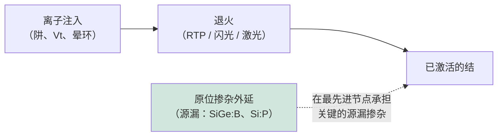

# 离子注入、掺杂与热处理

> 📘 **说明：** 本文为英文原版《Ion Implantation, Doping, and Thermal Processing》的简体中文参考译本，仅供参考；如有出入，以英文原版为准。

掺杂——有意引入杂质原子以控制硅的电学特性——正是把惰性的晶体硅变成可工作晶体管的关键。引入掺杂剂的主流方法是**离子注入**：将掺杂原子电离、加速到高能量，然后以对剂量和深度的极高控制精度射入晶圆。离子注入总是与**退火**配对使用：退火是一个热处理步骤，用于修复注入造成的晶格损伤，并通过把掺杂原子移到晶格位置上使其实现电激活。注入与退火共同定义了让晶体管开关的结，而随着器件微缩进入三维结构，二者都面临着深刻的新挑战。本文涵盖注入物理、注入机类型、结与阱工程、全环绕栅极（GAA）特有的掺杂问题、各类退火技术、外延及新兴掺杂方法、供应商格局以及路线图。

---

## 📊 图示概览

*原创示意图；Mermaid图表可在GitHub上直接渲染。*

**注入掺杂剂深度分布（近似高斯分布）**

下图为注入掺杂剂浓度随深度变化的示意：Rp为投影射程（由离子能量决定），ΔRp为射程歧离（分布展宽），沟道效应会使分布尾部延伸。

```
 dopant
 conc.  │        ____
        │      /      \      Rp  = projected range (set by ion energy)
        │     /        \     ΔRp = straggle (spread)
        │   /            \   tail extended by channeling
        │_/               \____
        └────────────────────────── depth into wafer →
```

**退火——“温度更高、时间更短”，在激活掺杂剂的同时避免扩散**

下图比较各类退火的时间尺度：炉管退火（数分钟至数小时，扩散多）、尖峰快速热处理（秒级）、闪光退火（毫秒级）、激光退火（微秒/纳秒级，扩散最少、激活率最高、可选择性加热特定层）。

```
 Furnace    minutes-hours  ████████████████████  (much diffusion)
 Spike RTP  seconds        ████
 Flash      milliseconds   ██
 Laser      micro/nano-s   ▏  (least diffusion, highest activation, layer-selective)
```

**注入→退火流程，以及当今向原位掺杂的转变**



---

## 1. 离子注入物理

在离子注入中，掺杂源（BF₃、PH₃或AsH₃等气体，或固态源）在等离子体中被电离，由质量分析磁铁筛选出所需的离子种类，随后离子束被加速并在晶圆上扫描。每个高能离子穿入硅时，会通过与电子的碰撞（电子阻止）和与原子核的碰撞（核阻止）损失能量，最终停留在由其能量和质量决定的深度。停留深度的统计分布形成近似高斯形的掺杂分布，其特征包括：

- **投影射程（Rₚ）**——平均穿透深度，随离子能量增加而增加；
- **射程歧离（ΔRₚ）**——围绕平均深度的展宽；
- 以及**布拉格峰**——能量沉积最大的深度。

若干物理效应使情况更加复杂。**沟道效应**是指离子沿晶格中的开放通道运动而异常深地穿透；可通过倾斜晶圆（通常为7°）、对表面进行预非晶化或使用屏蔽氧化层来抑制。碰撞级联会把硅原子从晶格位置上撞离，形成**注入损伤**，其范围可从孤立的点缺陷，到高剂量下近表面区域的完全**非晶化**。这些损伤随后必须通过退火修复；若处理不当，残余损伤会导致结漏电和缺陷。注入后的掺杂原子大多处于**电学非激活**状态（位于间隙位置）；只有在退火把它们移到替位晶格位置后，它们才会提供或接受载流子。

---

## 2. 注入机类型

不同的掺杂任务需要截然不同的剂量、能量和产能组合，业界因此使用几类不同的注入机：

- **大束流注入机**以中低能量提供大剂量，用于源漏掺杂以及其他对产能（每秒注入原子数）要求极高的大剂量步骤。
- **高能注入机**把离子加速到MeV级能量，将掺杂剂置于表面以下深处——用于先进CMOS和图像传感器中的倒掺杂阱、埋层和三阱。
- **中束流注入机**在剂量与能量之间取得平衡，具有精确的剂量控制和良好的角度控制，用于阈值电压调节、晕环/口袋注入和延伸区注入。
- <strong>PLAD（等离子体掺杂/等离子体浸没离子注入）</strong>将晶圆浸没在掺杂等离子体中，并施加脉冲偏压把离子共形地驱入表面——对于三维结构（如鳍和沟槽电容）侧壁的掺杂，以及常规束线注入难以实现共形性的超浅、高剂量结非常有价值。

现代注入机是集离子源、质量分析、加速柱、束流扫描以及精确的晶圆角度和剂量控制于一体的精密设备，对金属污染、剂量均匀性和角度精度有严格要求。

---

## 3. 结与阱工程

掺杂的艺术在于雕琢精确的掺杂分布以控制晶体管行为：

- 源漏**延伸区**所用的<strong>超浅结（USJ）</strong>必须极浅且高掺杂，以在抑制短沟道效应的同时保持较低串联电阻——这一根本矛盾在每个节点都愈发尖锐。
- **晕环/口袋注入**在沟道边缘附近引入局部的、带倾角的反型掺杂区，以抑制穿通并控制短器件中的阈值电压滚降。
- **倒掺杂阱**（利用高能注入）把掺杂峰值置于表面以下，以提高抗闩锁能力和短沟道控制，同时保持表面轻掺杂以利于迁移率。
- **阈值电压（Vt）调节注入**精细调整沟道掺杂以设定晶体管的开关电压，常在同一芯片上提供多种Vt类型（低、标准、高），以实现功耗/性能权衡。

若干辅助技术使这些分布更加陡峭。<strong>预非晶化注入（PAI）</strong>通常使用锗，有意使表面非晶化，以消除沟道效应并实现陡峭的浅结。碳或氟等元素的**共注入**可抑制不必要的掺杂扩散（例如碳可延缓硼的瞬态增强扩散），帮助在退火过程中保持陡峭的结。

---

## 4. GAA特有及先进掺杂挑战

向鳍式场效应晶体管（FinFET）、再向全环绕栅极器件的过渡，从根本上颠覆了传统注入。在平面晶体管中，掺杂区是平坦表面，垂直或略微倾斜的离子束即可轻松到达。而在三维器件中，需要掺杂的表面——鳍的侧壁、四周被栅极包围的堆叠纳米片沟道——已不再是定向离子束所能简单触及的；而且沟道本身通常保持轻掺杂（依靠栅极的静电控制），以避免掺杂涨落引起的器件波动。

因此，业界已将大量关键掺杂从束线注入转向**原位掺杂外延**（见下文）、用于三维表面的共形**等离子体掺杂（PLAD）**，以及通过金属栅的**功函数工程**（而非沟道掺杂）来设定阈值电压。在GAA中，控制**源漏掺杂与接触电阻**成为首要问题：掺杂剂必须恰好在接触界面处以最高浓度放置并激活，以尽量降低日益主导器件性能的寄生电阻。**替代金属栅功函数调节**——选择并叠层各种金属（TiN、TiAl、TaN等）为n型和p型器件设定精确功函数——是过去沟道Vt注入的现代对应物，由原子层沉积（ALD）/物理气相沉积（PVD）而非注入完成。

---

## 5. 退火——修复损伤与激活掺杂剂

退火是注入的热处理搭档，退火的历史就是一部以越来越短的时间实现越来越高峰值温度的历史——因为高温可激活掺杂剂并修复损伤，而短时间可防止掺杂剂扩散、抹平精心设计的浅结。退火技术的演进体现了这种“温度更高、时间更短”的追求：

- **炉管退火**——最初的方法，在批式炉中将晶圆保持在高温下数分钟到数小时。对于现代浅结而言扩散过多，但仍用于部分体材料和阱的退火。
- **快速热处理（RTP）/尖峰退火**——基于灯管加热，在数秒内将晶圆升至峰值温度（约1,000–1,100°C）并立即冷却，“尖峰”曲线使峰值停留时间最短。是许多节点上激活工艺的主力。
- **闪光灯退火（FLA）**——高强度闪光灯向表面施加毫秒级热脉冲，以比尖峰RTP更少的扩散实现高峰值温度。
- **激光尖峰退火（LSA）**——扫描激光加热表面数微秒（在最先进的纳秒/熔融变体中甚至更短），以最少的扩散实现最高的激活率。LSA在最先进节点中对于最浅、最陡峭的结以及降低接触电阻至关重要，其较低的热穿透深度也使其可兼容已成形的结构。
- **微波退火**——一种较低温度的研究/特种技术，通过微波耦合激活掺杂剂，热预算更低。

退火方式的选择是一项微妙的优化：在最大化电激活与损伤修复的同时，尽量减少掺杂扩散，并遵守晶圆上已有结构的热预算——在先进节点，这一热预算已变得极其紧张，尤其是金属栅、硅化物以及（在三维集成中）已键合的器件层无法承受高温的情况下。

---

## 6. 外延及新兴掺杂方法

随着束线注入在三维超浅掺杂方面触及极限，替代方法的重要性日益提升：

- **原位掺杂外延**现已成为最先进节点上源漏掺杂的主要方式。在选择性外延生长SiGe（用于pMOS）或Si:P（用于nMOS）的同时通入掺杂气体，把硼或磷以高且均匀的浓度掺入正在生长的晶体中，具有完美的共形性且没有注入损伤。这种原位方法可实现比“注入+退火”更高的激活掺杂浓度，这对于降低接触电阻至关重要。
- <strong>单分子层掺杂（MLD）</strong>是一种研究阶段技术：将含掺杂元素分子的自组装单分子层化学附着在表面，再通过短暂退火把掺杂剂驱入，实现对三维表面的极浅、共形、无损伤掺杂——原则上对GAA及以后的器件很有吸引力，但尚未进入大规模量产。
- <strong>等离子体掺杂（PLAD）</strong>连接了注入与上述表面方法，可对复杂形貌实现共形、高剂量的掺杂。

---

## 7. 供应商格局

| 供应商 | 定位 |
|---|---|
| **应用材料（Applied Materials，AMAT）** | 在注入（VIISta系列大束流、高能和中束流注入机）和热处理（RTP，以及基于DSA/Vantage平台的激光退火）两方面都是主要力量；产品组合广泛且集成度高。 |
| **亚舍立科技（Axcelis Technologies）** | **离子注入专业领导者**（Purion平台覆盖大束流、高能和中束流），在存储器和功率器件注入领域地位尤其强势；注入是其全部业务和核心护城河。2025年9月推出面向SiC的Purion Power Series+，2026年2月推出Purion H6大束流注入机；2025年10月宣布的与维易科（Veeco）的全换股合并，目前预计在2027年第一季度末前完成，尚待中国国家市场监督管理总局（SAMR）批准。 |
| **ULVAC、住友重机械工业（日本）** | 服务日本市场和存储器市场的注入设备供应商。 |
| **维易科（Veeco Instruments）** | 激光退火（源自原Ultratech的激光尖峰退火，以及面向低热预算接触和背面供电应用的纳秒激光退火）；正与亚舍立合并（见上）。 |
| **Mattson Technology** | RTP/热处理和去胶设备（现隶属于一家与中国相关的集团）。 |
| **迪恩士（SCREEN）、国际电气（Kokusai）、东京电子（TEL）** | 热处理和炉管设备供应商（与文件09中的热处理内容有所重叠）。 |

注入市场的突出特点是：亚舍立作为专注的纯业务公司，成功地与规模大得多的应用材料竞争，依靠的是深度专业化以及在存储器和功率器件细分市场的强势地位。退火（尤其是高价值的激光退火细分市场）由应用材料领先，维易科（原Ultratech）是激光退火领域的主要挑战者；正在进行的亚舍立–维易科合并将首次把一家领先的注入专业厂商与一家激光退火供应商结合在一起。中国本土注入设备供应商也正在中国成熟制程晶圆厂中进行设备验证（见下文2025–2026年更新）。

---

## 8. 路线图

注入与退火的路线图由重塑整个前道工艺的相同力量驱动：

- <strong>结深微缩至3nm以下：</strong>延伸区和接触必须越来越浅且掺杂越来越高，挑战低能注入、原位外延和超短退火的极限。
- <strong>接触电阻最小化：</strong>普遍被视为2nm（台积电自2025年第四季度起已量产）及以下节点的唯一硬性约束，这要求在接触界面处精确实现最高的激活掺杂浓度——推动原位掺杂外延、先进硅化物以及毫秒/纳秒激光退火的发展。
- <strong>面向GAA和互补场效应晶体管（CFET）的三维掺杂：</strong>对堆叠纳米片沟道和CFET的上下两层实现共形、可控的掺杂，需要共形掺杂方法（PLAD、MLD），并继续从沟道掺杂向功函数工程转移。
- <strong>面向三维集成的超低热预算：</strong>随着顺序三维集成和背面工艺的普及，掺杂激活越来越需要借助局部的、限于表面的退火（激光、闪光）来实现，且不扰动已成形的下层——这使得热预算最低的激活方法具有战略性的关键意义。

因此，掺杂与热处理依然是默默起决定作用的技术：不如光刻那样引人注目，却日益成为决定最小晶体管能以多快速度、多高效率开关的限制因素。

---

## 延伸分析：接触电阻、三维掺杂与退火前沿

### A. 接触电阻——硬性约束

如[文件15](15_technology_roadmaps.md)所述，<strong>接触电阻（Rc）</strong>普遍被视为2nm及以下节点器件性能的唯一硬性约束，而掺杂与退火技术正处于对抗接触电阻的核心位置。微缩晶体管的总电阻越来越多地不是由沟道主导，而是由**寄生电阻**主导——其中最主要的是源漏接触电阻，它随接触面积缩小而急剧上升。降低Rc需要注入和退火共同实现几件事：在接触界面处实现**最高的激活掺杂浓度**（使肖特基势垒变薄、隧穿更容易），具有低势垒高度的**最优硅化物**（NiPtSi、Ti基），以及最小的损伤。可达到的掺杂浓度受**固溶度**（硅晶格中能以激活的替位形式容纳的掺杂量）限制，而要突破平衡固溶度则需要非平衡技术——首先是**熔融或近熔融激光退火**，它可以把高于平衡极限的掺杂浓度“冻结”下来。这就是为什么最高价值的退火（毫秒和纳秒激光退火）已具有战略性的关键意义：它是少数能显著降低接触电阻的手段之一，而接触电阻原本会限制最先进节点的性能提升。

### B. 从束线注入向原位掺杂的转变

向三维器件的过渡推动了掺杂*方式*的深刻转变。在平面晶体管中，掺杂区是平坦、易到达的表面，定向离子束即可轻松触及——这使**束线注入**成为自然之选。但在FinFET尤其是GAA器件中，需要掺杂的表面（鳍侧壁、被栅极包围的堆叠纳米片沟道的端部）已不再是离子束可以简单到达的，而且沟道通常保持轻掺杂以避免掺杂涨落引起的波动。因此，业界已把大量关键掺杂转移到**原位掺杂外延**——在SiGe或Si:P源漏的选择性外延生长中掺入硼或磷——其可实现更高的激活浓度、完美的共形性且无注入损伤。这一转变是前道工艺中较为低调但影响深远的变化之一：对接触电阻影响最大的源漏掺杂，现在主要由**外延**设备（[文件04](04_deposition.md)）而非注入机完成，而束线注入仍在阱、阈值电压调节及其他步骤中发挥作用。<strong>等离子体掺杂（PLAD）</strong>和研究阶段的**单分子层掺杂**则用于满足原位外延无法覆盖的三维表面共形掺杂需求。

### C. 功函数工程取代沟道掺杂

与之相关的另一个转变是：**金属栅功函数工程**已在很大程度上取代沟道掺杂，成为设定阈值电压的手段。在较早的平面器件中，Vt通过对沟道注入来设定；但在GAA器件中，沟道保持轻掺杂（出于迁移率和波动性的考虑），Vt改由精心选择并叠层的**栅极金属**（TiN、TiAl、TaN等）来设定，这些金属的功函数决定开关电压，通过ALD/PVD沉积。在同一芯片上提供多种Vt类型（用于功耗/性能权衡的低、标准、高Vt）是通过改变这些功函数金属叠层实现的——在GAA中，也可通过改变纳米片宽度来实现（“按宽度实现多Vt”能力）。这意味着过去沟道Vt注入的现代对应物由沉积设备而非注入机完成——这是器件转型如何在设备集合中重新分配掺杂功能的又一例证。

### D. 退火前沿——局部化与层选择性

退火路线图的核心是对**局部化、超低热预算、层选择性**激活日益迫切的需求。随着器件走向三维，以及三维集成（顺序CFET、单片三维、背面供电）使晶圆上存在已完成的结构，退火必须提供较高的局部温度以激活掺杂剂，**同时不加热无法承受高温的埋层或相邻结构**。这正是**熔融和近熔融激光退火**所能提供的：仅在纳秒时间内加热表面（或特定区域），即可激活掺杂剂并形成低电阻接触，而晶圆其余部分——以及任何下层器件——保持低温。这种能力对CFET（激活上层而不损伤下层栅极）、背面工艺（在背面接触附近激活）以及任何“在上方继续构建”的集成方式都正变得不可或缺。每向三维集成迈进一步，对最局部化、最可控、热预算最低的退火的溢价就增加一分，使先进激光退火成为前道设备集合中增长较快、价值较高的领域之一——并将掺杂与退火技术的未来直接与定义最先进节点的三维、受接触电阻限制的前沿紧密联系在一起。

### E. 设备格局再审视

掺杂与退火设备格局反映了上述转变。在中国以外，**注入**市场基本上仍是双寡头格局（应用材料的VIISta和亚舍立的Purion，日本供应商占据部分细分领域，中国本土注入机在国内不断增长），亚舍立在仍以注入为主的存储器和SiC功率器件细分市场尤其强势（存储器和功率器件使用的注入远多于最先进逻辑，而后者的大部分关键掺杂已由原位外延接管）。**退火**由应用材料领先，尤其是在已具战略核心地位的高价值激光退火细分市场。随着最先进逻辑把关键掺杂转向外延、把激活需求转向局部激光退火，而存储器和功率器件维持强劲的注入需求，掺杂与退火设备市场按应用领域分化——这是更广泛行业格局的一个缩影：最难、最高价值的问题向三维、受接触电阻限制、受热预算约束的前沿迁移。

---

## 进一步分析：注入市场的韧性与功率器件的顺风

### A. 尽管转向外延，注入为何依然持久

虽然原位掺杂外延已在最先进节点接管了大部分*关键*源漏掺杂（见上文B节），**离子注入仍是一个规模庞大、富有韧性且不可或缺的市场**——这提醒我们，最先进节点只是故事的一部分。注入仍承担众多关键任务：逻辑芯片中的阱形成、阈值电压调节、晕环/口袋注入以及各种专门的掺杂步骤；在**存储器和功率器件**中，注入更是绝对核心，其注入用量远多于最先进逻辑。DRAM和3D NAND闪存的阱、存储单元结构及各种掺杂步骤都需要大量注入，而规模巨大且持续增长的存储器制造量维持着强劲的注入需求。**功率器件**（硅功率MOSFET和IGBT，尤其是SiC功率器件）高度依赖注入，而面向电动汽车电气化的SiC爆发式增长（[文件12](12_compound_semiconductor_equipment.md)）是注入市场一股重要且不断增强的顺风，因为SiC器件制造需要大量高剂量注入（SiC无法像硅那样方便地通过扩散掺杂，因此注入必不可少）。这种横跨逻辑、存储器和功率器件的需求多样性使注入市场在最先进逻辑将关键掺杂转向外延的情况下仍具韧性，这也是**亚舍立**（注入专业厂商）凭借在存储器和功率细分市场的强势地位蓬勃发展、成功与规模大得多的应用材料竞争的原因。

### B. SiC功率器件对注入的顺风

**碳化硅功率器件**的增长作为注入市场的一股重要顺风值得强调。SiC器件制造对注入的依赖异常高：由于SiC中掺杂剂扩散系数极低，基于扩散的掺杂不切实际，几乎所有SiC掺杂都通过**离子注入**完成（通常是高剂量、高能量，有时还需高温注入），随后进行SiC所需的极高温激活退火（1,600–1,800°C）。随着SiC功率器件为电动汽车电气化、快速充电和电网应用而放量（[文件12](12_compound_semiconductor_equipment.md)），对具备SiC能力的注入机的需求从长期看会相应增长（不过，据亚舍立管理层表示，在2023–2024年的产能扩建之后，由于客户消化产能，2025–2026年SiC注入需求较为疲软）——这股顺风使注入专业厂商受益（亚舍立在SiC功率领域地位强势），也例证了电气化大趋势如何在硅逻辑主流之外创造设备需求。SiC功率器件的顺风与富有韧性的存储器注入需求一起，确保离子注入——尽管在部分最先进逻辑环节被外延取代——仍是一个规模大、持续增长且具有战略重要性的设备市场，与电气化和存储器大趋势的关联程度不亚于与逻辑微缩的关联。

### C. 掺杂与退火的综合

本文的综合结论是：掺杂与退火虽然不如光刻或刻蚀引人注目，却日益成为决定最小晶体管能以多快速度、多高效率开关的**限制因素**——并且随着器件走向三维，它们已发生了深刻演变。对接触电阻（2nm及以下节点的硬性约束）影响最大的关键源漏掺杂已转向**原位掺杂外延**；阈值电压的设定已转向金属栅的**功函数工程**；三维表面的共形掺杂采用**等离子体掺杂**和研究阶段的方法；而激活越来越需要**局部化、超低热预算的激光退火**，在不损伤三维及堆叠器件埋层结构的前提下激活掺杂剂。与此同时，**束线注入**在逻辑（阱、Vt、晕环）、存储器（高度依赖注入）和功率器件（尤其是具有电气化顺风的SiC）中依然不可或缺且富有韧性。因此，掺杂与退火设备市场按应用领域分化——最先进逻辑转向外延和激光退火，存储器和功率器件维持强劲的注入需求——这一格局与更广泛的行业相呼应：最难、最高价值的问题向三维、受接触电阻限制、受热预算约束的前沿迁移，而在半导体产业所服务的各类多样化应用中，规模庞大且富有韧性的需求基础依然存在。

---

## 🆕 2025–2026年更新：最新进展（截至2026年11月）

### A. 市场背景：利好注入的存储器主导型上行周期

自本文最初撰写以来，整体设备市场已大幅加速。根据国际半导体产业协会（SEMI）2026年7月的年中预测，2026年设备销售总额将创下1,659亿美元的纪录（+23.2%），其中晶圆厂设备（WFE）为1,439亿美元，并预计到2028年总额将达到2,295亿美元。在2026年10月的财报季中，泛林集团（Lam Research）表示，预计2026年WFE约在1,550亿美元上下（“mid-$150B”区间），并初步预计2027年超过2,000亿美元，增长主要由**DRAM**引领，其次是代工/逻辑，然后是NAND。这一结构对掺杂与退火至关重要：存储器对注入的依赖远高于最先进逻辑（见“进一步分析”A节），因此由AI加速器所需高带宽内存（HBM）驱动的DRAM主导型周期，对束线注入的利好比2020年代初期由逻辑主导的周期更为直接。

### B. 亚舍立：新产品、SiC需求转弱与维易科合并

| 事项 | 现状（2026年11月） |
|---|---|
| Purion Power Series+（SiC：H200+、M+、XE+/EXE+） | 2025年9月推出，用于SiC功率器件注入 |
| Purion H6大束流注入机 | 2026年2月4日发布（在SEMICON Korea展出）；面向先进逻辑、存储器和图像传感器 |
| 2026年展望 | 2025年第四季度后指引为持平（存储器增长抵消功率器件和成熟制程的下滑）；据二手报道，2026年第二季度后上调为中个位数增长 |
| SiC注入需求 | 管理层称在客户消化产能期间近期需求疲软；长期前景积极 |
| 亚舍立–维易科合并 | 2025年10月宣布（全换股，约44亿美元；每股VECO换0.3575股ACLS）；双方股东投票于2026年2月6日通过；根据2026年11月2日的联合更新，交割目前预计在**2027年第一季度末前**完成，尚待中国SAMR批准及重新提交HSR申报 |

亚舍立–维易科合并与本文主题具有战略相关性：维易科带来激光尖峰退火和纳秒激光退火（其NSA系列系统定位于低热预算的接触退火和背面供电退火），与亚舍立的注入机结合，将形成一家横跨“注入+退火”两个环节的供应商。据媒体报道，SAMR的审查重点在于对中国市场竞争的影响，交割时间已从最初目标的2026年下半年推迟。

### C. 最先进逻辑：2nm投产，背面供电到来

- **台积电（TSMC）N2**（首个GAA纳米片节点）自2025年第四季度起已大规模量产，而**英特尔（Intel）18A**——首个采用PowerVia背面供电的节点——已进入大批量制造（Panther Lake于2026年初发布）。台积电采用超级电轨（Super Power Rail）背面供电的**A16**计划于2026年下半年至2027年量产（各方说法不一）。
- 这些量产进展印证了第4–6节所述的转变：关键源漏掺杂由原位掺杂外延完成，Vt由功函数金属设定，而价值最高的热处理步骤是用于接触形成的局部毫秒/纳秒退火。
- **背面供电**带来了新的退火需求：背面接触附近的掺杂剂和硅化物必须在晶圆完成键合和减薄、且正面互连已就位之后再进行激活。这有利于限于表面的激光退火，也是激光退火供应商专门针对背面供电和接触应用推广纳秒系统的原因之一。

### D. 中国：国产化延伸至注入

2025–2026年，中国仍是注入机的大买家，尤其是成熟制程逻辑、功率器件和存储器领域。根据行业机构数据，2025年中国所用设备中国产设备约占35%，且据报道新增产能须有一半以上的设备来自国内。注入历来是国产化程度最低的设备类别之一，但据报道，中国注入机厂商正在国内晶圆厂验证大束流和中束流设备。中美贸易休战（“关联方规则”自2025年11月10日起暂停实施；据报道休战延长至2027年1月10日）使现有半导体制造设备（SME）管制维持不变，但推迟了将其扩展至持股≥50%子公司的措施。

### E. 功率器件与SiC

SiC功率器件细分市场在2022–2024年曾是增长最快的注入终端市场，但随着电动汽车需求增速放缓、前期产能被逐步消化，2025–2026年进入消化阶段。长期驱动因素（电动汽车、快速充电、可再生能源及数据中心电源转换）依然完好，而200mm SiC转换仍需要高温注入和1,600–1,800°C的激活退火。AI数据中心供电（更高电压的机架供电）正成为SiC和GaN功率器件新的附加驱动因素。

**值得关注（2026年末–2027年）**

- SAMR的裁决及亚舍立–维易科合并的交割（目标为2027年第一季度末前），以及是否附加任何救济条件。
- DRAM/HBM资本开支激增能否在2027年转化为创纪录的注入机出货量。
- SiC注入需求复苏的速度以及200mm SiC的转换进程。
- 台积电A16和英特尔18A-P/14A在背面供电中采用激光退火的情况。
- 中国本土注入机在大束流和高能设备方面的进展。
