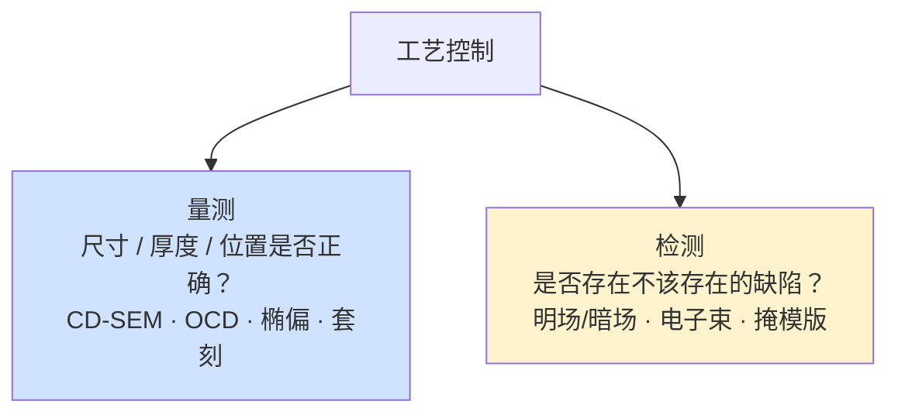
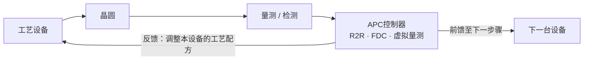

# 量测、检测与工艺控制

> 📘 **说明：** 本文为英文原版《Metrology, Inspection, and Process Control》的简体中文参考译本，仅供参考；如有出入，以英文原版为准。

如果说光刻、薄膜沉积和刻蚀*制造*了芯片，那么量测与检测就是让芯片得以**可靠且有利可图地**制造出来的关键。工艺控制——量测（测量尺寸、薄膜和套刻）、检测（发现缺陷）以及先进工艺控制（利用这些测量结果引导工艺）三大学科的总和——是晶圆厂的神经系统。它也是晶圆厂设备（WFE）中增长最快、对良率最关键的细分领域之一，通常占WFE支出的11–13%且比例持续上升（先进封装如今也成为一个快速增长的新增需求来源），因为随着极紫外光刻（EUV）和全环绕栅极（GAA）的到来，捕捉微小且常为随机性缺陷、以及将尺寸控制在原子尺度的难度已急剧上升。本文涵盖关键尺寸量测、薄膜量测、套刻量测、缺陷检测、计算与AI驱动的检测、原位与先进工艺控制（APC）、供应商格局（绝对由科磊主导）以及路线图。

下文所有内容都建立在一个有用的区分之上：**量测**回答“图形的尺寸、厚度和位置是否正确？”，而**检测**回答“是否存在不该存在的缺陷？”。二者都必不可少，而且在每个节点都变得更难。

---

## 📊 图示概览

*原创示意图；Mermaid图表可在GitHub上直接渲染。*

**量测与检测——两个截然不同的问题**



**先进工艺控制（APC）反馈回路——晶圆厂的神经系统**



**检测的权衡三角**

下图示意检测中灵敏度（发现最小缺陷）、产能（每小时晶圆数）与干扰事件（误报）之间的三角权衡：任取一点，获得其中一项就要牺牲另外两项；不同检测方式位于三角的不同角落。

```
              SENSITIVITY
             (find smallest defects)
                  /\
                 /  \
                /    \      pick any point — gaining one
               /      \     costs the others; different
              /        \    modalities sit at different corners
   THROUGHPUT ▔▔▔▔▔▔▔▔▔▔ NUISANCE
   (wafers/hr)            (false events)
```

---

## 1. 关键尺寸（CD）量测

CD量测以亚纳米精度测量图形化结构的物理尺寸——线宽、间距宽度、接触孔直径、鳍和纳米片尺寸。业界采用多种互补技术：

- <strong>CD-SEM（关键尺寸扫描电子显微镜）：</strong>主力在线CD设备，利用电子束对图形的俯视轮廓成像，在每片晶圆上数千个点位测量宽度和节距。CD-SEM快速直接，但提供的三维轮廓信息有限，且可能引起轻微的光刻胶收缩。主要供应商为日立高新（Hitachi High-Tech，领导者）和应用材料（Applied Materials）。
- <strong>OCD/散射测量（光学关键尺寸）：</strong>一种间接的、基于模型的技术，测量周期性测试结构的光学响应（反射率/偏振随波长和角度的变化），并将其拟合到电磁模型（通常使用严格耦合波分析，RCWA）中，以提取完整的三维轮廓——高度、侧壁角、宽度乃至细微的形状参数。**穆勒矩阵光谱椭偏**可捕获完整的偏振响应，实现最高灵敏度。OCD无损、快速且富含三维信息，对鳍、纳米片和高深宽比（HAR）结构等复杂结构不可或缺。科磊（KLA）、Onto Innovation和Nova是领导者。
- <strong>CD-AFM（原子力显微镜）：</strong>利用物理探针针尖描绘表面，直接提供三维轮廓和侧壁信息；速度慢于光学方法，用作参考以及用于难测结构。
- <strong>TEM/STEM（透射电子显微镜/扫描透射电子显微镜）：</strong>提供原子分辨率的截面成像——尺寸和材料结构的终极参考——但具有破坏性且速度慢，因此用于工艺开发、参考量测和失效分析，而非大批量在线控制。

CD量测在最先进节点面临的挑战，是以生产控制所需的精度和产能，测量如今仅有几个原子宽、且埋藏在三维结构内部的特征（例如隐藏在叠层中的纳米片宽度）。

---

## 2. 薄膜量测

薄膜量测测量众多沉积层的厚度、成分和性质：

- **椭偏测量**——包括单波长、光谱（SE）和穆勒矩阵等变体——通过分析反射光偏振状态的变化来测量薄膜厚度和光学常数；它是介质膜及许多其他薄膜厚度测量的主要工具，厚度精度可达亚埃级。
- <strong>XRF（X射线荧光）</strong>通过检测激发后发射的特征X射线来测量金属薄膜的成分和厚度。
- <strong>XRR（X射线反射）</strong>以高精度测量薄膜和多层膜的厚度、密度及界面粗糙度，对原子层沉积（ALD）薄膜和复杂叠层非常重要。
- **四探针**测量导电薄膜的方块电阻，对金属层和掺杂层性质提供直接的电学检查。

随着薄膜减薄到仅几个原子层（ALD高k、阻挡层和沟道层），薄膜量测必须在埃级和亚埃级分辨厚度和成分差异，而且往往是在三维表面上。

---

## 3. 套刻量测

套刻测量的是每一图形化层与其下方各层的对准精度——随着多重图形化和EUV要求的套刻预算逼近乃至低于2纳米，这一指标已变得极为严苛。层间错位会导致短路、断路和良率损失，因此每片生产晶圆都要在许多点位测量套刻。

- <strong>IBO（基于图像的套刻）</strong>通过光学成像测量专门设计的套刻标记（框中框或AIM标记）的相对位置。科磊的Archer系列和阿斯麦（ASML）的YieldStar（同时作为在线套刻和CD设备，与ASML扫描式光刻机紧密集成）是领先系统。
- <strong>DBO（基于衍射的套刻）</strong>通过叠加光栅的衍射信号测量套刻，精度高，并对某些工艺波动具有鲁棒性。

EUV时代的一个独特挑战是：**随机效应**会引入随机的放置偏差，使套刻测量与控制复杂化；而2nm节点极为严苛的套刻预算不仅需要更好的量测，还需要密集采样以及反馈到扫描式光刻机的复杂校正。

---

## 4. 缺陷检测

缺陷检测扫描晶圆（及掩模版）以发现物理缺陷——颗粒、图形桥接与断线、残留物、划痕，以及日益重要的EUV**随机**缺陷。检测的根本权衡是**灵敏度、产能与干扰事件**三者之间的取舍：更高的灵敏度能发现更小的真实缺陷，但也会带来更多“干扰”（无害）事件，并使扫描变慢。多种检测方式覆盖了这一权衡空间：

- **明场光学检测**（例如科磊的29xx/39xx宽带等离子体系列）使用宽带光源和高分辨率光学系统进行高灵敏度图形晶圆检测；是以高产能捕捉图形缺陷的主力。
- **暗场光学检测**（例如科磊Surfscan及暗场图形检测设备）在暗背景下检测缺陷的散射光，擅长高速检测颗粒及某些缺陷类型。
- **电子束检测**（例如科磊的eSxxx系列、HMI/ASML电子束设备，以及应用材料的电子束设备）提供最高分辨率——能够检测最小的缺陷，并可进行揭示电学断路/短路的电压衬度检测——但产能远低于光学检测，因此作为补充手段，用于最关键的层以及关注缺陷的发现。**多束**电子束检测是一个活跃的研发方向，旨在突破产能限制。
- **掩模版（掩模）检测**是一门专门的学科：掩模上的缺陷会印在每一片晶圆上，因此掩模由专用设备（科磊Teron）检测；对于EUV，越来越需要在13.5nm波长下进行**光化**检测（蔡司（ZEISS）AIMS EUV），以发现与EUV相关的缺陷并鉴定掩模的随机缺陷特性。

最先进节点上决定性的检测挑战是**EUV随机缺陷**：在可接受剂量下发生的随机、低概率的桥接和断线，必须在低于0.001/cm²的密度下被捕获——推动检测向更高灵敏度、更大采样面积和AI驱动分类发展。

---

## 5. 计算与AI驱动的检测

高灵敏度检测产生的海量数据使**计算**与光学同等重要。**AI驱动的缺陷分类**使用卷积神经网络以及越来越多的视觉Transformer，把检测到的事件自动归类为各种缺陷类型，并把真正的“关注缺陷”与无害的干扰事件区分开来——显著提高检测的信噪比，并减少工程师审阅图像所需的时间。**干扰过滤**和**合成缺陷增强**（利用生成式模型为罕见缺陷生成训练图像）进一步提升分类器性能。这些能力越来越多地被集成到检测平台和良率管理软件中（[文件22](22_ai_and_ml_in_semicap.md)对AI/ML有深入介绍）。

---

## 6. 原位量测与先进工艺控制（APC）

除独立的量测设备外，工艺控制越来越多地嵌入工艺设备**内部**，并编织进闭环控制回路：

- **原位传感器**实时监控工艺：<strong>光学发射光谱（OES）</strong>通过观察某层被刻穿时等离子体发射谱线的变化来检测刻蚀终点；**光学/光谱终点检测**用于判断化学机械平坦化（CMP）的完成；原位反射测量用于监控沉积厚度。
- <strong>先进工艺控制（APC）</strong>利用量测结果引导工艺。**批次间（R2R）控制**根据之前晶圆的测量结果（反馈）和来料晶圆的状况（前馈）调整各设备的工艺配方，使工艺在漂移的情况下仍保持在目标上。<strong>故障检测与分类（FDC）</strong>监控数百个设备传感器信号，以检测异常偏移并预测故障。
- **虚拟量测**使用机器学习模型，根据设备传感器数据*预测*晶圆的测量结果，使每片晶圆实际上都获得一个（模型推算的）测量值，而无需承担物理测量的产能代价——以更少的采样实现更严格的控制。

APC是把原始测量数据转化为良率的关键：它闭合了控制回路，使晶圆厂能够持续自我校正——当工艺窗口已缩小到原子尺度时，这一点至关重要。

---

## 7. 供应商格局

| 供应商 | 定位 |
|---|---|
| **科磊（KLA Corporation）** | **占主导地位**的工艺控制公司，在光学和电子束缺陷检测、掩模版检测、套刻（Archer）、薄膜和OCD量测以及良率管理软件方面均处于领先地位；科磊广泛而深厚的产品组合和数据分析业务，使其拥有整个半导体资本设备（SemiCap）行业中最坚固的护城河之一，利润率领先业界。据报道，2026年9月季度工艺控制约占其营收的91%，科磊预计2026年先进封装工艺控制营收约11亿美元。 |
| **应用材料（AMAT）** | 重要的工艺控制厂商，尤其在**电子束**检测/复检及部分量测领域，借助其横跨工艺与控制的广度；其冷场发射电子束新一代产品包括SEMVision H20缺陷复检系统（2025年2月）和PROVision 10电子束量测系统（2025年）。 |
| **阿斯麦（ASML）** | 提供**YieldStar**（与其扫描式光刻机紧密集成的套刻/CD量测），并通过收购**HMI**提供电子束检测——利用量测为自家光刻实现闭环。 |
| **Onto Innovation** | 由Rudolph与Nanometrics合并而成；在OCD、薄膜、套刻、封装/先进节点检测（Dragonfly）及光刻系统方面实力强劲；2026年在AI封装和HBM需求带动下营收创纪录，据报道订单积压超过10亿美元。 |
| **Nova Measuring Instruments** | 专注于OCD/散射测量、材料量测以及基于XPS的成分量测；是一家专注且快速增长的纯业务公司。 |
| **蔡司（ZEISS）** | 提供EUV**光化掩模检测**（AIMS EUV）和电子显微镜，同时承担光刻光学系统的角色。 |
| **日立高新（Hitachi High-Tech）** | CD-SEM领导者，另有FIB-SEM和工艺分析设备。 |
| **迪恩士（SCREEN）** | 检测和复检设备，以及其湿法工艺业务。 |
| **中国本土供应商**（如中科飞测（Skyverse）） | 为中国晶圆厂提供光学明场/暗场、宏观缺陷和封装检测以及薄膜量测；工艺控制仍是中国国产化程度最低的设备类别之一（据报道在国内领先的存储器晶圆厂中约为10%或更低）。 |

这一格局最突出的特点是科磊的主导地位：在一个普遍由各品类专业领导者构成的SemiCap行业中，科磊在几乎整个检测领域以及大部分量测领域都占据压倒性的广泛地位，使工艺控制成为设备领域集中度最高、利润最丰厚的板块之一。

---

## 8. 路线图

工艺控制路线图由器件转型和数据洪流共同塑造：

- <strong>AI原生的量测与检测：</strong>机器学习从外挂的分类器转变为测量执行、预测和解读的核心——虚拟量测、生成式缺陷建模和AI驱动的工艺配方优化成为标准。
- <strong>光化EUV掩模检测：</strong>随着2nm级节距（现已量产）和高数值孔径极紫外（High-NA EUV）使随机掩模缺陷变得具有决定性，更快的光化检测（下一代AIMS EUV）成为大批量生产（HVM）掩模鉴定的关键能力。
- <strong>面向GAA和互补场效应晶体管（CFET）的单元内三维量测：</strong>测量*埋藏在器件内部*的纳米片和CFET双层沟道的尺寸——隐藏在叠层中的纳米片宽度、内侧墙的轮廓——需要能够在单元内部进行三维观测的新型基于模型的光学、X射线和电子束技术。
- <strong>高产能电子束：</strong>多束电子束检测与复检旨在打破分辨率与产能之间的权衡，把电子束级的灵敏度扩展到更大的采样面积，以在生产中捕捉最小的随机缺陷。
- <strong>更严格的套刻与CD控制：</strong>亚2nm套刻和埃级CD控制需要更密集的采样、更好的标记以及更快的扫描式光刻机反馈——使量测与光刻的协同设计越来越紧密。

随着制造的物理裕度向原子尺度收缩，*看清*并*控制*晶圆上所发生之事的能力，已与图形化、沉积和刻蚀的能力同样具有决定性——这就是为什么以科磊为首的工艺控制已成为整个半导体设备行业中最具战略重要性、最具防御性的业务之一。

---

## 延伸分析：工艺控制的必要性与科磊的护城河

### A. 为什么工艺控制的增长快于WFE其他部分

一个决定性的趋势是：**工艺控制（量测+检测）在WFE中的占比随每个节点而上升**——这是一种根植于微缩物理规律的结构性优势。当特征尺寸向原子尺度缩小时，三件事会同时发生：**对波动的容忍度下降**（2nm节点无法容忍28nm节点所能容忍的CD或套刻波动）；**可能出错的环节增加**（更多的层、更多的步骤、更多的材料、EUV随机效应、GAA三维结构）；**良率偏移的代价上升**（每片晶圆更有价值，每个缺陷更昂贵）。这三点都推动更多的量测和检测、更密集的采样以及更高的灵敏度。EUV随机缺陷必须在低于0.001/cm²的密度下被捕获；GAA纳米片尺寸必须在器件*内部*测量；套刻预算逼近2nm且必须在整片晶圆上加以控制。其结果是，工艺控制强度——每片晶圆的量测与检测次数，以及工艺控制支出在WFE中的占比——逐个节点上升，使其成为少数拥有独立于周期的结构性顺风的WFE细分领域之一。这正是科磊的业务随节点难度增加而愈发强大的深层原因。

### B. 科磊护城河的剖析

科磊在工艺控制领域的主导地位是整个SemiCap行业中最持久的竞争地位之一，其构成颇具启发意义。第一是**广度**：科磊在光学和电子束缺陷检测、掩模版检测、套刻以及薄膜/OCD量测方面全面领先——这一产品组合使其能够提供集成的工艺控制解决方案，鲜有对手能够匹敌。第二是**装机基础与数据业务**：科磊庞大的装机基础产生了海量且不断增长的缺陷和量测数据，其良率管理软件（KLARITY及相关产品）将这些数据转化为良率洞察——这一业务随每售出一台设备而不断复利增强，因为更多的设备意味着更多的数据，更多的数据意味着更好的算法，更好的算法意味着更多的价值。第三是**问题本身的难度**：工艺控制技术门槛深（高灵敏度检测、基于模型的量测、缺陷分类）且对良率至关重要，因此客户不愿从经过验证的领导者处转换供应商。第四是**强度上升带来的顺风**：由于工艺控制的增长快于WFE，科磊的市场在结构上不断扩大。这些因素共同构成了一条护城河——广度、数据、难度和增长顺风——使科磊保持主导地位并实现高盈利（利润率位居SemiCap前列），且异常难以被竞争对手撼动。

### C. 检测的灵敏度-产能-干扰三角

检测的核心工程挑战是灵敏度（发现最小的真实缺陷）、产能（以满足生产要求的速度扫描晶圆）和干扰（避免让工程师淹没在无害事件中）之间的**三方权衡**。这三者相互牵制：更高的灵敏度能发现更小的缺陷，但也带来更多干扰且扫描更慢；更高的产能会牺牲灵敏度；更低的干扰需要更好的分类。不同的检测方式位于这个三角的不同位置——**明场光学**以中等产能进行高灵敏度图形检测，**暗场**用于快速颗粒检测，**电子束**以低产能实现最高灵敏度。前沿挑战是**EUV随机缺陷**：捕捉随机、低概率的桥接和断线需要在大采样面积上实现高灵敏度，从而逼近产能极限——这就是为什么**多束电子束检测**（将高灵敏度但速度慢的电子束方法并行化）和**AI驱动的分类**（驯服干扰问题）是关键的研发前沿。这个三角也说明了为什么没有任何单一检测设备能够满足需求，以及为什么晶圆厂要部署一整套互补的检测方式，每种方式针对不同的缺陷类型和工艺阶段进行优化——这种复杂性进一步巩固了科磊这类领导者的广度优势。

### D. AI原生工艺控制的兴起

机器学习（[文件22](22_ai_and_ml_in_semicap.md)）正从外挂工具转变为工艺控制的**核心**。在检测方面，深度学习分类器将关注缺陷与干扰区分开来并发现新的缺陷类型；在量测方面，机器学习实现了**虚拟量测**（根据传感器数据预测测量结果，使每片晶圆实际上都被测量而无需承担产能代价），并改进了基于模型的技术；在二者之间，生成式模型为罕见缺陷扩充训练数据，机器学习也让控制回路更快闭合。发展方向是**AI原生**的工艺控制——在量测和检测中，机器学习不再是附加组件，而是基本方法，从而以更少的物理采样实现更严格的控制和更快的良率学习。这加深了工艺控制业务中数据与软件的维度（有利于拥有最大数据集的领导者），也是AI与半导体制造之间递归关系最清晰的例证之一：为芯片带来良率的检测和量测，越来越多地运行在这些芯片所赋能的AI之上。

### E. 单元内三维量测前沿

GAA和CFET时代最难的量测挑战是**看清器件内部**。随着晶体管走向三维，需要控制的关键尺寸越来越多地被*埋藏*起来：隐藏在叠层中的纳米片宽度和厚度、内侧墙的横向凹进、高深宽比刻蚀的轮廓、键合层之间的对准、背面通孔的几何形状。这些无法通过简单的俯视成像测量；它们需要将**基于模型的光学（散射测量）、X射线（XRR、CD-SAXS）以及先进电子束**技术推向真正的三维、单元内能力——以生产产能无损地测量物理上位于器件内部的特征。这是决定性的量测前沿之一，因为正是带来密度提升的三维结构，同时也把需要测量以控制工艺的结构隐藏了起来。解决这一问题——开发能够在单元内部进行三维观测的量测技术，用于纳米片、CFET各层和背面结构——对于实现未来十年三维器件的良率至关重要，也是工艺控制领导者（科磊、Onto、Nova以及X射线和电子束专业厂商）在扩展其技术以跟上所需控制的架构时的首要重点。

---

## 进一步分析：工艺控制作为良率引擎

### A. 为什么工艺控制是良率的经济核心

归根结底，工艺控制是**良率的引擎**，而良率是半导体制造的经济核心（[文件15](15_technology_roadmaps.md)、[文件24](24_cleanroom_and_fab_infrastructure.md)）。二者的联系是直接的：每个缺陷都必须被*发现*（检测）、被*理解*（分类和根因分析）、被*消除*（工艺校正），而晶圆厂完成这些工作的速度和准确性，决定了其缺陷密度沿学习曲线下降、良率上升的速度。能够更快发现、诊断和消除缺陷的晶圆厂，良率爬坡更快，更早实现盈利，抢占利润丰厚的早期节点市场，并更快摊销巨额固定成本——这使工艺控制成为决定性的竞争武器，而非成本中心。这就是为什么工艺控制强度在每个节点都上升（节点越难，发现和修复缺陷的能力就越关键），为什么科磊的业务随节点难度增加而愈发强大，以及为什么晶圆厂尽管成本高昂仍大力投资于量测和检测。其经济逻辑令人信服：工艺控制的成本远低于其所带来的良率价值；在先进节点，每片晶圆价值15,000–20,000美元以上，良率问题可能是毁灭性的，因此看清并控制晶圆上所发生之事的能力几乎值得任何代价。

### B. 工艺控制与工艺的协同演进

一个决定性的动态是工艺控制与其所控制工艺的**协同演进**。每一项新的工艺能力——新的EUV层、GAA沟道释放、混合键合、背面通孔——都会带来新的量测或检测挑战：需要测量的新尺寸、需要发现的新缺陷类型、需要表征的新结构。工艺控制必须与工艺同步前进，开发每一项新工艺所需的新测量和检测能力。这种协同演进就是为什么工艺控制不是一门静态的、已解决的学科，而是一门持续进步的学科，也是为什么工艺控制领导者（科磊、Onto、Nova及各量测专业厂商）与工艺设备制造商和晶圆厂密切合作，为每一代新工艺开发控制能力。面向GAA和CFET的单元内三维量测、面向EUV的光化掩模检测、随机缺陷检测、混合键合套刻与表面量测、背面通孔对准——每一项都是为实现特定工艺进步而开发的工艺控制能力，每一项都体现了工艺控制与工艺如何协同演进、相互促进又相互提出要求。随着工艺向原子尺度、三维、多材料器件推进，工艺控制也必须同样努力地去看清和控制它们——使其成为设备行业中创新最持续、战略上最不可或缺的领域之一。

### C. 数据维度

工艺控制最后一个日益重要的维度是**数据**。来自高灵敏度、密集采样的量测与检测的海量测量结果和图像，构成了制造业中最丰富的数据集之一，而通过分类、关联、根因分析和预测把这些数据转化为良率洞察，正日益成为价值所在。这是**良率管理与分析**业务（科磊的软件、PDF Solutions的Exensio等）的基础，并且越来越多地由机器学习驱动（[文件22](22_ai_and_ml_in_semicap.md)）。数据维度为工艺控制领导者带来复利优势：更多的设备产生更多的数据，更多的数据训练出更好的算法，更好的算法带来更多的价值，更多的价值又卖出更多的设备——这一良性循环进一步巩固了领导者（首推科磊）的地位，使工艺控制既是硬件业务，也同样是数据与软件业务。随着晶圆厂越来越数据驱动、越来越AI原生（[文件22](22_ai_and_ml_in_semicap.md)），工艺控制的数据维度愈发重要，从庞大的工艺控制数据集中提取良率洞察的能力正成为越来越具决定性的竞争因素——从而完整勾勒出工艺控制作为现代晶圆厂的神经系统、良率引擎以及日益重要的数据大脑的全貌。

---

## 🆕 2025–2026年更新：最新进展（截至2026年11月）

### A. 创纪录WFE年份中的工艺控制

工艺控制板块乘上了AI驱动的设备上行周期。国际半导体产业协会（SEMI）2026年7月的年中预测将2026年设备销售总额上调至创纪录的1,659亿美元（+23.2%），其中WFE为1,439亿美元。作为本文主题风向标的科磊，将其2026年WFE预期上调至约1,500亿美元出头（此前为“1,400亿美元以上”），并表示预计2027年将“显著增长”；泛林集团（Lam Research）在2026年10月21日的财报中初步预计2027年WFE将超过2,000亿美元，由DRAM引领。由于工艺控制强度随节点复杂度、HBM堆叠和先进封装而上升，该板块的增长至少与WFE同步。

| 公司/事项 | 最新数据 | 来源/状态 |
|---|---|---|
| 科磊，2026年9月季度（2027财年第一季度，2026年10月28日公布） | 营收约41.4亿美元；工艺控制约37.5亿美元（约占营收91%），晶圆检测约21亿美元（同比+37%） | 媒体对公司业绩的摘要；各报道的分部数据略有出入 |
| 科磊先进封装工艺控制 | 2026日历年约**11亿美元**（约+70%） | 科磊指引，2026年10月重申 |
| Onto Innovation，2026年6月季度 | 营收创纪录，约3.43亿美元（同比+35%）；订单积压超过10亿美元；2026年先进封装增长预期上调至约80% | 公司业绩（撰写本文时第三季度业绩尚未公布） |
| 应用材料电子束 | SEMVision H20复检（2025年2月）；PROVision 10冷场发射电子束量测（2025年） | 产品发布 |

### B. 先进封装成为重要的工艺控制市场

自本文最初撰写以来，最大的变化是**先进封装工艺控制**的崛起。基于CoWoS类2.5D封装的AI加速器、HBM堆叠（2026年HBM4已为英伟达（Nvidia）Rubin平台量产）以及混合键合的SoIC结构，都需要对凸点、微凸点、硅通孔（TSV）、重布线层、键合界面和翘曲进行密集的检测与量测。科磊预计2026年封装工艺控制营收约11亿美元；据媒体对Onto第二季度电话会议的报道，仅一家外包封装测试厂商（OSAT）就下达了超过2亿美元的Dragonfly封装检测订单，大部分将于2027年交付。新的测量问题包括：

- **混合键合表面量测与套刻**——亚微米级芯片到晶圆对准、纳米级铜凹陷和表面形貌；据报道，台积电（TSMC）SoIC量产节距约为6 µm。
- **HBM堆叠检测**——芯片级缺陷与堆叠高度控制；联合电子设备工程委员会（JEDEC）将HBM4封装高度上限提高到775 µm，缓解了近期向混合键合转换的压力，使热压键合（TC）/MR-MUF堆叠（及其检测需求）暂时仍占主导。
- **面板级和玻璃芯基板**（例如台积电的CoPoS路线图）以及**共封装光学**（台积电COUPE于2026年下半年进入量产），带来新的形态和光学对准量测需求；日月光（ASE）已警告共封装光学（CPO）缺乏成熟的测试标准。

### C. 最先进逻辑与存储器的驱动因素

- **2nm GAA量产爬坡**（台积电N2自2025年第四季度起大规模量产；英特尔（Intel）18A采用PowerVia背面供电进入大批量制造；三星（Samsung）SF2）使纳米片和内侧墙的单元内三维量测以及背面通孔对准，从路线图项目变成了生产问题（见上文E节）。
- **高数值孔径EUV**：阿斯麦2026年第三季度的EUV销售中包括一台High-NA系统；据电话会议摘要，三星和台积电分别计划在2028年和2030年左右在大批量生产中使用High-NA，而英特尔14A计划成为首个采用High-NA的节点。High-NA更小的曝光场和更薄的光刻胶加剧了随机缺陷检测和掩模鉴定的要求。
- **DRAM主导的支出**（HBM和“存储器超级周期”）有利于存储器晶圆厂中的薄膜、套刻和缺陷检测设备；该领域的工艺控制强度过去低于逻辑，但如今随着4F²/垂直DRAM的研发和HBM而不断上升。

### D. 检测回路中的AI

AI如今既是需求驱动力，也是内嵌工具。深度学习缺陷分类和干扰过滤已成为新一代检测与复检系统的标准配置（例如，应用材料的SEMVision H20将冷场发射成像与深度学习分类相结合），晶圆厂也在扩展虚拟量测、数字孪生和“自主晶圆厂”项目——这些主题在SEMICON Taiwan 2026的智慧工厂专区（Smart Fab Zone）中得到展示（见[文件22](22_ai_and_ml_in_semicap.md)）。

### E. 中国与出口管制

中国仍是工艺控制供应商的重要市场（据报道约占科磊2026财年营收的30%），但美国对华先进节点设备的管制依然有效，而根据中美休战于2025年11月10日起暂停的“关联方（50%）规则”可能在暂停期结束时恢复（据报道休战已延长至2027年1月10日）。中科飞测等中国本土供应商在光学检测和薄膜量测领域不断成长，但工艺控制仍是中国国产化程度最低的设备类别之一——据报道在国内领先的存储器晶圆厂中约为10%或更低——而据行业机构数据，2025年中国所用全部设备的国产化率约为35%。

**值得关注（2026年末–2027年）**

- 2027年先进封装工艺控制能否继续以快于前道工艺控制的速度增长。
- 多束电子束检测在EUV随机缺陷（尤其是High-NA）方面的量产采用情况。
- HBM4E/HBM5中混合键合的采用情况，及其对键合套刻和表面量测需求的影响。
- “关联方规则”暂停期的到期或延长，及其对中国工艺控制销售的影响。
- 中国检测/量测供应商在成熟制程以外的进展。
