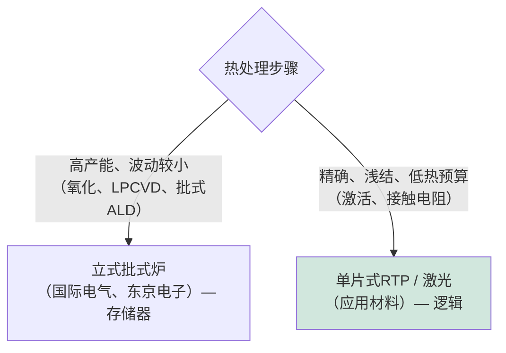

# 热处理、氧化与扩散炉

> 📘 **说明：** 本文为英文原版《Thermal Processing, Oxidation, and Diffusion Furnaces》的简体中文参考译本，仅供参考；如有出入，以英文原版为准。

热处理是半导体制造最古老、最基础的支柱之一。早在等离子体刻蚀或极紫外光刻（EUV）出现之前，只需在氧气中加热硅就能生长出高质量二氧化硅薄膜的能力，就是使集成电路成为可能的整个平面工艺的基础。如今，热处理的范围十分广泛——从批式炉中经典的高温氧化和扩散，到毫秒级快速热处理，再到三维集成所要求的超低温工艺区间。本文涵盖热氧化与Deal-Grove模型、扩散炉与批式低压化学气相沉积（LPCVD）、快速热处理、先进的低热预算前沿、供应商格局，以及化合物半导体的特殊热处理需求。

---

## 📊 图示概览

*原创示意图；Mermaid图表可在GitHub上直接渲染。*

**热氧化通过消耗硅而生长（Deal-Grove动力学）**

下图示意热氧化前后对比：氧化层向晶圆内部生长，约46%位于原表面之上，硅/氧化层界面随硅被消耗而下移；薄氧化层的生长与时间呈线性关系，厚氧化层呈抛物线关系（受扩散限制）。

```
   Before:                 After (oxide grows INTO the wafer):
   ┌──────────────┐        ┌──────────────┐
   │              │        │░░░ SiO2 ░░░░░│  ← ~46% above original surface
   │   silicon    │   →    ├──────────────┤  ← original surface line
   │              │        │   silicon    │  ← interface moves down as Si is consumed
   └──────────────┘        └──────────────┘
   Thin oxide: linear in time.  Thick oxide: parabolic (diffusion-limited).
```

**热处理的两种角色——批式产能与单片式精度**



---

## 1. 热氧化

热氧化是在高温（通常为800–1,100°C）下使硅与氧气（干氧氧化）或水蒸气（湿氧氧化）反应，生长二氧化硅。独特之处在于，氧化层是通过*消耗*下方的硅来生长的——氧穿过已生长的氧化层扩散到界面处发生反应，硅-氧化层界面随之向晶圆内部移动。这会形成异常洁净、电学性能极佳的Si/SiO₂界面，这也正是硅（而非其他本征输运特性更好的半导体）得以主导微电子领域的原因：没有任何其他材料体系能提供如此高质量的本征氧化物。

其动力学由**Deal-Grove模型**描述：对于薄氧化层，生长受**反应速率限制**（与时间呈线性关系）；对于较厚的氧化层，由于氧必须穿过越来越厚的氧化层才能到达界面，生长受**扩散限制**（与时间呈抛物线关系，按时间的平方根增长）。**干氧氧化**（O₂）生长较慢，但形成更致密、质量更高的氧化层，用于薄栅介质；**湿氧氧化**（H₂O）生长快得多，用于较厚的场氧化层和掩蔽氧化层。

栅介质的历史就是热氧化层不断减薄的历史：纯**SiO₂**服役了数十年，随节点逐步减薄，直到约90/65nm时减至约1.2nm——仅几个原子层——此时量子隧穿漏电已变得无法容忍。<strong>氮氧化硅（SiON）</strong>通过略微提高介电常数并阻挡硼穿透，在一定程度上延长了这一极限。最终在45nm节点，业界彻底放弃热生长栅氧化层，转而采用原子层沉积（ALD）的<strong>高k（HfO₂）</strong>介质加一层薄界面氧化层——由此结束了芯片上最重要的薄膜只需在炉中加热硅即可生长的时代。尽管如此，热氧化仍在界面层、隔离、牺牲氧化层及许多其他步骤中不可或缺。

---

## 2. 扩散炉

扩散炉——大型、精密控制的管式炉——是经典的高温批式设备，一次可处理大量晶圆（通常50–150片）以实现高产能。扩散炉最初用于**掺杂扩散**（从表面源将掺杂剂驱入，是离子注入的前身），现代扩散炉承担多种角色：

- 大批量晶圆的**氧化与退火**。
- 多晶硅（栅极及3D NAND闪存沟道材料）、氮化硅（Si₃N₄，用于硬掩模和侧墙）以及TEOS基二氧化硅等薄膜的**批式LPCVD**——炉管出色的均匀性和产能使其经济性突出。
- 3D NAND的ONON叠层和DRAM电容介质等薄膜的**批式ALD**，此类应用对共形性和产能都有要求。

炉管有**卧式**（较早）和**立式**（现代，更利于颗粒控制和自动化）两种配置。立式批式炉仍是大批量生产的主力设备，在存储器制造中尤其如此，因为层数众多使批式产能在经济上至关重要。

---

## 3. 快速热处理（RTP）

随着结深不断缩小，炉管退火的长时间处理导致掺杂剂扩散过多，推动业界转向**快速热处理（RTP）**——单片式、基于灯管的加热方式，可在数秒内将晶圆升至峰值温度（1,000–1,100°C），并同样快速地冷却。RTP在提供掺杂激活和损伤修复所需高温的同时，尽可能缩短高温停留时间，从而保持浅结。

RTP对工程技术要求极高：晶圆上的**均匀加热**（不均匀会产生应力和滑移位错）、精确的**高温测温**（以光学方式非接触测量晶圆温度，表面发射率的变化使其更加复杂），以及严格的升温速率控制。RTP及其更快的后继技术——**尖峰退火、闪光灯退火（FLA）和激光尖峰退火（LSA）**——构成了[文件07](07_ion_implantation_and_annealing.md)中详细介绍的现代退火工具组合，每一种都朝着以更短时间实现更高峰值温度的方向推进，以在最大化激活的同时尽量减少扩散。

---

## 4. 先进与低热预算工艺

最先进节点同时把热处理推向两个相反的方向：一方面追求更高的峰值温度以激活超浅结（激光退火），另一方面要求晶体管形成之后的所有工艺都采用**超低热预算**。以下几个趋势定义了这一前沿：

- <strong>面向接触电阻的超快退火：</strong>最低的结串联电阻要求在接触处实现最高的掺杂激活，这通过微秒/纳秒激光退火实现，即仅在尽可能短的时间内加热表面。
- <strong>低温后道（BEOL）工艺：</strong>一旦铜互连就位，热预算便被限制在约400°C，以避免金属和低k介质劣化。每一个BEOL沉积、退火和固化步骤都必须遵守这一上限，从而推动等离子体增强及其他低温方法的使用。
- <strong>三维集成要求更严苛的热预算：</strong>在顺序三维集成和背面供电工艺中，已完成的底层器件必须经受上层或背面的加工，这要求采用局部的、限于表面的热处理步骤（激光、闪光），在不加热埋层结构的前提下激活掺杂剂或使薄膜结晶。这种超低热预算区间是互补场效应晶体管（CFET）和先进3D-IC的决定性工艺挑战之一（[文件15](15_technology_roadmaps.md)和[文件23](23_research_and_emerging_technologies.md)）——而随着背面供电已进入大批量制造（英特尔（Intel）18A的PowerVia于2025–2026年投产，台积电（TSMC）A16随后跟进），它已成为生产要求，而不再只是研究课题。
- <strong>选择性热处理：</strong>通过激光或其他方式进行局部加热，仅处理目标区域，晶圆其余部分保持低温。

既需要高温以获得最佳薄膜和结，又需要低温以保护晶圆上已有的一切，这种矛盾是先进制造中长期存在的平衡难题之一——而且随着器件越来越多地以三维方式构建，这一矛盾愈发尖锐。

---

## 5. 供应商格局

| 供应商 | 定位 |
|---|---|
| **应用材料（Applied Materials，AMAT）** | 热处理产品组合广泛，涵盖RTP、氧化/氮化以及高价值的**激光退火**细分市场（DSA/Vantage）；是热处理领域的全面领导者。 |
| **东京电子（Tokyo Electron，TEL）** | 在**批式炉**和热处理方面实力强劲，尤其是存储器领域；拥有广泛的涂胶显影和热处理业务。 |
| **国际电气（Kokusai Electric）** | **立式批式炉**及批式ALD/CVD的领导者，是存储器制造（3D NAND ONON、DRAM）的核心供应商；前身隶属日立（自2023年10月起在东京上市）；据公司称，2025年其在批式ALD设备领域的全球营收份额位居第一。 |
| **ASM国际（ASM International）** | 炉管及外延/热处理系统，同时在ALD领域处于领先地位。 |
| **Centrotherm、迪恩士（SCREEN）** | 炉管和热处理设备供应商，Centrotherm还服务于光伏和功率器件市场。 |
| **北方华创（Naura，中国）** | 中国领先的本土氧化/扩散炉及立式炉供应商（另有刻蚀、PVD等设备）；据报道其炉管在中芯国际（SMIC）28nm产线上广泛使用，热处理是中国国产化程度最高的设备类别之一。 |

热处理市场分为高产能的**批式炉**业务（由东京电子和国际电气主导，尤其是存储器领域）和**单片式RTP/激光退火**业务（由应用材料领先），反映了热处理在现代晶圆厂中扮演的两种不同角色。在中国国内，随着本土晶圆厂推进成熟制程设备国产化，北方华创已成为主要的炉管供应商。

---

## 6. SiC与GaN热处理

化合物半导体对热处理的要求远超硅，需要专用设备：

- <strong>碳化硅（SiC）</strong>工艺需要极高的温度。SiC中的掺杂激活需要在**1,600–1,800°C**下退火——远高于硅工艺使用的任何温度——通常还需加碳帽层以保护表面不被分解。SiC的氧化和外延同样在高得多的温度下进行，需要专门的高温炉和化学气相沉积（CVD）反应器。
- <strong>氮化镓（GaN）</strong>工艺虽然不需要SiC那样极端的激活温度，但在金属有机化学气相沉积（MOCVD）外延和器件退火过程中需要细致的热管理，且材料不同的热膨胀和分解行为也需要专用的热处理设备。

这些更高的热处理要求是化合物半导体制造使用一套独立设备生态系统（见[文件12](12_compound_semiconductor_equipment.md)）、有别于硅CMOS热处理设备的原因之一，尽管二者都依赖氧化、扩散和退火的相同基本原理。

---

因此，热处理贯穿了整个行业的历史与未来——从让硅成为王者的简洁优雅的热氧化层，到将赋能未来十年三维器件的毫秒级激光退火和超低热预算热处理步骤。尽管不如光刻或刻蚀引人注目，它依然是半导体制造中不可或缺且持续演进的支柱。

---

## 延伸分析：退火物理、控制与应用

### A. 深入理解扩散与激活的权衡

退火的核心物理是两个热驱动过程之间的赛跑：需要高温的**掺杂激活**（及损伤修复），以及会把精心设计的结抹平、同样随温度和时间增加的**掺杂扩散**。掺杂扩散长度大致按√(D·t)缩放，其中D（扩散系数）随温度呈指数上升，t为高温停留时间。由于在相关温度范围内激活的热激活能高于扩散，**温度更高、时间更短**可以提高激活与扩散之比——这正是历史上从炉管（数分钟至数小时）到尖峰RTP（秒级）、再到闪光（毫秒级）和激光（微秒级及以下）演进的全部逻辑。在极限情况下，**熔融激光退火**（使表面短暂熔化并再结晶）可实现几乎完全的激活而基本没有扩散，形成超陡峭、高掺杂的结——代价是为避免损伤而需要极其严格的工艺控制。

### B. RTP温度控制

RTP决定性的工程挑战，是在仅持续数秒的工艺中准确、均匀地测量和控制晶圆温度。**高温测温**（根据发射的红外辐射推算温度）之所以复杂，是因为晶圆的**发射率**会随其薄膜、掺杂和背面状况而变化，因此相同的辐射亮度可能对应不同的真实温度。解决方案包括纹波测温、多点和多波长测温，以及控制反射的精心腔体设计。晶圆上的**温度均匀性**至关重要：热点或冷点会产生热应力，进而可能产生破坏器件的**滑移位错**（晶体缺陷），因此灯管阵列和腔体都按均匀加热进行设计，并采用多区控制来补偿边缘效应和图形密度变化。

### C. 激光退火的变体与应用

激光尖峰退火有几种类型，区别在于驻留时间以及表面是否熔化：
- <strong>亚熔融（非熔融）微秒级LSA：</strong>扫描激光（通常为CO₂或二极管激光）在不熔化的情况下加热表面数微秒，用于激活并以最少的扩散改善接触电阻。应用材料的动态表面退火（DSA）是领先平台。
- <strong>纳秒级/熔融激光退火：</strong>准分子或固态激光使表面熔化数纳秒，实现最陡峭、激活率最高的结；用于最先进节点，并越来越多地用于三维和背面供电工艺中**低热预算、层选择性**的激活，此类工艺只需加热表面或特定的某一层。

激光退火之所以具有战略性的关键意义，正是因为它能够提供较高的局部温度**而不加热下方结构**——这恰恰是在上层CFET或背面接触附近激活掺杂剂、同时不损伤下方已成形器件所需要的。这使激光退火细分市场（由应用材料领先，维易科（Veeco）、住友等参与）成为热处理中增长较快、价值较高的领域之一。

### D. 炉管工艺的经济性

批式炉在存储器制造中仍具有重要的经济意义，因为3D NAND巨大的层数（数百对ONON，最先进产品现已超过300层）使许多步骤若采用逐片的单片式处理会慢得令人望而却步。一次处理100片以上晶圆的立式批式炉，可将漫长的沉积或退火时间分摊到整批晶圆上，提供大宗存储器所要求的产能和单片成本。其代价是批次间灵活性降低、每批次周期更长，因此业界在批式（用于对产能要求高、波动较小的步骤）与单片式（用于对控制要求高的步骤）之间进行权衡——这一平衡因应用和制造商而异。**国际电气和东京电子**主导批式炉市场，其业绩与存储器周期密切相关。

### E. 供应商与技术总结

| 热处理技术 | 时间尺度 | 主要用途 | 领导者 |
|---|---|---|---|
| 批式炉 | 数分钟–数小时 | 氧化、LPCVD、批式ALD、体退火 | 国际电气、东京电子、ASM国际、Centrotherm |
| 尖峰RTP | 秒级 | 掺杂激活、通用退火 | 应用材料、Mattson |
| 闪光灯退火 | 毫秒级 | 超浅结激活 | 应用材料及其他厂商 |
| 激光尖峰退火（亚熔融） | 微秒级 | 接触电阻、先进激活 | 应用材料（DSA）、维易科 |
| 熔融激光退火 | 纳秒级 | 最陡峭的结、三维层选择性 | 应用材料、住友 |

随着行业转向三维及背面加工器件，**局部化、超低热预算**工艺的溢价不断上升，使先进激光退火成为战略重要性不断提升的技术之一，即便经典的炉管热处理已趋于成熟——这是贯穿本数据库的更广泛规律的一个缩影：最难、最高价值的问题向原子尺度的三维前沿迁移。

---

## 🆕 2025–2026年更新：最新进展（截至2026年11月）

### A. 存储器主导的周期利好批式热处理

热处理——尤其是立式批式炉——对存储器的敞口高于几乎任何其他前道设备类别（见延伸分析D节），因此2026–2027年上行周期的结构十分重要。国际半导体产业协会（SEMI）2026年7月的年中预测将2026年设备销售总额上调至创纪录的1,659亿美元（+23.2%），其中晶圆厂设备（WFE）为1,439亿美元；泛林集团（Lam Research）（2026年10月21日）初步预计2027年WFE将超过2,000亿美元，增长由**DRAM**引领，其次是代工/逻辑，然后是NAND。自2025年末以来，AI加速器所需的高带宽内存（HBM）推动DRAM价格和资本开支大幅上升；TrendForce曾预测2026年DRAM资本开支约为613亿美元，而此后存储器支出实际高于这一水平。

| 公司 | 近期数据 | 来源/状态 |
|---|---|---|
| 国际电气 | 截至2026年3月的财年：营收和利润同比下降（中国DRAM需求回归常态），但高于修正后的预测；截至2027年3月的财年营收增长指引约20%，预计DRAM和逻辑/代工设备销售增长最快，先进封装设备销售预计将增长一倍以上 | 公司业绩的二手摘要；具体数字各有出入 |
| 东京电子 | 2026财年上半年创纪录（据报道）；对2027年WFE的预期为≥1,900亿美元（据报道） | 媒体报道 |
| 北方华创 | 2026年上半年销售额同比增长约25%（据报道）；据报道立式炉累计出货量已超过1,000台 | 媒体/分析师对公司公告的摘要 |

### B. 技术进展

- <strong>背面供电与三维集成投入生产。</strong>英特尔18A（PowerVia）已进入大批量制造，台积电A16（超级电轨）计划于2026年下半年至2027年量产（各方说法不一）。晶圆键合、减薄和背面接触形成对所有键合后步骤施加了严格的热上限，提高了对第4节及延伸分析C节所述的局部激光退火和低温退火的需求。
- <strong>2nm全环绕栅极（GAA）量产爬坡。</strong>台积电N2（自2025年第四季度起大规模量产）、英特尔18A和三星（Samsung）SF2都采用纳米片叠层，其Si/SiGe超晶格、内侧墙和沟道释放对热预算十分敏感；外延后的热处理步骤必须避免纳米片之间的Ge互扩散。
- <strong>批式ALD与等离子体处理。</strong>批式ALD炉仍是3D NAND ONON叠层和DRAM电容介质的核心设备；供应商正在增加等离子体辅助的批式处理能力，以获得更低温度、更高质量的薄膜。
- <strong>先进封装。</strong>混合键合的热处理步骤（数百°C的键合后退火）、聚合物固化和晶圆级回流焊是一个不断增长的细分市场；随着AI封装产能（CoWoS、SoIC、HBM）扩张，国际电气等厂商正在瞄准封装设备。

### C. 化合物半导体

在快速扩产之后，SiC功率器件市场在2025–2026年处于消化阶段，SiC高温激活炉和外延反应器的订单放缓，但向200mm SiC晶圆的转换仍在继续。中国对镓的出口限制（根据贸易休战，对美国的出口禁令暂停至2026年11月27日），以及自2025年初以来镓价的大幅上涨，增加了GaN器件制造商的供应风险（见[文件12](12_compound_semiconductor_equipment.md)和[文件16](16_key_materials_and_chemicals.md)）。

### D. 中国

据行业机构数据，2025年中国所用设备中国产设备的比例已达约35%。热处理——氧化/扩散炉、LPCVD和RTP——是国产化程度最高的类别之一，北方华创是领先的本土炉管供应商（据报道其炉管用于中芯国际一半以上的28nm产线）。据报道，中国新建产能须有50%以上的设备来自国内，这将挤压日本批式炉供应商在中国市场的份额，尽管中国的需求依然庞大。

**值得关注（2026年末–2027年）**

- 2027年DRAM/HBM资本开支能否把批式炉和批式ALD订单推升至新纪录。
- 台积电A16和英特尔14A背面供电流程的热预算解决方案。
- SiC高温热处理设备的复苏时间。
- 北方华创在先进节点炉管和RTP验证方面的进展，以及日本供应商在中国的份额。
- 2026年11月27日暂停期限之后的镓供应与价格。
