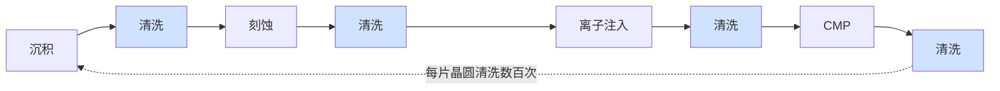
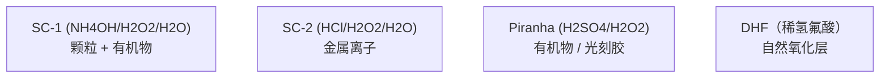

# 湿法工艺、清洗与表面处理

> 📘 **说明：** 本文为英文原版《Wet Processing, Cleaning, and Surface Preparation》的简体中文参考译本，仅供参考；如有出入，以英文原版为准。

清洗是整个晶圆厂中重复次数最多的工序。一片领先制程的逻辑晶圆在整个制造过程中要被清洗**数百次**——几乎在每一道薄膜沉积、刻蚀、离子注入、化学机械平坦化（CMP）和光刻步骤之后都要清洗——因为一颗颗粒、一丝金属污染或在错误时刻残留的一层薄膜都可能毁掉器件。因此，湿法工艺和清洗虽然远不如光刻或刻蚀那样受关注，却悄然成为制造中产能（吞吐量）最高、对良率最关键的环节之一。本文涵盖湿法槽式（wet-bench）化学、单片式与兆声波清洗、超临界与干法清洗、光刻胶去除、供应商格局，以及面向2nm以下工艺节点的无损伤清洗路线图。

现代清洗的核心矛盾在于：**在去除污染和残留物的同时，不损伤晶圆上日益脆弱的结构**——随着特征尺寸缩小、深宽比攀升、材料愈发娇贵，这一矛盾也愈发尖锐。

---

## 📊 可视化概览

*原创示意图；Mermaid图表可在GitHub上原生渲染。*

**清洗是重复次数最多的工序——几乎每一步之后都要进行**



**源自RCA的清洗化学品——各自针对不同污染物**



**图形坍塌问题及其解决方案（高深宽比结构）**

下图说明：左侧为液体干燥——退去的液面产生毛细力，把相邻结构拉到一起导致坍塌；右侧为超临界CO₂干燥——表面张力为零，结构不会坍塌。

```
 Liquid drying:                  Supercritical CO2 drying:
   ║  ║  ║  ║                       ║  ║  ║  ║
   ║  ║  ║  ║  capillary force →    ║  ║  ║  ║   zero surface tension
   ╲  ╲  ╱  ╱  pulls features        ║  ║  ║  ║   → no collapse
    ╲▼▼▼▼▼╱   together (COLLAPSE)    ║  ║  ║  ║
```

---

## 1. 湿法槽式化学

最基础的清洗化学源自**RCA清洗**，它于20世纪60年代在RCA实验室开发，至今仍是晶圆清洗的概念基础：

- **SC-1（标准清洗1号）：** 氢氧化铵、过氧化氢和水的混合液（NH₄OH/H₂O₂/H₂O）。它通过对表面进行轻微刻蚀（把颗粒“托起”剥离）来去除颗粒和有机污染，同时过氧化氢会重新生长一层薄的保护性氧化层。SC-1也能去除部分金属。
- **SC-2（标准清洗2号）：** 盐酸、过氧化氢和水的混合液（HCl/H₂O₂/H₂O）。它通过形成可溶性络合物去除金属污染（碱金属离子以及铁、铜、金等金属）。
- **Piranha（SPM，硫酸-过氧化氢混合液）：** 硫酸与过氧化氢的混合液（H₂SO₄/H₂O₂），是一种强氧化剂，用于去除有机残留物和光刻胶。
- **DHF（稀氢氟酸）：** 去除自然氧化层和化学氧化层，是关键沉积和接触工艺之前表面处理的基础。
- **TMAH（四甲基氢氧化铵）：** 一种有机碱，既用于光刻胶显影，也用于硅的各向异性刻蚀。
- **热磷酸（H₃PO₄）：** 相对于氧化硅选择性地刻蚀氮化硅，在侧墙（spacer）工艺和3D NAND闪存字线工艺中十分重要。

这些化学品在精确控制、温度受控的槽体或单片式设备中使用，所用的**半导体级化学品**其金属和颗粒污染要提纯到十亿分之一（ppb）级别（见[文件16](16_key_materials_and_chemicals.md)）。

---

## 2. 单片式清洗与兆声波

历史上，清洗是将成批晶圆浸入化学槽中完成的（**湿法槽式设备，wet bench**）。出于更严格控制和减少交叉污染的需要，现代趋势转向**单片式清洗**：每片晶圆单独处理，化学品精确喷淋、旋转甩干并可立即检测。单片式设备以牺牲产能为代价换取更好的均匀性和工艺控制，在领先制程中占据主导。

物理辅助手段可增强颗粒去除效果：
- **兆声波/超声波清洗**向清洗液施加高频声能，产生微观扰动（以及受控的空化效应），使颗粒从表面脱落——但能量必须仔细控制，以免损伤脆弱的精细图形。
- **CMP后清洗**是一个专门而关键的步骤：CMP之后，晶圆表面覆盖着研磨液残留物和颗粒，必须在不划伤刚刚平坦化表面的前提下去除，通常结合使用刷洗（PVA刷）、化学品和兆声波。
- **EUV专用表面处理**针对极紫外（EUV）图形化特有的残留物和缺陷问题，包括显影后清洗——必须在不损伤薄光刻胶的情况下去除与随机效应缺陷相关的残留物。

---

## 3. 图形坍塌问题与超临界CO₂

随着特征深宽比攀升、结构变得更高更薄，湿法清洗的干燥步骤中出现了一种新的失效模式：**图形坍塌**。当冲洗液从高而窄的结构之间蒸发时，退去液面产生的**毛细力**会把相邻结构拉到一起，使其粘连并坍塌——图形随之被毁。对于鳍、纳米片堆叠、DRAM电容器和3D NAND结构等高深宽比（HAR）特征来说，这是一个重大良率问题。

**超临界CO₂（scCO₂）干燥**巧妙地解决了这一问题。处于超临界状态的二氧化碳具有类似液体的密度，但**表面张力为零**，因此可用来置换液体并随后蒸发，而不产生任何毛细力——从而消除图形坍塌。scCO₂干燥已成为先进工艺节点高深宽比清洗的一项重要使能技术。

---

## 4. 干法清洗

有些清洗任务最好完全不用液体，而采用更温和或选择性更高的气相或等离子体化学来完成：

- **远程等离子体清洗**在远端腔室中产生活性自由基（例如由NF₃或H₂产生）并将其输送到晶圆表面，以较低的离子轰击损伤去除残留物和自然氧化层。
- **紫外-臭氧清洗**利用紫外光和臭氧去除有机污染。
- <strong>HF气相（无水HF）</strong>在气相中刻蚀氧化物，适用于去除自然氧化层以及某些释放刻蚀，且没有液态HF的毛细力问题。
- <strong>气相化学（例如BCl₃蒸汽）</strong>用于满足特定的残留物去除和表面处理需求。

在液体工艺会造成损伤、污染或图形坍塌的场合，干法清洗日益重要，它也模糊了清洗与刻蚀之间的界限（最温和的选择性刻蚀与最激进的清洗本质上密切相关）。

---

## 5. 光刻胶去除

每一轮光刻和刻蚀之后，光刻胶掩模都必须被彻底去除。去胶有多种方法，往往组合使用：

- **等离子体灰化**利用氧气（O₂）、氮气/氢气（N₂/H₂）或其他等离子体将有机光刻胶氧化并挥发。O₂灰化快速彻底，但可能氧化并损伤下方的低k介质和金属，因此领先制程中常采用<strong>还原性（H₂基）</strong>化学来保护敏感材料。
- **湿法去胶和溶剂去胶**利用有机溶剂或Piranha等化学品溶解光刻胶和刻蚀后残留物，尤其适用于等离子体会造成损伤的场合。

去胶必须彻底（任何残留都会造成缺陷），又必须温和（不能损伤下方器件）；随着介质愈发脆弱、金属愈发活泼，这种平衡越来越难把握。为保护对温度敏感的结构，**低温去胶**的需求日益增加。

---

## 6. 供应商格局

| 供应商 | 地位 |
|---|---|
| **SCREEN半导体解决方案（迪恩士，日本）** | **占主导地位的单片式湿法清洗供应商**，在日本和全球都拥有尤为强势的地位；湿法工艺是SCREEN的核心身份。 |
| **东京电子（TEL）** | 主要的清洗与表面处理供应商，拥有强大的单片式和批次式清洗平台，并与其广泛的工艺产品组合整合。 |
| **泛林集团（Lam Research）** | 在清洗与表面处理领域实力强劲（包括原SEZ单片式清洗业务和Da Vinci平台），与其刻蚀和沉积业务紧密结合。 |
| **Akrion、Modutek** | 专业湿法工艺和湿法槽式设备供应商（Akrion的湿法工艺业务已于2018年被中国的北方华创（Naura）收购）。 |
| **盛美半导体（ACM Research，美国/中国）** | 快速增长的单片式和批次式清洗供应商（SAPS/TEBO兆声波清洗、SPM设备），大部分业务和客户位于中国大陆；到2026年，其增长更多由电镀（ECP）和先进封装设备而非清洗设备驱动。 |
| **北方华创（Naura，中国）** | 中国综合性设备厂商，产品组合包括批次式和单片式清洗设备，受益于中国国产设备替代的推进。 |
| **MKS Instruments** | 提供清洗和表面处理子系统及化学品（包括通过其收购获得的业务）以及远程等离子体源。 |
| **Semes（韩国）** | 三星（Samsung）旗下的湿法清洗与工艺设备供应商，服务于韩国存储产业。 |

湿法清洗市场的一个显著特点是日本（SCREEN、TEL）和韩国（Semes）供应商实力强劲，这反映了清洗这一不起眼但对良率至关重要的领域所看重的深厚工艺诀窍和客户关系。清洗也是中国供应商（盛美半导体、北方华创等）在本土市场进展最大的设备类别之一，因为中国晶圆厂正在推动设备采购国产化（见下文2025–2026年更新）。

---

## 7. 路线图

清洗路线图的核心要求是：**在更脆弱的结构上，以更温和的方式，完成更多的清洗**：

- **面向2nm以下工艺节点的无损伤清洗：** 随着纳米片堆叠、内侧墙和新沟道材料愈发娇贵，清洗必须在去除污染和残留物的同时，不刻蚀、不侵蚀、不使这些结构坍塌——这推动了更温和的化学品、单片式精确控制以及干法/超临界方法的发展。
- **EUV显影后检测与清洗：** EUV的随机效应缺陷和薄光刻胶需要专门的显影后清洗与检测，以在不损伤图形的前提下去除与缺陷相关的残留物。
- **低温去胶与清洗：** 3D集成和温度敏感材料的普及，要求在尽可能低的温度下进行去胶和清洗，以保护已经形成的结构。
- **新材料兼容性：** 钌、钼、钴、高k材料以及二维沟道材料各自都需要能去除残留物却不腐蚀或损伤新材料的清洗化学品——随着材料体系不断扩展，这是一个持续的协同开发挑战。
- **混合键合表面处理：** 芯片-晶圆（die-to-wafer）和晶圆-晶圆（wafer-to-wafer）混合键合（见[文件11](11_advanced_packaging_equipment.md)）要求键合表面基本无颗粒且达到原子级平整，因为一颗颗粒就会造成键合空洞；CMP后清洗、等离子体活化和表面处理越来越多地与键合设备集成销售。
- **图形坍塌抑制：** 随着深宽比进一步攀升（3D NAND迈向1000层、更高的电容器和纳米片堆叠），超临界和无表面张力的干燥方法变得愈发不可或缺。

因此，清洗体现了本数据库反复出现的一个主题：一个看似平凡、成熟的工艺，在领先制程中却是不断创新、对良率至关重要的使能环节——每片晶圆要进行数百次，并且日益成为决定芯片能用还是报废的关键。

---

## 延伸分析：机理、单片式转型与新材料清洗

### A. 颗粒去除的物理与化学

从晶圆上去除一颗100nm以下的颗粒比听起来要难得多，因为把微小颗粒束缚在表面上的**黏附力**（范德华力、静电力和毛细力）随尺寸缩小而下降的速度，慢于可用**去除力**的下降速度，所以颗粒越小，相对而言就*越难*去除。经典的SC-1化学部分是通过**刻蚀掉底层表面的一薄层**（掏空颗粒下方使其脱落）来去除颗粒的，同时过氧化氢重新生长一层保护性化学氧化层——这一机理很巧妙，但每次都会消耗一点材料，当结构只有几个原子厚时就成了问题。兆声波扰动增加了一种**物理**去除力（声流和受控空化），但能使颗粒脱落的能量同样可能**损伤脆弱的精细图形**——因此兆声波功率必须仔细调校；在领先制程中，“能去除颗粒”与“会破坏图形”之间的工艺窗口收窄到必须采用新方法（更温和的化学品、受控空化、替代能量源）的程度。

### B. 单片式清洗为何胜出

传统的浸没式**湿法槽式设备**——把25–50片一批的晶圆依次浸入一系列化学槽和冲洗槽——产能高，但存在交叉污染（所有晶圆共用槽液，一片晶圆上的污染物会扩散到所有晶圆）且工艺控制有限（整批晶圆接受相同处理）。现代**单片式清洗设备**逐片处理晶圆：化学品被精确喷淋到旋转的晶圆上，在受控时间内反应、冲洗，然后旋转甩干，全程按单片晶圆配方控制，没有共用槽液。这带来了更好的均匀性、更严格的控制、更低的单片化学品消耗（化学品是喷淋使用而非在大槽中维持），并消除了批次交叉污染——代价是产能较低，而多腔室设备并行处理多片晶圆可缓解这一点。由SCREEN和TEL引领的单片式清洗转型，与整个行业在控制关键步骤上由批次式转向单片式处理的大趋势一致；在污染和均匀性容差极其严苛的领先制程中，这一转型必不可少。

### C. 干燥——被低估的关键步骤

干燥看似简单实则困难，是缺陷的常见来源。冲洗液蒸发时可能留下**水痕**（溶解物质的残留），可能通过毛细力**使脆弱的高深宽比图形坍塌**（见第3节），还可能使颗粒重新沉积。先进的干燥方法——**马兰戈尼（Marangoni）干燥**（利用IPA/醇类蒸汽形成的表面张力梯度把液体干净地从表面拉走）和**超临界CO₂干燥**（完全消除表面张力）——解决了这些问题；随着结构变得更高更薄，干燥方法的选择也愈发关键。整片晶圆完美无瑕的加工成果可能毁于最后的干燥步骤，这一事实凸显了清洗的严苛程度。

### D. 新材料的清洗

领先制程中引入的每一种新材料都会带来新的清洗挑战，因为能安全清洗一种材料的化学品可能腐蚀或损伤另一种材料：
- **钴、钌和钼互连**（见[文件04](04_deposition.md)、[文件15](15_technology_roadmaps.md)）的化学活性高于铜或与铜不同，需要既能去除残留物和刻蚀后副产物、又不引起电偶腐蚀或过度金属损失的清洗化学品——这是一项重大的配方重构挑战。
- **高k和铁电材料**需要不会使介质性能退化的清洗工艺。
- **二维沟道材料**（见[文件23](23_research_and_emerging_technologies.md)）会被激进的等离子体和许多湿法化学品损伤，需要极其温和的清洗。
- **低k和超低k介质**多孔且脆弱，很容易被用于去胶的等离子体灰化损伤——这推动了向**还原性（H₂基）化学**和更温和去胶方法的转变，以保护介质。

这种针对具体材料的清洗协同开发——为每种新材料匹配相应的清洗——是一项持续进行、常被忽视的使能工作，需要与沉积和刻蚀工艺负责人携手完成。

### E. 全局视角下的清洗路线图

贯穿始终的主线是：每片晶圆要进行数百次的清洗，必须在保持彻底的同时，不断变得**更温和、更具选择性、更了解材料特性**——这一矛盾在每个工艺节点上都在加剧。面向脆弱的2nm以下结构的无损伤清洗、EUV专用显影后清洗、适应3D集成热预算的低温去胶、面向越来越高深宽比的无坍塌干燥，以及与新材料兼容的化学品，共同构成了这样一条路线图：一个曾被视为平凡的工艺，实际上是一个不断创新、对良率至关重要的前沿领域——而日本和韩国湿法清洗龙头（SCREEN、TEL、Semes）深厚的工艺诀窍，则构成了持久的竞争护城河。

---

## 进一步分析：清洗——看不见的良率决定因素

### A. 清洗的庞大规模

值得强调的是清洗有多么普遍：它在每片晶圆上要进行**数百次**，几乎在每一道沉积、刻蚀、离子注入、CMP和光刻步骤之后都要进行，是整个晶圆厂中重复次数最多的工序，远超其他。这种规模使清洗成为一项悄然庞大的活动——无论是设备数量、产能、化学品和水的消耗，还是对良率的累积影响。由于清洗如此频繁，即便单步缺陷率很小，在数百个步骤中累积起来也会对良率产生显著影响；这就是为什么清洗尽管相较光刻或刻蚀低调，却是制造中对良率最关键的活动之一。一座晶圆厂的清洗表现——即连续数百次彻底去除污染和残留物而不损伤晶圆的能力——是其整体良率一个看不见却决定性的因素，也是湿法清洗龙头（SCREEN、TEL、Semes）凭借来之不易的深厚工艺诀窍保持稳固地位的重要原因。

### B. 协同开发的负担

清洗或许比其他任何步骤都更能说明贯穿先进制造的**协同开发负担**。每一种新材料（钴、钌、钼、高k、铁电材料、二维沟道）、每一种新结构（鳍、纳米片、高深宽比电容器、混合键合表面）以及每一种新的图形化方法（EUV及其薄光刻胶和随机效应缺陷），都需要相应的清洗开发——即一种既能去除相关污染和残留物、又不损伤或腐蚀新材料、也不使新结构坍塌的化学品和工艺。这种协同开发是持续的、往往不为人所见，需要与沉积、刻蚀和光刻工艺负责人携手完成，而且不可或缺：一个新的工艺模块在清洗问题解决之前无法通过认证。随着材料体系扩展、结构愈发脆弱，清洗协同开发的负担在每个节点上都在增加，它是把每一项新技术导入量产所需总投入中一个低调却重要的部分——这提醒我们，那些引人注目的工艺步骤（新晶体管、新互连）依赖于大量必须同步开发的使能步骤，而清洗正是其中的突出代表。

### C. 再论清洗路线图

再次概括，清洗路线图的核心要求是：**在更脆弱、更多样的结构和材料上，以更温和的方式，完成更多的清洗**——这些要求在每个工艺节点上都在加剧。面向脆弱的2nm以下结构和娇贵纳米片堆叠的无损伤清洗；在不损伤薄光刻胶的前提下去除随机效应缺陷相关残留物的EUV专用显影后清洗；保护三维集成中温度敏感结构的低温去胶与清洗；面向越来越高深宽比的无坍塌干燥（马兰戈尼干燥和超临界CO₂干燥）；以及适用于钴、钌、钼、高k、铁电材料和二维沟道的新材料兼容化学品——这些共同构成了一条路线图，表明清洗远非一个已解决的平凡步骤，而是一个不断创新、对良率至关重要的使能环节。它所回报的深厚工艺诀窍——即如何在每片晶圆上数百次地、彻底而又温和地清洗每种材料和结构而不损伤日益娇贵器件的积累经验——构成了湿法清洗龙头持久的竞争护城河，并确保清洗这一最朴素、重复次数最多的工艺步骤，始终是半导体制造事业中不可或缺且持续进步的支柱，其对良率的重要性丝毫不亚于那些构建器件的更引人注目的步骤。

---

## 🆕 2025–2026年更新：最新进展（截至2026年11月）

### 市场背景：清洗搭上由DRAM引领、AI驱动的上行周期

清洗需求随工艺步骤数和投片量而增长，因此与晶圆厂设备（WFE）整体支出高度相关。根据国际半导体产业协会（SEMI）2026年7月的年中预测，2026年设备总销售额预计约为**1,659亿美元（同比增长23.2%）**，其中WFE约为**1,439亿美元**；2026年10月财报季中各公司给出的看法更高（泛林集团认为2026年WFE在1,500亿美元中段区间，并初步预计2027年超过2,000亿美元）。泛林集团称增长首先由**DRAM**引领，其次是代工/逻辑，然后是NAND。这一结构对清洗有利：DRAM电容器和HBM相关工艺流程清洗密集，而2nm级全环绕栅极（GAA）节点的量产爬坡（台积电N2自2025年第四季度起量产、英特尔18A、三星SF2）又增加了许多精细的纳米片释放、内侧墙和选择性刻蚀/清洗步骤。

### 供应商业绩：整体增长之下的分化

- **SCREEN（迪恩士）**（截至2026年3月的财年）：根据对其2026年5月业绩的摘要，半导体生产设备板块销售额约为**4,860亿日元**，低于上一年的约5,200亿日元。DRAM相关设备和售后服务增长，而代工相关设备下降；按地区看，对台湾地区的销售增长，对中国大陆和美国的销售下降。SCREEN仍被普遍视为全球最大的单片式清洗设备供应商。
- <strong>盛美半导体（ACM Research）</strong>于2026年8月将2026年全年营收指引上调至**11.25–11.75亿美元**（增长25–30%），并于2026年10月28日预告2026年第三季度营收为**3.60–3.65亿美元**（同比增长34–36%），完整业绩定于2026年11月5日公布。值得注意的是，管理层表示2026年上半年的增长来自电镀（ECP）和先进封装设备，而**单片式清洗设备销售有所下降**；较新的SPM（硫酸-过氧化氢）清洗产品已出货，但在客户验收之前贡献的营收很少。
- **东京电子（TEL）和泛林集团**继续把清洗和表面处理步骤与其刻蚀和沉积业务捆绑；泛林集团2025年推出的钼原子层沉积（ALTUS Halo）用于金属化，这意味着刻蚀后和CMP后清洗又多了一种必须在不腐蚀、不过度损失的前提下处理的金属。

### 中国：清洗是国产化领先的设备类别

2025年，国产设备约占中国晶圆厂所用设备的**35%**（行业协会口径，2024年约为25%），据报道新建产能被要求一半以上的设备采用国产。清洗通常被认为是中国供应商（盛美半导体上海业务、北方华创等）进展最快的类别之一，而光刻的国产化率不足5%，形成鲜明对比。这一转变是日本清洗龙头在截至2026年3月的财年中对华销售走软的原因之一，尽管中国整体设备需求依然可观。

### 混合键合把清洗带入封装产线

最显著的新应用是**混合键合的表面处理**——铜/介质键合表面上的任何颗粒或残留物都会造成空洞：

- 应用材料（Applied Materials）与Besi的**Kinex**芯片-晶圆混合键合系统（2025年10月推出）在一台设备中集成了表面处理、键合和量测——表明芯片制造商希望清洗与活化步骤与键合机紧密耦合。
- **SUSS MicroTec**于2026年推出了用于混合键合的**XBC300 Gen2 SP**表面处理集群设备；据报道，ULVAC在2026年的一次行业研讨会上展示了用于混合键合清洗/活化的下游等离子体技术。
- 在HBM方面，固态技术协会（JEDEC）将HBM4封装高度上限提高到775 µm，缓解了对混合键合的迫切需求；SK海力士（SK hynix）在Hot Chips 2026上表示，混合键合尚未准备好用于HBM4E，最早要到HBM5才会采用，而据报道三星更为激进。因此，混合键合在HBM中的导入时间是封装产线清洗需求的关键变量。

### 可持续性与化学品供应

- **PFAS（全氟和多氟烷基物质）：** 2026年3月26日，欧洲化学品管理局（ECHA）风险评估委员会（RAC）发布最终意见、社会经济分析委员会（SEAC）发布意见草案，支持在欧盟范围内限制PFAS并给予有时限的豁免；最早的禁令预计不早于2028年底。湿法工艺设备大量依赖含氟聚合物润湿部件（PFA/PTFE管路、槽体、阀门）以及部分含氟化学品，因此豁免范围直接关系到湿法清洗设备厂商和晶圆厂。半导体行业是提交意见最多的具名行业。
- **水与化学品：** 清洗是晶圆厂中超纯水和高纯化学品的最大消耗环节；随着美国亚利桑那州、日本、韩国和欧洲的新建晶圆厂面临当地用水限制，单片式喷淋效率、化学品回收和水回用仍是差异化因素。

### 关键数据

| 项目 | 数据 | 来源/状态 |
|---|---|---|
| 2026年WFE | 约1,439亿美元 | SEMI年中预测，2026年7月 |
| 2026年WFE（公司观点） | 1,500亿美元中段区间；2027年超过2,000亿美元（初步） | 泛林集团，2026年10月21日 |
| SCREEN半导体生产设备板块销售额（截至2026年3月财年） | 约4,860亿日元（上年约5,200亿日元） | 业绩摘要，2026年5月 |
| 盛美半导体2026年营收指引 | 11.25–11.75亿美元 | 2026年8月上调 |
| 盛美半导体2026年第三季度营收（初步） | 3.60–3.65亿美元 | 2026年10月28日预告 |
| 中国国产设备占比 | 约35%（2025年） | 行业协会口径 |
| 欧盟PFAS限制 | RAC最终意见/SEAC意见草案 | 2026年3月26日发布 |

**值得关注（2026年底–2027年）**
- 2027年由DRAM和HBM引领的WFE增长能否转化为SCREEN、TEL和Semes的清洗上行周期，以及代工相关清洗需求能否随2nm/A16量产爬坡而回升。
- 盛美半导体新SPM设备的客户验收和营收确认进展，以及中国清洗设备的进一步国产化。
- 混合键合在HBM（HBM4E还是HBM5）和逻辑SoIC中的导入时间，这决定了对集成式表面处理设备的需求。
- 面向钼和钌金属化以及背面供电（A16、18A）工艺流程的清洗化学品。
- 欧盟PFAS限制的最终文本及半导体豁免范围。
