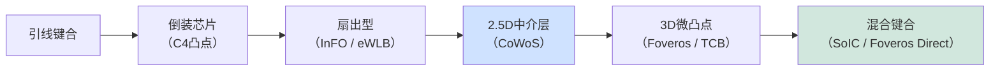

# 先进封装设备——2.5D、3D、混合键合与扇出型晶圆级封装

> 📘 **说明：** 本文为英文原版《Advanced Packaging Equipment — 2.5D, 3D, Hybrid Bonding, and FOWLP》的简体中文参考译本，仅供参考；如有出入，以英文原版为准。

在半导体行业历史的大部分时间里，封装一直是事后才考虑的环节——一个低附加值的“后道”步骤，仅仅用来保护裸片并将其连接到电路板上。那个时代已经结束。先进封装已成为提升系统性能的主要杠杆之一、芯粒（Chiplet）革命的基础，以及半导体资本设备（SemiCap）中增长最快的单一细分领域。原因很简单：随着晶体管微缩放缓且成本攀升，把多个专用裸片集成到一个紧密耦合的封装中——即异构集成——已成为持续提升性能、带宽和能效最具成本效益的方式。生成式AI热潮极大地加速了这一趋势，先进封装产能（尤其是台积电（TSMC）的CoWoS）已成为制约AI加速器供应的关键瓶颈。本文涵盖先进封装为何重要、主要封装类型及其所需设备、技术平台（SoIC、Foveros、X-Cube）、完整的设备类别、主要代工厂和外包封装测试厂商（OSAT）、专利格局以及路线图。

---

## 📊 可视化概览

*原创示意图；Mermaid图表可在GitHub上原生渲染。*

**2.5D集成（如CoWoS）——多个裸片并排放置在硅中介层上（剖面图）**

下图说明：顶部为逻辑裸片和两个HBM堆叠，通过微凸点/混合键合连接到硅中介层（含精细重布线层RDL和硅通孔TSV），中介层下方为封装基板。

```
   ┌──────────┐   ┌─────────┐   ┌─────────┐
   │ Logic die│   │HBM stack│   │HBM stack│
   └────┬┬────┘   └───┬┬────┘   └───┬┬────┘   ← micro-bumps / hybrid bond
   ████████ Silicon interposer: fine RDL wiring + TSV ████████
   ────────────────────────────────────────────────
   ░░░░░░░░░░ Package substrate ░░░░░░░░░░░░░░░░░░░░
```

**采用混合键合的3D堆叠（剖面图）**

下图说明：顶层裸片（SRAM/计算）与带TSV的底层逻辑裸片通过铜-铜混合键合直接相连，键合间距小于10 µm（并向1 µm演进）；无焊料凸点，电阻/电容更低，I/O密度高得多。

```
   ┌─────────────────┐   top die (SRAM / compute)
   ╞═════════════════╡   hybrid bond — Cu-Cu, bond pitch < 10 µm (→ 1 µm)
   ┌─────────────────┐   bottom die (logic) with TSVs
   └─────────────────┘
   No solder bump; lower resistance/capacitance; much higher I/O density
```

**封装分类——从最便宜到最先进**



**键合间距趋势——密度竞赛**

下图说明：从约40 µm的微凸点、约10 µm的微凸点，到小于10 µm的混合键合，再到约1 µm的混合键合（接近片上布线密度）；间距越小，I/O越多、带宽越高、每比特功耗越低。

```
 Micro-bump   ~40 µm  ████████████████████████████████████████
 Micro-bump   ~10 µm  ██████████
 Hybrid bond  <10 µm  ████
 Hybrid bond  ~1 µm   ▏   ← approaching on-chip wiring density
 (smaller pitch = more I/O, more bandwidth, less power per bit)
```

---

## 1. 先进封装为何重要

三股力量把封装从配角推上了舞台中央：

- **芯粒架构。** 设计者不再制造一个巨大的单片裸片（昂贵、受良率限制且受掩模版尺寸限制），而是把系统划分为多个更小的**芯粒**——例如独立的计算、I/O和缓存裸片，可能采用不同的工艺节点——并将它们集成在同一个封装中。这提高了良率（小裸片良率更高），允许为每种功能选用最优节点，并突破了掩模版尺寸限制。AMD基于芯粒的CPU和GPU以及英特尔（Intel）的分块式（tiled）处理器就是这一方法的典范。
- **异构集成。** 封装可以把本质上不同的技术——逻辑、存储（HBM）、模拟、射频、硅光子——组合在一个封装中，每种都采用其理想的工艺制造。
- **带宽密度。** AI加速器的决定性需求是巨大的内存带宽。把高带宽内存（HBM）紧挨着逻辑放置在硅中介层上，并通过数万根细间距导线相连，可以提供传统封装加印刷电路板（PCB）无法实现的带宽。从本质上说，先进封装正是推后“内存墙”的手段。

---

## 2. 封装类型及所需设备

### 2.1 倒装芯片

现代封装的基础。裸片不再正面朝上进行引线键合，而是翻转朝下，通过一组焊料<strong>凸点（C4——可控塌陷芯片连接）</strong>连接到基板上。所需设备：**凸点制作**（凸点下金属化层沉积、焊料电镀或焊膏）、**回流焊**（熔化焊料形成焊点）以及**底部填充**点胶（用环氧树脂填充间隙以保证机械可靠性）。

### 2.2 2.5D——CoWoS与硅中介层

在2.5D集成中，多个裸片（逻辑加HBM堆叠）并排安装在**硅中介层**上——这是一种无源硅基板，包含细间距重布线和**硅通孔（TSV）**，将信号向下引至封装基板。台积电的<strong>CoWoS（晶圆上芯片再上基板）</strong>是占主导地位的平台，几乎是所有高端AI加速器的支柱。所需设备：**TSV形成**（深硅刻蚀、ALD阻挡层/种子层、铜电镀填充）、**RDL光刻**（中介层上的细线重布线图形化）、芯片到晶圆或芯片到中介层的**键合/贴装**，以及用于露出TSV的**晶圆减薄**。

### 2.3 扇出型晶圆级封装（FOWLP）

在扇出型封装中，裸片被嵌入一个重构的<strong>塑封晶圆（或面板）</strong>中，互连<strong>重布线层（RDL）</strong>直接构建在嵌入的裸片之上，把连接“扇出”到比裸片本身更大的面积。这在许多应用中免除了单独的基板/中介层，降低了成本和厚度。台积电的**InFO（集成扇出型）**——用于苹果（Apple）应用处理器——和**HDFO（高密度扇出型）**，以及最初的<strong>eWLB（嵌入式晶圆级球栅阵列）</strong>是关键变体。所需设备：**塑封**（用环氧塑封料包封裸片）、**拾取贴装**（把已知良好裸片精确放置在载板上）、**RDL光刻与电镀**，以及载板的**解键合**。

### 2.4 3D堆叠——微凸点与TCB

真正的3D集成是把裸片垂直堆叠。传统方法通过**微凸点**连接它们，采用**热压键合（TCB）**——一种对准裸片并施加热和压力来形成焊点的键合机，每次处理一个堆叠——或采用产能更高的**批量回流焊**，然后进行**底部填充**。微凸点间距可小至约10–40μm，但再往下微凸点就会遇到物理极限，这推动了混合键合的发展。

### 2.5 混合键合（铜-铜直接键合）

3D集成的前沿。两个表面——各自是嵌在介质中的平坦化铜焊盘阵列——不用焊料直接键合。该工艺需要：对两个表面进行**CMP**，使其达到**亚纳米级粗糙度**并精确控制铜凹陷（见[文件06](06_cmp.md)）；对介质进行**表面活化**（等离子体处理）；**对准**精度优于约100nm（远比微凸点键合严格）；接触时在室温下实现**介质-介质键合**；以及**热退火**，使铜焊盘膨胀并熔合成连续的连接。混合键合可实现低于10μm的键合间距——并向1μm及以下迈进——比微凸点的密度提高一个数量级，同时电阻更低、电容更低，热性能和电性能更好。它有<strong>芯片到晶圆（D2W）</strong>和<strong>晶圆到晶圆（W2W）</strong>两种形式。台积电的SoIC、索尼（Sony）的堆叠式图像传感器以及AMD的3D V-Cache（堆叠SRAM）是领先的量产案例。

### 2.6 HBM堆叠键合

高带宽内存把8–16个DRAM裸片通过TSV和微凸点垂直连接起来，然后把该堆叠安装在中介层上的逻辑芯片旁边。HBM4于2026年进入量产，仍采用微凸点配合批量回流模塑底部填充（SK海力士（SK hynix）的MR-MUF）或热压键合：固态技术协会（JEDEC）决定把HBM4封装高度上限放宽至775 µm（原为720 µm），消除了对混合键合的迫切需求；SK海力士目前预计最早要到HBM4E或HBM5才会采用混合键合，而据报道三星（Samsung）在推进混合键合方面更为激进。HBM组装是一种专门化、高价值的3D堆叠形式，AI对HBM的需求已使其成为存储和封装投资中最热门的领域之一。

---

## 3. 技术平台比较：SoIC、Foveros、X-Cube

三大领先3D平台反映了三家领先制造商的战略：

- **台积电SoIC（系统整合芯片）：** 一种前道级、无凸点的**混合键合**3D堆叠技术，提供最细的间距；与CoWoS结合（即“SoIC + CoWoS”）可构建完整的3D加2.5D系统。它是台积电3DFabric封装产品组合的旗舰。
- **英特尔Foveros：** 英特尔的3D裸片堆叠技术，从使用微凸点的Foveros演进到**Foveros Direct**（混合键合）；用于Meteor Lake、Ponte Vecchio以及基于Intel 18A的Panther Lake（2026年初发布）等产品，并与**EMIB**（嵌入式多芯片互连桥，英特尔用于替代完整中介层的方案，在基板中嵌入一小块硅桥）结合使用。
- **三星X-Cube（扩展立方体）：** 三星的3D堆叠技术，同样向混合键合演进，并与其I-Cube（2.5D）和H-Cube产品整合。

三者都在向混合键合这一细间距3D集成的终点汇聚，差异在于各自的中介层/硅桥策略，以及与各公司逻辑和存储业务的整合方式。

---

## 4. 设备类别详解

先进封装依赖一个独特的设备生态系统，其中大部分由专业厂商而非前道WFE巨头供应：

- **晶圆减薄与背面研磨：** **迪思科（DISCO）**（占主导地位的供应商）和<strong>冈本（Okamoto）</strong>把晶圆研磨抛光到堆叠和TSV露出所需的厚度。
- **裸片切割（划片）：** 机械**刀片切割**、**隐形激光切割**（迪思科；激光在表面下形成改质层以实现干净分离）以及**等离子体切割**（刻蚀切割道，实现薄/脆裸片的无损伤分离）。
- **裸片贴装与键合：** **Besi（BE Semiconductor Industries）**、<strong>ASMPT（ASM Pacific Technology）</strong>和<strong>库力索法（Kulicke & Soffa，K&S）</strong>在裸片贴装、热压键合和混合键合贴装方面处于领先地位（韩国的<strong>韩美半导体（Hanmi Semiconductor）</strong>和<strong>韩华Semitech（Hanwha Semitech）</strong>是HBM用TC键合机的主要供应商；应用材料（Applied Materials）于2025年收购了Besi约9%的股份，双方共同开发了Kinex集成式芯片到晶圆混合键合机）；<strong>EV Group（EVG）</strong>和**SUSS MicroTec**在晶圆到晶圆键合机以及临时键合/解键合设备方面领先。
- **引线键合：** 库力索法和ASMPT主导着规模依然庞大的主流封装引线键合市场。
- **塑封：** **TOWA**（龙头）和**APIC Yamada**提供用于包封和扇出型封装的压缩成型和传递成型设备。
- **底部填充点胶：** <strong>诺信（Nordson）</strong>等公司提供用于毛细底部填充和模塑底部填充的精密点胶设备。
- **RDL形成：** 基于光刻的重布线，采用半加成电镀（SAP）和电镀设备，借助前道光刻（步进式光刻机）和电化学沉积（ECD）设备（2026年5月，应用材料同意收购ASMPT旗下的NEXX大面积/面板级ECD业务）。
- **TSV形成：** <strong>博世工艺深反应离子刻蚀（DRIE）</strong>深硅刻蚀（泛林集团（Lam Research）、SPTS、东京电子（TEL））、ALD阻挡层/种子层以及铜电化学沉积（ECD）填充。
- **检测：** <strong>3D X射线（计算机断层扫描）</strong>和<strong>扫描声学显微镜（SAM）</strong>用于无损检测埋藏的键合、空洞和TSV，另有针对RDL和凸点的光学和电子束检测。

一个显著的结构性特征是，先进封装正把**前道级设备**（尚不需要EUV级光刻，但需要精密步进式光刻机、ALD、CMP、等离子体刻蚀和高端检测）引入历史上技术含量较低的后道——模糊了前道晶圆厂与后道组装之间的界限，并把WFE巨头（应用材料、泛林集团、东京电子）吸引进封装领域。

---

## 5. 主要封装代工厂与OSAT

先进封装价值链既包括领先的晶圆代工厂，也包括专门的**外包封装测试厂商（OSAT）**：

- **台积电**——凭借其**3DFabric**产品组合（CoWoS、InFO、SoIC）成为先进封装的领导者；CoWoS产能是AI加速器供应的关键制约因素，促使其进行多年期产能扩张（行业估计2026年CoWoS产能约为每月10.6万–13万片晶圆，2027年将再度大幅提升）。
- **日月光集团（ASE）**——最大的OSAT，提供包括扇出型和2.5D/3D在内的全系列先进封装。
- **安靠（Amkor Technology）**——全球领先的OSAT，具备先进系统级封装（SiP）、扇出型和2.5D/3D能力；是西方关键的封装合作伙伴。
- **长电科技（JCET）、力成科技（Powertech，PTI）、矽品（SPIL，日月光旗下）、通富微电（Tongfu）、天水华天（TFME）**——主要OSAT，其中数家位于中国，是组装产能的核心，（就中国而言）也是国产化努力的核心。
- **英特尔和三星**——拥有自有先进封装业务（Foveros/EMIB、X-Cube）的垂直整合厂商。

---

## 6. 专利要点

争夺最激烈的封装知识产权集中在**混合键合**领域，<strong>Xperi/Adeia（原Invensas）</strong>拥有一个基础性专利组合（DBI——直接键合互连技术），并广泛授权，包括授权给主要代工厂和存储厂商。**索尼**凭借其开创性的堆叠式CMOS图像传感器拥有重要的混合键合知识产权。**台积电**已建立了庞大的SoIC和CoWoS专利组合。**EV Group**和**SUSS MicroTec**拥有关键的晶圆键合和临时键合设备知识产权。Adeia授权地位之广，使混合键合知识产权成为一个值得注意的例子：在这项封装技术中，一家非制造型知识产权持有者塑造了竞争格局。

---

## 7. 路线图

先进封装路线图指向越来越精细、越来越三维化的集成：

- **亚1μm凸点间距：** 混合键合推动键合间距从约10μm向1μm及以下迈进，大幅提高裸片间带宽密度，并把CMP、对准和洁净度要求推向前道水平。
- **3D堆叠逻辑：** 超越存储堆叠于逻辑之上或SRAM堆叠于逻辑之上，迈向堆叠有源逻辑层，逐渐进入顺序式互补场效应晶体管（CFET）和单片3D的领域（见[文件15](15_technology_roadmaps.md)、[文件23](23_research_and_emerging_technologies.md)）。
- **面板级封装：** 扇出型封装从圆形晶圆转向大型矩形面板，提高面积利用率并降低大型封装的成本（台积电的**CoPoS**——CoWoS的面板级、玻璃芯变体——已列入其路线图）。
- **光学与共封装光学集成：** 把硅光子芯粒集成到封装中，以突破电带宽墙（见[文件23](23_research_and_emerging_technologies.md)）。共封装光学（CPO）在2025–2026年从路线图走向产品：英伟达（Nvidia）的Spectrum-X/Quantum-X Photonics交换机已搭载CPO出货，台积电的COUPE光学引擎将于2026年下半年进入量产。
- **液冷与嵌入式冷却集成：** 随着堆叠式AI加速器的功率密度飙升，冷却越来越多地被集成到封装中——微流道、嵌入式冷却和先进热界面材料成为封装设备路线图的一部分。
- **玻璃基板与新型中介层：** 玻璃芯基板和其他中介层材料正在兴起，为超大型多芯粒系统提供更大、更平整、更高密度的平台。

先进封装由此完成了一场非凡的转变——从行业中被忽视的后道，成为最具战略意义、增长最快的前沿之一；未来十年系统性能的提升，将越来越多地不是靠缩小晶体管，而是靠在三维空间中越来越紧密地集成芯粒来实现。

---

## 延伸分析：封装革命及其对设备的影响

### A. 封装为何成为性能杠杆

在行业历史的大部分时间里，封装的价值在于保护和连接，而非性能——“有意思”的工程都发生在晶体管上。三股汇聚的力量颠覆了这一点。第一，**晶体管微缩放缓且成本上升**，意味着通过单片微缩榨取更多性能变得越来越难、越来越贵，使系统级集成成为通往更好产品的一条有吸引力的替代路径。第二，**掩模版尺寸极限**（光刻设备可图形化的最大裸片面积，约800mm²）限制了单个裸片的大小，而此时AI加速器恰恰需要越来越多的算力——迫使设计者把多个裸片组合起来。第三，**内存带宽墙**使得必须把高带宽内存在物理上紧挨着逻辑放置，并通过数万根细间距导线相连，而这只有先进封装才能做到。这些力量共同把封装从配角变成了系统性能的主要杠杆，并使先进封装设备成为SemiCap中增长最快的细分领域之一——AI热潮使这一转变定型：CoWoS封装产能与领先制程晶圆产能一样，成了AI加速器供应的瓶颈。

### B. 封装的“前道化”

一个深刻的结构性转变是，**前道级工艺和设备**正在迁移到历史上技术含量较低的后道。先进封装如今使用精密光刻（用于RDL和中介层）、ALD（用于TSV阻挡层/种子层）、等离子体刻蚀和DRIE（用于TSV和切割）、CMP（为混合键合达到前道公差）以及高端检测与量测——把WFE巨头（应用材料、泛林集团、东京电子）和工艺控制龙头（科磊（KLA）、Onto）与传统封装设备专业厂商（Besi、ASMPT、库力索法、迪思科、TOWA）一起吸引进了封装领域。最明显的例子是**混合键合**，其要求——亚纳米级CMP粗糙度、亚100nm对准、极致洁净度和保形介质沉积——都是应用于封装的前道要求。这种“前道化”模糊了晶圆厂与组装之间的历史边界，提高了封装的技术水平和资本密集度，也意味着微缩的未来越来越依赖于封装设备创新，其重要性不亚于晶体管设备创新。

### C. 混合键合的发展轨迹

混合键合是最重要的单项先进封装技术，其向越来越细间距演进的轨迹是业内影响最深远的趋势之一。传统微凸点的间距约为10–40μm；混合键合已把键合间距推到10μm以下，并正迈向**1μm及以下**，最终达到足够细的间距，使两个键合的裸片表现得几乎像单个单片裸片。每细一步都会大幅提高裸片间带宽密度（单位面积连接更多）、降低每比特功耗（连接更短、电容更低）并提升性能。相应的使能设备——极致CMP（见[文件06](06_cmp.md)）、精密晶圆到晶圆和芯片到晶圆键合机（EVG、SUSS、Besi），以及支撑它们的洁净度和量测——也被推向越来越严格的规格。应用正在激增：HBM（在JEDEC放宽堆叠高度限制后，混合键合已从HBM4推迟到HBM4E/HBM5）、3D逻辑（AMD 3D V-Cache、台积电SoIC）、CMOS图像传感器（索尼率先采用）以及日益增多的逻辑对逻辑堆叠。混合键合实际上是“封装”与“单片3D集成”（见[文件23](23_research_and_emerging_technologies.md)）之间的物理桥梁，其持续进步是行业三维未来的核心。

### D. 设备类别与供应商版图

先进封装设备生态系统不同于前道WFE，由专业厂商和正在进入的WFE巨头共同服务：

| 工艺步骤 | 关键设备 | 主要供应商 |
|---|---|---|
| 晶圆减薄/研磨 | 研磨机、CMP | 迪思科、冈本、应用材料、荏原（Ebara） |
| 切割/分离 | 刀片、激光、等离子体切割 | 迪思科、ASMPT、泛林集团（等离子体） |
| TSV形成 | DRIE刻蚀、ALD、ECD | 泛林集团、东京电子、SPTS、应用材料 |
| RDL | 光刻、电镀、PVD | 应用材料、阿斯麦（ASML）/尼康（Nikon）步进式光刻机、电镀设备 |
| 裸片贴装/键合 | TCB、混合键合机 | Besi、ASMPT、库力索法、EVG、SUSS |
| 塑封 | 压缩/传递成型 | TOWA、APIC Yamada |
| 底部填充 | 点胶 | 诺信 |
| 检测 | 3D X射线、声学、光学 | Onto、科磊、诺信、蔡司（Zeiss） |

这一生态系统正在快速增长，吸引了封装专业厂商和前道WFE龙头的投资，反映出封装已上升到战略核心地位。OSAT（日月光、安靠、长电科技）和领先代工厂（台积电3DFabric、英特尔、三星）是客户；争夺先进封装领导地位——尤其是CoWoS级2.5D和基于混合键合的3D——是AI时代的决定性战役之一，台积电的封装产能和能力是决定谁能供应全世界竞相打造的AI加速器的关键因素。

### E. 路线图的汇聚

最深层的主题是，先进封装正与**前道微缩汇聚**成一个统一的三维集成挑战。背面供电（见[文件15](15_technology_roadmaps.md)）在前道流程中使用类似封装的晶圆减薄和键合；顺序式CFET（见[文件23](23_research_and_emerging_technologies.md)）利用晶圆键合堆叠晶体管层；单片3D依次构建器件层；而混合键合把封装间距推向单片密度。“制造芯片”（前道）与“封装芯片”（后道）之间的历史分隔，正在消融为一个涵盖晶体管堆叠、裸片堆叠和系统集成的三维集成连续体。对设备行业而言，这种汇聚意味着先进封装技术——键合、减薄、TSV、细间距互连以及控制它们的量测——正在成为整个微缩未来的核心，封装设备厂商与前道WFE龙头也越来越多地在同一个三维空间中竞争与合作。先进封装已完成了从被忽视的后道到整个半导体制造中最具战略意义、增长最快的前沿之一的旅程。

---

## 🆕 2025–2026年更新：最新进展（截至2026年11月）

### 封装仍是AI瓶颈——也是快速增长的设备市场

整个2026年，基于CoWoS级2.5D封装并搭载HBM堆叠的AI加速器，仍是先进封装投资最大的单一驱动力。行业估计台积电的CoWoS产能在**2026年约为每月10.6万–13万片晶圆**，2027年将再次大幅提升（各方估计不一）；台积电已将2026年资本预算上调至**600–640亿美元**（原为520–560亿美元），封装是扩张的一部分。工艺控制增长最快：据报道，科磊预计其先进封装工艺控制营收**2026年将达到约11亿美元，增长约70%**，这反映了延伸分析B中所述的“前道化”。盛美半导体（ACM Research）同样将其2026年的增长主要归因于电镀（ECP）和先进封装设备。

### 混合键合：订单加速，HBM导入时间推迟

- **Besi**于2026年10月22日公布2026年第三季度业绩；据媒体报道，营收约为**2.83亿欧元（同比增长114%）**，订单约为**3.43亿欧元（同比增长96%）**，2026年前九个月的混合键合订单已超过2025年全年总额的两倍。应用材料于2025年收购了Besi约9%的股份，并与Besi共同开发了**Kinex**集成式芯片到晶圆混合键合系统（2025年10月推出），该系统在一台设备中整合了表面处理、键合和量测。
- **逻辑：** 据报道，台积电SoIC量产中的混合键合间距约为**6 µm**，路线图继续向约1 µm推进。
- **HBM：** HBM4于2026年为英伟达Rubin平台进入量产，但**并未**采用混合键合。JEDEC将HBM4封装高度上限提高到**775 µm**（原为720 µm），使12层和16层堆叠可以采用传统微凸点。SK海力士在Hot Chips 2026上表示，混合键合尚未准备好用于HBM4E，最早要到HBM5才会采用；而据报道三星更为激进（在天安建设混合键合产线）。据报道，SK海力士已为应用材料/Besi的在线集成系统下了首笔混合键合量产订单。

### TC键合机仍承担HBM主力产量

由于HBM4保留了微凸点，热压（TC）键合机在2026年仍是HBM堆叠的主力设备。据TrendForce转述的韩国媒体报道，SK海力士于2026年6月向**韩美半导体**下了一笔**442亿韩元**的HBM4 TC键合机订单；另据2025年12月的报道，SK海力士HBM4产线所用的TC键合机约有一半由ASMPT供应。韩美半导体与韩华Semitech仍在TC键合技术方面存在专利纠纷。根据Counterpoint的数据，2026年第二季度HBM市场份额大致为：SK海力士约50%、三星约33%、美光（Micron）约18%，因此三家供应商的封装产线都在扩张。

### 整合与新增产能

| 进展 | 详情 | 状态 |
|---|---|---|
| 应用材料–NEXX | 签署最终协议（2026年5月3日），收购ASMPT旗下的NEXX大面积/面板级ECD业务（面板尺寸最大510×515 mm） | 已宣布；预计数月内完成交割 |
| 应用材料–Besi | 约9%股权（2025年）；Kinex芯片到晶圆混合键合机 | 已投入生产使用 |
| 亚舍立（Axcelis）–维易科（Veeco）合并 | 全股票合并（维易科也供应封装湿法工艺和光刻设备） | 预计2027年第一季度末前完成，待中国国家市场监督管理总局（SAMR）批准 |
| SK海力士印第安纳州 | 约38.7亿美元的HBM先进封装工厂 | 目标约2028年 |
| 美光新加坡 | 约70亿美元的HBM封装工厂 | 建设中 |
| 台积电COUPE | 共封装光学引擎 | 2026年下半年量产 |
| 台积电CoPoS | 面板级、矩形、玻璃芯的CoWoS后继方案 | 列入路线图 |

### 共封装光学与面板级封装走向主流

共封装光学（CPO）已从路线图走向产品：英伟达的Spectrum-X和Quantum-X Photonics交换机已搭载CPO出货，台积电的**COUPE**（紧凑型通用光子引擎）将于2026年下半年进入量产。这带来了新的设备需求——光纤贴装、光学对准和晶圆级光学测试——日月光已警告业界仍缺乏CPO测试标准。与此同时，从圆形晶圆向大型矩形面板的转变（台积电CoPoS、玻璃芯基板）正把前道设备厂商吸引到面板加工领域；应用材料收购NEXX明确瞄准的就是AI封装从300 mm晶圆向面板的转变。

### 地缘政治与供应链要点

先进封装越来越被视为战略性基础设施。美国和韩国的存储厂商正在美国（SK海力士印第安纳州）和东南亚（美光新加坡）建设封装产能，而中国的OSAT（长电科技、通富微电、天水华天）作为国产化推进的一部分继续扩张。自2024年12月的管制措施以来，HBM本身也受到美国出口管制。

**值得关注（2026年底–2027年）**
- 混合键合能否在三星赢得HBM4E认证，还是在SK海力士和美光那里仍要等到HBM5——这是混合键合机需求最大的单一变量。
- 应用材料收购NEXX以及亚舍立–维易科合并的交割情况，以及封装设备专业厂商之间的进一步整合。
- 2027年CoWoS产能的新增情况，以及向CoPoS/面板级和玻璃芯基板过渡的节奏。
- CPO的量产爬坡，以及光学测试标准和设备的出现。
- 随着混合键合缺陷预算收紧，先进封装工艺控制（科磊、Onto、Nova、Camtek）的增长。
