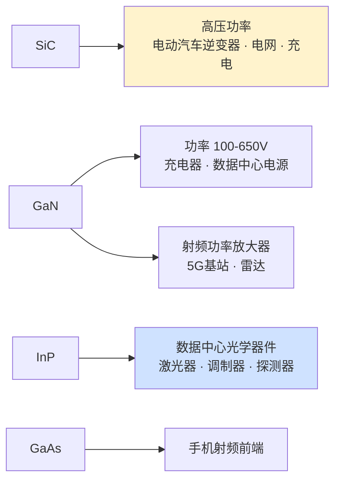
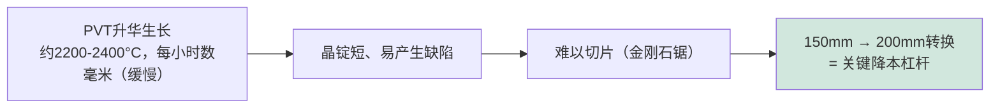

# 化合物半导体制造设备——GaN、SiC、III-V族

> 📘 **说明：** 本文为英文原版《Compound Semiconductor Manufacturing Equipment — GaN, SiC, III-V》的简体中文参考译本，仅供参考；如有出入，以英文原版为准。

并非所有半导体都是硅。**化合物半导体**家族——由元素周期表中不同族的元素组合而成——具有硅无法比拟的电学和光学特性，已在电力电子、射频（RF）、光电子和光子学领域变得不可或缺。碳化硅（SiC）和氮化镓（GaN）正在彻底改变电动汽车、快速充电器和电网的功率转换；砷化镓（GaAs）和磷化铟（InP）等III-V族材料则主导着射频前端和数据中心光学器件。这些材料需要一个独特的制造生态系统——不同的晶体生长方法、不同的外延、不同的热处理，而且晶圆往往更小——由一批基本独立的设备供应商提供。本文涵盖SiC、GaN和III-V族材料的制造及其设备、驱动它们的市场以及供应商格局。

这些材料之所以重要，根本原因在于**禁带宽度**及相关特性。宽禁带（SiC约3.3eV、GaN约3.4eV，而硅为1.1eV）使器件能承受高得多的电压和温度，并以更低的损耗更快地开关——非常适合功率应用。高电子迁移率和直接带隙则使III-V族材料在高频放大以及光的发射和探测方面更具优势。

---

## 📊 可视化概览

*原创示意图；Mermaid图表可在GitHub上原生渲染。*

**宽禁带 → 更高的电压、温度和频率（相对比例）**

下图说明：各材料禁带宽度（eV）——硅1.1、GaAs 1.4、SiC 3.3、GaN 3.4；宽禁带材料的击穿电场约为硅的10倍，因此功率器件可以更薄、损耗更低。

```
 Bandgap (eV):  Si 1.1 ██████    GaAs 1.4 ███████    SiC 3.3 ████████████████    GaN 3.4 █████████████████
 Breakdown field ~10× silicon → thinner, lower-loss power devices
```

**材料 → 应用对应图**



**SiC为何昂贵——晶体生长瓶颈**



---

## 1. 碳化硅（SiC）

碳化硅是**高压电力电子**（通常为650V–1700V及以上）领域领先的宽禁带材料，其低导通损耗和低开关损耗大幅提升了电动汽车牵引逆变器、车载充电器、光伏逆变器和工业驱动器的效率。SiC的制造挑战从第一步——晶体——就开始了。

**晶锭生长。** 与硅不同，SiC无法用直拉法（Czochralski法）从熔体中拉制（在实际压力下它会升华而不是熔化）。SiC晶锭通过<strong>PVT（物理气相传输/籽晶升华法）</strong>生长：SiC源粉在约2,200–2,400°C下升华，然后在籽晶上重新凝结——这一过程极其缓慢（每小时数毫米），生成的晶锭较短且容易产生缺陷（微管、位错）。<strong>HTCVD（高温化学气相沉积）</strong>是另一种生长方法。缓慢且易产生缺陷的生长过程，是SiC晶圆昂贵且供应受限的主要原因。

**晶圆尺寸转换。** SiC行业正在经历从**150mm向200mm**晶圆的关键转换，这大约使每片晶圆的裸片数翻倍并降低成本——这是一个关键的竞争战场，Wolfspeed、Coherent（原II-VI）等公司都在竞相推进200mm量产。到2026年，这一转换已在顺利推进：Wolfspeed关闭了其达勒姆（Durham）150mm器件工厂，把器件生产集中到其200mm莫霍克谷（Mohawk Valley）工厂；与此同时，中国衬底厂商（天岳先进（SICC）、天科合达（TankeBlue）等）正在扩充200mm产能并展示300mm（12英寸）SiC衬底样品，但后者尚未进入量产。

**外延。** 在衬底上生长一层SiC CVD外延层以形成器件有源区，并原位引入<strong>n型掺杂（氮）</strong>和**p型掺杂（铝）**。SiC外延在专用CVD反应器中高温进行。

**器件工艺。** SiC器件制造需要极高温度的**掺杂激活退火（1,600–1,800°C）**，通常需要碳帽保护，远远超出硅工艺中的任何温度。器件包括**沟槽型和平面型MOSFET**以及**肖特基势垒二极管（SBD）**。栅氧界面质量（SiC/SiO₂）是一个长期存在的可靠性挑战，需要专门的氧化和钝化工艺。

**晶圆供应商：** Wolfspeed（长期领导者，2025年通过《破产法》第11章程序进行重组，并于2025年9月29日脱离破产保护）、Coherent/II-VI、SiCrystal（罗姆（ROHM）旗下）、天岳先进和天科合达（中国，在衬底价格战中已获得大量份额）、Resonac、意法半导体（STMicroelectronics，收购了Norstel）。**设备：** 爱思强（Aixtron）等提供SiC CVD外延设备；专用高温炉和离子注入机；PVT生长炉则来自少数几家供应商。

---

## 2. 氮化镓（GaN）

氮化镓以两种不同的衬底策略服务于两个不同的市场：

- **硅基GaN（GaN-on-Si，功率）：** 在廉价硅衬底上生长的GaN，可为较低电压范围（通常为100V–650V）提供高性价比的**功率器件**——快速充电器、数据中心电源、消费电子产品，并日益扩展到汽车领域。GaN与硅之间的晶格失配和热失配需要通过MOCVD生长复杂的缓冲层/过渡层。
- **碳化硅基GaN（GaN-on-SiC，射频）：** 在SiC衬底（导热性极佳）上生长的GaN，可为5G基站、雷达和国防提供大功率**射频放大器**，其中GaN高电子迁移率晶体管（HEMT）远胜于较老的GaAs和LDMOS技术。

**外延。** GaN器件层采用<strong>MOCVD（金属有机化学气相沉积）</strong>生长，使用三甲基镓和氨等前驱体。领先的MOCVD设备供应商是<strong>爱思强（G5+ C平台）</strong>和**维易科（Veeco，Propel平台）**，它们主导着化合物半导体和LED外延市场。精确控制形成导电<strong>二维电子气（2DEG）</strong>沟道的AlGaN/GaN异质结构，是GaN HEMT性能的核心。

**器件工艺。** GaN HEMT/HBT制造包括**台面刻蚀**（隔离器件）、**SiN钝化**（对控制表面陷阱和可靠性至关重要）、**欧姆接触和肖特基接触**形成以及栅极工艺。**垂直GaN**——采用真正的GaN-on-GaN衬底制造更高电压的垂直器件——是一个新兴前沿，有望比横向硅基GaN性能更好，但体GaN衬底仍然昂贵且尺寸较小。

---

## 3. III-V族材料（InP、GaAs、InGaAs）

III-V族——由III族元素（Ga、In、Al）和V族元素（As、P、N）组成的化合物——主导着高频和光电子应用：

- **GaAs**用于手机中的射频功率放大器和开关（pHEMT、HBT），也用于部分光子学和太阳能领域。
- **InP**是**数据中心光学器件**和长途电信的主力材料，为高速光收发模块提供激光器、调制器和光电探测器；它也服务于最高频率的射频（毫米波、太赫兹）应用。
- **InGaAs**（及相关合金）为射频HEMT和光电探测器提供极高的电子迁移率。

**外延。** III-V族器件构建在通过**MOCVD**（用于大批量生产）和**MBE（分子束外延）**（用于最精确、界面最陡峭的结构和研究）生长的外延层上。以原子级精度生长晶格匹配和应变异质结构的能力，是III-V族器件性能的基础。

**器件工艺。** III-V族制造采用专门的**湿法刻蚀化学品**（这些材料对硅工艺中使用的许多化学品很敏感），以及针对每种材料定制的干法刻蚀、接触金属化和钝化工艺。晶圆通常比硅晶圆小（100–150mm），晶圆厂也相应地高度专门化。

**应用**包括**数据中心光学器件**（AI驱动的光互连爆发式增长是InP的主要驱动力）、**5G毫米波**前端、**卫星与国防**电子以及广义的**光子学**。

---

## 4. 市场

化合物半导体市场受到强劲长期趋势的驱动：

- **电力电子（SiC和GaN）：** 交通电气化（电动汽车）、快充基础设施建设、可再生能源逆变器和电网现代化正推动SiC和GaN功率器件快速增长。SiC主导高压电动汽车牵引市场；GaN正在充电器、数据中心电源领域扩张，并日益进入汽车领域。
- **射频（GaN和III-V族）：** 5G基础设施（GaN-on-SiC基站放大器）、国防雷达与电子战以及卫星通信推动着射频化合物半导体需求。
- **光学与光子学（InP、GaAs）：** AI驱动的数据中心带宽爆发是InP基光收发模块的巨大顺风，而硅光子（见[文件23](23_research_and_emerging_technologies.md)）也越来越多地集成III-V族激光器。

---

## 5. 主要供应商与晶圆厂格局

| 类别 | 主要厂商 |
|---|---|
| **SiC衬底** | Wolfspeed、Coherent/II-VI、SiCrystal（罗姆）、意法半导体、天岳先进、天科合达、Resonac |
| **SiC/GaN功率器件** | 英飞凌（Infineon）、意法半导体、安森美（onsemi）、罗姆、Wolfspeed、三菱电机、东芝、纳微半导体（Navitas）、Power Integrations、GaN Systems（英飞凌旗下）、EPC |
| **射频GaN/III-V族** | Qorvo、博通（Broadcom）、MACOM、Wolfspeed（原射频业务已出售给MACOM）、恩智浦（NXP）、住友（Sumitomo） |
| **MOCVD外延设备** | 爱思强、维易科（正与亚舍立（Axcelis）合并，预计2027年第一季度末前完成交割）、中微公司（AMEC，中国） |
| **MBE设备** | Riber、维易科 |
| **化合物半导体代工厂** | 高塔半导体（Tower Semiconductor）、稳懋半导体（WIN Semiconductors，GaAs/GaN代工）、格芯（GlobalFoundries，特色工艺，含GaN）、力积电（Powerchip/PSMC，硅基GaN）、全新光电（VPEC）、IQE等（外延片供应）；台积电（TSMC）将于2027年7月前退出GaN代工业务 |

化合物半导体设备市场与主流硅晶圆厂设备（WFE）明显不同：它由外延专业厂商（爱思强、维易科）以及众多材料和器件公司主导，而非硅CMOS巨头（尽管应用材料（Applied Materials）等公司也提供一些针对这些材料改造的离子注入、刻蚀和沉积设备）。晶体生长——SiC的PVT炉、体GaN和InP的生长——由少数专业供应商服务，衬底供应仍是整个化合物半导体领域的关键瓶颈和价值驱动因素。

随着电气化和光互连加速发展，化合物半导体已成为紧邻主流硅的最具吸引力的增长领域之一——它有自己的设备生态系统、自己的路线图（SiC从150mm向200mm转换、垂直GaN、InP光子集成），并在能源转型和AI驱动的带宽爆发中具有自身的战略意义。

---

## 延伸分析：器件物理、市场与设备细节

### A. 宽禁带物理为何在功率和射频领域胜出

SiC和GaN相对于硅的优势直接源于材料特性。SiC（约3 MV/cm）和GaN（约3.3 MV/cm）的**临界击穿电场**大约是硅（约0.3 MV/cm）的十倍，这意味着在给定额定电压下，宽禁带器件的漂移区可以**薄十倍**且掺杂浓度高得多——从而大幅降低以热量形式浪费能量的导通电阻。这一点体现在一些品质因数上，例如功率领域的<strong>巴利加品质因数（BFOM）</strong>和射频领域的**约翰逊品质因数（JFOM）**，SiC和GaN在这些指标上比硅高出数百倍。其实际影响是变革性的：电动汽车中的SiC牵引逆变器可以比其硅IGBT前代产品更小、更轻，效率高出几个百分点——而在电动汽车中，逆变器效率提高几个百分点会直接转化为续航里程延长或电池更小更便宜，这正是汽车制造商（以特斯拉（Tesla）的率先采用为首）推动SiC进入主流的原因。

SiC的高热导率（约为硅的3–4倍）也使器件能在更高温度下运行并更容易散热，这对大功率和恶劣环境应用很重要。GaN极高的电子速度以及AlGaN/GaN界面处的二维电子气（2DEG）赋予其出色的高频性能，这就是GaN-on-SiC HEMT在5G基站和雷达功率放大器中取代较老的LDMOS和GaAs技术的原因。

### B. SiC制造挑战详解

SiC价值链的瓶颈在于衬底。PVT晶体生长缓慢（每小时不到一毫米，而硅直拉法的拉晶速度为每小时数厘米）且容易产生缺陷——**微管**（中空核心缺陷，目前已基本得到控制）、**基平面位错**（会导致双极退化）以及**穿透位错**。晶锭很短（几厘米），限制了每个晶锭可切出的晶圆数量；SiC极高的硬度使切片和抛光既慢又贵（金刚石线锯切割，切缝损耗显著，不过Halo/英飞凌的激光“冷裂”技术等激光辅助切片方法正在提高得率）。**150mm向200mm的转换**大约使可用裸片面积翻倍，是核心的降本杠杆，Wolfspeed、Coherent、博世（Bosch）、意法半导体以及中国供应商（天岳先进、天科合达）都在竞相完成200mm认证。衬底成本仍是SiC器件成本中最大的单一组成部分，这就是为什么垂直整合（器件厂商确保或拥有衬底供应）是一个决定性的战略主题。

### C. GaN制造与可靠性

硅基GaN功率器件通常是**横向HEMT**（电流在2DEG中横向流动），其本质上是常开型的，需通过p-GaN栅、共源共栅（cascode）或凹槽栅结构设计成**常关型（增强型）**，以实现安全的功率开关。为弥合GaN/Si之间巨大的晶格失配和热失配而进行的缓冲层工程（采用AlN成核层和渐变AlGaN过渡层）是GaN外延的核心，也是MOCVD的关键挑战。**可靠性**——动态导通电阻（陷阱电荷引起的电流崩塌）、栅极可靠性以及缺少本征体二极管——导致GaN经历了多年的认证才获得广泛采用；**SiN钝化**和场板设计是控制表面陷阱的核心。垂直GaN（基于体GaN衬底）有望实现更高电压和更好的可靠性，但仍需等待价格合理的大尺寸体GaN衬底。

### D. 市场规模与展望

| 细分市场 | 主要材料 | 关键应用 | 增长驱动因素 |
|---|---|---|---|
| 高压功率（650–1700V以上） | SiC | 电动汽车牵引逆变器、充电、电网、轨道交通 | 电动汽车电气化 |
| 中压功率（100–650V） | GaN | 充电器、数据中心电源、消费电子、汽车 | 效率、功率密度 |
| 射频功率 | GaN-on-SiC | 5G基站、雷达、国防、卫星通信 | 5G/国防 |
| 射频前端（手机） | GaAs | 功率放大器、开关 | 移动通信 |
| 数据中心光学器件 | InP | 激光器、调制器、探测器 | AI带宽 |

SiC功率器件市场借助电动汽车的普及快速增长（英飞凌、意法半导体、安森美、罗姆和Wolfspeed是领先的器件厂商），而GaN功率正从充电器扩展到数据中心和汽车应用。AI驱动的光互连热潮是InP光子学的强劲顺风。贯穿这三者的一个共同主题是，**设备和衬底生态系统是决定价值的瓶颈**——外延反应器（爱思强、维易科）、晶体生长炉和衬底供应对行业增长的制约，比器件设计更大。

### E. 设备细节

化合物半导体晶圆厂使用较小的晶圆（100–200mm）和一套独特的设备：用于外延的**MOCVD和MBE**（价值最高的设备）；**高温离子注入和退火**（SiC激活需1,600–1,800°C，远超硅工艺）；**专用干法和湿法刻蚀**化学品（GaN/III-V族采用BCl₃/Cl₂，SiC采用氟基化学品，而III-V族材料对许多硅晶圆厂化学品很敏感）；**介质沉积**（SiN钝化对GaN至关重要）；以及针对每种材料定制的**欧姆接触和金属化**工艺。由于产量低于主流硅且晶圆更小，这些设备通常由较老一代硅设备改造而来或由专业厂商专门制造，而这些晶圆厂（Wolfspeed、英飞凌、意法半导体，以及稳懋半导体和高塔半导体等纯代工厂）构成了一个有别于领先制程硅逻辑世界的独特生态系统——尽管在电气化和AI驱动光学器件的推动下，化合物半导体的战略重要性仍在持续上升。

---

## 进一步分析：降本路线图与竞争态势

### A. SiC降本的迫切需求

碳化硅领域的核心商业动态是坚持不懈地**降低成本**，因为SiC在价格敏感型应用（尤其是大众市场电动汽车）中的普及取决于缩小与硅的成本差距。降本路线图有多个杠杆，每一个都是设备和工艺上的挑战。**150mm向200mm的晶圆转换**大约使每片晶圆的裸片数翻倍，是最大的单一杠杆——但它需要在控制缺陷的同时，把困难的PVT晶体生长扩展到更大直径，这是一项艰巨的材料挑战。**改进晶体生长**（更快的生长速度、更高的得率、更少的缺陷、更长的晶锭）直接降低衬底成本这一主要成本构成。**更薄的晶圆和更好的器件设计**（沟槽型MOSFET比平面型单位面积性能更高）提高了性价比。**更高产能的外延和器件工艺**降低了每片晶圆的加工成本。**基于激光的切片**（冷裂技术）则减少了用金刚石锯切割这种超硬材料时的切缝损耗和加工时间。Wolfspeed、英飞凌、意法半导体、安森美、罗姆、博世以及中国新进入者之间压低SiC成本的竞争正在重塑这一行业，垂直整合（控制衬底供应）和200mm领先地位是关键的竞争战场。对于设备厂商（外延领域的爱思强等，以及晶体生长炉和切片设备供应商）而言，SiC降本路线图是一个由电动汽车电气化大趋势驱动的增长机遇。

### B. GaN的双市场竞争结构

氮化镓的竞争结构由其两个截然不同的市场塑造——<strong>功率（硅基GaN）</strong>和**射频（碳化硅基GaN）**——它们的动态各不相同。在**功率**领域，GaN与硅竞争（凭借效率和功率密度在100–650V范围内取代硅），并越来越多地涉足更高功率的应用（数据中心电源、汽车）。竞争发生在GaN专业厂商（纳微半导体、EPC、现属英飞凌的GaN Systems、Power Integrations）与把GaN加入产品组合的大型功率半导体厂商（英飞凌、意法半导体、安森美、德州仪器（TI））之间，关键挑战在于成本（硅基GaN利用了廉价硅衬底，但需要复杂的缓冲层MOCVD）、可靠性（GaN所需的长达数年的认证）以及向更高功率扩展。在**射频**领域，GaN-on-SiC已在5G基站和国防功率放大器中取代LDMOS和GaAs，该市场由Qorvo、MACOM、Wolfspeed（射频业务已出售给MACOM）、恩智浦和住友主导，关键驱动力是5G基础设施和国防需求。**垂直GaN**前沿（用于更高电压的GaN-on-GaN）仍在等待价格合理的体GaN衬底。在这两个市场中，MOCVD外延（爱思强、维易科）都是决定价值的设备，GaN的增长故事——与SiC一样——与电气化和互联互通大趋势紧密相连。

### C. InP光子学的顺风

磷化铟正乘着化合物半导体领域最强劲的顺风之一：**AI驱动的数据中心光互连爆发**。随着AI集群对芯片之间、机架之间和系统之间带宽的需求不断增长，承载这些带宽的光收发模块——基于InP激光器、调制器和探测器——需求激增，而向共封装光学（见[文件11](11_advanced_packaging_equipment.md)、[文件23](23_research_and_emerging_technologies.md)）和更高数据速率（到2026年800G和1.6T已批量出货，3.2T是下一步）的迈进进一步加速了这一趋势。这使InP外延（MOCVD和MBE）和InP器件制造成为一个增长领域，由一个专业生态系统（Coherent、Lumentum以及光子代工厂）服务，并与硅光子（采用键合到硅上的InP激光器）日益交织。InP光子学的顺风说明，化合物半导体世界虽然有别于主流硅逻辑，却正被同一个AI大趋势所牵引——不是通过逻辑，而是通过AI带宽需求所要求的光互连。对设备厂商而言，这是紧邻硅主流的又一个增长方向，有其专门的外延和工艺要求。

### D. 独特的设备生态系统

关于化合物半导体最深层的结构性要点是，它们构成了一个有别于主流硅逻辑的**独特设备生态系统**——不同的晶体生长（SiC用PVT炉，GaN和InP用体生长）、不同的外延（MOCVD和MBE，而非逻辑芯片的硅CVD外延）、不同的热处理（SiC所需的极高温退火）、更小的晶圆，以及专门化、常为改造而来的设备组合。这一生态系统并非由硅WFE巨头主导，而是由外延专业厂商（爱思强、维易科）、晶体生长炉制造商以及众多材料和器件公司主导，不过WFE巨头也提供一些经过改造的离子注入、刻蚀和沉积设备。衬底——其生长、成本、质量和直径——比任何其他因素都更是整个化合物半导体领域决定价值的瓶颈。随着电气化（SiC/GaN功率）和AI驱动的光学器件（InP）加速发展，这一独特的生态系统已成为紧邻主流硅的最具吸引力的增长领域之一，拥有自己的路线图、自己的竞争态势，并在能源转型以及互联互通和AI革命中具有自身的战略意义——这提醒我们，半导体产业不仅关乎缩小硅晶体管，也关乎服务于硅所无法胜任之应用的多样化材料。

---

## 🆕 2025–2026年更新：最新进展（截至2026年11月）

### 需求结构已经反转：AI光学器件上行，电动汽车驱动的SiC承压

2025–2026年的化合物半导体设备周期，更多地由AI数据中心而非电动汽车塑造。西方电动汽车增长低于预期，加上中国激进的产能扩张，造成了**SiC衬底过剩和价格战**；与此同时，AI集群推动了对**InP基光学元件**的需求激增，并日益带动数据中心供电中对高效**GaN和SiC功率器件**的需求。

最清晰的设备数据点来自爱思强。根据其2026年第三季度初步业绩公告（2026年10月15日），订单额约为**2.75亿欧元**——大约是2025年第三季度1.24亿欧元的两倍——其中设备订单中**光电子约占68%**，电力电子约占24%。爱思强表示，InP基光学元件的需求持续快速增长，目前占其未交付订单的大部分，而GaN和SiC功率领域的势头也有所改善。第三季度营收约为1.84亿欧元，息税前利润率（EBIT利润率）约为31%，2026年全年指引维持不变。

### SiC：重组、200mm整合与中国规模化

- **Wolfspeed**于2025年年中申请了预先打包的《破产法》第11章重组，并于**2025年9月29日**脱离破产保护。随后，它提前关闭了达勒姆150mm器件工厂，把器件生产转移到莫霍克谷200mm工厂；根据其2026财年的业绩公告，季度营收约为1.5–1.7亿美元，由于产能利用率不足，毛利率仍深度为负。
- **中国**：天岳先进、天科合达等公司迅速扩充了150mm和200mm衬底产能。媒体报道描述了6英寸衬底的价格战和产能过剩，就连中国供应商的利润率也受到挤压（据媒体摘要，天岳先进2026年第一季度营收大幅下滑并出现净亏损），其战略正转向8英寸（200mm）产能。天岳先进于2024年11月推出了首片300mm SiC衬底，据报道至少有十家中国企业已拥有12英寸样品，但300mm SiC尚未进入量产。
- **对设备的影响**：晶体生长炉和SiC外延设备需求目前集中在中国以及其他地区的200mm转换上；西方的新建SiC项目普遍放缓或调整了规模。

### GaN：代工格局重组与向300mm迈进

- **台积电**于2025年宣布将**在2027年7月前退出GaN代工业务**，理由是来自中国竞争对手的价格压力，据报道还将把相关晶圆厂改作先进封装用途。其客户正在转移：**纳微半导体**把硅基GaN生产转移到<strong>力积电（PSMC）</strong>的200mm产线（100V产品自2026年上半年开始，650V产品在12–24个月内转移），并与**格芯**另行签署了代工合作协议。
- **英飞凌**正在其奥地利现有硅晶圆厂中扩大**300mm**硅基GaN生产（计划于2025年底前提供首批客户样品），这一步使GaN进入主流硅晶圆厂设备体系，可能使只拥有150/200mm产线的竞争对手处于劣势。
- **数据中心供电**：英伟达（Nvidia）在2025年宣布为未来AI机架采用800V直流供电架构，功率半导体厂商位列其合作伙伴之中，这强化了服务器电源对GaN和SiC的需求（实际采用时间仍有待观察）。

### 材料与地缘政治：镓和锗

中国供应全球约80%的原生镓和约60%的锗。中国在2024年12月宣布的对美镓、锗、锑出口禁令，已根据2025年底的中美休战协议**暂停至2026年11月27日**，而镓价自2025年初以来大幅上涨。这直接关系到GaAs、GaN和InP供应链（三甲基镓前驱体、GaAs衬底）以及国防射频项目。中国在2025年10月宣布的更广泛的稀土管制同样暂停至2026年11月；美国官员在2026年9月表示休战已延长至2027年1月10日，这一休战能否带来矿产出口暂停措施的进一步延长，是近期的关键风险。

### 设备厂商整合

**亚舍立–维易科**全股票合并（2025年10月宣布，约44亿美元）将一家领先的SiC/功率离子注入供应商与一家领先的MOCVD/MBE供应商合二为一。两家公司股东已于2026年2月6日批准该交易；目前预计在**2027年第一季度末前**完成交割，尚待中国国家市场监督管理总局（SAMR）批准以及重新提交的《哈特-斯科特-罗迪诺反垄断改进法》（HSR）申报。

| 项目 | 数据 | 来源/状态 |
|---|---|---|
| 爱思强2026年第三季度订单 | 约2.75亿欧元（2025年第三季度为1.24亿欧元）；光电子约占68% | 初步业绩公告，2026年10月15日 |
| Wolfspeed | 2025年9月29日脱离第11章破产保护；达勒姆150mm器件工厂关闭 | 公司公告 |
| 台积电GaN | 2027年7月前退出GaN代工业务 | 2025年宣布 |
| 英飞凌GaN | 300mm硅基GaN生产爬坡 | 公司计划 |
| 中国对美镓/锗出口禁令 | 暂停至2026年11月27日 | 中美休战协议 |
| 亚舍立–维易科 | 预计2027年第一季度末前完成交割 | 待SAMR/HSR审批 |

**值得关注（2026年底–2027年）**
- 中国的镓/锗及稀土出口暂停措施能否在2026年11月下旬之后延长至2027年。
- SiC衬底价格和200mm的普及速度；300mm SiC是否开始试产。
- 台积电退出后GaN代工产能的转移，以及英飞凌等厂商的300mm GaN认证。
- 面向1.6T/3.2T光收发模块和共封装光学的InP外延及光学元件产能的持续扩张。
- 亚舍立–维易科合并的交割情况，以及由此在离子注入和MOCVD领域带来的产品线变化。
