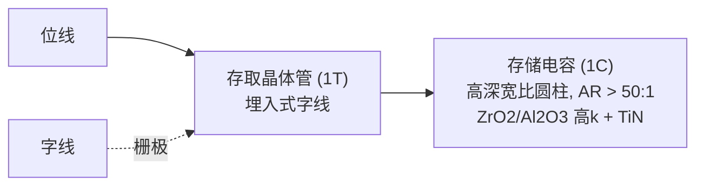
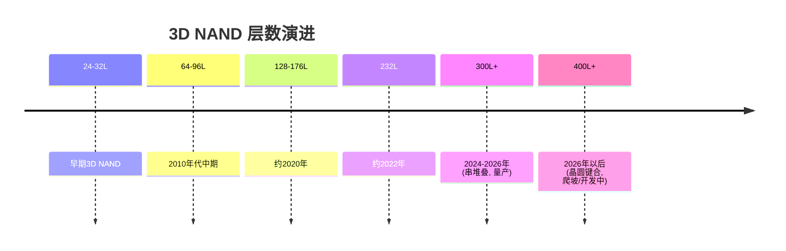
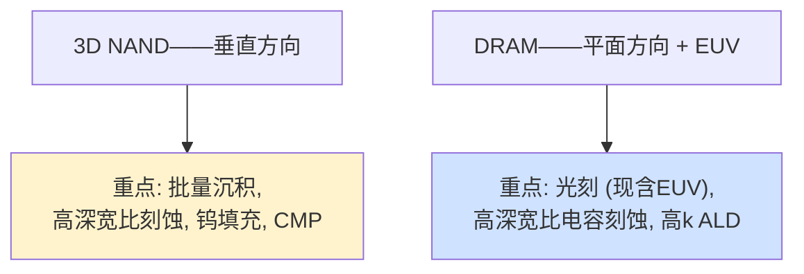

# 存储器专用制造设备——3D NAND闪存与DRAM

> 📘 **说明：** 本文为英文原版《Memory-Specific Manufacturing Equipment — 3D NAND and DRAM》的简体中文参考译本，仅供参考；如有出入，以英文原版为准。

存储器制造遵循与逻辑芯片制造不同的逻辑。先进逻辑芯片的特征是越来越精细的光刻和越来越复杂的晶体管，而存储器的特征则是以极致的单位比特成本经济性构建的**海量、重复的三维阵列**。这决定了其独特的设备结构：存储器晶圆厂是**薄膜沉积与刻蚀**设备的“大胃王”——尤其是高深宽比（HAR）刻蚀和批量式原子层沉积/化学气相沉积（ALD/CVD）——而在最先进光刻设备上的投入历来相对较少（直到最近）。两大存储器家族——3D NAND闪存与DRAM——各自面临独特的制造挑战，而一批新兴存储器（MRAM、PCM、ReRAM）也正逐步进入视野。本文涵盖其架构、关键工艺步骤及对应设备、新兴存储器格局、主要客户以及设备支出模式。

---

## 📊 可视化概览

*原创示意图；Mermaid图表可在GitHub上直接渲染。*

**3D NAND——靠堆叠层数而非缩小特征尺寸来微缩（剖面示意）**

下图为3D NAND垂直结构剖面示意：字线（W）层层堆叠，中间为垂直沟道（多晶硅+ONO电荷俘获层），每对字线对应一个存储单元；数百层堆叠（96 → 300+ → 400+），整座“塔”由一次深宽比大于60:1的高深宽比沟道孔刻蚀定义。

```
   ══ word line (W) ══ │ ░ │ ══ word line ══     ◄ each pair = one memory cell
   ══ word line (W) ══ │ ░ │ ══ word line ══       ░ = vertical channel
   ══ word line (W) ══ │ ░ │ ══ word line ══           (poly-Si + ONO charge trap)
   ══ word line (W) ══ │ ░ │ ══ word line ══
        ...  100s of stacked layers (96 → 300+ → 400+)  ...
   One HAR channel-hole etch (AR > 60:1) defines the whole tower.
```

**DRAM——带高耸电容的1T1C单元**



**NAND层数微缩（串堆叠将多座“塔”连接起来）**



**两种存储器微缩范式带动不同的设备需求**



---

## 1. 3D NAND闪存

### 架构演进

NAND闪存以电荷俘获在存储单元中的方式存储数据。2013年前后，平面（2D）NAND的微缩触及极限（单元过小，已无法可靠地容纳足够的电子），业界转而**向垂直方向**构建——将存储单元堆叠成“塔”，开拓第三维度。这种**3D NAND**架构不是靠缩小平面特征尺寸来微缩，而是靠**增加层数**：从最初几代的24层、32层，历经64、96、128、176、232层，如今**300层以上**已进入量产（据SK海力士（SK hynix）2026年7月财报，其321层NAND到2026年年中已成为其产量最大的NAND工艺节点），**400层以上**的世代正处于爬坡或开发阶段；最高层数通过**串堆叠**（分别制造两个或多个独立堆叠再垂直连接）实现，并越来越多地采用**晶圆键合**——将单独制造的CMOS外围电路晶圆与存储阵列晶圆键合在一起。增加层数可以在不需要更精细光刻的情况下提高比特密度——这是一种与逻辑芯片根本不同的微缩范式。

### 关键工艺步骤与设备

- **ONON / ONOP叠层沉积：** “塔”始于由交替介质层构成的叠层——通常为氧化物与氮化物（ONON）或氧化物与多晶硅——在**批量式LPCVD/ALD炉管**（国际电气（Kokusai）、东京电子（TEL））中沉积数百层。在如此庞大的叠层上保持均匀性和应力控制至关重要；应力会使晶圆翘曲，并使后续图形化发生畸变。
- **高深宽比（HAR）沟道孔刻蚀：** 3D NAND的标志性工艺。数以百万计、宽度仅数十纳米的沟道孔，要以**超过60:1的深宽比**（并正向100:1攀升）笔直地刻穿整个叠层（文件05）。这一步骤是整个制造业中要求最苛刻的工序之一，需要强大的低温/高能氟碳电容耦合等离子体（CCP）刻蚀，并以极其精细的形貌控制来避免弯曲（bowing）、扭曲和锥化。这是泛林集团（Lam Research）、东京电子和应用材料（Applied Materials）的主战场。
- **沟道孔填充：** 孔壁内衬存储薄膜叠层——由ALD沉积的**ONO（氧化物-氮化物-氧化物）电荷俘获层**——并以**多晶硅**沟道填充，所有薄膜都必须在深达数微米、宽仅数十纳米的结构中实现保形覆盖。
- **字线替换（后栅工艺）：** 通过狭缝开口，用**热磷酸湿法刻蚀**（或干法原子层刻蚀（ALE））去除牺牲氮化物层，形成水平空腔，随后以<strong>钨（CVD W）</strong>填充形成字线，再进行化学机械平坦化（CMP）。这种“替换栅”方案是电荷俘获型3D NAND的核心。
- **台阶刻蚀：** 为了与数百层字线逐层形成电接触，需要在阵列边缘形成<strong>阶梯状“台阶”</strong>结构，方法是反复向下刻蚀一层并回缩光刻胶掩模——这是一种专门的多循环刻蚀工艺。

3D NAND的设备强度集中在**薄膜沉积（批量ALD/CVD）、高深宽比刻蚀、钨填充和CMP**——这使存储器厂商成为这些设备类别的最大客户之一。永无止境的层数竞赛不断将刻蚀和沉积推向新的极限。

---

## 2. DRAM

### 架构

DRAM将每个比特以电荷形式存储在一个微小的电容上，并由单个晶体管存取——即<strong>1T1C（单晶体管单电容）</strong>单元。与NAND不同，DRAM的阵列*尚未*完全走向三维（尽管这一转变正在起步）；它主要依靠在平面内缩小单元、同时在垂直方向构建电容来实现微缩。这使DRAM成为光刻强度最高的存储器，也是首个采用极紫外光刻（EUV）的存储器。

### 关键工艺步骤与设备

- **埋入式字线（bWL）：** 为节省面积并降低耦合，字线晶体管的栅极被埋入硅中的沟槽内。这需要精确的沟槽**刻蚀**和保形**填充**（通常为带阻挡层的钨），以及存取晶体管的形成。
- **高深宽比电容刻蚀：** 为了在不断缩小的占位面积内存储足够的电荷，**存储电容**被做成非常高而窄的圆柱或柱状结构，**深宽比超过50:1**。刻蚀这些电容结构是DRAM的高深宽比刻蚀挑战，与NAND的沟道孔类似。
- **电容介质ALD：** 电容内衬高k介质叠层——过去为**ZrO₂/Al₂O₃/ZrO₂（ZAZ）**，并越来越多地采用更先进的高k材料——通过ALD在极高的深宽比上实现完美保形沉积，并配以**TiN电极**。在越来越小的单元中实现电容最大化、漏电最小化，是DRAM材料方面的核心挑战。
- **先进单元晶体管：** 为了控制漏电和短沟道效应，DRAM存取晶体管先后演进为<strong>RCAT（凹槽沟道阵列晶体管）</strong>和<strong>鞍形鳍（saddle-fin）</strong>结构，业界正在向未来几代的**垂直沟道及3D DRAM**迈进。
- **金属互连：** DRAM越来越多地在紧密间距金属层中采用**Ru、Co和Mo**，与逻辑芯片的互连材料转变如出一辙。
- **EUV导入：** DRAM是首个导入EUV的存储器。**SK海力士**率先在其1a/1b纳米级DRAM中采用EUV，三星（Samsung）和美光（Micron）随后跟进（美光的首个EUV节点为1γ），利用EUV对最关键层进行图形化并简化多重图形化。在2025–2026年正在爬坡的1c（第六代10纳米级）节点上，据报道SK海力士和三星使用了五层或更多EUV层，而美光则将EUV用量保持在最低限度，更多依赖ArF浸没式多重图形化。这使先进DRAM与先进逻辑一起，成为EUV的重要客户。

DRAM的设备强度覆盖**光刻（现已包括EUV）、高深宽比电容刻蚀、高k ALD以及精密沉积/CMP**——其设备结构比NAND更偏重光刻。

---

## 3. 新兴存储器

在NAND和DRAM之外，一系列新兴非易失性存储器正在找到细分市场——尤其是作为**嵌入式存储器**（取代片上闪存）以及用于新型计算（文件23）：

- **MRAM（磁阻随机存储器）：** 以<strong>磁隧道结（MTJ）</strong>的磁化方向存储数据。制造需要**以PVD沉积复杂的多层MTJ叠层**（约30层，在超高真空集群设备中完成）、**磁场退火**（在强磁场中设定磁化方向），以及用<strong>离子束刻蚀（IBE）</strong>对MTJ柱进行图形化（常规等离子体刻蚀会导致磁性材料再沉积和短路）。MRAM（STT-MRAM以及新兴的SOT-MRAM）已在三星、台积电（TSMC）等公司作为嵌入式存储器量产。
- **PCM（相变存储器）：** 利用<strong>硫系化合物（GST——Ge₂Sb₂Te₅）</strong>的非晶/晶态来存储数据，需要GST沉积和精细的刻蚀选择比控制。曾用于英特尔（Intel）/美光此前的3D XPoint以及嵌入式应用。
- **ReRAM（阻变存储器）：** 在金属氧化物（通常为**ALD沉积的HfOx**）中形成导电细丝来存储数据；适用于低成本嵌入式非易失性存储器（例如台积电/Weebit Nano的28nm嵌入式ReRAM）。

这些新兴存储器为存储器设备组合带来了新的设备需求——PVD MTJ叠层、IBE、硫系化合物沉积、专用ALD——尽管其产量相对于NAND和DRAM仍然很小。

---

## 4. 主要客户

存储器行业高度集中：

| 存储器 | 主要制造商 |
|---|---|
| **DRAM** | 三星、SK海力士、美光（“三巨头”，约占市场95%）；长鑫存储（CXMT，中国，新兴） |
| **3D NAND** | 三星、SK海力士（收购了英特尔的NAND业务，现为Solidigm）、铠侠（Kioxia）/闪迪（Sandisk）（合资；闪迪于2025年2月从西部数据（Western Digital）分拆独立）、美光；长江存储（YMTC，中国，新兴） |
| **新兴/嵌入式** | 三星、台积电、格罗方德（GlobalFoundries）、英飞凌（Infineon），以及专业厂商（Everspin、Weebit Nano） |

这种集中度意味着少数几家公司的资本支出决策就能左右整个存储器设备市场——而由于存储器是一种价格周期剧烈波动的大宗商品，这类支出波动极大，使存储器成为晶圆厂设备（WFE）需求中周期性最强的驱动因素。

---

## 5. 按存储器类型划分的设备供应商与支出模式

存储器的设备支出结构与逻辑芯片明显不同：

- **3D NAND**以**薄膜沉积（用于ONON叠层的批量ALD/CVD）、高深宽比刻蚀和钨填充**为主——这使泛林集团（刻蚀和金属填充）、应用材料、东京电子和国际电气对存储器的敞口尤其大。光刻相对较轻（规则的阵列图形容错性较高），这也是<strong>纳米压印光刻（佳能（Canon））</strong>被用于探索NAND制造的原因。CMP和清洗的需求同样密集。
- **DRAM**则更**偏重光刻**（现已包括阿斯麦（ASML）的EUV），同时还有高深宽比电容刻蚀和高k ALD；因此其支出分散在阿斯麦、泛林集团、东京电子、应用材料以及ALD专业厂商之间。
- **支出周期性：** 存储器资本支出是WFE中波动最大的组成部分。当DRAM和NAND价格飙升时（如2017–2018年、AI驱动的HBM热潮，以及2025–2026年由DRAM引领的上行周期），存储器厂商会大幅增加投资；当价格暴跌时，它们几乎在一夜之间削减资本支出，由此形成波及整个设备行业的繁荣-萧条模式。

**HBM热潮**值得特别一提：AI驱动的高带宽内存（HBM）需求，使先进DRAM及其**硅通孔（TSV）/堆叠/键合**工艺成为重要的增长驱动力，促使存储器厂商（尤其是SK海力士和三星）同时大举投资先进DRAM和堆叠所需的先进封装设备（文件11）。HBM多年来首次让存储器成为一个前沿技术故事，而不仅仅是一个大宗商品成本故事——并相应地将存储器厂商的设备支出重塑为向最先进的沉积、刻蚀、光刻和键合设备倾斜。

因此，存储器仍然是设备行业的巨大周期性引擎——在这个市场中，少数几个巨型客户构建着重复程度难以想象的三维阵列，对沉积、刻蚀以及日益增长的光刻和封装设备产生巨大而波动的需求，正是这些设备让比特成本不断下降成为可能。

---

## 扩展分析：微缩机理、HBM与存储器设备结构

### A. 两种微缩范式

理解存储器设备最深刻的方式，是认识到NAND和DRAM遵循**根本不同的微缩范式**，这决定了它们不同的设备结构。**3D NAND在垂直方向微缩**——增加层数而非缩小特征尺寸——因此其微缩由**沉积**（沉积越来越高的叠层）、**高深宽比刻蚀**（刻穿这些叠层）和**填充**（填充由此形成的结构）驱动，而光刻相对宽松（平面特征尺寸并不激进，且图形规则）。**DRAM主要在平面内微缩**（缩小单元），同时在垂直方向构建电容，因此它**对光刻的依赖程度高得多**（现已包括EUV），并依赖**高深宽比电容刻蚀和高k ALD**。这一差异解释了为什么NAND厂商是批量沉积和高深宽比刻蚀的最大客户，而DRAM厂商是EUV的重要客户——也解释了为什么NAND/DRAM投资平衡的变化会在不同设备类别之间转移需求。

### B. 3D NAND——层数军备竞赛

3D NAND层数的持续攀升（24 → 300+）是NAND制造的决定性动态，它以叠加的方式给设备带来压力。每增加一层，**叠层沉积**的要求就更高（总厚度更大，需要更严格的应力控制以防晶圆翘曲），**沟道孔刻蚀**就更难（深宽比更高，需要在更深的孔中更严格地控制形貌以避免弯曲和锥化），**填充和字线替换**也更具挑战性（对更深的结构进行保形覆盖和填充）。超过一定高度后，一次刻蚀和一次沉积已无法贯穿整个叠层，因此厂商采用**串堆叠**——分别构建两个（或更多）叠层再将其连接——这又带来了对准和连接方面的挑战。其经济性（每片晶圆更多比特、更低的单位比特成本）足以证明不断升级的难度是值得的，但工程挑战极其严酷，而**低温刻蚀**（文件05）、新型高能等离子体源、新型硬掩模以及不断改进的形貌控制，正是维持这场军备竞赛的关键手段。层数竞赛是高深宽比刻蚀和批量沉积设备需求的最大单一驱动因素。

### C. DRAM——电容与EUV转型

DRAM的核心挑战在于在越来越小的单元中存储足够的电荷以可靠地保存一个比特，这迫使**存储电容**变成越来越高、越来越窄的圆柱（深宽比超过50:1），并通过ALD内衬越来越好的高k介质（ZrO₂/Al₂O₃“ZAZ”类叠层，正向更高k值的材料演进）。存取晶体管同样在演进（埋入式字线，再走向垂直沟道和3D结构）以控制漏电。近期影响最深远的转变是**EUV转型**：DRAM成为首个采用EUV的存储器（SK海力士在其1a/1b纳米级节点上领先，三星和美光随后跟进），用EUV对最关键层进行图形化，并简化DRAM紧密间距原本所需的多重图形化。这使先进DRAM成为EUV的重要客户，并开始将DRAM推向曾经只属于逻辑芯片的前沿设备强度——而即将到来的**3D DRAM**转型（文件23）将加速这一趋势，届时DRAM终将追随NAND进入第三维度，并带来与之相应的全部沉积/刻蚀/填充强度。

### D. HBM——存储器与先进封装的交汇

AI热潮使<strong>高带宽内存（HBM）</strong>成为存储器领域最重要的增长故事，而HBM既是存储器故事，也是**先进封装**故事。一个HBM堆栈由8–16颗DRAM裸片组成，通过<strong>硅通孔（TSV）</strong>和**微凸点**垂直连接（2026年已量产的HBM4在JEDEC将封装高度上限放宽至775 µm后，仍采用MR-MUF/TC键合；**混合键合**目前预计将从HBM4E或HBM5开始导入），并与逻辑芯片并排安装在硅中介层上（CoWoS，文件11）。因此，制造HBM不仅需要先进DRAM，还需要先进封装中的**TSV形成、晶圆减薄、堆叠和键合**设备——这促使存储器厂商（尤其是HBM领导者SK海力士，以及三星和美光）同时大举投资先进DRAM和封装设备。HBM多年来首次让存储器成为一个前沿技术且产能受限的故事，而不仅仅是一个大宗商品成本故事，并将存储器厂商的设备支出重塑为向最先进的沉积、刻蚀、光刻、TSV、减薄和键合设备倾斜。争夺HBM领导地位的竞争（其中良率和堆叠能力起决定性作用）是当前存储器行业的标志性战役之一。

### E. 新兴存储器及其对设备的影响

新兴存储器（MRAM、PCM、ReRAM、FeRAM，文件23）为存储器设备组合增加了专门的设备需求——用于MRAM磁性叠层的超高真空（UHV）多腔PVD和离子束刻蚀、用于PCM的硫系化合物沉积和选择性刻蚀、用于ReRAM的HfOx ALD、用于FeRAM的HZO ALD。它们的产量相对于NAND和DRAM仍然很小，但正作为**嵌入式**存储器（在微控制器和SoC中取代片上闪存）以及存储级内存和存内计算的候选方案而不断增长。对设备行业而言，新兴存储器代表着一系列规模较小但价值更高的专业细分市场，它们利用并将现有的沉积和刻蚀平台延伸到新材料——这正是“材料种类不断扩展、持续创造新设备机会”这一更广泛规律的缩影。

---

## 进一步分析：存储器周期与HBM变革

### A. 大宗商品存储器周期

主流存储器（DRAM和NAND）最根本的经济特征是其**大宗商品属性**以及由此产生的剧烈价格周期。由于DRAM和NAND在很大程度上是可互换、以价格竞争的大宗商品，而且产能扩张以大规模、不连续的增量进行且交付周期很长，市场在短缺（高价格、高利润、扩产潮）与过剩（价格暴跌、亏损、资本支出崩塌）之间来回摆动。这些周期又被集中的供应商结构（少数几家厂商的集体产能决策决定供给）以及从产能决策到产出之间的漫长周期（导致新增产能往往在需求已发生变化之后才到位）所放大。对设备行业而言，存储器周期是WFE波动的最大单一来源：当存储器价格飙升时，三星、SK海力士和美光会向产能倾注资本，偏向存储器的设备需求（NAND方面的批量沉积、高深宽比刻蚀、钨填充；DRAM方面的包括EUV在内的光刻、电容刻蚀和高k ALD）随之激增；当价格暴跌时，这些支出几乎在一夜之间被削减。这使得受大宗商品价格周期驱动的存储器厂商资本支出决策成为整体设备市场的主要摇摆因素，也使对存储器敞口较大的设备厂商（凭借刻蚀和NAND优势的泛林集团；批量沉积领域的国际电气和东京电子；应用材料）的周期杠杆最高。

### B. HBM如何打破大宗商品模式

面向AI的<strong>高带宽内存（HBM）</strong>的崛起，多年来首次部分打破了存储器纯粹的大宗商品模式，并改变了存储器格局。与大宗商品DRAM不同，HBM是一种**差异化、高价值、产能受限、技术密集的产品**：它需要先进DRAM加上复杂的3D堆叠（TSV、微凸点，混合键合预计将在后续HBM世代中导入），良率和堆叠能力是决定性的竞争差异点，而且（由AI加速器驱动的）需求已超过供给，支撑了溢价定价。这带来了几项深远影响。它使**SK海力士**（HBM领导者）成为AI热潮中的突出受益者，并加剧了其与三星和美光争夺HBM领导地位的竞争。它促使存储器厂商同时大举投资先进DRAM和HBM所需的**先进封装设备**（TSV、减薄、堆叠、键合——文件11），使其设备支出扩展到传统存储器设备组合之外。它还多年来首次让存储器成为一个**前沿技术与产能故事**，而不仅仅是大宗商品成本故事，使相当一部分存储器需求与大宗商品周期部分脱钩。HBM对存储器的变革——从可互换的大宗商品转变为差异化、AI驱动、封装密集型的产品——是近期存储器行业最重要的发展之一，它既重塑了存储器厂商之间的竞争态势，也重塑了它们所产生的设备需求。

### C. 即将到来的3D DRAM转型

展望未来，存储器领域最具影响力的发展是**DRAM向三维的转型**（3D DRAM，文件23）。DRAM主要在平面内微缩，同时在垂直方向构建电容，但它正逼近当年迫使NAND走向垂直的同一堵墙：单元已无法在平面内继续缩小，同时又能存储并切换足够的电荷。3D DRAM——将DRAM单元垂直堆叠——正在三大厂商处开发，尽管难度极大（DRAM的低漏电要求远不如NAND电荷俘获单元那样宽容），但它越来越被视为超越传统DRAM微缩的必由之路。其设备影响十分重大：3D DRAM将需要NAND首创的**高深宽比刻蚀、保形ALD和高深宽比填充**能力，并应用于DRAM更严苛的规格，此外还可能需要新材料（IGZO氧化物半导体存取晶体管，因其超低漏电特性）。这一转型将使DRAM走向长期以来NAND所特有的沉积和刻蚀强度，重塑存储器设备需求，并为沉积和刻蚀领导者创造新的机会。预计在本十年末前后发生的3D DRAM转型，代表着存储器制造的下一个重大拐点——DRAM终将追随NAND进入第三维度，带来与之相应的全部设备强度，并完成贯穿本数据库的全行业向三维集成的转向。

---

## 🆕 2025–2026年更新：最新进展（截至2026年11月）

### A. 存储器引领2026–2027年设备上行周期

上文所述的存储器周期已坚定地转入上行。DRAM和NAND价格自2025年底起大幅上涨，行业叙事已转向由AI数据中心对HBM、大容量服务器DRAM和企业级SSD的需求驱动的“存储器超级周期”。这使存储器成为晶圆厂设备中增长最快的领域：

- **国际半导体产业协会SEMI（SEMI）2026年7月的年中预测**将2026年WFE上调至**1,439亿美元**（设备总额1,659亿美元，同比增长23.2%），并预计2028年设备总额将达到创纪录的2,295亿美元。
- **泛林集团**（2026年10月21日）预计2026年WFE约在1,500亿美元中段区间，并初步预计**2027年将超过2,000亿美元**，增长由**DRAM**引领，其次是晶圆代工/逻辑，然后是NAND。泛林还警告称，**洁净室空间和零部件供应**可能会限制行业增加产出的速度。根据财报电话会议纪要，泛林报告了与1α/1β/1γ技术升级相关的创纪录DRAM营收，并表示其NAND**升级**业务在2026年将保持强劲。
- 集邦咨询（TrendForce）（2025年11月）曾预测2026年DRAM资本支出约613亿美元（同比增长14%），随着存储器支出上升，这一数字后来已被超越。

| 指标 | 最新观点 | 来源 |
|---|---|---|
| 2026年WFE | 1,439亿美元 | SEMI，2026年7月 |
| 2026年WFE | 约1,500亿美元中段区间 | 泛林集团，2026年10月 |
| 2027年WFE | 超过2,000亿美元（初步），由DRAM引领 | 泛林集团，2026年10月 |
| 2026年DRAM资本支出 | 约613亿美元（同比增长14%），后被超越 | 集邦咨询，2025年11月 |
| 2026年第二季度HBM份额 | SK海力士约50%，三星约33%，美光约18% | Counterpoint |

### B. DRAM：1c节点、更多EUV层，以及通向4F²/3D之路

- **EUV层数正在增加。** 据报道，在1c节点上，SK海力士和三星使用了**五层或更多EUV层**；据报道SK海力士已将1c的EUV投资大幅提高到远超原计划的水平，并计划将其相当大比例的DRAM产能转换为1c。相比之下，美光直到1γ才导入EUV，并将EUV用量保持在最低限度，依赖ArF浸没式多重图形化。这些分化的策略对阿斯麦（EUV台数）与沉积/刻蚀供应商（多重图形化的侧墙和刻蚀步骤）而言意义重大。
- **下一代架构。** 据报道，垂直沟道晶体管（VCT）和**4F²单元**设计瞄准10纳米以下级别的DRAM，**3D DRAM**则更为遥远；目前均无确定的量产日期。每一步都会提高沉积和刻蚀强度，泛林已公开强调这一点。

### C. HBM4：键合方案的转变

- **HBM4已于2026年进入量产**，主要用于英伟达（Nvidia）的Rubin平台。
- **JEDEC将HBM4封装高度上限提高至775 µm**（原为720 µm），缓解了采用混合键合的压力。SK海力士继续采用**MR-MUF/热压（TC）键合**，并在Hot Chips 2026上表示混合键合尚未为HBM4E做好准备，**最早要到HBM5**才会导入。
- 据报道，**三星**在混合键合方面更为积极（天安产线）。据报道，SK海力士已下达首笔混合键合量产订单，采购**应用材料+Besi**的集成式在线系统。混合键合仍是未来重要的设备机会，但时间表较此前预期有所推迟。
- **HBM份额**的竞争更加激烈。据Counterpoint数据，三星的份额从2026年第一季度的约21%升至第二季度的约33%。

### D. 3D NAND：300层以上已量产，400层以上紧随其后

- SK海力士的**321层**NAND到2026年年中已成为其产量最大的NAND节点。三星第10代V-NAND（400层以上，采用外围电路晶圆与存储单元晶圆的晶圆键合）和铠侠的332层BiCS10正处于爬坡或准备阶段，但各方报道的时间表不一。据报道，三星已展示通过键合堆叠晶圆制成的超高层数原型。
- **低温介质刻蚀**已成为先进沟道孔刻蚀的主流方案；泛林称其Cryo 3.0已成为先进NAND的行业标准。据报道，下一代NAND正在采用<strong>钼（Mo）</strong>字线（取代钨），这将使泛林ALTUS Halo等Mo ALD/CVD平台受益。
- NAND支出仍以现有产能的**节点升级**为主，而非新建晶圆厂，尽管AI推理存储需求已改善了NAND需求前景。据报道，长江存储在出口管制下仍加速推进其武汉第三期晶圆厂。

### E. 产能投资与地缘政治

- **SK海力士：** 龙仁集群首座晶圆厂目标于2027年第一季度投产；印第安纳州先进封装工厂（约38.7亿美元，约2028年）；据报道（2026年7月）其计划在美国上市，募资最高约360亿美元，用于晶圆厂和EUV设备。
- **美光：** 在新加坡投资约70亿美元建设HBM封装工厂；在爱达荷州和纽约州建设美国晶圆厂。
- **三星/SK海力士：** 新增HBM后道产能（天安/温阳）。
- **韩国厂商的中国晶圆厂：** 三星（西安）和SK海力士（无锡、大连）的“经验证最终用户”（VEU）资格自2025年12月31日起被撤销。美国商务部工业与安全局（BIS）随后为其发放了**2026年度许可**，允许维持运营，但不得扩产或升级。这实际上冻结了这些NAND/DRAM基地的技术迁移。
- **长鑫存储和长江存储**继续扩张，国产设备占比不断提高。中国整体国产设备占比在2025年达到约35%（行业协会数据）。

**值得关注的事项（2026年末–2027年）**
- 2027年WFE能否如泛林预期超过2,000亿美元，以及洁净室和零部件短缺是否会限制存储器产能扩张。
- HBM4E的认证进展，以及是否有厂商在HBM5之前将混合键合用于量产HBM。
- 三星1c DRAM的良率，及其相对SK海力士的HBM份额走势。
- 400层以上NAND的爬坡、Mo字线的导入以及低温刻蚀的普及。
- 2026年之后，美国对韩国厂商中国存储器晶圆厂许可的续期条款。
