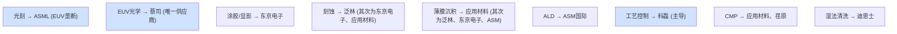
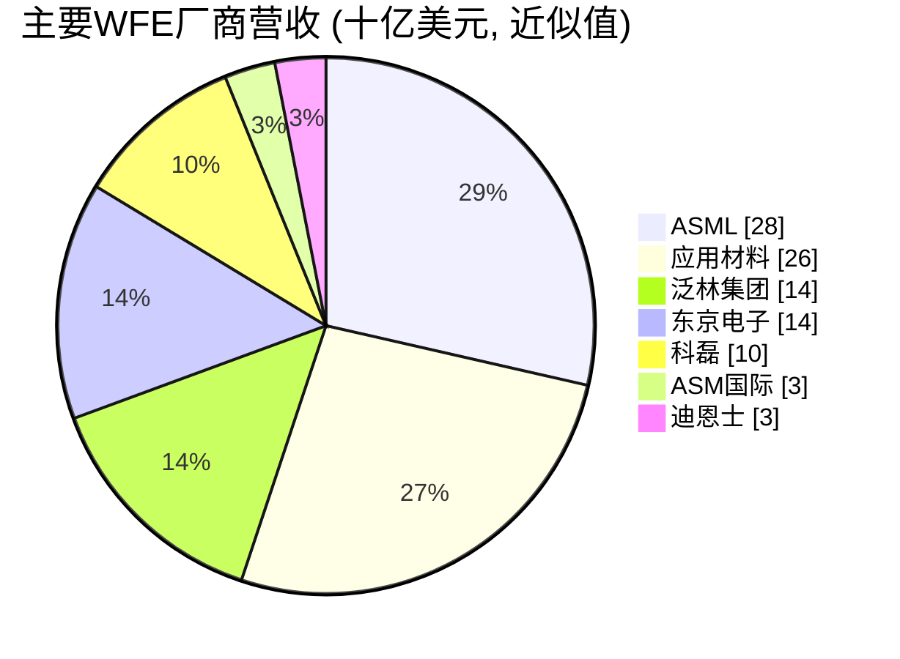
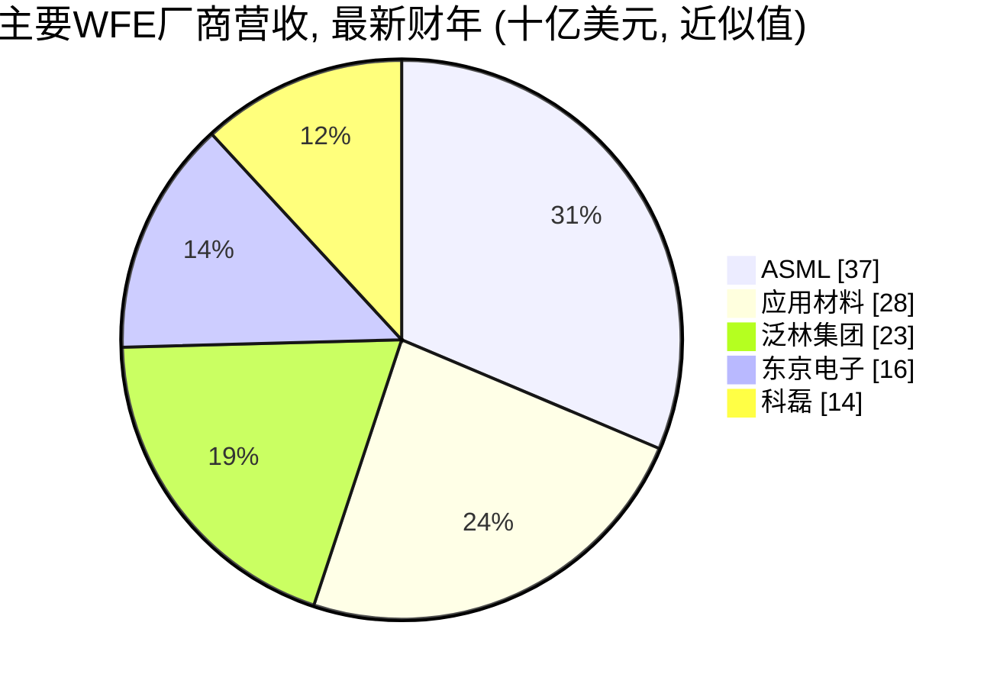

# 半导体资本设备厂商竞争格局——深度市场分析

> 📘 **说明：** 本文为英文原版《SemiCap Vendor Competitive Landscape — Deep Market Analysis》的简体中文参考译本，仅供参考；如有出入，以英文原版为准。

半导体设备行业是全球经济中集中度最高的行业之一。少数几家公司——其中许多在各自类别中拥有垄断或近乎垄断的地位——掌控着所有数字技术所依赖的设备。本文深入介绍主要厂商，涵盖业务概述、核心产品、市场地位、竞争护城河、主要客户和战略展望，最后给出市场份额与财务背景表格，并分析客户集中度和出口管制敞口。

一个贯穿始终的主题是：大多数半导体资本设备（SemiCap）类别都是**寡头垄断或垄断市场**，其护城河由数十年积累的工艺诀窍、与客户深度的联合开发关系、庞大的装机量（既带来经常性的服务/备件收入，又锁定下一次采购）以及专利组合共同构筑。这些护城河使行业顶端格局异常稳定——领导者鲜少更替——尽管行业营收呈现剧烈的周期性波动。

---

## 📊 可视化概览

*原创示意图；Mermaid图表可在GitHub上直接渲染。*

**谁在哪个领域领先——各类别领导者一览**



**集中度光谱——从垄断到充分竞争**

下图从左（垄断）到右（竞争）排列各厂商：ASML（EUV）、蔡司、东京电子（涂胶显影）、科磊、ASM（ALD）、泛林（刻蚀）、应用材料；竖线右侧为封装、子系统和材料等参与者更多的领域。越靠左，利润率越高、地位越难撼动。

```
 MONOPOLY ─────────────────────────────────────────► COMPETITIVE
 ASML(EUV)   ZEISS   TEL(track)   KLA   ASM(ALD)   Lam(etch)   AMAT   |   packaging · subsystems · materials
 (highest margins & most defensible)                                  (more players)
```

**按约2023年营收排名的主要晶圆厂设备（WFE）厂商（十亿美元，近似值）**



**按最新已披露财年营收排名的主要WFE厂商（十亿美元，近似值；财年口径不一——ASML为2025自然年，由约327亿欧元折算；应用材料为截至2025年10月的财年；泛林和科磊为截至2026年6月的财年；东京电子为截至2025年3月的财年）**



---

## 1. ASML（阿斯麦）（荷兰）

半导体资本设备领域、乃至可以说整个科技领域中战略地位最重要的公司。ASML是全球**唯一的极紫外（EUV）和高数值孔径极紫外（High-NA EUV）光刻设备供应商**，也是深紫外（DUV）浸没式扫描光刻机的领先供应商。其EUV垄断地位历经二十余年、超过100亿欧元的研发投入，并与蔡司（ZEISS，光学）、通快（TRUMPF，驱动激光器）和Cymer（光源，2013年被收购）合作构建而成——它把守着整个先进制程：没有ASML，任何晶圆厂都无法经济地制造约7nm以下的先进逻辑芯片或DRAM。核心产品：NXE/EXE EUV扫描式光刻机（EUV约1.5–2亿美元，High-NA约3.8亿美元以上）、TWINSCAN DUV浸没式扫描光刻机、YieldStar量测设备，以及（通过HMI提供的）电子束检测设备。**护城河：** 建立在无法复制的供应生态系统和集成诀窍之上、实际上不可撼动的垄断地位。**客户：** 台积电（TSMC）、三星（Samsung）、英特尔（Intel）、SK海力士（SK hynix）、美光（Micron）。**展望：** 受EUV层数增加、High-NA导入和AI资本支出周期推动的长期增长，但受到对华出口限制（自2018年起不向中国出口EUV；DUV限制不断收紧）和周期性的制约。**2025–26年：** 2025年净销售额约327亿欧元；2026年第三季度（2026年10月14日公布）净销售额达创纪录的117亿欧元，毛利率57.5%，2026财年指引为440–450亿欧元。ASML表示，计划供给在2027–2028年将无法完全满足需求，并计划在2027年将低数值孔径EUV和DUV浸没式产能提升约30%。中国占其系统销售额的比例从36%（2025年第四季度）降至14%（2026年第二季度），随后在2026年第三季度回升至约23%。ASML还领投了Mistral AI的C轮融资（约13亿欧元，2025年9月）。首席执行官：傅恪礼（Christophe Fouquet）。

## 2. 应用材料（Applied Materials，AMAT）（美国）

**规模最大、产品线最广**的WFE公司，拥有业内最宽的产品组合。应用材料在**薄膜沉积（物理气相沉积（PVD）——Endura平台的领导者；化学气相沉积（CVD）；原子层沉积（ALD）；外延）、刻蚀、化学机械平坦化（CMP，Reflexion平台的领导者）、离子注入、热处理/快速热处理（RTP）与激光退火，以及电子束检测/量测**领域处于领先或有力竞争地位，此外还有不断增长的先进封装业务。其<strong>集成材料解决方案（IMS）</strong>战略——在单一集成平台内对多个工艺步骤（沉积-刻蚀-处理）进行协同设计——是其在先进制程上的关键差异化优势。**护城河：** 广度、规模、业内最大的装机量（带来巨额经常性服务收入）以及深厚的材料工程专长。**客户：** 所有主要晶圆代工厂、逻辑和存储器制造商。**展望：** 广泛受益于各项增长驱动力（全环绕栅极（GAA）、先进封装、新材料），但面临较大的中国营收敞口和周期性。**2025–26年：** 2025财年（截至10月）营收约284亿美元；2026财年第三季度营收创纪录，约91亿美元（同比增长25%），中国营收占比降至28%（上年同期为35%），出口管制预计将使2026财年营收减少约6亿美元。应用材料于2025年收购了BE Semiconductor（Besi）约9%的股份，与Besi共同开发混合键合设备（Kinex芯片-晶圆混合键合机，2025年），据报道还于2026年5月同意收购ASMPT旗下的NEXX先进封装沉积/电化学沉积（ECD）业务。

## 3. Lam Research（泛林集团）（美国）

**刻蚀领导者**和薄膜沉积强者，在**存储器**领域尤为强大。泛林主导等离子体刻蚀（电容耦合等离子体（CCP）和电感耦合等离子体（ICP），包括关键的3D NAND高深宽比（HAR）刻蚀），并在<strong>薄膜沉积（钨及金属填充、PECVD/ALD介质，ALTUS和VECTOR/Striker平台）</strong>和**清洗**领域处于领先地位。其刻蚀与沉积的紧密结合，为最苛刻的工艺步骤（3D NAND、GAA沟道释放）提供集成化模块解决方案。**护城河：** 刻蚀主导地位、深厚的存储器客户关系，以及在最难的刻蚀和填充应用上的工艺诀窍。**客户：** 三星、SK海力士、美光、台积电、英特尔。**展望：** 对存储器周期（上行期是优势，下行期是弱点）、3D NAND层数增长以及GAA/先进封装刻蚀具有杠杆效应；中国敞口较大。**2025–26年：** 2026财年（截至2026年6月）营收增长约26%至约232亿美元（据第三方对其10-K年报的摘要）；2026年10月21日，泛林公布了创纪录的晶圆代工销售额，预计2026自然年WFE约在1,500亿美元中段区间，并初步预计2027年超过2,000亿美元（由DRAM引领），同时提示洁净室和零部件方面的制约。新产品包括ALTUS Halo（钼ALD）和Akara（导体刻蚀）；据报道，泛林宣布在印度投资约12亿美元用于零部件制造。

## 4. KLA Corporation（科磊）（美国）

**占主导地位的工艺控制公司**——在缺陷检测（光学和电子束）、掩模版检测、套刻量测（Archer）以及薄膜/光学关键尺寸（OCD）量测领域处于领先地位，并拥有强大的良率管理软件和数据分析业务。科磊拥有整个半导体资本设备领域中**最高的利润率和最坚固的护城河**之一：工艺控制市场高度集中、技术门槛深厚，而且随着EUV随机效应和GAA使良率越来越难以实现，其重要性日益凸显。**护城河：** 检测与量测领域的广度和深度、庞大的装机量，以及随每台设备不断累积增值的数据/软件业务。**客户：** 所有先进制程晶圆厂（工艺控制在先进制程中强度最高）。**展望：** 受益于每个工艺节点工艺控制强度的提升，具有结构性优势；节点越难，科磊在WFE中的份额往往*越高*。**2025–26年：** 2026财年（截至2026年6月）营收约136亿美元（第四季度创纪录，约36.6亿美元）；科磊将其对2026年WFE的预期上调至约1,500亿美元出头，预计2027年将出现“显著增长”，据报道预计2026年先进封装工艺控制营收约11亿美元（同比增长70%）。

## 5. Tokyo Electron（东京电子，TEL）（日本）

一家业务广泛的日本WFE巨头，也是**涂胶/显影轨道系统的主导供应商**（这种光刻胶处理设备与每一台光刻机配套使用——其近乎垄断的地位使东京电子成为ASML不可或缺的互补者）。东京电子在**刻蚀、薄膜沉积（CVD/ALD）、热处理/炉管、清洗和晶圆键合**领域同样实力雄厚。**护城河：** 涂胶/显影设备的垄断地位、强大的存储器及日本客户关系，以及广泛的工艺覆盖。**客户：** 台积电、三星、SK海力士、美光、英特尔，以及日本生态系统。**展望：** 广泛受益于先进制程和存储器增长；涂胶/显影业务随EUV导入直接增长（每台EUV光刻机都需要一套轨道系统）。**2025–26年：** 据报道，东京电子上半年业绩创历史新高，预计2027年WFE不低于1,900亿美元（据报道），并于2026年6月宣布与泰瑞达（Teradyne）合作开发面向AI/数据中心器件的集成测试单元。

## 6. ASM International（ASM国际）（荷兰）

**ALD领导者**，尤其擅长对鳍式场效应晶体管（FinFET）、GAA和互补场效应晶体管（CFET）至关重要的高k/金属栅及栅极叠层ALD，同时在<strong>外延（Intrepid/Epsilon）</strong>和PECVD领域也很强。ASM专注于ALD——增长最快的沉积技术——这为其带来了强劲的增长和利润率。**护城河：** 基础性的ALD知识产权（可追溯至Suntola）以及在最关键保形沉积步骤上的工艺领导地位。**客户：** 所有先进逻辑和存储器制造商。**展望：** GAA（内侧墙和栅极叠层ALD）、选择性沉积以及每个节点ALD步骤数不断增加的主要受益者。**2025–26年：** 据其2026年10月27日发布的公告，2026年第三季度营收创纪录，约11.6亿欧元（同比增长45%），主要由GAA逻辑/代工驱动，与HBM相关的DRAM需求同样强劲；ASM预计2027年营收将超过57亿欧元（按固定汇率计算）。

## 7. Onto Innovation（美国）

Onto由Rudolph Technologies与Nanometrics合并而成，是一家专注于**工艺控制与量测**的专业厂商——涵盖OCD/散射测量、薄膜与套刻量测、宏观缺陷检测，以及面向先进节点和**先进封装**（Onto处于有利地位的增长领域）的光刻/检测系统。**护城河：** 专注的量测专长和强大的封装检测地位。**展望：** 受益于先进封装增长和量测强度提升。**2025–26年：** 收购了Semilab International的材料分析产品线（2025年6月宣布，宣布时总交易价值约5.45亿美元），增加了材料成分和电学量测能力。

## 8. Nova Measuring Instruments（以色列）

一家快速成长的纯量测厂商，专注于**OCD/散射测量、材料量测以及基于X射线光电子能谱（XPS）的成分量测**。Nova的尺寸和材料量测对GAA和复杂3D结构越来越重要。**护城河：** 专业化、高精度的量测能力和强大的研发实力。**展望：** 受益于工艺控制强度提升和3D器件量测挑战带来的结构性增长。

## 9. Axcelis Technologies（亚舍立）（美国）

**专业离子注入领导者**（Purion平台），凭借高度专注成功地与规模大得多的应用材料竞争。亚舍立在**存储器和功率器件（包括SiC）离子注入**领域尤为强大。**护城河：** 离子注入专业化以及在存储器/功率器件领域的强势地位。**展望：** 受益于存储器周期以及SiC功率器件（离子注入密集型）的长期增长；有一定的中国敞口。**2025–26年：** 亚舍立与维易科（Veeco）宣布全股票合并（约44亿美元，2025年10月宣布；每股VECO换0.3575股ACLS），双方股东已于2026年2月6日批准；交割目前预计于2027年第一季度末前完成，尚待中国国家市场监督管理总局（SAMR）批准以及新的HSR申报。

## 10. Entegris（美国）

并非设备制造商，而是关键的**材料与耗材**供应商——CMP研磨液（通过收购CMC Materials获得）、先进过滤、气体和液体纯化、特种化学品以及晶圆载具/前开式晶圆传送盒（FOUP）。Entegris提供每座晶圆厂持续消耗的、经常性的、对工艺至关重要的耗材。**护城河：** 材料与特定工艺的深度协同开发，形成黏性很强的经常性收入。**展望：** 随晶圆产量以及先进节点日益提高的材料纯度要求而增长。

## 11. SCREEN Semiconductor Solutions（迪恩士）（日本）

**占主导地位的单片式湿法清洗供应商**，在日本及全球均具有特别强大的地位。每片晶圆要经历数百次清洗，这使迪恩士的设备既要求高产能，又对良率至关重要。**护城河：** 湿法工艺诀窍和稳固的客户关系。**展望：** 随先进节点清洗步骤数量和严格程度的提高而增长。

## 12. Kokusai Electric（国际电气）（日本）

**批量式（炉管）CVD/ALD**领域的领导者，对存储器（3D NAND的ONON叠层、DRAM高k介质）和热处理至关重要。前身为日立国际电气；曾是KKR/应用材料收购案（后告失败）的标的，现已独立并公开上市。**护城河：** 批量沉积领域的领导地位和存储器客户关系。**展望：** 受益于存储器以及3D NAND层数的不断增加。

## 13. Hitachi High-Tech（日立高新）（日本）

**关键尺寸扫描电镜（CD-SEM）领导者**（关键尺寸量测），并提供聚焦离子束-扫描电镜（FIB-SEM）、刻蚀和工艺分析设备。**护城河：** 电子显微镜和关键尺寸量测专长。**展望：** 先进节点关键尺寸控制和失效分析带来稳定需求。

## 14. ZEISS（蔡司）（德国）

ASML的**EUV和High-NA投影光学系统**独家供应商——EUV垄断格局中与ASML平起平坐的技术伙伴（ASML持有蔡司半导体制造技术（ZEISS SMT）的股份）。蔡司还提供<strong>EUV光化掩模检测（AIMS）</strong>和电子显微镜。**护城河：** 全球最先进的光学制造能力，无法大规模复制。**展望：** 随EUV/High-NA直接增长；High-NA光学系统更加复杂、价值更高。

## 15. EV Group / SUSS MicroTec（奥地利/德国）

**晶圆键合**（包括混合键合以及临时键合/解键合）和**MEMS及先进封装光刻**领域的领导者。随着混合键合成为3D集成和高带宽内存（HBM）的核心，这些公司占据了一个战略地位不断上升的细分市场。**护城河：** 键合与对准专长。**展望：** 受益于混合键合、3D集成和背面供电工艺带来的强劲增长。

## 16. DISCO Corporation（迪思科）（日本）

**切割（刀片切割、隐形激光切割）和研磨/减薄**设备的主导供应商——对芯片分割以及支撑3D堆叠和背面工艺的晶圆减薄至关重要。**护城河：** 在精密切割/研磨及其耗材刀片领域近乎垄断。**展望：** 受益于先进封装、HBM和背面供电（均为减薄密集型）带来的强劲增长。

## 17. Kulicke & Soffa（库力索法）/ BESI / ASM Pacific（ASMPT）（美国/荷兰/中国香港）

**封装组装**领域的领导者——芯片贴装、引线键合、热压键合，以及越来越多的**混合键合贴装**。其中BESI是关键的混合键合设备供应商（与应用材料合作，后者于2025年收购了Besi约9%的股份）。据报道，ASMPT于2026年5月同意将其NEXX沉积/电化学沉积业务出售给应用材料。**护城河：** 组装精度和封装客户关系。**展望：** 受益于先进封装以及从引线键合、微凸点向混合键合的转型。

## 18. Cohu / Teradyne（泰瑞达）/ Advantest（爱德万测试）（美国/美国/日本）

**测试**生态系统：**爱德万测试和泰瑞达**主导逻辑、存储器和SoC的自动测试设备（ATE）市场；**Cohu**在测试分选机和接触器领域领先。在先进节点以及复杂的AI/HBM器件上，测试强度不断提升。**护城河：** ATE平台的广度和软件。**展望：** 受益于AI芯片和HBM测试复杂度的提升以及系统级测试。**2025–26年：** AI需求已彻底改变了测试行业：爱德万测试截至2026年9月的季度营收约4,777亿日元，营业利润率约56%；泰瑞达截至2026年9月的季度营收约13.1亿美元，AI相关需求约占其营收的70%（2026年第一季度）；对2026年测试机市场规模的预期已上调至约130–145亿美元（据报道）。（文件25对测试有深入介绍。）

## 19. MKS Instruments / Novanta（美国）

关键的**子系统**供应商——射频电源及匹配网络、真空与压力测量、气体流量控制、光子学和激光器——这些产品安装在应用材料、泛林、东京电子等公司的工艺设备*内部*。MKS（收购了Newport和Atotech）是整个设备供应链的风向标。**护城河：** 设计内嵌、不可或缺的子系统。**展望：** 与整体WFE需求同步。（文件20介绍子系统。）

## 20. Brooks Automation / Azenta（美国）

**晶圆厂自动化**（真空及大气环境晶圆搬运机器人、设备前端模块（EFEM））、**低温技术**（真空泵）以及生命科学样本管理（Azenta）的供应商。**护城河：** 内置于设备和晶圆厂中的自动化与污染控制专长。**展望：** 与WFE及新晶圆厂建设同步。

## 21. 中国本土厂商：北方华创、中微公司、拓荆科技、盛美半导体、新凯来、上海微电子等

在<strong>国家集成电路产业投资基金（大基金）</strong>的推动以及出口管制下实现自给自足的迫切需求驱动下，中国本土设备产业正快速增长，但仍落后于最先进水平。<strong>北方华创（NAURA）</strong>规模最大，拥有刻蚀、薄膜沉积（PVD/CVD/ALD）、热处理和清洗设备。<strong>中微公司（AMEC，中微半导体设备）</strong>是一家可靠的刻蚀（CCP/ICP）供应商，客户包括国内及部分国际晶圆厂，此外还提供MOCVD设备。**拓荆科技（Piotech）**（薄膜沉积/PECVD/ALD）、**盛美半导体（ACM Research）**（清洗）、**芯源微（Kingsemi）**（涂胶/显影轨道设备）、**新凯来（SiCarrier）**（与华为（Huawei）相关的综合设备项目）以及**上海微电子（SMEE）**（国产光刻，目前仅限于成熟制程DUV，一台28nm级ArF浸没式扫描光刻机正在验证中）构成了这一阵营的其余部分。**地位：** 在成熟制程和许多前道设备类别中实力强劲且不断增长；在先进制程方面仍存在显著差距（尤其是EUV、先进量测以及最苛刻的刻蚀/沉积）。**驱动因素：** 大力的政府支持、有保障的国内市场（中芯国际（SMIC）、长鑫存储（CXMT）、长江存储（YMTC）），以及国产化的战略要求。**展望：** 在成熟制程中快速提升份额，并稳步攀登技术阶梯，但在先进制程上受到激发这一努力的同一套出口管制的制约。**2025–26年：** 2025年国产设备约占中国所用设备的35%（行业协会数据；2024年约为25%）；北方华创的28nm级刻蚀设备已量产，中微公司的先进刻蚀设备正在中芯国际进行14nm验证；新凯来于2025年发布了广泛的设备产品组合。光刻国产化率仍低于约5%，真空阀门和射频电源仍有约80%依赖进口（据报道）。

---

## 22. 分领域市场份额概览

| 领域 | 领导者 | 大致地位 |
|---|---|---|
| EUV光刻 | ASML | 约100%（垄断） |
| DUV光刻 | ASML；尼康（Nikon）、佳能（Canon） | ASML占多数 |
| 涂胶/显影轨道设备 | 东京电子 | 主导（约80%以上） |
| 刻蚀 | 泛林；东京电子、应用材料 | 泛林领先，三强并立 |
| 薄膜沉积（整体） | 应用材料；泛林、东京电子、ASM | 应用材料领先 |
| ALD | ASM；应用材料、泛林、东京电子 | ASM明显领先 |
| CMP设备 | 应用材料；荏原（Ebara） | 应用材料领先 |
| 离子注入 | 应用材料、亚舍立（正与维易科合并） | 双寡头 |
| 工艺控制/检测 | 科磊 | 主导（检测领域约50%以上） |
| CD-SEM | 日立高新 | 领导者 |
| 湿法清洗 | 迪恩士；东京电子、泛林 | 迪恩士在单片式领域领先 |
| EUV光学 | 蔡司 | ASML的唯一供应商 |
| 切割/研磨 | 迪思科 | 主导 |
| 晶圆键合 | EVG、SUSS、BESI | 领导者 |
| 测试（ATE） | 爱德万测试、泰瑞达 | 双寡头 |

## 23. 财务与战略背景

主要WFE企业具有一种可辨识的共同财务特征：**研发强度约为营收的12–18%**（属所有行业中最高之列）；**毛利率通常在40–60%区间**（科磊和ASML处于高端，反映其垄断/寡头地位）；来自庞大装机量的大额**经常性服务和备件收入**（可平滑周期并为研发提供资金）；以及与WFE支出周期、尤其是存储器周期相关的**显著周期性**。

**客户集中度风险**十分突出：少数几家客户（台积电、三星、英特尔、SK海力士、美光）占据了先进制程设备需求的大部分，因此单个客户的资本支出决策就可能显著影响一家原始设备制造商（OEM）的营收。**出口管制敞口**是另一项决定性的战略风险：中国历来占应用材料、泛林、科磊、ASML和东京电子销售额的20–45%；2022年以来不断升级的限制措施削减了面向中国的先进制程设备销售，但矛盾的是，也在短期内推高了中国对*成熟制程*设备的采购（在进一步限制出台前提前拉货），并加速了中国本土竞争对手的崛起（文件18）。2026年，多家西方OEM的中国营收占比已回落至较正常水平——例如，中国在应用材料2026财年第三季度营收中占28%（上年同期为35%），在ASML预期2026财年净销售额中约占20%。

整个行业的战略前景由若干长期顺风因素塑造——AI驱动的资本支出超级周期、每个节点EUV/High-NA及工艺控制强度的提升、先进封装的爆发式增长，以及电气化推动的SiC/GaN增长——同时也面临周期性、中国脱钩以及经典晶体管微缩放缓（且成本上升）等逆风。领导者的护城河足够深厚，竞争*格局*短期内不太可能改变；悬而未决的问题在于周期的节奏、中国国产化的走向，以及哪些企业能最好地抓住封装、新材料和工艺控制领域的新增长。

---

## 扩展分析：护城河、集中度与重塑格局的力量

### A. 半导体资本设备护城河的剖析

半导体资本设备竞争格局异常稳定——同一批领导者数十年如一日地主导各自类别——其背后是一组相互强化、值得剖析的护城河。**工艺诀窍**是基础：数十年积累的关于如何让设备在量产中稳定实现良率的经验，体现在人员、流程和隐性知识之中，无法被快速复制或购买。**客户联合开发关系**加深了护城河：设备通过联合开发协议与领先客户历时多年共同设计，建立起新进入者无法企及的信任和转换成本。**装机量**带来经常性的服务和备件收入（平滑周期并为研发提供资金），更关键的是**锁定下一次采购**——一座运行着某厂商数千台设备、工艺已在这些设备上完成认证、工程师也已接受相关培训的晶圆厂，若要更换供应商将面临巨大的成本和风险。**研发规模**（营收的12–18%）使领导者能够在每个节点所需的持续创新上投入远超挑战者的资金。而**专利和商业秘密**（文件17）则在实际壁垒之上又提供了法律保护。这些护城河共同解释了为什么竞争格局变化如此缓慢、为什么领导者如此盈利，以及为什么即便是资金充裕的挑战者（包括中国受补贴的本土厂商）也发现先进制程如此难以突破。

### B. 集中度光谱

半导体资本设备格局横跨从垄断到充分竞争的光谱，一家厂商在光谱上的位置在很大程度上决定了其盈利能力和战略安全性：
- **垄断：** ASML（EUV/High-NA）——最极端、也最有价值的地位。
- **近乎垄断/主导：** 蔡司（EUV光学）、东京电子（涂胶/显影）、科磊（工艺控制）、ASM（ALD）、迪思科（切割/研磨）。
- **2–3家寡头中的强势领导者：** 泛林（刻蚀）、应用材料（薄膜沉积、CMP、离子注入）、科磊（检测）。
- **双寡头：** 爱德万测试/泰瑞达（ATE）、应用材料/亚舍立（离子注入）。
- **竞争更充分/更分散：** 封装组装、子系统、材料。

厂商的地位越集中，其利润率越高、业务越稳固——这就是为什么垄断和近乎垄断者（ASML、科磊、ASM）享有最高的利润率和估值，也是为什么任何类别中的战略目标都是取得并捍卫主导地位。这种集中并非偶然，而是上述护城河的结果：每个类别的难度、资本密集度和诀窍要求天然只能支撑少数几家有生存能力的参与者，在先进制程上往往只有一家。

### C. 重塑格局的力量

尽管核心格局保持稳定，若干力量正在重塑厂商格局。**AI超级周期**正将需求转向先进制程、先进DRAM/HBM和先进封装——有利于ASML、先进工艺和工艺控制领导者，以及封装/键合专业厂商（BESI、EVG、迪思科），而先进封装的兴起也将WFE巨头拉入一个新的竞技场。**地缘政治与中国国产化**（文件18）正在使市场分化，在结构上减少在位者来自中国的先进制程营收，同时培育正在夺取成熟制程份额的中国本土竞争对手（北方华创、中微公司、拓荆科技）。**新材料与3D转型**（GAA、背面供电、CFET、新型互连金属）正在提升支撑这些转型的设备类别的地位——ALD（ASM）、选择性刻蚀与沉积、晶圆键合（EVG、SUSS、BESI）、减薄（迪思科）和工艺控制（科磊）——并创造新的高价值需求。而**每个节点工艺控制和光刻强度的提升**在结构上扩大了科磊和ASML的份额。这些力量在各类别之间重新分配价值并创造新的增长，而每个类别内部的领导者基本保持不变。

### D. 中国问题

厂商格局中最大的单一不确定性是**中国本土设备产业**的长期走向。在大基金和出口管制下自给自足的需要推动下，并有一个有保障的国内市场（中芯国际、长鑫存储、长江存储），中国厂商——北方华创（规模最大，覆盖刻蚀、沉积、热处理、清洗）、中微公司（刻蚀、MOCVD）、拓荆科技（沉积）、盛美半导体（清洗）、芯源微（轨道设备）、新凯来（与华为相关的综合项目）和上海微电子（光刻）——正在快速攀登技术阶梯。它们在**成熟制程**和许多前道设备类别中正获得可观的份额：在这些领域，其设备在成本上越来越有竞争力、在性能上已能满足需求，而且出口管制（限制了在位者对华销售）给了它们成长空间。悬而未决的问题包括：它们能在技术阶梯上攀登多高（先进制程，尤其是EUV和先进量测，仍是巨大的差距）；它们最终能夺取多少全球成熟制程份额（对在位者成熟制程业务的真实威胁）；以及它们是否最终会在中国以外挑战在位者。这个问题的答案将比其他任何因素都更能塑造未来十年的厂商格局，它是每一家在位者面临的核心战略不确定性。

### E. 持久的格局与开放的前沿

综合来看，半导体资本设备厂商格局兼具**异常持久的核心格局**——同一批领导者主导各自类别，并受到深厚护城河的保护——与**开放的前沿**：在这些前沿领域，AI、3D集成、新材料、地缘政治和中国竞争等力量正在重新分配价值并创造新的增长。领导者在光刻（ASML）、工艺控制（科磊）、刻蚀（泛林）、薄膜沉积（应用材料、ASM）等领域的地位不太可能被正面挑战所颠覆，因为护城河太深。但各类别的*相对*增长正在发生转移（向光刻、工艺控制、封装以及支撑3D的技术倾斜），新的类别正在崛起（键合、减薄、背面工艺），而中国问题笼罩着成熟制程市场。对投资者和战略制定者而言，理解这一格局既需要把握持久的秩序（哪些领导者将保持主导地位），也需要把握不断变化的前沿（哪些类别增长最快、新的竞争将在何处出现）——正是这种稳定与变化的结合，使半导体资本设备成为全球最具分析价值、最具战略影响的行业之一。

---

## 🆕 2025–2026年更新：最新进展（截至2026年11月）

### A. 市场背景：同一批领导者分享更大的蛋糕

厂商格局正被一个远比2025年预期更强劲的设备周期所重塑。根据**国际半导体产业协会SEMI（SEMI）2026年7月的年中预测**，2026年设备总销售额将达到**1,659亿美元（同比增长23.2%）**，其中WFE为**1,439亿美元**，并预计2028年将达到创纪录的**2,295亿美元**。2026年10月财报季中各公司的观点更为乐观：泛林预计2026自然年WFE约在1,500亿美元中段区间，并初步预计**2027年超过2,000亿美元**；科磊预计2026年约1,500亿美元出头；东京电子预计2027年不低于1,900亿美元（据报道）；美国银行（BofA）预计2026年/2027年分别为1,560亿美元/2,100亿美元。增长首先由DRAM引领（HBM及存储器上行周期），其次是晶圆代工/逻辑（2nm爬坡；台积电将2026年资本支出上调至600–640亿美元），然后是NAND。正如上文“持久格局”分析所预测的，领导者并未改变；改变的是需求规模和约束条件。ASML表示2027–2028年供给将无法完全满足需求，泛林则提示洁净室空间和零部件供应可能成为行业产出的上限。

### B. 最新业绩概览

| 厂商 | 最新披露数据 | 2025–26年重要战略举措 |
|---|---|---|
| ASML | 2026年第三季度净销售额117亿欧元（创纪录），毛利率57.5%；2026财年指引440–450亿欧元 | 计划2027年产能提升30%（低数值孔径EUV、DUV浸没式）；客户寻求锁定2029–2030年交付档期；资本市场日定于2027年6月10日 |
| 应用材料 | 2026财年第三季度营收约91亿美元（同比增长25%）；第四季度指引约102.5亿美元 | 持有Besi约9%股份；已同意收购ASMPT旗下NEXX（据报道） |
| 泛林集团 | 2026财年营收约232亿美元（同比增长26%）；晶圆代工销售额创纪录（2026年10月） | ALTUS Halo钼ALD、Akara刻蚀；在印度投资约12亿美元用于零部件制造（据报道） |
| 科磊 | 2026财年营收约136亿美元；第四季度约36.6亿美元（创纪录） | 2026年先进封装工艺控制营收约11亿美元（据报道） |
| ASM国际 | 2026年第三季度营收约11.6亿欧元（同比增长45%） | 预计2027年营收超过57亿欧元 |
| 东京电子 | 上半年业绩创纪录（据报道） | 与泰瑞达合作开发测试单元（2026年6月） |
| 爱德万测试/泰瑞达 | 爱德万测试：2026年9月季度业绩创纪录（据媒体报道）/泰瑞达：2026年9月季度营收约13.1亿美元 | AI驱动的测试需求；2026年测试机市场约130–145亿美元（据报道） |
| 亚舍立+维易科 | 合并已获股东批准（2026年2月） | 预计2027年第一季度末前完成交割，尚待SAMR/HSR审批 |

### C. 围绕先进封装与混合键合的整合

厂商战略中最明显的结构性转变，是争相掌控增速快于前道WFE的**先进封装**工艺环节：
- **应用材料**收购了**Besi**约9%的股份，共同开发了集成式芯片-晶圆混合键合机（Kinex，2025年），据报道还同意收购ASMPT旗下的**NEXX**沉积/电化学沉积业务（2026年5月）。据报道，SK海力士已就应用材料+Besi的在线系统下达首笔混合键合量产订单。
- 据报道，**科磊**的封装工艺控制业务2026年将增长约70%，达到约11亿美元。
- **亚舍立–维易科**合并将离子注入与维易科的激光退火、MOCVD、离子束和湿法工艺产品组合结合在一起。

然而，HBM的混合键合导入已经推迟：JEDEC将HBM4高度上限提高至775 µm，SK海力士在Hot Chips 2026上表示，混合键合最早要到HBM5才会导入。这在短期内有利于**热压（TC）键合机供应商**（如韩美半导体（Hanmi）、ASMPT、库力索法），而逻辑芯片的SoIC式堆叠以及三星更为激进的计划，则支撑着混合键合的需求。

### D. 中国：在位者份额收缩，本土厂商份额上升

- 中国在OEM营收中的占比已从2024年的高点回落，但仍然很大且波动剧烈。中国占应用材料2026财年第三季度营收的**28%**（上年同期为35%）。对ASML而言，中国占系统销售额的比例从2025年第四季度的36%降至2026年第二季度的14%，又在2026年第三季度回升至约23%；预计中国将占ASML 2026财年净销售额的约20%。应用材料估计出口管制将使其2026财年营收减少约6亿美元。
- **政策风险依然存在。** 美国的**关联方（“50%”）规则**依据釜山休战协议暂停实施，据报道该休战已延长至2027年1月10日。三星和SK海力士中国晶圆厂的VEU资格已于2025年12月31日终止，并由2026年度许可取代。拟议中的**MATCH法案**将禁止向中国销售DUV设备，并禁止为已装机设备提供服务。
- 2025年，**本土厂商**约占中国所用设备的35%（行业协会数据）。据报道，新增产能被要求采购50%以上的国产设备，并设定了到2027年成熟制程设备国产化率达70%的目标（据报道）。光刻（国产化率<5%）以及真空阀门和射频电源等关键子系统（约80%依赖进口，据报道）仍存在差距。

### E. 对竞争格局的影响

- **光刻和工艺控制份额提升。** ASML的2026财年指引（约440–450亿欧元）和科磊创纪录的年度业绩印证了“强度提升”的论点。DRAM的EUV层数不断增加以及High-NA导入计划（英特尔14A；据电话会议纪要，三星和台积电分别计划于约2028年和约2030年将High-NA用于大规模量产）将进一步强化这一趋势。
- **沉积/刻蚀领导者是DRAM引领增长的主要受益者。** 泛林的存储器敞口曾是周期性负担，如今已成为优势。
- **测试已高度由AI驱动**，爱德万测试的利润率已达到可与WFE垄断者相媲美的水平。
- 2027年，**供给侧约束**（洁净室空间、零部件、ASML产能）可能比需求更为关键，这有利于拥有稳固供应链和装机量服务收入的厂商。

**值得关注的事项（2026年末–2027年）**
- 2027年WFE能否达到泛林和美国银行所指出的2,000亿美元以上区间，抑或受洁净室和零部件制约。
- ASML 2027年的产能扩张及其2027年6月10日资本市场日公布的目标。
- 亚舍立–维易科合并的交割（SAMR/HSR）以及应用材料收购NEXX的完成情况。
- 面向HBM4E/HBM5的混合键合订单与TC键合的持续使用之间的此消彼长。
- 2027年1月10日之后“50%规则”暂停期的走向以及MATCH法案的进展。
- 北方华创、中微公司和新凯来在中国成熟制程扩产中的进一步份额提升。
