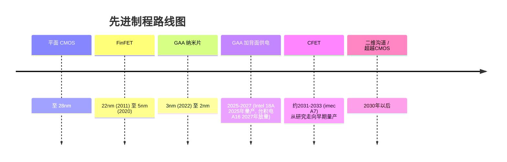
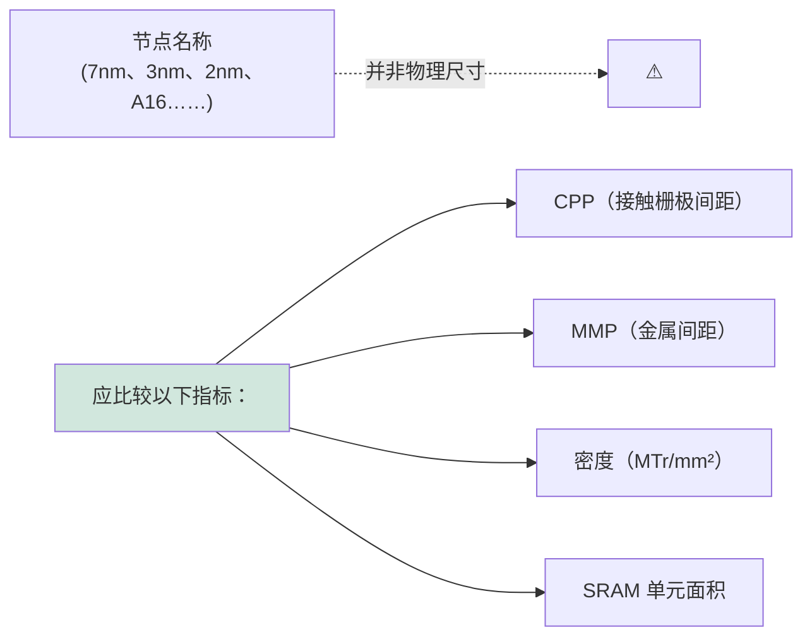

# 工艺技术路线图——逐节点综合分析

> 📘 **说明：** 本文为英文原版《Process Technology Roadmaps — Comprehensive Node-by-Node Analysis》的简体中文参考译本，仅供参考；如有出入，以英文原版为准。

> **核心学习目标。** 本文件是本数据库中两份最深入的专题之一，追溯半导体技术路线图从鳍式场效应晶体管（FinFET）时代，经由全环绕栅极（GAA）、背面供电，到互补场效应晶体管（CFET）以及超越硅的沟道材料的演进历程，并逐节点详细介绍器件架构、工艺集成、设备需求以及主导路线图制定的框架体系。

---

## 📊 可视化概览

*原创示意图；Mermaid 图表可在 GitHub 上直接渲染。*

**晶体管架构演进——每一步都增强栅极控制（截面图）**

下图为截面示意：平面晶体管（≤28nm，栅极仅控制一侧）→ FinFET（22–5nm，栅极控制三侧）→ GAA 纳米片（3–2nm，栅极包裹四侧）→ CFET（研究阶段，n 型叠于 p 型之上，单元面积缩小约50%）。

```
 PLANAR (≤28nm)     FinFET (22-5nm)      GAA NANOSHEET (3-2nm)    CFET (research)
                                                                   ┌─ gate (p) ─┐
    gate               ┌ gate ┐            ┌──── gate ────┐        │═══ pMOS ═══│
  ┌──────┐            ┌┴──────┴┐           │ ═══ sheet ═══ │       ├─ gate (n) ─┤
  │ chan │            │  fin   │           │ ═══ sheet ═══ │       │═══ nMOS ═══│
  └──────┘            │ (chan) │           │ ═══ sheet ═══ │       (n over p,
  ─substrate─         └────────┘           └──────────────┘        stacked)
  gate on 1 side     gate on 3 sides       gate wraps all 4        ~50% smaller cell
```

**先进制程架构与供电路线图**



**背面供电网络（BSPDN）——供电网络移至晶圆背面（截面图）**

下图为截面示意：背面电源网络（Vdd/Vss 平面）通过纳米硅通孔直接连接晶体管源/漏极；正面后道仅承担信号布线。结果：IR 压降降低、标准单元密度提升约10–15%、布线资源得以释放。

```
   ░░░░ backside power network (Vdd / Vss planes) ░░░░
        │ nano-TSV ↑ lands directly on transistor source/drain
   ████ transistors (RibbonFET / nanosheet) ████
   ════ frontside BEOL: SIGNAL ROUTING ONLY (power rails removed) ════
   Result: less IR-drop, ~10-15% denser standard cells, freed routing
```

**节点命名问题——节点名称只是营销标签，应比较物理指标**



---

## 第1节：路线图框架与主导机构

### 1.1 ITRS——起源与共识式路线图的逻辑

现代半导体路线图实践通过<strong>国际半导体技术路线图（ITRS）</strong>得以制度化。ITRS 源自20世纪80年代末的美国行业路线图，在美国<strong>国家半导体技术路线图（NTRS，首版发布于1992–1994年）</strong>的基础上，于1998年成为完全国际化的路线图。ITRS 是一项联盟性工作，由 SEMATECH 以及美国、欧洲、日本、韩国和台湾地区的行业协会共同协调。其宗旨深刻且具有经济合理性：半导体产业是一个庞大且相互依存的生态系统，一家公司的创新时机取决于数十家其他公司的准备程度。除非设备厂商已有经过验证的设备、材料供应商已有经过验证的光刻胶和气体、EDA 厂商已提供设计工具、且已具备控制工艺所需的量测能力，否则晶圆代工厂无法迈向新节点。若缺乏协调，这些时间表就会彼此错位，整个产业将陷入停滞。

ITRS 通过发布**共识性预测**解决了这一协调问题：预测产业在2年、5年、10年和15年后所处的位置——为每个未来节点的数百个参数（栅长、栅氧厚度、金属间距、缺陷密度、套刻等）设定目标值。与其说这是一种预测，不如说是一种**共同承诺**：通过约定例如产业将在某一年需要某种栅介质或某种光刻波长，ITRS 告诉生态系统中的每一个参与者该开发什么、何时开发。设备厂商据此安排研发节奏；材料供应商据此规划新化学品；研究人员据此识别“红砖墙”问题（即尚无可量产解决方案的参数，在著名的 ITRS 表格中以红色标示），这些问题亟需发明创新。

ITRS 以**摩尔定律**的节奏——晶体管密度大约每两年翻一番——为基础构建，数十年来一直是产业的节拍器，使整个生态系统步调一致。共识通过国际技术工作组（ITWG）体系达成，各工作组覆盖一个领域（光刻、前道工艺、互连、量测、组装与封装等），由来自垂直整合制造商（IDM）、晶圆代工厂、设备原厂（OEM）和学术界的专家组成，他们协商目标并识别差距。

### 1.2 ITRS 为何停止发布

到2010年代初，ITRS 的基本假设——进步主要可以描述为**平面晶体管按可预测的两年节奏进行几何缩小**——已经失效。多项发展动摇了这一假设。第一，经典的登纳德缩放（Dennard scaling）在2005–2007年前后终结，使尺寸缩小与功耗/性能改善之间的简单关系脱钩。第二，转向 FinFET（2011年）以及即将转向全环绕栅极，意味着“节点”不再是单一的微缩系数，而是架构、材料和三维创新的组合，无法简洁地映射为单一的路线图数字。第三，产业日趋分化：只有少数几家公司（英特尔（Intel）、台积电（TSMC）、三星（Samsung））仍处于最先进制程前沿，且它们的路线图各不相同，使单一的共识“节点”越来越名不副实。第四，价值正从单纯的晶体管微缩向**系统级集成**——封装、异构集成、专用加速器——迁移，而以器件为中心的 ITRS 对此刻画不足。

最后一版 ITRS 报告为2015年版（2016年发布），此后路线图在一个更适合后登纳德、后平面、系统驱动时代的新框架下重新组建。

### 1.3 IRDS——IEEE 的继任路线图

<strong>国际器件与系统路线图（IRDS）</strong>由 **IEEE**（具体为 IEEE 重启计算倡议和电子器件学会）主办，于2016年作为 ITRS 的继任者推出。IRDS 在范围和理念上与 ITRS 有几处重要区别：

- **系统优先，而非器件优先。** IRDS 从应用和系统需求出发（“应用基准测试”和“系统与架构”专题组），自上而下推导至器件与工艺，反映出如今的微缩是由系统需求驱动，而非由抽象的密度翻倍驱动。
- **范围超越 CMOS。** IRDS 明确涵盖 **More Moore**（延续 CMOS 微缩）、**More than Moore**（功能多样化——传感器、射频、功率、集成）以及 **Beyond CMOS**（全新器件技术——二维材料、自旋电子学、神经形态、量子）。这一三分结构承认未来并非单一的微缩路径，而是多条并行路径。
- **封装与三维集成地位提升。** IRDS 将异构集成和先进封装视为一等的微缩方向，而非事后补充。
- **年度更新**并定期发布完整版本，由覆盖与 ITRS 相同全球社群的国际专题组维护。

**IRDS 关键专题表格与指标。** “More Moore”表格追踪定义逻辑微缩的参数，学会解读这些表格是理解路线图的关键。最重要的指标包括：

- **接触栅极间距（或接触多晶硅间距）——CPP / CGP：** 包含接触在内的相邻晶体管栅极之间的最小距离——这是衡量水平方向逻辑密度最重要的单一指标，因为它决定了晶体管沿栅极方向可以排列多紧密。
- **最小金属间距——MMP / M0 或 M1 间距：** 由光刻决定的最紧密布线间距，限定互连密度。
- **以金属轨道数表示的单元高度：** 以金属轨道数量表示的标准单元高度（如“6轨”单元库），与 CPP 共同决定单元面积。
- **鳍宽 / 纳米片宽度与厚度：** 关键器件尺寸。
- **驱动电流（Ion）与关态电流（Ioff）：** 开/关性能指标。
- **亚阈值摆幅（SS）：** 晶体管关断的陡峭程度（室温下玻尔兹曼极限约为60mV/dec；更好的静电控制旨在逼近这一极限）。
- **电源电压（Vdd）：** 自登纳德缩放终结以来下降极为缓慢，加剧了功率密度问题。

解读 IRDS 表格意味着追踪这些参数逐年的预测演进、每一步由哪种架构实现，以及——至关重要的——哪些参数被标记为尚无已知的可量产解决方案。

### 1.4 晶圆厂内部路线图与公开的 IRDS

必须区分**公开的共识性 IRDS 路线图**、台积电、英特尔和三星发布的**经过精心编排的公开路线图**，以及真正主导这些公司研发的**严格保密的内部路线图**。IRDS 描述整个产业的发展方向以及必须解决的通用问题，并不披露任何一家公司的工艺配方。晶圆代工厂的*公开*路线图（N3、N2、A16；Intel 4、3、18A、14A；SF3、SF2）属于面向市场和投资者的沟通，公布节点名称、大致时间和主要收益，同时刻意隐藏构成竞争优势的物理工艺细节（确切间距、材料、层数）。*内部*路线图——实际的集成方案、设计规则和设备组合——则是业界保密级别最高的机密之一。

这种三层结构（公开的共识路线图、公开的公司路线图、保密的内部路线图）正是为什么分析技术路线图需要在 IRDS 目标、公司公告、学术会议披露（IEDM、VLSI）以及设备原厂的设备路线图之间进行三角互证。

### 1.5 IMEC 与竞争前共识的作用

路线图形成过程中的一个关键机构是**比利时微电子研究中心 IMEC**（比利时鲁汶）及其年度 **ITF（IMEC 技术论坛）**。IMEC 占据独特地位，是一个**中立的竞争前研究枢纽**：原本激烈竞争的对手——台积电、三星、英特尔——以及设备厂商（阿斯麦（ASML）、应用材料（Applied Materials）、泛林集团（Lam Research）、东京电子（TEL））和材料供应商在共享的300mm 中试线上共同开发下一代工艺模块。由于 IMEC 保持中立且领先量产数年，其自身的工艺路线图（通常以 A14、A10、A7 等技术代以及 CFET 研究载体命名）实际上起到了产业路线图的作用，塑造着最先进制程的方向和时间。IMEC 的研究项目——CFET 集成项目、二维材料（MoS₂）沟道项目、高数值孔径极紫外（High-NA EUV）导入工作、BSPDN 模块开发——有效地降低了日后出现在商业晶圆厂中的技术的风险，而 IMEC 在 IEDM 和 VLSI 上发表的成果是判断路线图走向最重要的信号之一。

### 1.6 设备路线图如何与工艺路线图对齐

工艺路线图与设备路线图是一枚硬币的两面。对于每一个未来节点，设备原厂必须在*早于*晶圆厂量产计划的时间表上提供<strong>“技术使能”</strong>——具备所需图形化、薄膜沉积、刻蚀和量测能力的设备。这种对齐通过晶圆厂与设备原厂之间的<strong>联合开发协议（JDA）</strong>以及 IMEC 中试线来管理。典型的时间线为：**研究**（概念在 IMEC 或设备厂实验室得到验证）→ **Alpha 机台**（首台原型）→ **Beta 机台**（依据 JDA 安装在领先客户处或 IMEC）→ **量产（HVM）机台**（经验证并复制到整个设备群）。这一流程跨越数年，这就是为什么像2nm 这样的节点的关键决策——采用何种光刻、何种沟道释放刻蚀、何种栅极填充 ALD——实际上在该节点投产前五年左右就已做出；也是为什么2024年开始向客户交付的 High-NA EUV，早在2010年代初就已在阿斯麦和蔡司（ZEISS）开始研发。

---

## 第2节：“节点命名”问题——营销与物理

### 2.1 为何“纳米”节点名称已名不副实

关于半导体产业，最常被误解的事实或许是：**节点名称中的“纳米”已不再对应芯片上的任何物理尺寸**。在早期数十年中，节点名称（如“1微米”“0.35微米”“90nm”）大致对应栅长或最小半间距——一个真实的物理特征。但随着微缩持续推进，节点名称与任何单一尺寸之间的关系瓦解，节点名称变成了表示技术“代”的**营销标签**，而非测量值。

其后果十分显著。“Intel 10nm”的晶体管密度与“TSMC 7nm”和“Samsung 8nm”大致相同——这些名义上不同的节点名称描述的是物理上可比的技术。英特尔历史上的命名较为保守（其“10nm”的密度确实与竞争对手的“7nm”相当），多年来这让英特尔看起来落后一个节点，实际并非如此——这一认知问题严重到英特尔在**2021年重新命名了其节点**（其“10nm Enhanced SuperFin”更名为“Intel 7”，后续节点为“Intel 4”“Intel 3”“Intel 20A”“Intel 18A”），明确地将其命名与晶圆代工厂更激进的惯例对齐。

### 2.2 真正重要的指标

由于节点名称不可靠，有意义的比较需要关注**物理与密度指标**：

- **接触栅极间距（CPP）：** 水平方向密度的驱动因素。
- **最小金属间距（MMP）：** 互连密度的驱动因素。
- **逻辑单元高度**（以轨道数计）：与 CPP 共同决定标准单元面积。
- **SRAM 单元面积（μm²）：** 一个敏感且被广泛报道的工艺真实密度指标（也是微缩难度的先行指标，因为近几代节点中 SRAM 的微缩慢于逻辑）。
- **晶体管密度（MTr/mm²——每平方毫米百万晶体管数）：** 最常被引用的密度数字，但其取值依赖于所假设的高密度单元与高性能单元的组合比例。

### 2.3 名义上等效节点的跨公司比较

下表以代表性数据说明节点命名问题（确切数值属公司机密，各来源估计不一；以下为广泛引用的近似值）：

| 指标 | 台积电 N7 | 英特尔 10nm（“Intel 7”） | 三星 8nm | 格芯（GlobalFoundries）12nm |
|---|---|---|---|---|
| CPP（nm） | 约57 | 约54 | 约64–66 | 约84 |
| 最小金属间距（nm） | 约40 | 约36 | 约44 | 约64 |
| 逻辑单元高度 | 约6轨 | 约6轨 | 约6.75轨 | 更高 |
| SRAM 单元面积（μm²） | 约0.027 | 约0.0312 | 约0.026（近似） | 约0.10+ |
| 晶体管密度（MTr/mm²） | 约91 | 约100 | 约61 | 约37 |

关键结论：**英特尔“10nm”与台积电“N7”在物理上相当**（按晶体管数量计，英特尔的甚至略密一些），而三星名义上相近的节点密度略低，格芯的“12nm”尽管名称接近，却落后整整一代。节点名称无法跨公司比较；只有物理指标才可以。

### 2.4 晶圆代工厂为何采用激进的节点命名

晶圆代工厂有强烈动机使用尽可能激进的节点名称：**客户认知**（对终端客户和公众而言，“5nm”芯片听起来比“7nm”芯片更先进）、**投资者关系**（节点领先地位推动估值）以及**竞争定位**（没有哪家代工厂愿意在提供相当密度的情况下显得比对手落后一个节点）。这一动态造成了持续的“节点名称通胀”，营销数字跑在任何物理尺寸前面，最终演变为埃米时代的命名（台积电 A16、A14；英特尔 20A、18A、14A、10A），其中“A”表示埃（10A = 1nm），但同样不对应任何物理特征。

### 2.5 尺寸微缩与等效微缩

IRDS 正式提出了一个关键区分，有助于理解后摩尔时代：

- **尺寸微缩**是对物理特征的经典缩小——让晶体管和导线在几何上变小。这是“摩尔定律”的本义，其步伐正在放缓且成本日益高昂。
- **等效微缩**是在**不**（或较少）进行尺寸缩小的情况下，通过新材料（高 k 介质、应变硅、新沟道材料）、新器件架构（FinFET、GAA、CFET）以及**三维集成与封装**来提升性能、功耗和有效密度。IRDS 认识到，“新节点”带来的收益越来越多地来自等效微缩，而非单纯的尺寸缩小。

这一重新定义至关重要：当台积电或英特尔宣布新节点带来“X% 的性能提升或 Y% 的功耗降低”时，其中大部分收益如今来自架构、材料和集成——即等效微缩——而不是简单地把一切做得更小。

### 2.6 登纳德缩放的终结

这一切的根源是2005–2007年前后**登纳德缩放的终结**。Robert Dennard 在1974年提出的缩放理论认为，随着晶体管缩小，电压和电流按比例下降，使**功率密度保持不变**——这意味着每个新节点都能在单位面积功耗不变的情况下提供更多晶体管*和*更高性能，几乎是“免费”的。这是产业黄金时代的引擎。

登纳德缩放之所以失效，是因为**电压无法再随尺寸同步降低**：当电源电压（Vdd）接近晶体管阈值电压（Vt）时，器件无法正常关断，漏电流急剧增加。由于约60mV/dec 的亚阈值摆幅（玻尔兹曼）极限，阈值电压本身也不能无限降低。随着电压缩放停滞在约0.7–0.8V，缩小晶体管不再按比例降低功耗，于是**功率密度开始随每个节点上升**。其直接后果是**频率缩放的终结**（时钟频率在2000年代中期停滞在约3–4 GHz）以及向**多核**架构的转向，并最终转向专用加速器（GPU、NPU）——因为在固定功耗预算内继续利用更多晶体管的唯一途径是并行化和专用化，而非更快的串行执行。这也是<strong>“暗硅”</strong>（无法同时为芯片上所有晶体管供电）的由来，以及其后每一项架构创新的主要动因，包括背面供电（以降低 IR 压降损耗）和三维集成（以缩短互连、节约能耗）。

---

## 第3节：FinFET 时代——从22nm 到5nm 详解

### 3.1 英特尔22nm（2011年）——首个商用 FinFET

自集成电路诞生以来一直沿用的平面 MOSFET，在22nm 节点前后走到了尽头。问题在于**静电控制**：随着栅长缩短，栅极对沟道的控制能力相对于漏极的影响而减弱，导致短沟道效应——关态漏电上升、亚阈值摆幅退化以及阈值电压滚降。在平面晶体管中，栅极仅从一侧接触沟道，当栅长低于约25nm 时，这种单侧控制已不再足够。

英特尔的解决方案是在其**2011年的22nm 节点**中引入的<strong>三栅极（FinFET）</strong>晶体管——数十年来最重要的晶体管架构变革。沟道不再是平坦的，而是将硅刻蚀成一个薄而竖直的**鳍（fin）**，栅极包裹鳍的顶部和两侧，从**三个方向**控制沟道。这极大地改善了静电控制，使晶体管能够更彻底地关断（更好的亚阈值摆幅、更低的漏电），并能在更低电压下工作。英特尔报告称，其22nm 三栅极相较于32nm 平面节点，在低电压下实现了大幅性能提升，并显著降低了动态功耗——这些收益恰恰来自恢复的栅极控制能力。

第一代 FinFET 的关键尺寸与概念：**鳍高**决定有效沟道宽度（更高的鳍在相同占地面积下提供更大电流——“免费”获得的宽度）；**鳍宽**必须非常薄（几纳米）以获得良好的静电特性；**鳍间距**决定密度。与全环绕栅极的区别在于，三栅极控制三个面，但鳍的底部仍与衬底相连；GAA 后来实现了四面包裹。

### 3.2 相对于平面工艺的流程变化

从平面转向 FinFET 需要大量新的工艺能力：
- **鳍的形成**：通过图形化和刻蚀将硅加工成高而薄且均匀的鳍——最初采用自对准双重图形化（SADP）以实现紧密、规则的鳍间距。
- **鳍回刻与隔离**：鳍周围填充浅沟槽隔离（STI）氧化物，然后回刻以露出所需的鳍高。
- **替代栅（后栅）集成**：英特尔采用后栅（替代金属栅）流程，先形成伪栅，完成应变源/漏外延，然后用高 k 介质和金属栅替换伪栅——以保护高 k 介质免受高温源/漏工艺的影响。
- **保形栅叠层沉积**：包裹三维鳍结构，需要 ALD 高 k 介质和保形功函数金属。

一个决定性的全新制造挑战是**鳍的线边缘粗糙度（LER）**：由于鳍非常薄，其宽度或边缘平直度的微小变化会直接转化为驱动电流和阈值电压的波动，使鳍的均匀性（以及控制它的量测）变得至关重要。鳍间距控制以及向<strong>“量子化”器件宽度</strong>的转变（只能以整数个鳍为单位增加驱动电流）也改变了设计人员构建电路的方式。

### 3.3 22nm → 14nm → 10nm 的 FinFET 微缩（2011–2017年）

在随后的几个节点中，FinFET 通过间距缩小、多重图形化和材料工程的组合实现微缩：

- **间距微缩：** 栅极（接触多晶硅）间距和鳍间距逐代缩小。英特尔的 **14nm** 节点接触多晶硅间距约70nm、最小金属间距约52nm、鳍间距约42nm——这些数字充分说明实际尺寸远大于“14nm”标签。
- **引入多重图形化：** 在14nm，业界对最紧密的层依赖 <strong>LELE（光刻-刻蚀-光刻-刻蚀）</strong>双重图形化；到 **10nm**，鳍和栅极则依赖 **SADP/SAQP（自对准双重/四重图形化）**，因为193i 浸没式光刻无法在单次曝光中分辨所需间距。这种多重图形化成本高昂（每层需要多次曝光以及额外的沉积和刻蚀），正是这种成本压力后来为 EUV 的导入提供了理由。
- **高 k/金属栅功函数调节：** nMOS 和 pMOS 需要不同的栅极功函数，通过叠加 **TiN、TiAl 和 TaC/TaN** 等金属来设定各类器件的阈值电压——这是一个 ALD/PVD 密集型工艺，随着节点推进以及对多种 Vt 选项的需求而日益复杂。
- **源/漏外延：** pMOS 采用 **SiGe**（锗含量逐代提高）引入压应变，nMOS 采用 **Si:P** 引入张应变，通过选择性外延生长，并精细控制晶面以塑造应力源形貌并降低电阻。
- **自对准接触与硅化物：** 接触硅化物不断演进（CoSi₂ → NiSi → Ti 基）以降低接触电阻，采用钨接触填充（后来在较低层改用钴），因为接触电阻在器件总电阻中所占比例越来越大。
- **后道（BEOL）微缩：** 铜双大马士革工艺搭配介电常数逐步降低的介质（k≈3.0 → 2.5 → 超低 k），金属层数也不断增加（在最先进制程中从约10层增至15层以上），以布线日益密集的逻辑电路。

**各公司的差异。** 台积电的 **16nm FinFET**（2015年）在几何结构和集成上做出了与英特尔22nm 不同的选择——这是一次较晚但商业上极为成功的 FinFET 首秀，支撑了一代移动 SoC。**三星的14nm** 经历了 **LPE → LPP → LPU** 多个版本，体现出业界在不进行完整节点迁移的情况下，从单一节点平台榨取多次渐进式改进的模式。

### 3.4 10nm 与7nm——晶圆代工厂开始分化

10nm/7nm 这一代是最先进制程领域由拥挤走向急剧收窄、各家分道扬镳的转折点：

- **英特尔10nm 的困境（2016–2019年）：** 英特尔的10nm 极为激进（目标约100 MTr/mm²，真正达到7nm 级密度），并试图同时引入 <strong>COAG（有源栅上接触）</strong>和钴互连。这一组合被证明极难提升良率，英特尔因此遭遇多年延误，在14nm（及其“+++”改进版）上停留的时间远超计划。这次失误——一个关于同时引入过多高风险创新的警示——使英特尔失去了长期保持的工艺领先地位，让台积电得以反超。
- **台积电10nm → 7nm（2017–2018年）：** 台积电走了一条更平稳的路，先推出不使用 EUV、采用 SADP/SAQP 多重图形化的 **N7**，随后推出在少数层上导入 EUV 的 **N7+** 以及 N6。台积电纪律严明、风险较低的策略（先用成熟的多重图形化，再逐步导入 EUV）为其赢得了最先进制程的移动和高性能计算（HPC）业务，确立了其主导地位。
- **三星10nm → 8nm → 7nm：** 三星最早推进 EUV，将 <strong>7nm（SF7/7LPP）</strong>作为其首个 EUV 节点，并在初期比台积电更激进地导入 EUV——这一大胆押注使三星较早积累了 EUV 经验。
- **格芯退出（2018年）：** 格芯做出了关键的商业决策，**完全放弃7nm 研发**，判断最先进制程微缩的巨额成本无法在与台积电和三星的竞争中获得足够回报。它转向**差异化特色工艺**——RF-SOI、SiGe BiCMOS、FDX（FD-SOI）——这一战略在财务上被证明是稳健的，也使最先进制程仅剩三家公司（台积电、三星、英特尔）。

**EUV 导入策略。** 决定*哪些层*从193i 多重图形化切换为 EUV 单次图形化，取决于**成本交叉点分析**：一旦 EUV 的产能（吞吐量）和稼动率足够，原本需要三到四次浸没式曝光（每次都伴随沉积/刻蚀）的层，改用单次 EUV 曝光反而更便宜，尽管 EUV 扫描式光刻机售价约1.5亿美元。因此，晶圆厂首先在多重图形化次数最多的层（间距最紧密的层）上导入 EUV，并随着技术成熟、更多层跨过成本门槛而逐步扩大 EUV 的使用范围。

### 3.5 5nm（2020–2022年）——EUV 成为主流

5nm 这一代标志着 EUV 从少数层过渡为关键层的**主流图形化方法**：

- **台积电 N5（2020年）：** 首个**全面集成 EUV** 的节点（超过十个 EUV 层），接触多晶硅间距约51–54nm，最小金属间距约30nm，晶体管密度约 **171 MTr/mm²**。**Apple A14** 是首款 N5 产品。N5 巩固了台积电的领先地位，并证明 EUV 能够真正实现大批量生产。
- **台积电 N5P 与 N4：** 同一设计规则家族中的性能增强版本，对 SRAM 和设计规则进行了改进——再次体现了“一个平台多个版本”的模式。
- **三星 SF5（5LPE）：** 三星的5nm，在概念上具有竞争力，但通常被认为在密度和良率成熟度上略逊于台积电 N5，其 EUV 层数和集成方式也有所不同。
- **英特尔10nm 的演进：** 当晶圆代工厂到达“5nm”时，英特尔正在将其10nm 改进为 **10nm SuperFin** 和 **Enhanced SuperFin**（更名为 **Intel 7**），在应变硅、更高迁移率沟道、栅介质质量和互连方面加以改进——从问题重重的10nm 基础上挖掘出大幅提升，同时为基于 EUV 的 **Intel 4** 以及基于 RibbonFET 的 **Intel 20A/18A** 做准备，后者被寄望于帮助英特尔重夺领先。

到 FinFET 时代结束时，最先进制程已集中为三家，EUV 已不可或缺，多重图形化和材料工程已被推向极限，下一次重大架构转变——全环绕栅极——的舞台已经搭好，这正是下一节的主题。

---

## 第4节：GAA（全环绕栅极）纳米片转型——当前前沿

### 4.1 为何需要 GAA？静电控制的论证

FinFET 尽管取得了巨大成功，却面临着当年终结平面晶体管的同一根本敌人：当栅长继续缩短至约16nm 以下时，即便是三面栅控也变得不够。短沟道效应再次出现——<strong>DIBL（漏致势垒降低）</strong>上升（漏极电压开始降低源端势垒，削弱控制）、**亚阈值摆幅**退化（晶体管关断不够陡峭）、**阈值电压滚降**加剧（Vt 随栅长漂移）。原则上可以将鳍做得更薄以改善控制，但在几纳米以下，鳍很难均匀制造，还会出现迁移率退化和量子限制效应。

答案是<strong>全环绕栅极（GAA）</strong>晶体管，其栅极**完全包裹沟道——四面、360°**。这为任意给定栅长提供了尽可能强的静电控制，恢复了晶体管干净关断的能力，并允许栅长进一步缩小。从本质上说，GAA 是栅控从单面（平面）到三面（FinFET）再到全包围这一趋势的逻辑终点。

### 4.2 纳米片与纳米线

GAA 可以采用不同截面形状的沟道实现：
- **纳米线**是窄沟道（大致为方形或圆形），静电特性最佳（栅极包围一个小截面），但每根线承载的电流相对较小。
- **纳米片**是宽而薄的带状结构，每片承载的电流大得多（有效宽度更大），同时又足够薄（几纳米），可以在上下表面实现出色的栅控。

业界在逻辑中选择了**纳米片**，因为驱动电流至关重要：宽纳米片在相同占地面积下比窄纳米线提供更大电流，而片的薄度（而非窄度）提供了静电控制。典型实现是**垂直堆叠2–4层纳米片**（层间相隔几纳米），每片**厚4–7nm**、**宽15–70nm**。关键在于片宽**可调**，使设计人员能够在驱动电流与面积之间权衡，并为 nMOS 和 pMOS 设定不同宽度——这一能力被称为<strong>“按宽度实现多 Vt”</strong>，台积电的营销名称为 **NanoFlex**，三星则将其纳入 **MBCFET** 方案。相对于 FinFET，堆叠纳米片提高了单位占地面积的有效沟道宽度，即使器件缩小，驱动电流也能保持增长。

### 4.3 三星 SF3 / SF3E（2022年）——首个商用 GAA

三星是**首家将 GAA 投入量产**的公司，在其 <strong>3nm 节点（SF3E，2022年）</strong>中率先于台积电引入——这是一次意图在架构上实现跨越的大胆战略举措。三星将其纳米片晶体管命名为 **MBCFET（多桥沟道场效应晶体管）**，其中的“桥”即堆叠的纳米片。

SF3 工艺流程展示了 GAA 制造中具有决定意义的新步骤：
1. **SiGe/Si 超晶格外延：** 生长由牺牲层 **SiGe** 与沟道层 **Si** 交替组成的叠层（通常3–5对），每层厚几纳米，通过选择性外延精确控制锗浓度（25–35%）和厚度。
2. **鳍/叠层图形化**，将超晶格加工成器件形状。
3. **伪栅与侧墙**形成（后栅流程）。
4. **内侧墙形成**——GAA 的标志性步骤（见下文）。
5. 在凹陷的源/漏区进行**源/漏外延**，与暴露的 Si 沟道端部接触。
6. **去除伪栅**并进行**沟道释放**：选择性刻蚀掉 SiGe，使 Si 纳米片悬空。
7. **栅叠层填充：** 通过 ALD 将高 k 介质和功函数/填充金属沉积到**每片已释放纳米片周围的间隙中**。

**内侧墙**是 GAA 最具决定性的工艺挑战。由于栅极现在完全包裹沟道，如果不加干预，它将与源/漏直接紧邻，产生高电容。为防止这一点，需要在沟道端部对牺牲 SiGe 进行**横向回刻**（水平方向回蚀），并通过 ALD 用<strong>低 k 介质“内侧墙”</strong>填充由此形成的微小空腔。内侧墙将栅极与源/漏隔离，并控制寄生栅电容（Cgg）。其形成需要对 SiGe 相对于 Si 进行高选择比的横向刻蚀，随后对仅几纳米大小的空腔进行保形 ALD 填充，再进行精确回刻——这一系列步骤处于工艺控制的极限，是整个制造中最困难的模块之一。

**良率与爬坡挑战。** 据报道，三星第一代 SF3 遭遇了**良率困难，爬坡慢于预期**，这提醒人们率先采用新架构是有风险的。内侧墙工艺、整个叠层的沟道释放均匀性以及寄生电阻控制都很困难，三星早期的 GAA 经历反映了这些挑战。增强版 **SF3E** 及后续版本改进了内侧墙并降低了外部电阻（Rext）。

### 4.4 台积电 N2（2025年）——台积电首个 GAA

台积电一如既往地选择了**保守路线**：在整个 **N3** 家族（N3、N3E、N3P、N3X）中一直沿用 FinFET——从成熟的 FinFET 架构中榨取最大价值和良率——直到 **N2（2nm）才完成 GAA 转型，该节点已于2025年第四季度进入量产**（位于新竹 Fab 20 和高雄 Fab 22），产能实际上已被订满。台积电的理由是其一贯重视的良率成熟度和客户信任：与其仓促推进 GAA，不如让 FinFET 撑过 N3，待工艺具备高良率条件时再引入纳米片。

N2 架构要点（基于披露信息和估计）：**纳米片**沟道（据报道约3片）、接触多晶硅间距约 **45nm**、最小金属间距约 **20nm**、估计密度约 **200–215 MTr/mm²**，以及覆盖所有关键层（有源区、栅极、接触、下层金属）的 **20个以上 EUV 层**。台积电的 **NanoFlex** 允许混用具有不同纳米片宽度的标准单元变体，以优化功耗/性能/面积。据广泛报道，苹果 **A20** 系列处理器是首批 N2 产品之一，AMD、高通、英伟达（Nvidia）等随后跟进。**N2P** 版本（据台积电称于2026年下半年量产）增加了性能增强；台积电在2026年4月的技术研讨会上还为该家族新增了 **N2X**（2027年）和低成本的 **N2U**（2028年）；**A16** 节点则增加了背面供电（第5节）。

### 4.5 英特尔20A 与18A——RibbonFET + PowerVia

英特尔的 GAA 实现被命名为 **RibbonFET**（纳米片即“带”，通常每个叠层四片），英特尔将其与第二项独立创新——**PowerVia** 背面供电——结合，力图借此跨越式重返领先：

- **Intel 20A** 是首个 RibbonFET 节点，主要定位为18A 的**技术载体和学习台阶**（英特尔于2024年9月取消了20A 作为产品节点，以便集中资源于18A）。
- **Intel 18A** 是重点节点——结合 **RibbonFET + PowerVia**——也是英特尔多年来最激进的工艺，定位于与台积电 N2 和三星 SF2 竞争。关键参数（估计）：CPP 约45nm，MMP 约21nm 或更小，**关键层采用标准（0.33 NA）EUV**——英特尔最终将 High-NA EUV 留给了下一个节点 **14A**，而非让18A 依赖它。PowerVia 将供电移至晶圆背面（第5节），释放正面布线资源。英特尔在2024–2025年间持续提升18A 良率；18A 于**2025年底进入大批量生产**（亚利桑那州 Fab 52），**Panther Lake** 客户端处理器于2026年初发布，增强版 **18A-P** 于2026年6月进入风险试产。18A 的成功对 <strong>Intel Foundry（英特尔代工）</strong>的信誉至关重要，后者在2025年获得了新的股权支持（美国政府由《芯片与科学法案》（CHIPS法案）补助转换而来的约10%股权，以及英伟达和软银的投资）。据报道的早期客户和合作包括亚马逊（AWS）、微软以及美国政府项目（国防部 RAMP-C）。

必须理解，**RibbonFET 与 PowerVia 是两项不同的创新**：RibbonFET 是 GAA 晶体管，而 PowerVia 是背面供电网络。英特尔选择在18A 同时引入两者——这一激进的“双重创新”若良率理想，将使英特尔同时获得架构和供电两方面的优势。

### 4.6 GAA 工艺集成挑战详解

GAA 转型几乎对每一个工艺模块都构成压力。最严苛的挑战包括：

- **SiGe/Si 超晶格外延：** GAA 的基础。需要精确的**锗浓度**（通常25–35%）——过低则 SiGe 无法被选择性刻蚀，过高则产生缺陷——同时要求多对堆叠层的**层厚**均匀且界面陡峭（每层约6–8nm），缺陷密度低。这是制造中最精密的外延挑战之一。
- **内侧墙形成：** 如前所述，需要（a）高选择比的**各向同性 SiGe 横向回刻**（Si/SiGe 选择比约30:1 或更高），（b）用低 k 介质（SiOCN、SiN 或 SiO₂）对5nm 以下空腔进行保形 **ALD 填充**，以及（c）均匀的**回刻**。每个子步骤都处于能力边缘，且内侧墙的介电常数直接决定寄生电容。
- **沟道释放：** 选择性地刻蚀掉 Si 片之间的**全部** SiGe，采用稀释 HF 或 TMAH 基湿法刻蚀，或越来越多地采用**气相（干法）选择性刻蚀**（如 HF/H₂O₂ 蒸气），既要保持叠层中所有片之间的均匀性，又不能损伤或使脆弱的悬空纳米片坍塌。
- **释放间隙中的栅极填充：** 高 k 介质和功函数金属必须通过 ALD 保形填充已释放纳米片之间及周围**仅几纳米的间隙**，不能有空洞，并以低电阻率填充金属（通常为 **W、Ru 或 Co**）完成栅极。完全填满7nm 以下的间隙是极端的 ALD 挑战。
- **源/漏接触电阻（Rc）：** 被普遍认为是 GAA 及以后**最大的单一微缩挑战**。随着接触面积缩小，Rc 上升并在器件总电阻中占据越来越大的份额。缓解手段包括**钴或钌衬层与填充**、先进**硅化物**，以及在接触处实现最大激活的**激光退火**。目标约为 **<10 Ω·μm²**——极其困难。
- **寄生电容（Cgg）：** 主要由内侧墙介质控制。从较高 k 的侧墙（SiN，k≈7）改为较低 k 的侧墙（SiOCN，k≈4.5）可将 Cgg 降低约10–15%，带来可观的性能提升——这正是低 k 内侧墙材料成为活跃研发领域的原因。

因此，GAA 代表的不是单一的新步骤，而是**一系列新的、相互关联、要求极高的模块**——外延、选择性刻蚀、保形 ALD 和接触工程——每一项都被推向原子尺度。这就是为什么即使对最优秀的制造商而言转型也十分艰难，也是为什么它推动了选择性刻蚀、间隙填充 ALD 和单元内三维量测等新设备能力的浪潮。

---

## 第5节：背面供电网络（BSPDN）——深入剖析

### 5.1 先进节点的供电难题

随着晶体管微缩，为其提供干净的电源成为一场危机。供电网络（PDN）必须以最小的 **IR 压降**（导线电阻造成的电压损失）将电流输送到数十亿个晶体管。传统上，**Vdd 和 Vss 电源轨布设在较低的后道金属层（M0、M1、M2）上**，与信号线并行。这带来两个相互叠加的问题：第一，随着导线缩小，其电阻上升，恰在功耗需求增加之际加剧 IR 压降；第二，电源轨与信号布线**争夺**稀缺的下层金属资源，制约标准单元密度并迫使单元变高。

这种拥塞已成为主要的微缩瓶颈。即使晶体管可以排得更紧密，下层无法同时容纳电源和信号布线也会限制标准单元库的密度。

### 5.2 埋入式电源轨（BPR）——过渡步骤

一种过渡方案是**埋入式电源轨（BPR）**：不再在后道金属中布设电源轨，而是<strong>向下刻蚀进入硅衬底（或 STI）</strong>形成沟槽，并以难熔金属（**钌、钨或钴**——之所以需要难熔金属，是因为它必须经受后续的高温前道工艺）填充。BPR 直接连接晶体管源/漏，**将电源轨从 M0/M1 移除**，释放这些层用于信号布线，估计可将标准单元布线效率提高 **10–15%**。BPR 是迈向完整背面供电的垫脚石。

### 5.3 背面供电——完整解决方案

完整的解决方案是将**整个供电网络移至晶圆背面**。正面**只承担信号布线**，而专用的**背面金属网络**（具有宽而低阻的 Vdd/Vss 平面）通过直接落在源/漏接触上的<strong>背面通孔（纳米硅通孔）</strong>向晶体管供电。这将两个相互竞争的网络分置于晶圆两侧，大幅降低 IR 压降（背面平面可以做得厚且低阻），并释放正面后道以实现更密集的信号布线。

实现这一目标需要全新的工艺流程：完成正面晶体管和后道 → **将晶圆正面朝下键合到载片上** → **翻转并从背面减薄**原晶圆至几微米（露出晶体管源/漏接触的底部）→ 刻蚀**背面通孔**以落在这些接触上 → 沉积阻挡层/籽晶层并填充金属 → 构建**背面 PDN 金属层** → 与最终封装基板键合。

### 5.4 英特尔 PowerVia

英特尔的 **PowerVia** 是首个进入大批量生产的背面供电技术，在18A 上与 RibbonFET 搭配（2025年底开始大批量生产；Panther Lake 于2026年初推出）。英特尔面向14A 的下一代方案 **PowerDirect** 则通过专用的背面接触直接向每个晶体管的源极和漏极供电。在 PowerVia 中，正面仅包含信号布线，背面包含带有 Vdd/Vss 平面的 PDN，并有**落在源/漏接触上的背面通孔**（一种“直接背面接触”方案）。晶圆加工流程：完成正面器件与后道 → 键合到载片晶圆 → 翻转并减薄器件晶圆以露出源/漏 → 刻蚀背面通孔 → 阻挡层/籽晶层/填充 → 构建背面 PDN → 连接封装。

英特尔在<strong>基于 Intel 4 工艺的测试载体（2023年披露）</strong>上演示了 PowerVia，报告称供电效率大幅提升（在其测试数据中，与 PDN 相关的 IR 压降损耗降低约90%）、频率提升约6%，标准单元利用率也有显著改善——在集成到18A 之前验证了这一概念，18A 的背面通孔间距目标约为20–30nm。

### 5.5 台积电 A16——超级电轨（Super Power Rail）

台积电的背面供电技术被命名为**超级电轨（Super Power Rail，SPR）**，首次用于 **A16 节点**。台积电最初将 A16 的量产目标定在2026年下半年；在2026年4月的技术研讨会上，台积电表示 A16 将于2026年具备生产就绪条件，但将客户放量列为 **2027年**（据媒体报道）。值得注意的是，**A14（2028年大批量生产）在推出时不采用 SPR**，带 SPR 的版本将于2029年跟进（据报道），因此背面供电仍是面向 HPC/AI 设计的高端选项，而非默认配置。A16 本质上是 **N2P 设计规则加背面供电**。台积电的实现在背面通孔接触晶体管的细节上与英特尔不同（台积电的 SPR 通过一种背面接触方案直接连接源/漏，针对功耗最高的高性能设计进行了优化）。台积电的目标是在相同复杂度下，相较 N2P 实现约 **8–10% 的性能提升（或15–20% 的功耗降低）**。背面供电改变了设计规则和工艺设计套件（PDK），因此 A16 是与 N2 显著不同的设计目标。

### 5.6 三星的 BSPDN 路线图

三星也在推进背面供电，但其公开时间表不如台积电和英特尔详细。三星的 **SF2** 一代（自2025年底起投产，如 Exynos 2600）推进了 GAA 微缩，其2024年的路线图将背面供电安排在约2027年的 **SF2Z** 上。后续报道并不一致：据报道，三星在2026年5月的 SAFE 论坛上未提及 SF2Z，且 **SF1.4 据报道已从2027年推迟至2029年**，在此期间三星将专注于 SF2 家族的改进（SF2P、SF2P+）。因此，三星背面供电的时间应视为不确定。

### 5.7 BSPDN 对设备的影响

背面供电带来了一整套全新的设备需求——实际上是把前道级别的加工带到了晶圆背面：

- **背面减薄：** 通过研磨和化学机械平坦化（CMP）将晶圆减薄至 **<5μm**（有时 <2μm），要求极高的均匀性和应力控制——任何不均匀都会造成整个芯片的良率损失，而超薄晶圆在机械上非常脆弱（迪思科（DISCO）、Okamoto、应用材料/荏原（Ebara）的 CMP）。
- **背面通孔刻蚀：** 穿过剩余薄硅层的**纳米级通孔**的高深宽比（>40:1）各向异性等离子体刻蚀，在亚100nm 通孔直径下需严格控制 CD——一种类似 Bosch 工艺、但尺度远小于常规硅通孔（TSV）的新型刻蚀。
- **背面阻挡层/籽晶层 ALD：** 在高深宽比背面通孔中保形沉积阻挡层和籽晶层。
- **载片键合与解键合：** 临时晶圆键合（如 ZoneBond，以及 SUSS MicroTec 和 EV Group 的设备），所用粘合剂需经受后续加工，另需热/激光解键合。
- **背面与正面对准：** **透过减薄后的硅**将背面通孔与正面晶体管接触对准，采用**红外（IR）对准**（硅对能量低于带隙的红外光透明），套刻目标低于约10nm——这是全新的量测与对准挑战。
- **热管理：** 减薄改变了散热路径；背面金属可兼作散热层，但背面供电器件的热设计是一个新的考量因素。

因此，BSPDN 生动说明了单一架构创新如何波及整个设备生态系统，在减薄、键合、背面刻蚀和背面量测领域创造出新的高价值市场——并将先进封装设备厂商（EVG、SUSS、迪思科、Besi）更深地拉入前道流程。

---

## 第6节：CFET（互补场效应晶体管）——下一次架构转变

### 6.1 CFET 概念

在 GAA 纳米片之后，下一次计划中的架构转变是**互补场效应晶体管（CFET）**，它在单个单元的占地面积内将 **nMOS 和 pMOS 晶体管垂直堆叠**——n 沟道在下、p 沟道在上（或反之）。在以往所有架构中，n 型和 p 型器件在平面内**并排**放置，由 n 阱/p 阱边界分隔并占用水平面积。CFET 通过向垂直方向发展消除了这种水平间隔，**相对于 GAA 纳米片将标准单元面积缩小约50%**——这一密度增益相当于一个完整节点，是通过器件本身的三维堆叠而非尺寸缩小实现的。

### 6.2 两种实现方式：单片式与顺序式

构建 CFET 有两种根本不同的方式：

- **单片式 CFET：** 上下两层晶体管在一片晶圆上以**单一、连续的工艺流程**构建，即生长一个包含两层器件所需各层的高超晶格并一起加工。这是更优雅、最终密度更高的方案，但受工艺约束：上层的每一个高温步骤（源/漏外延、激活退火）都必须与已形成的下层相容，热预算受到严格限制。
- **顺序式 CFET：** 下层在一片晶圆上完成全部加工，然后将第二片晶圆**键合在其上方**、减薄，并在其上加工上层。其决定性优势是**热预算自由**——每层在键合前分别加工，因而都可以使用完整的热预算，并分别针对 n 型或 p 型独立优化。代价是需要**极其精确的晶圆对晶圆键合对准**，以及形成连接两层的**层间通孔**。

### 6.3 单片式 CFET 详解

单片式工艺流程生长 **SiGe/Si/SiGe/Si** 之类的超晶格，下部的层对形成一种器件类型，上部的层对形成另一种，然后：对双层叠层进行图形化；为**两层**都形成内侧墙（使 GAA 的内侧墙复杂度加倍）；选择性释放沟道；以及——关键挑战——为 n 沟道和 p 沟道形成**各自独立的栅叠层**。由于 nMOS 和 pMOS 需要不同的栅极功函数，而两层又在垂直方向紧邻，工艺必须先形成下层栅极、**对其加以保护**，然后形成上层栅极，并在上下栅极之间采用**自对准介质隔离**。下层栅极形成后，所有后续高温步骤都不能损伤它——这使得**低温工艺和激光退火不可或缺**。IMEC 在 **IEDM 2022** 上展示了首个**单片式 CFET 集成**，采用 SiGe 下层沟道（pMOS）和 Si 上层沟道（nMOS），接触多晶硅间距为48nm——这是一个里程碑式的概念验证。

### 6.4 顺序式 CFET 详解

顺序式流程先完成<strong>晶圆1（下层）</strong>的前道（FEOL）、中道（MOL）和部分后道加工，然后以亚100nm（理想情况下 <20nm）的套刻精度将**晶圆2面对面键合**，减薄晶圆2，并在其上加工**上层**。其优势在于完全的热预算自由以及 n/p 独立优化；挑战在于**键合对准精度**（连接两层的层间通孔要求整片晶圆的套刻精度达到 <20nm 量级，理想情况下 <10nm）以及<strong>层间通孔（ITV）</strong>的刻蚀与填充。英特尔在 IEDM（2021–2023年）上发表了包括 ITV 电阻测量在内的 CFET 研究；英特尔和台积电都介绍过各自的 CFET 研究路径。

### 6.5 叉片（Forksheet）——过渡步骤

在 GAA 纳米片与完整 CFET 之间，存在一种可能的过渡方案——**叉片（forksheet）**，主要由 IMEC 开发。在叉片结构中，nMOS 和 pMOS **并不堆叠**，而是非常紧密地并排放置，中间以一道薄的**介质墙**隔开。这道墙使 n 型和 p 型器件可以比标准纳米片排得更紧（因为介质墙允许更小的 n-p 间距，并可在两侧独立进行栅极图形化），带来相对于 GAA 纳米片约 **10–20% 的密度提升**——低于 CFET 的约50%，但工艺复杂度要低得多。叉片可以在完整 CFET 就绪之前充当过渡技术；imec 的2026年路线图将<strong>“外墙式”叉片</strong>（将介质墙移至单元边界以便于制造）安排在 **A10** 一代，延长纳米片时代，之后由 CFET 在 A7 接棒。

### 6.6 CFET 何时进入大批量生产？

早先的业界预期将首次 **CFET 量产定在2027–2029年前后**；到2026年，共识已推迟至 **2030年代初**，且很可能**首先用于 SRAM 和单元库**（其规则结构容错性更强），而非完整的随机逻辑，更广泛的逻辑应用随后跟进。IMEC 的2026年路线图将 CFET 安排在其 <strong>A7（0.7nm 级）</strong>一代——各方报道的时间从最早约2031年到约2033年不等——并将背面供电视为前提条件；英特尔讨论过14A 之后的 CFET；台积电介绍过面向 A14 之后各代的 CFET 研究，但其2026年4月发布的直至2029年的路线图（A14、A13、A12）仍基于纳米片。IRDS 预测 CFET 级的接触多晶硅间距约为30–35nm，密度超过 **400 MTr/mm²**。

### 6.7 CFET 所需的设备使能技术

CFET 需要一系列全新或大幅扩展的设备能力：
- 针对**双材料叠层**的**高选择比沟道释放**（可能需要独立释放两种不同类型的沟道）。
- 具有优良界面质量（低 Dit）的**低温（<400°C）栅叠层和介质**，以保护已形成的器件层。
- **10nm 以下层间通孔**的高深宽比刻蚀与填充。
- 顺序式方案所需的**低于约10nm（3σ）的晶圆对晶圆键合套刻精度**——超出当前量产键合能力。
- 用于堆叠沟道栅极填充的、开口**小于3nm 的 ALD 间隙填充**。
- 能填充最窄间隙的**无铜栅极金属（Ru、Mo）**。

因此，CFET 代表着先进晶体管工艺与先进封装中的晶圆键合及三维集成技术的融合——这表明微缩的未来在于**垂直的、三维的器件集成**，而非继续进行平面缩小。

---

## 第7节：超越硅——二维沟道材料与其他器件架构

### 7.1 为何要超越硅沟道？

在极短的沟道长度下（物理沟道低于约5nm），即使是薄的硅纳米片也会遇到极限。硅的**体厚度**无法降到几纳米以下，否则会出现迁移率退化、表面粗糙度散射和量子限制效应，而硅的能带结构（有效质量、能谷简并）也带来了内在约束。为了在保持沟道足够薄以获得良好静电特性的同时进一步缩短栅长，研究人员将目光投向**二维（2D）沟道材料**，其中最重要的是 MoS₂ 等**过渡金属硫族化合物（TMD）**，它们可以仅有**单个单分子层（约0.65nm）厚**——远薄于任何硅片——同时仍能导电。更薄的沟道体意味着栅极可以在短沟道效应占主导之前控制更短的沟道，而 TMD 较高的带隙还能降低关态漏电。（本文第7节仅作概述；[文件23](23_research_and_emerging_technologies.md)对相关研究有完整深入的介绍。）

### 7.2 MoS₂ 与过渡金属硫族化合物

TMD（MX₂，其中 M = Mo、W，X = S、Se、Te）是由弱范德华力结合的层状晶体，因此可以减薄到单个分子层。主要候选材料包括：**MoS₂**（nMOS，单层带隙约1.8eV）、**WS₂**（nMOS）、**WSe₂**（pMOS/双极性）以及 **hBN**（一种可用作栅介质或衬底的绝缘二维材料）。原子级厚度的沟道体和较高的带隙使它们成为极具吸引力的超微缩沟道候选材料。

一项里程碑式的制造演示来自 **IMEC 2023年**的成果：首次展示了通过 MOCVD 生长的 **300mm 晶圆级 MoS₂ nMOS 晶体管**，栅长30nm，采用 HfO₂ 顶栅介质——这是一个关键证明，表明二维沟道原则上可以用与量产兼容的工艺制造，而不仅限于实验室中的微小薄片。三大持续存在的障碍是：**接触电阻**（金属/TMD 界面的费米能级钉扎形成肖特基势垒；MIT 演示的铋等半金属接触可大幅改善）、**缺陷密度**（CVD/ALD 生长的 TMD 含有约10¹²–10¹³ cm⁻² 量级的硫空位，降低迁移率和均匀性）以及**介质集成**（TMD 表面惰性、无悬挂键，阻碍常规高 k ALD 成核，需要籽晶层或特殊处理）。IRDS 预计 TMD 晶体管约在2027年进入工艺开发，最早约2030–2031年才会进入大批量生产，且最可能首先作为**特定的一层**（如顺序式 CFET 中的上层 pMOS），而非完整的 TMD 逻辑技术。

### 7.3 碳纳米管场效应晶体管（CNFET）

碳纳米管——卷成管状的石墨烯片——具有近弹道输运和极高的本征迁移率，MIT 在 **2019年用约14,000个 CNFET 构建了一款16位 RISC-V 微处理器**，广为人知。但 CNFET 面临严峻的可制造性障碍：生长出的纳米管中有三分之一是金属性的（会造成短路，要求半导体性纯度 >99.99%）；纳米管必须以高密度**平行于电流方向排列**（约100–200根/μm 才能获得有竞争力的驱动电流）；工艺还必须与后道兼容并能经受苛刻的化学处理。目前尚无主要晶圆代工厂有明确的 CNFET 大批量生产路线图；它仍属于2030年以后的探索性研究。（详见[文件23](23_research_and_emerging_technologies.md)。）

### 7.4 锗与 III-V 族沟道

- **锗**的空穴迁移率约为硅的4倍，因而对 **pMOS** 具有吸引力。锗已被用作 SiGe 应力源，纯锗 p 沟道也已得到演示（IMEC，VLSI 2022），但锗 nMOS 性能较差（费米能级钉扎），且锗需要 SiGe 缓冲层和精细的 GeO₂ 界面钝化。锗 pMOS 可能找到小众用途，但不在主流逻辑规划之中。
- **用于 nMOS 的 III-V 族（InGaAs）：** InGaAs 的电子迁移率是硅的数倍，对高性能 nMOS 具有吸引力。英特尔曾演示 InGaAs nMOS FinFET 与 SiGe pMOS 的共集成（IEDM，2015–2018年），但 III-V/Si 共集成受困于**污染问题**（硅晶圆厂中的砷和磷）、**穿透位错**（需要深宽比捕获技术才能在 Si 上生长 III-V）以及成本。主流逻辑已**基本放弃 III-V 沟道**，转而专注于硅纳米片，并从长远看转向 TMD。

总体结论是：在近中期，沟道仍将是**硅**（纳米片，随后在 CFET 中堆叠），**二维 TMD** 是最激进微缩层级最可信的长期继任者——而锗、III-V 族和碳纳米管则退居小众应用或探索性研究。

---

## 第8节：后道微缩——互连材料转型

### 8.1 互连 RC 问题

尽管大量关注集中在晶体管上，**互连**——多层金属布线——已成为先进节点性能的主要限制因素。问题在于 **RC 延迟**：导线电阻（R）与电容（C）的乘积决定了信号沿导线的传播延迟，而随着导线缩小，对于许多关键路径而言，这一延迟如今已**超过晶体管的开关延迟**。随着间距缩小，R 和 C 都朝不利方向变化。

**电阻：** 当铜导线截面缩小时，其电阻上升速度超过简单几何公式 R = ρL/A 的预测，因为在纳米尺度下电子会在**晶界和导线表面**发生散射，使铜的有效电阻率远高于其1.7 μΩ·cm 的体电阻率——在约10nm 宽的线条中达到约5–8 μΩ·cm。更糟的是，**阻挡层**（用于阻止铜扩散的 TaN/Ta）无法随之缩小：固定约2nm 的阻挡层在越来越窄的导线中占据越来越大的比例，留给导电铜的空间越来越少。

**电容：** 通过在导线之间使用**低 k 介质**降低线间电容——碳掺杂氧化物 <strong>SiOCH（k≈2.7–3.0）</strong>和**多孔超低 k 介质（k≈2.0–2.5）**。但降低 k 值需要引入孔隙，这会使介质**机械强度变差**，在刻蚀、灰化、CMP 和封装过程中容易受损——因此 k 值不能无限降低（k<2.0 需要孔隙率极高、极其脆弱的薄膜）。

### 8.2 铜的极限与过渡金属

当半间距低于约15nm 时，铜的电阻率劣势以及无法缩小的阻挡层使其竞争力日益下降，推动了互连金属的一次历史性转变：

- **钌（Ru）：** 体电阻率7.1 μΩ·cm——高于铜的体电阻率，但 Ru 几乎**不需要阻挡层**（可以无阻挡层或仅用超薄衬层沉积，且抗扩散），因此在极窄尺寸下，其**总**有效电阻（金属 + 阻挡层）可能**低于**铜。Ru 通过 ALD/CVD 沉积（前驱体如 Ru(DMBD)(CO)₃），台积电和三星正在将其开发用于最底层的后道金属；它还支持铜大马士革工艺无法实现的**减成刻蚀**和自对准方案。
- **钼（Mo）：** 体电阻率5.3 μΩ·cm，具有自钝化特性，**无需阻挡层**；通过 CVD/ALD 沉积（MoF₆ 或 MoCl₅ 化学体系）。英特尔发表了 Mo 后道研究（VLSI，约2023年），目标是将其集成到先进节点中。
- **钴（Co）：** 台积电在 N7 中用于**最底层金属（M0）和接触**，在极小尺寸下比铜具有更好的间隙填充能力和抗电迁移性能，尽管体电阻率更高。
- <strong>铱（Ir）</strong>及其他难熔金属仍处于小众研究阶段。

### 8.3 空气间隙与新型图形化

为将电容降到超低 k 介质都无法达到的水平，**空气间隙互连**用<strong>空气（k≈1.0）</strong>替代选定导线之间的介质：金属形成后，沉积牺牲介质，然后通过受控的<strong>夹断（pinch-off）</strong>在导线之间留下空气间隙。台积电自 N5 起在部分上层金属中采用空气间隙，为获得电容优势而接受一定的良率/机械风险。

新的图形化方法伴随金属转型而来：**半加成工艺（SAP）**（从籽晶层向上电镀金属，而非大马士革的填充-抛光）以更少的步骤实现更细的间距；**自对准通孔**（利用选择性沉积或刻蚀使通孔与金属线自对准，消除通孔与金属之间的套刻要求）正在为 N2/18A 及以下节点开发；**区域选择性沉积**使金属选择性地生长在金属而非介质上，实现与图形无关的填充和自对准结构。这些共同反映出一个更广泛的转变：从主导后道25年的铜大马士革范式，转向由**无阻挡层金属、减成与半加成图形化、选择性沉积和空气间隙**组成的新工具组合——这是自引入铜以来最重要的后道转变之一。

---

## 第9节：逐节点设备需求汇总

本节针对每个节点/时代，汇总主要工艺模块的主要设备需求和转变。

### 28nm（HKMG 节点，2011–2013年）——最后一个主要平面节点
- **光刻：** ArF 浸没式（193i）；大多数层采用单次图形化，最紧密间距处开始出现双重图形化。
- **薄膜沉积：** 引入**高 k/金属栅（后栅）**——ALD HfO₂ 以及 PVD/ALD 功函数金属。
- **刻蚀：** 常规介质与导体刻蚀；金属栅刻蚀。
- **CMP：** 为 HKMG 和新增金属层增加的步骤。
- **量测：** 标准 CD、薄膜和套刻量测；HKMG 推动更严格的栅叠层量测。
- **离子注入/退火：** 尖峰快速热处理（RTP）；常规结。

### 22nm/20nm（FinFET 导入，2012–2014年）
- **光刻：** 193i，鳍采用 **SADP**；双重图形化扩大应用。
- **薄膜沉积：** 在三维鳍上的保形栅叠层 ALD；**选择性 SiGe/SiP 源/漏外延**（应力源）。
- **刻蚀：** **鳍刻蚀**与鳍回刻；自对准接触刻蚀。
- **CMP：** 用于鳍/STI 和自对准接触的额外 CMP。
- **量测：** 全新的**三维鳍量测**（通过光学关键尺寸量测（OCD）和 CD-SEM 测量鳍高/鳍宽）；鳍 LER 控制。
- **离子注入/退火：** 面向三维结构的保形/倾角注入；先进退火。

### 16nm/14nm（FinFET 成熟期，2015–2016年）
- **光刻：** 关键层采用 **LELE** 多重图形化。
- **薄膜沉积：** 更高锗含量的 SiGe 源/漏；**钴局部互连**（台积电）；引入**空气间隙介质**（英特尔）。
- **刻蚀：** 更严格的导体/介质刻蚀；自对准接触走向成熟。
- **CMP：** 钴及额外金属 CMP。
- **量测：** 多重图形化所需的更严格套刻；芯片内 CD 均匀性。
- **离子注入/退火：** 先进结工程；激光退火应用增加。

### 10nm/7nm（多重图形化顶峰，2017–2019年）
- **光刻：** 鳍/栅采用 **SAQP**；**导入 EUV**（三星 SF7 率先；台积电 N7+）；EUV 版本使用4–12个以上 EUV 层。
- **薄膜沉积：** **Co 和 Ru 下层金属**；更多金属层（15层以上）；超低 k 介质。
- **刻蚀：** 紧密的后道间距要求新的刻蚀选择比；与 EUV 兼容的刻蚀和光刻胶修整。
- **CMP：** Co/Cu CMP，严格控制凹陷/侵蚀。
- **量测：** EUV 套刻与随机缺陷检测开始出现。
- **离子注入/退火：** 超浅结；用于降低接触电阻的激光尖峰退火。

### 5nm/4nm（EUV 成为主流，2020–2022年）
- **光刻：** 所有关键层**全面采用 EUV**（10层以上）；EUV 成为关键图形化的主力。
- **薄膜沉积：** **Ru 局部互连**；SiGe 纳米片超晶格外延在并行研究线上推进；先进间隙填充。
- **刻蚀：** EUV 图形转移；纳米片选择性刻蚀开发。
- **CMP：** 空气间隙与超低 k CMP；面向 AI 芯粒（Chiplet）的混合键合 CMP。
- **量测：** EUV 随机缺陷检测规模扩大；套刻要求更严格。
- **离子注入/退火：** 面向接触电阻的最大激活激光退火。

### 3nm（FinFET 末期/首个 GAA，2022–2024年）
- **光刻：** 20个以上 EUV 层；最紧密间距采用 EUV 双重图形化（LELE-EUV）。
- **薄膜沉积：** **内侧墙 ALD**；**纳米片间隙内的高 k 栅极填充 ALD**；超晶格外延投入量产（三星 SF3）。
- **刻蚀：** **纳米片沟道释放选择性刻蚀**；内侧墙横向回刻。
- **CMP：** 薄叠层 GAA CMP；持续的混合键合 CMP。
- **量测：** 针对埋藏纳米片尺寸的**单元内三维量测**。
- **离子注入/退火：** 原位掺杂外延占主导；超低热预算退火。

### 2nm（GAA 主流，2025–2026年）
- **光刻：** 标准 NA EUV 加 EUV 多重图形化（英特尔18A、台积电 N2 和三星 SF2 均未采用 High-NA）；High-NA 处于开发/早期层级试验阶段；套刻 <2nm。
- **薄膜沉积：** **Ru/Mo 后道金属**投入量产；7nm 以下间隙内的栅极填充 ALD；背面阻挡层/籽晶层 ALD（用于 BSPDN 版本）。
- **刻蚀：** 高选择比沟道释放；用于 BSPDN 的**背面通孔刻蚀**；内侧墙。
- **CMP：** **晶圆背面减薄至 <5μm**；Ru/Mo CMP。
- **量测：** 单元内三维量测；背面与正面的红外对准；**接触电阻 <10 Ω·μm²** 控制。
- **离子注入/退火：** 与背面/三维加工兼容的局部激光退火。

### 1.4nm/1nm（CFET 研究、BSPDN 成为标准，2027–2029年）
- **光刻：** **导入 High-NA EUV**（英特尔14A 率先，计划2027年风险试产；台积电 A14 不采用 High-NA），并在2030年前后逐步成为关键层的**主力**扫描式光刻机；大尺寸芯片采用视场拼接。
- **薄膜沉积：** **小于3nm 的 ALD 间隙填充**；双层栅极金属（Ru/Mo）；面向 CFET 器件层的低温高 k 介质；顺序式 CFET 键合界面。
- **刻蚀：** **双材料沟道释放**；10nm 以下**层间通孔**刻蚀；全面自对准。
- **CMP：** 顺序式 CFET 键合 CMP（亚纳米级粗糙度）；超薄背面。
- **量测：** 双层三维量测；**晶圆键合套刻 <10nm**；自对准通孔量测。
- **离子注入/退火：** 超低热预算、按器件层选择性激活（激光/闪光退火）。

贯穿所有时代的主线清晰可见：每一次节点转换**不再只是简单的缩小**，**更多的是新材料、新三维结构、新的选择性和原子级工艺以及新的量测**——这正是为什么即使尺寸微缩的步伐放缓，设备产业的价值却在增长。最困难、价值最高的设备挑战如今集中在 **EUV/High-NA 光刻、选择性与原子层刻蚀（ALE）、保形与选择性 ALD、混合键合、背面加工以及单元内三维量测**——这些都是 GAA、背面供电和 CFET 时代的使能技术。

---

## 第10节：光刻路线图的整合

光刻是路线图的节奏决定技术，其演进与上述每一次架构转变紧密交织。本节将光刻路线图与器件路线图整合起来。

### 10.1 EUV 产能（吞吐量）提升

EUV 的经济可行性取决于<strong>产能（每小时晶圆数，wph）</strong>和**可用性（稼动率）**，而两者历来都受光源功率制约。扫描式光刻机的演进：**NXE:3400C** 在约250W 光源功率下达到约170 wph；**NXE:3600D** 通过改进光源、光学和套刻，将产能推高到约160–220 wph；**NXE:3800E**（2024年起出货）的额定产能约为220 wph；高数值孔径的 **EXE:5000/5200** 尽管曝光视场缩小，目标产能仍为约185–200 wph（量产级 **EXE:5200B** 于2025年开始向客户交付）。每一步都需要提高光源功率（向250–500W 乃至更高迈进）、延长收集镜/光学元件寿命并提升稼动率——正是这些不起眼的工程工作，把 EUV 从科研项目变成了大批量生产的主力。产能之所以格外重要，是因为 EUV 与多重图形化相互竞争：只有当 EUV 设备运行得足够快速、可靠时，单次 EUV 曝光才能取代多次浸没式曝光。

### 10.2 EUV 加多重图形化（EUVL-MP）

当间距缩小到单次标准 NA EUV 曝光（0.33 NA）无法分辨的程度（量产 k1 下约28–30nm 间距）时，产业面临选择：**EUV 多重图形化**还是 **High-NA 单次曝光**。EUV 双重图形化——**LELE-EUV**（两次 EUV 曝光和刻蚀）或**自对准 EUV 多重图形化（SAOP，自对准八重/光刻变体）**——以增加工艺步骤和套刻难度为代价，将标准 NA EUV 延伸到20nm 以下间距。这在 N3/N2 的最紧密层上已有使用。经济交叉点——单次 High-NA 曝光（设备约3.8亿美元，曝光视场减半）何时比 EUV 双重图形化（设备约2亿美元）更便宜——是决定 High-NA 采用进程的核心问题，这使得 High-NA 首先用于需要最多 EUV 多重图形化次数的层。

### 10.3 High-NA EUV 采用曲线

- **英特尔18A/14A：** 英特尔是**先行者**，2024年接收了首台商用 EXE:5000，据报道已于2026年初在俄勒冈州 D1X 研发晶圆厂完成一台 **EXE:5200B** 的验收。英特尔并未如早先预期那样在18A 导入 High-NA，而是将 **14A**（计划2027年风险试产、2028年大批量生产）作为其**首个 High-NA 节点**，同时为客户提供低 NA 备选方案；14A 的产能建设与已确认的外部需求挂钩，客户决策预计在2026年下半年至2027年上半年之间做出。
- **台积电 A16 → A14 → A13/A12：** 台积电一贯保守，A16 和 A14（2028年大批量生产）均**未**采用 High-NA；据媒体对其2026年4月路线图的报道，A13 和 A12（2029年）也计划延续0.33 NA EUV 加多重图形化。根据阿斯麦2026年10月财报电话会议的纪要，台积电计划在 **2030年**前后大批量使用 High-NA。
- **三星：** 根据同一阿斯麦电话会议纪要，三星计划在 **2028年**前后大批量使用 High-NA；据报道其路线图将 High-NA 与1nm 级节点挂钩。存储器厂商也在评估将 High-NA 用于未来的 DRAM。
- 关键逻辑层的**全面 High-NA 转换**目前预计在 **2030年及以后**，届时设备、光刻胶和掩模都将趋于成熟——晚于数年前设想的2028–2030年窗口。

### 10.4 EUV 掩模基础设施

掩模生态系统是一个关键却常被忽视的瓶颈：
- **掩模基板：** EUV 掩模基板（镀有多层膜、无缺陷的衬底）仅由**三家公司——AGC、信越化学（Shin-Etsu）和 Hoya**——供应，且对大于20nm 的缺陷，其缺陷密度必须低于约0.003/cm²，洁净度要求极其苛刻。基板供应是一个实实在在的制约因素。
- **保护膜：** EUV 保护膜必须在13.5nm 波长下实现约90% 的透过率（光线需两次穿过），同时承受1000 W 以上的 EUV 功率。多晶硅保护膜的透过率约为88–90%；目标透过率 >95%、耐热性更高的**碳纳米管（CNT）保护膜**正在为更高功率的扫描式光刻机开发。
- **光化检测：** 与 EUV 相关的掩模缺陷只能在13.5nm 波长下才能看到，因此需要**光化检测（蔡司 AIMS EUV）**。随着2nm 级间距使随机掩模缺陷变得关键，更快的光化检测成为一项门槛能力——而目前光化检测的产能有限，确实制约着掩模认证。

### 10.5 光刻路线图中的 DSA 与 NIL

- **定向自组装（DSA）：** 在 EUV 预图形（图形外延）引导下的嵌段共聚物自组装，可以修正粗糙度并倍增图形密度，与 EUV 结合有望达到约14nm 半间距。IRDS 展望认为 DSA 将在<strong>2026–2028年前后用于特定层（接触、通孔）</strong>进入大批量生产，前提是缺陷密度得以降低（这是目前的障碍）。（DSA 研究见[文件23](23_research_and_emerging_technologies.md)。）
- **纳米压印光刻（NIL）：** 佳能（Canon）的 FPA-1200NZ2C 具有极低的单层成本和亚10nm 分辨率，率先在 **3D NAND 闪存**中获得量产立足点；由于缺陷和套刻挑战，其在逻辑中的应用仍是研究课题，用于逻辑大批量生产的污染管理也尚未得到验证。

因此，光刻路线图与器件路线图并行推进：标准 NA EUV 支撑了5nm–3nm；EUV 多重图形化和首批 High-NA 层支撑2nm–1.4nm；而 High-NA 将成为1nm 级及以下关键层的主力扫描式光刻机——这一切都建立在脆弱的掩模、保护膜、光刻胶和检测生态系统之上，其重要性不亚于扫描式光刻机本身。

---

## 第11节：路线图时间线比较表（2020–2030年）

下表比较了三家最先进制程制造商以及 IBM 研究院的路线图。IBM 研究院是研究领域的风向标（IBM 没有最先进制程的量产晶圆厂，但率先提出器件概念，例如其2021年的2nm 纳米片测试芯片及其 CFET 研究）。每个单元格注明架构、关键创新、EUV 状态和代表性产品。

| 年份 | 台积电 | 英特尔 | 三星 | IBM 研究院 |
|------|------|-------|---------|--------------|
| **2020** | **N5**——FinFET；全面 EUV（10层以上）成为主流；Apple A14 | **10nm** Ice Lake → Tiger Lake（FinFET，尚未采用 EUV） | **SF5（5LPE）**——FinFET，EUV | 2nm 纳米片研究进行中 |
| **2021** | **N5P、N4**——FinFET+ 改进；Apple A15 | **Intel 7**（10nm Enhanced SuperFin，FinFET） | **SF4**——FinFET，EUV 改进 | **2nm 纳米片测试芯片**（首次公开，宣称约333 MTr/mm²） |
| **2022** | **N3**——FinFET；约20个 EUV 层；高密度单元库 | **Intel 4**——英特尔首个 EUV 节点（FinFET） | **SF3E**——**首个商用 GAA（MBCFET）** | CFET 研究；纳米片微缩 |
| **2023** | **N3E、N3P**——FinFET 版本；N3 全面爬坡 | **Intel 3**——EUV FinFET，面向代工 | **SF3**——GAA 爬坡 | **单片式 CFET** 演示（与 imec 生态合作） |
| **2024** | **N2 风险试产**——台积电首个 GAA（纳米片） | **Intel 20A 取消（9月）**；**18A 风险试产**——RibbonFET + PowerVia；首台 EXE:5000 | **SF2 开发**——GAA 微缩 | CFET / 二维材料研究 |
| **2025** | **N2 大批量生产（第四季度）**——GAA 纳米片；NanoFlex；约20个以上 EUV 层；产能售罄 | **Intel 18A 大批量生产**（2025年底，Fab 52）——RibbonFET + PowerVia；标准 NA EUV | **SF2 大批量生产**——GAA（Exynos 2600）；背面供电推迟 | 研究 → 早期 CFET 载体 |
| **2026** | **N2P** 放量（下半年）；N2 多厂爬坡；**A16** 具备生产就绪条件 | **Panther Lake** 发布；**18A-P** 风险试产（6月）；14A PDK；EXE:5200B 完成验收（据报道） | <strong>第二代 SF2（SF2P）</strong>爬坡（下半年）；Tesla AI5/AI6 订单落地泰勒厂 | CFET / TMD 研究 |
| **2027** | **A16 放量**——首个超级电轨（背面供电）；N2X | **Intel 14A 风险试产**——首个 High-NA 节点；PowerDirect | **SF2P+ / SF2Z（BSPDN）**——时间不确定 | **CFET 研究 → 首批演示**趋于成熟 |
| **2028** | **A14 大批量生产**——第二代纳米片，推出时不采用 High-NA、不采用 SPR；N2U | **Intel 14A 大批量生产**（规模取决于外部客户） | SF2 家族改进；**约2028年大批量使用 High-NA**（据阿斯麦电话会议纪要） | 超越 CMOS / 二维材料研究 |
| **2029–2030** | **A14 + SPR、A13、A12**（2029年）；约2030年大批量使用 High-NA（据报道） | 14A 衍生节点；CFET 研究载体 | **SF1.4**（据报道推迟至2029年）；约2030年采用 High-NA 的1nm 级节点 | 二维沟道与超越 CMOS 演示 |

几个规律十分突出。**台积电的保守**（N3 之前一直使用 FinFET，直到 N2 才采用 GAA）与**三星的激进**（2022年在 SF3 上率先采用 GAA）以及**英特尔的双重跨越**（在18A 同时引入 RibbonFET 和 PowerVia，随后在14A 推出业界首个计划中的 High-NA 节点）形成鲜明对比。**IBM 研究院**一贯比量产早数年演示新概念（2nm 纳米片、CFET），扮演着产业先遣侦察兵的角色。而**本十年后半段**，所有参与者都汇聚于三大主题：**背面供电成为标准、High-NA EUV 成为主力、CFET 从研究走向早期生产**——这证实了下一个微缩时代从根本上是**三维的**。2025–2026年三家路线图的更新也呈现出一个共同的**时间表拉长**模式：台积电 A16 的放量从2026年下半年推迟到2027年，A14 推出时既无 High-NA 也无背面供电；三星 SF1.4 据报道推迟到2029年；CFET 的预期也从2020年代末推迟到2030年代初。表外，日本的 **Rapidus** 自2025年7月起已在其位于千岁的 IIM-1 晶圆厂运行2nm GAA 原型晶体管，计划于2026年底推出客户测试芯片，目标在2027财年下半年实现大批量生产；而 **imec 的2026年路线图**已延伸至约2038年的 A3（约0.3nm 级）（第19节）。

---

## 第12节：特色工艺与非先进制程路线图

并非整个产业都在追逐最先进制程。半导体制造中庞大且具有战略意义的一部分运行在**成熟节点和特色工艺节点**上，拥有各自的路线图、经济模式和设备市场。

### 12.1 成熟节点（28nm、40nm、65nm 及以上）

成熟节点依然极为重要，因为大多数芯片并不需要最先进的晶体管。微控制器、电源管理 IC、模拟、射频、显示驱动、图像传感器以及绝大多数汽车和物联网芯片都采用28nm 及更老的工艺制造。**2020–2021年的芯片短缺**在很大程度上是*成熟节点*的短缺，暴露出这部分产能的关键性。作为回应，**CHIPS 法案及其他补贴**资助了本土成熟节点产能建设（格芯纽约州马耳他扩产、台积电亚利桑那28nm、德州仪器的模拟晶圆厂等）。成熟节点的设备市场自成一体：它青睐**翻新的浸没式扫描式光刻机和较老的 CVD/刻蚀设备**、更长的折旧周期以及拥有成本更低的设备——在这个市场中，**中国本土设备厂商**（北方华创（NAURA）、中微公司（AMEC））正在获得可观份额，其经济性奖励的是可靠性和成本，而非尖端能力。

### 12.2 FD-SOI（全耗尽绝缘体上硅）

**FD-SOI** 是由**意法半导体（STMicroelectronics）和格芯**倡导的另一条微缩路径（28nm FD-SOI、**22FDX**、**12FDX**）。它在<strong>薄埋氧层上的超薄体（UTBB）</strong>上构建平面晶体管，无需鳍即可获得良好的静电特性，并独特地支持**背栅（体）偏置**——在埋氧层下方的衬底上施加电压，在大范围内动态调节阈值电压。这带来了出色的**低功耗运行、强劲的射频性能以及动态的功耗/性能权衡**，使 FD-SOI 对物联网、射频、汽车和超低功耗应用颇具吸引力。**Soitec** 供应专用的 SOI 晶圆。FinFET 赢得了主流密度竞赛（FD-SOI 的密度微缩不那么激进），但在低功耗、射频和体偏置优势比原始密度更重要的领域，FD-SOI 保持着盈利的细分市场。

### 12.3 RF-SOI（用于毫米波和射频前端模块）

**RF-SOI** 采用**富陷阱 SOI 衬底**以最大限度降低射频损耗，是每部智能手机中<strong>天线开关和射频前端模块（FEM）</strong>的主导技术——这是一个由格芯等厂商主导的大批量、高价值特色市场。它的优化方向与逻辑微缩完全不同，关注的是线性度、隔离度和射频性能，而非晶体管密度。

### 12.4 成熟节点上的功率半导体

电源管理和功率开关 IC 采用 **180nm–350nm** 的 <strong>BCD（双极-CMOS-DMOS）</strong>工艺制造，该工艺在单颗芯片上集成逻辑、模拟和高压功率器件；此外还有用于射频功率的 **LDMOS** 和**垂直功率 MOSFET**。这些产品运行在已完全折旧、生命周期很长的老设备上，并与化合物半导体功率器件的发展（[文件12](12_compound_semiconductor_equipment.md)）有所重叠，因为 SiC 和 GaN 正在占据最高电压的细分市场。

### 12.5 车规级要求

汽车芯片施加了特殊约束，并反过来影响工艺和设备选择：**AEC-Q100 认证**、更宽的温度范围、近乎零缺陷的容忍度（缺陷以十亿分之几计）以及**功能安全（ISO 26262）**。这些要求意味着<strong>漫长的认证周期（18–24个月）</strong>和对**成熟、经过验证的节点**的强烈偏好，这就是为什么汽车芯片厂商比消费类产品晚数年才采用新节点。缓慢而保守的汽车认证周期，是成熟节点产能和设备在最先进制程早已前移之后仍保持需求的结构性原因。

---

## 第13节：至2034年的 IRDS 目标——详细指标表

下表列出至2034年具有代表性的 IRDS 式物理微缩目标（数值为近似值，取自公开的 IRDS“More Moore”预测；具体数字因版本而异）：

| IRDS 年份 | CPP（nm） | MMP（nm） | 逻辑密度（MTr/mm²） | SRAM 单元（μm²） | Vdd（V） | 关键架构 |
|-----------|----------|----------|------------------------|-----------------|---------|------------------|
| **2022** | 约54 | 约30 | 约170 | 约0.021 | 0.75 | FinFET（N5 级） |
| **2024** | 约45 | 约21 | 约200 | 约0.017 | 0.70 | GAA 纳米片 |
| **2025** | 约42 | 约18 | 约250 | 约0.014 | 0.65 | GAA 纳米片 + 埋入式/背面供电 |
| **2027** | 约36 | 约14 | 约350 | 约0.010 | 0.60 | CFET（研究 → 早期生产） |
| **2030** | 约28 | 约10 | 约500 | 约0.006 | 0.55 | CFET + 二维沟道 |
| **2034** | 约20 | 约7 | 约1000+ | 约0.003 | 0.50 | 超越 CMOS 时代 |

### 13.1 哪些目标激进、哪些可以实现？

<strong>尺寸目标（CPP、MMP）</strong>具有挑战性，但有已知手段支撑——用 High-NA EUV 实现间距、用 GAA/CFET 实现器件、用三维堆叠提升有效密度。**密度目标**越来越依赖<strong>三维集成（CFET、堆叠）</strong>而非平面缩小，IRDS 明确承认**约2027年以后的密度微缩主要来自第三维度**，而非让二维特征变得更小。**Vdd 目标**是*最不*激进的——自登纳德缩放终结以来，电压下降极其缓慢，到2034年能否达到0.5V 尚不确定，因为亚阈值摆幅（玻尔兹曼）极限使得若没有陡峭摆幅器件（负电容或隧穿场效应晶体管），进一步降低电压极为困难，而这些器件仍未得到验证（[文件23](23_research_and_emerging_technologies.md)）。

### 13.2 根本约束：接触电阻

业界普遍认同，**接触电阻（Rc）**——而非光刻，也非晶体管架构——是 **2nm 及以下节点的唯一根本约束**。随着接触尺寸缩小，Rc 上升并在器件总电阻中占据越来越大的份额，侵蚀其他所有改进带来的驱动电流收益。要实现 **<10 Ω·μm²** 的目标，需要在硅化物、原位掺杂外延、新接触金属（Ru、Co）以及最大激活激光退火方面取得进展——这方面的进展，比任何间距数字都更能决定未来节点能交付多少真实性能。

### 13.3 三维的未来

IRDS 目标所传递的最深刻信息是：**路线图已转向垂直方向**。依靠缩小平面晶体管获取密度的时代正在结束；依靠**堆叠器件（CFET）、堆叠芯片（三维集成）以及将供电移至背面**获取密度的时代已经开始。这就是为什么设备产业的重心正转向使能三维集成的技术——选择性和原子级加工、保形与选择性沉积、混合键合、背面加工以及单元内三维量测——也是为什么下一个十年的微缩之争不会靠任何单一的“节点缩小”取胜，而要靠对日益三维化、日益异构化的制造流程的统筹协调。

---

## 结论

本文件追溯的技术路线图——从英特尔22nm 的首个 FinFET，经由 EUV 赋能的5nm 一代、3nm/2nm 的 GAA 纳米片转型、背面供电的到来，直至即将到来的 CFET 与二维沟道时代——讲述了一个连贯的故事：**尺寸微缩正在放缓且成本日益高昂，产业正通过在新维度上微缩来应对**——新材料、新器件架构、晶圆背面，以及堆叠器件和堆叠芯片的第三维度。主导路线图的框架（先是 ITRS，后是 IRDS）也随之演变，从单一的密度翻倍节奏扩展为涵盖 More Moore、More than Moore 和 Beyond CMOS 的多轨愿景。对设备产业而言，每一次转变都会催生新的高价值能力需求——这就是为什么即使经典意义上的摩尔定律逐渐褪色，半导体资本设备（SemiCap）产业面临的不是衰退，而是大量新的、更难解决的问题。归根结底，本文件中的逐节点细节是一张标示这些问题所在的地图，因而也标示了未来十年设备创新——以及价值——将在何处产生。

---

## 第14节：SRAM 微缩危机

任何关于路线图的讨论都离不开 **SRAM 微缩危机**，这是过去几个节点中影响最深远却最被低估的发展之一。静态随机存储器——用于片上缓存的六晶体管（6T）存储单元——历来与逻辑同步微缩，逐代缩小。但大约从5nm/3nm 一代开始，**SRAM 微缩急剧放缓，甚至一度几乎停滞**。

数据说明了一切。从成熟节点到7nm，SRAM 位单元每代大约缩小0.6–0.7倍，与逻辑同步。到了台积电 N3（早期版本），高密度 SRAM 位单元相较 N5 几乎没有缩小——台积电一度公布的数值基本持平（约0.021 μm²），后来的 N3E/N3P 版本才恢复了一些微缩。这一点极为重要，因为**现代处理器以缓存为主**：在大型 CPU 或 AI 加速器中，SRAM 可占据芯片面积的30–50% 甚至更多。如果逻辑继续缩小而 SRAM 不缩小，新节点的*有效*密度提升将远低于逻辑密度的标称数字，缓存的每比特成本也将不再下降。

SRAM 难以微缩的物理原因在于：6T 单元对**晶体管波动**极为敏感（单元内晶体管之间的失配会导致读写失败），而随着晶体管缩小，波动（来自线边缘粗糙度、随机掺杂涨落，以及如今的金属晶粒和随机效应）不断增大。单元还必须在缩放后的电源电压下保持足够的**静态噪声容限**，而 Vdd 下降缓慢使这一点更加困难。此外，单元紧密而规则的版图比随机逻辑更早地触及光刻和图形化极限。

产业的应对措施构成了未来路线图的一部分：<strong>（1）</strong>将 SRAM 密集的设计转移到先进封装——通过混合键合将专用缓存芯片堆叠在逻辑芯片上，如 **AMD 的3D V-Cache**（SRAM 堆叠在 CPU 上），使缓存不再与最先进制程逻辑争夺面积；<strong>（2）</strong>探索**将 GAA 和 CFET 用于 SRAM**，更好的静电特性以及（对 CFET 而言）垂直堆叠可以恢复部分位单元微缩；<strong>（3）</strong>研究**替代性嵌入式存储器**（MRAM、FeRAM、增益单元）以补充或替代部分 SRAM；<strong>（4）</strong>通过架构改进更高效地利用缓存。SRAM 危机生动地说明微缩已变得**不均衡**——芯片的不同部分以不同速度微缩——也说明为什么当二维微缩停滞时，**三维集成**越来越成为答案。这也是为什么解读新节点的“晶体管密度”标称数字时要格外谨慎：真实芯片中 SRAM 密集部分的密度提升远低于逻辑密度数字所暗示的水平。

---

## 第15节：路线图的经济学——每晶体管成本、晶圆成本与设计成本

路线图最终不仅受物理规律支配，更受**经济学**支配，而微缩的经济性已经以重塑产业的方式恶化。

### 15.1 每晶体管成本下降的终结

在摩尔定律的大部分时间里，每个新节点不仅带来更多晶体管，还带来**更便宜**的晶体管——每晶体管成本逐代下降，这才是产业真正的经济引擎。大约在28nm–16nm 过渡期间，情况开始改变。最先进制程晶圆的成本急剧上升（更多掩模层、多重图形化，然后是昂贵的 EUV），尽管晶体管*密度*持续提升，**每晶体管成本却不再下降**——据一些分析，对于某些设计类型，最先进制程的每晶体管成本甚至开始*上升*。这是产业史上最重要的转变之一：它意味着微缩不再自动具有经济合理性，一款设计迁移到新节点，只有在性能/功耗收益足以抵消更高成本时才合理，而不是因为晶体管更便宜。

### 15.2 不断上涨的晶圆成本

最先进制程晶圆的价格大幅攀升：一片成熟节点300mm 晶圆的加工成本可能只有几千美元，而一片最先进的 N3/N2 级晶圆据普遍估计成本约为 **1.5万–2万美元以上**，据报道台积电 N2 晶圆的售价约为 **3万美元**。驱动因素包括工艺步骤激增（先进逻辑超过1,000步）、昂贵的 EUV 曝光次数（每个 EUV 层都承担一台约1.5亿–3.8亿美元设备的成本）、GAA（外延、内侧墙、沟道释放）和背面供电带来的新增步骤，以及使如此复杂的流程达到良率所需的密集量测与检测。这些不断上涨的晶圆成本直接传导至设备市场——在很大程度上，这正是*为什么*即使最先进制程客户数量不断减少，晶圆厂设备（WFE）市场仍在持续增长。

### 15.3 设计成本暴涨

最先进制程芯片的*设计*成本与制造成本一同暴涨。仅先进节点的一套掩模就可能耗资数千万美元，而一款复杂的最先进 SoC 的总设计成本（包括 IP、验证和软件）据普遍估计达数亿美元。高昂的设计成本带来了深远的结构性影响：它们使最先进制程设计**集中**于少数资金雄厚的公司（苹果、英伟达、AMD、高通、超大规模云服务商）；推动了**芯粒**战略（在多个产品之间复用昂贵的最先进芯粒，只把真正需要最先进制程的部分放在昂贵节点上）；并延长了一个节点必须保持量产以摊销投资的时间。

### 15.4 经济因素如何驱动设备战略

这些经济力量解释了设备产业的大部分结构与战略。每个节点成本和复杂度的上升意味着**每片晶圆需要更多工艺步骤和更多设备**（有利于设备数量）、**更高价值的设备**（EUV、High-NA、先进量测——有利于设备收入）以及对**良率**的溢价（推动工艺控制强度提升——有利于科磊（KLA）和量测业务）。这也意味着**成熟节点市场依然庞大且具吸引力**（因为并非每颗芯片都能承受最先进制程的成本），支撑着老旧和翻新设备的强劲市场，并为中国本土设备厂商创造了可乘之机。同时，价值被推向**先进封装和三维集成**，它们能比又一次晶体管缩小更具成本效益地带来系统级收益——这就是为什么封装设备是增长最快的细分领域。简而言之，尺寸微缩经济性的恶化并没有扼杀设备产业，而是将其价值**重新分配**到光刻、工艺控制、新材料加工和封装领域。

---

## 第16节：设计-工艺协同优化与系统-工艺协同优化（DTCO 与 STCO）

现代路线图在方法论上的一个决定性转变是**协同优化**的兴起——即认识到要获得进一步的收益，需要*共同*设计工艺技术和芯片（最终是整个系统），而不是把一套完成的工艺作为固定规则交给设计人员。

### 16.1 设计-工艺协同优化（DTCO）

**DTCO** 意味着协同优化**工艺技术**与**设计规则/标准单元库**，以获取任何一方单独都无法实现的密度和性能。经典示例包括：**标准单元高度缩减**（通过与工艺协同设计单元架构，从7.5轨到6轨再到高密度单元库）；**单扩散隔断**和<strong>有源栅上接触（COAG）</strong>技术，通过协同设计版图和工艺来节省面积；**鳍/纳米片减配**（每个单元使用更少的鳍或调整纳米片宽度，以驱动电流换取面积）；以及**埋入式/背面电源轨**，它们本质上是 DTCO 创新——只有在重新设计单元库以利用释放出的布线资源时才有意义。DTCO 解释了为什么新节点的真实密度收益既来自更巧妙的单元设计，也来自更小的特征尺寸；这也是为什么晶圆代工厂与其客户如今比过去更早、更紧密地共同开发 PDK（工艺设计套件）。

### 16.2 系统-工艺协同优化（STCO）

**STCO** 将协同优化扩展到**整个系统**——将系统划分到多个芯粒上、选择哪些功能放在哪个节点上，并与硅片协同设计**封装**。STCO 是芯粒时代背后的思想框架：它不再问“如何缩小这颗单片芯片”，而是问“如何将这个系统划分到多个芯片和一个先进封装上，以在系统层面优化成本、性能和功耗”。背面供电、三维堆叠、共封装光学和异构集成都是 STCO 的举措。IRDS 的系统优先理念，本质上是对 STCO 的制度性接纳：认识到在后登纳德、微缩不再容易的时代，最大的收益来自同时跨越晶体管、芯片、封装和系统边界的优化。

### 16.3 对设备产业的影响

DTCO 和 STCO 强化了贯穿本文件的结论：创新的重心——因而也是设备价值的重心——正在**超越晶体管而扩展**。使能背面供电、混合键合、三维堆叠、细间距封装的设备，以及控制这些复杂三维流程的量测设备，正变得与为晶体管图形化的光刻扫描式光刻机同样具有战略核心地位。路线图曾经是一条追踪晶体管缩小的单线，如今已成为涵盖器件架构、材料、供电、互连、封装和系统划分的**多维设计空间**——驾驭这一空间是未来十年半导体制造的核心挑战，也是核心机遇。

---

## 第17节：良率学习与节点爬坡

如果无法以可接受的良率**制造出来**，路线图目标就毫无意义；而**良率学习**这门学问——推动新节点从少数可用芯片走向大批量盈利的系统化过程——对路线图的重要性不亚于任何器件创新。

### 17.1 缺陷密度与良率模型

可制造性的核心指标是**缺陷密度（D₀）**——单位面积上致命缺陷的数量。良率通常被建模（如负二项分布或泊松模型）为 D₀ 和芯片面积的函数：芯片越大、缺陷密度越高，良率越差，且两者呈指数关系，因此 D₀ 的适度降低就能带来良率的大幅提升，尤其是对大芯片而言。这就是为什么**大型 AI 加速器**（光罩尺寸极限的芯片，面积600–800mm²）对良率极为苛刻——一个在小型移动 SoC 上良率尚可的缺陷密度，对巨型 GPU 而言可能是灾难性的，这也是**芯粒**战略（将大系统划分为更小、良率更高的芯片）的主要动因。

### 17.2 学习曲线

新节点进入风险试产时，缺陷密度高、良率低——有时只有一小部分芯片能正常工作。在随后的几个季度乃至几年里，晶圆厂通过持续不断的**缺陷根因分析、工艺收紧和设备优化**降低 D₀，遵循一条特征性的**良率学习曲线**，大致以指数方式逼近成熟平台。学习的速度——即“良率爬坡”——是决定性的竞争武器：台积电的声誉在很大程度上建立在其能够比对手更快、更可预测地将新节点爬坡至高良率的能力上，而三星的 GAA（SF3）和英特尔10nm 的困境，从根本上说都是**良率爬坡**问题。比竞争对手早六个月达到高良率的节点，能够赢得最有利可图的早期客户（他们为最先进产能支付溢价），并更快摊销巨额固定成本。

### 17.3 工艺控制在良率学习中的作用

良率学习正是**量测与检测（[文件08](08_metrology_and_inspection.md)）物有所值**的地方。每一个缺陷都必须被**发现**（检测）、**分类**（是否致命？）并**追溯**到其根本原因（哪台设备、哪个步骤、哪次偏移）。晶圆厂做得越快越准，D₀ 下降得越快。这就是为什么工艺控制强度在每个节点都会上升，也是为什么随着节点越来越难，科磊的业务地位越来越稳固：对 EUV 图形化、GAA 结构、三维集成器件进行良率提升的难度，使发现和诊断缺陷的能力愈发宝贵。**AI 驱动的缺陷分类和虚拟量测**（[文件08](08_metrology_and_inspection.md)、[文件22](22_ai_and_ml_in_semicap.md)）在压缩学习曲线方面日益关键，它们自动筛选海量检测数据，找出真正重要的缺陷。

### 17.4 精确复制与设备群管理

工艺开发完成后，必须在**数百台相同的设备**上、通常还要跨**多个晶圆厂**进行复制，且不能引入差异。英特尔的 <strong>“Copy Exactly!（精确复制）”</strong>方法论——将每台设备、每项设置和每个程序从研发晶圆厂精确复制到量产晶圆厂——是确保工艺在各地良率一致的经典方法。随着晶圆厂在地理上扩散（亚利桑那、日本、德国，受地缘政治和补贴驱动），在全球分布的设备群之间保持一致良率的挑战日益增大，从而使机台间匹配、设备群管理以及验证一致性的量测变得更加重要。一个微妙但重要的观点是：跨晶圆厂匹配设备本身就是一个量测问题，名义上相同的腔体之间的差异是常见的良率损失来源，必须由工艺控制加以监管。

### 17.5 良率、成本与路线图

良率直接与路线图的经济学相关。一个节点的**每颗良品芯片成本**取决于晶圆成本（不断上升，见第15节）除以良率（沿学习曲线提升）。在爬坡早期，低良率使每颗良品芯片成本非常高——这就是为什么最先进产能如此昂贵，以及为什么起初只有高端产品（旗舰手机、AI 加速器）能承受。随着良率成熟，每颗良品芯片成本下降，节点开始面向更广泛的应用开放。因此，**不断上升的晶圆成本与良率学习之间的相互作用**决定了每个节点何时对每类产品变得经济可行——这也是为什么良率已完全成熟、设备已折旧完毕的成熟节点，对于大量不需要最先进制程的芯片而言仍是成本最低的选择。

---

## 第18节：设备交付周期与产能路线图

最后，路线图不仅受制于能*发明*什么，还受制于能*制造和安装*什么。**设备交付周期**和**产能爬坡**的物理现实决定了路线图实际能以多快的速度执行。

最先进的设备交付周期很长——一台 EUV 扫描式光刻机由来自数千家供应商的约10万个零部件组成，从下单到安装可能需要数月乃至一年以上，High-NA 设备则更长。阿斯麦 EUV、尤其是 High-NA 扫描式光刻机的产出本身就是产业新增最先进产能速度的**限速因素**：每年生产的扫描式光刻机数量有限，并在台积电、三星、英特尔和存储器厂商之间分配。这使 **EUV/High-NA 扫描式光刻机的产出成为最先进产能路线图上的真正瓶颈**，也是晶圆代工厂之间竞争格局的关键变量。

产能爬坡与[文件01](01_overview_and_introduction.md)中讨论的**晶圆厂建设浪潮**相互作用：一座新的最先进晶圆厂需要2–4年建设和装机，耗资200亿–300亿美元以上，且必须在其所服务的需求出现前数年就开始规划。2023–2026年 AI 驱动的需求激增与这一交付周期现实相撞，造成最先进逻辑产能、尤其是<strong>先进封装产能（CoWoS）</strong>的严重短缺——台积电的 CoWoS 之所以成为 AI 加速器供应长达数年的瓶颈，正是因为封装产能的增加赶不上需求的增长。这一制约延续到了2026年：阿斯麦在2026年10月表示，其计划供应量将无法完全满足2027年和2028年的客户需求；泛林集团则指出洁净室空间短缺和零部件供应可能限制产业产出。这生动地说明，路线图并非在抽象层面执行，而是通过缓慢、资本密集的晶圆厂实体建设以及全球设备厂商受限的产出来实现的。

产能路线图还有**地缘政治**维度（[文件18](18_geopolitics_and_export_controls.md)）：2022年后在美国、日本和欧洲兴建晶圆厂的热潮——受补贴和供应链安全考量驱动——正在重塑产能*在哪里*增加，其成本往往更高、速度往往慢于台湾和韩国等成熟产业集群。设备交付周期、晶圆厂建设经济性和地缘政治布局之间的相互作用，将成为本十年余下时间技术路线图实际展开方式的决定性特征——它提醒我们，本文件所描述的架构与材料的优雅逐节点演进，最终要通过建设和装备人类有史以来最复杂工厂这一混乱、昂贵且充满战略争夺的事业来实现。

---

至此，逐节点路线图的综合分析告一段落。配套的深度专题[文件23](23_research_and_emerging_technologies.md)将从量产路线图转向**前沿研究**——CFET、二维材料、碳纳米管、先进 EUV、量子器件制造、铁电、自旋电子学、硅光子学和神经形态计算——这些研究将定义超越本文所描绘的各代技术。

---

## 第19节：IMEC 路线图与从研究到量产的流水线

由于 IMEC 扮演着产业中立先遣侦察兵的角色，其公开的技术路线图是观察量产路线图中期未来最清晰的窗口之一，值得单独审视。

IMEC 以埃米时代的命名标注其未来各代——**A14、A10、A7、A5、A3**——大致对应商业上的1.4nm、1nm、0.7nm、0.5nm 和0.3nm 级各代。从架构上看，IMEC 的路线图为：A14/A10 代采用 **GAA 纳米片**，**叉片**作为可能的过渡，A7/A5 代采用 **CFET**，A5/A3 代及以后引入**二维材料（TMD）沟道**，届时硅的体厚度极限终将成为约束。IMEC 的 **2026年路线图更新**（2026年年中见诸报道）将展望延伸至**约2038年的 A3（约0.3nm 级）一代**，将**外墙式叉片**安排在 A10、**CFET 安排在 A7**，并强调密度增益越来越多地以**标准单元尺寸**（轨道高度、CFET 堆叠）而非单纯的栅极间距来衡量；2026年7月的一篇 imec 论文还发现，在 A2 节点，二维沟道 CFET 相比硅 CFET 并无接触间距优势，因为约36nm 的 CPP 下限由接触决定。与此同时，IMEC 还追踪互连路线图（Cu → Ru/Mo 转变、半大马士革和减成金属图形化、空气间隙）、供电路线图（埋入式电源轨 → 背面 PDN → 背面 PDN 加有源背面）以及光刻路线图（标准 NA EUV → EUV 多重图形化 → High-NA → Hyper-NA，即阿斯麦和蔡司讨论过的、更远期的 >0.55 NA 概念）。

IMEC 路线图之所以如此有影响力，在于其**演示时间相对于量产的提前量**。IMEC 通常在新模块出现在商业大批量生产中**3–5年之前**，就在其300mm 中试线上完成演示。其首个单片式 CFET 集成（IEDM 2022）、300mm MoS₂ 晶体管（2023年）、叉片和 BSPDN 模块工作，以及 High-NA 图形曝光（首台 EXE:5000 于2023年安装在 IMEC）都先于——并降低了——相应量产步骤的风险。通过在竞争前环境中与设备厂商（阿斯麦、应用材料、泛林集团、东京电子）和材料供应商共同开发这些模块，IMEC 在相互竞争的晶圆代工厂做出承诺之前，就有效地**同步了设备路线图与工艺路线图**——这正是 ITRS 曾经承担的协调职能，只不过如今通过共享的研究线而非共识文件来实现。

IMEC 所锚定的**从研究到量产的流水线**经历一系列可辨识的成熟度关卡，理解这些关卡有助于弄清前沿概念如何变成量产现实：

1. **概念与材料演示**（大学和 IMEC 实验室）：器件或模块在原理上被证明可行，通常在小尺寸或非标准衬底上完成。成果发表于 IEDM、VLSI 以及 Nature/Science 系列期刊。
2. **300mm 中试线集成**（IMEC、Leti 或设备原厂的研发晶圆厂）：模块被集成到量产规格晶圆上的晶圆级流程中，暴露出真实的可制造性挑战（均匀性、缺陷、与相邻步骤的集成）。
3. **Alpha/Beta 设备开发**（设备原厂）：设备厂商按量产规格制造能够执行新步骤的设备，首先在中试线上进行验证。
4. **领先客户 JDA 与工艺开发**（晶圆代工厂）：代工厂将模块集成到其特定节点中，开发设计规则和 PDK，并在研发线上开始良率学习。
5. **风险试产**：良率逐步成熟的小批量生产，面向愿意共同开发的领先客户。
6. **大批量生产**：良率成熟、设备群完成复制的全面量产。

每个关卡都可能耗时一年或更久，这就是为什么**从首次演示到大批量生产的整个流水线跨越5–10年**——也是为什么[文件23](23_research_and_emerging_technologies.md)所综述的研究（CFET、二维沟道、先进 EUV、新型存储器）是2030年代量产路线图的最佳预览。今天在 IEDM 和 VLSI 上备受关注的概念，就是下一个十年的节点；今天在 IMEC 原型化的设备能力，就是2030年代的大批量生产设备。从这个意义上说，路线图并不是外部强加的预测，而是成千上万名研究人员和工程师在竞争前实验室、设备厂商、材料供应商和晶圆代工厂中的**集体轨迹**——每个人都在解决链条中的下一个问题，由 IRDS 框架松散协调，由共享中试线和联合开发协议紧密协调，将前沿物理转化为可量产的技术。

这是路线图最深刻的启示：它是**由整个生态系统协作执行的**，时间跨度远超任何单一产品周期，通过一条将一个十年的探索性研究转化为下一个十年大批量生产的流水线来实现。本文件的逐节点细节描绘了这条流水线目前所处的位置；[文件23](23_research_and_emerging_technologies.md)则描绘了当前正在进入、并将在未来几年从中涌现的内容。

---

## 🆕 2025–2026年更新：最新进展（截至2026年11月）

截至2026年11月的18个月里，2nm 一代从路线图上的承诺变成了出货的芯片。三家最先进制程制造商如今都在大批量生产中使用 GAA 纳米片晶体管，英特尔也已将背面供电投入大批量生产。同一时期，更远期的节点则出现了一轮**时间表拉长**：后续步骤（台积电 A16、三星 SF1.4、High-NA 导入、CFET）普遍晚于2023–2024年设想的日期。本节总结截至2026年11月的路线图状况。

### 最先进制程现状一览

| 公司 | 大批量生产中（2026年11月） | 后续节点及状态 | 背面供电 | High-NA EUV 计划 |
|---|---|---|---|---|
| **台积电** | N2（2025年第四季度起）；N2P（2026年下半年） | A16 2027年放量；A14 2028年大批量生产；A13/A12 2029年；N2X 2027年，N2U 2028年 | A16 采用超级电轨；A14 的 SPR 版本2029年（据报道） | A16/A14 不采用；约2030年大批量使用（据阿斯麦电话会议纪要） |
| **英特尔** | Intel 18A（2025年底起大批量生产） | 18A-P 于2026年6月风险试产；14A 2027年风险试产、2028年大批量生产 | PowerVia（18A）；PowerDirect（14A） | 14A 为首个计划中的 High-NA 节点；EXE:5200B 已在 D1X 完成验收（据报道） |
| **三星** | SF2（Exynos 2600）；第二代 SF2 于2026年下半年爬坡 | SF2P+；SF1.4 据报道推迟至2029年 | SF2Z 时间不明 | 约2028年大批量使用（据阿斯麦电话会议纪要） |
| **Rapidus** | 自2025年7月起在 IIM-1 运行2nm GAA 原型 | 2026年底推出客户测试芯片；目标2027财年下半年大批量生产 | 未披露 | 标准 NA EUV |

### 台积电：N2 爬坡、A16 推迟、A14 仍不采用 High-NA

台积电的首个 GAA 节点 N2 于2025年第四季度进入量产，正在新竹和高雄的多个厂区阶段同步爬坡，2026年产能实际上已售罄。媒体对2026年底 N2 产能的估计差异很大，约在每月9万至12万片晶圆之间，应仅作参考。N2P 于2026年下半年跟进。据报道，在2026年4月的技术研讨会上，台积电将其首个超级电轨（背面供电）节点 **A16** 列为2027年放量的工艺，而此前的目标是2026年下半年。台积电确认 **A14** 将于2028年大批量生产，采用第二代纳米片和标准 NA EUV，推出时不采用背面供电；同时新增了2029年的 **A13** 和 **A12**。据媒体报道，这些节点均不依赖 High-NA EUV。支撑路线图的投资大幅增长：台积电将2026年资本支出指引上调至 **600亿–640亿美元**（此前为520亿–560亿美元），并表示2026–2028年的资本支出将“显著高于”此前三年。据 IDC 估计，台积电2026年的晶圆代工份额约为73%。封装如今已明确成为路线图的一部分：CoWoS 产能持续扩张，**COUPE** 共封装光学平台于2026年下半年进入量产，面板级 **CoPoS** 正在开发中。

### 英特尔：18A 如期交付，14A 是 High-NA 的试金石

结合 RibbonFET 和 PowerVia 的 Intel 18A 于2025年底进入大批量生产，Panther Lake 客户端处理器于2026年初发布。这使英特尔成为首家大批量出货背面供电的公司。增强版 **18A-P** 于2026年6月进入风险试产。英特尔的财务结构在2025年得到重组：美国政府持有约10%的股权（约89亿美元，由 CHIPS 法案补助转换而来），英伟达（50亿美元）和软银（20亿美元）也进行了投资。**Intel 14A** 计划成为业界首个采用 High-NA EUV 的节点，2027年风险试产、2028年大批量生产，并提供低 NA 图形化作为备选。英特尔已将14A 的产能建设与已确认的外部需求挂钩，客户决策预计在2026年下半年至2027年上半年之间做出。设备供应商正密切关注这一决策。据报道，英特尔代工2026年的设备订单同比增长约50%。

### 三星：SF2 已投产，后续节点推迟

三星的 SF2 已投入生产，首发产品为 Exynos 2600，第二代版本正于2026年下半年爬坡。2025年7月，三星与特斯拉签署了据报道约165亿美元的代工协议，在其得克萨斯州泰勒晶圆厂生产 AI5/AI6 芯片，为其2nm 业务带来了锚定客户。不过，据报道其2nm 良率仍低于台积电。据2026年的媒体报道，三星已将 **SF1.4** 从2027年推迟至 **2029年**，在此之前将专注于 SF2 家族的改进。其首个背面供电节点 **SF2Z**（此前计划于2027年推出）的状态尚不明朗。

### Rapidus 与中国

**Rapidus** 自2025年7月起已在其位于北海道千岁的 IIM-1 晶圆厂运行2nm GAA 原型晶体管。2026年2月，它从政府和32家民营企业筹集了2,676亿日元；据报道，政府累计支持约2.35万亿日元。Rapidus 计划于2026年底推出客户测试芯片，目标在2027财年下半年实现大批量生产。在中国，据报道中芯国际（SMIC）已采用 DUV 多重图形化生产出5nm 级（N+3）芯片，例如2025年底的麒麟9030，但良率低、成本高。路透社于2025年12月报道，深圳已组装出一台 **EUV 原型机**。该设备能产生 EUV 光，但尚未制造出可用的芯片；知情人士认为，与官方的2028年目标相比，约2030年才是更现实的芯片生产时间。上述进展短期内均不会改变最先进制程的时间线。但两者都表明，中国的路线图正在转向一条以 DUV 多重图形化为基础的独立轨道。

### 研究路线图：imec、CFET 与二维沟道

imec 的2026年路线图（2026年年中见诸报道）延伸至约2038年的 <strong>A3（约0.3nm 级）</strong>一代。它以**外墙式叉片**将纳米片时代延长至 A10，并在 **A7**（0.7nm 级）引入 **CFET**，同时将 BSPDN 视为前提条件。各方报道的 A7 时间从最早约2031年到约2033年不等。imec 还主张，密度应越来越多地以标准单元面积而非间距来衡量，因为接触栅极间距在40nm 出头的范围内趋于平缓。2026年7月的一篇 imec 论文发现，**在 A2 节点，二维沟道 GAA CFET 相比硅 CFET 并无 CPP 优势**，因为约36nm 的 CPP 下限由接触而非沟道决定。论文的结论是，近期的关键手段是接触与寄生参数的协同优化，而非新的沟道材料。这一发现印证了本文件的观点（第13.2节），即接触电阻是根本约束。IEDM 2026 将于2026年12月举行，截至本文撰写时，其关于 CFET、背面供电和二维材料的成果尚未公开。

### 光刻：High-NA 时间表逐渐明朗

阿斯麦于2026年10月14日公布第三季度净销售额创纪录，达117亿欧元，其中 EUV 系统销售额41亿欧元（含一台 High-NA 系统），并将2026财年指引定为440亿–450亿欧元。阿斯麦表示，其计划供应量将**无法完全满足2027年和2028年的客户需求**。公司计划在2027年将低 NA EUV 和 DUV 浸没式产能提升约30%，部分客户已要求为2029–2030年下单。根据财报电话会议纪要，三星计划在 **2028年**前后、台积电计划在 **2030年**前后大批量使用 High-NA。这将全面 High-NA 转换的现实窗口定在约2030年及以后，而非数年前设想的2028–2030年。在此之前，2nm–A14 的节奏决定设备将是**标准 NA EUV 和 EUV 多重图形化**，以及被它们成倍增加的薄膜沉积、刻蚀和量测步骤。阿斯麦将于2027年6月10日举行资本市场日，预计届时将更新 High-NA 及更长期（Hyper-NA）路线图。

### 路线图对设备需求的意义

2nm 爬坡与 AI 驱动的 DRAM/HBM 支出一起，是本轮设备上行周期的主要驱动因素之一。国际半导体产业协会（SEMI）2026年7月的年中预测显示，2026年 WFE 为 **1,439亿美元**，设备总销售额为1,659亿美元（增长23.2%）。泛林集团在2026年10月预计2026日历年 WFE 约在1,500亿美元中段，并初步预计 **2027年将超过2,000亿美元**，增长首先由 DRAM 引领，其次是晶圆代工/逻辑。GAA 和背面供电恰好在第4–5节所述的模块中增加了工艺步骤：超晶格外延、选择性沟道释放刻蚀、内侧墙与栅极填充 ALD、钼金属化（如泛林集团2025年推出的 ALTUS Halo 钼 ALD）、背面减薄以及晶圆键合与对准。上述每一项还会提高工艺控制强度。

**关注要点（2026年底–2027年）**

- **Intel 14A** 的外部客户承诺（预计在2026年下半年–2027年上半年）以及由此带来的 High-NA 订单规模。
- **台积电 A16** 作为首个代工背面供电节点于2027年的放量情况，以及 N2 产能扩张的速度。
- **三星 SF2** 的良率进展、泰勒厂特斯拉 AI5 的爬坡，以及 SF2Z/SF1.4 时间表的明确。
- **Rapidus** 的客户测试芯片（2026年底）及其2027财年大批量生产的准备情况。
- **IEDM 2026**（12月）关于 CFET、二维沟道、背面接触和叉片的成果。
- **阿斯麦资本市场日**（2027年6月10日）：High-NA 产出、EXE 路线图和 Hyper-NA 计划。

---

## 附录：路线图关键缩略语

- **CPP / CGP**——接触（多晶硅）栅极间距；水平方向密度的驱动因素。
- **MMP**——最小金属间距；互连密度的驱动因素。
- **MTr/mm²**——每平方毫米百万晶体管数；最常引用的密度指标。
- **DIBL**——漏致势垒降低；一种削弱栅控的短沟道效应。
- **SS**——亚阈值摆幅（mV/dec）；晶体管关断的陡峭程度（玻尔兹曼极限约60mV/dec）。
- **GAA**——全环绕栅极；栅极从各个方向包裹沟道的纳米片晶体管。
- **MBCFET**——三星的多桥沟道场效应晶体管（其 GAA 品牌名称）。
- **RibbonFET**——英特尔的 GAA 品牌名称；**PowerVia**——英特尔的背面供电技术。
- **BSPDN / BPR**——背面供电网络 / 埋入式电源轨。
- **SPR**——台积电的超级电轨（背面供电）。
- **CFET**——互补场效应晶体管；垂直堆叠的 nMOS/pMOS。
- **ITV**——层间通孔（连接 CFET 各层）。
- **TMD**——过渡金属硫族化合物（二维沟道材料，如 MoS₂）。
- **DTCO / STCO**——设计-工艺协同优化 / 系统-工艺协同优化。
- **D₀**——缺陷密度；核心的可制造性/良率指标。
- **IRDS / ITRS**——继任的和最初的共识性路线图。

这些术语贯穿整个数据库，构成了技术路线图的工作词汇。量产路线图已在此描绘完毕，[文件23](23_research_and_emerging_technologies.md)将转向填充路线图下一个十年的前沿研究。
