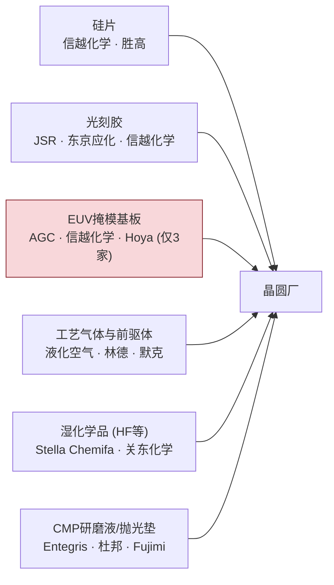
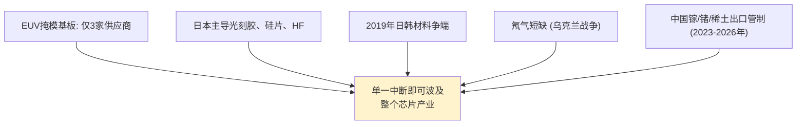

# 半导体制造中的关键材料、气体与化学品

> 📘 **说明：** 本文为英文原版《Key Materials, Gases, and Chemicals in Semiconductor Manufacturing》的简体中文参考译本，仅供参考；如有出入，以英文原版为准。

半导体制造既是一门设备学科，也是一门材料科学。每一个工艺步骤都要消耗经过精确配方的材料——超纯硅、光掩模、光刻胶、研磨液、数十种工艺气体、高纯湿化学品，以及种类不断扩展的介质、金属和沟道材料。这些耗材并非大宗商品：它们与工艺协同开发，纯度达到十亿分之一（ppb）级别（并日益达到万亿分之一（ppt）级别），其中若干种材料的供应与设备本身一样高度集中且具有战略敏感性。本文概述关键材料类别、其作用以及主导这些领域的供应商。

一个反复出现的主题是**纯度及其对供应链的影响**。在错误的工艺步骤中出现一个颗粒或一丝痕量金属污染，就可能毁掉一颗芯片，因此半导体级材料被提纯到极高水平，由少数专业供应商生产（高度集中于日本，在欧洲、美国和韩国的地位也在上升），并须经过漫长而严格的认证流程——这使得更换供应商十分困难，供应中断则非常危险。

---

## 📊 可视化概览

*原创示意图；Mermaid图表可在GitHub上直接渲染。*

**关键材料供给晶圆厂——其中若干种集中度高得危险**



**纯度要求——半导体级与工业级的对比**

下图对比工业级氢氟酸（HF，允许含杂质）与半导体级HF（提纯至十亿分之一乃至万亿分之一级）：仅1 ppb的铁、铜或钠就可能在硅中造成致命缺陷。

```
 Industrial HF        ████████████████  (impurities OK)
 Semiconductor HF     ▏  purified to parts-per-BILLION / TRILLION
 One ppb of Fe, Cu, or Na can create killer defects in the silicon.
```

**集中度 = 战略脆弱性（以过往冲击为例）**



---

## 1. 硅与衬底

起始材料是**电子级多晶硅**，纯度达9N–11N（99.9999999%以上）。它通过**直拉法（CZ）**（主流方法）或**区熔法（FZ）**（纯度/电阻率更高，用于功率器件和探测器）生长成单晶硅锭，然后经切片、研磨和抛光制成硅片（文件02）。**外延片**在其上增加一层无缺陷、精确掺杂的外延层；<strong>SOI（绝缘体上硅）</strong>晶圆——采用**Soitec的Smart Cut**层转移工艺制造——在埋氧层之上提供一层薄硅器件层，用于FD-SOI、RF-SOI和硅光子。领先的硅片供应商为**信越化学（Shin-Etsu）和胜高（SUMCO）（日本，二者合计占市场多数份额）、环球晶圆（GlobalWafers，中国台湾）、世创（Siltronic，德国）和SK Siltron（韩国）**，**Soitec**则主导SOI市场。硅片供应高度集中，并周期性地出现供应紧张。

---

## 2. 光掩模与掩模基板

<strong>光掩模（掩模版）</strong>承载着光刻投射到晶圆上的电路图形。深紫外（DUV）掩模采用**熔融石英基板**，其上有图形化的**铬或MoSi（硅化钼）吸收层**。**极紫外（EUV）掩模基板**则复杂得多：在低热膨胀系数基板上镀制**40–50对Mo/Si多层反射膜**和**TaN/TaBN吸收层**，要求缺陷密度低于约0.003/cm²。全球只有**三家公司——AGC、信越化学和Hoya**——供应EUV掩模基板，这使基板供应成为真正的瓶颈。掩模图形由**电子束掩模写入机**（IMS Nanofabrication、NuFlare）写入，掩模须经检测，EUV掩模还须进行光化检测（蔡司（ZEISS））。掩模厂是产业链中关键、资本密集且高度集中的一环。

---

## 3. 光刻胶

光刻胶是记录光刻图像的光敏聚合物——晶圆厂中对性能最为关键、协同开发最为紧密的材料之一：

- **ArF（193nm）化学放大光刻胶（CAR）：** 浸没式光刻的主力材料，利用光致产酸剂催化溶解度变化。
- **EUV CAR：** 针对13.5nm波长改进的化学放大光刻胶，通过精心调校的**淬灭剂化学**来控制酸扩散、抑制随机效应导致的模糊。
- **金属氧化物EUV光刻胶（MOR）：** **基于氧化锡**的光刻胶（由**Inpria**首创，Inpria于2021年被**JSR**收购；JSR本身则于2024年被政府背景的日本产业革新投资机构（JIC）私有化），由金属原子直接吸收EUV，以牺牲灵敏度为代价换取更高的分辨率和更低的线边缘粗糙度——对高数值孔径极紫外（High-NA EUV）日益重要。竞争性的含金属配方（例如默克（Merck）和杜邦（DuPont）的产品）以及泛林集团（Lam Research）等公司的**干法（气相沉积）光刻胶**工艺也在开发中，以争取量产认证。
- **非CAR/分子玻璃光刻胶：** 本征粗糙度更低的小分子光刻胶，尚处于研究阶段。

光刻胶市场由日本供应商主导——**JSR、东京应化（TOK）、信越化学、富士胶片（Fujifilm）和住友化学（Sumitomo）**——此外还有<strong>默克/EMD（德国）</strong>和**杜邦**。先进EUV光刻胶供应集中于少数（大多为日本）企业，是一项值得关注的供应链敏感点；2019年日本限制向韩国出口光刻胶相关原料时引发的恐慌即凸显了这一点。2025年底，有关日本限制向中国出货光刻胶的传闻流传，但未获证实；与此同时，中国正大力推进国产KrF/ArF光刻胶的开发。

---

## 4. CMP研磨液与抛光垫

化学机械平坦化（CMP）耗材（文件06）是精确配方的悬浮液和聚氨酯抛光垫：
- **研磨液：** 研磨纳米颗粒（**气相二氧化硅、二氧化铈/CeO₂或氧化铝**）分散于以氧化剂（**H₂O₂**）、pH缓冲剂、腐蚀抑制剂和表面活性剂调配的化学体系中，每种配方都针对特定材料（氧化物、钨、铜、钴）。供应商：**Entegris（通过CMC/卡博特微电子）、Fujimi、Versum/默克、力森诺科（Resonac）/日立、陶氏/杜邦**。
- **抛光垫：** 经工程设计的聚氨酯结构（经典的**IC1000**），由**杜邦**和**3M/卡博特**主导。

这些经常性、对工艺至关重要的耗材带来黏性强、利润率高的收入，并与工艺深度协同开发。

---

## 5. 工艺气体

现代晶圆厂消耗数十种**工艺气体**，按功能大致分为：

- **刻蚀气体：** 用于导体刻蚀的氯系和溴系气体（**Cl₂、HBr、BCl₃**），用于介质刻蚀的氟碳气体（**CF₄、C₄F₈、C₄F₆、CHF₃、SF₆、NF₃**），以及用于灰化和调节钝化的**O₂**。
- **CVD/ALD前驱体：** 硅源（**硅烷SiH₄、二氯硅烷DCS、TEOS**），金属前驱体（用于钨的**WF₆**，用于氮化钛的**TiCl₄**和**TDMAT**，用于HfO₂的**TDMAHf/TEMAHf**，用于ZrO₂的**TEMAZ**，用于Al₂O₃的**TMA（三甲基铝）**，以及用于新型金属的Ru/Mo/Co前驱体）。
- **掺杂及特种气体：** 用于掺杂和外延的**GeH₄（锗烷）、AsH₃（砷烷）、PH₃（磷烷）、B₂H₆（乙硼烷）**；用于氮化物的**NH₃（氨）**。
- **载气与吹扫气体：** 用量巨大的**H₂、N₂、Ar、He**。

其中许多气体**有毒、自燃或具有腐蚀性**（砷烷、磷烷、乙硼烷、硅烷），需要复杂的气体处理、尾气处理和安全系统（文件20、文件24）。若干气体——尤其是**NF₃、SF₆和全氟化碳**——是强效温室气体，推动了减排工作（文件21）；许多含氟工艺化学品也属于欧盟拟议的通用**PFAS（全氟和多氟烷基物质）限制**的范围（见下文2025–2026年更新）。主要工业气体供应商包括**液化空气（Air Liquide）、林德（Linde）、空气化工（Air Products）、大阳日酸（日本酸素/Matheson）和默克/Versum**，其中特种前驱体业务尤其集中、价值尤其高。

---

## 6. 高纯湿化学品

湿法工艺和清洗（文件10）消耗大量**半导体级湿化学品**，其金属和颗粒污染被控制在十亿分之一（最关键者为万亿分之一）级别：**硫酸（H₂SO₄）、氢氟酸（HF）、过氧化氢（H₂O₂）、氢氧化铵（NH₄OH）、盐酸（HCl）、磷酸（H₃PO₄）、异丙醇（IPA）和四甲基氢氧化铵（TMAH）**。纯度要求极端苛刻——酸中十亿分之一的铁或铜等金属就可能污染晶圆、毁坏器件。供应商包括**关东化学（Kanto Chemical）、Stella Chemifa（主导性的HF供应商）、三菱化学（Mitsubishi Chemical）、巴斯夫（BASF）、霍尼韦尔（Honeywell）和Entegris**，其中HF供应明显集中于日本。

---

## 7. 介质材料——低k、高k与铁电材料

- **低k与超低k介质：** 用于后道（BEOL）绝缘的**碳掺杂氧化物（SiOCH）**（k≈2.4–2.7）、**多孔超低k介质**（k≈2.0–2.2）以及实现最低电容的**空气隙**（k≈1.0）——需要在降低电容与机械脆性之间取得平衡（文件02、文件15）。
- **高k介质：** 用于栅极和电容介质的<strong>HfO₂（氧化铪）</strong>和**ZrO₂（氧化锆）**，以**Al₂O₃和La₂O₃**作为界面层和调节层（文件04）。
- **铁电材料：** **HfZrO₂（HZO）**——一种与CMOS兼容且具有铁电性的掺杂氧化铪——使**FeFET和FeRAM**非易失性存储器以及负电容研究成为可能（文件23）。

这些沉积介质材料主要以**ALD/CVD前驱体**（即第5节所述的金属有机化合物）的形式供应，而非以块体薄膜形式供应。

---

## 8. 阻挡层金属与新型互连材料

- **阻挡层/衬垫金属：** **TaN/Ta**（经典的铜阻挡层）、**TiN、WN以及Co/Ru衬垫**——用于阻止金属扩散并增强附着力的薄层。
- **新型后道金属：** 随着铜逼近其极限，<strong>钌（Ru）、钼（Mo）和钴（Co）</strong>正作为无阻挡层或薄阻挡层的互连金属，在最紧密的间距上进入量产（文件04、文件15）——这是自铜本身以来后道最重要的材料转变之一。到2025–2026年，**钼**已进入量产应用（例如泛林集团于2025年推出、面向先进存储器和逻辑金属化的ALTUS Halo钼ALD），使钼前驱体成为一个不断增长的特种化学品类别。

这些金属由专用前驱体（用于ALD/CVD）或靶材（用于PVD）沉积，再次使价值集中于前驱体和靶材供应商。

---

## 9. 二维及新兴沟道材料

沟道材料的前沿（文件15、文件23）将全新的物质引入晶圆厂：
- **MoS₂、WS₂、WSe₂**——用于超薄二维沟道的过渡金属二硫族化合物，通过MOCVD/ALD沉积，**晶粒尺寸、缺陷密度（硫空位）和300mm均匀性**是核心材料挑战。
- **hBN（六方氮化硼）**——一种二维绝缘体，用作栅介质和衬底。
- **碳纳米管**——需要超过99.99%的半导体型纯度以及定向排列。

这些材料仍处于研究阶段，阻碍其走向制造的主要障碍是材料纯度和均匀性问题（而非器件本身）。

---

## 10. 材料供应商格局

材料供应链由一批高度集中的专业厂商主导：

| 材料类别 | 领先供应商 |
|---|---|
| 硅片 | 信越化学、胜高、环球晶圆、世创、SK Siltron；Soitec（SOI） |
| 光刻胶 | JSR、东京应化（TOK）、信越化学、富士胶片、住友化学、默克/EMD、杜邦 |
| EUV掩模基板 | AGC、信越化学、Hoya |
| CMP研磨液/抛光垫 | Entegris（CMC）、Fujimi、Versum/默克、力森诺科、杜邦、3M |
| 工艺气体 | 液化空气、林德、空气化工、日本酸素/Matheson、默克/Versum |
| 湿化学品 | Stella Chemifa、关东化学、三菱化学、巴斯夫、霍尼韦尔、Entegris |
| ALD/CVD前驱体 | 默克/EMD、Entegris、液化空气、ADEKA、Tri Chemical、DNF |
| 过滤/纯化/载具 | Entegris、颇尔（Pall，丹纳赫旗下）、世伟洛克（Swagelok） |

有两个战略特征尤为突出。第一，**日本的主导地位**：日本供应了最关键材料（光刻胶、硅片、EUV掩模基板、HF以及许多特种化学品和气体）中不成比例的大部分份额，这就是为什么2019年日本对韩国实施光刻胶原料和HF出口管制时会震动整个行业，也是为什么材料在地缘政治战略中占有突出地位（文件18）。第二，**协同开发的深度**：先进材料要与特定工艺历时多年共同开发，经过严格的认证程序，且难以引入第二供应商——由此形成黏性强、利润率高的业务，同时也带来真实的供应链脆弱性。

因此，材料是整个行业默默无闻的基石：不如数百万美元的设备那样引人注目，但同样不可或缺、同样高度集中、同样具有战略意义。随着材料种类不断扩展——新型EUV光刻胶、新型互连金属、铁电材料、二维沟道——材料供应商在支撑每个新节点方面变得愈发核心，其供应安全也愈发成为国家战略问题。

---

## 扩展分析：纯度、集中度与战略脆弱性

### A. 为什么纯度是决定性要求

将半导体材料与其工业级对应物区分开来的唯一特性是**纯度**。同样是氢氟酸，工业用途的产品若要用于半导体，必须将金属和颗粒污染提纯到<strong>十亿分之一（最关键应用为万亿分之一）</strong>级别，因为仅十亿分之一的铁、铜或钠等金属就可能扩散进硅中，形成具有电活性的缺陷，从而毁坏器件。同样的逻辑适用于所有材料：硅的纯度必须达到9N–11N，气体的污染物必须控制在ppb级，光刻胶必须不含金属离子和颗粒，研磨液的粒径分布必须受到严格控制。实现并*验证*这些纯度水平需要专门的提纯、包装（避免运输途中污染）、处理和计量手段——这就是为什么半导体材料由少数具备深厚专长的专业供应商生产，也是为什么认证一种新材料或一家新供应商是一个漫长而严格的过程，使供应链黏性很强、转换成本很高。

### B. 集中度问题

半导体材料供应链的**集中度**极高，往往超过设备行业，而且常常以造成战略脆弱性的方式集中：
- **EUV掩模基板**仅来自**三家**供应商（AGC、信越化学、Hoya）。
- **硅片**由五家企业主导，其中以信越化学和胜高（均为日本企业）为首，二者合计占多数份额。
- **先进光刻胶**（尤其是EUV光刻胶）集中于少数几家以日本为主的企业（JSR、东京应化、信越化学、富士胶片），以及默克和杜邦。
- **高纯HF**集中于日本供应商（尤其是Stella Chemifa）。
- ALD/CVD用**特种前驱体**来自一小批专业化学品制造商。

这种集中意味着单一供应商、地区或材料的中断就可能波及整个行业——日本**2019年**对韩国实施的光刻胶原料和HF**出口限制**使这一风险暴露无遗，它威胁到三星（Samsung）和SK海力士（SK hynix），并表明材料（而不仅仅是设备）同样是地缘政治的“卡脖子”环节（文件18）。乌克兰战争引发的**氖气**短缺（乌克兰曾供应全球大部分用于DUV激光器的半导体级氖气）进一步凸显了这一点；2023年以来，中国对**镓、锗和稀土**的出口管制同样如此（中国供应约80%的原生镓和约60%的锗）。

### C. 日本在材料领域的主导地位

一个引人注目的结构性特征是**日本供应商**在最关键材料领域的**主导地位**——硅片、光刻胶、EUV掩模基板、HF及许多特种化学品和气体、CMP研磨液以及ALD前驱体。这种主导地位源于数十年积累的专业知识、与客户的深度协同开发，以及材料纯度所要求的严苛质量文化。它也赋予日本在半导体供应链中重要的战略杠杆——这一杠杆在2019年日韩争端中显露无遗，并影响着行业更广泛的地缘政治格局（文件18）。对世界其他地区而言，关键材料集中于日本（及少数其他地区）是一项供应链脆弱性，补贴计划（美国《芯片与科学法案》（CHIPS法案）、《欧洲芯片法案》）和“去风险”努力日益寻求通过多元化来应对——尽管所需专业知识的深度使快速多元化十分困难。

### D. 不断扩展的材料种类

一个决定性的趋势是，随着新的器件架构和向三维的转变把新物质引入晶圆厂，**材料种类**在每个节点上都在**不断扩展**：新型EUV光刻胶（金属氧化物）、新型互连金属（Ru、Mo、Co）、铁电HfO₂（HZO）、二维沟道材料（MoS₂、WSe₂）、新型高k和沟道材料，以及先进封装的特种材料（塑封料、再布线层（RDL）介质、键合界面）。每种新材料都需要新的前驱体或配方、新的提纯和认证工作，往往还需要建立新的供应商关系——这扩大了材料供应商的作用，使其在支撑每个新节点方面变得愈发核心。随着器件种类在材料上日益多样化（文件23），材料供应商与设备制造商一样，成为每一次技术转型中不可或缺的合作伙伴——而其高度集中、高纯度、深度协同开发的供应链的安全性和韧性，也愈发成为战略和国家层面的关切。

---

## 进一步分析：前驱体经济与未来材料体系

### A. 前驱体化学的隐秘世界

每一层ALD和CVD薄膜背后都有一种**前驱体**——一种经过专门设计的金属有机或无机分子，在受控条件下将所需原子输送到晶圆表面。前驱体化学是位于沉积工艺核心、深奥、高价值却常被忽视的学科。一种好的前驱体必须**易挥发**（以蒸气形式输送）、**热稳定**（不会过早分解）、**具有反应活性**（干净地化学吸附并与共反应物反应）且**洁净**（不留下碳、卤素或金属残留）。为每一种新薄膜——HfO₂、ZrO₂、TiN、Ru和Mo互连金属、MoS₂二维沟道——设计满足所有这些约束的分子，是一门专业的化学艺术，前驱体供应商（默克/EMD、Entegris、液化空气、ADEKA、Tri Chemical、DNF等）拥有宝贵的知识产权，并与沉积设备制造商和晶圆厂保持着深度协同开发关系。随着每个新节点引入新材料，支撑某种薄膜的前驱体可能与沉积设备本身一样成为关键制约因素，而开发一种新前驱体（并将其提纯到所需水平、在量产中完成认证）往往是一项与设备开发并行的、历时多年的工作。因此，前驱体经济是材料供应链中一个隐秘却必不可少的层次，化学、知识产权与工艺诀窍在此结合，使先进制程所需的每一种新薄膜成为可能。

### B. 材料是新器件的节奏决定因素

贯穿本数据库的一个反复出现的主题是：对许多前沿器件而言，**决定节奏的是材料，而非器件概念**。二维沟道晶体管受限于生长晶圆级、低缺陷MoS₂的难度（一个材料问题），而非器件物理。铁电存储器取决于对HZO铁电相的控制（一个材料问题）。新型互连取决于Ru/Mo沉积工艺及其前驱体的开发。碳纳米管晶体管受限于碳纳米管的纯度和定向排列（材料问题）。超宽禁带功率器件受限于Ga₂O₃和金刚石衬底的生长。在每种情况下，器件本身都已得到验证，但要将其推向制造，仍需等待材料难题的解决——以所需的质量和均匀性大规模地生长、提纯、沉积或集成该材料。这使材料供应商与设备制造商一道，处于支撑每一代新器件的中心位置，也意味着未来的路线图（文件15、文件23）既是器件或设备路线图，同样也是材料路线图。不断扩展的材料种类——新型光刻胶、新型金属、铁电材料、二维沟道、超宽禁带半导体、封装材料——是后尺寸微缩时代的决定性特征之一，它使材料科学与材料供应日益成为决定进步的核心因素。

### C. 供应韧性是战略要务

材料供应链的集中度和关键性使**供应韧性**成为一项战略要务，而地缘政治时代更使其尖锐地凸显出来。对三家EUV掩模基板供应商的依赖、对以日本为主的光刻胶和HF供应的依赖、对特定前驱体和特种气体来源的依赖，以及对氖气（乌克兰冲击）和稀土等材料的依赖，构成了一系列脆弱点——一次中断（自然灾害、贸易争端、冲突）就可能将其演变为全行业危机。2019年日韩材料争端和氖气短缺，都警示了材料中断如何波及整个芯片产业。作为回应，补贴计划（CHIPS法案、《欧洲芯片法案》）越来越多地资助材料产能和多元化，制造商则推行双重采购和库存缓冲，材料供应链的韧性已与设备供应链一样，成为企业和国家战略问题。然而，所需专业知识的深度和严格的认证要求使快速多元化十分困难——晶圆厂无法简单地换用未经认证的光刻胶或前驱体——因此材料韧性仍是一项艰巨的长期挑战。归根结底，这个默默无闻、高度集中、高纯度、深度协同开发的半导体材料世界，与它所服务的数百万美元设备一样具有战略关键性，也一样脆弱，其安全与整个半导体产业的安全密不可分。

---

## 🆕 2025–2026年更新：最新进展（截至2026年11月）

### A. 市场规模：材料支出创纪录，光刻与封装领涨

根据**国际半导体产业协会SEMI（SEMI）的材料市场报告（2026年5月）**，2025年全球半导体材料营收达到创纪录的**732亿美元（同比增长6.8%）**。晶圆制造材料增长5.4%，达到**458亿美元**，其中光刻相关材料（光掩模、光刻胶及配套试剂）和湿化学品均实现两位数的强劲增长。封装材料增长9.3%，达到**274亿美元**，主要受益于基板，以及金价上涨推高键合丝营收。中国台湾连续第16年保持全球最大材料消费地区的地位。

硅片方面，<strong>SEMI（2026年2月）</strong>报告称，2025年硅片出货面积增长约6%，达到约129.73亿平方英寸。然而硅片营收下滑约1.2%，至约114亿美元：AI驱动的先进外延片和HBM级抛光片需求推高了出货量，但传统应用需求疲软拖累了价格。SEMI对2026年的展望是“双轨”格局：AI逻辑和存储器带来强劲的300mm需求，而成熟制程仅谨慎复苏。鉴于SEMI 2026年7月预测2026年晶圆厂设备（WFE）将达1,439亿美元，材料消耗预计将在产能扩张之后滞后跟进。

| 指标 | 2025年数值 | 来源 |
|---|---|---|
| 半导体材料总额 | 732亿美元（同比增长6.8%） | SEMI，2026年5月 |
| 晶圆制造材料 | 458亿美元（同比增长5.4%） | SEMI，2026年5月 |
| 封装材料 | 274亿美元（同比增长9.3%） | SEMI，2026年5月 |
| 硅片出货量 | 约12,973百万平方英寸（同比增长约6%） | SEMI硅制造商集团（SMG），2026年2月 |
| 硅片营收 | 约114亿美元（同比下降约1.2%） | SEMI硅制造商集团（SMG），2026年2月 |

### B. 关键矿产地缘政治

- **镓、锗、锑：** 中国供应约80%的原生镓和约60%的锗。根据中美在釜山达成的休战协议（2025年10月30日），中国对美出口上述物项的禁令**暂停至2026年11月27日**。2025年初以来，镓价大幅上涨。
- **稀土：** 根据同一休战协议，中国2025年10月出台的大范围稀土出口管制**暂停实施至2026年11月**。2026年9月23日，美国财政部长贝森特（Bessent）表示休战期将延长至2027年1月10日。
- **钨、碲、铋、钼、铟：** 中国于2025年2月对这些物项实施出口管制。它们关系到WF₆和钨靶材、钼互连以及InP/化合物半导体。截至本次更新，尚无公开确认的放宽措施。
- **安世半导体（Nexperia）：** 荷兰政府于2025年10月接管安世半导体，随后中国禁止安世中国出口，扰乱了汽车供应链。安世的中国业务转而采用国产晶圆。这表明材料和晶圆供应链可以多么迅速地沿政治界线分裂。

**影响：** 晶圆厂和设备制造商正在建立库存缓冲，认证中国以外的第二供应来源（在存在替代来源的情况下），并资助回收和精炼产能。由于上文扩展分析所述的认证负担，快速替代仍然困难。

### C. 光刻胶与光刻材料

- **EUV光刻胶需求正在增长**，驱动因素包括DRAM中EUV层数的增加（据报道部分厂商在1c节点使用五层或更多EUV层）以及2nm级逻辑的爬坡（台积电（TSMC）N2自2025年第四季度起量产；英特尔（Intel）18A已进入大规模量产）。
- **金属氧化物光刻胶和干法光刻胶**正在向量产认证推进，尤其是在需要更薄光刻胶膜的High-NA EUV领域。英特尔14A是首个计划采用High-NA的节点，据报道三星和台积电分别计划在约2028年和约2030年将High-NA用于大规模量产。MOR在大规模量产中的导入时间因供应商和客户而异，公开确认的信息有限。
- **中国国产化：** 有关日本限制光刻胶出口的传闻（2025年底）始终未获证实。尽管如此，中国仍加速推进国产KrF/ArF光刻胶的认证，作为更广泛国产化努力的一部分——2025年国产设备已约占中国所用设备的35%。

### D. PFAS：含氟化学品面临的监管阴影

欧盟拟议的**通用PFAS限制**在2026年取得进展。**2026年3月26日**，欧洲化学品管理局（ECHA）风险评估委员会（RAC）发布了最终意见，社会经济分析委员会（SEAC）发布了意见草案。两者均支持在欧盟范围内实施限制，并给予**有时限的豁免**，最早的禁令不会在2028年底之前生效。在公众意见征询中，半导体是有明确身份的评论方中最多的行业。

该限制之所以重要，是因为含氟聚合物（设备和化学品输送系统中的PFA/PTFE接液部件）、光刻胶中的含氟光致产酸剂和表面活性剂，以及某些含氟刻蚀和清洗化学品，都在其范围之内。预计业界将持续开展无PFAS光刻胶组分以及排放处理与捕集方面的研发，同时游说争取较长的豁免期。

### E. 进入量产的新材料

- **钼**已与钨和铜一起进入量产金属化应用（泛林集团ALTUS Halo，2025年）。据报道，钼正被下一代3D NAND闪存的字线采用。
- **背面供电**（英特尔18A PowerVia已进入大规模量产；台积电A16超级电轨（Super Power Rail）于2026年下半年至2027年量产，各来源说法不一）提高了对键合介质、晶圆减薄耗材和载片的需求。
- 据SEMI数据，2025年**先进封装材料**的增速高于晶圆制造材料，驱动因素包括CoWoS扩产、混合键合（介质和铜焊盘化学品、键合表面CMP），以及正在为面板级封装开发的玻璃芯基板（台积电CoPoS已列入路线图）。

**值得关注的事项（2026年末–2027年）**
- 中国对镓/锗的暂停措施（至2026年11月27日）和稀土管制暂停是否会随休战期延长至2027年1月10日而相应延长。
- ECHA SEAC的最终意见以及欧盟委员会的PFAS限制提案，包括针对半导体用途的豁免期长度。
- 在High-NA导入节点（英特尔14A）上MOR或干法光刻胶的认证情况。
- 在AI和HBM带来的300mm需求收紧供应、而成熟制程需求依然疲软的背景下，硅片价格的走势。
- 日本或中国针对光刻胶或特种化学品的任何经确认的出口措施。
