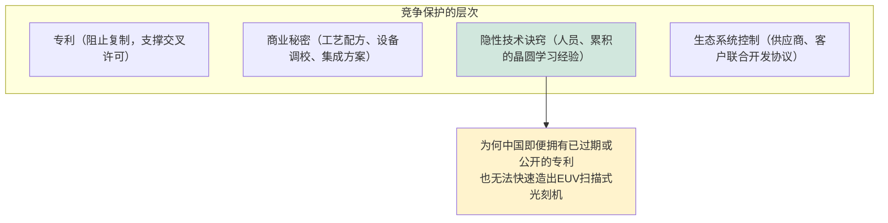
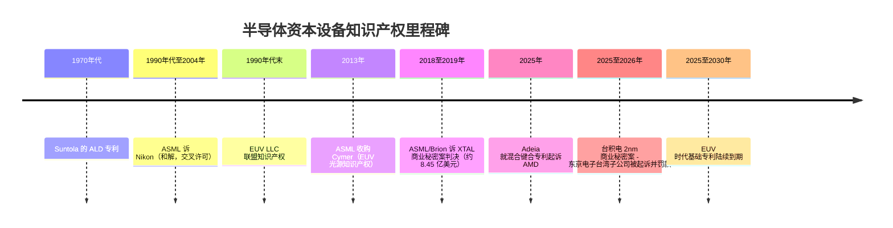

# 关键专利、知识产权格局与诉讼

> 📘 **说明：** 本文为英文原版《Key Patents, IP Landscape, and Litigation》的简体中文参考译本，仅供参考；如有出入，以英文原版为准。

知识产权（IP）是半导体设备行业看不见的“基础架构”。阿斯麦（ASML）在极紫外光刻（EUV）领域的垄断、ASM国际（ASM International）在原子层沉积（ALD）领域的领先、泛林集团（Lam Research）在刻蚀领域的主导地位，以及科磊（KLA）的工艺控制业务，其深厚的护城河既来自工程能力，也同样来自专利与商业秘密。由于该行业高度集中、利害关系巨大，知识产权纠纷曾多次重塑竞争格局；而随着中国在出口管制之下竞相打造本土设备产业，知识产权（其创造、保护以及被指控的盗用）已成为地缘政治竞争的前线。本文按技术领域梳理专利格局，回顾重大历史纠纷、专利到期动态，以及中美竞争中的知识产权维度。

---

## 📊 可视化概览

*原创示意图；Mermaid 图表可在 GitHub 上原生渲染。*

**真正的护城河是隐性技术诀窍，而不仅仅是专利**

**部分知识产权里程碑与纠纷（时间线）**

---

## 1. 按技术领域划分的专利格局

### 光刻

光刻是专利最密集、诉讼最多的设备领域。**ASML、蔡司（ZEISS）和 Cymer** 持有 **EUV** 的基础专利，覆盖光源（激光产生的锡等离子体、液滴发生、收集镜光学）、Mo/Si 多层反射光学、掩模版与双工件台传输，以及扫描式光刻机整体架构。大量早期 EUV 知识产权可追溯至 1990 年代末美国的 **EUV LLC** 联盟（英特尔、摩托罗拉、AMD 以及劳伦斯利弗莫尔、桑迪亚、劳伦斯伯克利等国家实验室），其许可安排帮助 ASML 确立了 EUV 领导地位，同时限制了日本竞争对手的获取渠道。ASML **2013 年收购 Cymer** 整合了光源知识产权，而其与**蔡司**的合作（及持股）则锁定了光学部分。由此形成的专利丛林如此密集，又与一个无法复制的供应生态深度交织，构成了所有行业中最坚固的护城河之一。

### 原子层沉积（ALD）

ALD 的基础专利可追溯至芬兰科学家 **Tuomo Suntola**，他在 1970 年代发明了“原子层外延”。**ASM国际**的 ALD 领先地位在很大程度上建立在早期强大的专利布局之上；ALD 知识产权——涵盖前驱体化学、反应腔设计、等离子体增强与空间型变体，以及选择性/区域选择性沉积——在 **ASM、应用材料（Applied Materials）、泛林集团和东京电子（TEL）** 之间激烈争夺。随着选择性沉积成为 3nm 以下工艺节点的关键使能技术，围绕抑制剂化学和自对准方案的专利竞赛日趋激烈。

### 刻蚀与原子层刻蚀（ALE）

刻蚀知识产权集中于**等离子体源设计**（电容耦合等离子体 CCP 与电感耦合等离子体 ICP 反应腔、双频与脉冲射频方案）、静电吸盘与温度控制，以及工艺化学。**泛林集团**在 CCP/ICP 反应腔和介质刻蚀技术方面拥有深厚的专利组合；**应用材料**拥有重要的 **ALE 与选择性刻蚀**知识产权；**东京电子**则持有强大的刻蚀及光刻-刻蚀集成专利。较新的前沿领域——原子层刻蚀、低温刻蚀，以及用于全环绕栅极（GAA）沟道释放的各向同性选择性刻蚀——是专利申请的活跃领域。

### 化学机械平坦化（CMP）

CMP 知识产权覆盖设备设计（**应用材料、荏原（Ebara）**）以及耗材——抛光液配方和抛光垫设计（**Entegris/CMC、杜邦、Fujimi、3M**）；其中化学与工艺的协同工程往往既依靠专利，也同样依靠商业秘密来保护。

### EUV 光刻胶

先进光刻胶的专利格局由 **JSR（已收购 Inpria 的氧化锡金属氧化物光刻胶知识产权）、东京应化（TOK）、富士胶片、信越化学（Shin-Etsu）和默克/EMD** 争夺，涵盖化学放大型和金属氧化物型化学体系；随着高数值孔径极紫外（High-NA EUV）需要新的光刻胶材料，这一领域的战略意义日益凸显。

### 先进封装与混合键合

混合键合是争夺最激烈的封装知识产权领域。**Xperi/Adeia（前身为 Invensas）** 持有围绕**直接键合互连（DBI）** 的基础专利组合，并广泛对外许可——包括主要晶圆代工厂和存储器制造商——使这家不从事制造的知识产权持有者成为混合键合生态中的核心角色。**索尼**凭借其开创性的堆叠式 CMOS 图像传感器持有重要的混合键合知识产权；**台积电（TSMC）** 已构建了可观的 **SoIC** 专利组合；**EV Group 和 SUSS MicroTec** 则持有关键的晶圆键合设备知识产权。其商业利害在 **2025 年 11 月**变得清晰可见：Adeia 在美国得克萨斯州西区联邦地区法院对 **AMD** 提起专利侵权诉讼，主张其混合键合专利被 AMD 的 3D V-Cache 产品侵犯（详见下文 2025–2026 年更新）。

### 3D NAND闪存与 DRAM

存储器知识产权的特点是少数存储器制造商——**三星（Samsung）、SK海力士（SK hynix）、铠侠（Kioxia）、美光（Micron）和西部数据**——之间的**广泛交叉许可**，覆盖 3D NAND 架构（沟道形成、串堆叠、字线方案）和 DRAM 单元结构。这种交叉许可反映了一个现实：少数几家存储器厂商各自持有数以千计相互重叠的专利，相互许可比诉讼更为务实。

### GAA 纳米片与互补场效应晶体管（CFET）

GAA 与 CFET 的专利格局涉及 **IBM（基础器件知识产权的多产来源，包括早期纳米片和 CFET 概念）、三星、台积电和英特尔（Intel）**，以及**比利时微电子研究中心imec（IMEC）**（其竞争前研究所产生的知识产权在全行业授权使用）。随着行业向 GAA 过渡并开发 CFET，围绕内侧墙形成、沟道释放和双层集成的专利正在被积极抢占。

---

## 2. 重大知识产权纠纷与和解

### ASML 诉 Nikon（1990 年代至 2004 年）

**ASML 与尼康（Nikon）** 之间围绕扫描式光刻机和浸没式光刻技术展开了旷日持久、多线作战的专利战。该纠纷于 **2004 年通过交叉许可和付款达成和解**，为浸没式光刻时代扫清了法律障碍，也间接为 ASML 最终的主导地位铺平了道路。

### 泛林集团诉应用材料（刻蚀）

这两家刻蚀领导者在等离子体刻蚀技术方面有着长期的专利纠纷历史，反映出最高价值刻蚀应用领域竞争之激烈。此类纠纷通常以和解与交叉许可告终，并未改变竞争格局。

### ASML/Brion 诉 XTAL（2018–2019 年）

这是一起里程碑式的**商业秘密**案件：ASML 的计算光刻子公司 **Brion** 对初创公司 **XTAL** 赢得了一项重大判决（约 **8.45 亿美元**），XTAL 被指控通过前员工盗用 Brion 的源代码。XTAL 实际上因此破产；该案具有涉华因素——XTAL 与中国背景的利益方存在关联，并与一家客户（三星）有业务关系——预示了如今弥漫于中美科技竞争中的知识产权安全担忧。它是一个典型范例，说明守护行业“皇冠明珠”的不仅是专利，更是商业秘密保护。

---

## 3. 专利到期分析

随着 1990 年代末和 2000 年代的核心发明走到约 20 年保护期的尽头，一批 **EUV 时代的基础专利正在 2025–2030 年窗口期内陆续到期**（这一过程现已开始）。原则上，专利到期会降低进入的法律门槛。但在实践中，**实际门槛仍是集成的技术诀窍和供应生态**，而非专利本身：即便专利已过期，也没有任何竞争对手能够复制蔡司光学、通快（TRUMPF）激光器、Cymer 光源、数十年积累的工艺学习经验以及共同构成一台 EUV 扫描式光刻机的供应商网络。因此，专利到期的影响远小于大多数行业——这道护城河主要由商业秘密、隐性制造知识和生态系统控制构筑，而这些都无法通过任何专利授权或到期而转移。

---

## 4. 商业秘密与政府资助的知识产权

行业中最有价值的知识产权有很多是以**商业秘密**而非专利形式持有的，原因恰恰在于最关键的技术诀窍（精确的工艺配方、设备调校参数、集成方案）保密比在专利中公开更有价值。这使得**商业秘密诉讼**（如 XTAL 案）和员工流动纠纷成为反复出现的现象，也使知识产权安全日益成为企业和国家安全的优先事项。

相当一部分基础知识产权还源于**政府资助的研究**：**美国国防高级研究计划局（DARPA）** 项目、**《芯片与科学法案》（CHIPS法案）** 资助的国家半导体技术中心（NSTC）及高校研究、**SEMATECH** 和国家实验室的遗产，以及在成员企业间分配竞争前知识产权的 **imec 和 Leti** 联合开发协议（JDA）。这些公共和联盟投资孕育了后来流入商用设备的知识产权，而获取条款（谁可获得许可、受何种限制）正越来越多地受国家战略左右。

---

## 5. 中国本土知识产权积累

随着中国在出口管制下打造本土设备产业（见[文件18](18_geopolitics_and_export_controls.md)），其**专利申请**数量正在快速积累——**北方华创（NAURA）、中微公司（AMEC）、上海微电子（SMEE）、拓荆科技（Piotech）、盛美半导体（ACM）等**大幅增加了专利申请，既为保护真正的本土创新，也（按部分西方评估）为绕开在位企业的知识产权。中国国家知识产权局（CNIPA）的数据显示半导体设备专利申请激增，对专利分类的分析揭示了中国的重点领域（刻蚀、沉积、清洗——中微公司和北方华创在这些领域最具实力）及其短板（EUV 光刻、先进量测——在位企业的知识产权和生态系统在这些领域仍无可匹敌）。

知识产权维度如今已与地缘政治竞争密不可分。出口管制限制设备及其底层技术的转移；商业秘密执法防范盗用；专利布局决定谁能制造什么。对在位企业而言，知识产权——尤其是专利本身无法涵盖的商业秘密和生态系统诀窍——是终极护城河，比任何单项专利更持久、比任何产品更有价值，因为它凝结了数十年积累的学习经验，正是这些经验使地球上最先进的设备成为可能。掌控这些知识的公司掌控着前沿，而保护这些知识已同时成为国家安全问题和企业战略问题。

---

## 延伸分析：半导体资本设备知识产权的经济学与战略

### A. 为何商业秘密比专利更重要

半导体资本设备（SemiCap）知识产权的一个决定性特征——在科技行业中并不常见——是**商业秘密往往比专利更重要**。原因在于结构：专利要求以公开披露发明换取有期限的垄断，但半导体制造中最有价值的知识是**隐性工艺诀窍**——精确的配方参数、设备调校程序、集成顺序、从数百万片晶圆中积累的学习经验——这些无法完整写入专利，而保密更有价值。即使一台 EUV 扫描式光刻机的专利全部到期，竞争对手仍然造不出来，因为那些不可复制的知识存在于 ASML、蔡司及其供应商的工程师和流程之中，而非专利文件之中。这正是 **ASML/XTAL 商业秘密案**意义重大的原因——它保护的是源代码和技术诀窍，而非专利——也是**员工流动、信息安全与反间谍**成为知识产权核心关切的原因。在地缘政治竞争中（[文件18](18_geopolitics_and_export_controls.md)），人们担心的与其说是专利侵权，不如说是通过招聘、合资或间谍活动造成的**隐性知识转移**。

### B. 交叉许可均衡

在众多参与者持有相互重叠专利的领域——存储器（三星、SK海力士、美光、铠侠、西部数据），以及在一定程度上拥有广泛产品组合的设备制造商——行业会达到一种**交叉许可均衡**：主要参与者不再就数千项重叠专利无休止地诉讼，而是相互交叉许可各自的专利组合并支付平衡性许可费，从而使各方都享有实施自由。这种均衡之所以稳定，是因为另一种选择（相互诉讼）对所有人都具有破坏性，而且每家的专利组合都对其他各方构成威慑。它也抬高了新进入者的门槛——新进入者缺乏可用于交叉许可的专利组合，可能面临侵权索赔——这是一道隐蔽但真实的护城河。存储器行业广泛的交叉许可是典型例证。

### C. 知识产权作为地缘政治工具

知识产权已与地缘政治密不可分。出口管制（[文件18](18_geopolitics_and_export_controls.md)）不仅限制设备的出货，还限制制造或维护这些设备所需的**技术与诀窍**的转移。**“视同出口”（deemed export）** 规则将与外国国民分享受控技术视为出口，使全球研发更加复杂。商业秘密执法（XTAL 先例）防范盗用。而在位企业的知识产权和诀窍——恰恰是出口管制意在保护的对象——是终极战略资产，比任何产品都更持久。对中国而言（[文件18](18_geopolitics_and_export_controls.md)），构建本土知识产权基础既是真正的创新努力，也是在在位企业专利丛林中寻找路径；对在位企业及其政府而言，保护知识产权和诀窍事关国家安全。

### D. 专利申请模式作为战略信号

专利申请数据为观察行业投资方向提供了窗口。围绕**选择性/区域选择性沉积、原子层刻蚀、混合键合、GAA 内侧墙工艺、背面供电以及 EUV 光刻胶**的申请激增，直接对应本数据库各处描述的前沿挑战——设备厂商竞相在 GAA、背面供电和 CFET 时代的技术进入量产之前抢占定义这一时代的工艺知识产权。中国专利申请的快速增长集中在刻蚀、沉积和清洗领域（中微公司、北方华创和拓荆科技在这些领域最具实力），而在 EUV 和先进量测领域则较为稀疏，这同样映射出其能力与短板。因此，解读专利格局就是解读技术路线图本身——今天的知识产权申请预示着明天的制造之争。

### E. 持久的护城河

综合来看，半导体资本设备的竞争护城河建立在专利、商业秘密、生态系统控制、客户联合开发关系以及累积诀窍的**组合**之上，其深度远超专利本身。专利到期（2025–2030 年 EUV 时代专利的到期）降低了一道门槛，但其余门槛依然完好。在位企业真正的保护是集成化的知识——体现在人员、流程、供应商网络和隐性学习之中——这些知识无法通过任何专利授权或到期而转移，需要数十年时间和数百亿美元才能建立。这就是为什么半导体资本设备的竞争格局变化如此缓慢、领导者地位如此稳固，以及为什么保护知识产权和诀窍已同时成为国家战略和企业关切。

---

## 进一步分析：知识产权、技术诀窍与复制的极限

### A. 无法被复制的知识

关于半导体资本设备知识产权最深刻的事实是：最有价值的知识——使设备在生产中稳定实现良率的**隐性工艺与集成诀窍**——无法通过任何专利或文件来复制、购买或转移。它存在于数千名工程师的经验之中，存在于数百万片已加工晶圆所积累的学习之中，存在于多年打磨的精细调校程序和集成顺序之中，也存在于供应商与客户关系的密集网络之中。这就是为什么中国大规模、坚定且有国家支持的努力，在投入多年和数百亿美元之后，仍未形成可用于生产的本土 EUV 能力（据报道，到 2025 年底已在深圳组装出一台可产生 EUV 光的原型机——值得注意的是，其团队据称包括前 ASML 工程师——但截至最新报道尚未生产出可用芯片），也未在先进量测领域追平前沿——并非因为专利无法获得（许多专利是公开的，有些正在到期），而是因为将专利转化为可用设备的**隐性知识和集成生态**无法被快速复制。即使一台 EUV 扫描式光刻机的专利明天全部到期，也没有竞争对手能够造出来，因为蔡司的光学诀窍、Cymer 的光源诀窍、集成专长和供应商网络都不在专利之中。这就是终极护城河——体现在人员、流程和关系中、历经数十年积累、任何法律机制都无法转移的知识——也是半导体资本设备竞争格局如此稳固、前沿如此难以突破的最深层原因。

### B. 对知识产权战略与安全的启示

隐性诀窍相对于正式知识产权的首要地位，以独特的方式塑造着行业的知识产权战略与安全。由于最有价值的知识是隐性的、最好保密，领导者高度依赖**商业秘密保护**（守护工艺配方、设备调校和集成方案），而不是将一切申请专利；**信息安全与反间谍**（防范通过招聘、间谍活动或合资造成的诀窍流失）因而变得至关重要。ASML/XTAL 商业秘密案正是例证——它保护的是源代码和诀窍，而非专利。在地缘政治竞争中（[文件18](18_geopolitics_and_export_controls.md)），人们担心的与其说是专利侵权，不如说是**隐性知识的转移**；这就是为什么出口管制不仅限制设备，还限制技术与诀窍，为什么“视同出口”规则约束与外国国民分享知识，以及为什么员工流动和合资条款受到严格审查。通过商业秘密法、信息安全、对人员和合作关系的审慎管理以及出口管制体系来保护诀窍，已与保护任何产品一样，成为企业和国家安全的优先事项，因为诀窍*本身*就是皇冠明珠。专利组合固然重要（它能阻止直接复制并支撑交叉许可），但真正构成持久竞争优势的，是其下一层——隐性的、累积的、不可替代的知识。

### C. 专利趋势：观察未来的窗口

尽管隐性诀窍居于首要地位，**正式的专利格局**仍是观察行业方向的宝贵窗口，因为申请量的激增揭示了领导者正在何处投资，以抢占将定义下一代制造的知识产权。当前申请集中于**选择性与区域选择性沉积、原子层刻蚀、混合键合、GAA 内侧墙与沟道释放工艺、背面供电、EUV 光刻胶与掩模，以及 CFET 集成**，这与 GAA、背面供电和 CFET 时代的前沿挑战（[文件15](15_technology_roadmaps.md)、[文件23](23_research_and_emerging_technologies.md)）精确对应——设备厂商正竞相为未来几年将进入量产的技术锁定工艺知识产权。中国的申请模式（集中于其厂商最具实力的刻蚀、沉积和清洗领域；在仍存在差距的 EUV 和先进量测领域则较为稀疏）同样映射出其能力与局限。因此，解读专利格局就是解读技术路线图——今天的知识产权申请预示着明天的制造之争——它以“行业将创新力投向何处”的视角，补充了对量产路线图（[文件15](15_technology_roadmaps.md)）和前沿研究（[文件23](23_research_and_emerging_technologies.md)）的分析。专利格局与隐性诀窍共同构成行业的知识基础：正式知识产权抢占前沿，隐性知识则承载着将前沿发明转化为可制造技术的累积经验——二者缺一不可，都具有战略意义，也都是定义半导体资本设备领导者持久竞争优势的核心。

---

## 🆕 2025–2026 年更新：最新进展（截至 2026 年 11 月）

2025 年年中至 2026 年末这段时期印证了本文的核心论点：半导体资本设备领域最具影响的知识产权事件并非围绕光刻机权利要求的专利有效性之争，而是**商业秘密与技术诀窍案件**（往往带有国家安全维度），同时在**混合键合**领域——这项因 AI 加速器和高带宽内存（HBM）而具有战略意义的封装技术——专利主张日趋尖锐。

### 商业秘密走向中心——并进入刑事法庭

- **台积电 2nm 案（台湾）。** 2025 年 8 月，台湾检方起诉一名台积电前工程师及其他人，指控其获取与台积电 2nm 工艺相关的商业秘密。2025 年 12 月，检方以未尽监督员工之责为由，依据《营业秘密法》和《国家安全法》将**东京电子台湾子公司**列为法人被告提起公诉；日本母公司未被起诉，并表示未发现该技术流向第三方的证据。2026 年 1 月检方追加起诉。据台湾媒体报道，2026 年 4 月法院判处该前工程师 10 年有期徒刑，并对东京电子台湾子公司处以 **1.5 亿新台币**罚金（若向台积电和国库支付赔偿可予缓刑）；检方称涉案资料与**用于 2nm 生产的刻蚀设备**有关。2026 年 7 月，台湾最高法院驳回了两项上诉。该案普遍被视为依据台湾《国家安全法》“国家核心关键技术”条款对企业提起的首例同类诉讼——这一先例加重了所有在前沿晶圆厂内派驻现场服务工程师的设备供应商的合规负担。
- **三星 DRAM 技术与长鑫存储（CXMT）（韩国）。** 2025 年 12 月，首尔检方起诉了 10 人，包括三星前高管和与长鑫存储有关的员工，指控三星 10nm 级 DRAM 工艺诀窍（数百个工艺步骤）被转移至长鑫存储，随后被改造以适配中国国产设备。各方报道对工艺节点细节说法不一。
- **应用材料与 Mattson / 北京屹唐。** 在美国，应用材料指控 Mattson Technology（自 2016 年起由北京屹唐半导体所有）招揽其工程师以获取商业秘密，该纠纷仍在继续；**2025 年 8 月**，北京屹唐在**北京知识产权法院**反诉应用材料，请求禁令救济及约 1 亿元人民币赔偿，涉及应用材料在中国提交的一项将前 Mattson 员工列为发明人的专利申请。
- **中国 EUV 原型机。** 据路透社报道（2025 年 12 月），深圳的一台 EUV 原型机由包括**前 ASML 工程师**在内的团队打造，部分使用了旧款 ASML 系统的零部件；该机可产生 EUV 光，但尚未生产出可用芯片。这一报道再次表明，稀缺资产是人才和隐性知识，而非专利文本。

### 混合键合成为诉讼热点

**2025 年 11 月**，Adeia（前 Xperi/Invensas DBI 许可方）在美国得克萨斯州西区联邦地区法院对 **AMD** 提起两起诉讼，主张 10 项专利——其中 7 项涉及混合键合，3 项涉及先进节点工艺技术——被 AMD 的 3D V-Cache（Ryzen X3D）、EPYC 和 Instinct 产品侵犯。代工这些产品的台积电未被列为被告。在所查阅的资料中，尚未见到任何裁决或和解的报道。该案对设备厂商意义重大，因为混合键合正走向量产（台积电 SoIC，以及 HBM4E/HBM5 候选方案），而应用材料与 Besi（应用材料于 2025 年取得其约 9% 股份）正在联合开发集成式芯片-晶圆（die-to-wafer）混合键合系统；设备厂商的客户将越来越多地关注实施自由（freedom to operate）问题。

### 汇总表

| 事项 | 司法管辖区 | 关键日期 | 状态（2026 年 11 月，据媒体报道） | 与半导体资本设备的关联 |
|---|---|---|---|---|
| 台积电 2nm 商业秘密 / 东京电子台湾子公司 | 台湾 | 2025 年 8 月、2025 年 12 月、2026 年 1 月起诉；2026 年 4 月判决 | 工程师被判 10 年；东京电子台湾子公司被罚 1.5 亿新台币；2026 年 7 月两项上诉被驳回 | 供应商对现场工程师承担责任；刻蚀诀窍 |
| 三星 DRAM 诀窍 → 长鑫存储 | 韩国 | 2025 年 12 月起诉 10 人 | 诉讼进行中 | 工艺配方被改造以适配中国国产设备 |
| 应用材料诉 Mattson；北京屹唐诉应用材料 | 美国；中国 | 美国诉讼 2022 年；中国诉讼 2025 年 8 月 | 未决 | 人才流动；在中国的平行诉讼 |
| Adeia 诉 AMD | 美国（得州西区） | 2025 年 11 月提起 | 未见裁决/和解报道 | 混合键合实施自由 |
| 据报道的中国 EUV 原型机 | 中国 | 路透社，2025 年 12 月 | 原型机；未见生产出可用芯片的报道 | 通过人员实现的诀窍转移 |

### 结构性趋势

- **专利到期已在进行，但对 EUV 护城河影响甚微。** 2025–2030 年到期窗口已经开启，但前沿领域未出现任何可见的竞争影响，与第 3 节的判断一致。
- **知识产权安全现已成为出口管制合规的一部分。** 美国管制聚焦于向中国出口的半导体制造设备、零部件和技术诀窍（[文件18](18_geopolitics_and_export_controls.md)），台湾和韩国又将“核心”技术泄露入刑，设备厂商面临覆盖员工、服务数据和云存储的多重监管体系。
- **中国的专利申请热潮仍在持续**，集中在刻蚀、沉积、清洗和热处理——北方华创、中微公司、拓荆科技和盛美半导体在这些领域份额上升，2025 年国产设备约占中国所用设备的三分之一（行业协会估计；见[文件18](18_geopolitics_and_export_controls.md)）——而光刻和先进量测领域仍然薄弱。
- **封装知识产权是专利主张和许可的增长领域**，因为混合键合和共封装光学正在进入量产。

**值得关注（2026 年末至 2027 年）**

- 台积电/东京电子台湾子公司案的进一步上诉或民事赔偿，以及其他司法管辖区是否针对供应商员工引入企业责任。
- Adeia 诉 AMD 案的进展（权利要求解释、和解或许可），以及是否会针对晶圆代工厂或 HBM 制造商提出专利主张。
- 北京屹唐诉应用材料案的进展，以及中国法院是否会成为针对西方设备厂商进行反制性专利主张的场所。
- 韩国涉长鑫存储刑事诉讼的判决结果。
- 随着 A16/A14 和 14A 节点临近量产，High-NA EUV、背面供电和 CFET 领域的专利申请数据。
