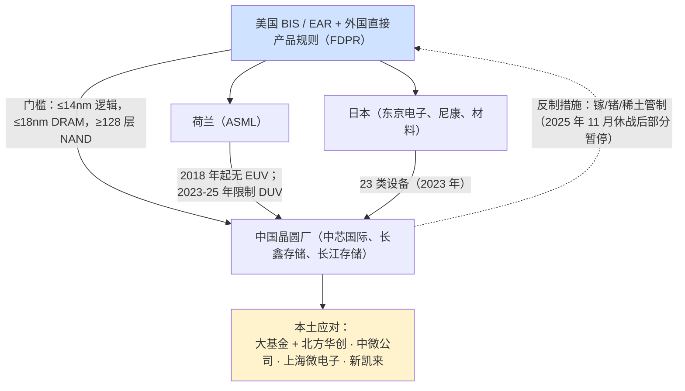
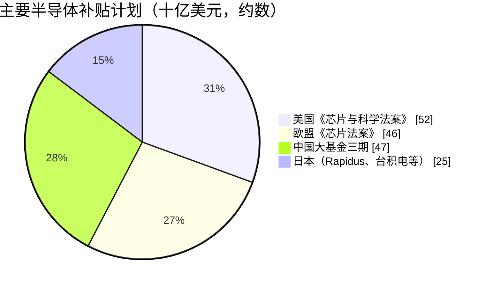

# 地缘政治、出口管制与供应链安全

> 📘 **说明：** 本文为英文原版《Geopolitics, Export Controls, and Supply Chain Security》的简体中文参考译本，仅供参考；如有出入，以英文原版为准。

大约自 2018 年起，半导体资本设备（SemiCap）已从地缘政治的边缘走向中心。人们发现，少数几类设备就卡住了整个先进芯片供应链，这使半导体资本设备成为大国科技竞争中最有力的杠杆。各国政府认识到，**控制设备远比控制芯片更有效**——只要切断对手获取极紫外光刻（EUV）、先进刻蚀和先进量测设备的渠道，其前沿雄心便会停滞。由此形成了一场不断升级的出口管制、补贴与产业政策竞赛，如今已深刻影响每一家主要半导体资本设备公司的战略、收入和风险状况。本文梳理出口管制体系、补贴计划、中国的应对以及对供应链的长期影响。

---

## 📊 可视化概览

*原创示意图；Mermaid 图表可在 GitHub 上原生渲染。*

**设备出口管制如何运作——以及中国的应对**



**为何设备是完美的“卡脖子”点**

以下示意图对比芯片与设备的可控性：芯片以数十亿计生产、由数百家企业设计，难以管控；设备（EUV 仅数百台、约 1 家供应商、一台设备决定大量芯片的产出，且需要持续服务与备件）则是理想的管控点。

```
 Chips:     made by the billions, designed by hundreds of firms → hard to control
 Equipment: a few hundred EUV tools, ~1 supplier, one tool gates many chips,
            and needs ongoing service/parts → IDEAL control point
```

**补贴计划（大致规模，十亿美元）**



---

## 1. 法律架构：ITAR、EAR 与 FDPR

美国对半导体技术的管控建立在两套体系之上。**《国际武器贸易条例》（ITAR）** 管辖一小部分国防级和抗辐射加固物项。影响大得多的是由**美国商务部工业与安全局（BIS）** 执行的<strong>《出口管理条例》（EAR）</strong>，它管控两用技术——基本上涵盖所有先进半导体设备。

决定性的工具是**外国直接产品规则（FDPR）**，它将美国管辖权延伸至**包含美国技术或软件的外国制造产品**。由于地球上几乎每一台先进设备——包括 ASML 的 EUV 扫描式光刻机——都含有美国原产的零部件、软件或设计，FDPR 赋予美国对整个全球设备供应链的域外管辖力。这就是美国能够有效限制一家荷兰公司出口的原因：FDPR 加上外交施压和盟国协调，使美国的管制在实践中具有全球效力。

---

## 2. 2022 年 10 月规则及其升级

分水岭出现在 **2022 年 10 月 7 日**，BIS 发布了针对中国先进芯片能力的全面规则。这些规则限制向中国出口能够生产以下产品的设备：
- **≤16/14nm 逻辑芯片**（鳍式场效应晶体管（FinFET）级及以下），
- **半间距 ≤18nm 的 DRAM**，
- **≥128 层的 NAND**，

此外还限制先进计算芯片，以及“美国人员”支持中国先进制造的活动。这些规则直接削减了**应用材料（Applied Materials）、泛林集团（Lam Research）和科磊（KLA）** 面向中国的销售，而这三家公司此前都有相当大比例的收入来自中国。

后续更新使管制**不断收紧并扩大**：**2023 年 10 月**的一揽子规则细化了门槛、堵塞漏洞、扩充实体清单并约束更多品类；**2024 年和 2025 年**的进一步更新延续了这一模式——**2024 年 12 月**的一揽子规则新增了高带宽内存（HBM）管制、约 140 个实体清单条目（包括中国设备厂商）以及 FDPR 扩展；**2025 年 9 月的“关联方”（50%）规则**将实体清单限制扩展至被列名方持股至少 50% 的子公司；三星和 SK海力士在华晶圆厂的**经验证最终用户（VEU）** 授权自 2025 年 12 月 31 日起被撤销。整体轨迹是稳步升级，每一轮都在填补上一轮留下的缺口——不过自 2025 年末起，升级与美中贸易谈判交织在一起，“关联方规则”根据釜山休战协议**自 2025 年 11 月 10 日起暂停一年**（见下文 2025–2026 年更新）。

---

## 3. ASML、EUV 与 DUV 限制

阿斯麦（ASML）处于最敏感的位置。它**从未获准向中国发运 EUV**（自 2018 年起，荷兰出口政策与美国压力保持一致），这意味着中国被完全拒于先进逻辑和先进 DRAM 最重要的单一设备之外。竞争随后转向**深紫外（DUV）浸没式**扫描式光刻机（用于多重图形化和成熟节点的 193i 设备）：在 **2023–2024 年**间，荷兰逐步限制 ASML 最先进浸没式系统对华出口，美国也扩大管制（包括维护服务），以限制中国获取和维护已安装的 DUV 设备。对 ASML 而言，中国已成为一个重要收入来源（限制前的抢购潮更放大了这一点），如今其中国业务面临有序下滑，而其余市场仍在增长：中国占 ASML 系统销售额的比例从 2025 年第四季度的 36% 降至 2026 年第二季度的 14%，随后在 2026 年第三季度回升至约 23%；ASML 预计中国将占 2026 财年净销售额的约 20%。国会中一项法案（拟议中的 **MATCH 法案**）将更进一步，禁止向中国销售 DUV 设备以及为已安装设备提供维护服务；截至 2026 年 11 月，该法案尚未通过。

---

## 4. 盟国协调：荷兰、日本与韩国

美国的管制之所以有效，完全是因为拥有其余设备生态的关键盟国进行了协调。**荷兰**（ASML）使其 EUV 和 DUV 政策与美国目标保持一致。拥有东京电子（TEL）、尼康（Nikon）、佳能（Canon）、迪恩士（SCREEN）以及关键材料供应商的**日本**，于 **2023 年 3 月实施了自己的出口管制**，覆盖 **23 类设备**（刻蚀、沉积、光刻、清洗、测试），影响东京电子等公司，并使日本与美荷框架保持一致。**韩国**（三星（Samsung）和 SK海力士（SK hynix）的母国，两家公司均在中国运营晶圆厂）处境更为微妙——既面临协调压力，又要保护本国企业在华的大规模业务；2025 年底美国撤销了三星西安工厂以及 SK海力士无锡和大连工厂的 VEU 资格，代之以 2026 年度许可证（允许维持运营，但不得扩产或升级），韩国的处境因此更加艰难。这种**三边加协调**（有时与台湾一起被非正式地称为“芯片四方联盟”（Chip 4）格局）正是管制得以奏效的关键；否则，中国完全可以从非美国供应商处采购。

---

## 5. 补贴时代：CHIPS 法案、欧盟芯片法案及其他

在实施限制的同时，主要经济体推出了庞大的**补贴计划**，以实现产能本地化并降低对东亚的依赖：

- **美国《芯片与科学法案》（CHIPS法案，2022 年）：** 约 **520 亿美元**，包括约 390 亿美元的制造激励和约 110 亿美元的研发资金（支撑**国家半导体技术中心（NSTC）**）。它推动了**台积电亚利桑那、英特尔俄亥俄与亚利桑那、三星得克萨斯以及美光纽约**等项目。2025 年 8 月，美国政府将应拨付给英特尔的 CHIPS 补助转换为约 10% 的股权（约 89 亿美元），偏离了最初的补助模式。至关重要的是，该法案包含<strong>“护栏”条款</strong>，禁止受资助方在十年内扩大其在中国的先进产能——将补贴与脱钩挂钩。
- **欧盟《芯片法案》（2023 年）：** 动员约 **430 亿欧元**，支持 **ASML、imec、英飞凌、意法半导体**以及新建晶圆厂（**台积电/ESMC 德累斯顿**合资项目；英特尔计划中的**马格德堡**项目于 2024 年暂停，并于 2025 年 7 月取消）。欧洲战略强调其优势领域——设备（ASML）、研究（imec）以及汽车/工业/功率芯片。
- **日本**以大额补贴支持 **Rapidus**（与 IBM 和 imec 合作的雄心勃勃的 2nm 项目）和**台积电熊本**晶圆厂，力图重建其前沿地位；Rapidus 于 2026 年 2 月从政府和 32 家民营企业筹集 2,676 亿日元，据报道政府累计支持约 2.35 万亿日元，目标在 2027 财年下半年实现大规模量产（HVM）。
- **韩国**宣布了庞大的半导体“超级集群”计划；**印度**推出激励计划，吸引了封装测试和部分晶圆厂投资；**台湾**、**新加坡**等也保持各自的支持政策。

其净效应是一场全球补贴竞赛，正在重塑产能建在*何处*——往往成本更高、速度更慢于成熟的亚洲产业集群——并掀起新一轮晶圆厂建设浪潮，即便中国市场收缩，也在推动设备需求。

---

## 6. 中国的应对：大基金与本土设备

中国以坚定推进**自给自足**来应对管制，资金来自**国家集成电路产业投资基金（“大基金”）**：**一期（约 1,390 亿元人民币/约 220 亿美元，2014 年）、二期（约 2,040 亿元人民币/约 300 亿美元，2019 年）和三期（约 3,440 亿元人民币/约 470 亿美元，2024 年）**——三期规模最大，表明在管制压力下投入力度进一步加大。

成果喜忧参半，但意义重大：
- **中芯国际（SMIC）** 借助 **DUV 多重图形化**而非 EUV 实现了 **7nm 级**量产（体现在**华为（Huawei）麒麟 9000S** 处理器上，约 2023 年）——证明了不依赖 EUV 也可能获得有意义的前沿能力，虽然成本更高、良率更低，但足以令西方政策制定者警觉，并显示出管制的局限。到 2025 年末，又有报道称出现了 5nm 级（N+3）芯片（华为麒麟 9030），同样采用 DUV 多重图形化，良率低、成本高。
- **本土设备厂商**——**北方华创（NAURA）**（刻蚀、沉积、热处理、清洗）、**中微公司（AMEC）**（刻蚀、MOCVD）、**拓荆科技（Piotech）**（沉积）、**盛美半导体（ACM Research）**（清洗）、**芯源微（Kingsemi）**（涂胶显影）、**新凯来（SiCarrier）**（与华为相关的综合设备项目）以及**上海微电子（SMEE）**（光刻）——正在沿技术阶梯攀升，在**成熟节点**和许多前道设备品类中取得了可观份额，但在**前沿领域仍存在重大差距**，尤其是在 **EUV 光刻和先进量测**方面。据一项行业协会数据，2025 年国产设备约占中国所用设备的 **35%**（2024 年约 25%，2020 年约 7%）。
- **上海微电子的国产光刻机**仍局限于成熟节点 DUV，一款 28nm 级 ArF 浸没式扫描式光刻机正处于验证阶段；国产 EUV 能力虽是既定目标，但普遍认为仍需数年——路透社 2025 年 12 月报道称，在深圳组装的一台 EUV 原型机可产生 EUV 光，但尚未生产出可用芯片；知情人士认为，相较官方的 2028 年目标，约 2030 年产出芯片更为现实。

因此，管制产生了一个悖论：它们**减缓**了中国的前沿进展并使其无法获得 EUV，同时又**加速**了中国本土设备产业的发展（为其保证了一个“专属市场”），并在近期引发了中国**成熟节点**产能和设备采购的激增。管制最终是遏制了中国，还是只是延缓了中国、同时催生了一个强大的本土竞争者——这是核心的战略问题。

---

## 7. 对半导体资本设备公司的影响

对设备制造商而言，中国历来占其**销售额的 20–45%**（应用材料、泛林集团、科磊、ASML、东京电子）。管制造成了复杂的收入图景：先是中国成熟节点采购的**短期激增**（中国晶圆厂在进一步限制出台前囤积设备），随后预计面向中国的前沿收入将出现**结构性下滑**，并由其他地区补贴驱动的晶圆厂建设部分抵消。如今每家主要原始设备制造商（OEM）都在应对这一张力——在把握西方及盟国需求的同时，应对中国前沿销售的流失以及中国本土企业在成熟领域的崛起。**出口管制敞口**已成为整个行业的首要投资考量。到 2026 年，下滑已经显现但较为渐进：应用材料 2026 财年第三季度中国收入占比降至 28%（一年前为 35%），公司估计管制将使其 2026 财年收入减少约 6 亿美元。执法同样产生了实效：2026 年 2 月，应用材料同意就经由其韩国子公司向中芯国际未经许可再出口离子注入机一事，向 BIS 支付 **2.525 亿美元**民事罚款。

---

## 8. 替代组装地点与其他依赖

在前沿之外，管制和更广泛的“去风险”也正在重塑**后道**：随着企业分散在中国的集中布局，**印度、越南、马来西亚和泰国**正在吸引封装、测试投资。与此同时，供应链还存在其他依赖——**稀土和特种材料**（中国在这些领域地位强势——它供应约 80% 的原生镓和约 60% 的锗，并在 2023–2025 年间将这两种材料以及稀土用作反制手段）、**氖气及其他气体**（乌克兰战争扰乱了乌克兰的氖气供应，暴露出这一脆弱性），以及高度集中的**日本材料**基础。这些依赖关系多向交织，赋予不同参与者不同的杠杆点，也确保供应链安全将始终是一项长期战略关切。

---

## 9. 长期战略影响

半导体资本设备的地缘政治化带来若干持久影响。行业很可能在一定程度上**分化**为西方盟国生态和中国本土生态，两者之间的交流减少（但不会为零）。设备公司将继续面对庞大中国市场与不断升级的限制之间的张力。补贴驱动的产能将建在成本更高的地点，抬高行业的成本底线。而**知识产权安全**（[文件17](17_patents_and_ip_landscape.md)）仍将是前线，因为竞争不仅围绕设备本身，还围绕制造设备的知识。

最重要的是，这一历程印证了本数据库的核心论点：半导体资本设备是现代经济的**终极“卡脖子”点**，谁掌控最先进的设备——以及其背后的生态与知识——谁就对计算的未来、进而对经济和军事实力拥有决定性杠杆。正是这一认识，而非任何单项规则或补贴，使半导体资本设备永久性地处于 21 世纪地缘政治的中心。

---

## 延伸分析：机制、有效性与二阶效应

### A. 为何设备是完美的“卡脖子”点

出口管制之所以聚焦设备而非芯片，取决于杠杆的几何结构。芯片以数十亿计生产，由数百家公司设计，发往世界各地——管控芯片如同试图管控流水。相比之下，设备由少数几家企业以极小的批量制造（全球仅有数百台 EUV 扫描式光刻机），而每台设备都决定着其所生产全部芯片的产出。拒绝提供一台 EUV 扫描式光刻机，就能阻止相当于一整座晶圆厂的前沿产能。此外，设备需要原始设备制造商持续提供**服务、备件、软件更新和工艺支持**——因此管控不仅限于初次销售，而是延伸至设备的整个运行寿命，使实施管控的政府拥有持久杠杆（切断维护服务的能力可以随时间推移使已安装设备失效）。供应极度集中、一台设备决定大量芯片的杠杆效应以及全生命周期依赖，三者结合使设备成为最有效的“卡脖子”点，这也正是它成为科技治国方略核心工具的原因。

### B. 管制的分层逻辑

2022 年 10 月规则及其后续规则体现了一种刻意设计的**分层逻辑**：它们并非禁止与中国的全部半导体贸易（那在经济上将是灾难性的，在外交上也不可能），而是瞄准一条精确的能力前沿——先进逻辑（≤16/14nm）、先进 DRAM（≤18nm）和先进 NAND（≥128 层）——之所以选择这些，是因为它们与军事和 AI 的相关性最大，也是中国最依赖外国设备的领域。在这条前沿之下（成熟节点），贸易基本照常进行，因为成熟节点芯片无处不在、战略敏感性较低，而且是西方原始设备制造商看重的市场。这种分层方法旨在实现“小院高墙”——严格限制最敏感的技术，同时保留更广泛的贸易——不过每次更新都在逐步降低前沿、加高围墙，而界定和监管这一边界（尤其是在中国能力不断提升的情况下）始终是一项持续的挑战。

### C. 中芯国际 7nm 的意外与管制的局限

**华为麒麟 9000S 中采用的中芯国际 7nm 级工艺**（约 2023 年）在不使用 EUV、仅借助 **DUV 多重图形化**的情况下实现，这是一个关键时刻，揭示了管制的局限与代价。它表明，一家意志坚定、资金充足的制造商可以在没有 EUV 的情况下达到 7nm 级能力——成本更高、良率更低、可扩展性有限，但足以产生战略影响，也打破了“拒绝提供 EUV 就能将中国冻结在更旧节点”的假设。与此同时，它也凸显了管制的真实威力：没有 EUV，中芯国际面临严重的成本和良率损失，以及进一步微缩的硬性天花板（仅靠 DUV，5nm 及以下变得极其困难——2025 年末报道的 5nm 级麒麟 9030 表明这条路径存在，但良率和成本代价高昂），而随后对 DUV 和维护服务限制的收紧，正是为了堵住多重图形化这条路径。这一事件凝练出核心战略争论：管制是在*遏制*中国（减缓其速度并封顶其上限），还是只是在*延缓*中国（同时催生一个强大的本土产业）？坦率的答案是两者兼有，而长期看哪种效应占主导，仍然确实难以确定。

### D. 对设备行业的二阶效应

管制对半导体资本设备公司产生了一系列复杂的二阶效应。在**短期**，它们引发了中国对成熟节点设备和尚未受限设备的*抢购*（中国晶圆厂在进一步限制出台前囤货），反常地推高了原始设备制造商来自中国的收入，尽管长期轨迹向下。在**中期**，它们在结构上减少了面向中国的前沿收入（对于中国曾占销售额 20–45% 的应用材料、泛林集团、科磊、ASML 和东京电子而言，这是不小的逆风）。此外，它们还**加速了中国本土竞争**：通过为本土设备厂商（北方华创、中微公司、拓荆科技、盛美半导体）保证一个受补贴的专属市场，并激发强烈的自给自足投资，管制正在帮助培育那些终将侵蚀在位企业成熟节点份额的竞争者。这里存在真实的战略张力：管制保护了在位企业的前沿垄断，同时又在更大的成熟节点市场培育中国竞争——这一权衡的长期得失在业界和政策制定者之间争论激烈。

### E. 补贴竞赛及其风险

并行的补贴计划（CHIPS 法案、欧盟芯片法案，以及日本、韩国和中国的同类计划）正在重塑产能建在*何处*，但它们本身也带有风险。在美国、日本和欧洲建设晶圆厂比在成熟的台湾和韩国产业集群**更昂贵、更缓慢**（劳动力和建设成本更高、供应链和人才储备不够成熟、审批周期更长）——台积电亚利桑那项目遇到的困难（延期、成本和劳动力挑战）以及英特尔马格德堡计划的取消（2024 年暂停，2025 年放弃）都说明了其中的摩擦。此外还存在**产能过剩**风险：如果每个主要经济体同时补贴本土产能，结果可能是供过于求，尤其是在成熟节点（中国正在新增巨量产能），从而压低价格和回报。补贴还抬高了行业的**成本底线**，因为更多生产出于战略而非经济原因转移到高成本地区。对设备行业而言，补贴竞赛在短期内是需求利好（建更多晶圆厂意味着卖更多设备），但也给产能利用率以及行业的地理和经济结构带来长期不确定性。

### F. 长期战略图景

最深远的影响在于，半导体行业正在**部分分化**为西方盟国生态和中国本土生态，两者之间的交流减少但并未消失。这种分化代价高昂（重复建设产能、规模经济丧失、价格上升），但受国家安全需要驱动，压倒了纯粹的经济逻辑。对半导体资本设备行业而言，这意味着要在两个日益分离的市场之间周旋，在把握补贴驱动的西方需求的同时管理中国前沿业务的结构性流失，并面对中国在成熟领域日益激烈的竞争。这一历程已永久确立了半导体资本设备作为治国工具和大国竞争核心舞台的地位——无论具体管制未来如何演变，这一地位都不太可能逆转，也使地缘政治分析成为理解设备行业前景不可分割的一部分。

---

## 🆕 2025–2026 年更新：最新进展（截至 2026 年 11 月）

2025 年年中至 2026 年 11 月间，设备出口管制已从单向收紧的“棘轮”转变为更广泛美中贸易谈判中的**筹码**。核心的半导体制造设备（SME）管制和 FDPR 依然有效，但新措施围绕它们被交替发布、暂停和许可；与此同时，中国以关键矿产杠杆和加速国产化作为回应。

### 出口管制时间线（2024–2026 年）

| 日期 | 措施 | 状态（2026 年 11 月） |
|---|---|---|
| 2024 年 12 月 | 美国一揽子规则：HBM 管制、约 140 个实体清单新增条目（含中国设备厂商）、FDPR 扩展 | 有效 |
| 2025 年 1 月 → 5 月 | “AI 扩散规则”发布后被撤销 | 已撤销 |
| 2025 年 9 月 29 日 | **“关联方”（50%）规则**：实体清单限制扩展至持股 ≥50% 的子公司 | 自 2025 年 11 月 10 日起**暂停**一年；休战期延长至 2027 年 1 月 10 日（据美国财政部长贝森特 2026 年 9 月 23 日表态），预计暂停期将相应延长，但尚待《联邦公报》确认 |
| 2025 年 10 月 30 日 | 特朗普与习近平在釜山会晤：贸易休战 | 延长至 2027 年 1 月 10 日 |
| 2025 年 12 月 31 日 | 撤销三星西安、SK海力士无锡/大连工厂的 **VEU 资格**（台积电南京类似） | 以 2026 年度许可证替代——可维持运营，不得扩产/升级 |
| 2026 年 1 月 | 面向中国的部分先进 AI 芯片（如英伟达 H200 级）改为附条件逐案审查，与一项收入分成安排挂钩 | 有效 |
| 2026 年 1 月 15 日 | **第 232 条款**：对一小部分先进芯片征收 25% 关税，支持美国制造的进口可获豁免 | 有效；可能推出范围更广的第二阶段关税 |
| 2026 年 2 月 | BIS 与应用材料达成 2.525 亿美元民事罚款和解（离子注入机经韩国再出口至中芯国际） | 已和解 |
| 2026 年 | 拟议中的 **MATCH 法案**（禁止向中国销售 DUV 设备及为已安装设备提供维护） | 国会审议中 |

### 休战改变了什么——以及没有改变什么

- **已暂停：** “关联方规则”（否则将波及被列名实体在华的数百家子公司）；中方则暂停了 2025 年 10 月出台的大范围稀土管制，以及对美国的镓/锗/锑出口禁令（暂停至 **2026 年 11 月 27 日**；仍需许可证）。
- **未改变：** 2022–2024 年的 SME 门槛、各项 FDPR、对美国人员的限制、荷兰和日本各自的管制，以及对 EUV 的禁运。BIS 的执法重点转向流向中国的 **SME、零部件和电子设计自动化（EDA）工具**。
- **韩国企业在华晶圆厂**如今处于一年一续的许可周期：它们可以继续运营，但不能升级技术——这是对其竞争力的“慢动作”封顶。

### 对设备制造商的影响

中国对西方设备的需求比预期更具韧性，但占比正在下降。据公司报告，应用材料 2026 财年第三季度中国收入占比降至 28%（一年前为 35%），管制使其 2026 财年收入减少约 6 亿美元；应用材料仍预计其中国收入将在 2026 自然年增长，主要由 28nm 晶圆代工/逻辑驱动。ASML 系统销售中的中国占比从 36%（2025 年第四季度）降至 14%（2026 年第二季度），再回升至约 23%（2026 年第三季度），预计占 2026 财年销售额的约 20%。由 AI 驱动的全球晶圆厂设备（WFE）景气（见[文件19](19_market_data_and_financials.md)）对西方原始设备制造商而言已远远抵消了中国市场的下滑。

### 中国的反制措施与国产化

- **关键矿产：** 中国供应约 80% 的原生镓和约 60% 的锗；镓价自 2025 年初以来大幅上涨。矿产暂停措施于 2026 年 11 月 27 日到期，是一个迫在眉睫的风险点。
- **安世半导体（Nexperia）：** 2025 年 10 月，荷兰政府依据《货物供应法》接管了安世半导体（由中国闻泰科技（Wingtech）持有）；中国随即阻止安世中国出口作为报复，扰乱了汽车供应链，安世中国业务转而采用国产晶圆。一家中国法院冻结了安世约 21.4 亿元人民币资产（2026 年 8 月），而在 2026 年 11 月 3 日，安世在荷兰法院起诉闻泰科技，索赔约 20 亿欧元。这一事件表明，成熟节点和分立器件芯片本身也可能成为“卡脖子”点。
- **国产化：** 2025 年国产设备约占中国所用设备的 35%（行业协会数据；按其他方法计算，WFE 国产化率约为 25%）。据报道，新建产能被要求采购超过 50% 的国产设备，到 2027 年成熟节点设备国产化目标据报道为 70%。差距依然显著：光刻国产化率低于 5%，真空阀门和射频电源仍有约 80% 依赖国外（2026 年 8 月报道）。北方华创的 28nm 级刻蚀设备已量产；中微公司的先进刻蚀设备正在中芯国际进行 14nm 验证；上海微电子的 28nm ArF 浸没式扫描式光刻机处于验证阶段；与华为相关的新凯来于 2025 年发布了广泛的设备产品组合。
- **EUV：** 路透社（2025 年 12 月）报道，深圳一台 EUV 原型机部分由前 ASML 工程师利用旧款 ASML 系统零部件打造，可产生 EUV 光，但尚未制造出可用芯片。
- **日本：** 2025 年末关于日本限制向中国发运光刻胶的传闻未经证实，但中国正在推动国产 KrF/ArF 光刻胶。

### 补贴与产业政策更新

美国政府取得英特尔约 10% 股权（2025 年 8 月，由 CHIPS 补助转换而来），英伟达（50 亿美元）和软银（20 亿美元）也进行了投资。台积电将其亚利桑那投资承诺扩大至 1,650 亿美元（2025 年 3 月）。英特尔取消了马格德堡和波兰项目（2025 年 7 月）。日本继续资助 Rapidus（2026 年 2 月融资 2,676 亿日元），泛林集团据报道宣布在印度投资约 12 亿美元用于半导体零部件制造（2026 年 10 月）。

**值得关注（2026 年末至 2027 年）**

- 中国是否将稀土及镓/锗暂停措施延长至 2026 年 11 月 27 日之后，以及“关联方规则”的暂停是否被正式延长以匹配 2027 年 1 月 10 日的休战期限。
- 韩国和台湾企业在华晶圆厂 2027 年许可证的续期条款。
- MATCH 法案的进展，或任何针对中国 DUV 维护服务的行政举措。
- 可能出台的第二阶段第 232 条款关税，以及针对为美国晶圆厂进口设备的豁免安排。
- 安世半导体与闻泰科技诉讼的结果，以及中国是否对成熟节点芯片出台新的出口管制。
- 中国 EUV 原型机或上海微电子浸没式扫描式光刻机投入生产使用的证据。
