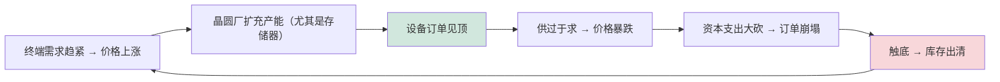

# 半导体资本设备市场数据、财务分析与投资动态

> 📘 **说明：** 本文为英文原版《SemiCap Market Data, Financial Analysis, and Investment Dynamics》的简体中文参考译本，仅供参考；如有出入，以英文原版为准。

半导体设备行业是一个规模庞大、增长迅速、周期性剧烈且利润极其丰厚的行业，处于尖端技术与金融市场的交汇点。少数几家主导企业享有全球经济中最高的利润率和最坚固的竞争护城河之一，但其收入随晶圆厂设备（WFE）周期而大幅波动。本文梳理市场规模与结构、收入与市场份额数据、研发强度与周期性、设备定价、公司财务、造就当今巨头的并购历史，以及影响半导体资本设备（SemiCap）投资的各项考量。

*关于数据的说明：以下数字为具有代表性的行业估计（来源包括国际半导体产业协会SEMI、Gartner、VLSI Research、TechInsights 及公司披露）；具体数值因来源和定义（WFE 与包含测试及封装在内的设备总额）而异，应视为近似值。*

---

## 📊 可视化概览

*原创示意图；Mermaid 图表可在 GitHub 上原生渲染。*

**全球半导体设备市场增长（十亿美元，约数；2026e/2028e 为 SEMI 2026 年 7 月预测）**

下图为各年份全球半导体设备销售额（十亿美元）的横向条形图，“e”表示预测值。

```
 2015   ████████████ 37
 2018   █████████████████████ 64
 2021   ██████████████████████████████████ 103
 2024   ███████████████████████████████████████ 117
 2025   ████████████████████████████████████████████ 133
 2026e  ███████████████████████████████████████████████████████ 166
 2028e  █████████████████████████████████████████████████████████████████████████████ 230
```

**周期性引擎——WFE 繁荣-萧条循环**



**设备价格跨越多个数量级（平均售价约数）**

下图依次为：High-NA EUV 扫描式光刻机（3.8 亿美元以上）、EUV 扫描式光刻机 NXE（约 1.8 亿美元）、DUV 浸没式（约 7,500 万美元）、电子束检测（约 5,000 万美元）、刻蚀/ALD 腔体（约 200–600 万美元）。

```
 High-NA EUV scanner   $380M+   ████████████████████████████████████████
 EUV scanner (NXE)     ~$180M   ███████████████████
 DUV immersion         ~$75M    ████████
 e-beam inspection     ~$50M    █████
 etch / ALD chamber    ~$2-6M   ▏
```

---

## 1. 全球半导体资本设备总可服务市场（TAM），2015–2030 年

半导体设备支出总额在十五年间大约增长了两倍，历经一系列周期：

| 年份 | 设备总额（十亿美元，约数） | 驱动因素 |
|---|---|---|
| 2015 | ~37 | 移动驱动；后 PC 时代低谷 |
| 2016 | ~41 | 3D NAND / DRAM 爬坡 |
| 2017 | ~57 | 存储器超级周期开始 |
| 2018 | ~64 | 存储器繁荣顶峰 |
| 2019 | ~60 | 存储器调整 |
| 2020 | ~71 | 新冠疫情带动数字化需求；EUV 爬坡 |
| 2021 | ~103 | 疫情期间供应紧张；创纪录资本支出 |
| 2022 | ~107 | 前沿逻辑/晶圆代工见顶 |
| 2023 | ~106 | 中国 DUV 提前采购抵消存储器下行 |
| 2024 | ~117 | AI 驱动的逻辑 + 先进封装；中国成熟节点采购 |
| 2025 | ~133（+13.7%） | AI 资本支出、2nm 爬坡、高带宽内存（HBM）（SEMI 2025 年 12 月年终数据） |
| 2026（预测） | ~166（+23%） | DRAM 引领的存储器上行周期、AI 逻辑、先进封装；WFE 约 1,440 亿美元（SEMI 2026 年 7 月） |
| 2027（预测） | 无（SEMI）——公司 WFE 预期约 1,900–2,100 亿美元 | DRAM、晶圆代工/逻辑、NAND；洁净室与零部件约束（泛林集团、东京电子、美银观点，2026 年 10 月） |
| 2028（预测） | ~230（创纪录） | AI 建设持续（SEMI 2026 年 7 月） |
| 2030（预估） | 隐含 >200 | 早期约 1,600–2,000 亿美元以上的预估已被 2026 年的预测取代 |

### 按细分领域划分

| 细分领域 | 约占 WFE 比例 | 领导者 |
|---|---|---|
| 光刻 | 20–25% | ASML |
| 薄膜沉积 | 20–25% | 应用材料、泛林集团、东京电子、ASM |
| 刻蚀 | 18–22% | 泛林集团、东京电子、应用材料 |
| 工艺控制 | 11–13% | 科磊 |
| 化学机械平坦化（CMP） | 4–6% | 应用材料、荏原 |
| 离子注入/热处理 | 5–8% | 应用材料、亚舍立 |
| 清洗 | 5–7% | 迪恩士、东京电子、泛林集团 |

### 按地区划分（晶圆厂所在地）

设备支出跟随晶圆厂建设：历史上**中国大陆、台湾和韩国**一直是最大的买家——中国在 2023–2024 年激增（成熟节点扩产及限制前的囤货），台湾以台积电（TSMC）的前沿支出为支撑，韩国则以三星（Samsung）和 SK海力士（SK hynix）的存储器支出为支撑。2025 年中国仍是最大的单一地区，但随着台湾（台积电 2nm/A16 和 CoWoS）和韩国（DRAM/HBM）加速投资，中国的占比在 2026 年正在下降。随着补贴驱动的晶圆厂陆续投产，**美国、日本和欧洲**的份额正在上升。

---

## 2. 设备占资本支出比例与主要客户

设备通常占**前沿晶圆厂建设成本的 75–80%**——是资本支出的主要组成部分。最大的设备买家是少数几家前沿制造商：
- **台积电**——单一最大的 WFE 客户，2021–2025 年年度资本支出在 **300–400 亿美元以上**区间，**2026 年上调至 600–640 亿美元**，占全球 WFE 总额的两位数百分比；分析师预计 2027 年约 850 亿美元。
- **三星**——在前沿逻辑/晶圆代工和存储器两方面均有大额支出。
- **英特尔（Intel）**——在其 IDM 2.0 / 晶圆代工建设上投入巨大；经历 2024–2025 年资本支出削减后，产能扩充（例如 14A）如今与已承诺的外部需求挂钩，不过据报道英特尔代工（Intel Foundry）2026 年的设备订单增长约 50%。
- **SK海力士和美光（Micron）**——由存储器驱动的周期性支出，2026 年因 HBM 和 DRAM 需求而大幅增加。
- **中国晶圆厂（中芯国际、长鑫存储、长江存储）**——可观的成熟节点支出，以及（受限的）先进节点支出。

这种集中度意味着单一客户的资本支出决定就可能撼动整个设备市场。

---

## 3. 收入与市场份额（2020–2024 年，约数）

| 公司 | 2023 年收入（十亿美元，约数） | 主要细分领域 | 地位 |
|---|---|---|---|
| **阿斯麦（ASML）** | ~28 | 光刻 | EUV 垄断 |
| **应用材料（Applied Materials）** | ~26 | 沉积、刻蚀、CMP、离子注入、工艺控制 | 产品组合最广 |
| **泛林集团（Lam Research）** | ~14–15 | 刻蚀、沉积、清洗 | 刻蚀领导者 |
| **东京电子（Tokyo Electron）** | ~13–15 | 涂胶显影、刻蚀、沉积、清洗 | 涂胶显影设备领导者 |
| **科磊（KLA）** | ~10 | 工艺控制 | 检测/量测领导者 |
| **ASM国际（ASM International）** | ~3 | ALD、外延 | ALD 领导者 |
| **迪恩士（SCREEN）** | ~3 | 清洗 | 湿法清洗领导者 |
| **Onto Innovation** | ~0.8 | 量测 | 光学关键尺寸（OCD）/封装 |
| **Nova** | ~0.5 | 量测 | OCD 专业厂商 |
| **亚舍立（Axcelis）** | ~1 | 离子注入 | 离子注入专业厂商 |

这五家领导者——ASML、应用材料、泛林集团、东京电子、科磊——合计占据 WFE 收入的绝大部分，是所有主要行业中集中度最高的结构之一。（2025–2026 年数据——例如 ASML 2025 年净销售额约 327 亿欧元及 2026 财年 440–450 亿欧元的指引——见下文 2025–2026 年更新。）

---

## 4. 研发强度与周期性

半导体资本设备企业的**研发强度维持在收入的约 12–18%**——位居各行业前列——资金来自其高利润率和庞大的经常性服务收入。研发是其护城河的基础：在 EUV、ALD、刻蚀和工艺控制领域保持领先所需的持续投入，本身就是一道进入壁垒。

**周期性**是其决定性的财务特征。WFE 周期由终端市场需求（尤其是波动剧烈的存储器市场）和晶圆厂建设浪潮驱动。历史周期——2017–2018 年存储器繁荣与 2019 年萧条、2021–2022 年疫情驱动的顶峰、2023 年存储器下行（被中国抵消）——显示年度支出波动幅度达 20–40%。规模最大、最多元化的企业（应用材料、泛林集团、东京电子）凭借横跨逻辑与存储器的广泛产品组合缓冲周期；专业厂商（亚舍立、偏重存储器的泛林集团）则对特定周期的杠杆效应更大。

---

## 5. 设备定价（平均售价）

不同设备类别的平均售价相差多个数量级：

| 设备 | 平均售价（约数） |
|---|---|
| EUV 扫描式光刻机（NXE） | ~1.5–2 亿美元 |
| 高数值孔径 EUV 扫描式光刻机（EXE） | ~3.8 亿美元以上 |
| DUV 浸没式扫描式光刻机 | ~6,000–9,000 万美元 |
| 刻蚀腔体/系统 | 每腔体 ~300–600 万美元；系统更高 |
| ALD/CVD 腔体 | ~200–500 万美元 |
| CMP 系统 | ~300–500 万美元 |
| 离子注入机 | ~300–800 万美元 |
| 检测设备（电子束 / 宽带等离子体光学） | ~3,000–8,000 万美元以上 |
| 关键尺寸扫描电镜（CD-SEM） | ~300–600 万美元 |

EUV 和 High-NA 扫描式光刻机是行业中单价最高的设备，这就是为什么 ASML 的收入可与产品组合广泛得多的应用材料相匹敌。平均售价呈强劲**上升**趋势——每一代光刻设备都更昂贵，工艺控制设备日益精密，而每个节点工艺步骤的增加又成倍放大了设备需求。

---

## 6. 关键财务特征

领导者们具有可辨识的共同财务特征：
- **毛利率**通常为 **40–60%**，**科磊和 ASML 处于高端**（反映其垄断/寡头定价能力；ASML 2026 年第三季度毛利率为 57.5%），产品组合广泛的企业则略低。
- **强劲的经常性收入**来自庞大装机基数的服务、备件和升级——平滑周期并为研发提供资金。
- **高经营杠杆**——固定的研发和制造成本意味着整个周期中利润波动大于收入波动。
- **订单积压和订单出货比（book-to-bill）** 是备受关注的领先指标：订单出货比高于 1.0 预示扩张，低于 1.0 预示收缩。

---

## 7. 半导体资本设备并购历史

当今的巨头在很大程度上是通过收购建立起来的，将各项能力整合为广泛的平台：

| 收购 | 年份 | 意义 |
|---|---|---|
| **应用材料 / Varian** | 2011 | 为应用材料增加离子注入业务 |
| **泛林集团 / Novellus** | 2012 | 为泛林的刻蚀业务增加沉积，打造沉积-刻蚀巨头 |
| **ASML / Cymer** | 2013 | 获得 EUV 光源 |
| **ASML / 汉微科（HMI，Hermes Microvision）** | 2016 | 增加电子束检测 |
| **科磊 / Orbotech** | 2019 | 扩展至 PCB、封装和特种检测 |
| **Entegris / CMC Materials** | 2022 | 为 Entegris 的材料组合增加 CMP 抛光液 |
| **应用材料 / Besi（约 9% 股权）** | 2025 | 少数股权；联合开发集成式混合键合系统 |
| **亚舍立 + 维易科（Veeco）（全股票合并，约 44 亿美元）** | 2025 年 10 月宣布；预计 2027 年第一季度末完成 | 将离子注入与沉积/刻蚀/湿法设备结合；尚待中国国家市场监督管理总局（SAMR）批准及重新提交 HSR 申报 |
| **应用材料 / ASMPT 旗下 NEXX 业务** | 2026 年 5 月达成协议（据报道） | 增加先进封装沉积/电化学沉积（ECD） |

若干拟议中的大型交易遭到**阻止**——最著名的是**应用材料 / 东京电子（2013–2015 年）**，因美国反垄断担忧而放弃；以及**应用材料/KKR 对国际电气（Kokusai Electric）的收购（2023–2024 年）**，最终告吹。这些被阻止的交易既反映了整合的战略价值，也反映了在一个已高度集中的行业中进一步集中所面临的反垄断限制。

---

## 8. 投资者考量

半导体资本设备为投资者呈现出独特的风险-回报特征：
- **周期性**——核心风险；收入尤其是利润随 WFE 周期剧烈波动，需要以穿越周期的长期视角看待。
- **中国敞口**——主要的波动因素；出口管制在结构上减少了中国前沿收入，但时间和深度仍不确定（[文件18](18_geopolitics_and_export_controls.md)）。
- **客户集中度**——少数客户驱动需求；单一客户项目的流失或延迟都影响重大。
- **研发护城河**——风险的另一面；领导者的技术主导地位和高利润率具有持久性，竞争格局很少改变。
- **毛利率特征**——利润率最高的业务（ASML 的 EUV 垄断、科磊的工艺控制主导地位）享有溢价估值。
- **长期顺风**——AI 驱动的资本支出、每个节点 EUV/High-NA 与工艺控制强度的提升、先进封装的爆发式增长，以及碳化硅/氮化镓（SiC/GaN）功率器件的增长，在周期性噪音之下提供了多年的结构性需求。

半导体资本设备的投资逻辑最终建立在本数据库核心的一个悖论之上：即便经典摩尔定律微缩放缓且成本日益高昂，**每个节点的复杂度和成本却在上升**，成倍增加了对设备的需求、推高了设备价值，并将行业越来越多的经济价值集中到少数能够制造这些设备的企业手中。尺寸微缩的放缓并不是设备行业增长的终结——而是将这种增长重新分配给光刻、工艺控制、新材料加工和封装，以及少数拥有技术和护城河、足以主导这些前沿领域的公司。

---

## 延伸分析：周期性、细分领域动态与 AI 超级周期

### A. WFE 周期剖析

WFE 周期由终端市场需求、存储器价格和晶圆厂建设时点的相互作用驱动，具有可辨识的节奏。**上行期**通常始于终端需求（PC、手机、数据中心、汽车）使芯片供应趋紧、价格坚挺之时，制造商——尤其是存储器制造商——竞相扩充产能，大量订购设备。交货周期拉长，原始设备制造商（OEM）的订单积压膨胀，订单出货比升至 1.0 以上。当新增产能赶上（且往往超过）需求时，**顶峰**到来。随后进入**下行期**：供过于求使芯片价格暴跌（存储器最为剧烈），制造商几乎在一夜之间削减资本支出，OEM 订单蒸发，订单出货比跌破 1.0——由于资本支出是制造商预算中最具弹性、削减最快的项目，下滑往往陡峭而突然。**低谷**一直持续到库存出清、需求恢复，并孕育下一个周期。

几个特征使这一周期可以交易和分析：它由**存储器**（波动最剧烈的细分领域）引领；它可以通过**订单出货比和订单积压**数据提前观察；它还受到**经常性服务收入**的缓冲（无论新设备需求如何，装机基数都需要备件和服务，从而提供底部支撑）。规模最大、最多元化的 OEM（应用材料、泛林集团、东京电子）凭借横跨逻辑与存储器的广泛产品组合穿越周期；专业厂商和偏重存储器的企业（泛林集团的存储器敞口、亚舍立）波动更大。

### B. 细分领域分化

一个关键的细微之处在于，各细分领域**并非**同步变动。**前沿逻辑/晶圆代工**（以台积电为支柱）跟随节点转换以及如今的 AI 周期；**存储器**跟随大宗商品价格周期；**成熟节点/特色工艺**跟随汽车、工业以及（近年来）芯片短缺和中国国产化驱动的扩产；而**先进封装**如今在很大程度上独立地跟随 AI 周期。这种分化既平滑了总量（存储器下行可能与逻辑繁荣同时发生），也创造了机会（在特定时期对最强细分领域敞口最大的企业表现更优）。2023 年的情况就是例证：存储器下行在很大程度上被中国成熟节点设备采购的激增和韧性十足的前沿逻辑所抵消——因此即使存储器支出大幅下降，WFE 总额仍大致持平。

### C. AI 超级周期

2023 年以来的生成式 AI 热潮引入了一个跨越各细分领域的强大新需求驱动力。它推动了**前沿逻辑**（采用台积电最先进节点的英伟达（Nvidia）/AMD GPU）、**HBM**（高带宽内存，DRAM 市场中最热门的领域，需要先进 DRAM 加上硅通孔（TSV）/堆叠/键合），尤其是**先进封装**（CoWoS，其产能成为 AI 加速器供应的多年瓶颈）。对设备行业而言，AI 超级周期具有几个鲜明特征：它将需求集中在**前沿和封装领域**（有利于 ASML、先进沉积/刻蚀/量测领导者以及封装/键合专业厂商）；它使 **HBM 和封装**即便在 2023 年存储器下行期间也成为难得的亮点——到 2026 年更推动存储器成为*领跑*增长的细分领域（DRAM 引领的“存储器超级周期”，SEMI 预测 2026 年 DRAM 设备增长约 39% 至约 388 亿美元）——并推动台积电和存储器制造商专门为 AI 进行多年期产能扩张。AI 超级周期最终是持久还是会回调（如所有周期一样），是该行业中期前景的核心问题，但它已明确无误地将设备需求的重心转向前沿、先进 DRAM/HBM 和先进封装。

### D. 估值与业务质量

半导体资本设备领导者之所以享有溢价估值，是因为在周期性之下，它们拥有质量异常之高的业务：垄断或寡头市场地位、全行业最高的研发强度（为持久护城河提供资金）、高毛利率（40–60%，ASML 和科磊居首）、庞大的经常性服务收入，以及对数十年长期增长（计算需求、AI、电气化）的敞口。投资争论的焦点在于权衡这些持久优势与周期性风险、结构性的中国逆风（[文件18](18_geopolitics_and_export_controls.md)）以及客户集中度。市场通常给予护城河最坚固、长期增长最清晰的企业最高估值倍数——**ASML**（EUV 垄断）、**科磊**（工艺控制主导地位、每个节点强度不断提升）以及产品组合广泛的领导者——反映出一种判断：纵观整个周期，它们属于全球质量最高的工业企业之列。尺寸微缩经济性的恶化非但没有削弱这一论点，反而强化了它：随着每个节点日益复杂、对设备的依赖日益加深，设备领导者所获取的价值不断增长，使半导体资本设备成为押注整个计算未来的一种带杠杆（尽管具有周期性）的投资。

---

## 进一步分析：长期投资逻辑

### A. 周期之下的长期增长

在主导逐年图景的剧烈周期性之下，存在着一股强大的**长期增长趋势**，它定义了半导体资本设备的长期投资逻辑。数十年来，设备支出总额大约增长了两倍（从 2015 年的约 370 亿美元增至 2025 年的约 1,330 亿美元，SEMI 预测 2026 年约 1,660 亿美元、2028 年创纪录的约 2,300 亿美元——远高于此前对 2030 年预估的 1,600–2,000 亿美元），其驱动力超越周期：计算需求的持续增长（如今被 AI 进一步放大）、每个节点成本和复杂度的上升（更多工艺步骤、更多 EUV、更多工艺控制、新材料、三维集成——每一项都成倍放大设备需求和价值）、先进封装作为新支出类别的爆发式增长，以及电气化驱动的化合物半导体（SiC/GaN）设备增长。关键洞见在于，即使*尺寸微缩的步伐放缓*，设备市场仍在增长，因为每个节点复杂度和成本的上升足以抵消节奏的放缓——每片晶圆更多的工艺步骤、更高价值的设备、不断提升的工艺控制和光刻强度，以及全新的设备类别。这种在周期性噪音之下持续的长期增长，是长期投资逻辑的基础：半导体资本设备是一个结构性增长的行业，以杠杆方式押注整个计算的未来，尽管短期内仍具周期性。

### B. 业务质量

叠加在长期增长之上的是**领先业务的卓越质量**，正是这一点使半导体资本设备不仅是一个增长的行业，更是一个高利润、可防御的行业。领导者拥有垄断或寡头地位（ASML 的 EUV 垄断、科磊的工艺控制主导地位、几乎每个类别的集中结构）、全行业最高的研发强度（为持久护城河提供资金）、高毛利率（40–60%，垄断者居首）、庞大的经常性服务收入（平滑周期并为研发提供资金），以及所有行业中最深的竞争护城河（积累的技术诀窍、与客户的联合开发、装机基数锁定、专利与商业秘密——见[文件14](14_vendor_competitive_landscape.md)、[文件17](17_patents_and_ip_landscape.md)）。这些业务极其持久：竞争格局变化缓慢，领导者的地位即使面对资金雄厚的挑战者（包括中国受补贴的厂商）也能守住，而且随着节点越来越难，护城河还在加深。长期增长与卓越业务质量的结合，使半导体资本设备领导者获得溢价估值，并使其在整个周期中跻身全球质量最高的工业企业之列——以杠杆方式（尽管具有周期性）押注整个计算的未来。

### C. 定义争论的风险

投资争论的焦点在于权衡这些优势与一系列真实风险。**周期性**是核心的近期风险——收入尤其是利润随 WFE 周期剧烈波动，需要以穿越周期的长期视角看待，并能承受波动。**中国敞口**是主要的结构性波动因素——出口管制（[文件18](18_geopolitics_and_export_controls.md)）在结构上减少了在位企业的中国前沿收入，同时培育了威胁成熟节点市场的中国本土竞争者，而这一动态的时间、深度和最终结果仍确实难以确定。**客户集中度**意味着少数客户（台积电、三星、英特尔、SK海力士、美光）驱动需求，因此单一客户项目的延迟或流失影响重大。**AI 超级周期的持久性**是一个悬而未决的问题——AI 驱动的前沿和封装需求激增一直是强劲的顺风，但所有周期终将回调，而最终回调的深度至关重要。此外，**前沿微缩的步伐与成本**——行业能否继续从日益昂贵的节点中获取经济价值——是长期需求的基础。权衡持久优势（长期增长、业务质量、深厚护城河）与这些风险（周期性、中国、集中度、AI 周期持久性）是半导体资本设备投资争论的本质；市场通常给予护城河最坚固、长期增长最清晰的企业（ASML、科磊、产品组合广泛的领导者）最高估值，反映出一种判断：纵观整个周期，业务质量和长期增长的力量胜过这些风险。尺寸微缩经济性的恶化非但没有削弱这一论点，反而强化了它：随着每个节点日益复杂、对设备的依赖日益加深，设备领导者所获取的价值不断增长——这使半导体资本设备尽管具有周期性和地缘政治敞口，仍是押注数字与 AI 时代不可或缺之基础的一种杠杆投资。

---

## 🆕 2025–2026 年更新：最新进展（截至 2026 年 11 月）

AI 基础设施建设使原本预期温和的 2025–2026 年扩张，演变为行业史上最强劲的设备上行周期。就在 2025 年末作出的预测已被大幅上调，争论焦点也从“AI 周期能持续多久？”转向“供应链能否在物理上交付这些设备？”

### 市场规模：预测被大幅上调

- **2025 年实际：** SEMI 2025 年 12 月年终预测显示，原始设备制造商设备销售总额约为 **1,330 亿美元（同比增长 13.7%）**，创历史纪录。当时 SEMI 预测 2026 年为 1,450 亿美元、2027 年为 1,560 亿美元。
- **2026 年：** SEMI **2026 年 7 月 14 日年中预测**将 2026 年上调至 **1,659 亿美元（+23.2%）**，其中 **WFE 为 1,439 亿美元（+23.1%）**，**DRAM 设备增长 39% 至约 388 亿美元**，**测试设备 153 亿美元**（大幅上调），封装与组装设备约 67 亿美元。SEMI 目前预计 **2028 年将达创纪录的 2,295 亿美元**。
- **2027 年：** SEMI（2026 年 8 月）预计仅 300mm 晶圆厂设备支出在 2027 年就将超过 1,500 亿美元。2026 年 10 月发布的公司和分析师 WFE 预期显示，增幅将远超 SEMI 此前 1,560 亿美元的设备总额预测：

| 来源（日期） | 2026 年 WFE 预期 | 2027 年 WFE 预期 |
|---|---|---|
| 泛林集团（2026 年 10 月 21 日） | 约 1,500 亿美元中段 | >2,000 亿美元（初步）；由 DRAM 引领，其次为晶圆代工/逻辑，再次为 NAND |
| 科磊（2026 年 10 月） | 约 1,500 亿美元低段（由“1,400 亿美元以上”上调） | “显著增长” |
| 东京电子（据报道） | — | ≥1,900 亿美元 |
| 美银（BofA） | 1,560 亿美元 | 2,100 亿美元 |
| SEMI（2026 年 7 月），仅 WFE | 1,439 亿美元 | — |

SEMI 数据与各公司自身的 WFE 估计口径不同，因此上述区间不可直接比较。在更广泛的芯片行业，Gartner 预计 2026 年半导体资本支出约 2,370 亿美元，世界半导体贸易统计组织（WSTS）预测 2026 年半导体收入约 9,750 亿美元，Omdia 则表示可能超过 1 万亿美元。

### 公司财务（最新报告数据，据公司公告及媒体报道）

| 公司 | 最新期间 | 关键数据 | 展望 / 备注 |
|---|---|---|---|
| **ASML** | 2026 年第三季度（2026 年 10 月 14 日） | 创纪录净销售额 117 亿欧元；毛利率 57.5%；净利润 50 亿欧元；EUV 系统销售额 41 亿欧元，含 1 台 High-NA | 2026 财年指引 440–450 亿欧元（2025 年约 327 亿欧元）；第四季度指引 142–152 亿欧元，毛利率约 57% |
| **应用材料** | 2026 财年第三季度（2026 年 8 月 13 日） | 创纪录收入约 91 亿美元（同比 +25%）；非 GAAP 每股收益 3.50 美元；中国占收入 28% | 第四财季指引约 102.5 亿美元；管制使 2026 财年收入减少约 6 亿美元 |
| **泛林集团** | 2026 财年（截至 2026 年 6 月）；2026 年 9 月季度 | 全年收入约 232 亿美元（+26%，据媒体汇总）；9 月季度每股收益 2.20 美元，高于预期的 2.18 美元；晶圆代工销售额创纪录 | 2027 自然年 WFE >2,000 亿美元（初步）；提示洁净室/零部件约束 |
| **科磊** | 2026 年 9 月季度 | 预计 2026 年先进封装工艺控制收入约 11 亿美元（+70%，据报道） | 上调 2026 年 WFE 预期 |
| **东京电子** | 2026 财年上半年 | 上半年创纪录（据报道） | 2027 年 WFE ≥1,900 亿美元（据报道） |
| **爱德万测试（Advantest）** | 2026 年 9 月季度 | 季度收入与营业利润率创纪录（据媒体报道；各来源数字不一） | AI/HBM 测试需求 |
| **泰瑞达（Teradyne）** | 2026 年 9 月季度 | 收入约 13.1 亿美元 | 2026 年指引中值约 52 亿美元；AI 约占收入 70%（2026 年第一季度） |

**测试**领域成为超额赢家：据报道，2026 年测试机市场预期已上调至约 130–145 亿美元，由 AI 加速器和 HBM 驱动。

### 客户资本支出

**台积电**将 2026 年资本支出上调至 **600–640 亿美元**（此前为 520–560 亿美元），并表示 2026–2028 年资本支出将“显著高于”此前三年；分析师预计 2027 年约 850 亿美元。台积电 2026 年第三季度收入约 467 亿美元，第四季度指引为 523–543 亿美元。存储器制造商正积极扩产（SK海力士龙仁一号晶圆厂目标 2027 年第一季度；据报道 SK海力士计划在美国上市，募资最多约 360 亿美元用于晶圆厂和 EUV 设备；美光在新加坡建设约 70 亿美元的 HBM 封装工厂）。据报道，英特尔代工 2026 年设备订单增长约 50%。

### 供应成为约束

ASML 表示，其计划供应量**无法完全满足 2027 年和 2028 年的客户需求**；公司计划在 2027 年将低数值孔径 EUV 和 DUV 浸没式产能提升约 30%，并正在研究进一步扩产，而客户已在要求下 2029–2030 年的订单。泛林集团警告，**洁净室空间短缺和零部件供应**可能限制行业产出。对投资者而言，这改变了周期的形态：决定 2027 年收入的可能是交货周期和订单积压，而非订单本身。

### 并购与业务组合调整

- **亚舍立–维易科**（约 44 亿美元全股票交易；每股 VECO 换 0.3575 股 ACLS）：双方股东于 2026 年 2 月 6 日批准；目前预计在 2027 年第一季度末前完成，尚待中国国家市场监督管理总局批准及重新提交 HSR 申报。
- **应用材料**于 2026 年 5 月同意收购 ASMPT 旗下 **NEXX** 先进封装沉积/电化学沉积业务（据报道），此前已于 2025 年取得 **Besi** 约 9% 股权。
- **ASML** 领投 Mistral AI 的 C 轮融资（约 13 亿欧元，2025 年 9 月）；**泛林集团**据报道宣布在印度投资约 12 亿美元用于零部件制造（2026 年 10 月）。

### 估值与市场情绪

尽管业绩超预期，设备股在 2026 年 8–10 月间仍波动剧烈，反映的是板块轮动以及对 AI 资本支出持久性、中国敞口和供应限制的争论，而非已报告需求出现任何恶化。

**值得关注（2026 年末至 2027 年）**

- SEMI 2026 年 12 月年终预测，以及其是否采纳 2027 年 WFE 达 2,000 亿美元以上的观点。
- ASML 2026 年第四季度业绩（2027 年 1 月）及其 2027 年 6 月 10 日资本市场日（2030 年目标、High-NA 采用情况）。
- 应用材料 2026 财年业绩（2026 年 11 月）及中国占比趋势。
- 设备交付瓶颈（洁净室、零部件）将收入推迟至 2028 年的迹象。
- DRAM/HBM 价格作为存储器资本支出的摇摆因素；AI 资本支出进入消化期的任何迹象。
- 亚舍立–维易科交易的完成，以及封装和测试领域的进一步整合。
