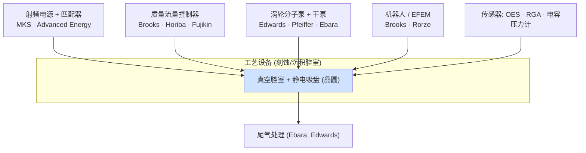

# 关键子系统、零部件与设备供应链

> 📘 **说明：** 本文为英文原版《Critical Subsystems, Components, and the Equipment Supply Chain》的简体中文参考译本，仅供参考；如有出入，以英文原版为准。

每一台价值数百万美元的工艺设备背后，都有一条由专业化**子系统和零部件**构成的纵深供应链——射频电源、真空泵、质量流量控制器、静电吸盘、陶瓷件、机器人、传感器以及流体处理部件，正是它们让设备得以运转。在讨论半导体资本设备（SemiCap）时，这些子系统往往被忽视，但它们不可或缺、技术要求极高，并具有重要的战略意义：单一子系统的短缺就可能限制整台设备的产出，而子系统供应商本身也是整个设备行业景气度的风向标。本文概述关键子系统类别、其供应商以及设备供应链的结构。

其中的经济逻辑十分重要：主要原始设备制造商（OEM）——应用材料（Applied Materials）、泛林集团（Lam Research）、东京电子（Tokyo Electron，TEL）、阿斯麦（ASML）——负责设计和集成设备，但**将物料清单（BOM）中的很大一部分外包**给专业的子系统制造商。这使得子系统供应商成为晶圆厂设备（WFE）需求的杠杆型标的，同时也是OEM的关键依赖——OEM必须提前数年对这些零部件进行认证并锁定供应。

---

## 📊 可视化概览

*原创示意图；Mermaid图表可在GitHub上原生渲染。*

**工艺设备解剖——使其运转的各个子系统**



**子系统创新推动工艺创新——同时也制约设备产出**

下图说明：更好的射频脉冲 → 实现先进刻蚀/原子层刻蚀；更快的质量流量控制 → 实现ALD精确剂量控制；更好的静电吸盘均匀性 → 实现全晶圆范围内严格的关键尺寸控制（子系统短缺可能导致设备停止出货——2021–22年的紧缺已证明这一点，2026年零部件交期拉长再次印证了这一点）。

```
 Better RF pulsing      → enables advanced etch / ALE
 Faster mass-flow ctrl  → enables ALD dose precision
 Better ESC uniformity  → enables tight CD across the wafer
 (A subsystem shortage can halt tool shipments — as the 2021-22 crunch showed,
  and as stretched 2026 component lead times are showing again)
```

---

## 1. 射频电源与匹配网络

基于等离子体的工艺——刻蚀、等离子体增强化学气相沉积（PECVD）、等离子体增强原子层沉积（PEALD）、溅射——需要**射频（RF）功率**来产生并维持等离子体，射频功率通过**匹配网络**输送，该网络将发生器与不断变化的等离子体负载耦合起来。射频电源是最关键的子系统之一：射频电源的精度、稳定性和脉冲能力直接决定刻蚀和沉积的性能。<strong>电感耦合（ICP）</strong>和<strong>电容耦合（CCP）</strong>等离子体采用不同的激发方式，现代工艺越来越依赖**脉冲射频**（对功率进行快速调制）来控制自由基与离子的比例并减少充电损伤。领先供应商为**MKS Instruments（自2025年起以MKS Inc.名义运营）、Advanced Energy和Comdel/XP Power**，射频电源是一个高价值、对性能至关重要的类别。

---

## 2. 质量流量控制器（MFC）

每一道沉积、刻蚀和清洗工艺都依赖于精确计量的气体流量，这由**质量流量控制器**提供——即以高精度测量并调节气体流量的器件。原子层沉积（ALD）的要求尤其严苛：在自限制循环中投放前驱体所需的快速、精确的**脉宽控制**，要求MFC快速、准确且可重复。领先供应商包括**Brooks Instrument、Horiba（堀场，Horiba STEC）、Fujikin（富士金）和Parker（派克汉尼汾）**。MFC的精度和响应时间对工艺控制有着不显眼却决定性的影响，尤其是在ALD和原子层级工艺日益普及的情况下。

---

## 3. 真空系统

大多数先进工艺都在**真空**下进行，这需要一整套分级的泵和真空计。**涡轮分子泵**（高真空）和**干式粗抽泵**（粗真空/前级真空）负责抽空腔室，而**电容式压力计和电离真空计**则用于测量压力。真空完整性是根本——泄漏或泵引入的颗粒都会降低良率。领先的真空供应商为**Pfeiffer Vacuum（普发真空）、Edwards（埃地沃兹，隶属Atlas Copco阿特拉斯·科普柯）、Leybold（莱宝）和荏原（Ebara）**（干泵）。极紫外光刻（EUV）对扫描式光刻机的光路提出了极端的真空要求。真空是一个规模大、不可或缺且相对集中的子系统市场。

---

## 4. 尾气处理

工艺尾气中含有有毒、腐蚀性、易燃和温室气体，必须在排放前加以处理。**使用点（POU）尾气处理**系统——采用**燃烧（热处理）、湿式洗涤、等离子体或催化**方法，通常组合使用（“燃烧-湿式洗涤”）——销毁或捕集这些气体，其中包括强效的<strong>全氟化碳（PFC）</strong>温室气体（见[文件21](21_sustainability_and_environmental.md)）。供应商包括**荏原（Ebara）、CS Clean Solutions（Busch）、Edwards（Atlas Copco）和Ecosys/DAS**。尾气处理既是环保上的必需，也是一套安全系统，随着排放法规日趋严格，其重要性不断上升。

---

## 5. 静电吸盘（ESC）

在加工过程中，晶圆必须保持平整、静止并处于精确控制的温度下，这越来越多地依靠**静电吸盘**实现：它以静电力夹持晶圆，并在多个区域调节其温度。静电吸盘存在两种物理机制：**Johnsen-Rahbek（约翰森-拉贝克）型**（使用略具导电性的陶瓷）和**库仑型**（使用绝缘陶瓷）。静电吸盘由先进陶瓷（**Al₂O₃、AlN**）制成，提供对刻蚀和沉积关键尺寸（CD）控制至关重要的**多区温度均匀性**。供应商包括OEM的自有业务，以及**Shinko（新光电气）、NGK（日本碍子）、Kyocera（京瓷）和TOTO**等专业厂商。静电吸盘是技术要求最高的零部件之一，直接影响工艺均匀性。

---

## 6. 陶瓷与工艺套件部件

工艺腔室内部衬有**消耗性的陶瓷和特种部件**，它们必须承受强烈的等离子体和化学腐蚀：**Al₂O₃腔室内衬、SiC聚焦环、Y₂O₃（氧化钇）涂层部件**，以及各种石英和陶瓷部件。这些<strong>工艺套件（process kit）</strong>部件会随时间被侵蚀，必须定期更换，从而产生可观的**经常性收入**，并占晶圆厂运营成本的相当比例。工艺套件更换的经济性（寿命、成本、颗粒表现）是设备拥有成本中的实际考量因素。供应商包括**京瓷（Kyocera）、CoorsTek、NGK、Ferrotec（磁性流体技术）和Entegris**，以及涂层专业厂商。随着等离子体工艺日益激进，氧化钇及其他抗等离子体涂层是一个活跃的研发领域。

---

## 7. 晶圆传输与机器人

晶圆必须以极高的精度和洁净度在晶圆厂内以及每台设备内部移动，这依靠**真空和大气机器人**、将设备与晶圆厂自动化系统对接的**设备前端模块（EFEM）**，以及在微环境中运送晶圆的**前开式晶圆传送盒（FOUP）**（按SEMI E47.1标准化）。供应商包括**Brooks Automation**（原Brooks公司——现为生命科学公司Azenta——于2022年出售给Thomas H. Lee Partners的半导体自动化业务）、**Rorze（乐华）、Genmark（Persimmon）和Yaskawa（安川电机）**。可靠、无颗粒的晶圆传输是根本——一次传输失误就可能导致晶圆报废——而机器人吞吐量也影响设备产能。

---

## 8. 传感器与量测子系统

工艺设备内嵌大量用于监测和控制的**传感器**：**电容式压力计**（压力）、**光学发射光谱（OES）**（等离子体/刻蚀终点）、<strong>残余气体分析仪（RGA）</strong>和**质谱仪**（气体成分）、温度传感器以及光学监测器。这些原位传感器为先进过程控制回路（见[文件08](08_metrology_and_inspection.md)）提供数据，使工艺保持在目标值上。供应商包括**MKS、Inficon（英福康）和Hiden Analytical**，以及OEM的自有传感器研发。

---

## 9. 高纯流体处理

接触晶圆的化学品和气体必须通过**超洁净流体处理部件**输送——**PTFE/PFA阀门、管件、管路、过滤器和泵**，且不得引入任何污染。供应商包括**Entegris（流体处理和过滤领域的领导者）、Swagelok（世伟洛克）、Parker（派克）和Saint-Gobain（圣戈班）**。纯度要求（十亿分之一级乃至更高，见[文件16](16_key_materials_and_chemicals.md)）使流体处理部件成为一个专业化、高价值的类别。

---

## 10. 污染控制

晶圆厂环境本身就是一个受控系统，需要**ULPA/HEPA过滤器**（几乎去除空气中的所有颗粒）、**微环境**（即使在洁净度较低的晶圆厂中，FOUP和设备外罩也能在晶圆周围维持ISO 1–5级洁净度）以及离子发生器（静电放电控制）。污染控制涵盖设备、微环境和洁净室（见[文件24](24_cleanroom_and_fab_infrastructure.md)），是良率的根本。供应商包括过滤器制造商（**AAF、Camfil（康斐尔）、Daikin（大金）**）以及更广泛的洁净室基础设施生态系统。

---

## 11. 子系统供应商格局

| 子系统 | 领先供应商 |
|---|---|
| 射频电源与匹配 | MKS Instruments、Advanced Energy、Comdel |
| 质量流量控制器 | Brooks Instrument、Horiba、Fujikin、Parker |
| 真空泵与真空计 | Pfeiffer、Edwards（Atlas Copco）、Leybold、荏原（Ebara） |
| 尾气处理 | 荏原（Ebara）、CS Clean Solutions、Edwards、Ecosys |
| 静电吸盘 | Shinko、NGK、Kyocera、TOTO（+ OEM自有） |
| 陶瓷 / 工艺套件 | Kyocera、CoorsTek、NGK、Ferrotec、Entegris |
| 机器人与自动化 | Brooks Automation、Rorze、Genmark、Yaskawa |
| 传感器 | MKS、Inficon、Hiden |
| 流体处理与过滤 | Entegris、Swagelok、Parker、Saint-Gobain |
| 外包组装 | Ultra Clean Holdings（UCTT）、Ichor、Celestica（天弘） |

若干**集成商**——尤其是<strong>Ultra Clean Holdings（UCTT）</strong>和**Ichor**——为OEM组装完整的气体输送和流体子系统，在零部件制造商与设备制造商之间占据重要的一层。

---

## 12. 财务与战略意义

子系统供应商占据着战略上重要、财务上独特的位置。**MKS Instruments、Advanced Energy、Ultra Clean Holdings和Ichor**等公司是**WFE需求的杠杆型标的**——它们的业绩随设备周期起伏，波动往往比OEM本身更大。尤其是**MKS Instruments**，其产品组合广泛（射频电源、真空、流量、光子学，以及通过收购Atotech获得的电镀化学品），覆盖众多设备，是整个设备行业备受关注的风向标。

对OEM而言，子系统供应链是一项关键依赖：射频发生器、真空泵或特种陶瓷的短缺，无论需求如何都可能限制设备产出——2021–2022年的供应紧缺已生动地证明了这一点，当时零部件短缺限制了OEM的出货能力，即便其积压订单创下纪录。2026年由人工智能驱动的上行周期再次引发了同样的担忧：泛林集团在2026年10月指出，零部件供应限制（以及洁净室空间短缺）可能制约行业产出；韩国媒体报道也提到射频电源、陶瓷部件、阀门和气体柜的交期不断拉长（见下文2025–2026年更新）。这促使OEM加深与关键子系统供应商的关系，并在某些情况下对其进行投资或实施双重采购。

因此，子系统与零部件层是“地基之下的地基”——这条专业化、技术要求高、常被忽视的供应链使世界上最先进的制造设备成为可能，其健康状况与其所服务的设备行业密不可分。

---

## 延伸分析：子系统层的战略作用

### A. 外包逻辑

主要OEM（应用材料、泛林集团、东京电子、阿斯麦）本质上是**集成者和工艺知识的拥有者**：它们的价值在于懂得如何将工艺配方转化为能实现良率的量产设备，以及围绕设备的系统级集成、控制软件和客户关系。因此，它们**将实体物料清单的很大一部分外包**——通常达50%或以上——给专业子系统制造商，后者开发和制造射频发生器、真空泵、质量流量控制器等产品的效率高于OEM自制。这种外包逻辑造就了纵深的多层级供应链，并使子系统供应商成为**WFE需求的杠杆型标的**——它们的收入随设备周期起伏，且往往比OEM更为剧烈，因为它们处于供应链更上游，承受库存波动带来的牛鞭效应。

### B. 2021–2022年供应紧缺的教训

2021–2022年的供应紧缺生动地展示了子系统层的关键性。随着需求激增，OEM发现自己无法出货，原因不是缺少订单，而是缺少**零部件**——射频发生器、真空泵、特种陶瓷，尤其是用于设备自身控制电子的半导体（这是一个递归式的讽刺：制造芯片的设备反受芯片短缺制约）。部分子系统的交期延长至一年甚至更久，OEM的积压订单因无法交付而急剧膨胀。这一教训重塑了行业的供应链战略：OEM加深了与关键子系统供应商的关系，尽可能实施双重采购，投资或收购关键供应商，并持有更多库存——这一事件也凸显出，设备行业的产出受制于其最薄弱的子系统环节，而不仅仅是自身的组装产能。

### C. 子系统性能即工艺性能

一个微妙但至关重要的观点是，子系统性能往往**直接决定工艺性能**。射频发生器的稳定性和脉冲精度塑造刻蚀和沉积结果；质量流量控制器的精度和响应决定ALD剂量控制；静电吸盘的温度均匀性决定全晶圆范围内的刻蚀CD均匀性；工艺套件陶瓷的颗粒表现影响缺陷率和良率。因此，OEM会结合自身工艺需求与供应商紧密**协同设计**这些子系统，而最优秀的子系统供应商是深度技术合作伙伴，而非单纯的零部件供应商。这种协同设计形成了高黏性的合作关系，也意味着子系统创新（更快的射频脉冲、更精确的流量控制、更抗等离子体的陶瓷）往往是工艺创新的推动力——一项新的刻蚀能力可能依赖于其底层新的射频或吸盘能力。

### D. 工艺套件耗材经济

**工艺套件**——腔室内在等离子体和化学品作用下被侵蚀的消耗性陶瓷和金属部件（内衬、聚焦环、电极、屏蔽件）——代表着一项规模大、可持续的经常性收入来源，也占晶圆厂运营成本的相当比例。这些部件必须定期更换（**湿法清洗/部件更换周期**是设备停机和拥有成本的关键驱动因素），其性能（寿命、颗粒产生、抗等离子体能力）对良率和生产率有实质影响。其经济性——部件成本、寿命、翻新以及更换所需的停机时间——是设备拥有成本中的实际考量，而随着等离子体工艺愈发激进，**抗等离子体涂层**（氧化钇及先进稀土涂层）成为活跃的研发领域。工艺套件业务由陶瓷专业厂商（京瓷、CoorsTek、NGK）及OEM自有的零部件业务提供，是设备销售之外一项可持续、高利润的补充。

### E. 子系统供应商作为风向标

由于子系统供应商横跨众多设备和众多OEM，其业绩被视为整个设备行业的**风向标**。**MKS Instruments**拥有广泛的产品组合（射频电源、真空、流量、光子学以及通过Atotech获得的电镀化学品），是典型代表——其订单出货比和管理层评论预示着WFE需求的方向。**Advanced Energy**（射频与电源）、**Ultra Clean Holdings**和**Ichor**（气体/流体子系统集成商），以及**Brooks Automation**（自动化；自2022年起为私有公司，而其原母公司Azenta已成为生命科学公司）同样追踪并反映着周期。对投资者和行业观察者而言，子系统层既提供了参与WFE需求的杠杆方式，也提供了判断其方向的早期信号——而对OEM而言，它是其设备乃至整个芯片产业赖以建立的不可或缺的基础。

---

## 进一步分析：子系统创新是工艺创新的基础

### A. 子系统进步如何推动工艺进步

一个微妙但至关重要的动态是，**工艺创新往往依赖于其底层的子系统创新**。一项新的刻蚀或沉积能力常常需要一个全新或改进的子系统来实现：更快、更精确的**射频脉冲**能够更好地控制自由基与离子比例，以实现先进刻蚀和原子层刻蚀（ALE）；更快、更准确的**质量流量控制**能够实现ALD和原子层级工艺所需的精确剂量；更好的**静电吸盘**温度均匀性能够实现先进刻蚀所要求的CD均匀性；更**抗等离子体的陶瓷和涂层**使高深宽比（HAR）和选择性工艺所需的强等离子体成为可能；更好的**真空和气体纯度**控制能够实现先进薄膜所需的洁净度。在每一种情况下，工艺能力都受制于子系统能力，OEM与子系统供应商共同对其进行协同设计。这意味着子系统创新并非被动的供应活动，而是工艺进步的主动推动力——新一代射频发生器、流量控制器或吸盘可以解锁一项新的工艺能力，而子系统供应商（MKS、Advanced Energy、Brooks、Horiba以及各陶瓷制造商）是推动前沿进步的真正技术合作伙伴，而非单纯的零部件供应商。认识到这一点，便提升了子系统层的战略重要性：它是创新引擎的一部分，而不仅仅是供应链。

### B. 脆弱性与应对

2021–2022年的供应紧缺（见上文B节）暴露了OEM对子系统层的依赖所带来的**脆弱性**：设备行业的产出受制于其最薄弱的子系统环节，任何关键零部件的短缺——射频发生器、真空泵、特种陶瓷，甚至设备自身控制电子所需的芯片——都可能无论需求如何而限制设备生产。行业的应对以持久的方式重塑了其供应链战略。OEM**加深了**与关键子系统供应商的**关系**（更长期的协议、更紧密的协同规划），在可行之处推行**双重采购**（认证第二供应来源以降低单点风险），在某些情况下**投资或收购**关键供应商（对关键能力进行垂直整合），并持有**更多**长交期零部件的**库存**。子系统供应商则相应扩充了产能并推动供应区域化（部分是对[文件18](18_geopolitics_and_export_controls.md)所述地缘政治压力的回应）。这种再平衡——转向韧性和冗余，而非一味追求效率——反映了一个惨痛的教训：在一个集中且相互依存的供应链中，中断的代价远远超过防止中断所需的缓冲和冗余成本。子系统供应链的韧性已成为OEM的战略优先事项，与材料供应链的韧性（见[文件16](16_key_materials_and_chemicals.md)）同等重要。

### C. 子系统层作为行业风向标与投资标的

子系统供应商作为设备行业的**风向标和杠杆型投资标的**占据独特位置。由于它们横跨众多设备和众多OEM，其订单趋势和管理层评论能够对WFE需求提供早期、全面的判断——**MKS Instruments**的产品组合涵盖射频电源、真空、流量、光子学以及（通过Atotech获得的）电镀化学品，是典型的行业风向标，**Advanced Energy、Ultra Clean Holdings和Ichor**同样追踪并反映着周期。对投资者而言，子系统层既提供了参与WFE需求的杠杆方式（子系统供应商处于供应链更上游，其波动往往大于OEM），也提供了判断其方向的早期指标。对行业而言，子系统层的健康与行业自身的健康密不可分：没有子系统，OEM无法出货；没有与OEM的协同设计，子系统无法进步；而全球最先进制造业的整座大厦，都建立在这条纵深、专业、常常不为人见的供应链之上。归根结底，子系统层是“地基之下的地基”——这些精密零部件和子系统使价值数百万美元的工艺设备成为可能，其创新推动工艺创新，其韧性决定行业产出，其健康状况预示着整个晶圆厂设备市场的走向。

---

## 🆕 2025–2026年更新：最新进展（截至2026年11月）

### A. 子系统层搭上AI驱动的WFE上行周期

上文所述的杠杆型逻辑在2026年得到了清晰的体现。国际半导体产业协会（SEMI）2026年7月的年中预测将2026年WFE定为**1,439亿美元**（设备总额1,659亿美元，同比增长23.2%），而OEM如今谈论的2027年WFE远高于此（泛林集团于2026年10月21日表示，初步看2027年可能超过**2,000亿美元**，由DRAM引领）。在此背景下，子系统供应商半导体业务的增速超过了OEM本身：

| 供应商 | 最近已公布期间 | 半导体相关数据（据公司公告/电话会议纪要） |
|---|---|---|
| **MKS（MKS Inc.）** | 2026年第二季度（2026年8月公布） | 总收入约12.5亿美元（同比+28%）；半导体收入5.54亿美元（同比+28%，环比+19%）；第三季度指引13.5亿美元±4,000万美元，其中半导体约6.3亿美元，即预计同比增长超过50% |
| **Advanced Energy** | 2026年第三季度（2026年11月初公布） | 收入6.96亿美元（同比+50%）；半导体设备收入约3.22亿美元（同比+64%），创历史新高；第四季度指引7.35亿美元±2,500万美元 |
| **Ultra Clean Holdings（UCT）** | 2026年第三季度 | 收入7.590亿美元（产品6.819亿美元，服务7,710万美元）；第四季度指引8.00–8.60亿美元 |
| **Ichor** | 2026年第一季度 | 收入约2.56亿美元（环比+15%，据电话会议纪要）；第二季度指引约2.90–3.10亿美元；毛利率仍仅约13% |

有两个特点尤为突出。其一，**射频电源和气体/流体输送专业厂商**增长最快，这与DRAM、HBM和全环绕栅极（GAA）投资中刻蚀和沉积占比较高的结构相一致。其二，即便处于景气高峰，**集成商的利润率依然微薄**（Ichor的毛利率仅在百分之十几的低位），这表明子系统层的价值获取集中在拥有差异化技术（射频、真空、流量、陶瓷）的厂商，而非组装环节。

### B. 供应紧缺再现——交期再次拉长

2021–2022年的教训正在再次接受检验。2026年10月，**泛林集团指出零部件供应限制和洁净室空间短缺**可能制约2027年的行业产出。TrendForce汇总的媒体报道（援引韩国ETNews及中国来源，2026年8–9月）描述了以下情况：

- 据报道，前五大设备制造商关键设备的交期延长了**1.5–2倍**，常规刻蚀和薄膜沉积设备的交期约为**12个月**，高端封装和测试设备超过18个月。
- 据报道，关键设备零部件的交期**增加了一倍以上**；据称一家激光加工设备制造商的某些日本零部件交期长达**40个月**（这是个案，并非行业平均水平）。
- 中信建投证券（China Securities）的一份报告指出，海外**阀门与管路、陶瓷部件、射频电源和气体柜**供应商的交期正在拉长，并估计扩建零部件产线需要**12–18个月**。
- 据报道，由于不确定AI驱动的上行周期将持续多久，零部件制造商对大举扩产持谨慎态度。

整个产业链上都能看到应对措施：Advanced Energy位于**泰国**的新工厂在2026年末逐步实现首批量产收入；泛林集团（据报道于2026年10月）宣布在**印度**投资约**12亿美元**用于半导体零部件制造；OEM则继续推行上文“进一步分析”一节所述的双重采购和库存缓冲策略。

### C. 地缘政治延伸至子系统层级

- 2025–2026年，**出口管制执法**日益针对流向中国的半导体制造设备**零部件和备件**，而不仅仅是整机；美国国会提出的《MATCH法案》（尚待审议）将更进一步，限制对已安装设备的维护服务。
- <strong>中国的国产化缺口在子系统领域最大。</strong>尽管据报道2025年国产设备约占中国所用设备的35%，但2026年8月的报道显示，**真空阀门和射频电源仍有约80%依赖海外供应**——这使子系统与光刻一起，成为最难替代的层级。据媒体报道，西方供应商交期拉长，帮助了能够更快交货的中国设备厂商。
- 企业结构也有所变化：原Brooks Automation更名为**Azenta**后已成为生命科学公司，而半导体机器人业务则作为私有公司**Brooks Automation**继续运营；MKS Instruments目前以<strong>MKS Inc.</strong>的名义运营。

### D. 技术对子系统的拉动

2025–2026年的工艺转换不断提高对子系统的要求：**DRAM和HBM**的产能爬坡推动高深宽比刻蚀（大功率脉冲射频和先进静电吸盘）；GAA和背面供电增加了选择性刻蚀、ALD和外延步骤（快速、精确的MFC和气体输送）；而**先进封装和混合键合**的快速增长扩大了后道设备对精密机器人、洁净度和流体处理子系统的需求。更激进的等离子体化学持续推动抗等离子体工艺套件涂层的研发。

**值得关注（2026年末–2027年）**

- 随着部分OEM预期2027年WFE迈向2,000亿美元以上，零部件交期是缓解还是恶化。
- 射频、真空、陶瓷和气体输送供应商的扩产情况——以及OEM是否会入股或收购产能受限的供应商。
- 子系统供应商（MKS、Advanced Energy、UCT、Ichor）的管理层评论，作为判断此轮由存储器引领的上行周期深度和持续时间的早期信号。
- 中国供应商在射频电源、真空阀门和真空泵方面的进展，以及美国对零部件和维护服务的任何进一步管制。
