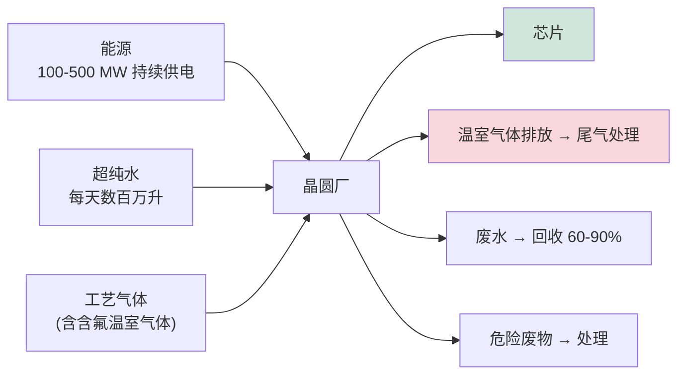

# 半导体制造中的可持续发展、环境影响与ESG

> 📘 **说明：** 本文为英文原版《Sustainability, Environmental Impact, and ESG in Semiconductor Manufacturing》的简体中文参考译本，仅供参考；如有出入，以英文原版为准。

半导体制造是地球上资源最密集的工业活动之一。一座现代晶圆厂的耗电量堪比一座小城市，每天消耗数百万加仑超纯水，以及大量特种化学品和气体——其中数种是强效温室气体——并产生需要复杂处理的危险废物流。随着行业扩张以满足人工智能（AI）驱动的需求，以及气候和环境监管日趋严格，可持续发展已从边缘议题转变为核心的战略和运营优先事项。本文概述半导体环境影响的能源、水、排放、废物、监管和循环经济等维度，以及设备在应对这些问题中的作用。

这一叙事的核心矛盾在于：该行业的产品在整个经济中**促成**了巨大的节能和脱碳（高效功率电子、AI优化系统、电动化交通），但其**制造过程**却付出了高昂的环境代价——这使得环境净账，以及降低制造环节影响的努力，成为该行业决定性的环境、社会和治理（ESG）议题。

---

## 📊 可视化概览

*原创示意图；Mermaid图表可在GitHub上原生渲染。*

**晶圆厂的资源流——输入与需要管理的废物流**



**脱钩挑战——增长必须快于影响**

下图说明：在AI驱动下产出快速上升；每片晶圆的环境足迹也在上升（工艺步骤更多、EUV、洁净室要求更严）；目标是通过能效提升、可再生能源、回收利用和尾气处理，使环境影响的下降速度快于产出的增长速度，即实现“脱钩”。

```
 Output (AI-driven)        ↗↗↗ rising fast
 Footprint per wafer       ↗  rising (more steps, EUV, tighter cleanroom)
 GOAL: efficiency + renewables + recycling + abatement must bend impact DOWN
       faster than output rises  →  decoupling
```

**含氟温室气体——微量泄漏，巨大的增温潜势（相对CO₂的GWP）**

下图比较SF6（约24,000倍）、NF3（约17,000倍）、C2F6（约12,000倍）和CF4（约7,400倍）的全球增温潜势；应对手段为尾气处理（销毁未反应气体）、提高利用率以及替代。

```
 SF6    ~24,000×   ████████████████████████
 NF3    ~17,000×   █████████████████
 C2F6   ~12,000×   ████████████
 CF4     ~7,400×   ███████
 → abatement (destroy unreacted gas) + better utilization + substitution
```

---

## 1. 能源强度

晶圆厂的能耗极其惊人。一座先进制程晶圆厂可持续消耗**100–500 MW**电力，而最大的制造商的用电量已达国家级规模：**仅台积电（TSMC）每年用电量就约为25–30 TWh**（一份2026年的分析估计其2025年用电量约为28.8 TWh，媒体报道称其约占台湾总用电量的十分之一），且随着2nm和先进封装产能的扩建，其需求仍在持续增长。这些能源用于运行数以千计的工艺设备（极紫外（EUV）扫描式光刻机尤其耗电——每台功耗可达约1兆瓦量级）、维持洁净室条件的庞大暖通空调和空气处理系统、超纯水制备、真空和尾气处理系统以及冷水机组。

能源强度通常以<strong>每片投片晶圆的千瓦时（kWh）</strong>或单位硅面积能耗来衡量，并在先进工艺节点上不断上升，因为每个节点都会增加工艺步骤、更耗能的设备（EUV、更多刻蚀/沉积）以及更严格的洁净室要求。每片晶圆能源强度的上升，乘以不断增长的晶圆产量，使行业总能源足迹日益受到关注，并成为其碳排放的主要驱动因素。

---

## 2. 用水量

半导体制造需要大量**超纯水（UPW）**——其纯化程度远超饮用水标准（电阻率>18.2 MΩ·cm，总有机碳<0.5 ppb）——用于在制造过程中对晶圆进行数百次冲洗。一座大型晶圆厂每天可消耗**数千万升水**。超纯水通过多级纯化（反渗透、电去离子、紫外处理、膜脱气）在厂内制备，而这一过程本身也是能源和资源密集型的（见[文件24](24_cleanroom_and_fab_infrastructure.md)）。

水是一项特别的脆弱点，因为晶圆厂往往位于缺水地区。**台积电的台湾厂区在2021年遭遇严重干旱**，威胁到生产，不得不用卡车运水，生动地说明了这一风险。为此，制造商积极推进**水循环与回收利用**——台积电的目标回收率超过**60%**，并在建设水回收厂——水源也已成为选址的核心考量（例如**台积电亚利桑那州工厂**在干旱的美国西南部的用水策略：台积电于2025年8月在当地动工兴建一座按近零液体排放设计的工业水回收厂，预计于2028年前后全面投运）。水资源管理如今已是关键的ESG指标和运营优先事项。

---

## 3. 全氟化碳（PFC）与温室气体排放

有几种工艺气体是具有极高全球增温潜势（GWP）和很长大气寿命的**强效温室气体**：**全氟化碳（CF₄、C₂F₆）、三氟化氮（NF₃）和六氟化硫（SF₆）**——用于刻蚀和腔室清洗。例如，CF₄的GWP是CO₂的数千倍；NF₃和SF₆同样强效。这些<strong>含氟温室气体（F-GHGs）</strong>是该行业直接（范围1）排放的主要组成部分。

行业从多个方面应对这一问题：**尾气处理**（在排放前于使用点销毁未反应气体，见[文件20](20_subsystems_and_components.md)）、**工艺优化**以提高气体利用率（减少未反应气体逸出——例如远程等离子体NF₃腔室清洗可实现很高的利用率），以及以较低GWP的替代品进行**替代**（例如在工艺兼容的情况下，用GWP较低的**C₄F₆等气体**替代高GWP气体）。<strong>世界半导体理事会（WSC）</strong>已为含氟温室气体设定了全行业归一化减排目标，减少这些排放是制造商与气体供应商之间持续的协作努力。

---

## 4. 温室气体报告与净零承诺

半导体制造商和OEM越来越多地报告并设定所有三个排放范围的减排目标：
- **范围1**——直接排放（含氟温室气体、现场燃烧）。
- **范围2**——外购电力（鉴于晶圆厂巨大的电力消耗，这是大多数晶圆厂最大的组成部分）。
- **范围3**——价值链排放（供应商、材料、产品使用）。

由于范围2占主导地位，**可再生电力采购**是最有力的杠杆。**台积电已承诺加入RE100**（100%可再生电力，该目标已提前至2040年，并设定2030年达到60%的中期目标）并设定净零目标——据其可持续发展报告，2025年可再生能源已占其全公司用电量的约20%——它也是全球最大的企业可再生能源采购方之一；英特尔（Intel）、三星（Samsung）以及主要OEM（阿斯麦、应用材料、泛林集团）也作出了类似的净零和可再生能源承诺。在可再生能源供应相对于行业庞大需求有限的地区（如台湾），这一挑战尤为严峻，使可再生能源采购同时成为可持续发展和供应安全问题。

---

## 5. 可持续化学

除温室气体外，该行业还在其各工艺中推行**绿色化学**：**低GWP刻蚀气体**（适用时采用C₄F₆、CHF₃）、提高**远程等离子体清洗**效率以尽量减少NF₃释放、减少有害溶剂，并在工艺性能允许的情况下开发毒性更低的替代品。<strong>PFAS（“永久化学品”）</strong>也受到越来越多的审视，它们以各种形式用于半导体制造（某些光刻胶、涂层和流体中），且正受到日益严格的监管——这构成了真正的挑战，因为部分基于PFAS的材料目前在关键应用中缺乏可直接替换的替代品。

---

## 6. 化学废物处理

晶圆厂产生大量需要厂内和厂外处理的危险**液体和气体废物**：**酸碱中和**、**氢氟酸（HF）废液处理**（HF需要特殊处理和氟化钙沉淀）、**有机溶剂回收**、**研磨液回收与处理**（化学机械平坦化（CMP）研磨液）以及**重金属去除**。制造商越来越多地追求**资源回收**——回收**硫酸**、回收铜及其他金属、循环利用溶剂和研磨液成分——这既有环境效益，也能降低成本。废物处理是晶圆厂基础设施（见[文件24](24_cleanroom_and_fab_infrastructure.md)）和运营成本的重要组成部分。

---

## 7. 监管格局

该行业在日益严密的环境监管网络下运营：
- **欧盟REACH法规**——管理化学品的注册、评估和授权，其中日益增多的**PFAS限制**直接影响半导体材料（拟议的通用PFAS限制已于2026年3月获得欧洲化学品管理局（ECHA）各委员会的意见；见下文2025–2026年更新）。
- **欧盟含氟气体法规（EU）2024/573**——自2024年3月起生效，收紧含氟气体的逐步削减，并包含与半导体制造相关的特定豁免。
- 美国（环境保护署EPA）及其他地区的**PFAS监管**，这是一项新兴且可能具有颠覆性的约束。
- **SEMI S2/S8安全标准**——关于设备安全和人体工程学的行业标准，与环境设计相交叉。
- **地方空气、水和废物许可证**，管理每座晶圆厂的排放和排污，在许多司法管辖区日趋严格。

监管是晶圆厂选址、工艺选择和设备设计中的实际因素，PFAS和含氟温室气体规则的收紧是近期较具挑战性的压力之一。

---

## 8. 循环经济与设备再利用

可持续性也延伸到设备本身。健全的**翻新设备市场**延长了旧设备的寿命——成熟工艺节点晶圆厂（见[文件15](15_technology_roadmaps.md)）大量使用翻新的浸没式扫描光刻机和整修过的CVD/刻蚀设备，降低了新制造的隐含碳和资源成本。**零部件再制造**（翻新工艺套件陶瓷件、泵和零部件）同样延长了零部件寿命并减少了废物。这种循环活动在经济上和环境上都有益处，是设备生态系统的一个显著特征，由专业翻新厂商和OEM自有的认证翻新项目提供支持。

---

## 9. 可持续发展的战略意义

环境绩效已成为真正的战略因素，原因有以下几点。**客户**（尤其是采购芯片的大型科技公司）越来越要求低碳供应链，并将半导体排放计入其自身的范围3目标，迫使制造商脱碳。**投资者**会权衡ESG表现。**监管机构**对排放、用水和化学品加以约束。而**运营韧性**——尤其是水和能源安全——直接影响生产连续性，台湾干旱即为明证。

设备行业在其中扮演核心角色：更节能的设备、更好的尾气处理、更高的气体利用率、更低GWP的工艺化学品、节水型工艺设计，以及寿命更长、可翻新的设备，都有赖于设备创新。随着行业扩张以满足AI驱动的需求，如何调和这种增长与环境责任——弥合半导体巨大的社会效益与其制造过程中可观的环境成本之间的差距——是该行业未来的决定性挑战之一，而设备制造商、材料供应商和芯片制造商的选择将共同决定其结果。

---

## 延伸分析：量化与脱碳环境足迹

### A. 晶圆厂的碳账

将能源问题具体化：一座持续用电约300MW的大型先进晶圆厂每年消耗约**2.6 TWh**电力——相当于一座数十万人口的城市。如果这些电力来自排放强度约为400–500 gCO₂/kWh的电网，仅该晶圆厂的范围2排放每年就超过一百万吨CO₂。乘以一家公司的整个厂群（台积电运营着众多晶圆厂），总量可达数千万吨。这就是为什么**范围2（外购电力）在大多数制造商的碳足迹中占主导地位**，为什么**可再生能源采购**是唯一最有力的脱碳杠杆——也是为什么晶圆厂在电网碳强度高的地区（东亚部分地区）的地理集中是一项环境隐忧，而在拥有更清洁或可扩展可再生能源供应的地区建厂，在一定程度上则是一个环境机遇。

### B. 用数字看含氟温室气体挑战

刻蚀和腔室清洗所用的含氟温室气体具有惊人的全球增温潜势：以100年计，**NF₃的GWP约为CO₂的17,000倍**，**SF₆约24,000倍**，**CF₄约7,400倍**，**C₂F₆约12,000倍**，其中一些的大气寿命长达数千年。因此即便是少量泄漏也具有很大的CO₂当量权重。行业从三个方面应对：**使用点尾气处理**（热/等离子体/湿法销毁，对未反应气体的去除率达>90–99%）、**提高利用率**（远程等离子体NF₃腔室清洗将大部分NF₃在腔室内转化为活性氟，几乎不会逸出——较旧式原位清洗有重大改进），以及**替代**（例如在工艺允许的情况下，用GWP较低的C₄F₆或生成COF₂的化学体系替代C₂F₆）。**世界半导体理事会**已陆续设定归一化排放削减目标，含氟温室气体尾气处理如今已是领先晶圆厂的标准做法，但由于部分高GWP气体在关键刻蚀步骤中缺乏可直接替换的替代品，完全消除仍难以实现。

### C. 水——本地化约束

与碳（全球性问题）不同，水是高度**本地化**的问题：晶圆厂的用水在其所在流域最为关键。一座在缺水地区每天消耗约5,000万–1亿升水的大型晶圆厂会与农业和市政供水直接竞争，带来声誉和运营双重风险。行业的应对结合了**循环利用**（台积电等公司的目标回收率为60–90%以上，通过多个内部回路回收并重新纯化用水）、**替代水源**（再生的市政污水，如台积电在台湾的水回收厂和亚利桑那州的用水策略）以及在工艺设计中的**节约**。水回收本身也是能源密集型的（将回收水纯化到超纯水标准需要耗电），这说明了各项资源挑战之间的相互关联——节水可能耗能，反之亦然。

### D. PFAS困境

<strong>PFAS（“永久化学品”）</strong>带来了一个真正棘手的挑战。某些PFAS化合物在半导体制造中广泛使用——用于部分光刻胶和抗反射涂层、含氟聚合物部件（PTFE/PFA流体处理部件，见[文件20](20_subsystems_and_components.md)）、某些刻蚀和清洗化学品以及传热流体。日益收紧的PFAS监管（欧盟REACH限制、美国EPA行动）可能扰乱供应——尽管欧盟的进程比最初担心的要慢，目前预计最早的禁令不会早于2028年末——而对于某些关键应用，**目前尚无经过认证的非PFAS替代品**。行业正在努力寻找替代品，并在缺乏替代方案的领域争取必要用途豁免，而监管机构则在环境和健康关切与半导体制造的战略重要性之间进行权衡。这种环境监管与制造必需之间的张力，是近期较具挑战性的可持续发展问题之一，且难以轻易解决。

### E. 净账与设备的作用

可持续发展叙事中最深刻的一点是**净账**：半导体的制造在环境上代价高昂，但在下游却促成了巨大的环境*节约*——高效功率电子（SiC/GaN，见[文件12](12_compound_semiconductor_equipment.md)）降低了电动汽车和电网中的能量损耗，AI和计算优化了能源系统，传感器使各处都能提高效率。严谨的核算必须将制造影响与所促成的节约进行权衡，而根据大多数分析，所促成的节约占主导——但这并不能为制造影响开脱，这种影响真实存在、不断增长且日益受到审视。设备行业是改善账目中制造一侧的核心：**更节能的设备**（降低待机功耗、高效子系统）、**更好的尾气处理**（更高的含氟温室气体销毁效率）、**更高的气体和化学品利用率**（每片晶圆的浪费更少）、**节水型工艺设计**，以及**寿命更长、可翻新的设备**（循环经济），都有赖于设备和工艺创新。随着行业扩张以满足AI需求，设备制造商、材料供应商和芯片制造商的选择将共同决定，半导体制造的环境足迹是与产出同比增长，还是逐步与之脱钩——这使可持续发展不再是设备行业之外的约束，而是其创新议程中不可分割的一个维度。

---

## 进一步分析：脱钩挑战与设备的作用

### A. 核心挑战：将增长与影响脱钩

半导体制造面临的核心可持续发展挑战是**脱钩**——在增加产出（由AI和数字化驱动）的同时，不让环境影响（能源、水、排放、废物）同比例增长。若无法脱钩，行业的环境足迹将与其产出亦步亦趋地增长，鉴于气候和资源方面的利害关系，这是不可接受的。脱钩要求在每个维度上的改进速度都快于增长速度：能源*强度*（每片晶圆能耗）的下降必须快于晶圆产量的上升；水的*循环利用*必须提高以抵消不断增长的用水需求；每片晶圆的*排放*必须通过更好的尾气处理和替代而降低；废物必须越来越多地被回收和再利用。难点在于，先进制程恰恰朝*相反*方向推进——每个节点都会增加工艺步骤、更耗能的设备（EUV）、更严格的洁净室要求和更多材料，从而提高每片晶圆的强度。因此，脱钩需要通过积极的能效提升、循环利用、尾气处理和可再生能源应用来克服这种强度上升的逆风。行业能否实现脱钩——在满足AI需求的同时逐步降低单位产出的环境影响——是其决定性挑战之一，其结果在很大程度上取决于设备制造商、材料供应商和芯片制造商的选择。

### B. 设备行业的决定性作用

设备行业在脱钩挑战中扮演**决定性角色**，因为晶圆厂的环境足迹在很大程度上取决于其设备的设计和运行。工艺设备的**能效**（降低待机功耗——这可能占设备能耗的很大一部分；提高真空、射频、热处理及其他子系统的效率）直接影响晶圆厂庞大的能源需求。**尾气处理效果**（对强效含氟温室气体更高的销毁效率）决定晶圆厂的温室气体排放。**气体和化学品利用率**（每片晶圆使用更少材料、可回收循环利用、采用更低GWP化学品的工艺）同时降低消耗和排放。**节水型工艺设计**（每个工艺步骤用水更少、便于水循环利用的设计）降低晶圆厂的用水需求。而**寿命更长、可翻新的设备**（循环经济）则降低新制造的隐含碳和资源成本。在每种情况下，设备制造商的设计选择都在很大程度上决定了晶圆厂的环境绩效——这使可持续发展不再是设备行业之外的约束，而是设备创新不可分割的维度，也日益成为设备评估和选型的考量因素。随着客户（晶圆厂）面临自身的脱碳和资源压力，它们越来越要求更高效、更低影响的设备，使环境绩效成为设备制造商的竞争因素。

### C. 可持续发展的战略与竞争意义

在多种力量推动下，环境绩效已从边缘议题转变为整个行业的**战略与竞争**因素。**客户**——采购芯片的大型科技公司——越来越要求低碳供应链，并将半导体排放计入其自身的范围3目标，迫使制造商脱碳，而制造商又反过来向其设备和材料供应商施压。**投资者**在估值和资本配置中权衡ESG表现。**监管机构**约束排放、用水和化学品（REACH、PFAS规则、含氟温室气体目标），其中PFAS挑战（见上文D节）尤为棘手。**运营韧性**——尤其是水和能源安全——直接影响生产连续性，台湾干旱即为明证。而**人才**也越来越看重雇主的环境记录。这些力量使可持续发展成为真正的竞争和战略维度，而非合规层面的事后考虑，并正在推动实质性投资——在可再生能源（台积电的RE100承诺和大规模可再生能源采购）、水循环利用（60–90%以上的回收目标）、尾气处理和高效设备方面。最深层的框架是**净账**：半导体在下游促成了巨大的环境节约（高效功率电子、AI优化的能源系统、电动化交通），但其制造代价高昂，因此当务之急是在最小化制造影响的同时最大化所促成的节约——在这一平衡中，设备行业通过其设备的能效和环境绩效，发挥着核心且日益重要的作用。调和行业必要的增长与环境责任，是其未来的决定性挑战之一，而设备、材料和制造各方的集体选择将决定行业的足迹是随产出增长，还是逐步与之脱钩。

---

## 🆕 2025–2026年更新：最新进展（截至2026年11月）

### A. AI驱动的增长使脱钩更加困难

上文所述的脱钩挑战在2025–2026年变得更加尖锐。国际半导体产业协会（SEMI）2026年7月的年中预测将2026年设备总销售额定为创纪录的**1,659亿美元**（同比增长23.2%），而泛林集团（Lam Research）等OEM目前初步预计2027年晶圆厂设备（WFE）将超过2,000亿美元，驱动因素包括AI加速器、高带宽内存（HBM）/DRAM以及2nm产能爬坡。每新增一座晶圆厂、一台EUV设备和一条先进封装产线，都会加重电网和供水系统的负荷；2026年10月，泛林集团甚至指出**洁净室空间**可能制约行业产出——这提醒人们，包括公用设施在内的物理基础设施如今已成为瓶颈因素。

### B. 能源——台湾电网成为战略议题

| 指标（台湾） | 数据 | 来源（据报道） |
|---|---|---|
| 2026年9月半导体产业用电量 | 单月超过45亿千瓦时（首次） | 中央社Focus Taiwan，2026年10月 |
| 2026年全年半导体产业用电量 | 预计超过约50 TWh | 台湾综合研究院，据Focus Taiwan |
| 半导体占全台用电比重 | 约17%（2026年）→ 约24%（2030年）→ 约30%（2035年） | 台电内部评估，据TrendForce |
| 2025年台积电可再生能源用电占比 | 全公司约20.1%；台湾厂区约11.4%；海外厂区100% | 台积电《2025年可持续发展报告》 |
| 台积电可再生能源目标 | 2030年达60%（RE60），2040年达100%（RE100） | 台积电 |

台湾经济部将2026–2035年全台电力需求年增长预测上调至约2.5%（此前为1.7%），台电表示正在重新评估其电源开发规划，以容纳半导体和AI数据中心的负荷。倡导机构的分析认为，即使台积电已签约的可再生能源组合全部兑现，到2030年仍可能面临超过10 TWh的可再生电力缺口；这是外部估算，并非公司数据。对设备制造商而言，其实际影响是客户越来越重视**待机功耗降低、高效的真空/射频/热处理子系统以及晶圆厂级能源管理**——并越来越多地借助[文件22](22_ai_and_ml_in_semicap.md)所述的AI和数字孪生工具。

### C. 水——回收规模扩大，审视日益严格

- **台积电亚利桑那州工厂**于2025年8月在凤凰城北部动工兴建一座占地约15英亩、按近零液体排放设计的工业水回收厂。据公司表示，该厂初期将回收约<strong>85%</strong>的废水（目标90%），并将首座晶圆厂的净取水量从每天约475万加仑降至约120万加仑以下；预计于**2028年**前后全面投运。
- 2026年7–8月的当地报道指出，台积电在凤凰城扩大的建厂计划可能使其成为**该市最大的用水客户**，这表明水资源管理已成为美国新建晶圆厂的“经营许可”问题。

### D. PFAS——欧盟限制缓慢推进

- **2026年3月26日**，欧洲化学品管理局（ECHA）风险评估委员会（RAC）发布了关于欧盟**通用PFAS限制**的最终意见，社会经济分析委员会（SEAC）发布了草案意见，支持在欧盟范围内实施附带**限时豁免**的限制。预计最早的禁令不会早于**2028年末**。
- 在评论方中，半导体是被点名的最大行业，其理由是含氟聚合物流体处理部件、部分光刻胶成分和传热流体缺乏经过认证的替代品。供应端也发生了变化：3M此前已宣布在2025年底前退出PFAS制造，迫使晶圆厂和设备制造商重新认证替代传热流体和含氟聚合物来源。

### E. 含氟气体与排放报告

- **欧盟含氟气体法规（EU）2024/573**正在实施中；欧盟委员会实施条例<strong>（EU）2026/286</strong>（2026年2月11日通过）对半导体制造中使用的某些冷水机组给予豁免，适用期为2027年1月1日至2029年12月31日。SEMI欧洲警告称，对含氟气体设备维护服务的限制可能导致已安装设备过早报废。
- 在**美国**，EPA于2025年提议撤销温室气体报告计划（GHGRP）的大部分内容；2026年2月的一项最终规则仅将2025报告年度的截止日期推迟至2026年10月30日，提案的其余部分仍悬而未决。若最终通过，晶圆厂含氟温室气体排放的设施级公开报告（Subpart I）可能中止，透明度将转而依赖企业自愿披露和客户的范围3要求。

### F. 对设备制造商的影响

尽管存在监管方面的逆流，客户压力并未减轻：采购AI芯片的超大规模云服务商仍将半导体制造计入其范围3清单，晶圆厂在设备采购中也越来越多地规定能耗、尾气处理和化学品利用率指标。因此，尾气处理销毁效率、远程等离子体清洗利用率、低GWP刻蚀化学品和可翻新设计仍是重要的竞争差异化因素。

**值得关注（2026年末–2027年）**

- SEAC的最终意见以及欧盟委员会的PFAS限制草案文本，包括半导体豁免的范围和期限。
- EPA是否最终撤销温室气体报告要求，以及晶圆厂在自愿披露方面如何回应。
- 台湾的电力供应规划（可再生能源、天然气以及核能讨论），与正迈向全台需求四分之一的半导体负荷之间的平衡。
- 大型水回收厂（台积电亚利桑那州、台湾）的投运情况，以及随着2027年产能爬坡，美国和日本新建晶圆厂能否兑现其水和能源承诺。
