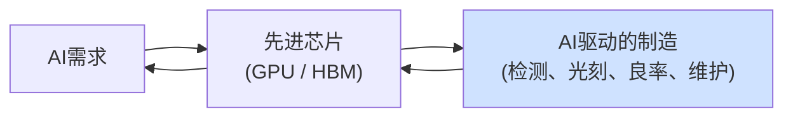
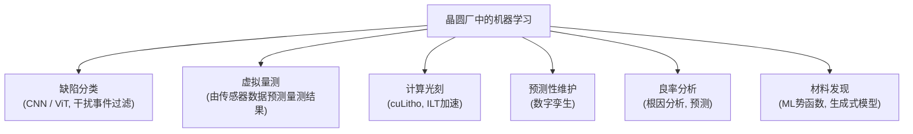

# 人工智能与机器学习在半导体制造中的应用

> 📘 **说明：** 本文为英文原版《AI and Machine Learning Applications in Semiconductor Manufacturing》的简体中文参考译本，仅供参考；如有出入，以英文原版为准。

人工智能（AI）和机器学习（ML）已渗透到半导体制造的方方面面——这不是营销包装，而是生产过程中真实存在且日益不可或缺的一层。原因是结构性的：随着器件缩小到原子尺度，工艺窗口不断收窄，数据量爆炸式增长，数千个工艺变量与最终良率之间的关系变得过于复杂，人类工程师或传统统计方法已无法驾驭。而这正是机器学习大显身手的领域——在高维数据中发现模式、预测结果、对缺陷进行分类、优化工艺，比传统方法更快、更准确。本文概述AI/ML在工艺控制、检测、光刻、维护、良率管理、材料发现和设备设计中的应用，以及迈向自主、自优化晶圆厂的路线图。

这里还存在一个引人注目的**良性循环**：AI需求推动了对先进芯片的需求，而先进芯片的制造越来越依赖AI，AI的运算又运行在这些先进芯片之上。半导体行业既推动着AI革命，也在消费着AI革命。

---

## 📊 可视化概览

*原创示意图；Mermaid图表可在GitHub上原生渲染。*

**递归循环——AI既驱动先进芯片，又运行于先进芯片之上**



**机器学习在晶圆厂中的应用领域**



**迈向自主晶圆厂——今天是辅助决策，明天是闭环控制**

下图说明：从“辅助决策”（由工程师决定）经“闭环控制”走向“自主”（自优化的“熄灯”晶圆厂）；制约因素包括可解释性、信任、数据整合以及错误成本。

```
 Advisory  ──────────────────────────────────► Autonomous
 (engineer decides)   closed-loop control   self-optimizing "lights-out" fab
 Gated by: explainability · trust · data integration · cost of errors
```

---

## 1. 工艺控制与先进过程控制（APC）

ML在晶圆厂中最早、最成熟的应用是**先进过程控制**。传统的**批次间（R2R）控制**使用线性模型，根据先前结果调整每台设备的配方；现代APC越来越多地使用**机器学习模型**，捕捉工艺输入与输出之间非线性、多变量的关系，使工艺比线性控制更紧密地保持在目标值上。

**虚拟量测**是ML的旗舰应用：不必对每片晶圆进行物理量测（这会限制产能），ML模型根据设备的传感器数据**预测**晶圆的量测结果（膜厚、关键尺寸（CD）、套刻），实际上为每片晶圆提供了一个模型化的量测值。这使得在减少物理抽样的同时实现更严格的控制——随着工艺窗口收窄，这一点日益重要。

<strong>故障检测与分类（FDC）</strong>已从单变量统计过程控制（SPC）演进到**多变量ML异常检测**，同时监测数百路设备传感器信号，以发现细微偏移，并在产生废片之前预测故障。这些由ML驱动的控制回路如今已是先进晶圆厂的标准配置。

---

## 2. 缺陷检测与分类

缺陷检测（见[文件08](08_metrology_and_inspection.md)）会产生海量图像数据，而**深度学习**已彻底改变了其分析方式。<strong>卷积神经网络（CNN）</strong>以及越来越多的<strong>视觉Transformer（ViT）</strong>能够自动**对缺陷进行分类**，并且——至关重要的是——将真正的**关注缺陷与“干扰”事件**（无害的异常）区分开来，从而大幅提高检测的信噪比，并减少复查图像所需的工程师工时。由于某些缺陷类型较为罕见，**合成缺陷增强**（利用生成式AI为罕见缺陷生成逼真的训练图像）可提高分类器的稳健性。商业实现包括<strong>科磊（KLA）基于AI的分类与分析（如其KLARITY/Klarity平台）</strong>以及**应用材料（Applied Materials）的AI增强检测（如其ExtractAI及相关功能，以及2025年2月推出、将电子束成像与AI图像识别相结合的SEMVision H20电子束缺陷复检系统）**。AI驱动的检测是价值最高的ML应用之一，因为它直接加速了良率学习。

---

## 3. 计算光刻

光刻是芯片制造中计算最密集的环节之一，AI正在重塑这一领域。<strong>AI驱动的光学邻近校正（OPC）</strong>和<strong>逆向光刻（ILT）</strong>利用机器学习加速掩模图形的计算，而**神经网络代理模型**能以极小的成本近似昂贵的物理仿真（如基于RCWA的成像仿真）。**随机缺陷预测**利用ML预判极紫外（EUV）随机缺陷可能出现的位置。旗舰进展是**英伟达（NVIDIA）cuLitho**（2023年发布，合作方为**台积电（TSMC）、阿斯麦（ASML）和新思科技（Synopsys）**），这是一个GPU加速的计算光刻库，可将掩模合成和ILT的速度提高几个数量级——它于2024年在台积电投入生产使用，三星（Samsung）也将其引入OPC流程（三星于2025年10月报告计算光刻速度最高提升约20倍）——从而应对先进节点掩模制备计算成本的爆炸式增长，并实现高数值孔径极紫外（High-NA EUV）日益需要的曲线掩模。在计算光刻领域，AI芯片与AI制造之间的良性循环尤为直接：GPU加速了制造GPU的光刻。

---

## 4. 预测性维护与数字孪生

计划外的设备停机代价极高，而ML使**预测性维护**成为可能——利用传感器数据和ML模型预测某个零部件（泵、射频发生器、静电吸盘）何时会失效，从而能够主动维护，而不是在代价高昂的故障发生后再处理。工艺腔室的**数字孪生**——模拟设备行为的“物理+ML”模型——允许在不消耗晶圆或设备机时的情况下进行虚拟实验、故障诊断和优化。**零部件消耗预测**利用ML预测工艺套件和耗材的更换需求，优化库存和设备稼动率。这些应用提升了最终决定晶圆厂生产率的**设备综合效率（OEE）**。

---

## 5. 良率管理与分析

**良率管理**——将数千个工艺、量测和测试参数与最终良率关联以找出根因——天然是一个ML问题。**科磊的良率管理软件、PDF Solutions的Exensio、Onto Innovation的分析工具（如与Firefly相关的功能）以及新思科技/西门子（Siemens）的良率工具**等平台将机器学习应用于庞大的晶圆厂数据集，以识别良率损失因素、预测良率并指导纠正措施。**AI辅助的工艺设计套件（PDK）与工艺表征**加速了器件模型和设计规则的提取。由于良率学习是节点量产爬坡的经济核心（见[文件15](15_technology_roadmaps.md)），ML驱动的良率分析直接影响盈利能力和上市时间。

---

## 6. 生成式AI用于材料与工艺发现

一个新兴前沿是利用**生成式和预测式AI进行材料发现**——利用ML模型（包括基于材料数据库和第一性原理仿真训练的模型）**预测**具有所需特性的介质、阻挡层金属、光刻胶、前驱体和研磨液的**新配方**，在开展昂贵的实验之前缩小庞大的搜索空间。这有望加快各节点日益依赖的新材料（新型EUV光刻胶、新型互连金属、铁电材料、二维沟道材料）的开发。尽管仍处于早期阶段，AI驱动的材料和工艺发现可能显著压缩制约路线图的开发周期。

---

## 7. AI用于设备设计

机器学习也正被应用于**设备本身的设计**：腔室几何结构的**拓扑优化**、让工程师能以远快于完整仿真的速度探索气流和等离子体设计的**计算流体力学（CFD）代理模型**，以及ML辅助的设备子系统优化。这缩短了新设备的开发周期，并有助于从设计阶段就优化工艺均匀性和性能。

---

## 8. 主要公司

| 公司 | AI/ML重点 |
|---|---|
| **科磊（KLA）** | AI缺陷分类、良率管理、检测分析 |
| **应用材料（Applied Materials）** | AI增强检测（ExtractAI）、AI辅助电子束缺陷复检（SEMVision H20）、工艺控制、AIx计划 |
| **泛林集团（Lam Research）** | 设备智能（Equipment Intelligence）服务（预测性/自动化维护、机群匹配）；Dextro维护协作机器人 |
| **阿斯麦（ASML）** | 与Mistral AI建立战略合作（ASML领投其约13亿欧元C轮融资，2025年9月），将AI应用于产品和运营 |
| **PDF Solutions** | Exensio良率分析；晶圆厂数据整合 |
| **Onto Innovation** | 量测分析与检测AI |
| **新思科技 / 西门子EDA** | 计算光刻、AI驱动的设计与良率、晶圆厂分析 |
| **英伟达（NVIDIA）** | cuLitho（GPU加速计算光刻）；Omniverse晶圆厂数字孪生；面向晶圆厂的AI算力（如2025年10月宣布的三星和SK集团“AI工厂”） |
| **晶圆厂自身（台积电、英特尔、三星）** | 在APC、良率和预测性维护方面广泛的内部ML应用 |

---

## 9. 路线图：迈向自主晶圆厂

AI在制造中的发展轨迹指向越来越高的自主性：
- **AI原生的量测与检测**——ML成为量测执行、预测和解读方式的核心（见[文件08](08_metrology_and_inspection.md)）。
- **闭环、自优化的工艺**——控制系统不仅将工艺保持在目标值上，还持续对其进行**优化**，在习得的约束范围内自主调整配方以提升良率和性能。
- **自主（“熄灯”）晶圆厂**——长期愿景是晶圆厂在极少人工干预下运行，由AI在数千台设备之间统筹排程、工艺控制、维护和良率管理。
- **生成式AI加速的开发**——压缩新工艺、新材料和新设备的开发周期。

有几点保留意见对这一愿景形成制约。ML模型需要海量、高质量、标注良好的数据，而这类数据生成成本高昂且往往属于专有数据。模型必须足够**可解释、可信赖**，工程师才会据此采取行动——在这种环境中，一个错误的决定就可能报废价值数百万美元的晶圆。而最具价值的应用依赖于跨众多设备和供应商的数据整合，这带来了数据所有权和标准化方面的挑战。尽管存在这些保留意见，AI和ML在半导体制造中已从实验决定性地转变为必需——它是管理原子尺度、大批量生产中原本无法驾驭的复杂性所不可或缺的一层，也是行业自身的产品与其制造方法日益递归交织的领域。

---

## 延伸分析：案例研究、方法与挑战

### A. 数据基础

晶圆厂中的每一项ML应用都建立在数据之上，而晶圆厂是可以想象的数据最丰富的环境之一：每台设备每秒产生数千条传感器轨迹（温度、压力、射频功率、气体流量、电机电流、光学信号），每片晶圆在上千道工艺步骤中积累历史记录，外加量测、检测和最终测试结果。一座先进晶圆厂每年可产生**数PB的数据**。挑战与其说是数据不足，不如说是难以对数据进行**整合、情境化和标注**——将一次最终测试失效沿工艺历史追溯到相应的设备、步骤和偏移事件。这一“晶圆厂数据整合”问题是所有ML应用的基础，**PDF Solutions的Exensio**等平台和晶圆厂内部的数据基础设施正是为解决这一问题而存在。数据的质量与整合程度，往往比算法的复杂程度更能决定一项ML应用的成败。

### B. 各应用的具体方法

| 应用 | 典型ML方法 |
|---|---|
| 虚拟量测 | 回归（梯度提升、神经网络），将传感器数据映射为量测结果 |
| 批次间控制 | 贝叶斯及ML增强控制器、指数加权模型 |
| 故障检测（FDC） | 多变量异常检测（PCA、自编码器、单类SVM） |
| 缺陷分类 | CNN、视觉Transformer；针对罕见类别的小样本和自监督学习 |
| 缺陷图像生成 | 用于合成缺陷增强的GAN、扩散模型 |
| 计算光刻 | 用于仿真的CNN/物理信息代理模型；GPU加速的ILT |
| 预测性维护 | 基于传感器时间序列的生存模型、循环/时序网络 |
| 良率根因分析 | 决策树、共性分析、基于晶圆厂数据的因果推断 |
| 材料发现 | ML原子间势函数、生成式模型、贝叶斯优化 |

### C. 案例研究——AI缺陷分类

举一个具体例子。一台明场检测设备扫描一片晶圆，标记出50,000个“事件”。过去，工程师需要人工复查样本，将真正致命的良率缺陷与无害的“干扰”（工艺波动、前层残留特征）区分开来。有了训练好的CNN/ViT分类器，设备会自动将事件按缺陷类型和置信度分类，筛选出数百个“关注缺陷”，同时过滤掉数万个干扰事件——将原本需要数小时的工程师工作压缩到几分钟，并大幅加速良率学习循环（见[文件15](15_technology_roadmaps.md)）。由于部分关键缺陷类型较为罕见，**合成增强**（利用生成式模型生成逼真的缺陷图像）使分类器能够在原本很少见到的类别上得到训练。科磊和应用材料已将这些能力产品化，它们是晶圆厂中投资回报率最高的ML应用之一，因为它们直接缩短了节点量产爬坡周期。

### D. 案例研究——cuLitho与计算光刻加速

制备一套先进掩模——在数十亿个多边形上运行OPC和逆向光刻——的计算成本已增长到需要庞大的CPU集群运行数周。**英伟达cuLitho**（与台积电、阿斯麦和新思科技合作）将这些工作负载重构为大规模并行的GPU计算，报告的加速达到一个数量级以上；到2024–2025年，它已从发布阶段进入台积电的生产使用，并被三星采用。这既降低了掩模制备的时间和成本，又使以往不切实际、计算需求更大的复杂技术（高数值孔径EUV日益需要的全曲线ILT）成为可能。这也是行业与AI之间递归关系最清晰的例证：利用计算光刻制造的GPU，被用来加速制造下一代GPU的计算光刻。

### E. 挑战与局限

尽管势头强劲，制造领域的AI仍面临实际约束。**可解释性**至关重要：工程师不会仅凭一个无法解释的建议就让模型报废或放行价值数百万美元的晶圆，因此可信赖、可解释的模型必不可少。**分布漂移**普遍存在：工艺会漂移、设备会维护、配方会变更，基于昨天工艺训练的模型可能会对今天的工艺产生误导——这要求持续地重新训练和监控。**数据孤岛和数据所有权**阻碍了最具价值的应用所需的跨设备、跨供应商整合，因为OEM、晶圆厂和材料供应商各自掌握部分信息，并将其作为专有资产严加保护。而**错误成本**如此之高，以至于ML最容易在辅助和加速角色中被采用（加快工程师已经在做的事情），而非在关键步骤中实现完全自主控制。

### F. 发展轨迹

现实的发展轨迹是渐进但不可阻挡的：随着信任的积累，ML在越来越多的应用中从辅助决策走向闭环控制；虚拟量测和AI检测成为标准配置；预测性维护和数字孪生日趋成熟；生成式AI加速材料和工艺开发。**自主、自优化晶圆厂**的长期愿景——在极少人工干预下统筹排程、控制、维护和良率——是一个前进方向而非近期目的地，但晶圆厂每年都在可衡量地变得更加数据驱动、更加自主。在一个其产品驱动着AI革命的行业中，AI正变得对制造这些产品不可或缺，这是恰如其分的——随着芯片及其制造方法都变得更加强大，这种递归只会不断加深。

---

## 进一步分析：递归循环与自主晶圆厂的前景

### A. 不断加深的递归

AI与半导体制造之间的关系具有独特的**递归性**，而且这种递归正在不断加深。AI应用（大语言模型、计算机视觉、推荐系统）推动了对先进芯片（GPU、加速器、HBM）的需求；这些芯片利用AI制造（缺陷分类、虚拟量测、计算光刻、预测性维护、良率分析）；而制造它们的AI又运行在其帮助生产的芯片之上。这一循环每转一圈都会收得更紧：更强的AI带来更好的制造，从而产出更强的芯片，进而支撑更强的AI。最清晰的例子是计算光刻——英伟达的cuLitho利用GPU加速制造GPU的掩模合成——但这种递归贯穿始终：捕捉缺陷的检测AI、加速量产爬坡的良率AI、维持工艺稳定的控制AI，全都运行在先进芯片之上，也都在帮助生产先进芯片。这种递归不只是一种奇特现象，而是真正的加速器，因为AI能力的提升会传导至制造能力并再反馈回来，它也使AI产业与半导体产业的命运愈发紧密地联系在一起。随着AI能力的增强，其在制造中的作用将不断加深；而随着制造越来越由AI驱动，它将产出让AI更加强大的芯片——这是位于科技经济核心的一个良性循环（对竞争对手而言则是一个强大的循环）。

### B. 通往自主晶圆厂之路

**自主“熄灯”晶圆厂**的长期愿景——在极少人工干预下运行，由AI在数千台设备之间统筹排程、工艺控制、维护和良率——是一个前进方向而非近期目的地，但其轨迹是清晰的，并且每年都在靠近。这条路径通过对各项独立功能的逐步自动化来实现：随着信任的积累，**工艺控制**从辅助决策走向闭环；**量测**日益虚拟化（由传感器数据预测）；**检测**变为AI原生；**维护**变为预测性；**排程与派工**实现AI优化；**良率管理**日益自动化。终点是一座由AI负责日常统筹和优化的晶圆厂，人类则负责监督、处理异常、做出战略决策并开发新工艺。障碍是真实存在的——在错误代价极高的环境中需要可解释、可信赖的模型；跨设备和供应商整合数据的困难；模型必须适应持续工艺漂移的挑战；以及一座数十亿美元的工厂理应保持的审慎。但方向是确定无疑的，最有效部署AI的晶圆厂——压缩良率学习曲线、最大化设备稼动率、将工艺保持在越来越窄的窗口内——将获得真正的竞争优势，这推动了对晶圆厂AI的持续投资。自主晶圆厂将逐项功能地渐进到来，而非一蹴而就，但它终将到来。

### C. 制造AI的战略意义

制造AI的战略意义重大且与日俱增。最有效部署AI的晶圆厂和设备制造商将在**良率**（更快的学习曲线、更高的成熟良率——节点量产爬坡的经济核心）、**成本**（更好的设备利用率、更少的废片、优化的维护）和**上市时间**（更快的工艺开发与量产爬坡）方面获得优势。由于良率和爬坡速度是决定性的竞争武器（见[文件15](15_technology_roadmaps.md)、[文件19](19_market_data_and_financials.md)），制造AI正成为真正的竞争优势来源，而非边缘性的效率手段。这有利于拥有最多数据的参与者（最大的晶圆厂和装机量最大的设备制造商——科磊的工艺控制数据资产就是典型例子）、拥有最佳ML能力以及最有效数据整合的参与者。它同样有利于提供AI能力的设备和软件厂商（科磊、应用材料、PDF Solutions、新思科技、西门子EDA、英伟达），使制造AI成为它们的增长和差异化机会。随着制造复杂度的上升（更多步骤、更严格的公差、三维器件、新材料）和数据量的爆炸式增长，AI正从有用的工具转变为管理原本无法驾驭的复杂性所不可或缺的必需品——而参与者制造AI的成效，正日益成为其竞争地位的重要决定因素。在一个其产品驱动着AI革命的行业中，AI革命反过来也在重塑这些产品的制造方式——并且日益将领先者与追随者区分开来。

---

## 🆕 2025–2026年更新：最新进展（截至2026年11月）

### A. AI如今既是需求引擎，也是工厂工具

上文所述的递归循环成为2025–2026年设备周期的决定性特征。在需求端，AI数据中心建设（GPU/ASIC、高带宽内存（HBM）、先进封装）推动国际半导体产业协会（SEMI）在2026年7月的年中预测中将2026年设备销售额上调至创纪录的**1,659亿美元**（同比增长23.2%），其中晶圆厂设备（WFE）为**1,439亿美元**；泛林集团等OEM初步预计2027年WFE将超过2,000亿美元。在制造端，AI正从试点项目走向晶圆厂级基础设施，芯片制造商专门采购GPU集群来运营自己的工厂。

### B. 为芯片工厂打造的“AI工厂”

| 项目 | 公布内容 | 状态/保留意见 |
|---|---|---|
| **三星 × 英伟达“AI超级工厂”**（2025年10月，APEC期间） | 在半导体、移动和机器人业务中部署超过50,000颗英伟达GPU；基于Omniverse的**晶圆厂数字孪生**；将cuLitho/CUDA-X引入OPC | 三星报告计算光刻速度最高提升约20倍（公司数据）；计划推广至包括得克萨斯州泰勒工厂在内的全球厂区 |
| **SK集团 × 英伟达AI工厂**（2025年10月） | 超过50,000颗GPU，第一阶段目标于2027年末完成；初期部署超过2,000颗RTX PRO 6000 Blackwell GPU，用于SK海力士（SK hynix）晶圆厂数字孪生和内部AI智能体 | 与SK海力士“2030自主工厂”计划相关联；据报道部署于清州晶圆厂 |
| **台积电 × 英伟达cuLitho** | GPU加速的OPC/ILT自2024年起投入生产 | 支持高数值孔径EUV所需的曲线掩模（见[文件03](03_lithography.md)） |
| **阿斯麦 × Mistral AI**（2025年9月） | 阿斯麦领投Mistral约13亿欧元的C轮融资，并建立战略合作，将AI模型应用于其产品、研发和运营 | 对光刻机性能的提升尚未公开量化 |

这些项目表明，行业正从孤立的ML模型（这里一个缺陷分类器，那里一个虚拟量测模型）转向**一体化平台**：全厂级数字孪生、决策优化引擎，以及与传统制造执行系统和自动化软件相连接的AI智能体。

### C. 设备制造商将AI服务产品化

- **泛林集团**扩大了其<strong>设备智能（Equipment Intelligence）</strong>服务（预测性和自动化维护、机群匹配）以及用于设备维护的**Dextro**协作机器人的规模；据财报电话会议纪要，Dextro已支持六种泛林设备类型，最初在NAND领域验证的方案正扩展至DRAM，一家领先的晶圆代工/逻辑客户已同意在关键沉积应用中部署设备智能服务。泛林集团CEO表示，其战略重点是在设备上增加更多传感器，使AI能够更早发现问题（据报道，2026年5月）。
- **应用材料**将电子束缺陷复检与AI图像识别相结合（SEMVision H20，2025年2月），并配合其ExtractAI/AIx数据分析方法。
- **科磊**仍是AI驱动检测和良率分析领域的领导者；该公司预计2026年先进封装工艺控制收入约为**11亿美元（同比增长70%，据报道）**，在这一领域，对凸点、混合键合和芯片级缺陷的AI分类至关重要。
- **东京电子（Tokyo Electron）与泰瑞达（Teradyne）**（2026年6月）宣布合作开发面向AI/数据中心器件的集成测试单元，将数据驱动的优化延伸至工艺与测试的边界（见[文件25](25_test_and_characterization.md)）。

### D. 自主晶圆厂议程走向主流

SEMICON Taiwan 2026（9月2–4日，台北）首次设立**智慧工厂专区（Smart Fab Zone）**，聚焦AI、自主决策、数字孪生、自动物料搬运系统以及协作/人形机器人，SEMI将这一转变描述为“从规模优势转向智能优势”。2026年的行业会议议程越来越多地涉及将**智能体AI和大语言模型**用于晶圆厂运营（配方辅助、故障排查、报告生成）。本文中的核心保留意见依然适用：可解释性、跨供应商数据整合、模型漂移以及错误成本，使大多数应用在关键步骤上仍停留在辅助决策或人工监督层面。

### E. AI本身也成为约束来源

AI需求也在给AI本应优化的物理系统带来压力：泛林集团指出洁净室和零部件短缺（2026年10月），据报道常规刻蚀和沉积设备的交期已延长至约12个月，台湾半导体产业用电量在2026年屡创新高（见[文件21](21_sustainability_and_environmental.md)）。因此，在供应受限的市场中，能够提升设备稼动率、腔室匹配和能效的晶圆厂AI具有直接的产能价值。

**值得关注（2026年末–2027年）**

- 三星和SK海力士晶圆厂数字孪生项目的实测成果（良率、爬坡时间、稼动率），而非仅仅是公告。
- OEM能否通过设备AI获得经常性软件/服务收入，以及晶圆厂如何处理数据所有权和跨供应商数据共享问题。
- 随着高数值孔径EUV走向大批量应用（英特尔14A；三星和台积电稍后），GPU加速计算光刻和曲线掩模的采用情况。
- 智能体AI首次可信地用于关键工艺步骤闭环控制的部署，以及先进AI芯片出口管制对中国晶圆厂AI部署的影响。
