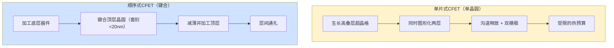
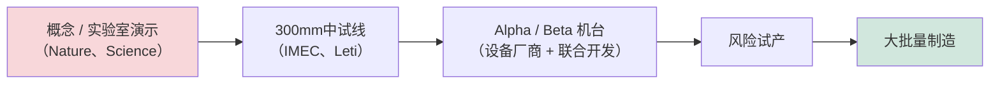
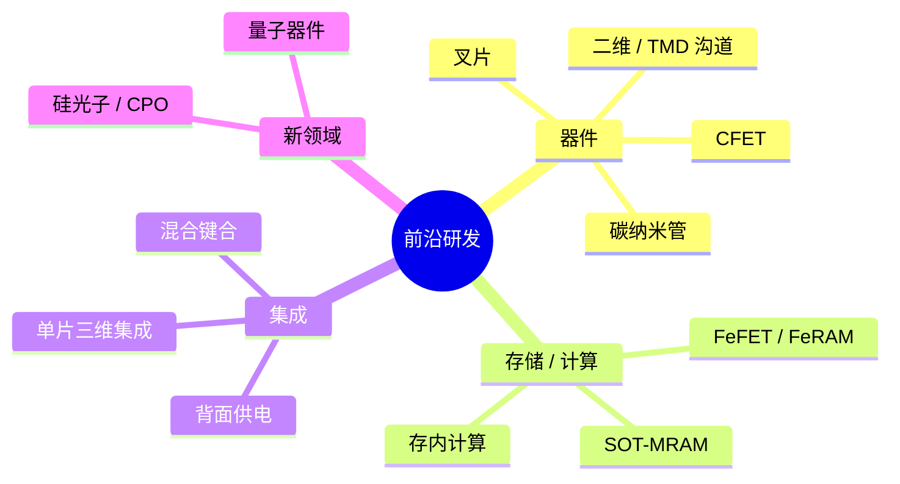

# 半导体制造中的前沿研究课题与新兴技术

> 📘 **说明：** 本文为英文原版《Frontier Research Topics and Emerging Technologies in Semiconductor Manufacturing》的简体中文参考译本，仅供参考；如有出入，以英文原版为准。

> **核心学习目标。** 本文件是本数据库中最深入的两个部分之一，系统梳理将定义2030年代半导体制造的前沿研究——互补场效应晶体管（CFET）、二维材料沟道、碳纳米管、背面供电、先进极紫外（EUV）光刻、定向自组装、量子器件制造、铁电材料、自旋电子学、硅光子学以及神经形态计算。每一节均涵盖其物理原理、注明具体机构与发表渠道的研究成果，以及详细的设备与工艺影响。

研究前沿之所以重要，是因为正如[文件15](15_technology_roadmaps.md)所述，量产路线图是通过一条"管线"来执行的：它把一个十年的探索性研究转化为下一个十年的大批量制造。今天在IEDM、VLSI研讨会、SPIE以及《自然》《科学》系列期刊上展示的概念，就是未来若干年的工艺节点与器件。本文件即是对这一前沿的全景描绘。

---

## 📊 图示概览

*原创示意图；Mermaid图表可在GitHub上原生渲染。*

**CFET——将nMOS堆叠在pMOS之上的两种方式**



**二维沟道材料——单层远薄于硅纳米片**

下图示意：硅纳米片沟道体厚度为4–7 nm，而MoS₂单层仅约0.65 nm，因此可在短沟道效应出现之前实现更短的栅长；主要障碍为接触电阻（费米能级钉扎）、缺陷以及300mm均匀性。

```
 Silicon nanosheet body : ████ 4-7 nm
 MoS2 monolayer body    : ▏ ~0.65 nm   → shorter gate length before short-channel effects
 Key blockers: contact resistance (Fermi-level pinning), defects, 300mm uniformity
```

**从研究到量产的管线（每个概念约5–10年）**



**前沿全景图——正在研究什么**



---

## 第1节：CFET（互补场效应晶体管）——深度研究综述

互补场效应晶体管（CFET）在[文件15](15_technology_roadmaps.md)中被介绍为继全环绕栅极（GAA）纳米片之后的下一次架构转换，目前正由比利时微电子研究中心imec（下文称IMEC）、英特尔（Intel）、台积电（TSMC）、三星（Samsung）以及学术界开展密集研究。本节深入介绍其工艺流程与研究成果。

### 1.1 单片式与顺序式CFET——根本性的选择

CFET将nMOS与pMOS晶体管垂直堆叠在同一单元占位面积内，与并排排布的GAA相比，标准单元面积大约减半。构建CFET有两种根本不同的方式，这一选择决定了下游的每一个工艺决策。

**单片式CFET（Monolithic CFET）** 在一片晶圆上通过单一连续的工艺流程同时构建上下两层。先生长一个高叠层超晶格——例如 **SiGe/Si/SiGe/Si**，下层的层对用于一种器件类型、上层的层对用于另一种——然后统一进行图形化和加工。单片式方案的优雅之处（单一晶圆，最终密度最高）被一个严苛约束所抵消：顶层所需的每一个高温步骤（源/漏外延、掺杂激活退火）都必须与**已经形成的底层器件**相兼容，这大幅限制了热预算，使低温工艺与激光退火成为必需。

**顺序式CFET（Sequential CFET）** 先在一片晶圆上完整加工底层器件，然后**在其上键合第二片晶圆**，将其减薄，再加工顶层器件。其决定性优势在于**热预算自由**——每一层在键合前即已完成，因此各层都可使用完整的热预算并独立优化（甚至可为n型和p型器件采用不同的沟道材料）。代价是需要**极其精确的晶圆对晶圆键合对准**，以及形成连接上下层的**层间通孔（ITV）**。

### 1.2 单片式CFET工艺步骤详解

一个具有代表性的单片式CFET流程如下：
1. **超晶格外延：** 生长SiGe/Si/SiGe/Si叠层，牺牲层SiGe中的锗浓度选在约 **25–35%**（足以实现选择性刻蚀，又低到可避免缺陷），每层厚度约 **6–8nm**，要求在高叠层中实现陡峭界面与低缺陷密度。
2. **双鳍/叠层图形化**，将超晶格刻成器件形状。
3. **为上下两层形成内侧墙** ——内侧墙工艺（SiGe横向回刻 + 低k ALD填充，见[文件15](15_technology_roadmaps.md)）现在必须对**底层和顶层**器件各执行一次，使GAA中最难的模块复杂度大致翻倍。
4. **选择性沟道释放** ——去除牺牲SiGe以释放沟道，双层结构使选择性挑战进一步加剧。
5. **先沉积底层栅极，再进行顶层前道（FEOL）工艺** ——底层晶体管的栅金属必须先形成，并在顶层加工期间受到**保护**。
6. **上下栅之间的自对准栅隔离介质** ——由于nMOS与pMOS需要不同的功函数却又垂直相邻，必须用自对准介质将两个栅极隔开。
7. **顶层源/漏外延**，须在受限热预算下进行，以免损伤已形成的底层栅极。

### 1.3 顺序式CFET工艺步骤详解

一个具有代表性的顺序式流程：将**晶圆1（例如nMOS底层）** 完成前道（FEOL）、中道（MOL）及部分后道（BEOL）工艺；以亚100nm（目标<20nm）的套刻精度将**晶圆2面对面键合**到晶圆1上；**减薄晶圆2**以暴露其器件层；在减薄后的晶圆2上加工**顶层（pMOS）** 纳米片；并形成连接上下两层源/漏和栅极的**层间通孔**。热预算自由使每一层可以独立优化——例如底层为硅nMOS，顶层为SiGe甚至二维材料pMOS。

### 1.4 关键研究成果

CFET的研究记录丰富而具体：
- **IMEC，IEDM 2022：** 首次实现**单片式CFET集成**，接触多晶硅栅间距（CPP）为 **48nm**，将NMOS硅纳米片堆叠在PMOS SiGe纳米片之上，采用TiN基内侧墙和功函数金属栅调节——具有里程碑意义的概念验证。
- **IMEC，IEDM 2023：** 带有**标准单元演示**的CFET，展示了相对GAA纳米片约 **50%的单元面积缩减**，这正是该架构的动机所在。
- **英特尔，IEDM 2021：** 提出**顺序式CFET**概念并给出**层间通孔（ITV）** 电阻测量结果，确立了键合方案的可行性。
- **台积电，VLSI 2023：** 给出向 **CPP ≈ 30nm** 演进的CFET微缩轨迹，并与BEOL金属化进行协同仿真。
- **三星，IEDM 2022：** MBCFET向CFET的演进，并讨论了作为中间步骤的**叉片（forksheet）**。
- **台积电与IMEC，IEDM 2025：** 台积电报告了其所称的首批可工作的CFET*电路*——一个101级单片式CFET环形振荡器和一个极小的6T SRAM位单元；IMEC则展示了混合晶向的单片式CFET。在 **VLSI 2026** 上，英特尔展示了与PowerVia及直接背面接触相结合的CFET反相器（详见下文"2025–2026更新"一节）。

### 1.5 作为中间步骤的叉片

在GAA纳米片与完整CFET之间是**叉片（forksheet）**，主要由**IMEC**开展研究。在叉片结构中，nMOS与pMOS并不堆叠，而是由二者之间构建的一道**介质墙**隔开，从而可缩小n-p间距，并在墙的两侧独立进行栅极图形化。相对于GAA纳米片，它可带来约 **20%的密度提升**——低于CFET的约50%，但工艺复杂度显著更低——曾被认为提供了一个可能的 **2026–2028年导入窗口**，作为完整CFET成熟之前的过渡技术。截至2026年，尚无晶圆代工厂将叉片投入量产；IMEC较新的路线图则将一种"外墙式（outer-wall）"叉片变体定位于A10世代前后，即本十年末、CFET之前。

### 1.6 CFET对设备的影响

CFET以具体而严苛的方式对设备组合施加压力：
- 用于堆叠纳米片之间栅极填充的、**开口小于3nm的ALD间隙填充**。
- 针对双材料沟道释放、**对Si选择比>100:1的SiGe选择性刻蚀**。
- **低温（<400°C）高k介质**，且界面质量优异（**Dit < ~5×10¹⁰ cm⁻²eV⁻¹**），以保护已形成的器件层。
- 深宽比高于20:1、关键尺寸（CD）小于20nm的**层间通孔刻蚀**。
- 顺序式CFET所需的**晶圆对晶圆键合套刻精度低于约15nm（3σ）**——超出当前量产键合能力。
- 能填充亚3nm间隙的**无铜栅金属（Ru、Mo）**。

因此，CFET代表着先进晶体管工艺与先进封装中的晶圆键合及三维集成技术的融合——这是最清晰的信号：微缩的未来在于垂直、三维的器件集成，而非持续的平面缩小。

---

## 第2节：二维材料与TMD晶体管

如果说CFET是下一代*架构*，那么**二维沟道材料**则是下一代*沟道*的首要候选——当即便是超薄的硅纳米片也耗尽静电控制余量时，这种材料可能最终取代硅。

### 2.1 物理背景

**过渡金属二硫族化合物（TMD）** 的化学式为 **MX₂**，其中M为过渡金属（Mo、W、Ti、Nb），X为硫族元素（S、Se、Te）。它们形成由微弱的**范德华**力结合在一起的六方晶格层状结构，因此可以减薄至单个分子层。关键在于，块体TMD为*间接*带隙，而**单层则实现直接带隙**，且单层厚度极薄。

关键材料及其特性：
- **MoS₂** ——nMOS候选材料，单层带隙约1.8eV。
- **WS₂** ——nMOS候选材料，约2.0eV。
- **WSe₂** ——pMOS/双极性候选材料，约1.7eV。
- **MoSe₂、MoTe₂** ——MoTe₂（约1.1eV）为pMOS候选材料。
- **hBN（六方氮化硼）** ——一种绝缘性二维材料，可用作栅介质或原子级洁净的衬底。

决定性优势在于**沟道体厚度**：MoS₂单层厚约 **0.65nm**，而硅纳米片为4–7nm。更薄的沟道体意味着栅极可以在短沟道效应占主导之前控制更短的沟道，理论上可实现低于约3nm的栅长——远短于硅所能达到的水平。

### 2.2 沉积方法与成熟度

二维材料的核心挑战并不在于器件物理（物理特性是有利的），而在于**制造**——生长晶圆级、低缺陷、均匀的薄膜。按可制造性由低到高，主要方法如下：
- **CVD硫化：** 金属前驱体（MoO₃或MoCl₅）与硫蒸气反应。可得到尚可的晶体，但**晶粒尺寸约10–100nm**、**缺陷密度高（10¹²–10¹³ cm⁻²）**，且晶粒取向不均——适合研究，不适合制造。
- **MOCVD：** 金属有机前驱体（如Mo(CO)₆或钼-环戊二烯基化合物配合H₂S）可在大面积上获得更好的均匀性。**Aixtron和维易科（Veeco）** 正在开发用于TMD的MOCVD反应腔，**IMEC于2023年演示了300mm MOCVD MoS₂**——这是关键的可制造性里程碑——但晶粒尺寸仍是限制因素。
- **ALD：**（如MoCl₅ + H₂S）可实现真正的逐层厚度控制，但结晶度较低，需要在约500°C以上进行沉积后退火以实现结晶。
- **MBE：** 可获得最佳的单晶质量，但只能在小尺寸（约2英寸）晶圆上进行——无法在300mm上量产。

**晶圆级均匀性**是症结所在：IMEC的300mm演示显示方块电阻均匀性优于约10%，但该材料目前只达到**薄膜晶体管级质量，而非逻辑级质量**——晶界、缺陷和波动性仍远高于高性能逻辑的要求。

### 2.3 关键器件成果

TMD研究记录中包含若干里程碑式成果：
- **MIT，2016年（Nature）：** 采用**1nm碳纳米管栅极**的MoS₂晶体管，在**1nm栅长**下实现**65 mV/decade**的亚阈值摆幅——展示了MoS₂的极限微缩潜力。
- **台积电，2021年（Nature Electronics）：** 单元面积约 **0.1 μm²** 的MoS₂ **CMOS反相器**，噪声容限>40%，证明了二维沟道的CMOS兼容性。
- **IMEC，2023年（IEDM）：** 采用MOCVD在硅上制备的**300mm MoS₂ NMOS**晶体管，**栅长30nm**、**Ion > 100 μA/μm**——首个与制造兼容的演示。
- **斯坦福大学，2022年：** 采用半金属**Bi₂O₃相关接触**的WS₂ pFET，接触电阻低于约1 kΩ·μm——TMD pFET的纪录。
- **北京大学，2021年：** 以MoS₂边缘作为栅极、**有效栅长0.4nm**的MoS₂ FET——亚纳米沟道控制的概念验证。

### 2.4 接触电阻问题

TMD晶体管面临的最大单一障碍是**接触电阻**，其根源在于金属/TMD界面处的**费米能级钉扎**：无论金属的功函数如何，金属都会把半导体的费米能级钉扎在禁带中部附近，即使对低功函数金属也会形成肖特基势垒。大多数金属与TMD的接触电阻为 **1–100 kΩ·μm**，而有竞争力的逻辑器件目标是低于约100 Ω·μm。

正在研究的解决方案：
- **半金属接触** ——In、Sn、Bi、Sb，其近零带隙可抑制肖特基势垒。**MIT 2021年的成果（Nature）** 采用**铋（Bi）接触**，在MoS₂上实现约 **123 Ω·μm**，这一突破已接近有竞争力的目标。
- **相工程** ——在接触区将MoS₂由半导体性的**2H相**局部转变为金属性的**1T相**（通过正丁基锂或电子束处理），接触电阻可低于约300 Ω·μm。问题在于：1T相是**亚稳态**的，在约100°C以上会回复到2H相，与标准CMOS热处理不兼容。
- **石墨烯接触** ——提供洁净的范德华界面。

### 2.5 TMD上的介质集成

第二大挑战是在TMD上沉积高质量的**栅介质**。TMD表面**原子级平整、化学惰性且没有悬挂键**，这对载流子输运极为有利，但对ALD成核却极为不利——常规高k ALD在原始表面上成核不良，而且不存在自然氧化层。解决方案包括**有机籽晶层**（如先沉积PTCDA籽晶层再ALD沉积Al₂O₃）、**臭氧预处理**、延长成核的低温ALD，以及**AlOx籽晶化**。最佳结果实现了**MoS₂上的HfO₂、等效氧化层厚度（EOT）低于1nm**，界面陷阱密度约10¹¹ cm⁻²eV⁻¹。**以hBN作栅介质**可提供近乎理想、晶格匹配的界面（在Pt箔上CVD生长并转移的hBN，亚阈值摆幅接近62 mV/dec），但尚无法大规模制造。

### 2.6 迈向集成的路线图

IRDS"超越CMOS"展望将TMD FET定位为：**当前处于早期研究**，**约2028年进入技术开发**，**首次大批量制造不早于约2031年**（最乐观情形）。最可能的集成路径**并非**全TMD逻辑，而是**选择性使用**——例如**在顺序式CFET中以WSe₂作为顶层pMOS**，而底层nMOS仍为硅纳米片——利用顺序键合的热预算自由，在不影响硅层的前提下加入一层二维器件。关键未解难题仍是**晶粒尺寸与均匀性、接触电阻、介质界面质量、300mm MOCVD工艺，以及互补n/p性能的平衡**——这是一份艰巨的清单，但IMEC、台积电、学术界以及开发沉积设备的设备厂商（Aixtron、维易科、ASM国际（ASM International）、应用材料（Applied Materials））正在系统性地攻克。最新成果喜忧参半：IMEC在VLSI 2026上展示了一条以EUV图形化、在300mm上实现50nm间距二维n型与p型MOS的集成路线；但IMEC在2026年7月发表的一篇基准对比论文发现，除非对接触和寄生参数进行协同优化，否则在A2世代二维沟道CFET相对硅CFET并无接触多晶硅栅间距（CPP）优势（详见"2025–2026更新"一节）。

---

## 第3节：碳纳米管场效应晶体管（CNFET）

碳纳米管具备已知材料中最诱人的本征晶体管特性之一，却也是最难制造的材料之一——这种令人心动又令人沮丧的组合，使其在潜力被认识数十年后仍停留在研究前沿。

### 3.1 CNT物理

**单壁碳纳米管（SWCNT）** 是一片卷成无缝管状的石墨烯，直径为 **0.5–2nm**。石墨烯片的卷曲方式——由手性指数 **(n,m)** 描述——决定了纳米管是**半导体性还是金属性**：随机生长的CNT中约**三分之一为金属性**，三分之二为半导体性。作为晶体管沟道，半导体性CNT可提供近乎理想的**一维弹道输运**，本征载流子迁移率超过 **100,000 cm²/V·s**，室温下平均自由程超过1μm——远优于硅。原则上，其单位宽度的跨导与驱动电流可大幅超越硅。

两大决定性挑战直接源自其物理特性：**金属性CNT会在晶体管中造成短路**（要求半导体性纯度高于 **99.99%**），并且纳米管必须以高密度**平行于电流方向排列**，才能提供有竞争力的驱动电流。

### 3.2 分离与分选

实现99.99%以上的半导体性纯度需要精密的分离技术：
- **凝胶分离**采用琼脂糖凝胶色谱，利用细微的密度差异；反复运行可达约99.9%的纯度。
- **聚合物包裹**采用共轭聚合物，如 **PFO（聚(9,9-二辛基芴-2,7-二基)）**，在甲苯分散液中选择性地包裹半导体性纳米管，纯度可达约 **99.99%** ——这是MIT首选的方法。
- **双水相萃取（ATPE）** 利用表面活性剂混合物的分配来选择半导体性纳米管，工艺可放大。
- **密度梯度超速离心（DGU）** 采用CsCl或碘克沙醇梯度，可实现亚纳米直径分辨率和>99.9%的纯度，但速度慢且成本高。

### 3.3 排列技术

有竞争力的驱动电流要求CNT以 **约100–200根/μm** 的密度平行于电流方向排列：
- **在取向衬底上的溶液法沉积**（Langmuir–Blodgett法、**浮动蒸发自组装，FESA**）可达约100根CNT/μm，局部有序性好，但长程有序性差。
- **在ST切石英上外延生长CNT**，纳米管沿石英晶体台阶边缘取向生长（取向度约95%，但密度仅约5根CNT/μm），随后转移到Si/SiO₂晶圆上。
- **介电泳（DEP）** 利用交流电场在溶液中排列纳米管，实现短程局部取向。
- **气溶胶/喷墨打印** CNT悬浮液（IBM）可在打印通道内实现局部取向。

### 3.4 关键器件成果

- **MIT，2019年（Nature）：** 里程碑式的 **RV16X-NANO**——一个**由约14,000个CNFET构建的16位RISC-V微处理器**，是迄今最复杂的CNT电路，功能完整，采用与制造兼容的流程制备。MIT的 **"MIXED"方法学**将金属性CNT去除步骤（电击穿/RINSE工艺）与可容忍残留金属性纳米管的电路设计技术（DREAM）相结合，芯片使用99.99%纯度的半导体性CNT。MIT还通过将CNFET逻辑与RRAM存储器堆叠，演示了**三维集成**。
- **斯坦福大学，VLSI 2022：** CNFET**环形振荡器**，级延迟约2ps，性能外推显示fT潜力超过1THz。
- **IBM研究院：** **稀疏取向CNT FET**，Ion/Ioff > 10⁶，采用**Pd接触**，接触电阻低于约30 Ω·μm。
- **北京大学，2023年：** **约100根CNT/μm的取向阵列** FET，**栅长10nm**，实现了迄今最高的CNT-FET驱动电流——约为MIT标准工艺的5倍。

### 3.5 集成挑战

尽管本征特性出色，CNFET仍面临严峻的制造障碍：
- **规模化密度：** 在紧凑栅间距下实现有竞争力的逻辑需要约200根CNT/μm，但晶圆级*平均*密度仍远低于最佳单器件结果。
- **排列均匀性：** 良好的局部取向已经实现，但**300mm尺度的均匀取向尚未解决**。
- **接触与掺杂：** **Pd** 对p型CNT效果良好（几乎无肖特基势垒），但可靠的**n型掺杂**（使用苄基紫精或稀土掺杂剂）及稳定的n型接触（Sc、Y）更难实现，使CMOS复杂化。
- **工艺兼容性：** CNFET制造必须与BEOL兼容（<400°C），但CNT会被HF、强等离子体以及标准光刻胶工艺损伤。
- **没有明确的路线图：** 尚无主要晶圆代工厂（台积电、三星、英特尔）承诺CNFET的大批量制造路线图；该技术被归类为**2030年以后的探索性研究**。其最可能的近期角色是作为堆叠在硅之上的**三维集成、BEOL兼容逻辑层**，利用CNT可低温加工的特性——但必须先解决密度与均匀性问题。

---

## 第4节：背面供电——详细研究版图

背面供电网络（BSPDN）在[文件15](15_technology_roadmaps.md)中作为量产技术介绍过，它拥有深厚的研究文献，揭示了它如何在短短几年内从概念走向量产——采用PowerVia的英特尔18A已于2025–2026年进入大批量制造（Panther Lake），而采用超级电轨（Super Power Rail）的台积电A16正自2026年下半年起爬坡。

### 4.1 研究与发表版图

- **英特尔，IEDM 2021：** 首次公开披露 **PowerVia**，描述了测试载体架构，报告了供电网络（PDN）效率的大幅提升，背面通孔电阻目标为在约20nm直径下每个通孔低于约1Ω。
- **英特尔，Hot Chips 2023 / VLSI 2023：** 英特尔18A路径上 **PowerVia + RibbonFET协同集成**的成果，版图对比显示约 **20%的标准单元面积**收益，并因IR压降降低而带来实测性能提升，在Intel 4测试载体上得到验证（报告约6%的频率提升和约90%的PDN相关压降减少）。
- **台积电，VLSI 2023：** **超级电轨（SPR）** 架构，对比了台积电的直接背面接触方案与英特尔的方案，并预测了A16的功耗/性能收益。
- **IMEC，IEDM 2022：** **BSPDN模块开发**，涵盖背面通孔隔离、背面PDN铜电阻，以及显示从背面供电后散热方式如何变化的**热仿真**。
- **CEA-Leti，约2023年：** 面向BSPDN的顺序集成工艺与键合对准成果，依托Leti在三维顺序集成方面的长期积累。

### 4.2 背面通孔技术（纳米TSV）

背面通孔是一种**纳米尺度的硅通孔（TSV）**，远小于传统TSV：
- **直径：** **20–50nm**（传统TSV为5–20μm）。
- **形成：** 从晶圆背面刻蚀，穿过极薄（<5μm）的剩余硅（若为SOI还需穿过BOX层以及ILD层），着陆于源/漏或接触上，**深宽比超过40:1**，需要极高各向异性的等离子体刻蚀（类似Bosch工艺，但尺度小得多）。
- **填充：** 阻挡层ALD（如约2nm TaN）+ 籽晶层ALD（Ru或Cu）+ Cu电镀或Ru CVD填充——在20nm直径下的间隙填充极具挑战。
- **电阻：** 研究载体测得每个通孔约 **0.5Ω**，满足英特尔低于1Ω的目标。
- **对准：** 穿过减薄晶圆的**背面对正面对准**采用**红外（IR）对准**（硅对低于带隙能量的红外光透明），套刻目标低于约10nm（3σ）。

### 4.3 BSPDN的晶圆减薄

减薄是最关键也最精细的步骤：
- **目标厚度：** 剩余硅**低于5μm**（对最小的纳米TSV，部分方案低于2μm）。
- **工艺：** 机械背面研磨至约50–100μm → CMP至约10μm → 湿法刻蚀（TMAH或KOH）或等离子体刻蚀至<5μm → 最终CMP。
- **超薄状态下的挑战：** **晶圆弯曲与翘曲**（来自FEOL/BEOL应力）、**搬运**（晶圆在全过程中必须键合在载片上）、在新的背面暴露出**硅体缺陷**（COP、微缺陷），以及后续工艺中的热机械应力。
- **临时键合/解键合：** 如 **ZoneBond（Brewer Science）** 及直接键合方案，所用粘合剂须耐受400°C及后续刻蚀化学品；**SUSS MicroTec和EV Group**提供键合/解键合设备，采用激光或热滑移解键合。

BSPDN是一个范例，说明单一架构理念如何催生一连串新的设备市场——背面刻蚀、背面ALD、超薄CMP、临时键合、红外对准——并把先进封装设备厂商深深拉入前道流程。

---

## 第5节：先进EUV——随机效应与下一代光刻胶研究

极紫外（EUV）光刻虽已进入大批量生产，但仍是一个前沿研究领域，因为其基本物理——EUV光子的离散性——带来的限制在每个节点都会加剧。

### 5.1 EUV中的随机效应

EUV随机效应问题的根源是**光子散粒噪声**。EUV光子能量很高（约92 eV），因此有效曝光剂量在单位面积内提供的光子数相对*较少*。在约20–30 mJ/cm²的典型剂量下，10nm²的面积只能接收到大约14–20个光子，如此小数量的**泊松统计**会产生很大的*相对*波动：√14 ≈ 3.7，即特征之间光子数约26%的差异。这种随机性直接转化为：
- **线边缘/线宽粗糙度（LER/LWR）：** 印刷线条的边缘随机游走；标准曝光下3σ LER约为2.5nm，而2nm节点需要低于约1.5nm——这是由光子统计决定的硬性限制。
- **随机缺陷：** 局部剂量随机不足或过量会造成**桥连**（两条线合并）或**断线**（线条不连续），在可接受剂量下密度约为0.01–0.1/cm²——而大批量制造需要低于约0.001/cm²。
- **剂量—LER—产能三角：** 提高剂量可降低LER和随机缺陷，但会降低扫描式光刻机速度（产能下降）。这一根本性权衡是EUV工艺优化的核心矛盾。

### 5.2 光刻胶研究

与随机效应的大部分较量发生在光刻胶上：
- **化学放大光刻胶（CAR）：** 现有主流。光致产酸剂（PAG）吸收EUV并产生酸，酸扩散并催化聚合物的脱保护反应。**酸扩散长度**是LER不可消除的贡献因素，而有机CAR相对较低的EUV吸收率限制了光子捕获。
- **金属氧化物光刻胶（MOR）：** **Inpria的锡氧化物基**光刻胶（Inpria于2021年被 **JSR** 收购）采用锡氧笼状前驱体；锡原子**直接吸收EUV**（吸收截面高），曝光后形成无机氧化物网络。MOR可实现低于约12nm间距的分辨率、LER约1.5nm——优于CAR——但代价是**灵敏度较低**（剂量较高），是高数值孔径极紫外（High-NA EUV）的首选候选。
- **分子光刻胶：** 无聚合物链扩散的小分子光刻胶，LER本征更低；IMEC、康奈尔大学和CEA-Leti在研究，但成熟度低。
- **增感CAR与PSCAR：** 在CAR中加入EUV增感分子以提高量子产率（IMEC，约2022–2023年），以及**光敏化学放大光刻胶（PSCAR）**——一种两步法，在EUV曝光后进行泛光UV曝光以放大产酸（JSR/东京应化（TOK））——二者都旨在不牺牲LER的前提下提高灵敏度。

### 5.3 EUV掩模与保护膜研究

- **高n吸收层：** 标准 **TaN** 吸收层（13.5nm下n≈0.96，k≈0.03）会造成三维掩模阴影效应。**高n/低厚度吸收层**（TaBN、Ni基、Co基、Ru基）可减轻这些效应；**IMEC**已演示高n吸收层掩模，可减少旁瓣伪影和成像不对称。
- **保护膜：** 多晶硅保护膜（厚约13nm）在EUV下透过率约88–90%，但在1000W以上的EUV功率下会劣化。**阿斯麦（ASML）与台积电正在开发碳纳米管（CNT）保护膜**，目标透过率>95%，并具有更高耐热性以适应更高功率的扫描式光刻机。
- **光化掩模检测：** 与EUV相关的掩模缺陷只能在13.5nm波长下（光化）看到。**蔡司（ZEISS）AIMS EUV**（位于ASML园区）提供光化检测，但产能有限（非HVM级）；台积电、三星和英特尔通过蔡司使用该能力，更快的下一代光化检测能力正在开发中，面向约2026年以后。**掩模基板缺陷密度**对>20nm的缺陷必须低于约0.003/cm²，**Hoya和AGC**处于领先，基板在蔡司接受检测——这是一条供给受限的链条（全球仅三家基板供应商）。

### 5.4 High-NA EUV（0.55 NA）研究现状

- **机台：** 首批 **ASML EXE:5000** 系统交付给**英特尔（首台客户机台，2024年）** 以及位于费尔德霍芬的 **ASML–IMEC联合High-NA实验室**（2024年）。随后推出量产级 **EXE:5200B**：据报道，英特尔于2026年初在其俄勒冈D1X晶圆厂完成了一台EXE:5200B的验收，IMEC也在其鲁汶洁净室中安装了一台EXE:5200，预计于2026年第四季度完成全面认证。
- **变形（anamorphic）光学：** 为控制0.55 NA下的掩模阴影，光学系统**在扫描方向采用8倍缩小、在狭缝方向采用4倍缩小**。掩模版仍以4倍放大制作，但可曝光**视场减半**至 **26mm × 16.5mm**——这意味着大芯片（如大型GPU计算阵列）必须由多次曝光**拼接**而成。
- **分辨率：** 在k1≈0.33时，最小间距约为λ/(2·NA) = 13.5/(2·0.55) ≈ 12.3nm，实际可实现约16nm半间距。
- **光刻胶与拼接挑战：** 光刻胶须在厚度低于约20nm（以控制掩模三维效应和吸收）的条件下分辨<16nm间距（需要金属氧化物光刻胶）；对于某一维度超过16.5mm的芯片，需要在视场边界实现拼接误差低于1nm的**图形拼接**——这是大芯片的真实设计约束。
- **IMEC的High-NA成果：** IMEC印制了**16nm间距图形（SPIE 2023）**，LER约2.8nm，并报告相对标准NA EUV，掩模三维效应显著降低。
- **英特尔14A的High-NA：** 英特尔最终让18A保留在标准（0.33 NA）EUV上，计划以其**14A**节点实现**首次大批量制造中的High-NA导入**，用于特定关键层，大多数层仍采用标准EUV；**3.8亿美元以上的机台成本**将早期采用限制在最先进晶圆厂的少数几层。根据ASML 2026年第三季度业绩电话会的评论，三星和台积电分别计划在2028年前后和2030年前后实现High-NA的大批量使用。

因此，先进EUV研究横跨物理（随机效应）、化学（光刻胶）、材料（吸收层、保护膜、基板）与光学（High-NA）——这是一个多学科交叉的前沿，整个产业的持续微缩都依赖于它。

---

## 第6节：定向自组装（DSA）——研究与制造现状

定向自组装利用某些聚合物在光刻模板引导下自发组织成规则纳米图形的天然倾向——提供了一条以潜在低成本实现低于光刻单独分辨极限的特征尺寸与间距的途径。

### 6.1 DSA基本原理

主力材料是**嵌段共聚物（BCP）** ——由两种化学上互不相溶的嵌段首尾相连构成的聚合物链，例如 **PS-b-PMMA（聚苯乙烯-嵌段-聚甲基丙烯酸甲酯）**。当分子量超过临界值时，两个嵌段会自发**微相分离**（它们倾向于分离，却被束缚在一起），形成具有特征间距 **L₀**（由嵌段长度决定）的规则纳米畴。

- **层状形貌：** 对称BCP形成半间距为L₀/2的交替层状结构。典型PS-b-PMMA的L₀/2约为10–15nm（即约20–30nm半间距）。**高χ（高Flory–Huggins相互作用参数）BCP**，如 **PS-b-PDMS** 或 **PS-b-PTMSS**，可获得更小的畴（L₀/2低于约8nm），具备亚10nm半间距的潜力。
- **图形外延（Graphoepitaxy）：** 由EUV或ArF浸没式光刻制作的形貌预图形（引导沟槽或柱）对BCP组装进行取向和定位。一大优点是**图形修正**——自组装会平滑引导图形的线边缘粗糙度并规整间距，使DSA结果比其光刻模板*更干净*。BCP畴相对引导图形的套刻须低于约L₀/4。
- **化学外延（Chemoepitaxy）：** 表面上的化学衬度图形（交替的化学刷条纹）在没有形貌的情况下引导BCP，对表面化学控制要求更严。IMEC和Albany NanoTech是主要的化学外延研究基地。

### 6.2 当前制造现状

- **三星**拥有最先进的（有限）量产DSA，用于**DRAM接触孔缩小**（IEDM 2018报道）以及通过图形外延进行通孔图形化，并在研究将DSA用于铠侠（Kioxia）式3D NAND台阶接触。
- 台积电和英特尔的**先进逻辑**尚**未**在量产中使用DSA。
- **缺陷密度**是核心障碍：BCP组装会在有序畴中产生缺陷——**位错、向错和晶界**——密度约10–100/cm²，而逻辑要求低于约0.01/cm²。缩小这一差距是首要研究方向。
- **IMEC DSA项目**（与陶氏（Dow）、JSR、默克（Merck）和东京电子（TEL）联合开发）演示了在EUV引导图形上以PS-b-PDMS实现10nm间距图形，并在2019–2023年间将缺陷密度从约1000/cm²降至约10/cm²，目标是到约2026年降至约1/cm²以下（截至2026年末，该目标是否实现尚未公开确认）。
- **高χ BCP：** PS-b-PDMS（χ≈0.26，而PS-b-PMMA的χ≈0.04）可实现更小的L₀，东京电子正致力于将PS-b-PDMS集成到涂胶显影轨道设备中。

### 6.3 DSA设备

- **涂胶显影轨道设备**（东京电子Lithius、迪恩士（SCREEN）轨道设备）：依次执行BCP涂布、软烘、**自组装烘烤**（PS-b-PMMA通常为230–250°C）、固定畴结构的UV处理，以及**选择性去除一种嵌段**（如用乙酸或O₂等离子体去除PMMA）。
- **检测：** 能在DSA间距下检测亚5nm畴缺陷的SEM缺陷检测——需要电子束检测（HMI/ASML或科磊（KLA））。
- **套刻量测：** BCP对引导图形的套刻低于约5nm（3σ），在研究环境中使用ASML YieldStar等工具测量。

根据IRDS，DSA可能的角色是**在约2026–2028年导入特定层（接触、通孔、线切割）**——不过截至2026年末，尚无先进逻辑量产导入的公开确认——作为EUV的补充（在EUV引导图形上进行图形外延）而非替代，完全取决于缺陷密度挑战能否解决。

---

## 第7节：量子计算器件制造

量子计算已成为专用器件制造的一大驱动力，几种相互竞争的量子比特技术各自提出了独特而严苛的制造要求。尽管量子器件的产量远低于经典芯片，其制造却在材料纯度、精度和三维集成方面推动着前沿，并越来越多地借助半导体制造设备与技术诀窍。

### 7.1 超导量子比特（Transmon）

**Transmon**是目前主流的超导量子比特类型，被**IBM、谷歌（Google）、Rigetti和IQM**采用。其关键非线性元件是**约瑟夫森结（JJ）**——一种 **Al/AlOx/Al** 隧道结。

- **JJ制造：** 经典方法是**阴影（Dolan桥）蒸镀**——通过电子束图形化的光刻胶掩模以一定角度蒸镀铝，在受控的O₂分压和温度下原位氧化底电极，然后以不同角度蒸镀顶电极。结面积（约200nm × 200nm）决定约瑟夫森能E_J，进而决定量子比特频率。
- **工艺环境：** 专用的**低污染洁净室**，不含磁性污染物（无Cu、无Fe），表面粗糙度亚纳米级，颗粒控制严格，因为污染会劣化超导特性（Al能隙Δ ≈ 170 μeV）。
- **衬底：** 高阻硅（>10 kΩ·cm）或蓝宝石，以降低微波损耗，并需关键的预清洗（HF去除自然氧化层、退火）。
- **介质损耗与TLS：** Si/SiO₂界面、衬底表面和Al₂O₃中的**二能级系统（TLS）** 是主要的退相干来源；降低TLS密度（通过氢退火、表面钝化）是IBM和谷歌的一大研究方向。
- **铌基量子比特：** **Nb**（Tc = 9.25K，而Al为1.2K）用于谐振器和传输线，通过PVD沉积并以Cl₂/F等离子体刻蚀图形化；其更大的能隙可抵御辐射诱发的准粒子。英特尔和IQM使用Nb。
- **三维集成：** IBM的"重六边形（heavy-hex）"拓扑及规模扩展需要**倒装芯片键合**（铟微凸点键合，使焊点能承受冷却至约4K及以下），将量子比特芯片连接到独立的读出芯片，凸点高度低于约5μm、对准精度低于约5μm，并需应对低温机械应力。
- **良率与频率定标：** 50量子比特芯片上JJ频率离散约1–5%（"频率拥挤"），需要通过磁通偏置线对各量子比特单独调谐，并在制造后对**JJ进行激光退火**（MIT，2020年）以微调结电阻并定标频率。

### 7.2 离子阱量子比特

- **制造：** 在硅或石英衬底上制作**表面电极离子阱**，金或铝电极采用标准光刻（约1μm特征）图形化。硅上的**DRIE刻蚀窗口**为激光束提供光学通道，并通过引线键合连接到低温PCB。
- **材料：** 低放气电极（超高真空下首选金）、电极下方的氧化铝介质、SiO₂层间介质，以及粗糙度低于约5nm的刻蚀硅表面（以减少激光散射）。
- **公司：** **IonQ（已于2025年收购Oxford Ionics）和Quantinuum（霍尼韦尔）**；离子阱芯片制造通常外包给**MEMS晶圆厂**（如专业代工厂、IMEC），而非先进逻辑晶圆厂。
- **光子集成：** 离子阱芯片越来越多地集成**光子器件**（Si₃N₄波导、光栅耦合器）以实现片上激光传输——MIT/林肯实验室开创了集成光子离子阱芯片。

### 7.3 硅自旋量子比特

- **量子比特：** **Si/SiGe或Si-MOS量子点**中的单电子自旋，具有长相干时间（在同位素纯化硅中T₂可达数秒）。
- **制造：** 使用**标准22nm/28nm级CMOS工艺**，栅间距极紧（30–50nm）；单电子控制需要亚阈值工作，并可在约4K下协同集成**低温CMOS控制电路**。
- **同位素纯化硅：** 天然硅含4.7%的 **Si-29**（核自旋非零）；使用 **99.99%的Si-28** 可消除核自旋浴，将T₂*从微秒级延长至>100μs。**信越化学（Shin-Etsu）和Wacker**为外延Si-28生长提供纯化硅烷。
- **英特尔的路径：** 利用现有**300mm CMOS晶圆厂**（改进的22nm FD-SOI工艺）制造自旋量子比特——以其"Tunnel Falls"研究芯片为代表——瞄准大规模量子比特阵列，与**QuTech（代尔夫特理工大学）** 合作。决定性优势在于借力成熟的CMOS制造；挑战在于量子比特均匀性要求亚纳米级的栅氧均匀性，超出当前CMOS良率目标，且每个量子比特都需单独调谐。

### 7.4 量子器件制造设备

- **电子束光刻：** 亚100nm JJ和量子点栅极的主要图形化工具（Raith、JEOL、Elionix系统，常以100kV获得最佳分辨率）——尚未达到代工规模。
- **PVD：** 在专用低污染腔室中沉积铝和铌（Plassys、AJA International），并集成原位氧化。
- **DRIE：** 用于离子阱窗口和表面形貌的硅刻蚀（Oxford Instruments、SPTS）。
- **表面分析：** 用XPS表征Al₂O₃，用HAADF-STEM观察JJ截面（常与国家实验室合作）。
- **低温PEALD：** 在约80°C下ALD沉积Al₂O₃或SiO₂，获得与量子比特兼容的介质（MIT研究，采用三甲基铝/水化学体系）。

因此，量子器件制造覆盖了从定制化的电子束加蒸镀实验室工艺（超导和离子阱）到借力CMOS代工的制造（硅自旋量子比特）的完整谱系；随着量子系统规模扩大，向半导体制造技术——300mm加工、ALD、先进光刻和三维集成——靠拢的趋势日益强烈。

---

## 第8节：铁电器件——FeFET、FeRAM与负电容

2011年发现**氧化铪**可以呈现铁电性，重新点燃了铁电微电子学领域，因为——与传统钙钛矿铁电材料（PZT、BaTiO₃）不同——HfO₂完全兼容CMOS、可微缩至纳米级厚度，并可通过ALD沉积。

### 8.1 HfO₂基铁电材料

- **发现：** **Böscke等人，2011年（Applied Physics Letters）** 发现**掺杂HfO₂**（掺Si、Y、Zr、Al或Gd）呈现铁电性**正交相**（空间群Pca2₁），在薄至约1nm的薄膜中仍可稳定存在——这是块体HfO₂所不具备的特性，并且与硅完全兼容，这一点与钙钛矿不同。
- **关键掺杂剂：** **掺Si（3–4 at%）** 可稳定铁电相；**掺Zr（HZO，HfO₂:ZrO₂约50:50）** 可得到稳健的铁电体，剩余极化2Pr约20–40 μC/cm²；**掺Al**提高矫顽场；**掺Y**可得到最大的Pr，但存在均匀性挑战。
- **HZO的ALD沉积：** 交替进行HfCl₄/H₂O和ZrCl₄/H₂O循环，由超循环比例控制Hf:Zr比，沉积温度250–300°C（兼容300mm），随后进行 **400–500°C的沉积后退火**以晶化出铁电相（TaN覆盖电极提供晶化模板）。

### 8.2 FeFET（铁电场效应晶体管）

- **结构：** 采用HZO铁电栅介质的标准MOSFET；极化状态以非易失方式存储数据，读出为阈值电压偏移（ΔVt约1V）；可实现1位或多位操作。
- **格芯（GlobalFoundries）FeFET：** **GF 22FDX FeFET**（基于FD-SOI）是首个商用FeFET（约2021年），耐久性约10⁹次循环，85°C下保持时间>10年；已演示8Mb FeFET阵列（Fraunhofer/格芯，2023年）。
- **FinFET FeFET：** 三星在28nm级鳍式场效应晶体管（FinFET）上演示了FeFET，在鳍侧壁上保形沉积HZO，由于鳍表面钝化，比平面结构更复杂。
- **关键挑战：** **唤醒效应**（Pr在最初10³–10⁵次循环中变化）、**印记效应**（同一状态多次循环后Vt偏移）以及**循环疲劳**——均通过界面工程（在HZO与硅之间加入SiO₂或Al₂O₃中间层）加以解决。
- **应用：** 嵌入式非易失存储器（在28nm及以下替代NOR闪存）、用于模拟计算的突触器件，以及存内逻辑。

### 8.3 负电容场效应晶体管（NCFET）

- **概念：** **Salahuddin和Datta，2008年（Nano Letters）** 提出，将铁电体与栅氧化层串联可放大栅电压，获得**低于60 mV/decade玻尔兹曼极限**的有效亚阈值摆幅——有望实现更低电压、更低功耗的晶体管。
- **机制与争议：** 铁电体的负dQ/dV区（P–E曲线上）可放大栅电势，但观察到的亚60mV/dec行为究竟反映真正的稳态负电容还是瞬态迟滞，**在科学上仍有争论**。
- **现状：** **三星**表示其SF3 GAA栅叠层使用了具有"NC"效应的薄HZO，但其机制存在争议；**IMEC**在直流HZO/SiO₂叠层中测得SS ≈ 52 mV/dec，而交流测量显示存在迟滞。NCFET仍是**研究阶段**的概念，尚未被确认为有意设计的大批量制造特性，其物理机制仍有争议。

### 8.4 FeRAM（铁电随机存储器）

- **结构：** **1T1C**单元（存取晶体管 + 铁电电容）。HZO FeRAM面向28nm以下的嵌入式非易失存储器（NVM），这是传统PZT FeRAM（不可微缩、与BEOL不兼容）无法企及的领域。
- **集成：** 在晶体管之后于BEOL中以350–400°C沉积HZO，上下电极为TiN；约10nm的HZO薄膜可实现Pr ≈ 18 μC/cm²、耐久性>10⁹，85°C下保持时间>10年（台积电研究，IEDM 2022）。
- **开发者：** 德州仪器（Texas Instruments）、Synaptics等公司正在开发面向嵌入式应用的HZO FeRAM。

因此，铁电HfO₂开启了一个丰富的设计空间——非易失存储器（FeFET、FeRAM）、陡峭斜率晶体管（NCFET，若物理机制成立）以及模拟/神经形态器件（第11节）——全部由一种与CMOS兼容、可ALD沉积的材料构建，使其成为新兴器件中最活跃、最具前景的前沿之一。

---

## 第9节：SOT-MRAM与自旋轨道矩器件

磁阻随机存储器（MRAM）将信息存储在磁性隧道结的磁化方向而非电荷中，具有非易失性、高耐久性和快速翻转等特点——其演进历程展示了自旋电子器件如何进入主流嵌入式存储器。

### 9.1 MRAM的演进

- **Toggle MRAM（第一代）：** 使用两个磁耦合层，由外加磁场翻转；由**Everspin**商业化，但无法微缩到先进节点。
- **STT-MRAM（自旋转移矩）：** 写入电流*穿过*MTJ，自旋极化电流产生的力矩翻转自由层。STT-MRAM已作为**嵌入式MRAM**投产：**三星28nm eMRAM**（IEDM 2019）、**台积电22nm eMRAM**平台，以及IBM将STT-MRAM用作末级缓存。其目标是在嵌入式应用中替代NOR闪存和SRAM。
- **SOT-MRAM（自旋轨道矩）：** 独立的写入电流路径穿过与自由层相邻的**重金属层**（W、Pt、Ta）；重金属中的**自旋霍尔效应**产生纯自旋流，在*不*让电流穿过隧道势垒的情况下翻转自由层。这使读写路径解耦，**延长隧道势垒寿命**（耐久性），并可实现更快、潜在能耗更低的翻转——代价是更复杂的三端单元。

### 9.2 MTJ叠层结构与沉积

SOT-MRAM单元围绕磁性隧道结构建：**重金属（W/Pt/Ta，3–5nm）/ CoFeB自由层（1–1.5nm）/ MgO隧道势垒（约1nm）/ CoFeB参考层（2–3nm）/ 合成反铁磁体（SAF：CoFe/Ru/CoFe钉扎结构）**。

- **沉积：** 完整的MTJ叠层约由30层组成，在**超高真空多腔室集群设备**中通过**PVD（磁控溅射）** 沉积，所有层在不破真空的情况下原位沉积（层间任何污染都会劣化磁性）。
- **MgO隧道势垒：** 通过在O₂中反应溅射Mg（或先沉积Mg再氧化）形成；其厚度均匀性须控制在**约0.1nm以内**，因为隧穿磁阻（TMR）比随势垒厚度呈指数变化。目标TMR为 **>200%** 以获得足够的读出裕度；实验室结果在室温下超过600%。
- **磁场退火：** 在 **1–2特斯拉磁场**中进行300–400°C的沉积后退火，使CoFeB在MgO界面处晶化为bcc CoFe（对高TMR至关重要），并设定SAF的取向。

### 9.3 MTJ图形化——IBE的挑战

MTJ柱的图形化是一项独特的挑战：常规等离子体（化学）刻蚀**无法**使用，因为被刻蚀的磁性材料不挥发，会**再沉积到柱的侧壁上**，在隧道势垒两端形成导电短路。因此MTJ采用**离子束刻蚀（IBE）** 图形化——以**倾斜（约45°）入射的宽束Ar⁺** 进行物理溅射，在铣削柱体的同时尽量减少侧壁再沉积。IBE要求在低至约20nm的柱直径和高于5:1的深宽比下实现±1nm的CD控制。**SPTS（科磊）和维易科**供应IBE设备。这一图形化约束是MRAM与常规CMOS之间决定性的制造差异之一。

### 9.4 SOT-MRAM研究成果

- **IMEC，IEDM 2020：** 首个**在300mm晶圆上完全集成的SOT-MRAM阵列**，采用钨重金属层，写入速度约40ns，并通过倾斜各向异性方案实现无外场翻转。
- **MIT，2019年（Nature Materials）：** W基SOT翻转，脉冲**约1ns**，临界电流密度约3×10⁶ A/cm²——速度很快，但所需电流相对STT仍偏高。
- **三星，IEDM 2022：** 嵌入28nm CMOS的SOT-MRAM，目标替代末级缓存，写入约5ns、读取约3ns，耐久性>10¹¹次循环。
- **关键挑战——无外场翻转：** SOT翻转本质上需要一个打破对称性的磁场来确定翻转方向。解决方案包括**反铁磁体的交换偏置、倾斜的MTJ各向异性以及形状各向异性**——使无外场、确定性翻转成为核心研究焦点。

SOT-MRAM体现了自旋电子器件如何凭借其独特的PVD叠层和IBE图形化要求，在从研究迈向嵌入式存储器量产的过程中，创造出新的设备细分市场（超高真空集群溅射、IBE、磁场退火）。

---

## 第10节：硅光子学与共封装光学（CPO）

随着电互连逼近其带宽极限，**硅光子学**——采用CMOS兼容工艺在硅中构建光学元件——已成为数据中心和AI系统互连未来的关键，而**共封装光学（CPO）** 正将光I/O直接移入芯片封装内部。

### 10.1 为何是现在发展硅光子学

- **带宽墙：** 112 Gbps（PAM4）的电SerDes由于插入损耗将在约2027–2028年触及物理极限，而224 Gbps SerDes在超过约1m的传输距离下极具挑战。光互连是实现>10 Tb/s带宽密度的唯一途径。
- **共封装光学：** 将光收发器*直接集成在交换机或加速器封装上*（而非作为可插拔的前面板模块），消除了高损耗的PCB走线，带宽密度可提升约10倍、功耗降低>30%——这对芯片间带宽限制规模扩展的AI集群至关重要。

### 10.2 硅光子器件制造

- **硅波导：** 在**SOI晶圆（来自Soitec，200/300mm）** 的220nm硅层中，以DUV 193i光刻和干法刻蚀（HBr/Cl₂等离子体）图形化，**侧壁粗糙度低于约0.5nm**对于将传播损耗控制在约1 dB/cm以下至关重要。
- **锗光电探测器：** 在硅波导沟槽中进行**选择性锗外延**生长；锗0.66eV的带隙可吸收1550nm通信波长，响应度>1 A/W、带宽>100 GHz。关键挑战是降低Ge/Si**穿透位错密度**（低于约10⁷ cm⁻²）。IMEC使用ASM国际的外延反应腔生长硅上锗。
- **调制器：** **硅PN结耗尽型调制器**、载流子注入型调制器、**SiGe电吸收调制器（EAM）**，以及性能最高的**绝缘体上铌酸锂（LNOI）** 调制器（通过晶圆键合；HyperLight、PsiQuantum），目标Vπ·L低于约1 V·cm、带宽>50 GHz。
- **光栅耦合器：** 在波导中进行浅（约70nm）周期性刻蚀，将来自光纤或自由空间的光耦合进芯片，效率70–80%（变迹光栅可进一步提高）。
- **热调谐：** TiN加热器调谐波导/微环谐振器波长（完整自由光谱范围偏移约需100mW）；相变材料（GST、Sb₂S₃）正被研究用于非易失调谐。
- **III-V/Si混合激光器：** 硅的间接带隙使其发光效率很差，因此必须加入**III-V激光器**——通过晶圆/芯片键合（主流方式，如将III-V倒装到硅上），或在**硅上直接外延III-V**（带缓冲层的硅上GaAs/InP；目前位错密度纪录约10¹⁰ cm⁻²，目标低于约10⁵）。英特尔开创了混合激光器集成。

### 10.3 CPO制造与集成

- **CPO组装：** 硅光子芯粒（来自博通（Broadcom）、英特尔、Marvell、OpenLight、Ayar Labs）通过**倒装微凸点或混合键合**与交换机或加速器ASIC（如博通Tomahawk、思科Silicon One）相连。
- **光纤贴装：** 多芯光纤连接器以**边缘耦合**方式接入光子芯片，需要**主动对准**至约1μm以下（使用MEMS或压电平台）并进行气密封装以保证可靠性——光纤贴装是关键的成本与良率驱动因素。
- **制造挑战：** 光子元件（波导、锗探测器、调制器）与电学ASIC必须同时获得良好良率；锗探测器暗电流均匀性、保证波长稳定性的无热调制器设计，以及**激光器可靠性（70°C下>10年）** 是核心关注点。
- **市场与成果：** **Ayar Labs**（封装内光I/O）、**英特尔**（CPO交换机）、**博通**（量产硅光收发器）以及**Marvell/Coherent**处于领先。代表性成果：**IMEC（OFC 2023）** 演示了带锗探测器阵列的300mm硅光晶圆；**英特尔（Hot Chips 2023）** 展示了51.2 Tb/s CPO交换机；**博通（ECOC 2023）** 报告了量产硅光收发器数据。到2025–2026年，CPO已进入产品阶段：**英伟达（Nvidia）** 于2025年3月发布了面向2026年供货的 **Spectrum-X Photonics（以太网）和Quantum-X Photonics（InfiniBand）** CPO交换机，其基于**台积电COUPE**（紧凑型通用光子引擎，以SoIC-X将EIC堆叠在PIC之上），该平台于2026年下半年进入量产。

硅光子学为半导体流程带来了一套新的工艺要求——超光滑波导刻蚀、锗外延、调制器掺杂、光栅图形化、混合激光器键合以及主动光纤对准——随着AI推动永无止境的带宽需求，它正成为与主流逻辑相邻、增长最快的前沿之一。

---

## 第11节：神经形态计算与模拟存内计算

在存储器与处理器之间搬运数据的能耗——即"冯·诺依曼瓶颈"——主导着神经网络推理的功耗。**模拟存内计算（IMC）** 通过*在*存储阵列内部执行计算来直接应对这一问题，并已成为新兴存储器研究的重要驱动力。

### 11.1 为何采用模拟计算

神经网络推理中的主导运算是**矩阵-向量乘法（MVM）**。在传统数字系统中，这需要从存储器读出权重矩阵并在处理器中执行乘累加（MAC）运算——受制于存储器带宽。在**模拟IMC**中，权重以**交叉阵列**中器件的**电导**形式存储；输入向量以电压形式施加；根据**欧姆定律（I = V·G）**，每个器件将其输入与存储的权重相乘，根据**基尔霍夫定律**，电流沿每一列求和——在计算发生的地方一步完成整个MVM，时间复杂度为O(1)。这可使推理能效提升数个数量级。

### 11.2 用于模拟计算的相变存储器（PCM）

- **机制：** PCM使用硫系化合物（**GST——Ge₂Sb₂Te₅**）；非晶态为高阻（约MΩ），晶态为低阻（约kΩ）。缓慢、低电流的脉冲实现SET（晶化）；快速、高电流的尖峰实现RESET（非晶化）。
- **多级操作：** 控制SET脉冲可实现**部分晶化**，从而得到中间电阻——实现多位/模拟权重。**IBM**演示了用于神经网络的4级（及更细）模拟PCM（Nature，2017年）。
- **IBM PCM交叉阵列：** IBM构建了用于深度学习推理的**百万单元PCM交叉阵列**，演示了大型网络推理，相对GPU精度损失<1%（约2023年ISSCC报道）。关键挑战是**电导漂移**（电阻随时间增加，τ约数小时），通过周期性漂移补偿进行校正。
- **代工集成PCM：** 集成于BEOL中，采用W底电极、溅射GST和TiN顶电极；格芯和台积电提供嵌入式PCM。

### 11.3 用于模拟计算的RRAM/ReRAM

- **机制：** **HfOx RRAM**（ALD沉积HfO₂）在FORMING步骤中形成导电的**氧空位导电丝**；SET使导电丝生长（低阻约kΩ），RESET使其部分溶解（高阻约MΩ），导电丝直径低于约5nm。
- **模拟电导：** 控制SET脉冲可改变导电丝，获得连续（模拟）电导；目标是每单元256级（8位），但目前可靠实现的约为8–16级（3–4位）。
- **关键挑战：** **周期间与器件间的波动**（导电丝形成具有随机性，电导每个周期变化10–30%），可通过限流控制、串联电阻和写-验证反馈加以缓解。
- **商业化：** 嵌入式RRAM现已成为微控制器/物联网非易失存储器的量产选项：台积电在成熟节点（40/28/22nm级）提供自有的嵌入式RRAM，**Weebit Nano**则向SkyWater、DB HiTek等代工厂授权其HfOx基ReRAM。RRAM在模拟计算中的应用仍处于研究和早期产品阶段。

### 11.4 用于模拟计算的MRAM与铁电器件

- **MRAM：** STT-MRAM的两态特性使真正的模拟多级翻转很困难（研究阶段）；更可行的是将MRAM作为近存计算架构中快速、高耐久性的存储器。
- **铁电隧道结（FTJ）：** 电极之间的HZO或BTO势垒，其**极化调制隧穿电流**（约10倍变化）；中间极化态可提供4–8个模拟电平（MIT演示，Nature Electronics 2023年）。FTJ与CMOS兼容（HZO可在400°C BEOL中集成）、非易失且能耗极低（<1 fJ/bit），但开关比较小（约10倍，而RRAM约10³倍）。

### 11.5 设备与展望

模拟IMC和神经形态器件主要在**BEOL**中构建，使用ALD（HfOx、HZO）、溅射（GST、MTJ叠层）以及各类存储器的专用图形化（MRAM用IBE）。其集成借力现有沉积和刻蚀设备，并针对新材料进行适配，同时需要模拟/混合信号设计与测试能力来应对器件波动。尽管仍处于新兴阶段，模拟存内计算代表着计算机架构潜在的变革性转变——将计算移入存储器本身——是新兴存储器器件物理、材料与设备交汇最活跃的领域之一。

---

## 第12节：主要研究机构、会议与发表版图

本文件所综述的前沿研究由一个全球性的机构生态体系产出，并通过一组明确的会议和期刊传播。了解这一版图，是追踪产业走向的关键。

### 12.1 研究机构

- **IMEC（比利时鲁汶）：** 全球最大的独立半导体研究中心（5,000多名研究人员，年预算约9亿欧元），运营一条由台积电、三星、英特尔、ASML、应用材料、泛林集团（Lam Research）和东京电子共同资助的300mm中试线。其年度 **ITF（IMEC技术论坛）** 是重要的产业盛会，研究项目覆盖先进CMOS（GAA → CFET）、二维材料、EUV、DSA、量子、神经形态和先进封装。IMEC是最具影响力的单一竞争前（pre-competitive）研究枢纽。
- **CEA-Leti（法国格勒诺布尔）：** 专注于FD-SOI、**三维顺序集成**、量子计算、硅光子学和生物电子学，与意法半导体（STMicroelectronics）和Soitec密切合作。
- **IBM研究院（纽约州奥尔巴尼）：** 与格芯的Albany NanoTech园区同址；开创了**2nm纳米片测试芯片（2021年）**，引领CFET和后硅（CNT、TMD）研究，并推动 **IBM Quantum** 路线图（Heron、Condor，以及2025年11月发布的120量子比特 **Nighthawk** 和实验性容错处理器 **Loon**），IBM已将主要量子处理器晶圆制造转移到Albany NanoTech的一条 **300mm** 产线上。与三星和英特尔有重要的CFET合作。
- **MIT微系统技术实验室（MTL）：** Max Shulaker的**CNFET**研究、硅自旋量子比特、光子神经网络及新型晶体管架构的研究基地。
- **斯坦福纳米加工设施（SNF）：** 支持III-V光子学、MEMS、量子和二维材料研究的大学晶圆厂；Sayeef Salahuddin**负电容**课题组的所在地。
- **NIMS（日本）：** 二维材料、氧化物电子学和拓扑材料方面的材料研究。
- **工研院（ITRI，台湾）：** 政府研究机构，与台积电在先进封装、化合物半导体和SiC功率器件方面密切合作。
- **KAIST（韩国）：** 与三星联系紧密，在先进存储器、3D NAND和神经形态研究方面实力雄厚。
- **弗劳恩霍夫研究所（德国）：** 多个研究所——**IPMS**（MEMS、铁电/HZO）、**IISB**（SiC、工艺仿真）、**IAF**（III-V、GaN）——与英飞凌（Infineon）、博世（Bosch）和意法半导体关系密切。
- **INL（葡萄牙）：** 伊比利亚国际纳米技术实验室，专注于二维材料和量子点。
- **台积电研究部门、三星和英特尔内部实验室：** 越来越多地在主要会议上发表前沿成果（N2、A16、RibbonFET、CFET），常与大学合作伙伴（台积电合作的台湾大学、清华大学（新竹））联合发表。
- **贝尔实验室（诺基亚）：** 历史上为该领域奠定基础；如今规模较小，专注于光子学和量子。

### 12.2 主要会议及其侧重点

- **IEDM（IEEE国际电子器件会议）：** 12月，旧金山——首屈一指的器件研究会议，新的晶体管架构（FinFET、GAA、CFET）、存储器件和三维集成往往在此首次披露。是了解器件新突破最重要的单一渠道。
- **VLSI研讨会（技术与电路）：** 6月，京都/檀香山轮流举办——工艺技术（VLSI-T）与电路（VLSI-C）；常是代工节点详细数据（台积电N2、英特尔18A）首次发布的场合。
- **SPIE先进光刻+图形化会议：** 2月，圣何塞——EUV、DSA、计算光刻与光刻胶研究；最主要的光刻会议。
- **AVS国际ALD会议：** 7月，轮流举办——ALD材料、前驱体、设备与选择性ALD；技术性很强。
- **AVS国际研讨会：** 10月——涵盖ALD、刻蚀、沉积和表面科学的广泛议题。
- **EIPBN（电子、离子与光子束技术及纳米加工会议）：** 6月——电子束光刻、聚焦离子束、纳米压印和纳米加工工具。
- **MRS春季与秋季会议：** 广泛的材料科学——二维材料、铁电、量子——比工艺专题更偏基础。
- **SRC TECHCON：** 9月，奥斯汀——半导体研究联盟（SRC）资助的大学研究，常预示IEDM成果。
- **Hot Chips：** 8月，斯坦福——芯片架构会议，常是在产品语境下首次披露详细工艺节点信息的场合（英特尔、AMD、苹果、英伟达）。
- **OFC（光纤通信会议）：** 3月——硅光子学和光收发器成果。
- **ISSCC（国际固态电路会议）：** 2月，旧金山——电路与系统，包括模拟IMC、MRAM阵列和量子比特控制电路。

### 12.3 发表版图

除会议外，突破性成果还发表在 **Nature系列期刊**（Nature、Nature Electronics、Nature Materials、Nature Nanotechnology）、**Science** 以及专业期刊（IEEE Electron Device Letters、Applied Physics Letters、Advanced Materials）上。一个典型模式是：器件概念先以单次演示的形式出现在高影响力期刊上，随后在IEDM/VLSI上发展为晶圆级集成成果，再（数年后）成为代工节点披露——这正是[文件15](15_technology_roadmaps.md)所描述的从研究到量产的管线。

---

## 结论

本文件综述的前沿研究——CFET及可能继之而来的二维材料沟道、碳纳米管、背面供电、先进EUV的随机效应与High-NA光学、定向自组装、多种量子器件制造路线、铁电HfO₂器件、自旋轨道矩存储器、硅光子学与共封装光学，以及模拟存内计算——代表着**前沿中的前沿**：今天正在演示、将填充2030年代量产路线图的技术。贯穿其中的有若干统一主题。未来是**三维的**（CFET、三维集成、单片式与顺序式堆叠）。未来是**材料多元的**（二维沟道、铁电HfO₂、硫系化合物、III-V光子、超导体）。未来日益**将逻辑与存储、与光子融合**（存内计算、共封装光学、FeFET存内逻辑）。并且在每一步，未来都由**新的设备能力**所驱动——原子级选择性沉积与刻蚀、超精密晶圆键合、背面工艺、超光滑波导刻蚀、超高真空磁性叠层溅射，以及单元内三维量测。配套的[文件15](15_technology_roadmaps.md)描绘了这些技术将汇入的量产路线图；两份文件共同勾勒出从今日前沿物理到明日制造器件的完整弧线——这是本数据库的智识核心，也是对全球最具战略重要性的产业去向最清晰的描绘。

---

## 第13节：低温CMOS与量子控制电子学

连接量子计算与主流CMOS的一个前沿是**低温CMOS（cryo-CMOS）**——设计和表征可在深低温（4K及以下）下工作的常规硅晶体管，用作量子处理器的控制与读出电子电路。这是一个与制造相关的前沿，因为它借助标准CMOS晶圆厂开拓了一个全新的工作区间。

### 13.1 布线瓶颈

每个超导或自旋量子比特都需要控制信号（微波脉冲、磁通偏置、栅电压）和读出。在当前系统中，这些信号通过同轴电缆和布线从室温电子设备向下传入稀释制冷机。随着量子比特数量向数千乃至数百万扩展，这一<strong>"布线瓶颈"</strong>变得难以为继——根本没有空间，也没有热预算，为每个量子比特配置一根或多根室温电缆。解决方案是将控制电子电路放在**低温恒温器内部、靠近量子比特**，这就需要能在4K（某些功能需在约100mK级）下工作的CMOS。

### 13.2 低温CMOS器件物理

硅晶体管在低温下的行为有所不同：亚阈值斜率变陡（随温度下降趋近理论极限），阈值电压漂移，载流子迁移率变化，并出现新效应（掺杂剂不完全电离、界面陷阱冻结）。表征和建模这些效应——并设计在4K下、在严格功耗预算内（4K可用的制冷功率仅为瓦级）可靠工作的电路（低温CMOS控制器、复用器、放大器、ADC/DAC）——是一个活跃的研究领域。英特尔的<strong>"Horse Ridge"</strong>低温控制芯片（采用标准22nm FinFET工艺制造）是一个里程碑式的演示，在单颗低温CMOS芯片上集成了多个量子比特的微波控制。

### 13.3 制造影响

关键的制造洞见在于，低温CMOS是在**标准300mm CMOS晶圆厂**中制造的——与商用芯片相同的FinFET和FD-SOI工艺——其新颖之处在于表征、建模和电路设计，而非新的工艺步骤。这使低温CMOS成为可制造性较强的量子相关技术之一，也是将主流CMOS制造的巨大能力应用于量子规模扩展问题的一条途径。随着量子系统规模扩大，低温CMOS控制与量子比特芯片的协同集成（通过低温下的三维集成和倒装键合）本身就成为一项重大的封装与集成挑战，需借助先进封装设备生态（[文件11](11_advanced_packaging_equipment.md)）。

---

## 第14节：先进封装研究前沿

在[文件11](11_advanced_packaging_equipment.md)所述的量产封装技术之外，一系列研究前沿正在重塑2030年代芯片的集成方式。由于密度提升越来越多地来自封装而非晶体管，这些前沿是整个产业中影响最深远的领域之一。

### 14.1 玻璃芯基板

数十年来承载封装的有机基板，在超大型多芯粒封装的平整度、尺寸稳定性和互连密度方面正逼近极限。**玻璃芯基板**——以玻璃面板作为封装芯层——具有更优的平整度（对细间距互连和大尺寸封装至关重要）、更好的尺寸稳定性、可形成精细的**玻璃通孔（TGV）**，并具备更好的电学性能。**英特尔**已公开承诺在本十年后半段采用玻璃基板，更广泛的产业（三星、台积电的基板合作伙伴以及Absolics/SKC等基板厂商）也在大力投资。玻璃基板制造为封装流程带来新的设备需求——玻璃通孔成形（激光与刻蚀）、玻璃搬运以及玻璃上的RDL。

### 14.2 面板级封装

扇出型封装（[文件11](11_advanced_packaging_equipment.md)）传统上使用圆形重构晶圆，但转向大尺寸**矩形面板**（如300mm × 300mm或更大，类似显示产业规格）可大幅提高面积利用率并降低大尺寸封装成本。**面板级封装（PLP）** 正由日月光（ASE）、三星、力成（Powertech）等推进——台积电也已将 **CoPoS**（chip-on-panel-on-substrate，一种矩形、兼容玻璃芯的CoWoS面板版本）列入路线图——这需要面板规格的塑封、RDL光刻、电镀和检测设备，是一项部分借鉴显示制造技术的重大设备开发工作。

### 14.3 共封装光学的成熟

如第10节所述，共封装光学将光I/O移入封装内。这里的研究前沿包括**芯粒之间的封装内光互连**（而不仅是芯片到网络）、**集成激光器**（克服硅难以高效发光的缺陷）、无需高功耗加热器即可保持波长稳定的**无热设计**，以及让光学器件与高价值逻辑共存于同一封装所需的制造良率与可靠性。Ayar Labs、英特尔、博通及更广泛的光子生态正在推动这一方向，它代表着硅光子学、先进封装与高速电子学的融合。

### 14.4 嵌入式与微流道冷却

随着三维堆叠逻辑和高功率AI加速器将功率密度推向极端，**热管理**成为首要的封装约束。研究前沿包括**微流道冷却**（直接在硅或中介层中刻蚀微通道并让冷却液流过——IMEC、佐治亚理工学院等已演示）、先进**热界面材料**、集成于封装内的**嵌入式液冷**，以及**背面热管理**（利用减薄晶圆的背面作为散热路径）。尤其是微流道冷却，它把类似MEMS的通道刻蚀和流体密封工艺带入封装流程，并可能成为最高功率三维堆叠系统的必需技术。

### 14.5 不断缩小间距的混合键合

混合键合间距竞赛（[文件11](11_advanced_packaging_equipment.md)）——据报道2026年台积电SoIC芯片对晶圆量产键合间距约为 **6μm**，而在JEDEC将HBM4封装高度上限放宽至775μm之后，HBM的混合键合导入被推迟至HBM4E/HBM5——正持续向 **1μm** 及以下的键合间距推进，并最终迈向接近片上布线密度的亚微米间距——模糊了"封装"与"单片"集成之间的界线。实现这些间距需要更好的CMP（大面积亚纳米粗糙度）、更严格的对准（远低于100nm，向数十纳米迈进），以及纯净的表面准备与洁净度，从而将前道级的工艺控制引入键合流程。这一轨迹——键合间距细到两颗键合芯片几乎如同一颗——是整个半导体技术中最重要的轨迹之一，因为它是正在取代单片SoC的"芯粒系统"的物理基础。

---

## 第15节：超越CFET的单片三维集成

CFET（第1节、[文件15](15_technology_roadmaps.md)）堆叠了两层晶体管，而其逻辑延伸是**单片三维集成（M3D）**——在单片晶圆上顺序构建*多*层有源器件和互连，形成真正的三维集成电路，而非两层器件的堆叠。

### 15.1 概念及其前景

在单片三维集成中，第一层晶体管和互连完成后，在其*上方*形成一层薄半导体（通过沉积、晶化或层转移），并在其上构建第二层晶体管，二者通过超精细的**单片层间通孔（MIV）** 相连——由于是在单片晶圆上以光刻方式制作，MIV远小于TSV甚至芯片堆叠中的混合键合焊盘。这有望实现最高的垂直互连密度和最短的互连，从而在性能、功耗和密度上获得相应收益。CEA-Leti的 **CoolCube** 项目是旗舰研究项目，演示了采用低温顶层的顺序三维集成。

### 15.2 热预算问题

单片三维集成的决定性挑战是**热预算**：构建上层器件不能损伤下层的晶体管和互连。由于铜互连和硅化物在约400°C以上会劣化，整个上层晶体管——包括沟道形成、掺杂激活和栅介质——都必须在低温下制作，同时仍要获得良好的器件质量。这推动了对**低温外延与晶化、只加热顶层的激光/闪光退火激活、低温高k介质以及替代性低温沟道材料**的深入研究（包括第2节的二维材料，它们可在低温下沉积，因而是单片三维上层的天然候选）。这种汇聚令人瞩目：二维沟道、顺序式CFET和单片三维都指向同一组使能技术——在已完成结构之上进行低温、高质量的器件制造。

### 15.3 应用与展望

单片三维集成适用于**逻辑叠逻辑**（堆叠逻辑层）、**逻辑叠存储**（将存储器直接置于使用它的逻辑之上，即终极的近存计算）以及**传感器/成像器集成**（堆叠传感、处理和存储）。它与顺序式CFET（某种意义上是一种两层单片三维器件）以及更广泛的三维化趋势相互重叠。其时间线较长——晚于CFET，进入2030年代——其实现取决于解决同样制约二维材料和顺序集成的低温工艺难题。但它代表着产业转向第三维度的逻辑终点：不仅堆叠芯片或两层晶体管，而是逐层构建真正的三维集成电路。

---

## 第16节：超越CMOS的逻辑器件

在延伸CMOS的新沟道材料和新架构之外，研究人员还在探索**超越CMOS**的逻辑器件，它们利用根本不同的物理原理进行计算——力图摆脱基于电荷翻转的能耗极限。IRDS"超越CMOS"章节跟踪这些器件；虽然尚无一种接近量产，但其中若干在科学上十分重要。

### 16.1 隧穿场效应晶体管（TFET）

**隧穿FET**通过调制**带间隧穿**而非越过势垒的热注入来开关，原理上可实现**低于60 mV/decade玻尔兹曼极限的亚阈值斜率**——从而大幅降低工作电压和功耗。TFET已在硅、III-V（InAs/GaSb异质结）和二维材料体系中得到演示，但同时实现陡峭斜率*和*高导通电流被证明极其困难（隧穿电流本质上很小）。TFET仍是研究器件，若能解决导通电流问题，将在超低功耗细分应用中具有吸引力。负电容FET（第8节）是实现亚60mV/dec工作的另一条路线，也有其自身争议。

### 16.2 自旋电子与磁电逻辑

在存储器（第9节）之外，自旋电子学还提供以自旋而非电荷编码信息的**逻辑**概念——包括**自旋波（磁子）逻辑**、**磁电自旋轨道（MESO）逻辑**（由英特尔提出，利用磁电翻转和自旋轨道读出实现极低的翻转能耗）以及全自旋逻辑。它们有望实现非易失性和潜在的极低能耗，但面临自旋器件互连、信号增益/级联以及翻转速度方面的挑战。它们属于长周期研究，其重要性在于为后CMOS版图带来概念上的多样性。

### 16.3 Mott/相变及其他奇异器件

利用**Mott金属-绝缘体转变**（如VO₂中）的器件、用于逻辑的**铁电与相变**翻转，以及各种**神经形态**器件概念（第11节），构成了超越CMOS探索的其余部分。一个反复出现的主题是寻找一种翻转能耗远低于电荷型晶体管的器件，或能原生执行CMOS效率低下的有用功能（存储、振荡、阈值行为）的器件。大多数距量产还有数十年（如果能实现的话），但它们保留了超越硅晶体管的未来计算基底的可能性，并为IRDS的长期愿景提供参考。

### 16.4 务实的评估

产业的务实观点是：**由新材料（二维沟道）、新架构（GAA、CFET、单片三维）和三维集成所延伸的CMOS，将在2030年代相当长时间内保持主导地位**；超越CMOS的器件最可能首先以**专用加速器或存储器**的形式进入市场，用于其具有明显优势的功能（超低功耗传感、存内计算、神经形态推理），而非全面取代CMOS逻辑晶体管。尽管如此，这些研究依然重要：它们探索计算的终极物理极限，播下可能最终接替硅的概念种子——并确保当经典微缩最终耗尽时，产业手中已有替代方案。

---

## 第17节：前沿量测与面向研究的AI

如果没有同样先进的**量测与表征**能力——在原子尺度上*看见*并*测量*埋藏于三维器件内部、往往由新材料构成的结构——本文件所综述的前沿器件和工艺就无法开发。研究量测本身就是一个前沿。

### 17.1 原子尺度表征

研究表征的主力是电子显微镜：**球差校正STEM/TEM**可分辨单个原子列，描绘纳米片、内侧墙、约瑟夫森结或二维材料/介质界面的结构；**HAADF-STEM**提供原子序数衬度；**EELS和EDX**逐原子绘制成分分布。**原子探针层析（APT）** 可重建单个原子的三维位置和种类，对绘制结和接触中的掺杂分布极为宝贵。同步辐射光源上的（并日益进入晶圆厂的）**X射线技术**——XRR、XRD、小角散射（CD-SAXS）——可无损探测埋藏结构和应变。这些由赛默飞世尔（Thermo Fisher）、JEOL、日立和蔡司提供的工具，是研究前沿的"眼睛"。

### 17.2 单元内与三维量测研究

随着器件三维化，核心量测挑战是测量器件*内部*的特征——埋藏纳米片的宽度、内侧墙的回刻深度、高深宽比刻蚀的形貌、键合层之间的对准。研究量测正推动**基于模型的光学（散射测量）、X射线和电子束**技术迈向真正的三维、单元内测量能力，并迈向最终从研究实验室走向生产线所需的产能（[文件08](08_metrology_and_inspection.md)）。这是整个事业中较难的问题之一，因为带来密度的三维结构，恰恰也遮蔽了为控制工艺而必须测量的结构。

### 17.3 面向材料与工艺研究的AI

机器学习（[文件22](22_ai_and_ml_in_semicap.md)）日益成为研究工具：**ML加速的第一性原理模拟**（以远低于密度泛函理论的成本逼近其精度的机器学习原子间势）让研究人员能以远快于单靠实验的速度筛选新材料——介质、二维沟道、铁电掺杂剂、接触金属；**生成式模型**提出候选材料和工艺条件；**贝叶斯优化与自主实验**框架（自驱动实验室）在最少人工干预下规划并执行实验以优化工艺。随着每一种新器件概念都使材料与工艺空间爆炸式增长，AI加速的发现正成为驾驭这一空间的必需手段，它体现了产业产品所赋能的AI与推动产业自身进步的研究之间的深度耦合。

---

## 第18节：综合——前沿如何成为主流

前面十七节综述了非常广泛的前沿研究，值得将这些线索汇总，以看清它们共同描绘的未来形态。

第一，未来在**每一个尺度上都是三维的**：堆叠晶体管（CFET）、堆叠有源层（单片三维）、堆叠芯片（混合键合）以及堆叠存储（HBM与逻辑叠存储）。产业的重心已决定性地从缩小特征尺寸转向器件的垂直集成，本文件中几乎每一个前沿——CFET、单片三维、先进封装、背面供电，乃至量子三维集成——都是这一主题的变奏。

第二，未来是**材料多元的**。硅仍居核心，但越来越多地与SiGe和锗、二维二硫族化合物、铁电氧化铪、硫系化合物、磁性多层膜、III-V光子材料、超导体和玻璃相结合——每一种都需要自己的沉积、刻蚀、图形化和量测。材料集合的扩张是决定性趋势之一，它把材料供应商以及能够加工新材料的设备厂商置于进步的中心。

第三，未来**将曾经分离的功能融合**：逻辑与存储（存内计算、FeFET存内逻辑、单片逻辑叠存储）、电子与光子（共封装光学、集成激光器），以及经典与量子（量子比特的低温CMOS控制）。界定冯·诺依曼时代的处理器、存储器、互连和I/O之间的清晰分隔，正在消融为紧密集成的异构系统。

第四，也是对本数据库最重要的一点：每一个前沿都**由设备创新所驱动**。原子级选择性沉积与刻蚀使CFET和二维沟道成为可能；低温工艺使单片三维和二维器件层成为可能；超精密晶圆键合使顺序式CFET、三维堆叠和量子集成成为可能；背面工艺使BSPDN成为可能；超光滑刻蚀使光子学成为可能；超高真空磁性溅射和离子束刻蚀使自旋电子存储成为可能；而单元内三维量测使对这一切的控制成为可能。归根结底，研究前沿既是器件物理的前沿，也是**制造能力**的前沿——这正是为什么设备产业非但没有随着经典微缩放缓而面临衰退，反而面临新的、更难问题的激增，每一个问题都代表着打造工具、将今日前沿研究转化为明日大批量制造的新机遇。

[文件15](15_technology_roadmaps.md)所描述的管线——从概念到中试线，再到Alpha/Beta机台，最后到大批量制造，历时五到十年——正是本文件内容将逐节成为2030年代量产现实的机制。今天在IEDM、VLSI、SPIE和Nature系列期刊上发表成果的研究人员，正在书写下一个十年的路线图；为制造他们的演示成果而打造工具的设备工程师，正在构建实现这一路线图的手段。二者共同确保全球最具战略重要性的产业将继续前进——不是沿着定义其前半个世纪的单一、简单的尺寸微缩轴线，而是跨越本文件所描绘的、由材料、架构、集成方案和计算范式构成的丰富多维前沿。

---

## 第19节：超宽禁带半导体

在[文件12](12_compound_semiconductor_equipment.md)所述的碳化硅和氮化镓之外，**超宽禁带（UWBG）** 半导体前沿有望使功率和射频器件在更高的电压、温度和频率下工作——拓展化合物半导体制造所能达到的边界。

### 19.1 氧化镓（Ga₂O₃）

**β-Ga₂O₃** 具有极宽的带隙（约4.8eV）和极高的击穿场强，其功率器件理论品质因数是SiC和GaN的数倍。关键在于——与SiC不同——Ga₂O₃**可以从熔体中生长**（通过导模法（EFG）、提拉法或相关方法），有望获得比SiC缓慢的升华法生长更低的衬底成本。研究挑战相当大：Ga₂O₃**热导率很差**（需要巧妙的热管理和衬底转移方案），且**p型掺杂极为困难**（使器件架构基本局限于单极型和场效应设计）。企业和研究机构（日本的NCT即Novel Crystal Technology，以及大学课题组）正在推进Ga₂O₃衬底和器件，该材料被视为超高压电力电子领域中SiC和GaN潜在的未来补充。

### 19.2 金刚石

**金刚石**是终极的宽禁带半导体（带隙约5.5eV，热导率为所有材料之最，击穿场强极高），使其成为理论上"完美"的功率与射频半导体。但金刚石极难制造：生长大尺寸、低缺陷的单晶金刚石晶圆是一个尚未解决的难题（CVD金刚石生长缓慢且晶圆尺寸小），掺杂（尤其是n型）也非常困难。因此，金刚石是一种长周期研究材料，用于极端应用（大功率射频、恶劣环境电子学），以及作为GaN的散热衬底——"金刚石上GaN"——即便不把金刚石用作有源半导体，也可利用其热导率。

### 19.3 氮化铝与AlGaN

**AlN**（约6.0eV）和高铝组分的**AlGaN**将GaN材料体系延伸至超宽禁带领域，并延伸至**深紫外光电子学**（用于消毒和传感的UV LED和激光器）。AlN衬底和AlGaN外延正在进步，使超宽禁带功率/射频器件和深紫外发射器都成为可能。其制造借力并扩展了已服务于GaN的MOCVD外延生态（Aixtron、维易科）。

### 19.4 意义

超宽禁带半导体代表着SiC和GaN已在推动的**电气化与大功率**叙事的前沿（[文件12](12_compound_semiconductor_equipment.md)）。它们在近期不会取代硅，甚至不会取代SiC/GaN——材料和制造挑战太大——但它们界定了功率与射频电子学的长期轨迹，并将化合物半导体设备生态（晶体生长、MOCVD外延、高温工艺）推向更极端的材料。与逻辑前沿一样，节奏决定因素是**材料与制造能力**——衬底生长、掺杂和热管理——而非器件概念。

---

## 第20节：存储前沿——3D DRAM、选择器与存储级内存

与逻辑一样，随着常规微缩放缓，存储器也正转向新的架构与材料，若干存储前沿正在[文件13](13_memory_equipment.md)所述的3D NAND闪存和DRAM之外重塑这一领域。

### 20.1 3D DRAM

DRAM主要在二维平面上微缩，同时将电容垂直构建（[文件13](13_memory_equipment.md)），但如今它正接近当年迫使NAND走向三维的同一堵墙：电容和存取晶体管已无法在平面内继续缩小，同时又存储和切换足够的电荷。因此产业正在开发**3D DRAM**，像3D NAND堆叠闪存单元那样垂直堆叠DRAM单元。这极其困难——DRAM对低漏电电容和快速、低漏电存取晶体管的需求远不如NAND的电荷俘获单元宽容——需要新的单元架构（垂直沟道晶体管、新型电容或无电容设计，以及可能采用的、漏电极低的**IGZO（铟镓锌氧化物）氧化物半导体**存取晶体管）。三星、SK海力士（SK hynix）和美光（Micron）都在研究3D DRAM，预计首批量产将在本十年末前后。其设备影响与NAND相似：高深宽比（HAR）刻蚀、保形ALD和HAR填充，只是应用于DRAM更严苛的要求。

### 20.2 IGZO与氧化物半导体晶体管

**IGZO**及相关非晶氧化物半导体长期用于显示背板，如今正作为存储器和三维集成材料崭露头角，因为它们具有**极低的关态漏电**，并可**在低温下沉积**（与BEOL和三维集成兼容）。这使它们成为**无电容DRAM（增益单元）**、3D DRAM存取晶体管以及单片三维（第15节）中**BEOL集成晶体管**的候选。IMEC、台积电、英特尔和各存储器厂商都在研究以ALD或溅射沉积的IGZO晶体管——将一种显示产业材料带入先进存储器和三维逻辑的核心。

### 20.3 选择器器件

实现高密度新兴存储器和存内计算（第11节）的交叉阵列，需要在每个单元配置一个**选择器**，以防止"潜行路径"电流流经未选中的单元。开发高度非线性、大电流、快速且耐久的选择器是一项重大研究挑战。**双向阈值开关（OTS）**——基于硫系化合物的选择器（用于英特尔/美光的3D XPoint）——是领先方案，此外还有混合离子-电子导电型及其他新型选择器。选择器往往是新兴存储阵列中的限制性元件，选择器研究是一个低调却关键的前沿。

### 20.4 存储级内存

统一这些努力的更宏大愿景是**存储级内存（SCM）**——介于快速/昂贵的DRAM与慢速/廉价的NAND之间的一层，提供接近DRAM的速度、非易失性以及高于DRAM的密度。3D XPoint（Optane）是最著名的SCM尝试；尽管英特尔已将其停产，但它所针对的需求——随数据中心化和AI工作负载而扩大的存储-内存鸿沟——依然存在，新兴存储器（PCM、MRAM、ReRAM、FeRAM）仍在为SCM和嵌入式角色而开发。2030年代的存储层级很可能比今天清晰的DRAM/NAND二分格局更加多样，由这些新兴技术占据各自的细分领域。

---

## 第21节：芯粒互连标准与异构集成

芯粒（Chiplet）革命（[文件11](11_advanced_packaging_equipment.md)、[文件15](15_technology_roadmaps.md)）不仅依赖于封装*硬件*，还依赖于让不同供应商、不同工艺的芯粒得以通信的**互连标准**——这一前沿既关乎物理，也关乎生态与标准，但它对制造有直接影响。

### 21.1 UCIe与芯片间互连标准

**UCIe（通用芯粒互连标准）** ——由英特尔、AMD、Arm、台积电、三星等支持的开放产业标准——的出现，旨在为芯粒做PCIe为板卡所做的事情：定义标准的芯片间接口（物理层、协议层和软件层），使不同来源的芯粒能组合进同一封装。标准化接口（UCIe，以及更早的BoW和英特尔AIB等）对实现芯粒模式的全部潜力——一个可互操作芯粒的市场——至关重要，并塑造了连接它们的封装的要求（凸点间距、信道距离、信号完整性）。这些标准推动封装路线图走向UCIe高级版本所假定的细间距、高带宽互连（2.5D、混合键合）。

### 21.2 异构集成路线图

产业通过**异构集成路线图（HIR）** 来协调封装的未来，这是一项由IEEE主导、类似IRDS但专注于封装与集成的工作。HIR描绘了通向更细互连、更大封装、集成光子、嵌入式冷却的轨迹，以及使异构集成常态化所需的标准与设计工具。它反映出产业已认识到封装如今是首要的微缩方向，值得获得晶体管微缩长期享有的那种协调式路线图规划。

### 21.3 设计与测试影响

异构集成在**设计**（芯粒与封装协同设计、系统划分——即[文件15](15_technology_roadmaps.md)中的STCO）和**测试**（在组装前将芯粒作为已知良品芯片（KGD）进行测试，以及测试组装后的多芯片系统——[文件25](25_test_and_characterization.md)）方面带来新挑战。这些本身并非设备挑战，但它们塑造设备需求：对已知良品芯片测试的需求推动晶圆级和芯片级测试能力，多芯粒系统的复杂性推动系统级测试。因此，芯粒前沿的影响波及整个流程，从设计工具到封装设备再到测试；它也是全行业协作最活跃的领域之一，原因恰恰在于没有任何一家公司能独自实现芯粒愿景。

---

## 第22节：关于研究前沿的总结性观点

本文件综述了极为广泛的前沿研究——从将延伸逻辑的CFET和二维材料沟道，到碳纳米管和超越CMOS器件、背面供电和先进EUV、定向自组装、多种量子器件技术、铁电与自旋电子存储、硅光子学与共封装光学、神经形态与存内计算、低温CMOS、单片三维与先进封装前沿、超宽禁带半导体、存储前沿以及芯粒集成。没有任何单一实验室或公司能掌控所有这些领域；它们由一个全球生态共同推进——IMEC、Leti、IBM、MIT、斯坦福、弗劳恩霍夫、各国家实验室、大学、代工厂研究部门以及设备与材料厂商——由IRDS和HIR路线图松散协调，并由将前沿物理转化为可制造技术的共享中试线和联合开发协议紧密联结。

最深刻的结论是：半导体产业的未来不是一条单一的道路，而是一个**不断拓宽的前沿**。前半个世纪的进步沿着一条主轴——尺寸微缩，即平面晶体管的缩小。这条轴正在放缓、变得更加昂贵，但产业并未走进死胡同，而是发现前沿同时向多个方向展开：向第三维度（CFET、单片三维、先进封装），向新材料（二维沟道、铁电、超宽禁带、光子），向新物理原理（自旋电子、量子、神经形态），以及向新的系统架构（芯粒、存内计算、共封装光学）。每个方向都有其自身的物理、自身的材料，以及——对本数据库至关重要的——自身的**设备与制造挑战**，因而也为将打造实现手段的设备厂商带来了自身的机遇。

对设备产业而言，这是核心且充满希望的启示：轻松的尺寸微缩的终结，并不是增长的终结，而是增长的**多元化**。只要世界需要更多算力——而AI时代确保了这一点——产业就将继续跨越这一多维前沿前进，为每一种新器件、新材料和新集成方案打造制造工具的公司，将始终处于全球经济的战略中心。本文件所描绘的研究就是这一进程的前沿：今天的物理将成为明天的制造，并通过漫长、协作、资本密集的管线得以实现——这条管线才是半导体进步真正的引擎。

---

## 第23节：前沿设备需求——综合视图

由于本数据库本质上关注的是半导体*设备*，有必要将本文件中前沿研究共同提出的设备需求汇总起来。下表及讨论将每项主要前沿技术映射到其所需的新的或扩展的设备能力——即设备产业为将每个前沿推向制造而必须解决的具体工具挑战。

| 前沿技术 | 关键设备需求 |
|---|---|
| **CFET（单片式）** | 双层超晶格外延；>100:1选择性沟道释放刻蚀；亚3nm ALD间隙填充；自对准栅间隔离；低温（<400°C）高k；激光退火 |
| **CFET（顺序式）** | 套刻<15nm的晶圆对晶圆键合；超薄晶圆减薄/CMP；层间通孔刻蚀（AR>20:1、CD<20nm）及填充 |
| **二维/TMD沟道** | 300mm MoS₂/WSe₂ MOCVD/ALD；低缺陷、均匀的薄膜生长；半金属接触沉积；惰性表面上的籽晶化高k ALD；低损伤图形化 |
| **碳纳米管** | CNT提纯与300mm尺度排列；BEOL兼容（<400°C）集成；不损伤CNT的温和图形化 |
| **背面供电（BSPDN）** | 晶圆减薄至<5μm；纳米TSV刻蚀（AR>40:1）；背面阻挡层/籽晶层ALD；临时键合/解键合；红外背面对正面对准 |
| **High-NA EUV** | EXE平台扫描式光刻机；金属氧化物光刻胶工艺；<20nm超薄光刻胶涂布；误差<1nm的视场拼接；更快的光化掩模检测 |
| **DSA** | 带自组装烘烤的涂胶显影轨道设备；DSA间距下的电子束检测；<5nm套刻量测 |
| **超导量子比特** | 电子束光刻；带原位氧化的超高真空Al/Nb蒸镀；低污染洁净室；低温倒装键合；JJ激光微调 |
| **自旋量子比特** | 300mm CMOS（22/28nm）；同位素纯化Si-28外延；亚纳米栅氧均匀性；低温CMOS协同集成 |
| **铁电（HZO）** | HfO₂/ZrO₂超循环ALD；带覆盖电极的晶化退火；TiN电极沉积；BEOL（<400°C）集成 |
| **SOT-MRAM** | 约30层MTJ叠层的超高真空多腔PVD；均匀性<0.1nm的反应溅射MgO；磁场退火；离子束刻蚀（CD ±1nm） |
| **硅光子/CPO** | 粗糙度<0.5nm的波导刻蚀；硅上锗外延；调制器掺杂；光栅耦合器图形化；III-V激光器键合；亚微米主动光纤对准 |
| **模拟IMC/神经形态** | BEOL ALD（HfOx、HZO）；硫系化合物（GST）溅射与刻蚀；交叉阵列集成；选择器器件工艺 |
| **单片三维（M3D）** | 低温外延/晶化；层选择性激光退火；低温高k；单片层间通孔光刻 |
| **玻璃基板/面板封装** | 玻璃通孔成形（激光+刻蚀）；面板规格RDL光刻与电镀；玻璃搬运；面板检测 |
| **微流道冷却** | 深硅通道刻蚀（DRIE）；流体密封与键合；与有源器件集成 |

### 23.1 反复出现的设备主题

纵览此表，一小组**反复出现的设备主题**浮现出来，构成整个前沿的"结缔组织"：

- **原子级选择性沉积与刻蚀**几乎出现在每一个逻辑前沿中（CFET、二维、M3D）——一次增减一个原子层、并在一种材料相对另一种材料上选择性地进行，是埃米时代的核心能力。
- **亚3nm尺度的保形ALD间隙填充**在沟道被堆叠和包裹的地方都是必需的（CFET、GAA、3D DRAM）——将ALD推向其物理极限。
- **精密晶圆键合**——套刻精度不断收紧——支撑着顺序式CFET、三维堆叠、光子集成和量子三维集成，使键合设备（EVG、SUSS、Besi）成为战略地位上升最快的设备类别之一。
- **超薄晶圆减薄与背面工艺**——曾经的封装细分领域——通过BSPDN和三维集成成为主流，提升了CMP、研磨和背面刻蚀/ALD的地位。
- **低温（<400°C）高质量工艺**是所有"在上方构建"技术的共同使能条件——单片三维、顺序式CFET、二维器件层、BEOL存储器、铁电——使低热预算沉积、激活（激光/闪光）和介质形成成为普遍需求。
- **单元内、三维及新材料量测**是看见和控制上述一切所必需的——前沿的三维化和材料多样性使量测在变得更加关键的同时也变得更加困难。
- **新的图形化方式**——High-NA EUV、DSA、纳米压印、电子束和自对准方案——不断涌现，因为单一方法已无法满足所有层和应用。

### 23.2 对设备产业的战略启示

综合视图印证了贯穿整个数据库的论点。经典尺寸微缩的放缓并没有缩小设备机遇——反而使其**成倍增加并多元化**。每一项前沿技术都创造了对新的或大幅扩展的设备能力的需求，设备产业的价值随着制造挑战的增长而增长。最有利的公司包括：有能力覆盖多个前沿的平台型企业（广泛产品组合的领导者——应用材料、泛林集团、东京电子），在节奏决定性技术上拥有垄断地位的企业（光刻领域的ASML、工艺控制领域的科磊），在新兴能力上领先的企业（ALD领域的ASM国际、晶圆键合领域的键合专业厂商、减薄领域的迪思科（DISCO）），以及为每项新工艺提供支撑的材料与子系统供应商。归根结底，本文件综述的前沿研究，是设备产业未来十年创新——以及价值创造——将在何处发生的一幅前瞻地图。

---

## 🆕 2025–2026更新：最新进展（截至2026年11月）

2025年中至2026年11月的十八个月里，本文件中的若干前沿朝制造迈出了决定性的一步：CFET从单个器件走向可工作的电路，背面供电进入大批量生产，High-NA EUV在芯片制造商和IMEC两端都进入了量产级机台阶段，共封装光学也已随商用交换机出货。与此同时，一些结果令人清醒——尤其是二维沟道方面——若干时间表（CFET、HBM的混合键合）也被明确为比早期炒作所暗示的更晚。IEDM 2026将于2026年12月举行，其结果尚未公开。

### CFET：从器件到电路

- **IEDM 2025（2025年12月6–10日，旧金山）：** 台积电报告了其所称的首批基于CFET的集成电路——一个在约0.5–0.95 V供电范围内工作的**101级单片式CFET环形振荡器**，以及其所称的**全球最小6T SRAM位单元**——这建立在其2024年CFET反相器的基础上。据日本行业媒体报道，台积电以**2030年代**为CFET逻辑和存储器实用化的目标。IMEC展示了一种**混合晶向单片式CFET**，将(110)硅pMOS与(100)硅nMOS配对。
- **VLSI研讨会2026（6月14–18日，檀香山）：** 英特尔演示了**在Si(110)上采用2×2 RibbonFET、栅间距45nm、并结合PowerVia与直接背面接触的CFET反相器**——首次公开在同一流程中融合堆叠晶体管与背面供电。根据研讨会技术简报，三星展示了每个器件层堆叠三片纳米片、栅间距42nm的CFET（细节尚未从完整论文中得到确认）。
- **IMEC的2026年路线图**（据报道）将CFET定位为在**A7（0.7nm级）** 世代前后可行，并将逻辑路线图延伸至约**2038年前后的0.3nm级**——这与CFET是2030年代初期（而非2020年代后期）的量产技术相一致。

### 二维沟道：真实进展与令人清醒的基准

- 在 **IEDM 2025** 上，IMEC报告了创纪录性能的**单层WSe₂ pFET**，以及与产业伙伴共同开发的新的晶圆厂兼容工艺模块——针对二维p型器件长期存在的短板（第2节）。
- 在 **VLSI 2026** 上，IMEC发表了其所称的**首个基于EUV、在300mm晶圆厂中实现50nm间距二维材料沟道n型和pMOS晶体管的集成路线**；相关工作通过芯片/小晶圆转移，在同一晶圆上实现了**MoS₂ nMOS与WSe₂ pMOS并排**的准CMOS。
- IMEC**2026年7月的一篇论文**带来了现实检验：基准对比显示，**在A2世代，二维沟道GAA CFET相对硅CFET并无接触多晶硅栅间距优势**，因为约 **36nm的CPP下限由接触决定**，而非由沟道静电特性决定。结论是：只有对接触和寄生参数进行激进的协同优化，二维沟道才能带来回报——这将设备重点转向接触金属化、中道电阻和低损伤沉积，而不仅仅是沟道薄膜本身。

### 背面供电：从研究论文到大批量制造

第4节所综述的BSPDN文献已成为量产现实。**英特尔18A**——首个采用PowerVia的节点——已进入大批量制造，Panther Lake于2026年初发布；**18A-P** 于2026年6月进入风险试产（据报道性能提升最高约9%）。在VLSI 2026上，台积电详细介绍了采用**超级电轨**（背面直接接触）的 **A16**，宣称**在相同功耗下比N2P速度提升8–10%**；A16预计于2026年下半年至2027年进入量产（各方说法不一）。第4节描述的设备连锁需求——晶圆减薄、纳米TSV刻蚀、背面ALD、临时与永久键合、红外对准——如今已是一个量产市场。

### 光刻：High-NA研究进展与中国的EUV原型机

- **High-NA进入现场：** ASML 2026年第三季度业绩（2026年10月14日）中，41亿欧元的EUV系统销售额包含一台High-NA系统。据报道，英特尔于2026年初在俄勒冈D1X完成了一台 **EXE:5200B** 的验收，并计划在 **14A** 上采用High-NA；根据电话会纪要，三星和台积电分别计划在2028年前后和2030年前后实现High-NA的大批量使用。IMEC在其鲁汶300mm洁净室中安装了一台 **EXE:5200**，预计于2026年第四季度完成全面认证。
- **光刻胶成果：** 在SPIE先进光刻+图形化会议（2026年2月）上，IMEC报告称，在提高氧浓度的条件下进行曝光后烘烤，可改善**金属氧化物光刻胶的剂量响应**——这是一个降低剂量（提升产能）的手段。2026年晚些时候，IMEC报告称**化学放大光刻胶可延伸至High-NA**，以单次图形化实现低至 **22nm间距**的随机逻辑线/间隔以及中心距 **28nm** 的通孔，目标是A14/A10的关键层——这一点值得关注，因为它表明High-NA上将不仅使用MOR，也会使用CAR。
- **中国：** 路透社于2025年12月报道，一个包括前ASML工程师在内的团队在深圳组装了一台**EUV原型机**，部分使用了旧款ASML系统的零部件。据报道该机器能产生EUV光，但尚未制造出可工作的芯片；其芯片目标为2028年，知情人士认为约2030年更为现实。此事未获官方来源证实，应视为早期研究性努力，而非本十年内的量产威胁。

### 封装与光子：CPO出货，混合键合时间表明朗

- **共封装光学投产：** 英伟达于2025年3月发布、面向2026年供货的 **Spectrum-X Photonics**（以太网）和 **Quantum-X Photonics**（InfiniBand）CPO交换机，基于**台积电COUPE**构建，其第一代采用SoIC-X将65nm电子芯片堆叠在光子芯片之上。COUPE于2026年下半年进入量产，后续世代计划集成到CoWoS封装中。日月光等厂商警示**缺乏CPO测试标准**——这一空白直接影响测试与检测设备需求。
- **混合键合时间表：** 据报道，台积电SoIC量产的键合间距约为 **6μm**。对于HBM，JEDEC将HBM4封装高度上限提高到 **775μm**（原为720μm），缓解了采用混合键合的压力；SK海力士在Hot Chips 2026上表示，混合键合对HBM4E尚未就绪，最早将在HBM5上采用，而据报道三星的态度更为激进。另据报道，SK海力士已就一套应用材料–Besi集成系统（2025年推出的Kinex芯片对晶圆键合机）下了首份混合键合量产订单。
- **面板与玻璃：** 台积电的 **CoPoS** 面板级（矩形、兼容玻璃芯）封装已列入其路线图，玻璃芯基板在全行业仍处于开发阶段（第14节）。

### 量子、铁电与MRAM里程碑

- **量子：** 2025年11月，IBM推出了120量子比特的 **Nighthawk** 处理器（218个可调耦合器）和实验性的 **Loon** 处理器，后者演示了基于qLDPC容错所需的组件；IBM还将主要量子处理器晶圆制造转移至**Albany NanoTech的300mm设施**，称这使其研发速度翻倍。IBM预计到2026年底将出现经验证的量子优势结果，并以2029年为容错系统的目标——这是量子比特制造迁移到主流半导体设备上的一个清晰例证（第7节）。
- **铁电：** IMEC在VLSI 2026上展示了两项（面向FeFET的）铁电存储器进展；CEA-Leti与弗劳恩霍夫IPMS在欧盟 **FAMES中试线**内互换了铁电存储晶圆；一篇2026年3月的预印本报告了28nm FeFET基非易失6T SRAM（尚未经同行评审）。
- **MRAM：** 一个包括阳明交通大学（NYCU）、台积电和工研院在内的团队于2026年初报告了一种**SOT-MRAM**器件，翻转时间约 **1ns**、保持时间>10年，并稳定了钨的β相——这是迈向可制造SOT叠层的一步，但尚未准备好直接集成到处理器中。据TechInsights（2026年5月）报道，台积电与恩智浦（NXP）推出了**16nm FinFET车规级eMRAM**产品，扩大了STT-MRAM的量产版图。

### AI作为研究工具

AI在研究中的作用（第17.3节）如今已工业化：英伟达的 **cuLitho** 计算光刻平台已被台积电采用，AI驱动的检测、数字孪生和自主实验在SEMICON Taiwan 2026上占据了显著位置。

| 里程碑 | 场合/时间 | 意义 |
|---|---|---|
| 首批CFET电路（101级环形振荡器、6T SRAM） | 台积电，IEDM 2025年12月 | CFET从器件层面走向电路层面；以2030年代为量产目标 |
| CFET + PowerVia + 直接背面接触 | 英特尔，VLSI 2026年6月 | 在同一流程中融合堆叠晶体管与背面供电 |
| 采用超级电轨的A16（相对N2P速度+8–10%） | 台积电，VLSI 2026年6月 | 第二种BSPDN实现方案迈向量产 |
| 300mm上以EUV实现50nm间距二维n/pMOS | IMEC，VLSI 2026年6月 | 二维沟道进入晶圆厂兼容的集成路线 |
| 二维CFET在A2世代相对硅无CPP收益 | IMEC，2026年7月 | 决定微缩下限的是接触，而非沟道 |
| High-NA上CAR单次图形化至22nm间距 | IMEC，2026年 | 将High-NA光刻胶选项拓展至MOR之外 |
| COUPE CPO量产 | 台积电/英伟达，2026年下半年 | 硅光子成为量产封装流程 |
| Nighthawk / Loon；300mm量子比特制造 | IBM，2025年11月 | 量子制造转移到300mm设备上 |

**值得关注（2026年末–2027年）**

- **IEDM 2026（2026年12月）：** 更多CFET电路和二维沟道成果，以及二维接触电阻能否弥合IMEC所指出的差距。
- **High-NA认证：** IMEC的EXE:5200认证（目标2026年第四季度）、英特尔14A的客户承诺（2026年下半年–2027年上半年），以及ASML资本市场日（2027年6月10日）。
- **A16爬坡**以及背面直接接触供电的首批良率数据。
- HBM4E/HBM5的**混合键合**决策，以及集成式芯片对晶圆键合机的采用。
- **CPO规模扩展：** COUPE向CoWoS的迁移，以及逐步形成的CPO测试标准。
- **中国EUV原型机：** 任何经独立验证的、迈向图形化晶圆曝光的进展。
- 预计在2026年底前出现的**量子优势声明**，以及SOT-MRAM和FeFET迈向代工厂嵌入式存储器产品的进展。

---

## 附录：前沿技术关键缩略语

- **CFET** ——互补场效应晶体管；垂直堆叠的nMOS/pMOS。
- **ITV / MIV** ——层间通孔 / 单片层间通孔。
- **TMD** ——过渡金属二硫族化合物（如MoS₂、WSe₂）。
- **CNFET** ——碳纳米管场效应晶体管。
- **BSPDN / BPR** ——背面供电网络 / 埋入式电源轨。
- **DSA** ——定向自组装；**BCP** ——嵌段共聚物。
- **JJ** ——约瑟夫森结（超导量子比特元件）。
- **TLS** ——二能级系统（量子比特退相干来源）。
- **HZO** ——铪锆氧化物（铁电材料）。
- **FeFET / FeRAM / FTJ** ——铁电场效应晶体管 / 铁电随机存储器 / 铁电隧道结。
- **NCFET** ——负电容场效应晶体管。
- **MTJ** ——磁性隧道结；**TMR** ——隧穿磁阻。
- **STT / SOT** ——自旋转移矩 / 自旋轨道矩。
- **IBE** ——离子束刻蚀（MTJ图形化）。
- **CPO** ——共封装光学；**LNOI** ——绝缘体上铌酸锂。
- **IMC** ——存内计算；**PCM / RRAM** ——相变存储器 / 阻变存储器。
- **M3D** ——单片三维集成。
- **IGZO** ——铟镓锌氧化物（低漏电氧化物半导体）。
- **UWBG** ——超宽禁带（Ga₂O₃、金刚石、AlN）。
- **UCIe** ——通用芯粒互连标准。
- **TFET** ——隧穿场效应晶体管；**MESO** ——磁电自旋轨道逻辑。
- **cryo-CMOS** ——低温CMOS（量子控制电子电路）。

这些术语与[文件15](15_technology_roadmaps.md)的路线图词汇一起，构成了半导体研究前沿的工作语言——它们是将定义未来十年制造、并在本数据库中反复出现的概念。

---

## 第24节：Hyper-NA EUV与光刻的终局

展望High-NA EUV（0.55 NA）之后，ASML和蔡司已公开讨论 **Hyper-NA EUV** 的概念——将数值孔径提高到0.55以上，或许接近约0.75——作为光学波长光刻可能的下一步、也可能是最后一步。其动机与以往每一次提高NA相同：提高单次曝光分辨率，以推迟或避免多重图形化的成本和套刻代价。但Hyper-NA面临严峻的物理挑战。进一步提高NA会加剧已迫使High-NA采用变形光学的**掩模三维与阴影效应**，可能需要更极端的变形比或全新的掩模概念（如更薄的或衰减相移型EUV掩模，或高n吸收层）。它还会进一步**缩小焦深**（焦深与NA²成反比），要求更薄的光刻胶和更平整的晶圆。并且它将**进一步缩小视场尺寸**，使大芯片的拼接问题更加严重。光刻胶、掩模和量测生态都需要再一次飞跃。Hyper-NA究竟能否实现量产——抑或产业转而依靠EUV多重图形化、定向自组装和三维集成，在没有它的情况下继续微缩——是2030年代悬而未决的战略问题之一，其答案将影响数百亿美元的设备投资。

与此同时，研究人员持续探索完全绕开光学波长的光刻方法：**多束电子束直写**（大规模并行电子束，以克服单束产能瓶颈，用于无掩模或特种图形化）、分辨率前沿的**纳米压印**（见[文件03](03_lithography.md)），以及EUV与**DSA**修正（第6节）相结合，以达到比EUV单独更细的间距。光刻的终局很可能是**多元化**的——不是High-NA的单一继任者，而是一套互补技术的工具箱（在可行之处使用Hyper-NA、EUV多重图形化、DSA、自对准方案，以及针对特定应用的纳米压印），按照每一层所需的成本和分辨率逐层部署。这种多元化本身就是一个前沿，因为它要求晶圆厂和设备厂商掌握并整合比以往任何时候都更多样的图形化方法。

---

## 第25节：创新管线——资金、人才与长期博弈

本文件中每一项技术的背后，都有一个**人力与资金体系**，在十年或更长的时间尺度上将创意转化为可制造的技术——而这一体系本身正承受压力并发生转变，这将影响前沿所能交付的成果。

**资金。** 前沿半导体研究的资金来源包括企业研发（设备厂商占营收12–18%的研发预算，见[文件19](19_market_data_and_financials.md)，以及代工厂巨额的开发支出）、联盟模式（IMEC和Leti的会员制结构，见[文件15](15_technology_roadmaps.md)），以及由地缘政治竞争（[文件18](18_geopolitics_and_export_controls.md)）催生的新一轮**政府资助**——美国《芯片与科学法案》（CHIPS法案）的研发部分和**国家半导体技术中心（NSTC）**、欧盟《芯片法案》的研究支柱、日本对Rapidus及其研究基础的支持，以及中国的国家集成电路产业投资基金（大基金）。在政府对半导体研究的资助衰退数十年之后，这种公共部门的重新介入正在重塑创新管线——资助着前沿所依赖的竞争前研究、中试线和人才培养。

**人才。** 产业面临公认的**人才短缺**——受过前沿半导体工作所需的深厚、跨学科技能（器件物理、材料科学、等离子体物理、精密机械、计算方法）训练的工程师和科学家太少。制造的地理扩张（[文件18](18_geopolitics_and_export_controls.md)）加剧了这一挑战，因为美国、日本和欧洲的新晶圆厂都在争夺稀缺人才。人才培养已成为战略优先事项和补贴计划的组成部分，因为再多的资本也无法替代将前沿研究转化为可制造技术的人类专长。

**长期博弈。** 研究前沿最重要却最不被重视的特征，或许是其**时间尺度**。本文件中的技术不是明年的产品；它们是2020年代后期和2030年代的产品，是多年前开始的研究和还将持续多年的开发的成果。High-NA EUV从概念到首台客户机台用了十多年。CFET已研究多年——根据IMEC 2026年路线图（将其置于A7世代前后）以及台积电自身的2030年代目标——在2030年代初期之前不会进入量产。二维沟道晶体管在2030年代之前可能都不会实现大批量生产。这种长周期特征意味着，产业的未来在相当程度上**已经可见**于今天的研究之中——今年IEDM和VLSI上的演示是对下一个十年制造的真实预览——而现在在资金、人才和设备开发方面所做的决策和投资，将决定哪些前沿得以实现、由谁实现。

这是研究前沿乃至整个数据库的终极信息：半导体进步是一项**漫长、协作、资本与人才密集型的事业**，在一个全球生态中、以远长于任何产品周期的时间尺度推进，并且日益成为经济与地缘政治力量的核心。这里综述的前沿研究，是这一事业伸向未来最远的地方——而打造制造工具的设备产业，现在是、将来也仍将是地球上最重要技术的战略核心。

---

## 最终综合：将前沿解读为一幅未来地图

本文件的二十五个章节合在一起，构成了一幅地图——不是半导体产业*身在何处*的地图，而是它*将去往何方*的地图。[文件15](15_technology_roadmaps.md)所描述的每一项量产技术，在十年前都正是这里所综述的那种前沿研究：FinFET在成为英特尔22nm之前是实验室里的新奇事物；EUV在为数十亿颗芯片图形化之前是一项物理实验；GAA纳米片在成为三星SF3和台积电N2之前是IMEC的演示。因此，严谨的读者可以把本文件当作一件前瞻工具来使用：今天IEDM上的CFET集成预示着2030年代初期的工艺节点；300mm二维材料演示预示着2030年代的沟道；混合键合间距的缩小预示着将取代单片SoC的芯粒系统；铁电和自旋电子存储器预示着更加多样化的存储层级；量子和神经形态器件则预示着超越冯·诺依曼机的计算范式。

把这一切统一起来的——也是使本文件成为*设备*数据库的一部分、而不仅仅是一份器件物理综述的原因——是：每一个前沿只有在具备以规模化、高良率、可接受成本制造它的**制造能力**时才能成为现实。产业的历史，归根结底就是这种能力的历史：光刻刻画出越来越精细的特征，沉积与刻蚀构建并雕琢越来越薄、越来越具选择性的薄膜，键合与减薄在三维中实现越来越多的集成，量测则看见并控制这一切。这里所综述的前沿研究，既是器件物理的前沿，也是这种能力的前沿，而打造制造工具的设备产业，是每一次突破不可或缺的伙伴。

这是本文件的结束语，也恰好适用于整个数据库：计算的未来将在这里所描绘的实验室和中试线中被发明，但它将在半导体资本设备（SemiCap）产业所打造的晶圆厂和设备上被*实现*。前沿研究与制造它的设备是同一项事业的两半——而这项从原始硅片一直延伸到前沿物理的完整事业，正是本数据库所要描绘的。
