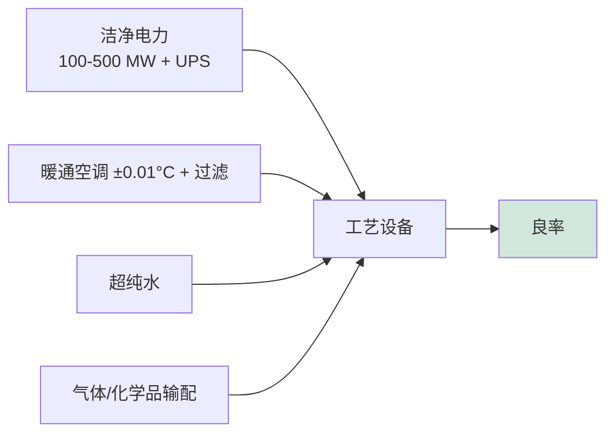

# 洁净室设计、晶圆厂基础设施与公用工程

> 📘 **说明：** 本文为英文原版《Cleanroom Design, Fab Infrastructure, and Utilities》的简体中文参考译本，仅供参考；如有出入，以英文原版为准。

半导体晶圆厂是地球上要求最为严苛的建筑环境之一——在这里，空气比手术室洁净数千倍，温度被控制在百分之一摄氏度以内，地板的振动小到不足以让纳米级曝光变得模糊，而公用工程消耗的电力和水量相当于一座小城市。本数据库各处所描述的工艺设备离开这些基础设施便无法运转，而建造这些基础设施的成本极其高昂：一座领先制程晶圆厂的造价达200亿–300亿美元甚至更高，其中厂房与基础设施（“晶圆厂厂房外壳”及其公用工程）与设备本身一起构成了其中的很大一部分。本文涵盖洁净室分级与空气处理、振动与环境控制、化学品与气体输配、超纯水、废弃物处理、电力、静电放电（ESD）控制、自动化物料搬运、晶圆厂布局、建设经济性，以及建造晶圆厂的企业。

---

## 📊 可视化概览

*原创示意图；Mermaid 图表可在 GitHub 上原生渲染。*

**晶圆厂剖面——洁净空气向下流动，经地板回流，配套设施位于下层**

> 图注：天花板上的风机过滤单元（HEPA/ULPA）将洁净空气以层流方式向下吹送，流经设备所在的洁净室（ISO 1–3级），穿过开孔高架地板向下回流；下层的辅助层（Subfab）安置真空泵、射频电源、气体/化学品输配和尾气处理设备。微环境（FOUP与装载端口）使晶圆处于最洁净的环境中。

```
   ┌──────── Fan Filter Units (HEPA / ULPA) ────────┐
   │   ↓ ↓ ↓   laminar downflow of clean air   ↓ ↓ ↓ │
   │   [tool]   [tool]   CLEANROOM (ISO 1-3)   [tool] │
   │   ══════ perforated raised floor ══════          │  ← air returns downward
   │   SUBFAB: pumps · RF · gas/chem · abatement       │
   └───────────────────────────────────────────────────┘
   Mini-environments (FOUPs + load ports) keep the wafer cleanest of all.
```

**各项公用工程紧密相互依存——任何一项失效都可能导致晶圆报废**



**建造一座晶圆厂——规模与时间线**

> 图注：造价200亿–300亿美元以上，其中设备约占70%–80%；从破土动工到首片晶圆需2–4年（达到满产需更久）；建造商包括Exyte（原M+W）、Turner、三星物产（Samsung C&T）等，建设本身已成为瓶颈；2026年：洁净室空间短缺被视为制约晶圆厂设备（WFE）的因素（泛林集团，2026年10月）。

```
 Cost:   $20-30B+   |   Tools ≈ 70-80% of that
 Time:   2-4 years groundbreaking → first wafer (longer to full ramp)
 Built by: Exyte (M+W), Turner, Samsung C&T, ... ; construction is now itself a bottleneck
 2026:   cleanroom space shortage flagged as a limit on WFE (Lam, Oct 2026)
```

---

## 1. 洁净室分级与空气处理

晶圆厂的决定性特征是**洁净度**。仅有几十纳米大小的空气颗粒就可能落在晶圆上并毁坏器件，因此空气必须极其洁净。洁净室依据 **ISO 14644-1** 标准分级，该标准按颗粒尺寸规定了允许的最大颗粒浓度。最洁净的半导体环境——即最关键的工艺区和光刻区中紧邻晶圆的空间——接近 **ISO 1–3级**（对应旧版美国联邦标准209E的1级至10级），意味着每立方米空气中基本不存在大于约0.1μm的颗粒。

实现这一点需要大规模的**空气处理**。空气持续通过 **HEPA（高效空气颗粒过滤器）** 和 **ULPA（超低穿透率空气过滤器）** 过滤，去除99.99%以上的颗粒，并以**层流（单向）下送风**方式循环，使任何产生的颗粒都被直接向下扫离晶圆，而不是在空间内循环。现代晶圆厂采用覆盖洁净室整个天花板的**风机过滤单元（FFU）**，将一道连续的过滤空气“幕帘”向下推送穿过工作区，并经高架地板回流。空气处理系统输送的风量极为庞大，是晶圆厂中最大的能耗设施之一。

一项关键的现代策略是**微环境**：与其让整个巨大的洁净室都保持最高洁净等级（成本极高），不如只在紧邻晶圆的小型封闭空间内维持最严格的洁净度——即在用于运送晶圆的 **FOUP（前开式晶圆传送盒）** 内部以及设备装载端口内部——而周围的<strong>大开间（ballroom）</strong>则保持相对宽松的等级。这大幅降低了成本和能耗，同时在关键之处保护了晶圆。

---

## 2. 振动、温度与湿度控制

除颗粒之外，晶圆厂环境还必须极其**稳定**：

- **隔振：** 光刻和量测设备所成像的特征尺寸仅有几纳米；即使是纳米级振幅的振动也会使图像模糊。晶圆厂建造在巨大的、相互隔离的混凝土基础上（通常是厚重的“华夫板”），最敏感的设备还安装在额外的主动或被动隔振系统上，整栋建筑经过专门设计，以衰减来自设备、人员走动乃至附近道路和地震的振动。
- **温度控制：** 尺寸稳定性和工艺可重复性要求严格的温度控制——洁净室内通常为±0.1°C，**光刻区则严格至±0.01°C**，因为晶圆、设备以及空气（影响光路）的热膨胀否则会使图形位置发生偏移。
- **湿度控制：** 相对湿度被控制在一个狭窄范围内，以控制静电效应、光刻胶行为和腐蚀。

这些环境要求使晶圆厂的暖通空调（HVAC）系统成为所有行业中最复杂、能耗最高的系统之一。

---

## 3. 化学品与气体输配

晶圆厂需要安全、高纯度地向数百台设备输配种类繁多的化学品和气体：

- **大宗气体与特种气体：** <strong>洁净干燥空气（CDA）</strong>和<strong>氮气（N₂）</strong>以巨大的用量输配，用于吹扫和气动；**特种工艺气体**（即[文件16](16_key_materials_and_chemicals.md)中的刻蚀、沉积和掺杂气体，其中许多有毒或可自燃）通过按严格安全标准（**SEMI F15** 及相关标准）设计的<strong>气体输配盘和阀门分配箱（VMB）</strong>输送。危险气体储存在专用的<strong>气瓶间（gas bunker）</strong>中，配备泄漏检测、自动切断和尾气处理装置。
- **化学品输配：** 高纯湿化学品（酸、碱、溶剂、研磨液）通过专用的化学品供应系统输配，并配有纯度、过滤和安全控制。
- **安全系统：** 由于许多气体和化学品具有急性危害，晶圆厂配备了大量的**气体检测、紧急切断、洗涤和围堵**系统，整个设施都围绕危险物料的安全处理而设计。

---

## 4. 超纯水（UPW）

晶圆厂消耗大量**超纯水**用于冲洗晶圆（[文件10](10_wet_processing_and_cleaning.md)），超纯水制备是一项重要的基础设施。超纯水的纯度远超饮用水——电阻率 **>18.2 MΩ·cm**（纯水的理论最大值），**总有机碳低于0.5 ppb**，金属、离子、颗粒和溶解气体降至几乎无法检测的水平。超纯水通过多级工艺在厂内制备：<strong>反渗透（RO）</strong>去除溶解性固体，<strong>电去离子（EDI）</strong>和离子交换去除离子，<strong>紫外线（UV）</strong>处理分解有机物并杀灭细菌，**膜脱气**去除溶解气体，最后通过**超滤**去除残余颗粒。超纯水站规模庞大、能耗高且至关重要——没有它晶圆厂就无法运转——而由于水资源稀缺而珍贵（[文件21](21_sustainability_and_environmental.md)），晶圆厂越来越多地配置大规模的**水回收与再利用**系统，以重复利用很大比例的用水。

---

## 5. 废弃物处理

晶圆厂产生大量危险的**液态和气态废弃物**，必须在排放前进行处理：

- **酸碱中和：** 废酸和废碱在排放前被中和至安全的pH值。
- **氢氟酸（HF）处理：** HF需要特殊处理，通常以氟化钙沉淀的形式处理。
- **溶剂回收与有机物处理：** 有机溶剂被回收或销毁。
- **研磨液与金属处理：** CMP研磨液和含金属废弃物经处理以去除并回收固体和金属。
- **尾气处理：** 使用点（POU）尾气处理和集中式尾气处理系统销毁或捕获有毒气体和温室气体（[文件20](20_subsystems_and_components.md)、[文件21](21_sustainability_and_environmental.md)）。

废弃物处理是晶圆厂基础设施和运营成本中的重要组成部分，也日益成为资源回收和环保合规的重点。

---

## 6. 电力基础设施

晶圆厂的电力需求极其庞大——一座大型领先制程晶圆厂需要 **100–500 MW** 的持续电力——而且电力必须格外**洁净和可靠**，因为哪怕仅持续几分之一秒的电力扰动，也可能毁掉整个晶圆厂内正在加工的晶圆，造成数百万美元损失。电力基础设施包括：

- **冗余的市电进线**和厂内变电站。
- <strong>不间断电源（UPS）</strong>和电能调节系统，用于穿越电网扰动并保护敏感设备。
- **严格的电能质量要求**（电压稳定性、谐波控制），远超一般工业标准。

供电可靠性是晶圆厂选址的关键考量因素，而晶圆厂巨大且不断增长的电力需求（由EUV和日益提高的工艺复杂度驱动）与[文件21](21_sustainability_and_environmental.md)中的可持续发展挑战相互交织。

---

## 7. 静电放电（ESD）控制

<strong>静电放电（ESD）</strong>可能毁坏敏感器件并吸附颗粒，因此晶圆厂依据 **ANSI/ESD S20.20** 等标准实施全面的ESD控制：导电或耗散型**地板**、人员（腕带、防静电鞋）和设备的**接地**、中和空气中静电荷的**离子风机**，以及全厂范围内受控的材料。ESD控制既保护产品，也保护工艺。

---

## 8. 自动化物料搬运系统（AMHS）

在现代300mm晶圆厂中，晶圆价值过高、洁净要求过于严格，不适合人工搬运，因此晶圆采用自动化方式传送。**AMHS** 包括：

- **天车搬运系统（OHT）：** 在天花板轨道上运行的自动化小车，在设备与存储之间运送FOUP。
- **自动仓储（Stocker，STK）：** 用于FOUP的自动化存储。
- <strong>区间（Interbay）与区内（Intrabay）</strong>传送，连接晶圆厂的不同区域以及同一区域内的各台设备。

AMHS由晶圆厂的制造执行和调度系统协调，并通过标准化的交接协议（例如用于装载端口交接的 **SEMI E84** 等）与设备通信。自动化物料搬运对于大批量晶圆厂的产能、洁净度和追溯至关重要，其供应商包括大福（Daifuku）、村田机械（Murata Machinery）等专业厂商。

---

## 9. 晶圆厂布局

晶圆厂的物理布局经过精心优化。经典设计是<strong>工艺区-维修通道（bay-and-chase）</strong>布局（或称“大开间（ballroom）”布局）：设备按<strong>工艺区（bay）</strong>排列，从洁净侧进入，后方或下方的**维修通道（chase）**（辅助层/服务区）安置为设备提供支持的真空泵、电源、气体和化学品输配以及尾气处理装置。现代晶圆厂通常为多层结构：用于加工晶圆的**洁净室（生产）层**，正下方安置大部分辅助设备的**辅助层（subfab）**，以及用于空气处理和公用工程的其他楼层。**EUV**带来了特殊要求，包括为价值高昂、对污染敏感的掩模版提供专用的<strong>掩模版存储与搬运（RSP——掩模版仓储/传送盒）</strong>基础设施。布局优化——尽量缩短晶圆移动距离、组织工艺流程、高效利用昂贵的洁净室空间——是一门重要的工程学科，同时影响资本成本和运营产能。

---

## 10. 建设时间线与成本

建造一座领先制程晶圆厂是规模最大、最复杂的私人建设项目之一。一座新建（greenfield）领先制程晶圆厂造价达 **200亿–300亿美元甚至更高**，从破土动工到首次投产需要 **2–4年**（达到满产则更久），涉及数百台设备的协调安装、数英里长的管道和线缆，以及要求最高的洁净室和公用工程系统。建设通常采用**模块化、分阶段**方式：先完成厂房外壳，再分批安装和验证设备。晶圆厂建设的规模、成本和周期，正是产能决策必须提前数年做出的原因（[文件15](15_technology_roadmaps.md)），也是设备需求周期与晶圆厂建设浪潮紧密相连的原因（[文件01](01_overview_and_introduction.md)）。

---

## 11. 主要晶圆厂建设企业

晶圆厂建设是一门专业学科，由少数具备洁净室建造和复杂公用工程集成能力的企业提供服务：

- **Exyte（原M+W集团）**——洁净室和高科技设施建设领域的全球领导者，建造了世界上许多最先进的晶圆厂。
- **Turner Construction、Mace及其他大型承包商**——参与重大晶圆厂项目，通常以合资形式进行。
- **三星物产（Samsung C&T）及其他韩国/亚洲建筑企业**——建造三星、SK海力士（SK hynix）等公司的巨型晶圆厂园区。
- **本地和专业承包商**，负责洁净室系统、机电管道（MEP）和公用工程集成。

随着补贴驱动的扩建浪潮（[文件18](18_geopolitics_and_export_controls.md)、[文件19](19_market_data_and_financials.md)）在美国、日本、欧洲和亚洲同时启动数十座新晶圆厂，晶圆厂建设行业已具有战略重要性——它使建设能力、熟练劳动力供应以及洁净室和公用工程系统的供应趋于紧张，并使晶圆厂建设本身成为新产能上线速度的瓶颈。自2025年以来，人工智能（AI）驱动的需求激增（HBM/DRAM、2nm逻辑、先进封装）在补贴驱动项目之上叠加了第二波紧迫的扩产潮；到2026年，设备厂商和存储器厂商已公开将可用洁净室空间不足列为制约行业产出的因素（见下文2025–2026年更新）。

---

归根结底，洁净室及其基础设施是半导体制造这出大戏上演的舞台。如果没有足够洁净的空气、足够稳定的环境、足够纯净的水、足够可靠的电力，以及足够自动化且无污染的搬运系统，地球上最先进的工艺设备也将毫无用处，无法在原子尺度上发挥性能。这些基础设施占据了晶圆厂成本和工程工作的很大一部分，而随着器件微缩和工艺复杂度上升，其在洁净度、稳定性、纯度、电力、用水和安全方面的要求日益严苛，使晶圆厂基础设施成为半导体事业中不可或缺且持续进步的支柱。

---

## 延伸分析：作为极端工程系统的晶圆厂

### A. 晶圆厂的成本结构

了解一座领先制程晶圆厂200亿–300亿美元以上的成本花在何处，有助于理解为何晶圆厂是如此艰巨的工程。**工艺设备**是最大的单项组成部分，通常占总额的70%–80%——数百台价值数百万美元的系统，仅EUV光刻机（数台，每台约1.5亿–3.8亿美元）就占数十亿美元。<strong>设施（厂房外壳与洁净室）</strong>和**公用工程/基础设施**（空气处理、超纯水、电力、气体/化学品输配、尾气处理、废弃物处理）占其余的大部分——而且这些并非廉价的普通建筑，而是按非凡公差设计的高度专业化系统。一个有用的思维模型是：晶圆厂建筑及其公用工程本身就是一台巨大的精密工程机器，专门用于创造和维持工艺设备所需的环境。基础设施成本随所要求的洁净度、稳定性和容量而增加，并随着每一代工艺节点要求的收紧，以及EUV和日益提高的工艺复杂度增加电力、用水和尾气处理负荷而不断上升。

### B. 公用工程的相互依存

晶圆厂基础设施的一个决定性特征是其各公用工程系统之间**紧密的相互依存**，它们必须同时完美运行。工艺设备需要洁净、稳定的电力；电力和设备产生的热量必须由HVAC排除，同时将温度保持在百分之一摄氏度以内；HVAC输送巨量的过滤空气，这些空气必须经过调节并再循环；设备消耗超纯水，超纯水必须被制备、使用并大部分回收；设备消耗气体和化学品，这些物料必须安全输配，其尾气必须处理，其废弃物也必须处理。任何一个系统发生故障——一次电压骤降、一次HVAC故障、一次断水、一次供气问题——都可能使整个晶圆厂停摆，并使价值数百万美元的在制晶圆报废。这种相互依存使晶圆厂运营成为一场持续不断、高风险的公用工程协同调度，也使**可靠性与冗余**变得至关重要：关键系统采用双重配置、持续监控，并由UPS和应急系统作为后备，因为一次计划外中断的代价是巨大的。

### C. 基础设施的可持续发展维度

晶圆厂的环境足迹（[文件21](21_sustainability_and_environmental.md)）在很大程度上也是由其基础设施决定的。**HVAC与空气处理**系统是最大的能耗设施之一（持续过滤和调节巨量空气）；**超纯水**制备和**水回收**系统决定了用水量和循环利用率；**尾气处理**系统决定了温室气体和有毒排放的控制水平；**电力**基础设施则决定了晶圆厂巨大的电力需求以何种清洁度和效率得到满足。随着可持续发展压力加大，基础设施设计日益针对能效（热回收、高效冷水机组和风机、降低待机能耗）、水循环（多回路回收）和排放控制进行优化——这使晶圆厂“后台”的公用工程成为改善行业环境绩效的核心舞台，尽管晶圆厂电力和用水需求的持续增长（由EUV和日益提高的复杂度驱动）正朝着相反的方向推动。

### D. 晶圆厂选址的地理学

晶圆厂建在何处，由一套复杂的考量决定，其中基础设施起着核心作用。经典要求——**充足、可靠、清洁的电力；充沛的水源；稳定的地质条件（低地震/振动风险）；熟练劳动力；邻近供应链；以及政府支持**——解释了晶圆厂在历史上集中于特定产业集群的原因（台湾的新竹/台南、韩国、美国部分地区、日本，以及越来越多的欧洲地区）。2022年后补贴驱动的地理分散化（[文件18](18_geopolitics_and_export_controls.md)）与这些要求发生了碰撞：在新地点（亚利桑那、俄亥俄、德国、日本）建设晶圆厂，需要建立成熟集群早已具备的电力、水、供应链和人才基础设施，这也是这些项目面临更高成本、更长周期和执行挑战的部分原因（例如，英特尔（Intel）于2025年2月将其首座俄亥俄晶圆厂的完工时间推迟至2030–2031年；与之形成对比的是，台积电（TSMC）亚利桑那基地加快了第二座晶圆厂的进度，并将其在美投资承诺扩大至1,650亿美元）。干旱地区（亚利桑那）的水资源可得性、电网容量与清洁度，以及熟练建筑和运营劳动力的可得性，都是决定补贴驱动的扩建能在何处取得成功的现实约束。因此，晶圆厂选址既是一个经济或政治问题，同样也是一个基础设施问题，而基础设施要求既有助于解释该行业历史上的集群化，也有助于解释其当前地理分散化过程中的摩擦。

### E. 建设瓶颈

全球同时掀起的晶圆厂建设浪潮（由补贴和AI需求驱动）揭示出**建设本身**已成为瓶颈。同时建造数十座世界上最复杂的工厂，使专业洁净室和公用工程系统、经验丰富的晶圆厂建设企业（Exyte和少数几家其他企业），尤其是**熟练劳动力**（建造洁净室和安装公用工程的专业工种）的供应都趋于紧张。建设延误、成本超支和劳动力短缺已影响到多个重大项目（2026年，泛林集团（Lam Research）指出洁净室空间短缺可能限制行业产出，美光（Micron）则表示增加供应需要增加洁净室空间），而建设和验证一座晶圆厂所需的周期（2–4年）意味着今天的建设决策决定了数年后的产能。对设备行业而言，建设瓶颈是对新产能——进而对设备需求——上线速度的现实约束，它与设备交货周期（[文件15](15_technology_roadmaps.md)）相互作用，共同决定了行业扩张的实际步伐。浇筑混凝土、安装空气处理机组、铺设管道这些看似平凡的工作，与工艺设备中的奇异物理学一样，竟成为决定计算未来的真正门控因素。

---

## 进一步分析：晶圆厂运营与稼动率经济学

### A. 晶圆厂运营的经济学

晶圆厂的竞争力不仅取决于建造，更取决于**高效运营**，而晶圆厂运营的经济学由少数几个关键指标主导。**利用率**——使昂贵的设备和巨大的固定成本设施保持接近满负荷运行——至关重要，因为晶圆厂巨大的固定成本（200亿–300亿美元以上投资的折旧、设施与公用工程的间接费用）必须分摊到尽可能多的产出上；利用率不足的晶圆厂会大量失血。**良率**（[文件15](15_technology_roadmaps.md)、[文件25](25_test_and_characterization.md)）决定了这些产出中有多少可以销售。**生产周期**（晶圆在厂内停留的时间，通常为3–4个月）影响响应速度和库存。而**设备综合效率（OEE）**——设备可用率、性能和质量三者的乘积——反映了设备的使用效率。良好地运营一座晶圆厂，意味着要在数千台设备和上千道工艺步骤中，全年无休（24/7/365）地持续最大化利用率和良率、最小化生产周期和成本——因为无论晶圆厂是否运转，固定成本都在持续发生。这种卓越运营是真正的竞争优势：台积电的声誉既建立在其技术之上，同样也建立在其运营纪律（高利用率、快速的良率爬坡、可靠的执行）之上；在资本密集、周期性强的行业中，运营良好与运营不善的晶圆厂之间的差距，可能就是盈利与亏损之间的差别。

### B. 稼动率与停机成本

由于晶圆厂巨大的固定成本和在制晶圆的价值，**设备稼动率**至关重要，而**停机**的代价极其高昂。一次计划外的设备故障可能使某道工艺步骤停顿，造成整个流程积压，而在最糟糕的情况下（电力、HVAC、水或污染异常），会导致大量价值数百万美元的在制晶圆报废。这使得**可靠性和预防性维护**（[文件20](20_subsystems_and_components.md)、[文件22](22_ai_and_ml_in_semicap.md)）备受重视：设备按周密的计划进行维护，关键子系统受到持续监控，预测性维护（利用机器学习分析传感器数据）力求在部件失效前进行维修，而设施的关键公用工程系统均采用双重配置并由UPS和应急系统作为后备。其经济账一目了然：防止停机的冗余和维护成本，远低于其所避免的停机和报废成本。这就是晶圆厂在可靠性、冗余和预测性维护上大量投入的原因，也是**设备可用率**（OEE的关键组成部分）成为被密切关注的指标、并成为设备选型重要因素的原因——一台良率表现良好但频繁停机的设备，其价值远低于其规格参数所显示的水平。例如，EUV在历史上的可用率挑战与其产能问题一样，都是其被采用的障碍；在使EUV适用于大批量制造的过程中，提高稼动率与提高光源功率同样重要。

### C. 爬坡——从首片晶圆到全面量产

使一座新晶圆厂（或一个新工艺节点）从首片晶圆走向全面、盈利的量产——即**爬坡**——是晶圆厂运营中最具挑战性、影响最深远的阶段之一，它将基础设施、设备、工艺和良率学习紧密联系在一起。一座新晶圆厂必须安装和验证数百台设备、整合完整的工艺流程、沿学习曲线推高良率（[文件15](15_technology_roadmaps.md)），并将产出扩大到满产——这一过程需要数年时间，且充满良率、设备和集成方面的风险。爬坡的速度和顺畅程度是决定性的竞争因素：爬坡更快的晶圆厂能更早实现盈利，抢占利润丰厚的早期节点市场，并更快地摊销其巨额固定成本。晶圆厂的地理分散化（[文件18](18_geopolitics_and_export_controls.md)）使爬坡更加复杂，因为位于不太成熟地区（亚利桑那、德国、日本）的新晶圆厂必须建立成熟集群早已具备的人才、供应链和运营能力——这也是这些项目面临爬坡挑战的部分原因。爬坡是基础设施（本文）、设备（各设备章节）、工艺（[文件02](02_chip_manufacturing_process_end_to_end.md)、[文件15](15_technology_roadmaps.md)）和人员汇聚的环节，也是卓越运营受到最严峻考验的环节——这使它与技术本身一样，成为晶圆厂和制造商成败的核心决定因素。本文所描述的平凡基础设施——洁净室、公用工程、自动化——正是爬坡以及盈利性大批量制造这出高风险大戏得以上演的不可或缺的舞台。

---

## 🆕 2025–2026年更新：最新进展（截至2026年11月）

### 洁净室空间成为硬性约束

2026年最重要的基础设施动态是：**可立即投入使用的洁净室空间**——而不仅仅是设备供应——已成为行业扩充产能速度的限制因素。AI驱动的上行周期——面向AI服务器的HBM和常规DRAM、2nm逻辑工艺爬坡，以及CoWoS类先进封装——到来之时，许多补贴时代的厂房仍在建设中。在2023年下行周期中暂缓新建项目的存储器厂商受到的冲击最大：美光表示，增加供应需要增加洁净室空间，并且目前尚无法判断供需何时恢复平衡；据报道，韩国业内人士和券商预计，2026–2027年存储器供应增长将受到洁净室可用空间有限的制约。在2026年10月21日的财报电话会议上，**泛林集团**明确指出洁净室空间短缺和零部件供应约束可能限制行业产出，尽管其同时预计2026年WFE处于1,500亿美元区间的中段，并初步预计2027年将超过2,000亿美元。

这对基础设施生态系统的实际影响包括：

- **“先建厂房”策略：** 厂商在设备订单确定之前就先行建设厂房和洁净室空间，以便设备一到货即可搬入；据报道，三星（Samsung）加快了平泽P5的洁净室建设，SK海力士则将其龙仁产业集群首座晶圆厂的目标定在2027年第一至第二季度前后。
- **收购现有空间：** 收购或改造现有晶圆厂已成为比新建更快的扩产途径（例如，据报道美光收购了一处台湾晶圆厂厂址以增加洁净室空间）。
- **封装洁净室：** 先进封装产线（CoWoS、HBM堆叠、混合键合）如今需要接近前道的洁净度，并与前道争夺同一批承包商、过滤系统和AMHS供应商；SK海力士在印第安纳州约38.7亿美元的封装工厂以及美光在新加坡约70亿美元的HBM封装设施即为例证。

### 2025–2026年主要晶圆厂建设里程碑

| 项目 | 截至2026年11月的状态 | 基础设施要点 |
|---|---|---|
| 台积电亚利桑那（凤凰城） | 1号厂自2024年底起以4nm量产；2号厂进度提前，据报道于2026年下半年开始设备搬入，目标于2027年下半年实现3nm量产；3号厂（2nm/A16）地基工程进行中 | 在美投资承诺总额提高至1,650亿美元（2025年3月）；熟练劳动力短缺曾被列为延误原因之一 |
| 美光，克莱（纽约州） | 2026年1月16日举行奠基仪式；规划最多四座晶圆厂，首期目标约2030年 | 2026年进行场地工程，随后开始主体结构建设；美国规模最大的洁净室项目之一 |
| 英特尔俄亥俄 | 首座晶圆厂完工时间推迟至2030–2031年（2025年2月宣布） | 说明厂房建设可以放缓以匹配需求 |
| SK海力士龙仁（韩国） | 1号厂目标2027年 | 多晶圆厂存储器产业集群的一部分，需要大量新增电力和水资源 |
| Rapidus IIM-1（北海道千岁） | 自2025年7月起运行2nm全环绕栅极（GAA）原型；大批量生产（HVM）目标为2027财年下半年 | 在压缩工期内建成的新建领先制程洁净室 |

### 电力与用水面临新压力

晶圆厂对电力的需求（每个大型厂区100–500 MW）如今与其所供应的AI数据中心直接竞争。电网并网排队、变电站交付周期和变压器短缺——这些拖慢数据中心建设的约束——同样影响晶圆厂选址，而韩国、台湾、日本和美国的新建存储器与逻辑产业集群都需要专门的电力和水利项目。大量使用EUV的工艺节点以及不断增加的工艺步骤数，持续推高每片晶圆的能耗和超纯水需求，进一步推动了对热回收、高效冷水机组和FFU以及多回路水回收的投资（[文件21](21_sustainability_and_environmental.md)）。

### 化学品、PFAS与设施系统

欧盟全面的全氟和多氟烷基物质（PFAS）限制取得进展：欧洲化学品管理局（ECHA）风险评估委员会（RAC）的最终意见和社会经济分析委员会（SEAC）的意见草案于2026年3月26日发布，支持在欧盟范围内实施限制，并给予有时限的豁免；最早的禁令预计不会早于2028年底生效。含氟聚合物在晶圆厂基础设施中无处不在——化学品和超纯水输配中的PFA/PTFE管道和阀门、密封件、过滤器壳体以及湿法工作台部件——因此设施设计方和零部件供应商正密切关注豁免范围。

### 晶圆厂基础设施的供应链

- **设备相关零部件：** 泛林集团关于零部件约束的表态，反映出真空、射频、阀门和精密零件领域更广泛的紧张局面；在中国，据2026年8月的报道，真空阀门和射频电源仍有约80%依赖外国供应。
- **本土化：** 中国推动国产设备（据报道，2025年国产设备约占所用设备的35%）的努力已延伸至设施系统和AMHS，据报道新增产能被要求采购一半以上的国产设备。
- **印度：** 据报道，泛林集团于2026年10月宣布在印度投资约12亿美元用于半导体零部件制造，这是围绕印度首批晶圆厂和外包封装测试厂商（OSAT）建立本地供应基础的更广泛努力的一部分。

### 晶圆厂内部的AI

设施运营是AI的早期受益领域：晶圆厂公用工程的数字孪生、针对真空泵、冷水机组和FFU的预测性维护，以及AI辅助的AMHS调度和能源负荷调度，都是SEMICON Taiwan 2026（包括其“智慧工厂专区（Smart Fab Zone）”）的突出主题。

**值得关注的动向（2026年底–2027年）**

- 洁净室空间短缺是否真的会限制2027年WFE，或者随着2,000亿美元以上WFE预测接受检验，“先建厂房”的建设能否迎头赶上。
- SK海力士龙仁1号厂、台积电亚利桑那2号厂设备搬入以及美光纽约主体结构建设的时间进度。
- 新晶圆厂集群在与AI数据中心竞争中面临的电网和电力设备约束（变压器、变电站）。
- 欧盟PFAS限制的最终文本，以及针对晶圆厂管道、密封件和过滤系统的豁免范围。
- 随着多个超大型项目同时进入高峰期，美国、日本和欧洲的建筑劳动力可得性。
