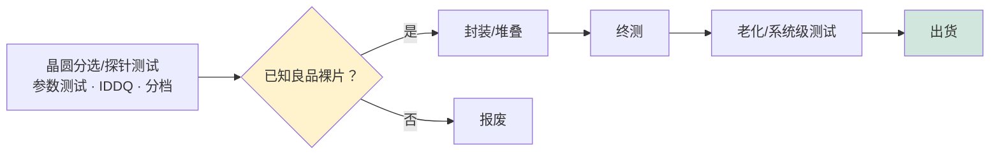

# 半导体测试、特性表征与可靠性

> 📘 **说明：** 本文为英文原版《Semiconductor Test, Characterization, and Reliability》的简体中文参考译本，仅供参考；如有出入，以英文原版为准。

当一片晶圆经过上千道工艺步骤、裸片（die）全部制造完成之后，仍然存在最后一个不可或缺的问题：<strong>芯片真的能工作吗？它们能持续工作下去吗？</strong>回答这一问题正是**测试、特性表征与可靠性**的领域——这些学科负责验证功能、将良品裸片与不良裸片分拣开来、测量器件参数，并确保产品能够在实际使用中经受多年的考验。测试是一个有别于晶圆厂设备（WFE）的独立设备生态系统，由不同的供应商主导（爱德万测试（Advantest）、泰瑞达（Teradyne）、Cohu、FormFactor）；随着芯片日益复杂、先进封装和芯粒（Chiplet）要求进行已知良品裸片测试，以及AI加速器和汽车应用使未被检出缺陷的代价越来越高，测试的重要性和成本都在上升。本文涵盖晶圆分选测试与探针测试、自动测试设备、器件特性表征、封装级与系统级测试、3D/芯粒测试、失效分析、供应商格局，以及测试成本不断上升的挑战。

---

## 📊 可视化概览

*原创示意图；Mermaid 图表可在 GitHub 上原生渲染。*

**测试流程——以及已知良品裸片（KGD）把关为何对芯粒至关重要**



**为何KGD在多裸片封装中至关重要**

> 图注：若每颗裸片的良品率为95%，则由8颗裸片组成的封装良率仅为0.95^8≈66%——而一颗坏裸片就会浪费所有良品裸片以及昂贵的封装。→ 因此必须在组装**之前**对每颗裸片进行彻底测试。

```
 If each die is 95% good, a package of 8 dies yields only 0.95^8 ≈ 66%
 — and one bad die wastes ALL the good dies + the costly package.
 → Test each die thoroughly BEFORE assembly.
```

**测试成本正在结构性上升**

> 图注：推高因素——单颗SoC功能增多、高速I/O、KGD/3D测试、AI与汽车可靠性要求（十亿分之一级缺陷率）；应对措施——提高并行度、可测试性设计（扫描/BIST）、自适应/AI测试、以系统级测试取代老化测试。

```
 Drivers ↑ :  more functions per SoC · high-speed I/O · KGD/3D test ·
              AI + automotive reliability (parts-per-billion defects)
 Responses :  more parallelism · Design-for-Test (scan/BIST) ·
              adaptive/AI test · System-Level Test replacing burn-in
```

---

## 1. 晶圆分选/探针测试

第一次测试在**晶圆级**进行，即在晶圆切割之前——称为**晶圆分选测试（wafer sort）**、<strong>探针测试（probe）</strong>或**晶圆测试（wafer test）**。晶圆上的每一颗裸片都在原位接受电性测试以确定其能否正常工作，从而在产生封装成本之前识别出有缺陷的裸片。

- **探针卡：** 测试机与裸片之间的电气接口是**探针卡**，其上带有精细的触针，与裸片的焊盘或凸点接触。类型包括**悬臂式（针式）探针卡**、**垂直式探针卡**和**基于MEMS的**探针卡（最先进的类型，用于细间距、高引脚数和高频测试）。探针卡技术至关重要且要求严苛——触针必须能够数千次与微小焊盘建立可靠、低电阻的连接而不造成损伤。**FormFactor** 是领先的探针卡供应商，Technoprobe和MPI（旺矽科技）也占有重要地位。
- **参数测试：** 除功能测试之外，**参数测试**测量器件的基本参数——晶体管阈值电压（Vt）、驱动电流、漏电流以及静态电源电流（**IDDQ**）——测试对象是放置在裸片之间划片道上的测试结构，为晶圆厂提供工艺监控反馈。
- **良率分档：** 裸片按功能和速度标准进行测试，并按性能等级和合格/不合格进行分类（“分档”，binning）。由此得到的**晶圆良率图**反馈至晶圆厂的工艺控制和良率学习工作中（[文件15](15_technology_roadmaps.md)）。

---

## 2. 自动测试设备（ATE）

芯片的功能测试由<strong>自动测试设备（ATE）</strong>完成——这是一种精密而昂贵的测试机，它向器件施加输入信号图形，并在不同电压和温度下以全速将输出与期望结果进行比对。ATE是一个主要的设备类别，有其自身的领导者，不同类型的器件需要不同的测试机：

- **逻辑/SoC ATE：** 测试复杂的数字和混合信号片上系统（SoC）器件，覆盖逻辑、嵌入式存储器、模拟/射频模块、电源管理和高速I/O（SerDes）。领先平台包括**爱德万测试的V93000**和**泰瑞达的UltraFLEX/UltraFLEXplus**。随着芯片集成更多功能（射频、高速I/O、电源），需要配备大量仪器的测试机，SoC测试的难度日益增加。
- **存储器ATE：** 测试DRAM和NAND，其挑战在于以大规模并行方式高效测试海量存储单元。领先平台包括**爱德万测试的T5800系列**和**泰瑞达的Magnum**（泰瑞达于2025年8月推出的 **Magnum 7H** 面向从HBM2E到HBM4/HBM4E的高带宽内存（HBM）器件）。HBM已成为要求最高的存储器测试细分领域，因为堆叠裸片必须在晶圆级、裸片级和堆叠级以极高的I/O速度进行测试。
- **并行测试经济学：** 由于测试时间直接决定成本，ATE会**并行测试多颗器件**（同时测试数十到数百颗器件），并行度是一个关键的经济杠杆——更多的并行测试工位可以在单位时间内将昂贵的测试机成本分摊到更多器件上。

ATE与**分选机（handler）**（将器件送至测试机并按测试结果分拣）和**接触器/测试座（contactor/socket）**（与封装器件的电气接口）配合工作——该市场由**Cohu**领先，爱德万测试和泰瑞达也供应分选机。

---

## 3. 器件特性表征

除合格/不合格测试之外，**器件特性表征**测量晶体管和互连的详细电学行为，用于工艺开发和可靠性认证：

- **CV/IV测量：** 电容-电压和电流-电压曲线可提取基本参数——阈值电压（Vt）、亚阈值摆幅（SS）、漏致势垒降低（DIBL）、迁移率和漏电流——表征晶体管的开关性能。
- **互连与时序表征：** <strong>时域反射法（TDR）</strong>和高频测量用于表征互连。

### 可靠性表征

可靠性测试通过对器件施加应力并外推失效率，来预测器件能否经受多年的工作：
- **TDDB（时间相关介质击穿）：** 对栅介质施加应力以预测其寿命。
- **电迁移（EM）：** 以高电流密度对互连施加应力以预测金属线失效，使用<strong>布莱克方程（Black's equation）</strong>建模；互连从铜向钌和钼的转变（[文件04](04_deposition.md)、[文件15](15_technology_roadmaps.md)）改变了电迁移行为，需要重新进行表征。
- **HCI（热载流子注入）：** 表征高能载流子导致的晶体管退化。
- **BTI（偏压温度不稳定性）：** <strong>NBTI（负偏压）</strong>和<strong>PBTI（正偏压）</strong>表征阈值电压在偏压和温度作用下随时间的漂移——这是先进工艺节点的关键可靠性问题。

这些可靠性机制必须经过表征和建模，以便设计人员为其产品设置保护裕度以满足寿命目标——随着器件微缩和新材料的引入，这一过程的要求越来越高。

---

## 4. 封装级与系统级测试

裸片完成封装（[文件11](11_advanced_packaging_equipment.md)）后，还要进行进一步测试，以确保封装后的产品能正常工作且可靠：

- **老化测试（Burn-in）：** 封装器件在高温和高电压下承受应力（依据 **JEDEC** 标准），以加速暴露**早期失效**——通过加速应力筛除那些在实际使用中会过早失效的薄弱器件。
- **终测（Final test）：** 封装器件在不同电压和温度下接受全面测试，以验证其最终形态满足规格要求。
- **系统级测试（SLT）：** 在模拟实际应用的环境中测试器件（运行真实软件或具有代表性的工作负载），以捕获结构化ATE测试图形可能遗漏的、与系统相关的细微故障。SLT对于复杂SoC日益重要，并越来越多地被用作**老化测试的补充或部分替代**，因为在先进工艺节点上，某些失效模式只有在真实运行条件下才会显现。

---

## 5. 3D IC与芯粒测试

先进封装和芯粒（[文件11](11_advanced_packaging_equipment.md)）带来了深刻的新测试挑战，因为一颗坏裸片就可能毁掉一个昂贵的多裸片组件：

- **已知良品裸片（KGD）：** 在将裸片堆叠或集成到昂贵的封装之前，每颗裸片都必须经过测试并确认为“已知良品”——因为即使只集成一颗有缺陷的裸片，也会浪费所有其他裸片和昂贵的封装。因此，在晶圆级或单颗裸片级进行KGD测试必不可少；而对于设计为在封装内测试的芯粒，KGD测试比传统独立芯片更加困难。
- **晶圆级老化：** 在组装前于晶圆级对裸片施加应力。
- **裸片间互连测试：** 组装后，堆叠或并排裸片之间的连接（微凸点、混合键合、中介层布线）必须进行连通性和性能测试。
- **测试访问：** 相关标准（如用于3D测试访问的IEEE 1838，以及UCIe等芯粒互连标准中的测试条款）提供了在多裸片封装内测试单颗裸片的访问机制。

芯粒的日益普及使KGD和3D测试成为测试领域增长最快、挑战最大的方向之一，直接影响先进封装的良率和成本。

---

## 6. 失效分析工具

当器件在开发、认证或现场使用中失效时，<strong>失效分析（FA）</strong>借助一套精密的工具来查找根本原因：

- **FIB-SEM（聚焦离子束/扫描电子显微镜）：** 精确铣削截面并成像，使工程师能够在精确位置“切入”器件观察缺陷。供应商为**赛默飞世尔（Thermo Fisher，FEI）和蔡司（ZEISS）**。
- **TEM截面分析：** 对失效部位进行原子分辨率成像（[文件23](23_research_and_emerging_technologies.md)）。
- <strong>OBIRCH（光束诱导电阻变化）</strong>和 **EMMI（光发射显微镜）：** 通过探测故障的光学或热学特征来定位缺陷（短路、漏电）。
- **X射线断层扫描（CT）：** 以无损方式对封装和3D组件的内部结构成像，以发现空洞、裂纹和键合缺陷。

失效分析对于良率学习和可靠性改进至关重要，它提供的根因认识驱动着工艺和设计的修正。

---

## 7. 供应商格局

| 类别 | 领先供应商 |
|---|---|
| **逻辑/SoC ATE** | 爱德万测试、泰瑞达 |
| **存储器ATE（含HBM）** | 爱德万测试、泰瑞达 |
| **测试分选机** | Cohu、爱德万测试、泰瑞达 |
| **探针卡** | FormFactor、Technoprobe、MPI |
| **测试座/接触器** | Cohu、Smiths Interconnect、Yokowo（横尾） |
| **失效分析** | 赛默飞世尔、蔡司、滨松光子（Hamamatsu） |
| **系统级测试** | 爱德万测试、泰瑞达、Cohu及专业厂商 |
| **共封装光学（CPO）测试** *（新兴领域，2025–2026年）* | ATE供应商、探针卡厂商（如FormFactor）以及光子测试专业厂商；相关标准仍不成熟 |

ATE市场基本上是**爱德万测试与泰瑞达**的**双寡头垄断**，**Cohu**在分选机和接触器领域领先，**FormFactor**在探针卡领域领先。这是一个有别于晶圆厂设备的独立生态系统，有其自身的发展规律，但与相同的终端市场周期紧密相连，并日益受到推动整个行业的先进封装和AI芯片趋势的影响。到2025–2026年，这种联系已占据主导地位：爱德万测试报告称，受益于AI加速器测试，其SoC测试机市场份额从2024年的约56%升至2025年的约66%；2026年第一季度，AI相关需求约占泰瑞达营收的70%（见下文2025–2026年更新）。

---

## 8. 日益突出的测试成本问题

历史上，测试在芯片总成本中只占不大的比例，但这一比例正在**上升**，其驱动因素有多个：芯片更加复杂（需要测试的功能更多、测试图形更多、测试时间更长）；先进封装和芯粒要求进行**KGD和3D测试**；AI加速器和汽车芯片要求接近零的缺陷率（推动更彻底、更长时间的测试以及SLT）；高速I/O和射频集成需要配备大量仪器的昂贵测试机。**测试成本在总拥有成本中的占比**在先进工艺节点上日益受到关注，业界正采取多种应对措施——提高测试并行度、采用更智能的（自适应、机器学习驱动的）测试将精力集中在可能出现缺陷之处、以**系统级测试**取代昂贵的老化测试，以及采用使芯片测试成本更低的可测试性设计（DFT）技术。这一挑战对于最复杂、对可靠性要求最高的产品尤为严峻——而这些恰恰是处于行业增长核心的AI和汽车芯片。

---

因此，测试与特性表征闭合了制造环路：它们验证本数据库中所描述的非凡制造工艺是否真正生产出了能够工作且可靠的器件，并为推动持续改进的良率和可靠性学习提供输入。随着芯片日益复杂、3D集成和芯粒不断普及，以及应用领域（AI、汽车、安全关键系统）使未检出缺陷的代价不断提高，测试的重要性和成本都在上升——这使其不再是后道的附属环节，而是半导体事业中不可分割且日益重要的组成部分，拥有自己不可或缺的设备生态系统，以及在KGD、3D、系统级和AI驱动测试方面的前沿挑战。

---

## 延伸分析：测试经济学、可测试性设计与芯粒挑战

### A. 测试经济学

测试成本从根本上是**测试时间 × 测试机成本 ÷ 并行度**的函数，而每一个杠杆都影响着其经济性。**测试时间**取决于器件的复杂度和所要求的彻底程度——功能更多、测试图形更多、可靠性筛选更多，都会延长测试时间。**测试机成本**取决于所需的仪器——用于简单逻辑芯片的测试机远比还需处理高速SerDes、射频和电源的测试机便宜，因此现代SoC集成多种多样的功能推高了测试机成本。**并行度**——同时测试多颗器件——是降低单颗器件成本的主要杠杆，业界一直在不懈地提高并行度（存储器同时测试数百颗器件，逻辑芯片同时测试多颗）。矛盾在于，随着器件日益复杂、可靠性要求日益严格，测试时间和测试机成本不断上升，而并行度带来的抵消性收益终将饱和——这就是为何在先进工艺节点上以及对于最复杂的产品而言，**测试成本在总成本中的占比正在上升**，也是测试经济学已成为一个真正值得关注的问题、而非可忽略不计的零头的原因。

### B. 可测试性设计（DFT）

应对测试成本和复杂度上升的一项关键措施是**可测试性设计（DFT）**——从一开始就将芯片设计为可高效测试。DFT技术包括**扫描链**（将触发器连接成移位寄存器，从而可以控制和观测内部状态）、**内建自测试（BIST）**（自主测试存储器和逻辑模块的片上电路，减少对外部ATE的依赖）、**边界扫描**（JTAG，用于测试互连）以及减少测试数据量的**压缩**技术。DFT以少量的硅面积和设计投入换取测试时间和ATE需求的大幅减少，已在先进工艺节点上变得不可或缺。对于3D和芯粒产品，DFT扩展到**测试访问架构**（IEEE 1838，以及UCIe和其他芯粒标准中的测试条款），使封装内的单颗裸片能够被访问和测试——没有这些架构，多裸片产品根本无法以经济的方式进行测试。

### C. 已知良品裸片的必要性

芯粒和3D集成革命（[文件11](11_advanced_packaging_equipment.md)、[文件23](23_research_and_emerging_technologies.md)）使<strong>已知良品裸片（KGD）</strong>测试成为测试领域最关键、最具挑战性的方向之一。其逻辑一目了然：假设一个封装集成了八颗芯粒，每颗裸片为良品的概率为95%，那么八颗全部为良品（因而封装合格）的概率仅约为66%——而每一个有缺陷的封装浪费的不仅是那颗坏裸片，还有所有良品裸片以及昂贵的封装。随着裸片数量增加、封装日益昂贵（一个高端AI加速器封装集成了巨大的价值），集成哪怕一颗坏裸片的代价都变得难以承受，因此必须在组装**之前**对每颗裸片进行彻底测试并确认其为已知良品。但KGD测试很难：设计为在封装内测试的裸片可能缺乏进行完整独立测试所需的I/O和访问通道，细间距接口难以探测，而且测试必须足够彻底，才能捕获那些否则只会在昂贵的组装之后才显现的缺陷。因此，KGD是芯粒时代的核心使能因素——也是核心挑战——推动了对先进晶圆级和裸片级测试能力的需求。

### D. 可靠性的利害关系

对于推动行业增长的应用——**AI加速器**（大规模训练中的单个故障代价高昂）尤其是**汽车和安全关键**系统（失效可能危及生命）——未被检出缺陷的代价巨大，可靠性门槛也相应地极为严苛。汽车芯片必须通过 **AEC-Q100** 认证，满足以<strong>十亿分率（DPPB）</strong>衡量的近零缺陷率以及功能安全标准（**ISO 26262**），这推动了更彻底、更长时间的测试，更多的老化测试或系统级测试，以及广泛的可靠性表征（TDDB、电迁移、BTI、HCI——见第3节）。不断提高的可靠性要求是推动测试成本和复杂程度上升的主要力量，也使测试不再是后道的例行公事，而是这些应用赖以存在的安全性和可信性的关键保障。

### E. 系统级测试与未来

**系统级测试（SLT）**——在逼真的应用环境中运行封装器件——这一趋势反映了这样一个现实：在先进工艺节点上，某些失效模式（细微的时序、功耗、热和相互作用效应）无法仅靠结构化ATE测试图形捕获，必须通过按实际使用方式运行芯片才能暴露。SLT越来越多地被用作传统老化测试（成本高、耗时长）的**补充**和部分**替代**，并在复杂SoC、AI芯片和汽车零部件中不断增长。展望未来，测试路线图受到与行业其他部分相同的力量塑造：更复杂和异构（芯粒）的产品要求KGD和3D测试，更高的可靠性要求需要更彻底的筛选，以及**AI与自适应测试**的应用（将测试精力集中在统计上可能出现缺陷之处，利用机器学习分析测试数据以优化覆盖率和成本）。因此，测试从后道的附属环节上升为半导体事业中不可分割、不断增长且日益精密的组成部分——拥有自己不可或缺的设备生态系统（爱德万测试、泰瑞达、Cohu、FormFactor），以及在芯粒、AI和汽车时代的前沿挑战。

---

## 进一步分析：测试成本危机与自适应测试

### A. 测试成本为何结构性上升

测试成本长期以来在芯片总成本中占比不大且保持稳定，但在领先制程上正在结构性上升——这一变化具有切实的经济后果。推动它的力量有以下几种。**复杂度**：现代SoC集成了逻辑、多种类型的存储器、模拟、射频、高速I/O和电源管理，每一部分都需要各自的测试内容，延长了测试时间，并需要配备大量仪器的（昂贵）测试机。**可靠性要求**：推动行业增长的AI和汽车应用要求接近零的缺陷率，需要更彻底、更长时间的测试，更多的老化或系统级测试，以及广泛的可靠性筛选。**先进封装与芯粒**：组装前进行已知良品裸片测试的需要，以及测试复杂多裸片封装的需要，增加了全新的测试工序和挑战。**高速接口**：测试现代芯片的多千兆位SerDes和高带宽接口需要昂贵的高频测试能力。随着这些力量叠加，以及并行度带来的抵消性收益趋于饱和，测试成本在总拥有成本中的占比不断攀升——这在先进工艺节点上以及对于最复杂的产品而言是一个真正的问题，也是测试经济学已成为战略考量而非事后补充的原因。

### B. 自适应与AI驱动的测试

应对测试成本危机的一项关键措施是**自适应测试**——利用数据和机器学习智能地而非一刀切地分配测试精力。自适应测试不是对每颗器件都运行完整的测试套件，而是对测试数据（以及器件在晶圆上的位置、其参数特征和历史）进行统计分析和机器学习，**将测试精力集中在统计上可能出现缺陷之处**，在不太可能出现缺陷之处跳过或缩短测试。通过将昂贵的测试资源集中于风险最高的器件和条件，这种方法可以大幅缩短测试时间（从而降低成本），同时保持甚至提高缺陷覆盖率。AI驱动的测试还包括**异常值检测**（识别那些通过标称测试、但呈现出预示早期失效的异常特征的器件——即自适应方法可以捕获的“测试逃逸”）、**测试内容优化**（利用机器学习识别哪些测试图形在单位时间内提供最大覆盖率）以及**预测性分档**。自适应和AI驱动的测试是在满足AI和汽车应用不断提高的可靠性要求的同时控制测试成本的最有前景的途径之一，也体现了数据和机器学习向制造各个角落的广泛渗透（[文件22](22_ai_and_ml_in_semicap.md)）。

### C. 芯粒测试难题

芯粒革命（[文件11](11_advanced_packaging_equipment.md)、[文件23](23_research_and_emerging_technologies.md)）带来的可能是最深层的测试挑战，其经济账一目了然。由于将哪怕一颗有缺陷的裸片集成到多裸片封装中都会浪费所有良品裸片和昂贵的封装，**组装前的已知良品裸片（KGD）测试必不可少**——但这很难，因为设计为在封装内测试的芯粒可能缺乏进行彻底独立测试所需的I/O和访问通道，细间距接口难以探测，而且测试必须足够彻底，才能捕获那些否则只会在昂贵的组装之后才暴露的缺陷。业界的应对措施——内置测试访问的可测试性设计架构（IEEE 1838、UCIe测试条款）、晶圆级和裸片级测试能力，以及使封装内单颗裸片可被访问的标准——是芯粒时代的核心使能因素，因为如果没有经济的KGD和封装内测试，芯粒模式的承诺（组合来自不同来源和不同工艺节点的裸片）就无法以可接受的成本实现。因此，芯粒测试难题是单片SoC向芯粒拆分的一个门控因素，而（通过DFT、测试标准和测试设备）解决这一难题，对于芯粒的未来与封装技术本身同样重要。

### D. 测试作为信任的保障

测试最深层的意义超越了成本，关乎**信任与安全**。对于日益处于行业核心的应用——单个故障就可能破坏大规模计算的AI系统，尤其是失效可能危及生命的汽车和安全关键系统——测试是芯片能够正确、可靠工作的保障。汽车领域极端的可靠性要求（AEC-Q100、十亿分率级缺陷率、ISO 26262功能安全）要求测试和特性表征的彻底程度远远超出简单的功能验证，涵盖广泛的可靠性筛选（TDDB、电迁移、BTI、HCI）、老化测试或系统级测试，以及持续的现场可靠性监控。随着半导体日益深入地渗透到安全关键和任务关键系统中，测试作为正确性和可靠性最终保障的作用愈发重要，使其不再是后道的例行公事，而是一道必不可少的安全防线——其设备生态系统（爱德万测试、泰瑞达、Cohu、FormFactor）和方法论（自适应测试、KGD、系统级测试、可靠性表征）的精密程度和战略重要性正在不断提升，以匹配其所保护的应用所承担的风险。

---

## 🆕 2025–2026年更新：最新进展（截至2026年11月）

### 测试成为AI驱动的增长市场

本文所描述的结构性力量——不断提高的复杂度、多裸片封装的KGD要求以及近零缺陷要求——在2025–2026年汇聚于同一个驱动因素：**AI加速器与HBM**。每个AI GPU或定制ASIC封装都包含一颗（或数颗）超大逻辑裸片、多个HBM堆叠以及一个中介层，因此每个封装的测试时间、每种产品的测试工序数以及测试逃逸所带来的风险价值都在急剧上升。尤其是AI加速器的SLT，已发展成为一个主要的测试机和分选机类别。

市场数据印证了这一点。根据**国际半导体产业协会（SEMI）2026年7月14日发布的年中预测**，2026年测试设备销售额预计将达到约**153亿美元**，这是一次大幅上调，也是增长最快的设备细分领域之一；据报道，2026年测试机市场预期被上调至约**130亿–145亿美元**。爱德万测试于2026年10月表示，预计2026年SoC测试机市场将达到约115亿美元，接近其预测区间的上限，驱动因素是AI相关高性能芯片的产量和复杂度。

| 公司 | 近期数据（2026年） | 来源/备注 |
|---|---|---|
| 爱德万测试 | 2026年9月季度营收与利润率创纪录（据媒体报道；各来源数字不一）；因SoC测试机销售增强，上调2026财年营业利润率预测（2026年10月28日） | 公司业绩；SoC测试机份额约56%（2024年）→约66%（2025年），公司披露 |
| 泰瑞达 | 2026年9月季度营收约13.1亿美元；2026年指引中值约52亿美元；2026年第一季度AI相关需求约占营收的70% | 公司业绩；Magnum 7H正在最大的几家HBM厂商处爬坡 |
| FormFactor | 2026年第三季度营收同比增长近40%（连续第四个季度创纪录）；位于得克萨斯州Farmers Branch的新工厂正在投产 | 公司公告（2026年10月28日）；HBM和共封装光学被列为增长驱动因素 |

### HBM测试：存储器测试的繁荣

HBM需求改变了存储器测试。HBM4于2026年为英伟达（Nvidia）Rubin平台进入量产，每个HBM堆叠都需要大量测试——对DRAM核心裸片和基础（逻辑）裸片进行晶圆级探针测试，在堆叠前进行KGD筛选，以及在键合后进行堆叠级测试。泰瑞达报告称，2025年第三季度存储器测试销售额为1.28亿美元，环比增长110%，并表示其 **Magnum 7H** 的批量出货正在最大的几家HBM制造商处爬坡；爱德万测试也扩充了其存储器测试和分选机产品线（例如2025年12月推出的M5241存储器分选机）。在探针方面，FormFactor报告称，受HBM驱动，2026年第一季度DRAM营收创纪录（8,290万美元，同比增长约70%），SK海力士（SK hynix）为其最大客户，并重点介绍了用于高并行度、HBM4速率测试的全晶圆接触器技术。

联合电子器件工程委员会（JEDEC）将HBM4封装高度上限提高至 **775 µm** 的决定，使SK海力士得以在HBM4上继续采用MR-MUF/TC键合，而不必立即转向混合键合。对测试而言，这意味着HBM4/HBM4E的12层和16层堆叠将继续依赖成熟的微凸点互连测试方法，而混合键合的HBM（据SK海力士在Hot Chips 2026上的说法，最早将在HBM4E或HBM5上采用）将需要新的裸片间连通性测试和KGD方法。

### 共封装光学与新的测试工序

共封装光学（CPO）在2025–2026年进入量产（英伟达Spectrum-X/Quantum-X Photonics交换机；台积电（TSMC）COUPE平台于2026年下半年进入量产）。CPO在传统电性测试流程中加入了光学测试——在晶圆级和封装级测量耦合损耗、波长和光功率。封装厂日月光（ASE）已就CPO测试标准的缺失发出警告，探针卡和ATE供应商正在为这一新测试工序布局。同样，混合键合和面板级封装（CoPoS）的发展也提高了KGD和裸片间测试的要求。

### 与前道及工艺控制的融合

测试与前道和封装合作伙伴的联系日益紧密：**东京电子（Tokyo Electron）与泰瑞达**于2026年6月宣布合作开发面向AI/数据中心器件的集成测试单元；据报道，科磊（KLA）预计其先进封装工艺控制营收在2026年将达到约**11亿美元（增长70%）**，反映出多裸片封装中在线检测与测试之间的交叠。随着测试数据量的增加，基于AI的自适应测试和异常值检测（见上文“进一步分析”B节）正从试点走向标准流程。

### 地缘政治与供应

与前道设备相比，测试设备受美国出口管制的约束较少，但更广泛的管制体系（实体清单新增条目、已暂停实施的“关联方规则”（Affiliates Rule）、2024年12月出台的HBM管制）决定了先进AI芯片和HBM测试可以在何处进行。中国测试设备厂商在成熟制程和存储器测试领域持续成长，而关税政策（包括2026年1月15日生效的第232条款半导体关税）为OSAT的测试单元选址决策增添了不确定性。

**值得关注的动向（2026年底–2027年）**

- 2026年测试设备预测（约153亿美元，SEMI）能否被超越，以及2027年AI上行周期中有多少流向SLT和HBM测试。
- 混合键合HBM4E/HBM5以及16层堆叠的测试策略。
- CPO测试标准及专用光学测试设备的出现。
- 爱德万测试与泰瑞达在AI加速器SoC测试和HBM测试领域的份额变化。
- 探针卡产能扩充（FormFactor、Technoprobe、MPI）能否匹配HBM和先进逻辑需求。
