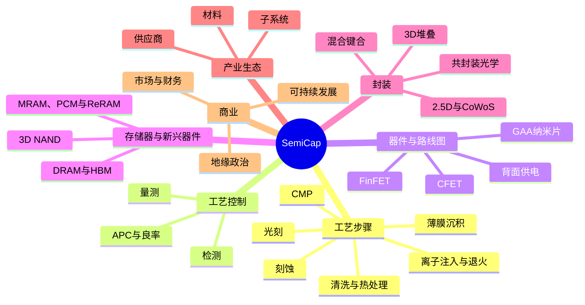

# 半导体资本设备术语与缩略语词汇表

> 📘 **说明：** 本文为英文原版《Glossary of Semiconductor Capital Equipment Terms and Acronyms》的简体中文参考译本，仅供参考；如有出入，以英文原版为准。

本词汇表汇总了本数据库中使用的术语、缩略语、公司和概念，供综合查阅。释义以便于快速查阅为目的；如需更完整的阐述，请按文件指引（例如“文件15”）查阅相关章节。条目按主题分组，每组内按字母顺序排列。每个条目保留英文术语及缩略语，并在其后给出中文译名。

---

## 📊 概念图

*本数据库各主题一览（Mermaid 思维导图可在 GitHub 上原生渲染）。*

---

## 1. 工艺步骤与设备类别

- **ALD（Atomic Layer Deposition，原子层沉积）** — 通过自限制、表面饱和的反应进行沉积，每个循环增加不足一个单原子层，可实现埃级厚度控制和近乎完美的保形性。是高k栅极叠层、FinFET/GAA、DRAM电容器和3D NAND的使能技术。（文件04）
- **ALE（Atomic Layer Etch，原子层刻蚀）** — ALD的减材对应工艺——通过自限制循环一次去除一个原子层的材料，实现原子级精度和低损伤（例如GAA沟道释放）。（文件05）
- **APCVD（Atmospheric Pressure CVD，常压化学气相沉积）** — 在大气压下进行的CVD；产能高、保形性较低；在现代工艺中作用有限。（文件04）
- **ASD（Area-Selective Deposition，区域选择性沉积）** — 仅在特定表面上生长材料的选择性ALD/CVD（例如只在金属上而不在介质上生长），可实现自对准结构，放宽套刻要求。（文件04、23）
- **BEOL（Back-End-of-Line，后道）** — 连接晶体管的多层金属互连（多达15–20层）；采用铜双大马士革工艺和低k介质，正向钌/钼过渡。（文件02）
- **CCP（Capacitively Coupled Plasma，电容耦合等离子体）** — 使用平行板电极的等离子体刻蚀源；擅长介质刻蚀（氧化物、氮化物、低k）。（文件05）
- **CMP（Chemical Mechanical Planarization，化学机械平坦化）** — 结合化学软化和机械研磨将晶圆抛光平整；对多层结构的构建以及混合键合的表面制备至关重要。（文件06）
- **CVD（Chemical Vapor Deposition，化学气相沉积）** — 通过气相前驱体在表面反应进行薄膜沉积；变体包括LPCVD、APCVD、PECVD、HDP-CVD、FCVD。（文件04）
- **DRIE（Deep Reactive-Ion Etch，深反应离子刻蚀）** — 用于硅通孔（TSV）、MEMS和背面通孔的深硅刻蚀（通常采用Bosch工艺）。（文件05、11）
- **FCVD（Flowable CVD，可流动化学气相沉积）** — 沉积一种类液态薄膜、使其在固化前渗入窄间隙的CVD，解决无空洞填隙问题。（文件04）
- **FEOL（Front-End-of-Line，前道）** — 工艺流程中构建晶体管的部分——隔离、阱、栅极叠层、源/漏、接触。（文件02）
- **HDP-CVD（High-Density Plasma CVD，高密度等离子体化学气相沉积）** — 同时进行溅射刻蚀以实现无空洞填隙的CVD。（文件04）
- **IBE（Ion Beam Etch，离子束刻蚀）** — 以一定角度使用宽离子束进行的物理刻蚀；用于MRAM MTJ柱的图形化，因为等离子体刻蚀会造成再沉积短路。（文件23）
- **ICP（Inductively Coupled Plasma，电感耦合等离子体）** — 可独立控制通量与能量的等离子体刻蚀源；常用于导体刻蚀。（文件05）
- **iPVD（Ionized PVD，离化物理气相沉积）** — 将离化金属通量导入高深宽比结构、用于沉积阻挡层/籽晶层的PVD。（文件04）
- **LPCVD（Low-Pressure CVD，低压化学气相沉积）** — 在低压、高温下进行的批量CVD，用于多晶硅、氮化物和TEOS氧化物。（文件04）
- **MOL（Middle-of-Line，中道）** — 连接FEOL和BEOL的最小间距局部互连（局部互连、自对准接触、M0/V0）。（文件02）
- **PEALD / PECVD（Plasma-Enhanced ALD / CVD，等离子体增强原子层沉积/化学气相沉积）** — 借助等离子体实现较低温度的沉积，对BEOL≤400°C的热预算至关重要。（文件04）
- **PLAD（Plasma Doping，等离子体掺杂）** — 通过等离子体浸没对3D表面进行保形、高剂量掺杂。（文件07）
- **PVD（Physical Vapor Deposition，物理气相沉积）** — 从固体靶材溅射沉积金属；用于阻挡层、籽晶层和电极。（文件04）
- **RIE（Reactive-Ion Etch，反应离子刻蚀）** — 中等密度等离子体刻蚀；高密度等离子体刻蚀的前身。（文件05）
- **RTP（Rapid Thermal Processing，快速热处理）** — 单片式灯加热，在数秒内升至峰值温度，以实现掺杂激活同时将扩散降至最低。（文件07、09）
- **SADP / SAQP（Self-Aligned Double/Quadruple Patterning，自对准双重/四重图形化）** — 基于侧墙的多重图形化，使线条密度在单次曝光分辨率的基础上提高到两倍/四倍。（文件03）
- **Selective etch（选择性刻蚀）** — 去除一种材料而保留相邻相似材料的刻蚀（例如在GAA沟道释放中选择性去除SiGe而保留Si）。（文件05）
- **Spatial ALD（空间原子层沉积）** — 前驱体区域在空间上（而非时间上）分隔的ALD，以获得更高产能。（文件04）

---

## 2. 光刻

- **193i（ArF immersion，ArF浸没式光刻）** — 采用水浸没的193 nm光刻（NA最高1.35）；大多数图层和成熟工艺节点的主力技术。（文件03）
- **Actinic inspection（光化检测）** — 在13.5 nm工作波长下进行的EUV掩模检测（蔡司AIMS EUV），用于发现与EUV相关的缺陷和随机缺陷。（文件03、08、23）
- **CAR（Chemically Amplified Resist，化学放大光刻胶）** — 利用光酸产生剂催化溶解度变化的光刻胶；当前主流的EUV光刻胶。（文件03、23）
- **Computational lithography（计算光刻）** — 对掩模/照明进行预畸变以补偿衍射的软件（OPC、SMO、ILT）；越来越多地采用GPU/AI加速（英伟达cuLitho，已被台积电采用）。（文件03、22）
- **DSA（Directed Self-Assembly，定向自组装）** — 在光刻预图形引导下，利用嵌段共聚物微相分离进行图形化；可倍增密度并修复粗糙度。（文件03、23）
- **DUV（Deep Ultraviolet，深紫外光刻）** — 采用248 nm（KrF）和193 nm（ArF）的光刻；DUV浸没式光刻仍是行业主力。（文件03）
- **EUV（Extreme Ultraviolet，极紫外光刻）** — 13.5 nm光刻，采用激光等离子体锡光源、全反射Mo/Si光学系统和反射式掩模；由阿斯麦（ASML）垄断。（文件03）
- **EXE:5200B（阿斯麦第二代高数值孔径EUV光刻机）** — 阿斯麦第二代、更高产能的高数值孔径极紫外（High-NA EUV）量产型光刻机；据报道，英特尔已于2026年初在其俄勒冈州D1X研发晶圆厂完成一台的验收。（文件03、15）
- **High-NA EUV（高数值孔径极紫外光刻）** — 0.55 NA的EUV（阿斯麦EXE平台），采用变形（anamorphic）光学系统，曝光场减半（26×16.5 mm）；英特尔计划以Intel 14A作为首个在大批量生产（HVM）中使用该技术的节点；据报道，三星和台积电分别计划在2028年和2030年前后实现大批量使用。（文件03、15、23）
- **Hyper-NA EUV（超高数值孔径极紫外光刻）** — 拟议中的未来EUV，NA超过0.55（约0.75）；面临严峻的掩模3D效应、焦深和曝光场尺寸挑战。（文件23）
- **ILT（Inverse Lithography Technology，反演光刻技术）** — 通过求解成像逆问题来计算理想（通常为曲线形）掩模。（文件03）
- **k₁ factor（k₁因子）** — 瑞利分辨率公式（分辨率 = k₁·λ/NA）中的工艺因子；单次曝光的下限约为0.25。（文件03）
- **LELE（Litho-Etch-Litho-Etch，光刻-刻蚀-光刻-刻蚀）** — 交替进行两次曝光/刻蚀以使密度加倍的多重图形化。（文件03）
- **LER / LWR（Line-Edge / Line-Width Roughness，线边缘/线宽粗糙度）** — 边缘/线宽的随机变化，是由光子散粒噪声驱动的关键EUV随机效应限制。（文件03、23）
- **MOR（Metal-Oxide Resist，金属氧化物光刻胶）** — 基于氧化锡的EUV光刻胶（Inpria/JSR），分辨率更高、LER更低；对High-NA至关重要。（文件03、16、23）
- **NA（Numerical Aperture，数值孔径）** — 投影光学系统的集光能力指标（NA = n·sinθ）；NA越高分辨率越好，但焦深越小。（文件03）
- **NIL（Nanoimprint Lithography，纳米压印光刻）** — 用模板对光刻胶进行物理压印实现图形化（佳能）；首先在3D NAND中立足。（文件03）
- **NTD（Negative-Tone Develop，负性显影）** — 提高接触孔/沟槽层对比度的光刻胶/工艺方案。（文件03）
- **OPC（Optical Proximity Correction，光学邻近效应修正）** — 修改掩模形状以补偿衍射和工艺效应。（文件03）
- **Overlay（套刻）** — 每一层与其下各层的对准精度；先进工艺节点的套刻预算接近或低于2 nm。（文件08）
- **Pellicle（保护膜）** — 覆盖在掩模上的薄保护膜；EUV保护膜必须具有约90%的透过率并能承受高功率（碳纳米管保护膜正在开发中）。（文件03、23）
- **SMO（Source-Mask Optimization，光源-掩模协同优化）** — 对照明和掩模图形进行联合优化。（文件03）
- **Stochastic effects（随机效应）** — 由光子散粒噪声引起的随机EUV缺陷（桥连、断线）和粗糙度；EUV的核心挑战。（文件03、23）

---

## 3. 器件、架构与路线图

- **14A（Intel 14A，英特尔14A工艺）** — 英特尔18A之后的工艺节点，也是首个计划使用High-NA EUV的节点；英特尔已将其产能建设与已承诺的外部客户需求挂钩，客户决策预计在2026年下半年至2027年上半年作出。（文件15、18）
- **18A / 18A-P（Intel，英特尔18A/18A-P工艺）** — 英特尔首个GAA（RibbonFET）节点，也是业界首个采用背面供电（PowerVia）的节点；已进入大批量生产，Panther Lake客户端CPU于2026年初发布。18A-P是面向代工客户的性能增强版本，已于2026年6月进入风险试产。（文件15）
- **A14（TSMC，台积电A14工艺）** — 台积电继A16之后的下一代工艺节点，目标2028年。（文件15）
- **A16（TSMC，台积电A16工艺）** — 台积电首个采用背面供电（超级电轨Super Power Rail）的工艺节点，基于纳米片GAA；面向高性能计算（HPC）/AI，量产时间为2026年下半年至2027年（各方说法不一）。（文件15）
- **BPR（Buried Power Rail，埋入式电源轨）** — 埋入衬底沟槽中的电源轨，释放下层金属布线资源；是迈向背面供电的一步。（文件15）
- **BSPDN（Backside Power Delivery Network，背面供电网络）** — 通过纳米硅通孔将供电移至晶圆背面，使正面专用于信号布线。代表技术有英特尔PowerVia和台积电超级电轨。（文件15、23）
- **CFET（Complementary FET，互补场效应晶体管）** — 在同一占位面积内将nMOS垂直堆叠在pMOS之上（单元面积减少约50%）；有单片式和顺序式（键合）两种实现方式。（文件15、23）
- **CPP / CGP（Contacted (Poly) Gate Pitch，接触栅极间距）** — 包含接触在内的最小栅极间距；关键的横向密度指标。（文件15）
- **Dennard scaling（登纳德缩放定律）** — 晶体管缩小时功率密度保持不变的原理（已于约2005–2007年失效）；其终结导致了多核与功率密度时代的到来。（文件15）
- **DIBL（Drain-Induced Barrier Lowering，漏致势垒降低）** — 漏极电压降低源端势垒、削弱栅控能力的短沟道效应。（文件15）
- **DTCO / STCO（Design-/System-Technology Co-Optimization，设计-工艺协同优化/系统-工艺协同优化）** — 将工艺与标准单元库（DTCO）或整个系统/封装（STCO）协同设计，以获得纯尺寸微缩之外的收益。（文件15）
- **FinFET（鳍式场效应晶体管）** — 栅极从三面包裹薄硅鳍的3D晶体管；首次在英特尔22nm（2011年）实现商业化。（文件15）
- **Forksheet（叉片晶体管）** — 中间型GAA架构，nMOS/pMOS之间以介质墙隔开；密度比纳米片高约20%，比CFET简单。（文件15、23）
- **GAA（Gate-All-Around，全环绕栅极）** — 栅极从四面包裹沟道的晶体管；纳米片实现方式接替FinFET（三星SF3/SF2、台积电N2——自2025年第四季度起量产——以及英特尔18A的RibbonFET）。（文件15）
- **HKMG（High-k/Metal Gate，高k金属栅）** — 采用高k介质（HfO₂）和金属栅极的栅极叠层，于45nm节点引入以降低漏电。（文件02、15）
- **IRDS（International Roadmap for Devices and Systems，国际器件与系统路线图）** — 由IEEE主办、接替ITRS（2016年起）的路线图；涵盖“延续摩尔”（More Moore）、“超越摩尔”（More than Moore）和“超越CMOS”（Beyond CMOS）。（文件15）
- **ITRS（International Technology Roadmap for Semiconductors，国际半导体技术路线图）** — 1992–2016年的行业共识路线图。（文件15）
- **ITV / MIV（Inter-Tier / Monolithic Inter-tier Via，层间通孔/单片层间通孔）** — CFET/单片3D中堆叠器件层之间的垂直连接。（文件23）
- **M3D（Monolithic 3D Integration，单片三维集成）** — 在同一晶圆上顺序构建多个有源器件层；如CEA-Leti的CoolCube。（文件23）
- **MBCFET（Multi-Bridge-Channel FET，多桥沟道场效应晶体管）** — 三星对其纳米片（GAA）晶体管的品牌命名。（文件15）
- **MMP（Minimum Metal Pitch，最小金属间距）** — 最紧密的互连布线间距；关键的互连密度指标。（文件15）
- **MTr/mm²（Mega-Transistors per mm²，每平方毫米百万晶体管数）** — 晶体管密度；最常被引用的密度数字。（文件15）
- **N2 / N2P（TSMC，台积电N2/N2P工艺）** — 台积电首个GAA纳米片节点系列；N2自2025年第四季度起量产且产能售罄，N2P为其性能增强的后续版本。（文件15）
- **Nanosheet / Nanowire（纳米片/纳米线）** — GAA沟道的截面形态——宽而薄的片状（电流更大，逻辑器件所选）与窄线状（静电控制更好）。（文件15）
- **NanoFlex（台积电NanoFlex技术）** — 台积电可变纳米片宽度的多阈值电压能力。（文件15）
- **Node naming problem（工艺节点命名问题）** — 以“nm”命名的工艺节点只是营销标签，并非物理尺寸；应通过CPP、MMP、密度和SRAM单元进行比较。（文件15）
- **PowerVia（英特尔PowerVia背面供电技术）** — 英特尔的背面供电技术，在18A上与RibbonFET配合使用（自2026年初起大批量生产）。（文件15、23）
- **RibbonFET（英特尔RibbonFET晶体管）** — 英特尔对其GAA（纳米片）晶体管的品牌命名。（文件15）
- **SF2（Samsung，三星SF2工艺）** — 三星代工的2nm级GAA（MBCFET）工艺；已投产（如Exynos 2600），第二代于2026年下半年爬坡；据报道良率落后于台积电N2。（文件15）
- **SS（Subthreshold Slope，亚阈值摆幅）** — 晶体管关断的陡峭程度（mV/decade）；室温下的玻尔兹曼极限约为60 mV/dec。（文件15）
- **Super Power Rail（SPR，超级电轨）** — 台积电的背面供电技术，于A16引入；与基于通孔的方案不同，它将背面供电网络直接连接到晶体管的源/漏极，释放正面布线资源，并改善HPC/AI芯片的供电。（文件15）
- **Vdd（电源电压）** — 供电电压；自登纳德缩放终结以来下降缓慢，造成了功率密度限制。（文件15）

---

## 4. 存储器与新兴器件

- **3D NAND（三维NAND闪存）** — 垂直堆叠的NAND闪存（96层→300层以上），采用高深宽比沟道孔刻蚀和字线替换工艺。（文件13）
- **DRAM（Dynamic RAM，动态随机存取存储器）** — 动态随机存取存储器（1T1C单元），采用垂直高深宽比电容器进行平面微缩；首个采用EUV的存储器；正向3D DRAM发展。（文件13、23）
- **FeFET / FeRAM / FTJ（Ferroelectric FET / RAM / Tunnel Junction，铁电场效应晶体管/铁电存储器/铁电隧道结）** — 采用铁电HfO₂（HZO）的非易失性器件。（文件23）
- **HBM（High-Bandwidth Memory，高带宽内存）** — 堆叠DRAM（通过TSV/微凸点堆叠8–16颗裸片，混合键合预计最早从HBM4E/HBM5才开始采用），在中介层上与逻辑芯片并排放置；是AI的核心。（文件11、13）
- **HBM4 / HBM4E（第六/第七代高带宽内存）** — 第六/第七代HBM；HBM4将接口位宽倍增至2,048位，于2026年为英伟达Rubin平台进入量产，其基础裸片越来越多地采用代工厂逻辑工艺制造。JEDEC将HBM4封装高度上限从720 µm提高至775 µm，使12层/16层堆叠无需混合键合即可实现；据SK海力士（Hot Chips 2026）称，混合键合尚未为HBM4E做好准备，最早预计在HBM5上采用。（文件11、13）
- **HZO（Hafnium-Zirconium Oxide，铪锆氧化物）** — 与CMOS兼容的铁电材料（掺杂HfO₂），用于FeFET/FeRAM及负电容研究。（文件16、23）
- **IGZO（Indium-Gallium-Zinc-Oxide，铟镓锌氧化物）** — 低漏电氧化物半导体，用于3D DRAM存取晶体管以及BEOL/单片3D器件。（文件23）
- **IMC（In-Memory Computing，存内计算）** — 在存储器交叉阵列内执行矩阵-向量乘法（利用欧姆定律/基尔霍夫定律），实现高能效的AI推理。（文件23）
- **MTJ（Magnetic Tunnel Junction，磁隧道结）** — MRAM的存储单元（约30层的PVD叠层，含MgO势垒）。（文件13、23）
- **NCFET（Negative-Capacitance FET，负电容场效应晶体管）** — 拟议中的采用铁电栅极、亚阈值摆幅低于60 mV/dec的器件；其机理仍有争议。（文件23）
- **PCM（Phase-Change Memory，相变存储器）** — 利用硫系化合物（GST）非晶态/晶态的存储器；用于模拟计算。（文件13、23）
- **RRAM / ReRAM（Resistive RAM，阻变存储器）** — 利用金属氧化物（ALD HfOx）中导电细丝的存储器；用于嵌入式非易失性存储器和模拟计算。（文件13、23）
- **STT-MRAM / SOT-MRAM（Spin-Transfer-Torque / Spin-Orbit-Torque MRAM，自旋转移矩/自旋轨道矩磁阻存储器）** — 由自旋极化电流（STT）或独立的重金属写入路径（SOT）进行翻转的磁阻存储器。（文件13、23）
- **TMR（Tunneling Magnetoresistance，隧穿磁阻）** — MTJ不同磁化状态之间的电阻比；读取裕度需要大于200%。（文件23）

---

## 5. 超越硅与化合物半导体

- **2DEG（Two-Dimensional Electron Gas，二维电子气）** — GaN HEMT中AlGaN/GaN界面处的导电沟道。（文件12）
- **CNFET（Carbon-Nanotube FET，碳纳米管场效应晶体管）** — 采用半导体性碳纳米管的晶体管；本征性能优异，但面临严峻的纯度/排列难题。（文件23）
- **GaN（Gallium Nitride，氮化镓）** — 宽禁带半导体，用于功率器件（硅基GaN）和射频（碳化硅基GaN）；采用MOCVD生长。（文件12）
- **HEMT（High-Electron-Mobility Transistor，高电子迁移率晶体管）** — 利用异质结二维电子气的高频/功率晶体管（GaN、GaAs、InGaAs）。（文件12）
- **III-V（III-V族化合物半导体）** — 用于射频和光子学的化合物半导体（GaAs、InP、InGaAs）；InP主导数据中心光通信。（文件12、23）
- **MBE（Molecular Beam Epitaxy，分子束外延）** — 超高真空外延，可获得最高质量的薄膜；用于研究/特种应用，晶圆尺寸较小。（文件04、12）
- **MOCVD（Metal-Organic CVD，金属有机化学气相沉积）** — 用于化合物半导体（GaN、SiC、InP）外延及晶圆级二维材料生长；供应商有爱思强（Aixtron）、维易科（Veeco）。（文件04、12、23）
- **PVT（Physical Vapor Transport，物理气相传输）** — 用于生长SiC晶锭的籽晶升华晶体生长法（约2,200–2,400°C）；速度慢且易产生缺陷。（文件12）
- **SiC（Silicon Carbide，碳化硅）** — 用于高压功率器件（电动汽车、电网）的宽禁带半导体；从150 mm向200 mm晶圆的过渡是关键的成本杠杆。（文件12）
- **TMD（Transition-Metal Dichalcogenide，过渡金属二硫族化合物）** — 二维沟道材料（MoS₂、WS₂、WSe₂），单层厚度，适用于极度微缩的沟道。（文件23）
- **UWBG（Ultra-Wide-Bandgap，超宽禁带）** — 下一代功率/射频材料——Ga₂O₃、金刚石、AlN。（文件23）

---

## 6. 先进封装与测试

- **2.5D / CoWoS（2.5D封装/晶圆上芯片再上基板）** — 在带硅通孔（TSV）的硅中介层上并排放置裸片（台积电Chip-on-Wafer-on-Substrate）；AI加速器的支柱。（文件11）
- **ATE（Automated Test Equipment，自动测试设备）** — 施加测试图形以验证芯片功能的测试机；爱德万测试（Advantest）、泰瑞达（Teradyne）。（文件25）
- **Chiplet（芯粒）** — 作为较大系统中一个功能模块的裸片，与其他裸片一起集成在封装中。（文件11、15）
- **CoPoS（Chip-on-Panel-on-Substrate，面板上芯片再上基板）** — 台积电CoWoS的面板级演进版本，在大型矩形面板上加工中介层（路线图中包含玻璃芯选项），与圆形300 mm晶圆相比，每块基板可容纳更多、更大的AI封装。（文件11）
- **COUPE（Compact Universal Photonic Engine，紧凑型通用光子引擎）** — 台积电的共封装光学引擎，采用SoIC混合键合将电子芯片堆叠在光子芯片之上；2026年下半年进入量产。（文件11、23）
- **C4 / micro-bump（C4凸点/微凸点）** — 用于倒装芯片和3D堆叠的焊料凸点互连。（文件11）
- **CPO（Co-Packaged Optics，共封装光学）** — 将光收发器直接集成在封装内，以突破电学带宽瓶颈；自2025–2026年起已在英伟达Spectrum-X/Quantum-X Photonics交换机和台积电COUPE中出货，但行业测试标准仍不成熟。（文件11、23、25）
- **DFT（Design-for-Test，可测试性设计）** — 为可测试性而设计芯片（扫描、BIST、边界扫描、测试压缩）。（文件25）
- **Foveros / SoIC / X-Cube（英特尔/台积电/三星3D堆叠平台）** — 英特尔/台积电/三星的3D裸片堆叠平台（正向混合键合过渡）。（文件11）
- **FOWLP / InFO（Fan-Out Wafer-Level Packaging，扇出型晶圆级封装）** — 将裸片嵌入模塑晶圆中，再布线向外扇出（台积电InFO）。（文件11）
- **Glass-core substrate（玻璃芯基板）** — 以玻璃芯取代有机层压材料的封装基板，具有平整度高、尺寸稳定性好以及可实现细间距玻璃通孔等优点，适用于超大型AI封装；正针对面板级封装进行开发。（文件11）
- **Hybrid bonding（Cu-Cu，混合键合/铜-铜键合）** — 以10 µm以下（正向1 µm以下发展）间距直接键合铜和介质；需要亚纳米级CMP和严格对准；据报道，台积电SoIC量产中的间距约为6 µm。（文件06、11）
- **KGD（Known-Good-Die，已知良品裸片）** — 在集成到昂贵的多裸片封装之前已经过测试并确认为良品的裸片。（文件25）
- **Kinex（应用材料Kinex混合键合系统）** — 应用材料（Applied Materials）的集成式裸片对晶圆（die-to-wafer）混合键合系统，于2025年推出，与Besi（应用材料持有其约9%股份）共同开发；将键合与键合前处理及在线量测相结合。（文件11）
- **MR-MUF（Mass Reflow Molded Underfill，批量回流模塑底部填充）** — SK海力士的HBM堆叠工艺——将裸片堆叠后一起回流焊接，再以模塑底部填充材料填充间隙，散热性和产能良好；在JEDEC放宽堆叠高度限制后，HBM4继续沿用该工艺。（文件11、13）
- **OSAT（Outsourced Semiconductor Assembly and Test，外包封装测试厂商）** — 封装/测试分包商（日月光ASE、安靠Amkor、长电科技JCET）。（文件11）
- **RDL（Redistribution Layer，再布线层）** — 在裸片/中介层上构建的细间距布线，用于连接走线。（文件11）
- **SLT（System-Level Test，系统级测试）** — 在逼真的应用环境中测试封装器件；补充/替代老化测试。（文件25）
- **TC-NCF（Thermo-Compression with Non-Conductive Film，非导电膜热压键合）** — HBM堆叠方法（历来为三星和美光采用），通过非导电膜以热压键合（TCB）逐颗键合裸片；是MR-MUF的主要替代方案。（文件11、13）
- **TCB（Thermo-Compression Bonding，热压键合）** — 利用热量和压力进行的裸片键合，用于微凸点堆叠。（文件11）
- **TSV（Through-Silicon Via，硅通孔）** — 贯穿晶圆的垂直通孔，用于3D/2.5D互连；纳米硅通孔用于背面供电。（文件11、15）
- **UCIe（Universal Chiplet Interconnect Express，通用芯粒互连标准）** — 用于实现芯粒互操作的开放式裸片间互连标准。（文件23）

---

## 7. 量测、工艺控制与可靠性

- **APC（Advanced Process Control，先进工艺控制）** — 利用测量结果引导工艺（批次间控制、前馈/反馈、FDC、虚拟量测）。（文件08）
- **BTI（NBTI/PBTI — Bias Temperature Instability，偏压温度不稳定性）** — 阈值电压在偏压/温度作用下的漂移；一项可靠性问题。（文件25）
- **CD（Critical Dimension，关键尺寸）** — 图形化特征的尺寸；可通过CD-SEM、OCD/散射测量、CD-AFM、TEM测量。（文件08）
- **CD-SEM（关键尺寸扫描电子显微镜）** — 关键尺寸扫描电子显微镜；主力在线CD量测设备（日立高新Hitachi High-Tech）。（文件08）
- **D₀（Defect Density，缺陷密度）** — 单位面积内的致命缺陷数；核心的可制造性指标。（文件15）
- **Electromigration（电迁移）** — 由电流驱动的金属原子迁移，导致互连失效（布莱克方程）。（文件25）
- **FDC（Fault Detection and Classification，故障检测与分类）** — 监控设备传感器以检测异常；越来越多地基于机器学习。（文件08、22）
- **IBO / DBO（Image-/Diffraction-Based Overlay，基于图像/基于衍射的套刻量测）** — 光学套刻测量方法（科磊KLA Archer、阿斯麦YieldStar）。（文件08）
- **OCD（Optical Critical Dimension，光学关键尺寸）/ Scatterometry（散射测量）** — 基于模型的光学量测（RCWA），从周期性结构中提取3D轮廓。（文件08）
- **OEE（Overall Equipment Effectiveness，设备综合效率）** — 设备可用率 × 性能 × 质量；生产率指标。（文件24）
- **OES（Optical Emission Spectroscopy，光学发射光谱）** — 通过发射谱线进行原位等离子体/刻蚀终点检测。（文件05、08）
- **TDDB（Time-Dependent Dielectric Breakdown，时间相关介质击穿）** — 栅介质寿命可靠性测试。（文件25）
- **Virtual metrology（虚拟量测）** — 利用机器学习根据设备传感器数据预测晶圆的测量值，减少实际抽样量测。（文件08、22）
- **Yield learning（良率学习）** — 在工艺节点爬坡过程中，沿学习曲线降低缺陷密度、提升良率的过程。（文件15）

---

## 8. 材料、子系统与基础设施

- **AMHS（Automated Material Handling System，自动化物料搬运系统）** — 晶圆厂内的天车搬运、自动仓储和FOUP物流（SEMI E84）。（文件24）
- **CMP slurry / pad（CMP研磨液/抛光垫）** — 对CMP成本和性能至关重要的研磨化学品和聚氨酯抛光垫耗材。（文件06、16）
- **EOT（Equivalent Oxide Thickness，等效氧化层厚度）** — 高k栅介质的SiO₂等效厚度。（文件02）
- **ESC（Electrostatic Chuck，静电吸盘）** — 提供静电吸附和多区温度控制的晶圆夹持装置。（文件20）
- **F-GHG / PFC（Fluorinated Greenhouse Gas / Perfluorocarbon，含氟温室气体/全氟化碳）** — 需要尾气处理的高全球变暖潜能值（GWP）工艺气体（NF₃、SF₆、CF₄）。（文件20、21）
- **FOUP（Front-Opening Unified Pod，前开式晶圆传送盒）** — 提供微环境的标准化300 mm晶圆载具（SEMI E47.1）。（文件20、24）
- **High-k / Low-k / Ultra-low-k（高k/低k/超低k介质）** — 高介电常数的栅极/电容介质（HfO₂、ZrO₂）以及低介电常数的BEOL绝缘材料（SiOCH、多孔材料、空气隙）。（文件02、16）
- **MFC（Mass Flow Controller，质量流量控制器）** — 精确的气体流量调节器，对ALD剂量控制至关重要（Brooks、堀场Horiba、富士金Fujikin）。（文件20）
- **PFAS（Per- and Polyfluoroalkyl Substances，全氟和多氟烷基物质）** — 用于晶圆厂含氟聚合物管道、密封件、光刻胶和工艺流体的“永久化学品”；欧盟范围的限制正在推进（ECHA风险评估委员会RAC最终意见和社会经济分析委员会SEAC意见草案，2026年3月26日），附带有时限的豁免，最早的禁令不会早于2028年底。（文件16、21、24）
- **Process kit（工艺套件）** — 会被侵蚀并按周期更换的腔室消耗件（陶瓷内衬、聚焦环、电极）。（文件20）
- **RF power / matching network（射频电源/匹配网络）** — 等离子体激发子系统（MKS、Advanced Energy），其精度和脉冲控制决定刻蚀/沉积效果。（文件20）
- **Ru / Mo / Co（Ruthenium / Molybdenum / Cobalt，钌/钼/钴）** — 在最小间距处取代铜的新型BEOL互连金属（无阻挡层或薄阻挡层）。（文件04、15）
- **SOI（Silicon-on-Insulator，绝缘体上硅）** — 在埋氧层上有一层薄硅器件层的晶圆（Soitec Smart Cut智能剥离技术）；FD-SOI、RF-SOI、光子学。（文件12、16）
- **UPW（Ultrapure Water，超纯水）** — 纯化至电阻率>18.2 MΩ·cm、总有机碳（TOC）<0.5 ppb的水，用于冲洗晶圆。（文件10、24）
- **ULPA / HEPA（超低穿透率空气过滤器/高效空气颗粒过滤器）** — 维持洁净室颗粒水平的超低穿透率/高效空气颗粒过滤器。（文件24）

---

## 9. 公司与机构（速查）

- **AMAT（Applied Materials，应用材料）** — 晶圆厂设备（WFE）产品组合最广泛的公司——薄膜沉积、刻蚀、CMP、离子注入、热处理、电子束。（文件14）
- **AMEC / NAURA / Piotech / SMEE / SiCarrier（中微公司/北方华创/拓荆科技/上海微电子/新凯来）** — 中国本土设备制造商（刻蚀、薄膜沉积、光刻）。（文件14、18）
- **ASE / Amkor / JCET（日月光/安靠/长电科技）** — 领先的外包封装测试厂商（OSAT）（封装/测试）。（文件11）
- **ASM International（ASM国际）** — ALD和外延领域的领导者。（文件14）
- **ASML（阿斯麦）** — EUV/High-NA EUV的唯一供应商；领先的DUV制造商。（文件03、14）
- **Advantest / Teradyne / Cohu（爱德万测试/泰瑞达/Cohu）** — 测试（ATE、分选机）；AI加速器和HBM推动了2025–2026年的强劲上行。（文件25）
- **Axcelis–Veeco（亚舍立–维易科）** — 全股票合并（2025年10月宣布，约44亿美元），将离子注入与MOCVD/离子束/激光退火设备相结合；已于2026年2月获双方股东批准，在等待中国国家市场监督管理总局（SAMR）审批和美国HSR审查的情况下，预计于2027年第一季度末前完成交割。（文件07、14）
- **BESI / Kulicke & Soffa / ASM Pacific（Besi/库力索法/ASMPT）** — 封装组装与键合。（文件11）
- **DISCO（迪思科）** — 切割与研磨/减薄领域的领导者。（文件11、14）
- **EV Group / SUSS MicroTec（EV集团/苏斯微技术）** — 晶圆键合以及临时键合/解键合。（文件11、14）
- **IMEC / CEA-Leti / IBM Research / Fraunhofer（比利时微电子研究中心imec/法国原子能委员会电子与信息技术实验室/IBM研究院/弗劳恩霍夫协会）** — 竞争前研究中心。（文件01、15、23）
- **KLA（科磊）** — 占主导地位的工艺控制（检测/量测）公司。（文件08、14）
- **Kokusai Electric（国际电气）** — 批量式炉管/ALD领域的领导者（存储器）。（文件14）
- **Lam Research（泛林集团）** — 刻蚀领域的领导者；在薄膜沉积和清洗领域实力强劲（受存储器影响较大）。（文件05、14）
- **MKS Instruments / Advanced Energy / Entegris（MKS仪器/Advanced Energy/Entegris）** — 子系统与材料。（文件16、20）
- **Onto Innovation / Nova** — 量测专业厂商。（文件08、14）
- **Rapidus** — 由日本政府支持的晶圆代工厂，在北海道千岁的IIM-1开发2nm GAA工艺；原型自2025年7月起运行，大批量生产目标为2027财年下半年。（文件15、19）
- **SCREEN（迪恩士）** — 单片式湿法清洗领域的领导者。（文件10、14）
- **Shin-Etsu / SUMCO / JSR / TOK / AGC / Hoya（信越化学/胜高/JSR/东京应化/AGC/豪雅）** — 材料领域的领导者（晶圆、光刻胶、EUV掩模基板）。（文件16）
- **TEL（Tokyo Electron，东京电子）** — 涂胶/显影轨道设备领域的领导者；刻蚀、薄膜沉积、清洗产品线广泛。（文件14）
- **ZEISS（蔡司）** — EUV/High-NA光学系统及光化掩模检测。（文件03、14）

---

## 10. 市场、政策与经济

- **Affiliates Rule（"50% Rule"，关联方规则/“50%规则”）** — 美国工业与安全局（BIS）的规则（2025年9月29日），将实体清单限制扩展至由被列名方持股≥50%的实体；根据中美釜山休战协议，自2025年11月10日起暂停实施一年，据报道该休战已延长至2027年1月10日。（文件18）
- **AI Diffusion Rule（AI扩散规则）** — 2025年1月出台的美国规则，按国家分级限制其获取先进AI芯片的权限；已于2025年5月撤销。（文件18）
- **ASP（Average Selling Price，平均售价）** — 设备价格（EUV约1.5亿–2亿美元；High-NA约3.8亿美元以上；刻蚀/ALD腔体约200万–600万美元）。（文件19）
- **BIS（Bureau of Industry and Security，美国商务部工业与安全局）** — 负责执行《出口管理条例》（EAR）出口管制的美国机构。（文件18）
- **Book-to-bill（订单出货比）** — 订单与出货之比；大于1.0表示扩张。（文件19）
- **CHIPS Act / EU Chips Act（《芯片与科学法案》/《欧盟芯片法案》）** — 美国（约520亿美元）和欧盟（约430亿欧元）支持本土产能和研发的补贴计划；2025年8月，美国将英特尔的CHIPS补助转换为约10%的政府股权。（文件18）
- **Domestic-tool share (China)（国产设备占比（中国））** — 中国晶圆厂所用设备中由中国供应商提供的比例——按某行业机构的口径，2025年约为35%（2024年约为25%）；按WFE金额口径计算则较低（约25%）；光刻领域仍低于5%。（文件14、18）
- **EAR（Export Administration Regulations，出口管理条例）** — 涵盖先进设备的美国两用物项出口管制体系。（文件18）
- **FDPR（Foreign Direct Product Rule，外国直接产品规则）** — 将美国管辖权延伸至采用美国技术的外国产品——关键的域外管辖杠杆。（文件18）
- **MATCH Act（MATCH法案）** — 拟议中的美国立法（截至2026年11月仍待审议），将禁止向中国销售DUV光刻设备，并禁止为已在中国安装的设备提供维护服务。（文件18）
- **Memory supercycle（存储器超级周期）** — 对2025–2027年由AI（HBM和服务器DRAM）驱动、以DRAM为主导的存储器上行周期的简称，其特点是DRAM/NAND价格大幅上涨，存储器引领WFE增长。（文件13、19）
- **"Big Fund"（National IC Industry Investment Fund，“大基金”/国家集成电路产业投资基金）** — 中国国家半导体基金（一期至三期，约220亿/300亿/470亿美元）。（文件18）
- **Section 232（semiconductor tariffs，第232条款半导体关税）** — 美国基于国家安全的贸易法规，据此对一小类先进芯片征收25%关税，自2026年1月15日起生效（2026年1月14日发布公告），对支持美国制造的进口给予豁免；可能出台范围更广的第二阶段关税。（文件18、19）
- **TAM（Total Addressable Market，总可服务市场）** — 市场规模；半导体资本设备（SemiCap）TAM约370亿美元（2015年）→约1,130亿美元（2024年）→约1,330亿美元（2025年，SEMI）→约1,660亿美元预测（2026年）→预计创纪录的约2,295亿美元（2028年，SEMI 2026年7月预测）。（文件19）
- **VEU（Validated End-User，经验证最终用户）** — 美国的一项计划，允许预先批准的外国设施无需单独许可证即可接收受管制物项；三星（西安）和SK海力士（无锡、大连）的中国晶圆厂自2025年12月31日起被移出该计划，改为2026年度许可证，仅允许维持运营，不得扩产或升级。（文件18）
- **WFE（Wafer Fab Equipment，晶圆厂设备）** — 前道工艺设备；半导体资本设备市场的核心。（文件01、19）

---

## 🆕 2025–2026年更新：最新进展（截至2026年11月）

本版新增了在2025年年中至2026年11月期间变得重要的术语。**路线图**方面：台积电N2/N2P和A16（超级电轨）、英特尔18A/18A-P和14A、三星SF2，以及阿斯麦EXE:5200B高数值孔径光刻机。**存储器与封装**方面：HBM4/HBM4E（及JEDEC的775 µm堆叠高度上限）、MR-MUF与TC-NCF堆叠工艺、应用材料/Besi的Kinex混合键合设备、台积电CoPoS面板级封装和COUPE共封装光学，以及玻璃芯基板。**政策与市场**方面：BIS“关联方规则”（“50%规则”）及其暂停实施、韩国厂商在华晶圆厂的VEU资格被撤销、第232条款芯片关税、拟议中的MATCH法案、中国国产设备占比、PFAS限制，以及“存储器超级周期”。现有条目（High-NA EUV、GAA、HBM、CPO、CHIPS法案、TAM）也已更新至2026年的状态。

---

## 交叉引用说明

本词汇表汇总了整个数据库中定义的术语。两个深度专题文件保留了各自的专门附录——<strong>[文件15](15_technology_roadmaps.md)（附录：关键路线图缩略语）</strong>和<strong>[文件23](23_research_and_emerging_technologies.md)（附录：关键前沿技术缩略语）</strong>——用于在上下文中查阅路线图和研究专用术语。如需了解任一条目的完整阐述，请按其文件指引查阅相关章节。
